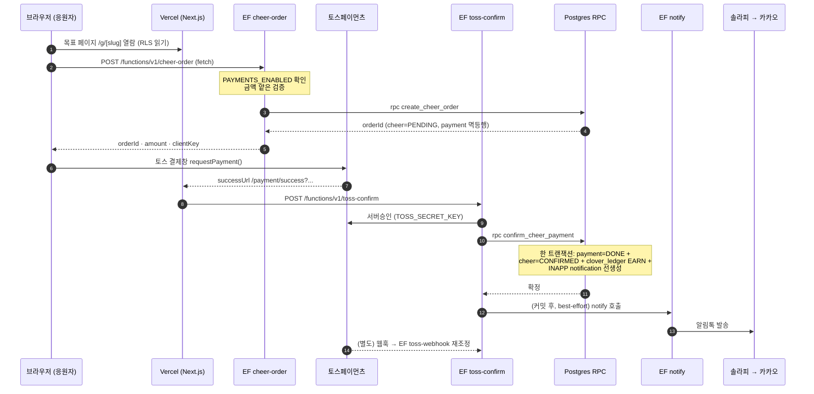
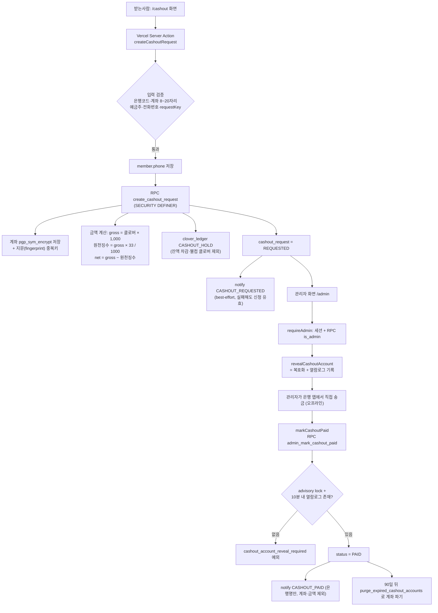

# Architecture — 해낼게 (haenael-ge)

> eng-design 단계 산출물(tech-architect 소유). 진실원: 승인 PRD `prd-haenael-ge-v0.3.0` · 승인 디자인 핀 `DESIGN-v1.6+` · `user-flow.md` · `risks.md` #1. 재개된 PRD v0.4.0은 미승인 증분안이다.
> 이 문서가 닫는 것: **전금법 자금흐름(존립조건)** · 서버리스 토폴로지 · 도메인·데이터 흐름 · 스택 확정 근거.
> 규율: eng-design = 문서만(제품 소스코드 X). 법률/founder만 정할 것은 `⛔ 회수 필요`.

---

> 🏷 **STAMP (AS-IS 절 갱신)** | line: haenael-ge | 갱신: 2026-08-19 KST | model: claude-opus-5 / tech-architect
> 근거: 레포 실파일 직접 확인 — `supabase/functions/**`(12 슬러그) · `supabase/config.toml` · `supabase/migrations/**`(38개) · `web/src/app/**` · `docs/구현현황.md` · `session-state.core.md`(사고 2건 실측 기록) · `wiki/ops/kakao-alimtalk-runbook.md`
> 벤치마크: [Supabase Edge Functions Architecture](https://supabase.com/docs/guides/functions/architecture) · [Supabase 공식 트러블슈팅: Edge Function은 고정 egress IP를 제공할 수 없다](https://supabase.com/docs/guides/troubleshooting/why-supabase-edge-functions-cannot-provide-static-egress-ips-for-whitelisting-3d78b0)
> 시크릿 값은 이 문서에 없다. 환경변수는 **이름만** 적는다.

# Part I. 지금 실제로 어떻게 도는가 (AS-IS, 2026-08-19 실측)

> Part II(§0 이하)는 2026-07-28 **설계 시점** 문서다. 설계 의도(특히 전자금융거래법 자금흐름)는 그대로 두되, 구현·배포가 설계와 갈라진 지점은 이 Part I이 우선한다.

## A. 회장 질문에 대한 답 — 왜 전용 서버가 없고, 결제·환전은 어디서 도는가

**우리는 상주 서버를 한 대도 운영하지 않는다.** 1인 사업 규모에서 서버 한 대를 띄우면 고정비, OS·보안 패치, 배포 파이프라인, 모니터링, 새벽 장애 대응이 통째로 따라온다. 지금 필요한 일(웹 화면 + 돈 관련 짧은 로직 + DB)은 관리형 서버리스로 전부 덮이고 사용량 과금이라 트래픽 0이면 비용도 0에 수렴한다. 그래서 서버 대신 **세 개의 관리형 런타임**을 빌려 쓴다.

| 층 | 무엇을 쓰나 | 여기서 도는 것 |
|---|---|---|
| 화면·서버액션 | **Next.js 16 App Router on Vercel** (`web/`) | 목표 페이지·홈·관리자 화면, 그리고 **환전 신청 Server Action**(계좌 암호화 키를 다루는 유일한 웹 지점) |
| 돈·비밀키 로직 | **Supabase Edge Functions**(Deno) `supabase/functions/` | 결제 주문·결제 승인·웹훅·알림 발송·카카오 로그인 토큰 교환 |
| 데이터·규칙 | **Supabase Postgres** (RLS + SECURITY DEFINER RPC) | 원장·주문·환전 상태 전이, 금액 계산, 이중지급 방지 |

**결제**는 브라우저 → Edge Function `cheer-order` → 토스 결제창 → Vercel 성공 페이지 → Edge Function `toss-confirm` → Postgres RPC `confirm_cheer_payment` 순으로 돈다(§C).
**환전**은 설계 초기의 "토스 지급대행 자동화"가 **폐기**됐고, 지금은 **Vercel Server Action + 관리자 화면 + 사람이 은행 앱으로 송금하는 수동 정산**이다(§D). 자동 지급대행 Edge Function은 스텁으로만 남아 있다.

### A-1. "전용 서버가 없다"가 실제로 만든 제약 (겪은 것만)

| 제약 | 실제로 무슨 일이 있었나 | 근거 |
|---|---|---|
| **아웃바운드 IP가 고정이 아니다** | 솔라피(알림톡 대행) API 키에 IP 화이트리스트를 걸 수 없어 "모든 IP 허용"으로 발급했다. 대신 키를 해낼게 전용으로 분리해 유출 시 영향 범위를 좁혔다. | `wiki/ops/kakao-alimtalk-runbook.md:189-194`, `session-state.core.md:1943-1944`. 공식 근거: [Supabase 트러블슈팅 문서](https://supabase.com/docs/guides/troubleshooting/why-supabase-edge-functions-cannot-provide-static-egress-ips-for-whitelisting-3d78b0) — Deno Deploy 전역 풀에서 호출마다 다른 IP가 나간다 |
| **실행 위치가 전 세계 엣지** | 금융·본인확인 데이터의 국외 처리 우려 → 모든 Edge Function 응답에 `x-region: ap-northeast-2` 헤더를 붙이는 `withRegionHeader()`를 두고 서울 핀을 유지한다. | `supabase/functions/_shared/region.ts` (전 슬러그가 import) |
| **상주 프로세스·크론이 없다** | 계좌정보 90일 파기를 돌릴 데몬이 없다. 그래서 파기를 **DB 함수 + `pg_cron`**으로 설계했다. **아직 운영 등록 안 됨(미착수)**. | `docs/cashout-account-purge-scheduler.md`, `public.purge_expired_cashout_accounts()` in `supabase/migrations/20260802010000_cashout_security_hardening.sql:58-90` |
| **배포 단위가 3개로 쪼개진다** | 코드를 커밋해도 Vercel·Edge Function·DB 마이그레이션이 각자 따로 올라가서, "커밋했으니 됐다"고 착각한 배포 누락 사고가 2번 났다. | §E |

> 콜드스타트: Deno + ESZip 구조라 초기 실행이 밀리초 단위라는 게 공식 설명이나, **우리 서비스에서 콜드스타트 지연을 실측한 기록은 없다 → 미확인.**

## B. 실측 런타임 인벤토리

### B-1. Edge Function 12 슬러그 (`supabase/functions/`)

| 슬러그 | 역할 | 현재 상태 | 근거 |
|---|---|---|---|
| `cheer-order` | 응원 주문 생성(`cheer`=PENDING + `payment` 멱등 행). `PAYMENTS_ENABLED!=="true"`면 즉시 차단. 금액은 1,000원 배수·1,000~1억원만 통과(진실원은 DB) | **실구현** 181줄 | `cheer-order/index.ts:75,144` |
| `toss-confirm` | 토스 서버승인 → RPC `confirm_cheer_payment`(결제·응원·원장·인앱알림 한 트랜잭션) → 알림톡 디스패치 | **실구현** 334줄 / ⚠️ **운영 배포본이 구버전**(§E) | `toss-confirm/index.ts:67,219,303` |
| `toss-webhook` | 토스 웹훅 수신·재조정. 얇은 래퍼이고 로직은 `_shared/toss-webhook-handler.ts` | **실구현** | `toss-webhook/index.ts`, `supabase/config.toml:385-386` |
| `notify` | 알림톡 3종 발송 + INAPP 폴백 + `notification` 행 기록 | **실구현** 156줄 (2026-08-19 배포) | `notify/index.ts` |
| `auth-kakao` | 카카오 인가코드 → 토큰 교환 → Supabase 유저·`member` upsert → 세션 링크 발급. 전화번호 저장도 여기 | **실구현** 292줄 | `auth-kakao/index.ts` |
| `report` | 신고 접수(게스트 포함) | **실구현** 237줄 | `report/index.ts` |
| `wordmap-render` | 워드맵 SVG 생성 → Storage 업로드(목표 소유자만) | **실구현** 249줄 | `wordmap-render/index.ts` |
| `lead-capture` | 사전 관심 등록 수집 | **실구현** 99줄 | `lead-capture/index.ts` |
| **`cashout`** | 설계상 자동 환전 진입점이었으나 **폐기**. 수동 환전(v1.2)으로 옮기면서 계좌 body를 읽지도, DB를 호출하지도 않는다. 남아 있는 배포 URL로 들어와도 **410 Gone**만 응답 | **폐기(410 Gone)** | `cashout/index.ts:1-4, 32` |
| **`cashout-payout`** | 토스 지급대행 호출 예정 자리. 본문은 TODO 한 줄뿐이고 **501 Not implemented** 반환 | **스텁(501)** 16줄 | `cashout-payout/index.ts` |
| `kyc-verify` | PASS 본인인증 게이트 자리. 역시 **501 Not implemented** | **스텁(501)** 15줄 | `kyc-verify/index.ts` |
| `_shared` | 슬러그가 공유하는 모듈(`alimtalk` `toss` `ledger` `errors` `region` `slack` `withholding` `payout` `pass` `oauth-kakao` `notify-message` `cheer-notification` `toss-webhook-handler` `idempotency` `risk`) | 라이브러리(배포 단위 아님) | `supabase/functions/_shared/` |

> `_shared/payout.ts`·`pass.ts`는 파일로 존재하나 이를 호출하는 EF(`cashout-payout`·`kyc-verify`)가 스텁이라 **운영 경로에서 실행되지 않는다.**

### B-2. 웹(Vercel) — 실제 라우트

`web/src/app/` 기준: 공개 목표 페이지 `g/[slug]`, 결제 결과 `payment/success`·`payment/fail`, 받는사람 존 `(receiver)/me`·`onboarding`·`wordmap/[goalId]`·`cashout`(+`status`·`history`), 카카오 로그인 `auth/kakao/start`·`auth/kakao/callback`·`auth/callback`·`auth/logout`, 관리자 `admin`, 헬스체크 `api/health`, 정책 문서 `terms`·`privacy`·`child-safety`·`how`.

**Server Action은 두 곳뿐이고 둘 다 돈·개인정보 지점이다.**
- `web/src/app/(receiver)/cashout/actions.ts` → `createCashoutRequest`
- `web/src/app/admin/actions.ts` → `revealCashoutAccount` · `markCashoutPaid`

즉 **계좌 암호화 키를 만지는 코드는 Vercel Server Action 한 곳에만 있고, Edge Function에는 없다.**

### B-3. DB 접근 패턴

읽기는 브라우저/서버 컴포넌트가 RLS 보호 하에 직접 조회하고, 상태를 바꾸는 돈 로직은 전부 **`SECURITY DEFINER` + `SET search_path = ''` RPC**로 들어간다(`create_cheer_order`, `confirm_cheer_payment`, `create_cashout_request`, `admin_reveal_cashout_account`, `admin_mark_cashout_paid`, `is_admin`, `purge_expired_cashout_accounts`). 규칙과 금액 계산의 진실원은 애플리케이션이 아니라 **Postgres**다.

## C. 결제 플로우 (실측, 엔드투엔드)



**어디서 무엇이 도는가**

| 단계 | 실행 위치 | 코드 |
|---|---|---|
| 금액 입력·결제창 호출 | **브라우저** | `web/src/components/goal/CheerPaymentButton.tsx:111,153` (EF를 직접 `fetch`, Vercel 경유 안 함) |
| 주문 생성·멱등 | **Edge Function** | `cheer-order/index.ts:144` → RPC `create_cheer_order` |
| 결제수단 인증·대금 수납 | **토스페이먼츠** (자금은 여기 머문다) | 외부 |
| 성공 콜백 수신 | **Vercel 서버 컴포넌트** | `web/src/app/payment/success/page.tsx:23` |
| 서버 승인·확정 | **Edge Function** | `toss-confirm/index.ts:219` |
| 상태·원장·인앱알림 | **Postgres 단일 트랜잭션** | RPC `confirm_cheer_payment` (`20260708000000_payment_rpc.sql` 이후 7개 마이그레이션이 누적 개정) |

**`toss-webhook`과 `verify_jwt: false`** — 토스가 서버 대 서버로 쏘는 웹훅에는 우리 Supabase 로그인 JWT가 없다. 게이트웨이 JWT 검증을 켜두면 토스 호출이 401로 튕긴다. 그래서 이 슬러그만 `supabase/config.toml:385-386`에서 `verify_jwt = false`로 열고, 대신 **자체 공유 토큰 `TOSS_WEBHOOK_TOKEN`으로 인증**한다(`toss-webhook/index.ts:13`). "인증을 뺀 것"이 아니라 "인증 수단을 바꾼 것"이다.

**알림 격리 구조 (결제를 절대 되돌리지 않는다)**
`toss-confirm/index.ts:303` → `_shared/cheer-notification.ts` → EF `notify` → `_shared/alimtalk.ts` → 솔라피.
`dispatchCheerReceivedNotification()`은 주석에 명시된 대로 **어떤 오류도 throw하지 않는다**. 전화번호 조회 실패·전화번호 없음·알림톡 환경변수 미설정·notify 호출 실패는 전부 `{channel: "INAPP", reason}`으로 강등된다(`_shared/cheer-notification.ts:36-85`). 인앱 알림은 이미 `confirm_cheer_payment` 트랜잭션 안에서 만들어져 있으므로, 알림톡이 안 나가도 사용자는 인앱으로는 반드시 본다. **알림 호출은 DB 커밋 이후에 일어나고, 실패해도 결제 응답을 바꾸지 않는다.**

**kill switch `PAYMENTS_ENABLED`** — 서버 쪽 두 지점(`cheer-order/index.ts:75`, `toss-confirm/index.ts:67`)이 `Deno.env.get("PAYMENTS_ENABLED") !== "true"`면 요청을 거부한다. 브라우저 쪽은 별개 변수 `NEXT_PUBLIC_PAYMENTS_ENABLED`로 버튼 자체를 숨긴다(`CheerPaymentButton.tsx:44`). **UI를 뚫어도 EF에서 막히는 2중 구조**이고, 켤 때는 Vercel과 Edge Function 양쪽 환경변수를 모두 손대야 한다.

## D. 환전 플로우 (실측) — ⚠️ 자동 지급대행은 폐기, 지금은 수동 정산

> **설계 대비 가장 큰 변경.** Part II §2.2 ⑦의 "토스 지급대행 payout API 자동 호출"은 구현되지 않았고, `cashout` EF는 410으로 폐기, `cashout-payout` EF는 501 스텁이다. 실제 송금은 **관리자가 은행에서 직접** 한다. 전자금융거래법상 "자금 무보유" 설계 의도(Part II §2.1)는 이 변경으로 재검토 대상이다(§F).



**단계별 실행 위치**

| 단계 | 위치 | 근거 |
|---|---|---|
| 신청 폼 | 브라우저 | `web/src/app/(receiver)/cashout/page.tsx` |
| 신청 처리 | **Vercel Server Action** | `web/src/app/(receiver)/cashout/actions.ts` `createCashoutRequest` |
| 계좌 암호화·금액 계산·홀드 | **Postgres RPC** | `create_cashout_request` (`20260802010000_cashout_security_hardening.sql:103`, 원본은 `20260728010000_cashout_manual_payout.sql:129`) |
| 관리자 조회·열람·지급확정 | **Vercel Server Action + 관리자 화면** | `web/src/app/admin/actions.ts`, `web/src/app/admin/page.tsx` |
| 실제 송금 | **사람(오프라인 은행 이체)** | 자동화 코드 없음 |

**계좌정보 보호 (근거 = 마이그레이션 파일)**

| 장치 | 내용 | 근거 |
|---|---|---|
| 저장 암호화 | `pgp_sym_encrypt`로 계좌번호 암호화, 키 버전(`p_account_key_version`)을 함께 저장해 키 교체 가능 | `20260728010000_cashout_manual_payout.sql`, `20260802010000_cashout_security_hardening.sql` |
| 키 위치 | 암호화 키는 **Vercel 환경변수**로만 주입되고 RPC 인자로 전달된다. DB에 상주하지 않는다 | `getCashoutAccountEncryptionConfig()` in `web/src/lib/supabase/service.ts` (actions.ts에서 import) |
| 열람 로그 | 복호화는 `admin_reveal_cashout_account`로만 가능하고 `cashout_account_access_log`에 행위자·목적·시각을 남긴다 | `20260728010000_cashout_manual_payout.sql:47`, `20260802010000_...:464` |
| 마스킹 | 화면·응답·상태/이력 페이지 어디에도 전체 계좌번호가 나오지 않는다(E2E 보안 어설션 7건 보존) | `docs/qa-report-cashout-phone-2026-08-05.md` |
| 90일 파기 | `paid_at`/`rejected_at` 기준 90일 경과분의 계좌를 `purge_expired_cashout_accounts()`가 파기(`account_purged_at` 기록) | `20260802010000_...:58-90`. ⚠️ **운영 스케줄 등록은 아직 안 됨** |

**이중지급·중복신청 방지 장치**

| 장치 | 동작 | 근거 |
|---|---|---|
| Advisory lock | `admin_mark_cashout_paid`가 `pg_advisory_xact_lock(hashtextextended('cashout_request:'||id))`로 같은 건의 동시 처리를 직렬화 | `20260802010000_...:547-549` |
| 열람 강제 게이트 | 같은 관리자가 **10분 이내에 `purpose='payout'`으로 계좌를 열람한 기록**이 없으면 지급완료 처리 자체가 예외로 막힌다(`cashout_account_reveal_required`) | `20260802010000_...:551-560` |
| 권한 이중 확인 | Server Action `requireAdmin()`이 세션 확인 + RPC `is_admin()`을 호출하고, RPC `admin_mark_cashout_paid` 안에서 **다시** `is_admin()`을 확인한다. 웹을 우회해도 DB에서 막힌다 | `web/src/app/admin/actions.ts:46-57`, `20260802010000_...:540-542` |
| 상태 가드 | 진행 중(`REQUESTED`/`KYC_PENDING`/`APPROVED`/`PAYOUT_SENT`) 신청이 있으면 새 신청 거부, 이미 `PAID`면 `cashout_already_paid` | `20260731000000_cashout_manual_request.sql:53-60`, `20260802010000_...` |
| 요청 멱등 | `p_request_key` 기준 재호출은 새 신청을 만들지 않고 `is_replay=true`로 기존 건을 돌려주며, 이때 알림도 다시 보내지 않는다 | `create_cashout_request` + `actions.ts` replay 분기 |

**이용료와 원천징수는 DB가 계산한다.** 실사용 RPC는 `create_cashout_request` 하나뿐이다(`request_manual_cashout`은 임포터 0건 사망 함수였고, B안 그대로 총량을 즉시 깎는 원장을 남겨 이중 차감 위험이 있어 20260822000000에서 `DROP FUNCTION`됐다 — 컨트롤러 재검증 MAJOR1, 2026-08-21). `create_cashout_request`에서 `이용료 = floor(gross × 10%)`, `부가세 = floor(이용료 × 10%)`, `원천징수 = floor((gross - 이용료 - 부가세) × 3.3%)`를 적용한다. 30,000원의 실수령은 25,819원이다(`20260821000000_cashout_service_fee_10pct.sql`). 이 마이그레이션은 로컬 검증 완료, **운영 DB 미적용** 상태다(`pipeline-state.core.md` 승인 로그 2026-08-21).

## D-2. 시크릿은 어디에 사는가

**값과 목록은 여기 두지 않는다.** 어떤 키가 어디에 왜 있는지는 `wiki/ops/인프라-시크릿-인벤토리.md`
가 정본이다. 이 문서는 설계를 다루고, 그 문서는 운영 실태를 다룬다.

여기서는 설계상 알아야 할 것만 적는다.

**실행 위치가 둘이라 같은 키가 두 벌 필요하다.** 웹 서버 코드는 Vercel 에서 돌고 Edge Function
은 Supabase 에서 돈다. 서로의 환경변수를 못 본다. 환전 신청 한 번이 Vercel 에서 시작해 Supabase
함수를 부르고 그 함수가 다시 데이터베이스에 쓰므로, 각 구간마다 그곳의 키가 필요하다.

**2026-08-25 에 이 구조 때문에 두 번 막혔다.** Vercel 쪽에 `SUPABASE_SERVICE_ROLE_KEY` 가
없어 환전 신청이 데이터베이스에 닿지도 못했고, `notify` Edge Function 이 받은 토큰을 자기
환경변수와 문자열로 대조하고 있어 Vercel 에서 부르는 알림이 전부 거부됐다. 후자는 전용
`NOTIFY_INTERNAL_TOKEN` 방식으로 바꿨다.

**Supabase 키가 네 종류다.** `anon` 과 `service_role` 이 구형이고 `publishable` 과 `secret`
이 신형이다. 섞어 쓰면 조용히 거부당한다. 구분과 용도는 인벤토리 문서에 있다.

## E. 배포 단위 3개와 그 함정

이 레포는 한 번의 커밋이 세 곳에 따로 나간다. **커밋 = 배포가 아니다.**

| 배포 단위 | 명령 | 확인 방법 |
|---|---|---|
| 웹 (Vercel) | `cd web && vercel --prod` (또는 Git 연동 자동 배포) | 배포 URL의 화면·`/api/health` |
| Edge Function | `supabase functions deploy <슬러그>` — **슬러그마다 개별 배포** | `supabase functions list`로 슬러그별 **version·updated_at** 확인 |
| DB 마이그레이션 | `supabase db push` | 대상 함수/타입을 SQL로 직접 조회 |

**함정: `supabase functions deploy A B C`를 돌려도 변경 없는 슬러그는 `No change found`로 건너뛴다.** 그래서 "deploy 명령을 쳤다"는 배포 증거가 아니고, **`functions list`의 version 증가와 시각**만이 증거다.

### 사고 ① 2026-08-06 — `auth-kakao` 미배포로 전화번호가 저장되지 않음
증상은 "카카오에서 전화번호 동의를 했는데 화면이 또 동의를 요구하고, 결국 못 받았다"였다. 전화번호 저장 코드는 web이 아니라 Edge Function `auth-kakao`에 있는데, **컨트롤러가 Vercel만 배포하고 EF는 배포하지 않았다.** `functions list` 실측 결과 마지막 배포는 **2026-07-29 00:41**, 해당 커밋은 **2026-08-05 02:16**. 운영은 7일 전 코드로 돌면서 카카오가 준 `phone_number`를 그냥 버렸다. 화면 폴백은 설계대로 작동한 것이라 증상만으로는 원인이 안 보였다. 조치 = `supabase functions deploy auth-kakao` (version 14 → 15). 부수 실수로, 배포 검증을 실제 로그인 왕복이 아니라 **HTTP 200 상태코드만으로** 했다. (근거: `session-state.core.md:1641-1660`)

### 사고 ② 2026-08-19 — `toss-confirm` 미배포로 실결제 알림톡 미발송
실결제 1건(1,000원, `payment` id 23 `DONE`)이 났는데 알림톡이 오지 않았다. 진단 단서는 **`notification.alimtalk_status = null`** 이었다. `notify/index.ts:104-122`는 `phone`이 들어오면 반드시 `SENT` 또는 `FAILED`를 기록하므로, `null`은 **phone이 아예 전달되지 않았다**는 뜻이다. 원인을 따라가니 운영의 `toss-confirm`은 **version 14, 2026-08-08 19:13** 배포본이었고(같은 시점 `notify`는 version 16, 당일 배포), 그 구버전은 알림톡 설정 판정에 옛 환경변수 이름 **`KAKAO_ALIMTALK_SENDER_KEY`** 를 요구했다. 현행 `_shared/alimtalk.ts:29-36`은 그 이름을 버리고 `KAKAO_ALIMTALK_PFID`·`KAKAO_ALIMTALK_FROM`·`KAKAO_ALIMTALK_TEMPLATE_CHEER_RECEIVED`를 요구하도록 바뀌었다. 솔라피 규격에 없는 `SENDER_KEY`는 등록하지 않았으므로 구버전은 "알림톡 미설정"으로 판정 → phone 미전달 → INAPP 폴백. **코드는 정상, 배포만 안 된 상태.** (근거: `session-state.core.md:1-45`)

**교훈 (두 사고 공통)**
1. 코드 커밋·테스트 통과는 배포 증거가 아니다. 슬러그별 `version`/`updated_at`을 봐야 한다.
2. Edge Function은 슬러그 단위로 올라간다. 한 슬러그만 최신이고 그 슬러그를 **호출하는** 쪽이 구버전이면, 최신 쪽만 보고 "배포됐다"고 오판하게 된다(②가 정확히 이 형태다).
3. 환경변수 이름을 바꾸는 변경은 **호출하는 EF와 호출당하는 EF가 동시에 올라가야** 한다. 반쪽 배포는 조용히 폴백으로 흡수돼 장애로 안 보인다.
4. 배포 확인을 상태코드 200으로 갈음하지 않는다. 실제 사용자 경로를 한 번 탄다.

## F. 설계(Part II) 대비 현재 차이 — 신규/변경 목록

| 항목 | 설계(2026-07-28, Part II) | 현재 실태 | 상태 |
|---|---|---|---|
| 환전 지급 | EF `cashout` → 토스 지급대행 자동 이체 | `cashout` **410 폐기**, `cashout-payout` **501 스텁**. Server Action + 관리자 수동 송금 | **변경** |
| 계좌 취급 위치 | Edge Function | **Vercel Server Action 한 곳**(암호화 키 포함) | **변경** |
| 서비스 이용료 10%(+VAT) | 환전 계산에 반영 | 두 RPC 로컬 구현·검증, 운영 DB는 `fee_krw = 0` 구버전 | **로컬 구현·운영 미적용** |
| KYC(PASS·만19+·명의일치) | `kyc-verify` EF가 환전 전단 게이트 | **501 스텁**, 환전 경로에서 호출되지 않음 | **미구현** |
| 계좌 90일 파기 | — (설계 당시 없음) | DB 함수 구현됨, `pg_cron` 운영 등록 미완 | **신규·미완** |
| 알림톡 | 설계상 `notify` EF | 3종 템플릿 승인·실발송 확인, `notify` 배포됨 / `toss-confirm` 재배포 대기 | **신규 구현** |
| 리전 핀 | `x-region` 필요 | `withRegionHeader()`로 전 슬러그 적용 | **구현됨** |
| 관리자 화면 | 설계상 "나중" | `/admin` 실구현(권한 이중 확인) | **신규 구현** |
| 웰컴 클로버 | 정책만 | 지급·환전 제외·삭제 시 무효 마이그레이션 구현 | **구현됨** |

**⛔ 회수 필요: 수동 정산 전환이 전자금융거래법 자금흐름 설계를 바꿨는지 확인**
- 배경: Part II §2.1은 "자금은 토스가 보관하고 우리 계좌를 통과하지 않는다(패스스루)"를 존립 근거로 삼았다. 그런데 실제 환전은 **관리자가 자기 은행에서 직접 송금**하는 방식으로 바뀌었다. 송금 재원이 우리 명의 계좌를 거친다면 Part II §2.4-B의 "별도관리 의무"가 살아난다.
- 무엇을 정하나: 수동 송금 재원이 되는 계좌가 운영비 계좌와 물리적으로 분리돼 있는지, 아니면 분리해야 하는지.
- 옵션 A(추천): 응원 정산금 전용 계좌를 운영비와 분리하고 그 사실을 약관·내부 규정에 명시한다. → 고르면: 별도관리 의무 위반(횡령) 리스크가 닫힌다. 안 고르면: 자금이 커질수록 형사 리스크가 그대로 남는다.
- 옵션 B: 현행 유지하고 자동 지급대행 도입 시점까지 미룬다. → 트레이드오프: 지급대행 도입은 토스 개인정산 확답에 묶여 있어 시점이 불확실하다(§2.4-C).
- 추천 근거: 코드상 자동 지급대행 경로가 폐기·스텁이라 "우리가 자금을 안 만진다"는 설계 전제가 지금은 성립하지 않는다. 계좌 분리는 코드 변경 없이 오늘 실행 가능한 유일한 방어다.

## G. 알림 아키텍처

**3종 타입** — `CHEER_RECEIVED`(응원 도착), `CASHOUT_REQUESTED`(환전 신청 접수), `CASHOUT_PAID`(환전 지급 완료). 전부 **정보성**이고 마케팅 발송은 금지다(`notify/index.ts:1-19`). DB `notification_type_enum`에 환전 2종을 추가하는 `20260811010000_cashout_notification_types.sql`은 **운영 미적용**이다.

**경로** — 호출자(`toss-confirm` 또는 Server Action) → EF `notify`(service_role 토큰 대조로 외부 호출 차단) → `_shared/alimtalk.ts` → **솔라피(Solapi) `messages/v4`** → 카카오 알림톡. 템플릿은 카카오 심사 승인이 있어야 발송되며, 3종 모두 승인 후 2026-08-19에 실발송·실수신을 확인했다(`session-state.core.md`).

**필요한 환경변수 이름** (`_shared/alimtalk.ts:29-36`, 하나라도 비면 발송을 시도하지 않는다)
`KAKAO_ALIMTALK_API_URL` · `KAKAO_ALIMTALK_API_KEY` · `KAKAO_ALIMTALK_API_SECRET` · `KAKAO_ALIMTALK_PFID` · `KAKAO_ALIMTALK_FROM` · `KAKAO_ALIMTALK_TEMPLATE_CHEER_RECEIVED`
(구 `KAKAO_ALIMTALK_SENDER_KEY`는 2026-08-08에 제거됐다. 사고 ②의 직접 원인이다.)

**INAPP 폴백 규칙** — 다음 중 하나라도 해당하면 알림톡을 건너뛰고 인앱 알림만 남긴다.
1. 받는사람 `member.phone`이 없음 (`phone_missing`)
2. 전화번호 조회 실패 (`phone_lookup_failed`)
3. 위 환경변수 6종 중 하나라도 미설정 (`alimtalk_not_configured`)
4. `notify` 호출 실패 (`notify_failed`)
5. 솔라피 발송이 `FAILED` — `notify` 안에서 `channel`을 `ALIMTALK`→`INAPP`으로 강등

`notification` 행은 어느 경우에도 남으며, `channel`과 `alimtalk_status` 조합이 사후 진단 단서가 된다(사고 ②가 이 값으로 풀렸다).

---
# Part II. 설계 정본 (2026-07-28 eng-design 산출물, 보존)

> 아래는 **설계 시점** 문서 원문이다. 전자금융거래법 자금흐름 설계 의도의 정본으로 계속 유효하되, 구현·배포가 갈라진 지점은 Part I §F의 차이표가 우선한다.

## 0. 시스템 한 줄

**인스타 바이오 링크로 열리는 단일 컬럼 모바일 웹.** 친구가 목표 페이지(②)에서 조용히 결제 → 클로버가 주인공 계정에 **원장(ledger)으로** 적립 → 모이면 환전. **자금은 우리가 보유하지 않는다** — 결제·정산·지급은 전부 외부 PG(토스페이먼츠)가 들고, 우리 DB의 클로버는 "얼마를 지급대행 받을 권리"의 **표시값**이다(선불충전금 아님을 지향).

> **🔒 회장 확정 스택(2026-07-04, 이전 Spring Boot/MySQL override): 서버리스·인프라 제로.**
> - **프론트** = Next.js on **Vercel**(서버리스).
> - **DB·Auth** = **Supabase**(Postgres + Auth + RLS + Storage). 소셜로그인 = Supabase Auth(write-first).
> - **돈 로직**(토스 결제·지급대행·환전·원장·멱등) = **Supabase Edge Functions**(Deno/TS). 토스 비밀키·웹훅 핸들러가 여기.
> - **상주 서버 0** — 관리할 백엔드 앱 없음. 고정비 제거(usage 과금).
>
> **🔒 독립 코드베이스 유지**: 데이팅(Romeo/DC)만 PostAGI-commons/public로 묶고 **해낼게는 의존하지 않는다.** Romeo의 검증된 설계(원장·멱등·토스 흐름)는 **참고**하되 코드 복사·shared 의존 금지 — 해낼게 자체 격리본(Postgres 스키마 + Edge Functions)으로 재구현. 근거: 구현비용 agent≈0 → 재사용 절감명분 소멸, 결합·blast-radius 제거·속도.

---

## 1. 기술스택 확정 (근거 있는 결정)

| 레이어 | 선택 | 근거 |
|---|---|---|
| **프론트** | Next.js(App Router)/TS on **Vercel** | 서버리스·자동확장·고정비 0. shadcn/ui+Radix+Tailwind = `DESIGN.md` 토대. Supabase JS 클라이언트(anon key + RLS) |
| **DB** | **Supabase Postgres** | 리전 **서울(ap-northeast-2)** 지정(§2.6). 원장·주문·상태를 관계형+트랜잭션으로. RLS로 행 단위 접근제어 |
| **Auth** | **Supabase Auth** + **카카오 커스텀 OAuth** | 🔒 **로그인=카카오 primary**(+구글/애플). ⚠️ 카카오는 Supabase 네이티브 미지원 → **커스텀 OAuth 어댑터**(Edge Function `auth-kakao`로 토큰 교환 → Supabase 세션 발급). 구글/애플=Supabase 네이티브. + **anonymous(게스트)**. JWT `is_anonymous`로 게스트/주인공 구분 |
| **돈 로직** | **Supabase Edge Functions**(Deno/TS) | 토스 결제 confirm·지급대행·환전·원장 기입·멱등·웹훅. `service_role` 키로 RLS 우회 + 원자적 원장 트랜잭션. 토스 secret = EF 환경변수(브라우저 노출 0) |
| **가벼운 읽기** | Supabase PostgREST(자동 REST) + RLS 뷰 | 목표 열람·워드맵·잔액·알림 = 클라이언트 직접 쿼리(RLS가 보안). 커스텀 코드 불요 |
| **파일** | **Supabase Storage** | 워드맵 공유 이미지(리전 서울). RLS 버킷 정책 |
| **알림** | **카카오 알림톡**(정보성) | 🔒 응원 도착 등 **정보성** 알림. Edge Function `notify` + 알림톡 API 어댑터. ⚠️ 의존성 = 카카오 비즈채널 + 템플릿 사전심사 + 건당 발송비 + **정보성만(마케팅 금지)** |
| **본인인증** | **PASS 통합본인인증** | 🔒 환전 **만19+·실명·나이 게이트**에서 호출(로그인과 별개). Edge Function `cashout` 전단계(`kyc-verify`)가 PASS 검증. 벤더 실단가=build 확인 |
| **결제수단** | 토스페이먼츠 **간편결제 켬** | 🔒 카드 + **카카오페이·네이버페이·토스페이**. 결제위젯 한 번 연동으로 전 수단 제공 |
| **분석** | **GA4**(gtag) | 🔒 web(Next.js)에 gtag 수집 심음. **directive: 수집=앱(web) / 분석=MARKETING 중앙 테넌트.** 핵심 이벤트 자리(§6) |
| **Mobile** | 없음(MVP) | 잠긴 스코프 = 링크인바이오 웹. 앱/친구피드 = phase2 |

### 독립 코드베이스 — 패턴 차용 (commons 의존 없음)
Romeo/DC·commons는 **라이브러리가 아니라 레퍼런스 설계**로만 쓴다(코드 복사·import 금지).

| 기능 | 차용 원본(레퍼런스) | 해낼게 방식(서버리스) |
|---|---|---|
| 토스 결제 승인/취소 | commons `payment-toss` `TossPaymentsClient`(Java) | Edge Function `toss-confirm`(Deno/TS) **자체 구현** |
| 지급대행(payout) | (신규 — 원본 없음) | Edge Function `cashout-payout`(Deno/TS) 자체 |
| 원장 가상화폐 | Romeo `payment`(PointWallet/PointLog) | Postgres `clover_ledger` 테이블 + `clover` Edge Functions **자체 재설계**(3층·원천징수) |
| 인증·세션 | commons jwt-core/security | **Supabase Auth 관리형**(자체 JWT 발급 불요) |
| 접근제어 | Spring Security 필터체인 | **Postgres RLS 정책**(DB 레벨 방어) |
| ui 베이스 | shadcn/ui(공개 OSS) | shadcn CLI 직접 생성 + 해낼게 토큰 |

> **효과**: 관리할 상주 서버 0, 데이팅 코드베이스와 blast-radius 완전 분리. "commons 실구현 검증" 태스크 불필요(의존 없음).

---

## 2. 🔴 전금법 자금흐름 아키텍처 (risks.md #1 = 존립조건)

### 2.1 설계 원칙 — "자금 무보유 패스스루"(옵션 A, 스택 무관 유지)
risks.md 옵션 A를 **토스페이먼츠 지급대행 + Edge Functions**로 실장한다:

1. **응원자 결제금 미보유** — 토스 PG가 대금 보관, 환전 시 토스 **지급대행**이 주인공 계좌로 직접 지급.
2. **클로버 ≠ 선불충전금** — 사전충전 X(잠김결정). 클로버 = 확정 응원에 대해 지급대행 받을 권리의 **표시값**(Postgres 원장 카운트), 유통 저장가치 아님.
3. **정산 미관여** — FSC 유권해석: *"정산을 외부 PG가 대행하면 PG 등록 불필요."* 우리는 Edge Function이 주문·원장·표시만, 자금 수납·보관·지급은 토스.

### 2.2 자금 흐름 다이어그램 (Edge Functions 기준)

> ⚠️ **교정(2026-08-19)**: 아래 ⑥~⑧의 자동 지급대행은 **구현되지 않았다.** `cashout` EF는 410으로 폐기됐고 `cashout-payout` EF는 501 스텁이다. 실제 환전은 Vercel Server Action + 관리자 수동 송금이다(Part I §D). 자금 무보유 전제의 재검토는 Part I §F의 ⛔ 항목.

```
[응원자(게스트=anonymous auth)]
   │  ① 결제위젯(토스) — 카드/토스페이/카카오/네이버페이, ANONYMOUS customerKey
   ▼
[토스페이먼츠 PG] ─── 대금 수납·보관 (★자금 여기 머문다. 우리 X)
   │  ② successUrl(paymentKey/orderId/amount) 콜백 → Next.js
   ▼
[Edge Function: toss-confirm]  (Deno/TS, service_role)
   │  ③ 서버승인(멱등) — 토스 secret으로 confirm → payment=DONE
   │  ④ 한 트랜잭션: cheer=CONFIRMED + clover_ledger EARN(+N) append
   │     ※ Postgres엔 "표시값·원장"만. 실제 돈은 토스에.
   ▼
[주인공]  클로버 누적(개수만 표시, RLS 뷰) ──최소환전액(30,000원)↑──▶ 환전
   │  ⑤ KYC(본인인증·만19+ 게이트) 통과 · riskHook(no-op, §2.5)
   ▼
[Edge Function: cashout]  (service_role)
   │  ⑥ cashout_request: gross/fee(take)/withholding(3.3%)/net + clover_ledger CASHOUT_HOLD
   │  ⑦ 토스 지급대행(payout) API 호출 ──────────▶ [토스 지급대행] ──▶ 주인공 계좌(net)
   │  ⑧ clover_ledger CASHOUT_SETTLED + 지급명세 기록(원천징수 신고 근거)
```

**핵심**: ④와 ⑦ 사이에 **우리 명의 계좌를 자금이 통과하지 않는다.** Edge Function은 정산 지시자·수수료 수취자일 뿐. take-rate는 지급대행 net 계산에서 차감(또는 별도 정산).

> **정산 주기 = placeholder `D+n` (⛔)**: 환전 신청 → 실제 계좌 입금까지 소요일은 **토스 지급대행 payout 스펙 의존** → build에서 확정. UX 카피는 "수일 내 입금"(예: D+2~D+3)으로 잡되 확정 수치는 ⛔. cashout 완료화면·정산내역에 이 주기 표시.

### 2.3 왜 이 구조가 등록/별도관리를 회피하나
| 리스크 | 회피 논리 | 근거 |
|---|---|---|
| 선불업 등록(30억/500억) | 클로버=충전형 아님(사전충전X), 확정 응원 표시값 | risks.md 옵션 A. **⛔ 법률 확인**(§2.4) |
| 선불충전금 100% 별도관리(2026-12-17) | 자금 무보유 → 별도관리 대상 자금 없음 | 보유 불성립 |
| PG업 등록(정산 관여 시) | 수납·정산·지급 전부 토스 위탁 | FSC: 정산 외부위탁 시 PG 등록 불요 |
| 원천징수 3.3% | 환전 시 사업소득 원천징수·지급명세 제출 | 별풍선 선례. 정책 P3 |

### 2.4 legal 게이트 — AI 자문(2026-07-21) 반영: "선불수단 해당하나 소규모 면제로 초기 합법 오픈 가능(조건부)"

> **판정 갱신(2026-07-21)**: 구 판정 "클로버=선불수단 여부가 존립을 가른다(⛔ 미해결)"를 아래로 갱신한다. 회장이 구글 AI(Gemini)로 받은 전자금융거래법 자문 요지를 반영. **⚠️ AI 자문은 방향 근거일 뿐, 최종 판단은 변호사 확인 권고**(§2.4-D). 이 갱신으로 "결제·환전 빌드 전 변호사 필수" 게이트가 사라지는 것은 아니며, "합법 오픈의 조건(유지의무)"이 구체화된 것이다.

**A. 등록 면제 판정 (핵심 완화):**
클로버 적립잔액은 **선불전자지급수단에 해당할 소지가 크나**, 개정 전자금융거래법상 **소규모 발행자 등록 면제**에 든다:
- 면제 기준 = **분기말 발행잔액 30억 원 미만 AND 연간 총발행액 500억 원 미만**(둘 다 충족 시 선불업 등록 의무 면제). 근거: FSC 개정 전금법, 김·장 Finance Legal Update, a-fin 해설(§8 벤치마크).
- **출시 초기(발행잔액 1억 원 미만) = 등록증 없이 합법 오픈 가능.** → 구 §2.4의 "선불업 등록(30억/500억)" 리스크는 초기 규모에서 **비활성(면제)**. 단 성장 시 임계 접근 모니터링 의무(§2.4-C).

**B. 면제여도 남는 유지의무 (조건부 합법 — 이걸 어기면 위법):**
| 의무 | 내용 | 위반 시 |
|---|---|---|
| **충전금(응원금) 별도관리** | 이용자 응원 대금을 운영비와 물리적 분리. **운영비로 전용 시 횡령죄.** 우리 설계는 "자금 무보유 패스스루"(§2.1)라 토스 PG가 보관 → 별도관리 대상 자금을 우리가 안 쥐는 게 1차 방어. 단 정산 타이밍상 우리 명의 통과가 생기면 별도계좌 필수 | 형사(횡령) |
| **이용약관 필수기재** | **이용료 차감 기준**(10%+VAT 명시)·**환불/청약철회 규정**·**낙전(미사용·소멸) 처리** 규정을 약관에 명시 | 약관규제법·전상법 |
| **웹 푸터 필수정보** | 상호·대표자·사업자등록번호·**통신판매업신고번호**·주소·고객센터(전화/이메일)·개인정보보호책임자 | 전상법 표시의무 |
| **KYC(환전 시)** | 출금 신청 시 휴대폰 본인인증 + 계좌 실명인증(1원 송금) + **가입 명의=계좌주 명의 일치 검증**(자금세탁방지) | 특금법·AML |

**C. 잔존 밑돌 (변호사 확인 권고 — 자문이 완전히 닫지 못한 것):**
- **⛔ 토스 지급대행으로 "개인(사업자 아닌 주인공)에게" 후원금 정산이 계약·규제상 가능한가?** 불가 시 환전 경로 붕괴. (토스 확답 요청 = `docs/legal-toss-inquiry-2026-07-21.md`.)
- **⛔ take-rate(10%) 수취가 "정산 관여"로 재해석돼 PG 등록을 유발하는가?**
- **⛔ 성장 시 임계(30억/500억) 접근 모니터링·초과 전 등록 준비** = 잔액 실시간 집계 지표 필요(build).
- **⛔ 금융·KYC 개인정보 국외이전**(§2.6) — 병존.

**D. 게이트 상태**: PRD §10 Q6 = **결제·환전 빌드 전 변호사 자문 권고 유지.** 단 판정이 "존립 불명"→"조건부 합법 오픈 가능"으로 완화되어, **초기 결제 오픈은 위 B 유지의무(별도관리·약관·푸터·KYC) 충족을 전제로 진행 가능**하고, 환전(지급대행) 오픈은 C의 토스 확답 + 변호사 확인 후로 유지한다. (자금세탁·개인정산 계약이 환전의 실제 게이트.)

### 2.5 ⚠️ ACCEPTED-RISK — 셀프후원/자금세탁 차단 미구현 (🔒 회장 결정)
- **차단 룰 미개발.** 자연억제 의존(KYC + 최소환전 30,000원 + take/원천징수 마찰 + **토스 자체 모니터링**).
- 설계: `cashout` Edge Function이 환전 확정 전 **`riskHook()` 호출 + no-op 기본 구현**(항상 CLEAR). 인터페이스·호출지점은 지금 심고, 룰은 나중에 주입만(코드 재수술 X). `hook exists, rule deferred`.
- ⚠️ 잔여 리스크(회장 인지): AML/카드깡 적발 시 책임·PG 계약 리스크. 수용 근거 = 초기 규모·usage 과금 대비 룰 ROI 낮음 + 토스 1차 방어.

### 2.6 ⛔ 데이터 리전·개인정보 국외이전 (서버리스 신규 리스크)
- **Supabase Postgres·Auth·Storage = 리전 서울(ap-northeast-2) 지정** → 저장 데이터는 국내.
- ⚠️ **그러나 Supabase Edge Functions는 기본이 전 세계 엣지(Deno Deploy) 분산 실행** — 요청자 IP 기준 최근접 엣지에서 도는 게 디폴트(조사: supabase.com/docs/functions/architecture). **KYC(본인인증·CI)·계좌번호·결제정보가 국외 엣지 노드에서 처리되면 개인정보보호법 국외이전 고지·동의/위탁 이슈.**
- 완화안(설계 방향): 돈·KYC Edge Function은 **regional invocation(`x-region: ap-northeast-2`)으로 DB 리전 핀** + 민감데이터 처리를 서울 고정. 단 API 게이트웨이 라우팅·서브프로세서 경로는 남음.
- **⛔ 회수 필요: 금융·KYC 개인정보의 국외이전(Supabase/Deno 서브프로세서·엣지 실행) 적법성·고지동의 범위 = 변호사·개인정보 검토.** legal 게이트(§2.4)에 병합. (⚠️ 회장이 지목한 신규 스택 리스크 — 추측으로 "괜찮다" 닫지 않음.)

---

## 3. 서버리스 토폴로지

```
┌──────────────── 브라우저 (모바일 웹) ────────────────┐
│  Next.js (Vercel)  — ①받는사람 존 / ②목표페이지 존     │
│    · Supabase JS (anon key)  → 읽기: RLS 보호 쿼리      │
│    · 토스 결제위젯(ANONYMOUS)                           │
└───────┬───────────────────────────┬──────────────────┘
        │ 읽기(RLS)                  │ 돈 쓰기(민감)
        ▼                           ▼
┌──────────────┐        ┌──────────────────────────────┐
│ Supabase      │        │ Supabase Edge Functions       │
│ PostgREST     │        │ (Deno/TS, service_role)       │
│ + RLS 뷰      │        │  toss-confirm · toss-webhook   │
│ (goal_public, │        │  cheer-order · cashout ·       │
│  clover_bal…) │        │  cashout-payout · kyc          │
└──────┬────────┘        │  → riskHook(no-op)             │
       │                 └──────────┬─────────────────────┘
       ▼                            ▼
┌─────────────────────────────────────────────────────┐
│ Supabase Postgres (서울)  — 원장·주문·상태 + RLS 정책 │
│ Supabase Auth (소셜+anonymous) · Supabase Storage     │
└──────────────────────────┬──────────────────────────┘
                           ▼ (외부)
                   토스페이먼츠 (PG · 지급대행)
```

원칙: **읽기 = 클라이언트 직접(RLS 방어)**, **돈 쓰기 = Edge Function(service_role, 멱등·원장 트랜잭션)**. 상주 서버 없음.

---

## 4. 도메인 분해 (Postgres 스키마 + Edge Function 그룹)

Romeo 도메인 분해를 **참고**(의존 아님). Postgres 테이블 묶음 + 그를 다루는 Edge Function/RLS로 표현.

| 도메인 | 책임 | 핵심 테이블 | 쓰기 경로 | phase2 확장점 |
|---|---|---|---|---|
| `auth` | Supabase Auth + **카카오 커스텀 OAuth**(primary)·구글/애플·게스트 anonymous | (auth.users 관리형) | Supabase Auth + EF `auth-kakao` | 친구그래프 인증 |
| `member` | 주인공 계정·프로필·연령 | `member` | RLS insert/update(본인) | 역할전환·친구관계 |
| `goal` | 목표(액자)·slug·상태·공개범위·**soft-delete** | `goal`(`deleted_at`) | RLS(본인) + slug 트리거 | **친구그래프 FK 자리** |
| `cheer` | 응원 1건·메시지·익명·상태·**soft-delete** | `cheer`(`deleted_at`) | **EF `cheer-order`**(주문·멱등) | pledge 조건부 서브타입 |
| `payment` | 토스 주문·승인·취소·웹훅(**간편결제**: 카드·카카오페이·네이버페이·토스페이) | `payment`,`payment_log` | **EF `toss-confirm`/`toss-webhook`** | 다른 PG 어댑터 |
| `clover` | **원장(ledger)** 적립/홀드/정산/환원 + 잔액 파생 | `clover_ledger`,`clover_balance` | **EF만**(service_role, append-only) | 클로버 이전·pledge 홀드 |
| `cashout` ⚠️설계와 다름(Part I §D) | 환전·take·원천징수·지급대행 + **PASS 본인인증**(만19+) + **riskHook 자리** | `cashout_request`,`kyc_verification` | **EF `cashout`/`cashout-payout`/`kyc-verify`(PASS)** | 자동정산·세무 |
| `wordmap` | 응원메시지 집계 read-model·공유이미지 | (뷰 + `wordmap_render_cache`) | RLS 읽기 + EF 렌더 | 친구별 워드맵 |
| `share` | linktree 링크(=goal.slug)·재공유 이벤트 | `share_event` | RLS insert | 딥링크·앱 공유 |
| `notification` | 은은한 도착 알림 + **카카오 알림톡**(정보성) | `notification` | **EF `notify`**(알림톡 발송) + RLS 읽기 | 친구 피드 |
| `report` | **신고+수동삭제 모더레이션**(MVP): 목표/메시지 신고 → soft-delete | `report` | RLS insert(신고) + EF/수동 soft-delete | 사전 AI필터·admin UI(나중) |
| `analytics` | GA4 gtag 수집(web) | (외부 GA4) | web 클라(수집=앱/분석=MARKETING 중앙) | 이벤트 확장 |
| `risk` | ⚠️ ACCEPTED-RISK: 룰 미구현. `riskHook` no-op 자리(§2.5) | `risk_event`(미사용) | — | 룰 주입·검토 큐 |

> **스코프 밖(설계 안 함, 확장점만)**: `pledge`·`admin`·`achievement`. 테이블 FK·enum 여지만 남겨 phase2 친구그래프·pledge를 막지 않음(잠긴 스코프).

---

## 5. 데이터 흐름 — 3대 시나리오

### 5.1 친구 조용한 결제 (콜드스타트 생사)
```
친구  Next.js(②)          Edge Function            토스PG
 │ 링크클릭 │ supabase.from('goal_public') RLS 읽기(비로그인/게스트)
 │ "밀어줄게"│ 게스트=supabase.auth.signInAnonymously()
 │────────▶│ invoke('cheer-order'){goalId,금액,메시지,익명}
 │         │────────────▶ cheer=PENDING, orderId, 멱등키(payment UNIQUE)
 │         │◀──────────── orderId, amount, clientKey
 │         │ 토스 결제위젯(ANONYMOUS) ─────────────▶ 결제수단 인증
 │         │◀──────────── successUrl(paymentKey,orderId,amount)
 │         │ invoke('toss-confirm') ──▶ 토스 secret confirm(멱등)
 │         │                └─ 트랜잭션: payment=DONE + cheer=CONFIRMED + ledger EARN
 │         │◀──────────── ConfirmToast + 워드맵 반영
```

### 5.2 클로버 적립 → 환전(지급대행)

> ⚠️ **교정(2026-08-19)**: 이 시나리오는 미구현이다. 현행 실측 플로우는 Part I §D. `invoke('cashout')` 경로는 존재하지 않으며 `kyc-verify`도 스텁이라 호출되지 않는다.
```
주인공 Next.js          Edge Function              토스 지급대행
 │ 홈    │ supabase.from('clover_balance') RLS → 개수(🍀N)만
 │ 환전  │ invoke('cashout'){cloverAmount,bank,account}
 │       │──▶ 최소환전 30,000원 검증 → 미달=대기응답
 │       │──▶ KYC·만19+ 확인 → 미완=KycSheet
 │       │──▶ riskHook(no-op, 항상 CLEAR — §2.5)
 │       │──▶ cashout_request + ledger CASHOUT_HOLD
 │       │──── payout 요청 ───────────────────▶ 계좌 이체(net)
 │       │──▶ CASHOUT_SETTLED + 지급명세 기록
 │       │◀── 완료·정산내역(₩는 여기서만)
```

### 5.3 워드맵 재공유 → 확산 고리
```
홈 "워드맵 보기" → RLS 뷰/RPC 집계 → 풀뷰
 → 아이콘 공유(이미지/스토리): EF 렌더 → Supabase Storage URL
 → 친구 스토리 링크 탭 → goal_public(②) = 고리 닫힘(share_event insert)
```

---

## 6. 횡단 관심사

| 관심사 | 설계 | 근거 |
|---|---|---|
| **멱등성** | 결제/환전 Edge Function = `orderId`/`requestId` UNIQUE + (선택)advisory lock. `payment` UNIQUE(order_id) | 중복결제·이중지급 방지(돈=무관용) |
| **원장 정합성** | `clover_ledger` append-only, **EF service_role만 기입**. 잔액=원장 SUM 검증. `clover_balance`=파생 캐시(트리거 or EF) | 감사·환불역산 |
| **트랜잭션 경계** | 결제확정(payment+cheer+ledger)은 **1 Postgres 트랜잭션**(EF 내 단일 커밋 or DB 함수 `rpc`). 토스 호출은 트랜잭션 밖 → 실패 시 웹훅·재조정 보상 | PG성공/DB실패 리커버리 |
| **접근제어(RLS)** | 모든 테이블 RLS ON. 읽기 = 정책으로 방어(§7). 쓰기 민감분 = service_role EF만 | defense-in-depth(클라 우회 불가) |
| **게스트** | Supabase anonymous sign-in → `is_anonymous` JWT. 결제 EF만 허용, 조회/환전 불가 | 잠김: 게스트 허용·익명표시·PG엔 신원 |
| **금액 3층** | **RLS 뷰로 필드 분리**: `goal_public`(₩·개수 없음, N명만) / `clover_balance`(개수만) / cashout EF 응답(₩) | DESIGN.md §6 위반을 DB 뷰로 차단 |
| **비밀정보** | 토스 secret·payout 키·**카카오 OAuth·알림톡·PASS 키** = **Edge Function secret(env)**, 브라우저 0. 계좌·CI = Postgres 암호화 컬럼(pgcrypto) | 돈·개인정보 |
| **관찰성** | Edge Function 로그(Supabase) + `payment_log` 상태전이 | risks·CS |
| **분석(GA4)** | web에 gtag 수집. **directive: 수집=앱(web) / 분석=MARKETING 중앙.** 핵심 이벤트 자리: `goal_created`·`cheer_started`·`payment_success`·`wordmap_shared`·`cashout_requested` | 콜드스타트 전환(인스타→②→결제) 실측 |
| **모더레이션** | MVP=**신고 버튼 + 수동 soft-delete**(`report` insert → 목표/메시지 `deleted_at`, RLS가 필터). 사전 AI필터·admin UI=나중 | 안전 최소선(운영량 넘으면 자동화) |
| **알림톡** | 정보성만(마케팅 금지). 템플릿 사전심사·건당 발송비. 실패 시 인앱 알림 폴백 | 카카오 비즈메시지 정책 |

---

## 7. 인증·RLS 접근제어 (①/② 경계)

- **② 비로그인 열람**: `goal_public` **RLS 뷰**를 anon/게스트가 SELECT. **뷰가 금액·개인정보 필드를 애초에 포함 안 함**(3층 a). 로그인 벽 없음(잠김).
- **게스트 결제**: `supabase.auth.signInAnonymously()` → authenticated 역할(`is_anonymous=true`). RLS·EF에서 게스트 판별. 결제 confirm EF만 허용.
- **주인공**: Supabase Auth 소셜 로그인 → JWT. `goal`/`clover_balance`/`cashout` 읽기 RLS = `auth.uid() = member_id`. 목표생성·환전 = 본인만.
- **돈 쓰기 = service_role EF**: 원장·결제확정·지급대행은 RLS 우회 EF만(클라 직접 쓰기 차단). RLS는 그래도 ON(2중 방어).
- **write-first draft**: 목표 입력 draft = 브라우저 localStorage(로그인 실패해도 보존). 저장 시점에만 Supabase Auth. 서버는 인증 후에만 goal insert.

---

## 8. 벤치마크 (§2 의무 — 참고/차용/차별화)

| 참고(출처) | 차용 | 차별화 |
|---|---|---|
| **투네이션**(help.toon.at) 외부PG·월정산·6.3% | 자금 무보유 패스스루·비로그인 열람·익명옵션 | 지인×지인·조용히·금액 비노출 |
| **토스 지급대행**(docs.tosspayments.com/guides/v2/payouts) | 환전=지급대행 계좌직송(무보유) | 개인 크리에이터 정산(⛔ 계약) |
| **토스 결제위젯 ANONYMOUS** | 게스트 1탭 간편결제 | — |
| **Supabase RLS**(supabase.com/docs database RLS) | 금액 3층·①② 경계를 DB 뷰/정책으로 강제(defense-in-depth) | 금액 뷰 분리 |
| **Supabase Edge Functions**(docs/functions/architecture) | 돈 로직 서버리스·secret 격리·DB 옆 트랜잭션 | ⚠️ 국외이전 ⛔(§2.6) — regional invocation 핀 |
| **Romeo `payment` 도메인** | 원장 패턴 **참고**(코드 X, Postgres+EF 재구현) | 3층·원천징수·독립 |

---

## 9. 알려진 리스크 + build 인계

1. **법률 게이트(§2.4 갱신 + §2.6)**: AI 자문(2026-07-21)으로 "선불수단 해당하나 소규모(30억/500억 미만) 면제 → 초기 조건부 합법 오픈 가능"으로 완화. **결제 오픈 = B 유지의무(별도관리·약관·푸터·KYC) 충족 전제로 진행 가능.** **환전 오픈 = 토스 개인정산 확답 + take=정산관여 + KYC 국외이전 = 변호사 확인 유지.** (PRD §10 Q6.)
2. **Edge Function 리전 핀**: 돈·KYC EF는 `x-region: ap-northeast-2`로 서울 고정 필요(§2.6). 미핀 시 국외 엣지 실행.
3. **토스 클라이언트·지급대행 자체 구현**(Deno/TS): commons 의존 없음. Romeo/commons 코드는 참고만.
4. **PG성공·DB실패 정합성**: 토스 호출을 트랜잭션 밖 → 웹훅(`toss-webhook`)·재조정으로 보상.
5. **정책 확정값 정본**(회장 확정 2026-07-19~21 — fdd·build 진실원):
   - **서비스 이용료(take-rate) = 10%(+VAT)** 확정(2026-08-21). 30,000원 환전 시 이용료 3,000원 + VAT 300원을 먼저 차감하고, 26,700원을 기준으로 원천징수 881원을 차감해 **25,819원**을 지급한다. 로컬 구현·검증은 끝났고 운영 DB 적용은 대기 중이다. **⛔ build 확인: 토스 PG수수료 원가가 10% take 안에 흡수되는지 손익 검산**(역마진 방지). **⛔ 출금 유저에 세금계산서/현금영수증 발행 의무** → 지급명세·세무 처리 경로(build).
   - **클로버 단위 = 1클로버 = 1,000원**(회장 2026-07-20). 응원 = 클로버 개수 기반, **상한 무제한**(직접입력 큰 금액 허용). `clover_amount = amount_krw/1000`. 최소환전 = 30클로버(30,000원).
   - **웰컴 클로버 정책**(회장 2026-07-18·21): 목표 생성 시 웰컴 3클로버 지급. **홈 잔액엔 개수 포함 표시(욕망 자극)**, **환전 실지급 금액에서는 제외**(친구 응원분만 실환전). **삭제 목표의 웰컴은 무효** → 향후 목표 삭제 시 웰컴 자동 무효화(정리 트리거). 홈 표기 = 🍀개수 크게(주) + "≈원 상당" 작게(보조), 환전화면에서만 실수령 정직표시(§2.5 표시광고법).
   - **목표(해낼게) 수정 기능 추가 필요**(회장 2026-07-21): 이름·이유(why)·기한(날짜) 수정. `goal` update RLS(본인) 경로 = fdd 신규 스텝.
   - **KYC = 출금(환전) 신청 시 강제**(회장 2026-07-21): 소셜로그인은 유지하되, 환전 신청 시 **휴대폰 본인인증 + 계좌 실명인증(1원 송금) + 가입명의=계좌주 명의 일치 검증**(AML). PASS/1원송금 벤더 = build. (기존 §2.5·kyc-verify 인터페이스에 "명의 일치 검증" 요건 추가.)
   - **라이브 결제 키 존재**: 토스 상점(정성컴퍼니, MID **zeroon1zvn**) 라이브 키 발급됨. 결제 kill switch(`PAYMENTS_ENABLED=false`)로 잠금 중 → 키 주입·웹훅·실결제 검증 후 오픈.
   - 미성년 환전만 만19+ · 환불 문의수동 · 셀프후원 차단X(riskHook no-op).
6. **build 확인 노트(벤더 실스펙)**: (a) **정산주기 D+n** = 토스 payout 스펙 확정(⛔ placeholder). (b) **PASS 본인인증 실단가**·연동 스펙. (c) **알림톡 템플릿 사전심사**·건당비·비즈채널 개설. (d) **카카오 커스텀 OAuth** 토큰 교환 흐름(Supabase 세션 매핑) 실검증.

### 🤖 build 구현 모델 split (🔒 회장 지시)
- **저가 모델(기본)**: Next.js UI·RLS 읽기 쿼리·워드맵·공유·알림·목표/응원 조회.
- **강한 모델 + 리뷰(돈 코어)**: `toss-confirm`·`cashout`·`cashout-payout`·`toss-webhook` Edge Functions + **clover 원장·멱등·전금법 자금흐름·RLS 정책**. 실수=돈 사고 → 강한 모델 구현 + 별도 코드리뷰 게이트. test-plan §0.

---

## 10. 셀프심문 (CoVe)
- **"서버리스가 돈 코어에 틀렸다면 왜?"** → Edge Function 국외 엣지 실행이 KYC/금융 개인정보 국외이전을 유발할 수 있음 → §2.6 ⛔ + regional invocation 핀으로 방어. 추측으로 "괜찮다" 안 함.
- **"자금흐름이 틀렸다면?"** → 클로버=선불수단 판정 or 토스 개인정산 불가 시 붕괴 → §2.4 갱신(AI 자문: 소규모 면제로 초기 합법), 환전은 토스 개인정산 확답 + 변호사 확인 유지.
- **"면제 조건·유지의무를 정확히 반영했나?"** → 면제 = 분기말 잔액 30억 AND 연 500억 **둘 다 미만**(FSC/김·장 확인, WebSearch). 유지의무 4종(별도관리·약관필수기재·푸터·KYC)을 §2.4-B 표로 명시. "AI 자문은 방향, 최종 변호사"를 §2.4 서두·D에 박음 — 자문 한계 은폐 안 함.
- **"스택 외 founder 결정을 임의로 했나?"** → 아니오. 스택은 회장 확정값만 반영. 리전·국외이전은 *리스크로 올림*(⛔), 임의 확정 안 함.
- **"0번 게이트 — 매칭 스킬 호출?"** → `diagram`=별도 다이어그램 파일 산출 시 적합인데 eng-design 문서는 inline 다이어그램이 컨벤션 → skip. `document-generate`=기존 코드 역생성 도구, 소스 0 → 부적용. 하단 선언.

---

SKILLS_USED: 없음 (매칭 스킬 없음 — 아래 사유)
SKILLS_SKIPPED: diagram(=별도 다이어그램 파일 산출용, 본 문서는 inline 다이어그램이 eng-design 컨벤션이라 파일산출 불요) · document-generate(=기존 소스코드 역생성 도구, eng-design은 소스 0의 forward 설계라 부적용)

SOURCES/MODEL: opus-4-8[1m] · 근거=docs/{prd,risks,bm,persona,user-flow,DESIGN,coverage} 직접 Read · 토스 지급대행/비회원결제(WebSearch: docs.tosspayments.com, fsc.go.kr) · Supabase Edge Functions 리전/RLS(WebSearch: supabase.com/docs/functions/architecture, /database RLS) · PostAGI-commons/Romeo 구조 직접 확인(참고용, 의존 X)

---

> **§2.4 legal 갱신 STAMP(2026-07-21, 요율 2026-08-21 갱신)**: 회장 제공 구글 AI(Gemini) 전자금융거래법 자문 요지 반영 + FSC/김·장/a-fin 면제기준 WebSearch 교차확인(발행잔액 30억 AND 연 500억 미만 = 등록 면제). 정책결정 6종(이용료 10%+부가세·클로버 1000원·웰컴·목표수정·라이브키 zeroon1zvn·KYC출금강제) 정본화(§9.5). ⚠️ AI 자문은 방향 근거이며 최종은 변호사 확인 권고(§2.4-D). 근거 URL: fsc.go.kr/no010101/82339·83004, tosspayments.com/blog/articles/amendment, kimchang.com Finance Legal Update, a-fin.co.kr/insights/prepaid-registration-exemption-2024.

---

## AS-IS 갱신 푸터 (2026-08-21)

**셀프심문(CoVe)**: "이 AS-IS 서술이 틀렸다면 가장 그럴듯한 이유는?" 배포 상태를 코드가 아니라 문서(`구현현황.md`·`session-state.core.md`·`pipeline-state.core.md`)에서 읽었다. 따라서 배포 상태는 "근거 확인"이지 "관찰됨"이 아니다. 이용료 10% 코드는 실존 마이그레이션과 로컬 실호출 기록으로 확인했고, 운영 DB 미적용은 따로 표시했다.

**레드팀** — 회의적 감사자 관점: "수동 정산인데 자금 무보유라고 계속 주장하면 문서 전체가 알리바이가 된다." → Part I §F에 ⛔ 회수 항목으로 표면화하고 Part II §2.2에 교정 배너를 박았다.

**미확인으로 남긴 것**: 콜드스타트 실측치 / `cheer-order`·`report`·`wordmap-render`·`lead-capture`의 운영 배포 버전 / 이용료 10% 마이그레이션의 운영 적용 결과.

SKILLS_USED: 없음
SKILLS_SKIPPED: `diagram`(별도 다이어그램 파일 산출용 — 본 문서는 mermaid 인라인이 컨벤션이라 파일 산출 불요) · `document-generate`(신규 문서 생성용 — 본 과업은 기존 문서 교정·증보)

SOURCES/MODEL: claude-opus-5 / tech-architect · 실파일 직접 확인 = `supabase/functions/{cheer-order,toss-confirm,toss-webhook,notify,auth-kakao,report,wordmap-render,lead-capture,cashout,cashout-payout,kyc-verify}/index.ts` · `supabase/functions/_shared/{alimtalk,cheer-notification,region}.ts` · `supabase/config.toml` · `supabase/migrations/{20260728010000_cashout_manual_payout,20260731000000_cashout_manual_request,20260802010000_cashout_security_hardening,20260811010000_cashout_notification_types}.sql` · `web/src/app/(receiver)/cashout/actions.ts` · `web/src/app/admin/actions.ts` · `web/src/components/goal/CheerPaymentButton.tsx` · `web/src/app/payment/success/page.tsx` · `docs/구현현황.md` · `docs/cashout-account-purge-scheduler.md` · `wiki/ops/kakao-alimtalk-runbook.md` · `session-state.core.md` · 웹: https://supabase.com/docs/guides/functions/architecture , https://supabase.com/docs/guides/troubleshooting/why-supabase-edge-functions-cannot-provide-static-egress-ips-for-whitelisting-3d78b0

PRESENTATION_CHECK: 툴콜 태그 잔재 없음 확인 / 경로·함수명·마이그레이션 파일명 전수 재확인(아래 검증 스크립트) / mermaid 2종(결제 sequence, 환전 flowchart) 포함
