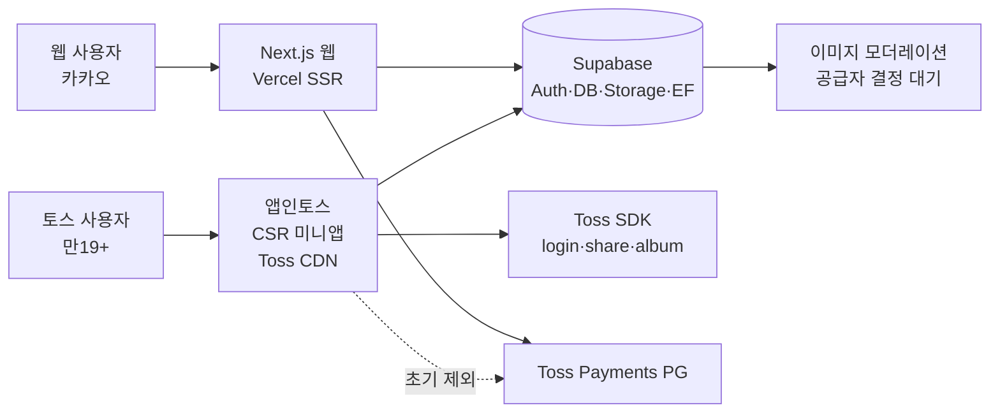

# 소셜 바이럴 루프 아키텍처

| 항목 | 값 |
|---|---|
| 버전 | v0.1.0 |
| 작성일 | 2026-10-04 KST |
| 작성자/모델 | tech-architect / claude-opus-4-8 |
| 상류 핀 | FDD v0.1.0 §4·§6·§10, api-contract·erd·design-patterns v0.1.0 |

> STAMP: 생성 2026-10-04 KST. claude-opus-4-8. tech-architect. 근거 실배포 Next.js(Vercel)+Supabase 스택, 앱인토스 공식 제약(SSR 금지·토스 로그인·현금전환 제한). FDD 다이어그램을 아키텍처 정본으로 좁힘. 고민 지점은 "유통할 제품은 채널과 독립적으로 견고해야" 한다는 회장 지시대로 소셜 도메인을 채널 공통층에 두는 것.
>
> 기반 표준: arc42(아키텍처 문서 12장) + C4 model(context·container·component 뷰). 이 문서는 context(§1)·container(§2·5)·component(§3·4) 뷰를 담는다.

## 목차
- [1. 시스템 맥락](#1-시스템-맥락)
- [2. 레이어](#2-레이어)
- [3. 소셜 도메인 = 채널 공통층](#3-소셜-도메인--채널-공통층)
- [4. 핵심 흐름](#4-핵심-흐름-fdd-6-정본)
- [5. 배포 토폴로지](#5-배포-토폴로지)
- [6. 고위험 구간](#6-고위험-구간-크로스모델-리뷰)
- [7. build 진입 전제](#7-build-진입-전제)

## 1. 시스템 맥락

## 2. 레이어

| 레이어 | 구성 | 소셜 책임 |
|---|---|---|
| 채널 클라이언트 | web(SSR), miniapp(CSR) | 화면·네비. 서로 독립 배포 |
| 공유 패키지 | packages/domain, design-tokens | 순수 DTO·토큰. 런타임 import 0 |
| API | Supabase RPC + Edge Functions | 소셜 변이·조회. service_role 경계 |
| 데이터 | Postgres + Storage(2버킷) | 진실원. RLS·수명주기 |
| 외부 | Toss SDK, moderation | EF 뒤로만 |

## 3. 소셜 도메인 = 채널 공통층

회장 지시(유통 최우선, 제품은 채널과 독립적으로 견고)대로 친구·초대·커버·신원·선호는 특정 채널이 아니라 Supabase 공통 도메인에 산다. 웹·미니앱·향후 iOS/Android가 같은 계약을 쓴다. 채널은 표현만 다르다.

## 4. 핵심 흐름 (FDD §6 정본)
- 커버 업로드·공개: sign-upload → quarantine 업로드 → finalize(검증·모더레이션·공개전환). 승인 전 비노출 불변식.
- 초대·친구: create_friend_invite → 링크 공유 → accept_friend_invite(토큰 잠금·정렬쌍 생성).
- 앱인토스 목표생성: 토스 로그인 → auth-toss code 교환 → member_identity resolve → Supabase 세션 → create_goal.

## 5. 배포 토폴로지
- 웹: Vercel(현행 보존). 결제·환전·admin 전부 여기.
- 미니앱: Vite+React CSR → Toss CDN. 승인 기능만. 결제·환전·외부 URL·SSR 0.
- 백엔드: Supabase 단일(공통). Auth URL에 tossmini origin 등록 필요.

## 6. 고위험 구간 (크로스모델 리뷰)
결제(cheer-order·toss-confirm), 인증(auth-kakao·auth-toss·link-identity), 권한(친구 RLS), 개인정보(CI·토큰·subject 해시), 마이그레이션(goal 컬럼·신규 테이블). FDD §11 보안 가드 + api-contract §3 적용.

## 7. build 진입 전제
FDD §13.1 차단 갭(앱인토스 서면 회신 GAP-02, 신원 threat review GAP-03, 모더레이션 공급자 GAP-06a, 환불·미성년 GAP-08/09, 업적 진실원 GAP-05) 미해소. 방향 확정된 커버·친구·신원·선호·조회만 build 가능.
