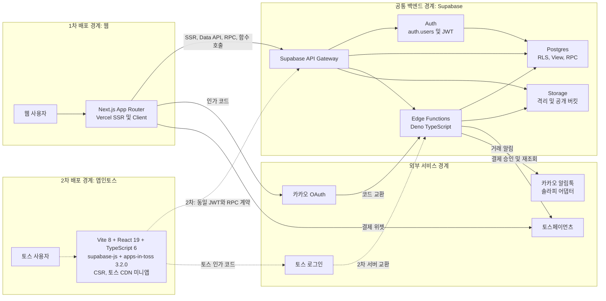
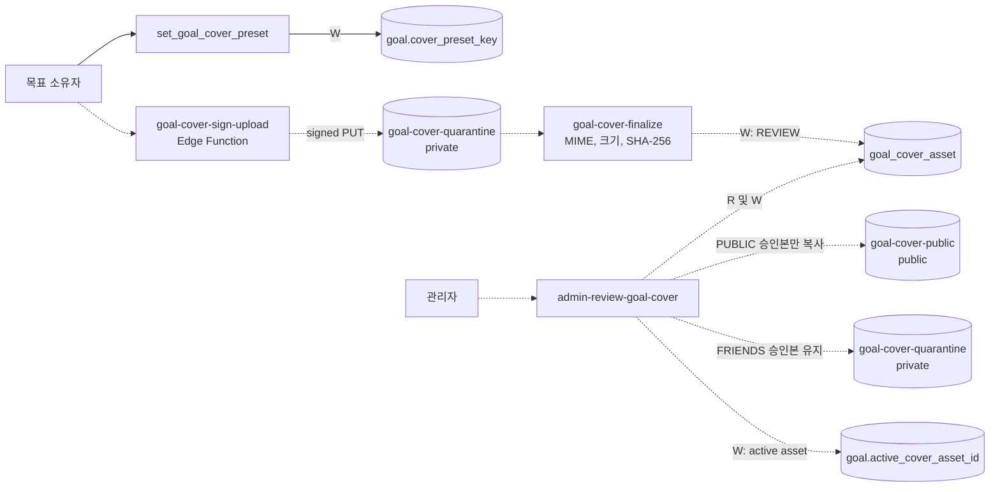
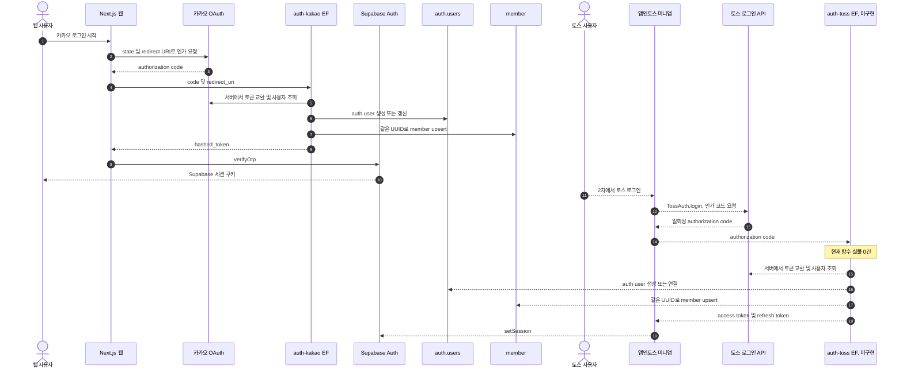
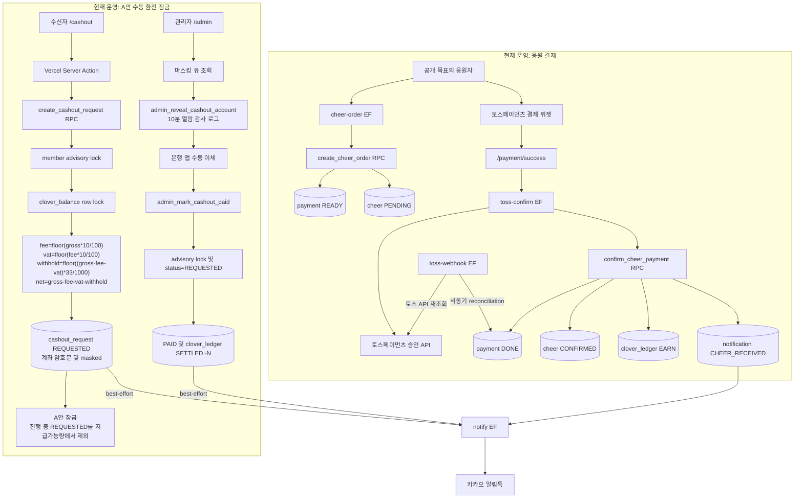
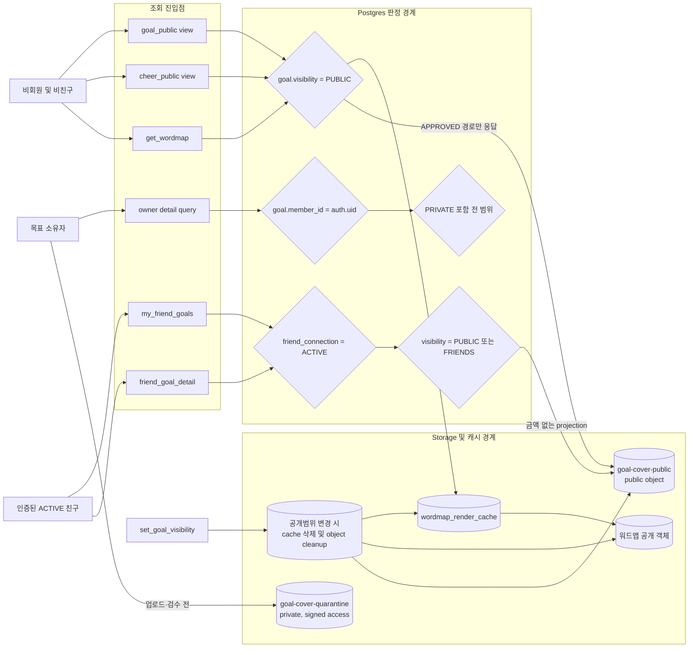
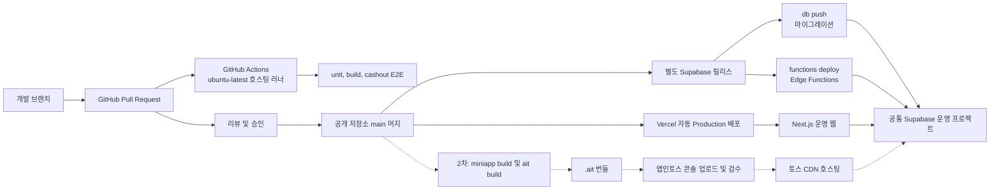

# 해낼게 V2 소셜 바이럴 루프 웹 우선 시스템 아키텍처

| 항목 | 값 |
|---|---|
| 버전 | v1.0.1 |
| 작성일 | 2026-10-13 03:13 KST |
| 작성자/모델 | tech-architect / gpt-5-codex |
| 작업 라인 | v2 |
| 상태 | eng-design 보완본. 웹 1차는 설계, 모바일 2차는 후속 설계 |
| 상류 핀 | `pipeline-state.core.md` D-018, `docs/plan/haenael-v2-blueprint-v1.0.0-opus48.md`, `DESIGN.md` v2.0.1, `docs/design/prototypes/social-viral-loop-v2-opus48.html` |
| 동급 설계 핀 | `fdd-social-viral-loop-web-first-v1.0.0.md`, `erd-social-viral-loop-web-first-v1.0.0.md`, `api-contract-social-viral-loop-web-first-v1.0.0.md`, `test-plan-social-viral-loop-web-first-v1.0.0.md` |
| 기반 포맷 | `docs/eng-design/architecture.md` v1.0.0, `docs/eng-design/architecture-social-viral-loop-v0.1.0.md` |

> STAMP: 생성 2026-10-13 03:13 KST. 모델 gpt-5-codex. 에이전트 tech-architect. 스킬 docs. 근거는 D-018, 웹 우선 설계 4종, 현재 Next.js·미니앱·Supabase 코드, 운영 인프라 정본, C4·arc42·Supabase·Vercel·GitHub·앱인토스 공식 문서다. 고민 한 줄: 현재 운영 중인 결제·환전과 아직 서버 실물이 없는 V2 소셜 기능을 같은 그림에서 사실처럼 섞지 않으면서도, 두 클라이언트가 공유할 백엔드 경계를 구현자가 오해하지 않게 만드는 데 집중했다.

> PATCH v1.0.1 사유: 미결이던 ARC-R05를 D-019로 종결했다. PUBLIC 승인 커버만 public bucket으로 복사하고 FRIENDS 커버는 private object와 120초 Presigned URL로 제한한다.

## 목차

- [0. 결론과 범례](#0-결론과-범례)
- [1. 전체 시스템 구성](#1-전체-시스템-구성)
- [2. 소셜 서브시스템](#2-소셜-서브시스템)
- [3. 인증 구성](#3-인증-구성)
- [4. 결제와 환전 구성](#4-결제와-환전-구성)
- [5. 공개 범위와 RLS 경계](#5-공개-범위와-rls-경계)
- [6. 배포 구성](#6-배포-구성)
- [7. 현재와 목표의 차이](#7-현재와-목표의-차이)
- [8. 위험과 회수 항목](#8-위험과-회수-항목)
- [9. 추적성과 인계](#9-추적성과-인계)
- [10. 벤치마크 적용](#10-벤치마크-적용)
- [11. 자기심문과 레드팀](#11-자기심문과-레드팀)
- [12. 개정 이력](#12-개정-이력)

## 0. 결론과 범례

V2는 Next.js 웹을 1차 배포 채널로 완성한 뒤 앱인토스 미니앱을 2차 채널로 연결한다. 두 클라이언트는 별도 프런트엔드이지만 Supabase Auth, Postgres, RLS, RPC, Edge Functions, Storage를 하나의 공통 백엔드로 사용한다. 현재 운영 중인 결제와 수동 환전은 변경하지 않는다.

### 0.1 상태 범례

| 표기 | 뜻 | 이 문서의 대상 |
|---|---|---|
| 실선 | 현재 코드와 운영 인프라에 실물이 있음 | 웹, `auth-kakao`, 결제, 환전, 알림톡, 기존 Supabase |
| 점선 | 설계됐으나 서버 또는 배포 실물이 없음 | 소셜 RPC·테이블·커버 함수, `auth-toss`, 모바일 2차 연결 |
| 굵은 경계 | 배포 또는 권한이 갈리는 독립 책임 경계 | Vercel 웹, 토스 CDN 미니앱, Supabase 공통 백엔드, 외부 서비스 |

### 0.2 의도적으로 없는 구성

- AI 생성, 추천, 자동 매칭 컴포넌트는 없다.
- 친구 관계는 추천이나 공개 프로필 탐색이 아니라 초대 토큰 수락으로만 만든다.
- 1:1 채팅은 없다. 기존 응원 문구는 목표 링크에 남기는 메시지다.
- 미니앱에는 결제와 환전을 싣지 않는다. 해당 경로는 웹에만 남긴다.

## 1. 전체 시스템 구성



**이 그림이 드러내는 위험:** 웹 배포와 Supabase 마이그레이션·함수 배포가 독립이므로, Vercel만 최신이면 V2 화면이 빈 서버 계약을 호출할 수 있다.

### 1.1 책임 경계

| 경계 | 책임 | 금지 |
|---|---|---|
| Next.js 웹 | SSR, 로그인 복귀, 공개 목표, 결제·환전 UI, 관리자 UI | 브라우저에 service role 노출 |
| 앱인토스 미니앱 | CSR 화면, 토스 로그인 시작, 소셜 RPC 소비 | SSR, 외부 웹 이동, 카카오 로그인, 결제·환전 |
| Supabase Auth | 세션·JWT와 `auth.users` | 제품 프로필을 auth metadata만으로 대체 |
| Postgres·RLS·RPC | 소유권, 친구관계, 공개범위, 원장, 동시성의 최종 판정 | 클라이언트 판정을 신뢰 |
| Edge Functions | OAuth 코드 교환, 결제 승인, 알림톡, 커버 격리·승인 | 승인 전 커버 공개, 비밀값 응답 |
| Storage | 커버와 워드맵 객체 수명주기 | 공개 버킷을 친구 전용 인가 경계로 오인 |

## 2. 소셜 서브시스템

### 2.1 RPC와 테이블 읽기·쓰기 구성

```mermaid
flowchart TB
  CLIENTS["웹 1차 및 미니앱 2차"]

  subgraph READ_RPC["조회 RPC"]
    R1["my_friend_goals"]
    R2["friend_goal_detail"]
    R3["friend_invite_preview"]
  end

  subgraph WRITE_RPC["변경 RPC"]
    W1["create_friend_invite"]
    W2["accept_friend_invite"]
    W3["remove_friend"]
    W4["set_goal_cover_preset"]
    W5["update_member_preferences"]
    W6["set_goal_visibility"]
  end

  CLIENTS --> R1
  CLIENTS --> R2
  CLIENTS --> R3
  CLIENTS --> W1
  CLIENTS --> W2
  CLIENTS --> W3
  CLIENTS --> W4
  CLIENTS --> W5
  CLIENTS --> W6

  FC[("friend_connection")]
  FI[("friend_invite")]
  MEMBER[("member")]
  GOAL[("goal")]
  CHEER[("cheer")]
  PREF[("member_preference")]
  CACHE[("wordmap_render_cache")]
  CLEANUP[("storage_cleanup_queue")]

  R1 -->|"R"| FC
  R1 -->|"R"| MEMBER
  R1 -->|"R"| GOAL
  R2 -->|"R"| FC
  R2 -->|"R"| GOAL
  R2 -->|"R, 메시지와 인원 projection"| CHEER
  R3 -->|"R"| FI
  R3 -->|"R, 최소 필드"| MEMBER
  R3 -->|"R, 최소 필드"| GOAL

  W1 -->|"R"| GOAL
  W1 -->|"W, 토큰 해시만"| FI
  W2 -->|"R 및 W, FOR UPDATE"| FI
  W2 -->|"W, ordered pair"| FC
  W3 -->|"W, ACTIVE에서 REMOVED"| FC
  W4 -->|"W, c1부터 c6"| GOAL
  W5 -->|"W, 본인 upsert"| PREF
  W6 -->|"W, 공개범위"| GOAL
  W6 -->|"W, PRIVATE 미사용 초대 revoke"| FI
  W6 -->|"D, 캐시 무효화"| CACHE
  W6 -->|"W, 객체 정리 예약"| CLEANUP
```



**이 그림이 드러내는 위험:** `SECURITY DEFINER` RPC 하나라도 호출자·소유권·`ACTIVE` 관계를 재검사하지 않으면 직접 테이블 RLS를 우회해 친구공개 데이터가 노출된다.

### 2.2 목표 커버 구성



**D-019 통제:** `goal-cover-public`은 PUBLIC 커버에만 사용한다. FRIENDS 커버는 private object로 남기고 ACTIVE 친구 확인 뒤 120초 Presigned URL로만 제공한다.

## 3. 인증 구성



**이 그림이 드러내는 위험:** 카카오와 토스 신원을 같은 회원으로 연결하는 확정 규칙 없이 `auth-toss`를 구현하면 한 사람이 채널마다 중복 `auth.users`와 `member`를 가질 수 있다.

### 3.1 현재와 목표

| 경로 | 현재 상태 | 공통 수렴점 |
|---|---|---|
| 웹 카카오 | `auth-kakao`와 Next.js callback 코드 존재. 운영 동의·콜백 전체는 미검증 | `auth.users.id = member.id` |
| 모바일 토스 | 미니앱 호출 코드만 존재. `auth-toss` Edge Function 없음 | 목표도 `auth.users.id = member.id` |
| 소셜 RPC | 인증 JWT의 `auth.uid()`를 회원 ID로 사용 | 두 채널 동일 |

## 4. 결제와 환전 구성

이 절은 현재 운영 구조를 기록한다. V2 소셜 설계가 결제·환전 계약을 변경하지 않는다.



**이 그림이 드러내는 위험:** 은행 앱의 실제 이체와 `admin_mark_cashout_paid` DB 전이는 하나의 트랜잭션이 아니므로, 운영자가 둘 중 하나만 끝내는 잔여 위험이 현재도 있다.

### 4.1 변경 금지 불변식

```text
fee = floor(gross * 10 / 100)
vat = floor(fee * 10 / 100)
withhold = floor((gross - fee - vat) * 33 / 1000)
net = gross - fee - vat - withhold
```

- 같은 회원의 동시 신청은 `cashout_member:{member_id}` transaction advisory lock으로 직렬화한다.
- 진행 중 신청 판정은 `status='REQUESTED'` 조건을 유지한다.
- A안은 신청 시 클로버를 소각하지 않고 진행 중 신청량을 지급 가능량에서 잠근다.
- 계좌번호는 암호문과 마스킹 문자열을 분리하고, 화면 기본값은 마스킹이다.
- `web/e2e/cashout-manual.spec.ts`와 `supabase/tests/cashout_security_hardening.test.sql`을 삭제·skip·약화하지 않는다.

## 5. 공개 범위와 RLS 경계



**D-019 통제:** RLS는 public Storage URL 직접 조회를 막지 못하므로 FRIENDS 커버는 public bucket에 복사하지 않는다. private Storage 직접 GET은 owner 외 RLS로 차단하고, 친구 화면은 서버가 ACTIVE 관계를 재검사한 뒤 발급한 120초 Presigned URL만 사용한다.

### 5.1 공개범위 판정표

| 경로·표면 | PUBLIC | FRIENDS | PRIVATE | 강제 위치 |
|---|---:|---:|---:|---|
| `/g/[slug]`, `goal_public`, `cheer_public` | 허용 | 0행 또는 404 | 0행 또는 404 | view WHERE |
| anon `get_wordmap`, 캐시, 워드맵 객체 | 허용 | 삭제 | 삭제 | 함수, cache, cleanup |
| `my_friend_goals`, `friend_goal_detail` | 허용 | ACTIVE 친구만 | 0행 | RPC 내부 관계 검사 |
| owner detail | 허용 | 허용 | 허용 | owner RLS·소유권 검사 |
| `goal-cover-quarantine` | owner signed read·admin | owner signed read·admin | owner signed read·admin | private bucket policy |
| `goal-cover-public` | public | 사용 안 함, public path 0건 | 사용 안 함, public path 0건 | PUBLIC 커버만 저장 |
| FRIENDS private cover | 비회원 금지 | ACTIVE 친구 확인 후 120초 Presigned URL | owner만 직접 read | object path 응답 제거 |

## 6. 배포 구성



**이 그림이 드러내는 위험:** `main` 머지는 Vercel 배포를 즉시 만들지만 GitHub Actions 성공과 Supabase 릴리스를 원자적으로 기다리지 않는다. 백엔드 선배포와 운영 검증 순서를 릴리스 절차가 강제해야 한다.

### 6.1 배포 단위와 종료 증거

| 단위 | 트리거 | 종료 증거 |
|---|---|---|
| 웹 | GitHub `main` 머지 | Vercel Production READY, 정규 URL commit 일치, 실제 핵심 경로 관찰 |
| DB | 승인된 마이그레이션을 Supabase에 적용 | migration parity, catalog·RLS·RPC 실조회, rollback rehearsal |
| Edge Functions | `supabase functions deploy` | 함수 목록·버전, 실제 인증·결제·커버 호출 증거 |
| 미니앱 | `.ait` 번들 콘솔 업로드와 검수 | 토스 CDN 출시 버전, 토스 앱 실기기 핵심 경로 |
| CI | 공개 저장소 GitHub 호스팅 러너 | 해당 commit의 required checks 성공 |

## 7. 현재와 목표의 차이

| 구성 | 현재 실물 | 웹 1차 목표 | 모바일 2차 목표 |
|---|---|---|---|
| Next.js 웹 | 운영 중 | 친구·초대·커버·공개범위 추가 | 변경 최소화 |
| 미니앱 | 화면과 gateway 호출 코드 | 서버가 준비돼도 출시하지 않음 | 같은 RPC에 연결 후 토스 심사 |
| 소셜 RPC 9종 | 운영 0건 | 9종 구현·권한·테스트 | 기존 5종 이름 그대로 소비 |
| 소셜 테이블 4종 | 운영 0건 | 생성 및 즉시 RLS | 그대로 공유 |
| `auth-kakao` | 코드·배포 실물 있음. 전체 운영 로그인 미검증 | 유지·회귀 검증 | 사용 안 함 |
| `auth-toss` | 0건 | 만들지 않아도 웹 완료 가능 | 구현 후 `auth.users`·`member` 수렴 |
| 결제·환전 | 웹 운영 실물 있음 | 변경 금지 | 미니앱에 포함하지 않음 |
| 알림톡 | `notify`와 거래 이벤트 존재 | 기존 거래 알림 유지 | 소셜 알림 확대는 별도 결정 |
| AI·추천 매칭 | 없음 | 없음 | 없음 |

## 8. 위험과 회수 항목

### 8.1 위험 등록부

| ID | 위험 | 영향 | 통제·다음 행동 | 상태 |
|---|---|---|---|---|
| ARC-R01 | 웹과 Supabase 배포 순서 분리 | 화면만 배포되고 RPC 0건 | DB·함수 선배포, contract smoke 후 웹 feature flag 개방 | build·ship 통제 필요 |
| ARC-R02 | `SECURITY DEFINER` 권한 오구성 | 친구공개·초대 정보 유출 | empty search path, exact grant, auth.uid·관계 재검사, pgTAP sentinel | 설계됨, 미구현 |
| ARC-R03 | `auth-toss` 신원 병합 규칙 미확정 | 회원 중복과 친구관계 분열 | 구현 전 계정 연결 ADR과 threat review | 모바일 2차 blocker |
| ARC-R04 | 은행 이체와 DB PAID 비원자성 | 중복 지급 또는 상태 불일치 | 마스킹, 10분 열람 감사, REQUESTED guard, 운영 체크 | 현재 잔여 위험 |
| ARC-R05 | FRIENDS 커버와 public bucket 충돌 | URL 직접 접근으로 공개범위 우회 | D-019: private object, ACTIVE 친구 확인, 120초 Presigned URL | 종결 |
| ARC-R06 | Vercel이 CI 성공을 기다리지 않음 | 실패 commit 운영 노출 | 보호 브랜치·required checks·배포 후 실경로 검증 | ship 통제 필요 |

### 8.2 D-019 확정: FRIENDS 커스텀 커버의 Storage 경계

PUBLIC 목표의 승인 커버만 `goal-cover-public`에 복사한다. FRIENDS 승인 커버는 private `goal-cover-quarantine` object로 유지한다. `friend_goal_detail`이 ACTIVE 친구관계를 확인한 뒤 Next 서버가 `createSignedUrl(path, 120)`으로 Presigned URL을 만들며 object path는 브라우저 응답에서 제거한다. ACTIVE 친구도 private Storage object를 직접 GET할 수 없다.

## 9. 추적성과 인계

### 9.1 요구 추적표

| 요청 항목 | 이 문서 | 기반 계약 | 구현·검증 인계 |
|---|---|---|---|
| 전체 구성도 | §1 | FDD §3, D-018 | 배포 단위별 실물 count |
| 소셜 RPC·테이블 | §2 | API §2·§3·§4, ERD §4 | pgTAP·contract test |
| 카카오·토스 인증 수렴 | §3 | 기존 `auth-kakao`, 미니앱 gateway | 웹 login E2E, 모바일 2차 threat review |
| 결제·A안 환전 잠금 | §4 | 기존 architecture §6~§8, 환전 migration | 기존 테스트 무수정 PASS |
| PUBLIC·FRIENDS·PRIVATE | §5 | ERD §5·§6, API §4.4 | sentinel·Storage 직접 URL 테스트 |
| 웹·미니앱 배포 | §6 | `wiki/ops/인프라.md`, `.github/workflows/ci.yml` | commit·배포·서버 실물 일치 |

### 9.2 build 인계 판정

| 범위 | 진입 판정 | 근거 |
|---|---|---|
| 목표 상세·친구·초대·프리셋 커버·환경설정 | 가능 | RPC·테이블·RLS·테스트 계약이 4종 설계와 이 문서에서 일치 |
| PUBLIC 커스텀 커버 | 가능 | 격리, 수동 승인, public object 계약이 일치 |
| FRIENDS 커스텀 커버 | 불가 | ARC-R05의 객체 접근 경계 미결 |
| 앱인토스 인증·출시 | 불가 | `auth-toss`와 신원 병합 규칙 미구현·미확정 |
| 기존 웹 결제·환전 | 회귀만 수행 | 신규 설계 대상이 아니며 변경 금지 |

아키텍처 구성도 누락은 해소됐다. 다만 전체 build 진입 가능 판정은 **조건부**다. ARC-R05를 제외한 웹 1차 슬라이스는 개발할 수 있고, FRIENDS 커스텀 커버만 결정 전 차단한다.

## 10. 벤치마크 적용

| 출처 | 차용 | 해낼게에 맞춘 변경 |
|---|---|---|
| [C4 System Context](https://c4model.com/diagrams/system-context)·[Deployment](https://c4model.com/diagrams/deployment) | 사용자, 시스템, 외부 서비스, 배포 노드를 서로 다른 확대 수준으로 분리 | 단일 거대 그림 대신 전체·서브시스템·배포 뷰로 분할하고 현재·목표 선형을 추가 |
| [arc42 Building Block View](https://docs.arc42.org/section-5/) | 정적 구성요소와 의존 관계를 계층적으로 표현 | 소셜 RPC를 black box로 두고 실제 테이블 R/W를 white box로 확대 |
| [Supabase Architecture](https://supabase.com/docs/guides/getting-started/architecture)·[Auth Architecture](https://supabase.com/docs/guides/auth/architecture) | Auth, Postgres, Storage, Functions가 한 프로젝트의 공통 Postgres로 수렴 | 웹과 미니앱이 같은 JWT·RLS·RPC를 쓰는 공통 백엔드 경계로 적용 |
| [Supabase Secure Data](https://supabase.com/docs/guides/database/secure-data)·[Storage Access Control](https://supabase.com/docs/guides/storage/security/access-control) | 공개 키는 RLS와 함께 쓰며 service role은 백엔드에만 둠. Storage는 객체 정책과 RLS로 통제 | Postgres RLS와 public Storage URL을 다른 보안 경계로 그려 ARC-R05를 표면화 |
| [Vercel Git Deployments](https://vercel.com/docs/git)·[GitHub-hosted runners](https://docs.github.com/en/actions/reference/runners/github-hosted-runners) | production branch 자동배포와 호스팅 러너의 실행 경계 | 공개 저장소 `main` 머지, `ubuntu-latest`, Vercel 자동배포를 별도 노드로 표현 |
| [앱인토스 개요](https://developers-apps-in-toss.toss.im/intro/overview.html)·[토스 로그인](https://developers-apps-in-toss.toss.im/bedrock/reference/framework/%EB%A1%9C%EA%B7%B8%EC%9D%B8/appLogin.html) | 번들 콘솔 업로드 후 토스 CDN 호스팅, 인가 코드는 서버 교환 | 미니앱을 2차 독립 배포로 두고 `auth-toss`를 서버 경계에 배치 |

## 11. 자기심문과 레드팀

### 11.1 셀프심문

**이 결론이 틀렸다면 가장 그럴듯한 이유는 무엇인가?** 웹과 미니앱이 같은 RPC 이름을 쓰더라도 인증 신원과 채널 정책이 달라 실제로는 완전히 같은 백엔드 계약을 쓸 수 없을 수 있다. 그래서 공유 범위는 도메인 테이블·RLS·응답 DTO로 제한하고, 카카오·토스 코드 교환과 화면 정책은 각 채널 어댑터로 분리했다.

**가장 하중이 큰 가정은 무엇인가?** `auth.uid()`가 두 채널에서 같은 사람을 같은 `member.id`로 가리킨다는 가정이다. 웹은 현재 이를 만족하지만 토스 계정 연결 규칙은 아직 없다. 이 가정을 사실처럼 두지 않고 ARC-R03과 모바일 2차 blocker로 올렸다.

**0번 스킬 게이트를 지켰는가?** `docs` 스킬 지침을 읽고 문서 골격을 먼저 만들었다. 역할 정의가 지목한 `diagram`과 `document-generate` 스킬은 현재 available-skills에 없어 호출하지 못했고, Mermaid를 직접 작성한 뒤 mmdc 11.12.0으로 7개를 렌더해 육안 검증했다.

### 11.2 레드팀

까다로운 보안 리뷰어 관점의 공격은 “FRIENDS라는 라벨만 DB에 붙였을 뿐, public Storage URL이 있으면 친구공개는 거짓말”이다. 이 공격은 유효하다. D-019로 FRIENDS의 public object를 금지하고 private object 직접 GET도 차단했으며, ACTIVE 관계 확인 뒤 120초 Presigned URL만 허용한다. 공개범위는 view·RPC·cache·Storage의 네 표면을 모두 추적했다.

## 12. 개정 이력

| 버전 | 일자 | 변경 | 작성자 |
|---|---|---|---|
| v1.0.1 | 2026-10-13 | D-019로 ARC-R05 종결. FRIENDS private Storage와 120초 Presigned URL 확정 | code-builder / gpt-5-codex |
| v1.0.0 | 2026-10-13 | 웹 1차·모바일 2차 공통 백엔드, 소셜·인증·결제·환전·RLS·배포 구성도 신설 | tech-architect / gpt-5-codex |

KNOWLEDGE_QUERY: BRAIN `business/index.md`와 `cto/index.md`에서 해낼게 공유장벽, PWA·WebView·미니앱, Supabase RLS, 공개·비공개 객체 경계를 검색했다. 외부에서는 C4 context·deployment, arc42 building block, Supabase architecture·Auth·RLS·Storage, Vercel Git 배포, GitHub 호스팅 러너, 앱인토스 CDN 배포·토스 로그인을 검색했다.

HITS_USED: `concept-공유장벽-선언vs요청-UGC바이럴.md`는 초대가 추천 매칭이 아닌 선언 링크에서 시작해야 한다는 제품 경계에 사용했다. `concept-PWA-WebView-하이브리드-미니앱.md`는 미니앱을 웹과 별도 채널 어댑터로 두는 데 사용했다. `concept-Supabase-Firebase-RLS-비용구조.md`는 DB RLS를 최종 인가 경계로, `concept-S3-Presigned-URL-임시-출입증.md`는 공개 버킷과 친구공개가 충돌한다는 판정에 사용했다. 외부 공식 문서는 구성도 수준과 배포·인증·Storage 경계를 검증하는 데 사용했다.

HITS_REJECTED: BRAIN의 AI 추천·생성 아키텍처는 이 제품에 AI·추천 매칭 요구가 없어 미채택했다. C4 code diagram은 구현 클래스 수준으로 과도해 미채택했다. 앱인토스 결제 API는 미니앱에서 결제·환전을 제외한다는 D-018과 정책 경계 때문에 미채택했다.

CONFLICTS: BRAIN의 private bucket·단기 Presigned URL 원칙과 v1.0.0의 모든 승인 커버 public copy가 충돌했다. D-019에 따라 FRIENDS는 private object와 120초 Presigned URL로 확정해 충돌을 해소했다.

SKILLS_USED: docs. 로컬 Markdown 전달 문서의 상단 제어표, 목차, client-ready 구조, 추적표, 위험 등록부, 품질 푸터에 적용.

SKILLS_SKIPPED: diagram, document-generate. 현재 세션 available-skills에 두 스킬이 없어 Mermaid와 문서 파일을 직접 작성했다. visualize는 대화형 시각화용이라 저장소 아키텍처 정본 생성에는 사용하지 않았다.

RUBRIC_SCORE: 완결성=5/5 정밀성=5/5 벤치마크반영=5/5 추적성=5/5 전문성·톤=5/5 total=25/25

WEAKEST_LINE: "FRIENDS 커스텀 커버의 객체 접근 경계는 ARC-R05 결정 전까지 미확정이다."

PRESENTATION_CHECK: 내부 태그 잔재 0 / 목차 앵커 확인 / Mermaid 7개를 mmdc 11.12.0으로 PNG 렌더하고 육안 확인함 / 컨트롤러 표시용 창은 열지 않음

SOURCES/MODEL: gpt-5/codex | `pipeline-state.core.md`; `wiki/거버넌스/결정.md` D-018; `wiki/거버넌스/실수.md`; `wiki/ops/인프라.md`; `DESIGN.md` v2.0.1; `docs/design/README.md`; `docs/design/user-flow.md`; `docs/구현현황.md`; `docs/eng-design/fdd-social-viral-loop-web-first-v1.0.0.md`; `docs/eng-design/erd-social-viral-loop-web-first-v1.0.0.md`; `docs/eng-design/api-contract-social-viral-loop-web-first-v1.0.0.md`; `docs/eng-design/test-plan-social-viral-loop-web-first-v1.0.0.md`; `docs/eng-design/architecture.md`; `web/src`; `miniapp/src/gateway.ts`; `supabase/functions`; `supabase/migrations`; `.github/workflows/ci.yml`; `~/SJ_BRAIN_wiki/wiki/business/index.md`; `~/SJ_BRAIN_wiki/wiki/cto/index.md`; `~/SJ_BRAIN_wiki/wiki/business/마케팅/concept-공유장벽-선언vs요청-UGC바이럴.md`; `~/SJ_BRAIN_wiki/wiki/cto/개발/concept-PWA-WebView-하이브리드-미니앱.md`; `~/SJ_BRAIN_wiki/wiki/cto/개발/concept-Supabase-Firebase-RLS-비용구조.md`; `~/SJ_BRAIN_wiki/wiki/cto/보안/concept-S3-Presigned-URL-임시-출입증.md`; https://c4model.com/diagrams/system-context; https://c4model.com/diagrams/deployment; https://docs.arc42.org/section-5/; https://supabase.com/docs/guides/getting-started/architecture; https://supabase.com/docs/guides/auth/architecture; https://supabase.com/docs/guides/database/secure-data; https://supabase.com/docs/guides/storage/security/access-control; https://vercel.com/docs/git; https://docs.github.com/en/actions/reference/runners/github-hosted-runners; https://developers-apps-in-toss.toss.im/intro/overview.html; https://developers-apps-in-toss.toss.im/bedrock/reference/framework/%EB%A1%9C%EA%B7%B8%EC%9D%B8/appLogin.html
