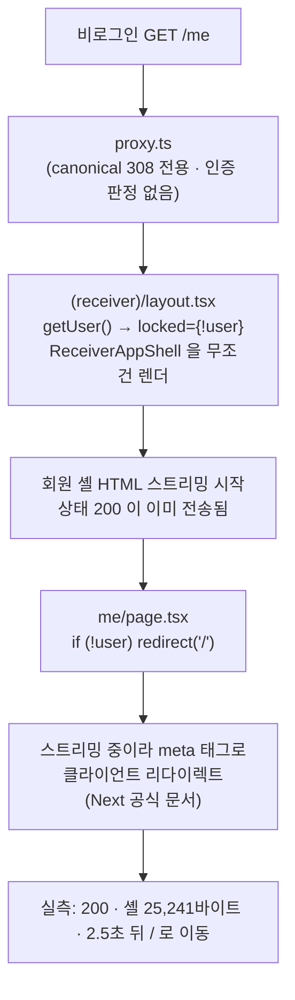
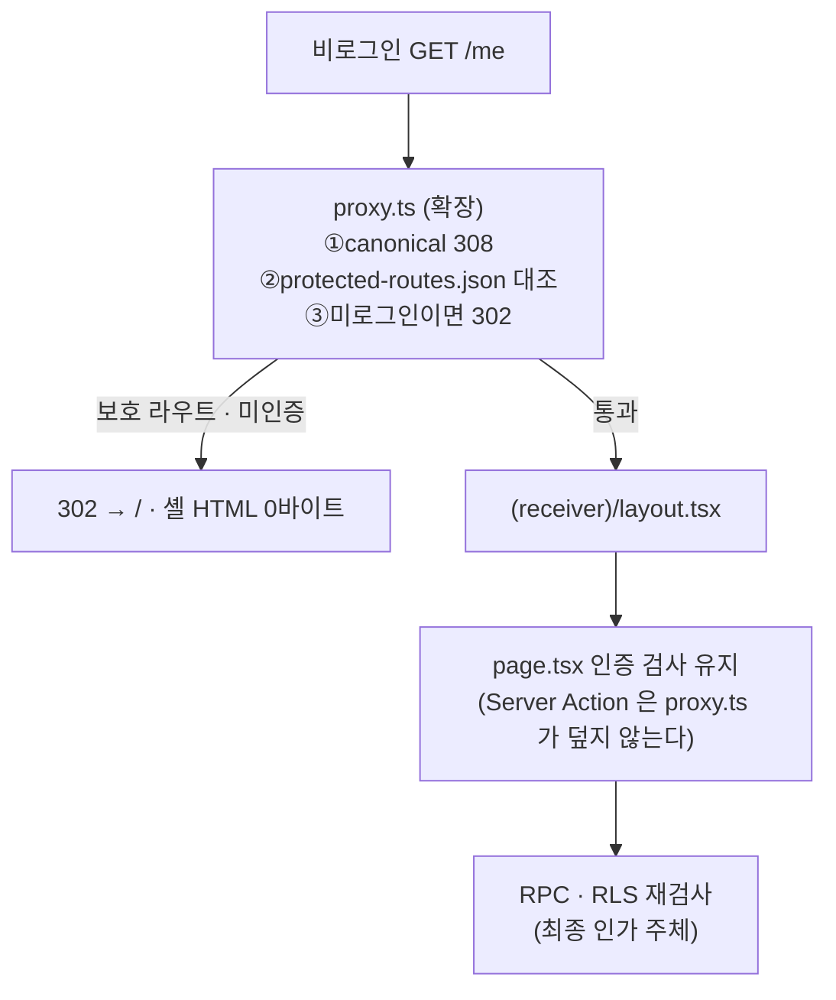
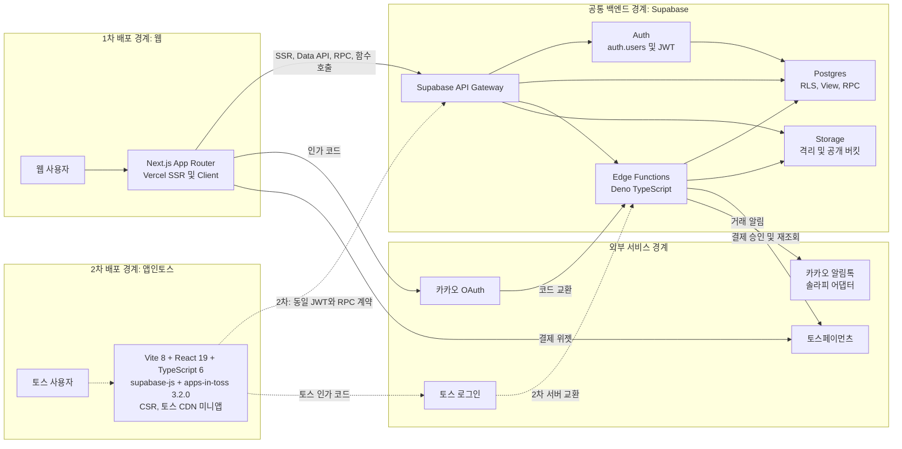
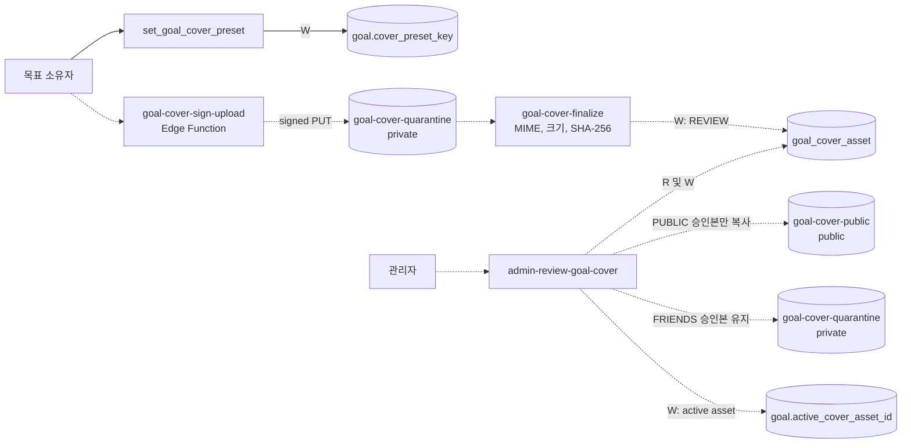
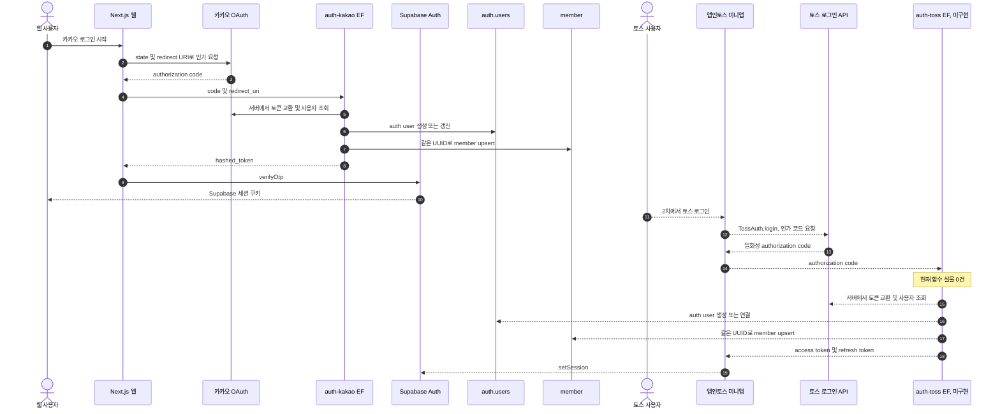
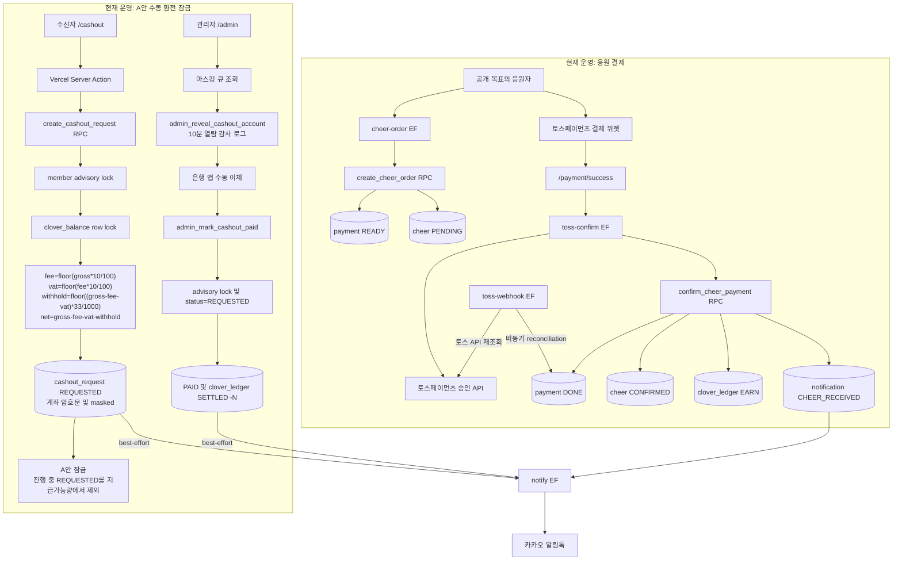
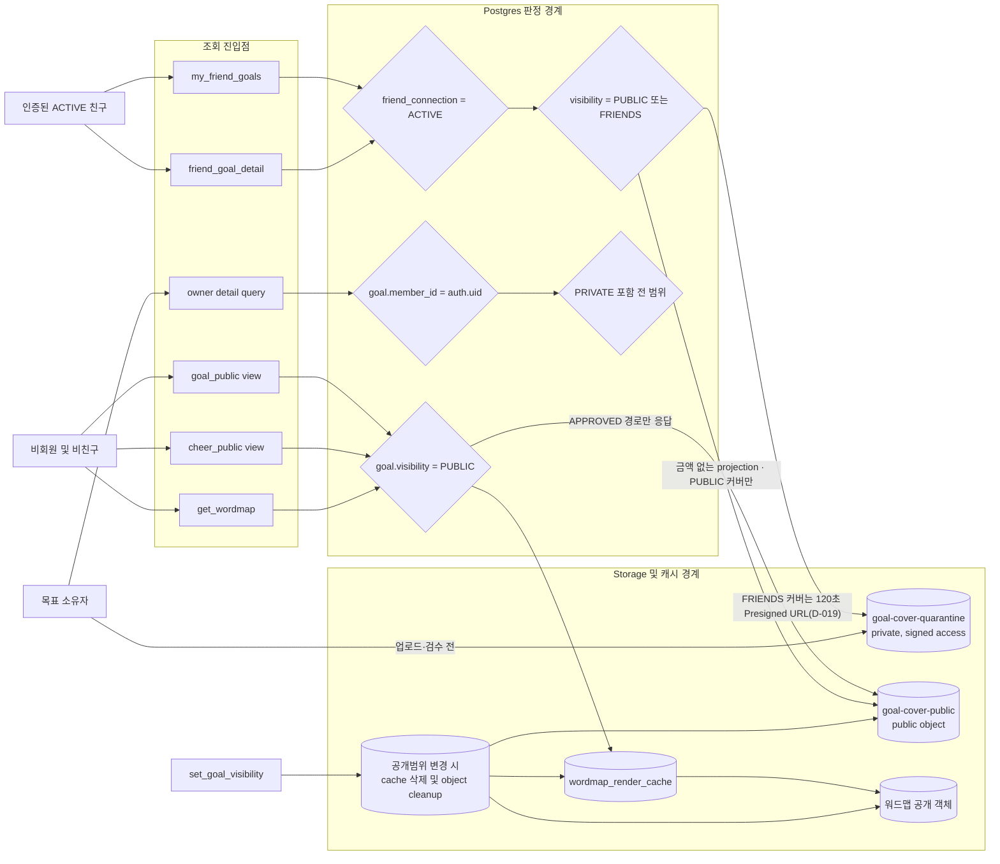
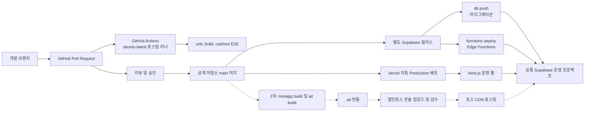

# 해낼게 V2 소셜 바이럴 루프 웹 우선 시스템 아키텍처
| 항목 | 값 |
|---|---|
| 버전 | **v1.2.4** (Codex 6차 15/25 반려 반영: Edge Function 인증 계약 확정 · 비회원 필드 최소성 입증 · settle 이후 구간 · 버전·앵커·수치 검사 0건) |
| 작성일 | v1.1.0 2026-10-13 03:13 KST · **v1.2.x 개정 2026-10-19 16:4x KST** |
| 작성자/모델 | v1.1.0 tech-architect / gpt-5-codex · **v1.2.0 tech-architect / claude-opus-5[1m]** |
| 작업 라인 | v2 |
| 상태 | **웹 1차는 운영 배포됨**(실측). 이 개정은 6차 개정이 요구하는 경계 변경과 현황 교정이다. 모바일 2차는 후속 설계 |
| 상류 핀 | `pipeline-state.v2.md` D-018·D-037 · `docs/plan/haenael-v2-blueprint-v1.0.0-opus48.md` · **`DESIGN.md` sha256 `0ddeed8caff7…`** · **`docs/design/prototypes/social-viral-loop-v3-opus5.html` 3.0.0 sha256 `f9398150755d…`** |
| 동급 설계 핀 | `fdd-…-v1.2.4.md`, `erd-…-v1.2.4.md`, `api-contract-…-v1.2.4.md`, `test-plan-…-v1.2.4.md`, `test-cases-…-v1.2.4.md`, `folder-structure-…-v1.2.4.md`, `design-patterns-…-v1.2.4.md` |
| 기반 포맷 | `docs/eng-design/architecture.md` v1.0.0, `docs/eng-design/architecture-social-viral-loop-v0.1.0.md` |

> STAMP: 생성 2026-10-13 03:13 KST. 모델 gpt-5-codex. 에이전트 tech-architect. 스킬 docs. 근거는 D-018, 웹 우선 설계 4종, 현재 Next.js·미니앱·Supabase 코드, 운영 인프라 정본, C4·arc42·Supabase·Vercel·GitHub·앱인토스 공식 문서다. 고민 한 줄: 현재 운영 중인 결제·환전과 아직 서버 실물이 없는 V2 소셜 기능을 같은 그림에서 사실처럼 섞지 않으면서도, 두 클라이언트가 공유할 백엔드 경계를 구현자가 오해하지 않게 만드는 데 집중했다.

> PATCH v1.0.1 사유: 미결이던 ARC-R05를 D-019로 종결했다. PUBLIC 승인 커버만 public bucket으로 복사하고 FRIENDS 커버는 private object와 120초 Presigned URL로 제한한다.

> v1.1.0 사유: D-022 마이페이지 read model을 추가한다. 회원-응원 귀속은 client가 읽을 수 없는 테이블로 격리하고, Next.js `/my`는 `my_social_dashboard()` 집계만 소비한다.

## 목차
- [A. v1.2.x 개정 (현황 교정과 경계 변경)](#a-v12-개정-현황-교정과-proxyts-변경)
  - [A.1 §7 "운영 0건" 교정: 전제 실측표](#a1-7-운영-0건-교정-전제-실측표)
  - [A.2 로그인 판정을 `proxy.ts` 에서 한다 (D-034 · 회장 확정)](#a2-로그인-판정을-proxyts-에서-한다-d-034---회장-확정)
  - [A.3 노출 규칙 SSOT 계층 (D-032)](#a3-노출-규칙-ssot-계층-d-032)
  - [A.4 위험 등록부 갱신](#a4-위험-등록부-갱신)
  - [A.5 build 인계 판정 갱신](#a5-build-인계-판정-갱신)

- [0. 결론과 범례](#0-결론과-범례)
- [1. 전체 시스템 구성](#1-전체-시스템-구성)
- [2. 소셜 서브시스템](#2-소셜-서브시스템)
- [3. 인증 구성](#3-인증-구성)
- [4. 결제와 환전 구성](#4-결제와-환전-구성)
- [5. 공개 범위와 RLS 경계](#5-공개-범위와-rls-경계)
- [6. 배포 구성](#6-배포-구성)
- [7. 현재와 목표의 차이](#7-현재와-목표의-차이)
- [8. 위험과 회수 항목](#8-위험과-회수-항목)
- [9. 추적성과 인계](#9-추적성과-인계)
- [10. 벤치마크 적용](#10-벤치마크-적용)
- [11. 자기심문과 레드팀](#11-자기심문과-레드팀)
- [12. 개정 이력](#12-개정-이력)

## A. v1.2 개정 (현황 교정과 `proxy.ts` 변경)
> 이 장이 이 문서의 **구성 정본**이다. 같은 사실을 두 번 적지 않는다(전수 대조 결과 = FDD §A.9). §7 의 현황 표는 §A.1 의 실측값으로 교체됐다.

### A.1 §7 "운영 0건" 교정: 전제 실측표
품질헌법 `standard-eng-design.md` §1-7. v1.1.0 §7 은 소셜 RPC 10종·테이블 4종·마이페이지 read model 을 모두 "운영 0건" 으로 적었다. **그 뒤 build 와 ship 이 돌았고 지금은 전부 살아 있다.**

| 구성 | v1.1.0 §7 기록 | 2026-10-19 실측 | 확인 명령 | 등급 |
|---|---|---|---|---|
| 소셜 RPC 10종 | 운영 0건 | **8종 직접 관찰**(`my_friend_goals` 200 · `my_social_dashboard` 200 · `friend_goal_detail` P0002 · `friend_invite_preview` P0008 · `accept_friend_invite` P0008 · `set_goal_visibility` P0005 · `get_wordmap` 200 · `admin_list_goal_covers` 403) · **2종 시그니처 확인**(`set_goal_cover_preset`·`remove_friend`) · `create_friend_invite`·`update_member_preferences` 는 **운영 쓰기가 발생하므로 호출하지 않았고 근거 확인 등급**이다 | QA 로그인 후 `POST /rest/v1/rpc/<f>` | 관찰됨(8) / 근거 확인(2) |
| 마이페이지 read model | **§A.1 참조**(배포됨) | **존재.** `my_social_dashboard()` 가 `profile`·`goals`·`friend_count`·`achievements`(3종)·`belonging_queue` 를 반환 | 같음 | 관찰됨 |
| 소셜 테이블 | 운영 0건(4종 전제) | **5종 존재**: `friend_invite`·`friend_connection`·`goal_cover_asset`·`member_preference`·`social_cheer_member_attribution` | `GET /rest/v1/<t>` anon → 42501/42703 | 관찰됨 |
| 커버 엣지 함수 | 설계만 | **3종 전부 배포됨.** 대조군 `zz-does-not-exist` 는 404 `NOT_FOUND` | `OPTIONS/POST /functions/v1/<fn>` | 관찰됨 |
| `goal-cover-public` 버킷 | 설계만 | **존재**(`NoSuchKey`) | `GET /storage/v1/object/public/…` | 관찰됨 |
| `goal-cover-quarantine` 버킷 | 설계만 | **읽기 전용 자격증명으로는 원리적으로 관찰 불가.** Storage API 가 버킷 존재보다 RLS 를 먼저 보기 때문이다: `object/list` 는 존재·부재 모두 200 `[]`, `object/upload/sign` 은 둘 다 403 `new row violates row-level security policy`(대조군 `zz-nope` 로 확인). 간접 근거 셋: ①migration 145~148행이 `public=false` 로 생성 ②운영 `goal-cover-sign-upload` 가 이 버킷에 서명 URL 을 발급하며 인증 호출이 `goal_not_found` 까지 진행 ③`goal-cover-public` 은 같은 INSERT 문으로 함께 생성되고 실재가 관찰됨 | **근거 확인**(관찰은 쓰기 권한 필요 → build 과제) |
| 웹 소셜 라우트 | 없음 | **존재.** `/friends`·`/friends/[friendId]`·`/invite`·`/invite/[token]`·`/my`·`/me/goal/[id]`·`/me/achievements`·`/wordmap/[goalId]` | `find web/src/app -name page.tsx` · 운영 HTTP | 관찰됨 |
| 보호 라우트 비로그인 응답 | 미측정 | `/my`·`/friends`·`/invite` **307** · `/me` **200 + 셸 25,241바이트** · `/me/goal/1` **200**(의도된 권한없음 화면) | `curl -o /dev/null -w '%{http_code}'` | 관찰됨 |
| `web/src/proxy.ts` | 언급 없음 | **존재**(3,333바이트, 2026-07-19). canonical 도메인 308 전용. matcher 가 정적 자산만 제외해 전 경로를 덮는다 | `ls -la`, 본문 Read | 관찰됨 |
| 간격 토큰 | 언급 없음 | `globals.css :root` 에 `--space-*` 만 있고 `--sp-0`~`--sp-6` 없음. 폐지된 `--tabbar-lock-size` 잔존 | `sed -n '100,130p'` | 관찰됨 |

측정일 2026-10-19, 프로젝트 `ossvejipdivgxzcqszbw`, 읽기 전용 QA 자격증명. 운영 쓰기 0건. **`supabase functions list` 는 관리 API 권한 부족(403)으로 쓸 수 없어** HTTP 대조군 방식으로 셌다.

**따라서 v1.1.0 §7 의 "현재 실물" 열은 더 이상 현재가 아니다.** 이 표를 현재로 읽는다.

### A.2 로그인 판정을 `proxy.ts` 에서 한다 (D-034 - 회장 확정)
**현재 구조와 왜 셸이 먼저 그려지나**



**목표 구조 (회장 확정)**

회장이 **`proxy.ts` 에서 로그인 판정**을 택했다. `proxy.ts` 는 Next.js 16 의 요청 가로채기 계층이다. 요청이 페이지 렌더에 들어가기 전에 가로채 처리한다(Next 15 이전 이름은 `middleware.ts` 이고 Next 16 정본 이름이 `proxy` 다). 이 파일은 이미 있고 지금은 canonical 도메인 308 강제만 한다.



**설계 규칙 4개**

1. **`proxy.ts` 는 추가이고 대체가 아니다.** Next.js 공식 인증 가이드대로 `proxy.ts` 는 낙관적 선제 리다이렉트만 하고, 실제 인가는 데이터에 가까운 곳(페이지·RPC·RLS)에서 다시 한다. `proxy.ts` 만 믿으면 Server Action 이 열린다(그 경로를 보는 테스트 = AU-05).
2. **새 파일을 만들지 않는다.** `web/src/proxy.ts` 가 이미 있고 matcher 가 전 경로를 덮는다. 그 안에 판정 하나를 더한다.
3. **보호 라우트 목록은 데이터다**(D-032). `qa/contracts/protected-routes.json` 이 소유하고, `proxy.ts` 와 테스트가 **같은 파일**을 읽는다. 목록에 없는 신규 보호 라우트는 폴더 스캔 대조로 린트가 반려한다. 규칙의 집행 주체가 사람 기억이 되지 않게 한다.
4. **예외도 목록에 적는다.** `/me/goal/[id]` 처럼 의도적으로 권한없음 화면을 주는 경로는 `allow_shell_without_auth` 로 명시한다. 그 화면에도 법적 고지 블록을 두지 않는다(운영 현재는 두고 있다: 교정 대상).

**레이아웃에서 막는 대안을 쓰지 않는 이유**: 레이아웃도 스트리밍 대상이라 같은 증상이 재발할 자리가 남는다. Next 공식 가이드도 레이아웃 인증을 Partial Rendering 주의 대상으로 둔다.

### A.3 노출 규칙 SSOT 계층 (D-032)
6차 개정은 같은 처방을 네 군데에 적용했다. **규칙을 문서에만 적고 집행 주체를 두지 않으면 그 규칙은 매 판 재협상된다.** 아키텍처는 그 집행 주체의 자리를 정한다.

| 규칙 | 정본(데이터) | 집행 주체(코드) | 검사 |
|---|---|---|---|
| 법적 고지 노출 | `web/src/lib/legal/exposure.ts` 의 `LEGAL_EXPOSURE` | `LegalFooter.tsx` 가 표를 읽고 **표에 없으면 DOM 을 만들지 않는다** | LG-01~05 |
| 보호 라우트 | `qa/contracts/protected-routes.json` | `proxy.ts` 판정 + 폴더 스캔 린트 | AU-01~04 |
| 수직 간격 | `globals.css :root` 의 `--sp-0`~`--sp-6` | 카드 컴포넌트가 그 변수만 쓴다 | SP-01~04 |
| 응원 메시지 줄 수 | CSS 변수 1개(`--cheer-clamp-lines`) | 4경로 공유 컴포넌트 | CL-01~04 |
| 비회원 허용 필드 집합 | api-contract **§A.8.1**(정의 자리). 적힌 자리 6곳은 §A.8.3. 각 필드의 소비 근거는 §A.8.1.1 | 서버 응답 스키마가 그 집합과 **같다**(초과 0 + 누락 0) | GT-01·02 |
| 소비자 호출 인증 | Vault 비밀값 3개 + `config.toml` 의 `verify_jwt=false` | `cleanup-auth.ts` 의 SHA-256 + 상수시간 비교 + fail-closed | EA-01~04 |
| 문서 자신에 대한 수치·링크 | 없다(손으로 적지 않는다) | `lint-doc-contradiction.mjs` E·F·G축이 센다 | 검사 자체 |
| 큐 점유 유효기간·소유권 | `storage_cleanup_queue.locked_at`·`lock_token` + lease 15분 | `claim_storage_cleanup_batch`·`settle_storage_cleanup` RPC 2개 | CV-10 |
| 비회원 미리보기 예시 데이터 | `web/src/lib/copy/guest-preview.ts` 상수 | 그 상수만 그린다. **서버 호출 0건** | GT-01·03 |
| 말투 규칙 | `standard-ux-writing.md` 의 규칙 데이터 | 카피 모듈 + 제품용 말투 검사(프로토타입 린트와 **같은 규칙 데이터**) | VO-01~04 |
| 접기 정책 | 접기 정책 데이터 | `Collapsible.tsx` 단일 집행자 | CP-01~05 |
| 고정 CTA 자리 예약 | `--cta-h` 1개 | 렌더 시점 대조 | SP-03 |

**프로토타입과 제품이 같은 표를 공유하지 않으면 두 벌이 갈라진다.** 법적 고지가 네 판 연속 어긋난 원인이 그것이었다. 제품 코드의 표는 프로토타입의 `LEGAL_EXPOSURE` 와 **같은 키·같은 값**으로 시작한다.

### A.4 위험 등록부 갱신
v1.1.0 §8.1 과 §9.2 가 **ARC-R05 를 종결과 미결 blocker 로 동시에** 적었다(Codex 지적). D-019 가 닫았으므로 **종결로 통일한다.**

| ID | 상태 변경 | 근거 |
|---|---|---|
| ARC-R01 (배포 순서 분리) | build·ship 통제 필요 → **실현됐고 통제 성공.** DB·함수가 먼저 서고 웹이 뒤에 섰다(§A.1) | 실측 |
| ARC-R02 (`SECURITY DEFINER` 오구성) | 설계됨·미구현 → **구현됨, 부분 검증.** `admin_list_goal_covers` 가 비관리자에게 403 `admin_forbidden`, `cheer`·`friend_*` 가 anon 에게 42501 | 실측. pgTAP 전수는 qa 단계 |
| ARC-R05 (FRIENDS 커버 경계) | 종결 / 미결 **동시 기록** → **종결로 통일.** `web/src/lib/social/server.ts:103` 에 `createSignedUrls(paths, TTL)` 일괄 발급이 구현돼 있다 | 코드 + D-019 |
| ARC-R08 (신규) | **비회원 응답 과다 노출.** R2 가 타인 데이터를 그릴 자리를 만들었고 CSS 흐림은 인가가 아니다 | 통제: 회장 확정으로 **그 경로가 서버를 아예 호출하지 않는다**(예시 데이터 = 클라이언트 상수). 금지 필드 목록은 다른 비회원 경로에 계속 적용. 상태: **닫힘** |
| ARC-R09 (신규) | **비로그인 회원 셸 전송.** 타인 데이터 노출은 없으나 로그인 판정이 렌더 뒤에 있다 | 통제: §A.2(`proxy.ts`). 상태: **설계 확정, 구현 대기** |
| ARC-R10 (신규) | **중단된 커버 업로드가 치워지지 않는다.** `UPLOADING` 행과 격리 객체가 누적. 더구나 `storage_cleanup_queue.reason` 이 그 사유를 받지 못한다 | 통제: erd §A.3(CHECK·함수·인덱스) + §A.4(cron job·재시도·관측·종료 증거 5개). 상태: **설계 확정, 실물 13건 전부 0건**(2026-10-20 재계수) |
| ARC-R14 (신규) | **DB 예약 작업만 만들면 job 은 성공하고 Storage 객체는 영구히 남는다.** 그 상태로 테스트가 통과하면 허위 완료다 | 통제: erd §A.4.2 소비자 계약 + CV-09(객체 부재 직접 확인). 상태: **설계 확정, 소비자 실물 0건** |
| ARC-R15 (신규) | **Storage 호출이 트랜잭션 밖이라 `SKIP LOCKED` 만으로는 그 구간이 보호되지 않는다.** 중복 삭제 또는 claim 후 영구 정지가 난다 | 통제: erd §A.4.3(`locked_at`+`lock_token`+lease 15분+stale 재수집) + CV-10. 상태: **설계 확정, 실물 0건** |
| ARC-R16 (신규) | **배치 삭제의 부분 성공.** 일괄 `remove()` 가 일부만 지웠는데 전 행을 완료로 닫으면 지워지지 않은 객체가 숨는다 | 통제: erd §A.4.5(요청·반환 1:1 대조 + 재조회) + CV-11. 상태: **설계 확정** |
| ARC-R17 | **cron → 엣지 함수 인증.** 새 API 키는 JWT 가 아니므로 `Authorization: Bearer` 로 보내면 핸들러가 검증할 수 없고 키 종류에 따라 결과가 갈린다 | 통제: **공식 문서로 확정**(erd §A.4.4). `apikey` 하나만 보내고 `Authorization` 을 쓰지 않는다. 인증은 내부 토큰 비교(SHA-256 + 상수시간 + fail-closed 503). 테스트 EA-01~04. 상태: **설계 확정, 구현 0건** |
| ARC-R18 (신규) | **게이트웨이 통과를 인증으로 착각할 위험.** `verify_jwt=false` 면 키를 모르는 호출자도 게이트웨이를 지난다. 공식 문서도 "검사만으로는 API 키만 보낸 호출자를 인증하지 못한다" 고 명시 | 통제: 함수 안 내부 토큰 검사가 **유일한 인증**임을 계약에 박고 EA-02 가 "키가 틀려도 토큰이 맞으면 통과" 를 테스트로 고정해 오해를 막는다 | 
| ARC-R19 (신규) | **settle 이후 종료 구간.** 큐를 닫고 tombstone 을 별도 단계로 지우면 그 사이 종료 시 tombstone 이 영구 잔존 | 통제: erd §A.4.6 한 트랜잭션 묶기 + 고아 tombstone 재등록 경로 + CV-12. 상태: 설계 확정 |
| ARC-R11 (신규) | **법정 기재사항 축소.** 시안 `biz` 블록이 운영에 있던 주소·개인정보보호책임자를 빠뜨렸다 | 통제: FR-W12 가 6항목 전수를 요구하고 LG-04 가 검사. 회장 확정으로 **2단 구조**(마이페이지·설정 목록 → 한 단계 아래 전문). 상태: **닫힘** |
| ARC-R12 (신규) | **격리 버킷 존재를 읽기 전용으로 관찰할 수 없다.** Storage API 가 버킷 존재보다 RLS 를 먼저 본다 | 통제: 간접 근거 3개로 `근거 확인` 등급(§A.1). 관찰은 쓰기 권한이 필요하므로 build 첫 항목으로 서명 업로드 1회. 상태: **근거 확인** |
| ARC-R13 (신규) | **말투·접기 규칙에 제품 코드 집행자가 없다.** 프로토타입만 린트가 있고 제품은 사람 기억이 집행자다(D-032 와 같은 형태) | 통제: FR-W19 카피 모듈 + 제품용 말투 검사, FR-W21 `Collapsible.tsx` 단일 집행자. 테스트 VO-01~04·CP-01~05. 상태: **설계 확정, 실물 0건** |
| ARC-R03·R04·R06·R07 | 변경 없음 |: |

### A.5 build 인계 판정 갱신
| 범위 | v1.1.0 판정 | v1.2.0 판정 | 근거 |
|---|---|---|---|
| 목표 상세·친구·초대·프리셋 커버·환경설정 | 가능 | **배포됨.** 남은 것은 6차 개정 반영 | §A.1 |
| PUBLIC 커스텀 커버 | 가능 | **배포됨**(엣지 함수 3종·공개 버킷 실재) | §A.1 |
| FRIENDS 커스텀 커버 | **불가**(ARC-R05 미결) | **가능.** ARC-R05 종결 + 일괄 서명 발급 구현 확인 | `server.ts:103` · D-019 |
| 6차 개정 R1·R3·R6·R9·R10·D-030-C | 해당 없음 | **가능.** 서버 변경 0 | FDD §A.4 |
| R2 비회원 미리보기 | 해당 없음 | **가능(확정).** 예시 데이터 = 클라이언트 상수. **서버 변경 0, 신설 서버 자산 0** | FDD §A.7.1 · api-contract §A.2 |
| R4 말투 집행 · R7 업적 토글 제거 · R8 접기 정책 | 해당 없음 | **가능.** 서버 변경 0 | FDD FR-W19·W20·W21 |
| D-034 로그인 판정 | 해당 없음 | **가능(확정).** 기존 `proxy.ts` 확장. 신설 파일 0 | §A.2 |
| R5 업로드 경로 · 정리 | 해당 없음 | **가능(확정).** 업로드 3단 구조 변경 0. 클라이언트 수정 + **정리 경로 추가 3묶음**(CHECK 교체 / 정리 함수·인덱스·cron job / Storage 소비자 엣지 함수·점유 RPC 2개·컬럼 2개·인덱스·cron job·Vault 3개) | erd §A.3·§A.4.2~A.4.5 |
| 앱인토스 인증·출시 | 불가 | **불가**(변경 없음). `auth-toss` 미구현·신원 병합 미확정 | ARC-R03 |
| 기존 웹 결제·환전 | 회귀만 | **회귀만**(변경 없음) | §4.1 불변식 |

## 0. 결론과 범례
V2는 Next.js 웹을 1차 배포 채널로 완성한 뒤 앱인토스 미니앱을 2차 채널로 연결한다. 두 클라이언트는 별도 프런트엔드이지만 Supabase Auth, Postgres, RLS, RPC, Edge Functions, Storage를 하나의 공통 백엔드로 사용한다. 현재 운영 중인 결제와 수동 환전은 변경하지 않는다.

### 0.1 상태 범례
| 표기 | 뜻 | 이 문서의 대상 |
|---|---|---|
| 실선 | 현재 코드와 운영 인프라에 실물이 있음 | 웹, `auth-kakao`, 결제, 환전, 알림톡, 기존 Supabase |
| 점선 | 설계됐으나 서버 또는 배포 실물이 없음 | `auth-toss`, 모바일 2차 연결, **정리 함수·cron job·Storage 큐 소비자**(§A.1 에서 0건 확인). 소셜 RPC·테이블·커버 엣지 함수는 **실물이 있으므로 실선**이다 |
| 굵은 경계 | 배포 또는 권한이 갈리는 독립 책임 경계 | Vercel 웹, 토스 인프라 미니앱, Supabase 공통 백엔드, 외부 서비스 |

### 0.2 의도적으로 없는 구성
- AI 생성, 추천, 자동 매칭 컴포넌트는 없다.
- 친구 관계는 추천이나 공개 프로필 탐색으로 만들지 않는다. **확정된 응원이 그 순간 양방향 친구를 만들고**(D-024), 초대 토큰 수락이 또 하나의 경로다. 둘 다 정렬된 쌍 UNIQUE 로 1건만 생긴다.
- 1:1 채팅은 없다. 기존 응원 문구는 목표 링크에 남기는 메시지다.
- 미니앱에는 결제와 환전을 싣지 않는다. 해당 경로는 웹에만 남긴다.

## 1. 전체 시스템 구성


**이 그림이 드러내는 위험:** 웹 배포와 Supabase 마이그레이션·함수 배포가 독립이므로, Vercel만 최신이면 V2 화면이 빈 서버 계약을 호출할 수 있다.

### 1.1 책임 경계
| 경계 | 책임 | 금지 |
|---|---|---|
| Next.js 웹 | SSR, 로그인 복귀, 공개 목표, 결제·환전 UI, 관리자 UI | 브라우저에 service role 노출 |
| 앱인토스 미니앱 | CSR 화면, 토스 로그인 시작, 소셜 RPC 소비 | SSR, 외부 웹 이동, 카카오 로그인, 결제·환전 |
| Supabase Auth | 세션·JWT와 `auth.users` | 제품 프로필을 auth metadata만으로 대체 |
| Postgres·RLS·RPC | 소유권, 친구관계, 공개범위, 원장, 동시성의 최종 판정 | 클라이언트 판정을 신뢰 |
| Edge Functions | OAuth 코드 교환, 결제 승인, 알림톡, 커버 격리·승인 | 승인 전 커버 공개, 비밀값 응답 |
| Storage | 커버와 워드맵 객체 수명주기 | 공개 버킷을 친구 전용 인가 경계로 오인 |

## 2. 소셜 서브시스템
### 2.1 RPC와 테이블 읽기 쓰기 구성

```mermaid
flowchart TB
  CLIENTS["웹 1차 및 미니앱 2차"]

  subgraph READ_RPC["조회 RPC"]
    R1["my_friend_goals"]
    R2["friend_goal_detail"]
    R3["friend_invite_preview"]
  end

  subgraph WRITE_RPC["변경 RPC"]
    W1["create_friend_invite"]
    W2["accept_friend_invite"]
    W3["remove_friend"]
    W4["set_goal_cover_preset"]
    W5["update_member_preferences"]
    W6["set_goal_visibility"]
  end

  CLIENTS --> R1
  CLIENTS --> R2
  CLIENTS --> R3
  CLIENTS --> W1
  CLIENTS --> W2
  CLIENTS --> W3
  CLIENTS --> W4
  CLIENTS --> W5
  CLIENTS --> W6

  FC[("friend_connection")]
  FI[("friend_invite")]
  MEMBER[("member")]
  GOAL[("goal")]
  CHEER[("cheer")]
  PREF[("member_preference")]
  CACHE[("wordmap_render_cache")]
  CLEANUP[("storage_cleanup_queue")]

  R1 -->|"R"| FC
  R1 -->|"R"| MEMBER
  R1 -->|"R"| GOAL
  R2 -->|"R"| FC
  R2 -->|"R"| GOAL
  R2 -->|"R, 메시지와 인원 projection"| CHEER
  R3 -->|"R"| FI
  R3 -->|"R, 최소 필드"| MEMBER
  R3 -->|"R, 최소 필드"| GOAL

  W1 -->|"R"| GOAL
  W1 -->|"W, 토큰 해시만"| FI
  W2 -->|"R 및 W, FOR UPDATE"| FI
  W2 -->|"W, ordered pair"| FC
  W3 -->|"W, ACTIVE에서 REMOVED"| FC
  W4 -->|"W, c1부터 c6"| GOAL
  W5 -->|"W, 본인 upsert"| PREF
  W6 -->|"W, 공개범위"| GOAL
  W6 -->|"W, PRIVATE 미사용 초대 revoke"| FI
  W6 -->|"D, 캐시 무효화"| CACHE
  W6 -->|"W, 객체 정리 예약"| CLEANUP
```


**이 그림이 드러내는 위험:** `SECURITY DEFINER` RPC 하나라도 호출자·소유권·`ACTIVE` 관계를 재검사하지 않으면 직접 테이블 RLS를 우회해 친구공개 데이터가 노출된다.

### 2.2 목표 커버 구성


**D-019 통제:** `goal-cover-public`은 PUBLIC 커버에만 사용한다. FRIENDS 커버는 private object로 남기고 ACTIVE 친구 확인 뒤 120초 Presigned URL로만 제공한다.

## 3. 인증 구성


**이 그림이 드러내는 위험:** 카카오와 토스 신원을 같은 회원으로 연결하는 확정 규칙 없이 `auth-toss`를 구현하면 한 사람이 채널마다 중복 `auth.users`와 `member`를 가질 수 있다.

### 3.1 현재와 목표
| 경로 | 현재 상태 | 공통 수렴점 |
|---|---|---|
| 웹 카카오 | `auth-kakao`와 Next.js callback 코드 존재. 운영 동의·콜백 전체는 미검증 | `auth.users.id = member.id` |
| 모바일 토스 | 미니앱 호출 코드만 존재. `auth-toss` Edge Function 없음 | 목표도 `auth.users.id = member.id` |
| 소셜 RPC | 인증 JWT의 `auth.uid()`를 회원 ID로 사용 | 두 채널 동일 |

## 4. 결제와 환전 구성
이 절은 현재 운영 구조를 기록한다. V2 소셜 설계가 결제·환전 계약을 변경하지 않는다.



**이 그림이 드러내는 위험:** 은행 앱의 실제 이체와 `admin_mark_cashout_paid` DB 전이는 하나의 트랜잭션이 아니므로, 운영자가 둘 중 하나만 끝내는 잔여 위험이 현재도 있다.

### 4.1 변경 금지 불변식
```text
fee = floor(gross * 10 / 100)
vat = floor(fee * 10 / 100)
withhold = floor((gross - fee - vat) * 33 / 1000)
net = gross - fee - vat - withhold
```

- 같은 회원의 동시 신청은 `cashout_member:{member_id}` transaction advisory lock으로 직렬화한다.
- 진행 중 신청 판정은 `status='REQUESTED'` 조건을 유지한다.
- A안은 신청 시 클로버를 소각하지 않고 진행 중 신청량을 지급 가능량에서 잠근다.
- 계좌번호는 암호문과 마스킹 문자열을 분리하고, 화면 기본값은 마스킹이다.
- `web/e2e/cashout-manual.spec.ts`와 `supabase/tests/cashout_security_hardening.test.sql`을 삭제·skip·약화하지 않는다.

## 5. 공개 범위와 RLS 경계


**D-019 통제:** RLS는 public Storage URL 직접 조회를 막지 못하므로 FRIENDS 커버는 public bucket에 복사하지 않는다. private Storage 직접 GET은 owner 외 RLS로 차단하고, 친구 화면은 서버가 ACTIVE 관계를 재검사한 뒤 발급한 120초 Presigned URL만 사용한다.

### 5.1 공개범위 판정표
| 경로·표면 | PUBLIC | FRIENDS | PRIVATE | 강제 위치 |
|---|---:|---:|---:|---|
| `/g/[slug]`, `goal_public`, `cheer_public` | 허용 | 0행 또는 404 | 0행 또는 404 | view WHERE |
| anon `get_wordmap`, 캐시, 워드맵 객체 | 허용 | 삭제 | 삭제 | 함수, cache, cleanup |
| `my_friend_goals`, `friend_goal_detail` | 허용 | ACTIVE 친구만 | 0행 | RPC 내부 관계 검사 |
| owner detail | 허용 | 허용 | 허용 | owner RLS·소유권 검사 |
| `goal-cover-quarantine` | owner signed read·admin | owner signed read·admin | owner signed read·admin | private bucket policy |
| `goal-cover-public` | public | 사용 안 함, public path 0건 | 사용 안 함, public path 0건 | PUBLIC 커버만 저장 |
| FRIENDS private cover | 비회원 금지 | ACTIVE 친구 확인 후 120초 Presigned URL | owner만 직접 read | object path 응답 제거 |

## 6. 배포 구성


**이 그림이 드러내는 위험:** `main` 머지는 Vercel 배포를 즉시 만들지만 GitHub Actions 성공과 Supabase 릴리스를 원자적으로 기다리지 않는다. 백엔드 선배포와 운영 검증 순서를 릴리스 절차가 강제해야 한다.

### 6.1 배포 단위와 종료 증거
| 단위 | 트리거 | 종료 증거 |
|---|---|---|
| 웹 | GitHub `main` 머지 | Vercel Production READY, 정규 URL commit 일치, 실제 핵심 경로 관찰 |
| DB | 승인된 마이그레이션을 Supabase에 적용 | migration parity, catalog·RLS·RPC 실조회, rollback rehearsal |
| Edge Functions | `supabase functions deploy` | 함수 목록·버전, 실제 인증·결제·커버 호출 증거 |
| 미니앱 | `.ait` 번들 콘솔 업로드와 검수 | 토스 인프라 출시 버전, 토스 앱 실기기 핵심 경로 |
| CI | 공개 저장소 GitHub 호스팅 러너 | 해당 commit의 required checks 성공 |

## 7. 현재와 목표의 차이
> **현재 실물 열의 정본은 §A.1 이다.** 아래 표는 1차·2차 목표 구분만 쓰고, 현황은 §A.1 의 실측값을 가리킨다. v1.2.1 까지 이 표가 소셜 RPC·테이블·마이페이지를 "운영 0건" 으로 남겨 §A.1 과 충돌했다(Codex 지적).

| 구성 | 현재 실물 | 웹 1차 목표 | 모바일 2차 목표 |
|---|---|---|---|
| Next.js 웹 | 운영 중 | 친구·초대·커버·공개범위 추가 | 변경 최소화 |
| 미니앱 | 화면과 gateway 호출 코드 | 서버가 준비돼도 출시하지 않음 | 같은 RPC에 연결 후 토스 심사 |
| 소셜 RPC 10종 | **§A.1 참조**(배포됨) | 6차 개정 반영분만 | 기존 5종 이름 그대로 소비, 웹 `/my`는 dashboard RPC 소비 | 기존 5종 이름 그대로 소비, 웹 `/my`는 신규 dashboard RPC 소비 |
| 마이페이지 read model | **§A.1 참조**(배포됨) | 6차 개정 반영분만(R6 응원 요약·R7 토글 제거) | 업적 저장 테이블 없이 기존 원장 count |
| 소셜 테이블 | **§A.1 참조**(5종 + 정리 큐 = 6종 배포됨) | 생성 및 즉시 RLS | 그대로 공유 |
| `auth-kakao` | 코드·배포 실물 있음. 전체 운영 로그인 미검증 | 유지·회귀 검증 | 사용 안 함 |
| `auth-toss` | 0건 | 만들지 않아도 웹 완료 가능 | 구현 후 `auth.users`·`member` 수렴 |
| 결제·환전 | 웹 운영 실물 있음 | 변경 금지 | 미니앱에 포함하지 않음 |
| 알림톡 | `notify`와 거래 이벤트 존재 | 기존 거래 알림 유지 | 소셜 알림 확대는 별도 결정 |
| AI·추천 매칭 | 없음 | 없음 | 없음 |

## 8. 위험과 회수 항목
### 8.1 위험 등록부
| ID | 위험 | 영향 | 통제·다음 행동 | 상태 |
|---|---|---|---|---|
| ARC-R01 | 웹과 Supabase 배포 순서 분리 | 화면만 배포되고 RPC 0건 | DB·함수 선배포, contract smoke 후 웹 feature flag 개방 | build·ship 통제 필요 |
| ARC-R02 | `SECURITY DEFINER` 권한 오구성 | 친구공개·초대 정보 유출 | empty search path, exact grant, auth.uid·관계 재검사, pgTAP sentinel | 설계됨, 미구현 |
| ARC-R03 | `auth-toss` 신원 병합 규칙 미확정 | 회원 중복과 친구관계 분열 | 구현 전 계정 연결 ADR과 threat review | 모바일 2차 blocker |
| ARC-R04 | 은행 이체와 DB PAID 비원자성 | 중복 지급 또는 상태 불일치 | 마스킹, 10분 열람 감사, REQUESTED guard, 운영 체크 | 현재 잔여 위험 |
| ARC-R05 | FRIENDS 커버와 public bucket 충돌 | URL 직접 접근으로 공개범위 우회 | D-019: private object, ACTIVE 친구 확인, 120초 Presigned URL | **종결** (§A.4 가 §9.2 의 "미결" 기록을 종결로 통일) |
| ARC-R06 | Vercel이 CI 성공을 기다리지 않음 | 실패 commit 운영 노출 | 보호 브랜치·required checks·배포 후 실경로 검증 | ship 통제 필요 |
| ARC-R07 | 익명 결제 중심 cheer에 회원 FK가 없음 | 미응원 큐가 자기 행동을 판별하지 못함 | service-role attribution 분리, 유효 JWT일 때만 기록, CONFIRMED 재검사 | 구현·pgTAP 확인 |

### 8.2 D-019 확정: FRIENDS 커스텀 커버의 Storage 경계
PUBLIC 목표의 승인 커버만 `goal-cover-public`에 복사한다. FRIENDS 승인 커버는 private `goal-cover-quarantine` object로 유지한다. `friend_goal_detail`이 ACTIVE 친구관계를 확인한 뒤 Next 서버가 `createSignedUrl(path, 120)`으로 Presigned URL을 만들며 object path는 브라우저 응답에서 제거한다. ACTIVE 친구도 private Storage object를 직접 GET할 수 없다.

## 9. 추적성과 인계
### 9.1 요구 추적표
| 요청 항목 | 이 문서 | 기반 계약 | 구현·검증 인계 |
|---|---|---|---|
| 전체 구성도 | §1 | FDD §3, D-018 | 배포 단위별 실물 count |
| 소셜 RPC·테이블 | §2 | API §2·§3·§4, ERD §4 | pgTAP·contract test |
| 카카오·토스 인증 수렴 | §3 | 기존 `auth-kakao`, 미니앱 gateway | 웹 login E2E, 모바일 2차 threat review |
| 결제·A안 환전 잠금 | §4 | 기존 architecture §6~§8, 환전 migration | 기존 테스트 무수정 PASS |
| PUBLIC·FRIENDS·PRIVATE | §5 | ERD §5·§6, API §4.4 | sentinel·Storage 직접 URL 테스트 |
| 웹·미니앱 배포 | §6 | `wiki/ops/인프라.md`, `.github/workflows/ci.yml` | commit·배포·서버 실물 일치 |

### 9.2 build 인계 판정
| 범위 | 진입 판정 | 근거 |
|---|---|---|
| 목표 상세·친구·초대·프리셋 커버·환경설정 | 가능 | RPC·테이블·RLS·테스트 계약이 4종 설계와 이 문서에서 일치 |
| PUBLIC 커스텀 커버 | 가능 | 격리, 수동 승인, public object 계약이 일치 |
| FRIENDS 커스텀 커버 | **가능** (§A.5 가 이 행을 교체한다) | ARC-R05 는 D-019 로 **종결**됐고 `web/src/lib/social/server.ts:103` 에 일괄 서명 발급이 구현돼 있다 |
| 앱인토스 인증·출시 | 불가 | `auth-toss`와 신원 병합 규칙 미구현·미확정 |
| 기존 웹 결제·환전 | 회귀만 수행 | 신규 설계 대상이 아니며 변경 금지 |

아키텍처 구성도 누락은 해소됐다. 다만 전체 build 진입 가능 판정은 **조건부**다. ARC-R05를 제외한 웹 1차 슬라이스는 개발할 수 있고, FRIENDS 커스텀 커버만 결정 전 차단한다.

## 10. 벤치마크 적용
| 출처 | 차용 | 해낼게에 맞춘 변경 |
|---|---|---|
| [C4 System Context](https://c4model.com/diagrams/system-context)·[Deployment](https://c4model.com/diagrams/deployment) | 사용자, 시스템, 외부 서비스, 배포 노드를 서로 다른 확대 수준으로 분리 | 단일 거대 그림 대신 전체·서브시스템·배포 뷰로 분할하고 현재·목표 선형을 추가 |
| [arc42 Building Block View](https://docs.arc42.org/section-5/) | 정적 구성요소와 의존 관계를 계층적으로 표현 | 소셜 RPC를 black box로 두고 실제 테이블 R/W를 white box로 확대 |
| [Supabase Architecture](https://supabase.com/docs/guides/getting-started/architecture)·[Auth Architecture](https://supabase.com/docs/guides/auth/architecture) | Auth, Postgres, Storage, Functions가 한 프로젝트의 공통 Postgres로 수렴 | 웹과 미니앱이 같은 JWT·RLS·RPC를 쓰는 공통 백엔드 경계로 적용 |
| [Supabase Secure Data](https://supabase.com/docs/guides/database/secure-data)·[Storage Access Control](https://supabase.com/docs/guides/storage/security/access-control) | 공개 키는 RLS와 함께 쓰며 service role은 백엔드에만 둠. Storage는 객체 정책과 RLS로 통제 | Postgres RLS와 public Storage URL을 다른 보안 경계로 그려 ARC-R05를 표면화 |
| [Vercel Git Deployments](https://vercel.com/docs/git)·[GitHub-hosted runners](https://docs.github.com/en/actions/reference/runners/github-hosted-runners) | production branch 자동배포와 호스팅 러너의 실행 경계 | 공개 저장소 `main` 머지, `ubuntu-latest`, Vercel 자동배포를 별도 노드로 표현 |
| [앱인토스 개요](https://developers-apps-in-toss.toss.im/intro/overview.html)·[토스 로그인](https://developers-apps-in-toss.toss.im/bedrock/reference/framework/%EB%A1%9C%EA%B7%B8%EC%9D%B8/appLogin.html) | 번들 콘솔 업로드 후 토스 CDN 호스팅, 인가 코드는 서버 교환 | 미니앱을 2차 독립 배포로 두고 `auth-toss`를 서버 경계에 배치 |

## 11. 자기심문과 레드팀
### 11.1 셀프심문
**이 결론이 틀렸다면 가장 그럴듯한 이유는 무엇인가?** 웹과 미니앱이 같은 RPC 이름을 쓰더라도 인증 신원과 채널 정책이 달라 실제로는 완전히 같은 백엔드 계약을 쓸 수 없을 수 있다. 그래서 공유 범위는 도메인 테이블·RLS·응답 DTO로 제한하고, 카카오·토스 코드 교환과 화면 정책은 각 채널 어댑터로 분리했다.

**가장 하중이 큰 가정은 무엇인가?** `auth.uid()`가 두 채널에서 같은 사람을 같은 `member.id`로 가리킨다는 가정이다. 웹은 현재 이를 만족하지만 토스 계정 연결 규칙은 아직 없다. 이 가정을 사실처럼 두지 않고 ARC-R03과 모바일 2차 blocker로 올렸다.

**0번 스킬 게이트를 지켰는가?** `docs` 스킬 지침을 읽고 문서 골격을 먼저 만들었다. 역할 정의가 지목한 `diagram`과 `document-generate` 스킬은 현재 available-skills에 없어 호출하지 못했고, Mermaid를 직접 작성한 뒤 mmdc 11.12.0으로 7개를 렌더해 육안 검증했다.

### 11.2 레드팀
까다로운 보안 리뷰어 관점의 공격은 “FRIENDS라는 라벨만 DB에 붙였을 뿐, public Storage URL이 있으면 친구공개는 거짓말”이다. 이 공격은 유효하다. D-019로 FRIENDS의 public object를 금지하고 private object 직접 GET도 차단했으며, ACTIVE 관계 확인 뒤 120초 Presigned URL만 허용한다. 공개범위는 view·RPC·cache·Storage의 네 표면을 모두 추적했다.

## 12. 개정 이력
| 버전 | 일자 | 변경 | 작성자 |
|---|---|---|---|
| **v1.2.4** | **2026-10-20** | **Codex 6차 반려 반영. ARC-R17 을 미검증에서 설계 확정으로 올리고(공식 문서 근거) ARC-R18·R19 신설(게이트웨이 통과를 인증으로 착각할 위험 / settle 이후 종료 구간). SSOT 계층표에 호출 인증·문서 자기 수치 2행 추가. 상단 버전 표기 교정(v1.2.2 로 남아 있던 것)** | **tech-architect / claude-opus-5[1m]** |
| **v1.2.3** | **2026-10-19** | **Codex 5차 반려 반영. SSOT 계층표의 "비회원 금지 필드" 를 **"허용 필드 집합"**(정의 자리 + 적힌 자리 6곳)으로 교체하고 큐 점유 1행 추가. ARC-R14~R17 신설(허위 완료 / 트랜잭션 밖 구간 / 배치 부분 성공 / cron 인증 미검증). build 인계 판정의 R5 행을 정리 경로 3묶음으로 구체화** | **tech-architect / claude-opus-5[1m]** |
| **v1.2.2** | **2026-10-19** | **Codex 4차 반려 반영. 우선순위 선언문 삭제. §0.2 의 "친구는 초대 수락으로만" 을 D-024(응원이 친구를 만든다)로 교정. 공개범위 다이어그램에서 FRIENDS 커버를 public bucket 으로 보내던 간선을 격리 버킷 + 120초 Presigned URL 로 교정(바로 아래 D-019 표와의 모순 제거). §7 현황 표의 "운영 0건" 을 §A.1 실측으로 단일화. 점선 범례를 실측에 맞춰 교정** | **tech-architect / claude-opus-5[1m]** |
| **v1.2.1** | **2026-10-19** | **Codex 재검수 반영. 격리 버킷을 미검증 → 근거 확인으로 상향하고 "읽기 전용으로는 원리적으로 관찰 불가" 사유를 대조군 실측과 함께 기록. `proxy.ts` 를 표준 용어로 정의하고 "경계" 류 비유어 단독 사용 제거(회장 지적). 회장 확정 4건 반영. ARC-R08·R11 닫힘, R12 등급 상향, R13(말투·접기 집행자 부재) 신설. SSOT 계층표에 3행 추가. build 인계 판정 전면 갱신** | **tech-architect / claude-opus-5[1m]** |
| **v1.2.0** | **2026-10-19** | **§7 "운영 0건" 을 실측표로 교정(RPC 10종·테이블 5종·엣지 함수 3종·공개 버킷 실재, 격리 버킷 미검증). 인증 경계를 렌더 앞으로 올리는 구조를 다이어그램 2개로 제시(D-034·D-OPEN-2). 노출 규칙 SSOT 계층표 신설(D-032). ARC-R05 종결/미결 상충 해소. ARC-R08~R12 신설. build 인계 판정 갱신** | **tech-architect / claude-opus-5[1m]** |
| v1.1.0 | 2026-10-13 | D-022 마이페이지 read model·private attribution 경계와 ARC-R07 추가 | code-builder / gpt-5-codex |
| v1.0.1 | 2026-10-13 | D-019로 ARC-R05 종결. FRIENDS private Storage와 120초 Presigned URL 확정 | code-builder / gpt-5-codex |
| v1.0.0 | 2026-10-13 | 웹 1차·모바일 2차 공통 백엔드, 소셜·인증·결제·환전·RLS·배포 구성도 신설 | tech-architect / gpt-5-codex |

KNOWLEDGE_QUERY: BRAIN `business/index.md`와 `cto/index.md`에서 해낼게 공유장벽, PWA·WebView·미니앱, Supabase RLS, 공개·비공개 객체 경계를 검색했다. 외부에서는 C4 context·deployment, arc42 building block, Supabase architecture·Auth·RLS·Storage, Vercel Git 배포, GitHub 호스팅 러너, 앱인토스 CDN 배포·토스 로그인을 검색했다.

HITS_USED: `concept-공유장벽-선언vs요청-UGC바이럴.md`는 초대가 추천 매칭이 아닌 선언 링크에서 시작해야 한다는 제품 경계에 사용했다. `concept-PWA-WebView-하이브리드-미니앱.md`는 미니앱을 웹과 별도 채널 어댑터로 두는 데 사용했다. `concept-Supabase-Firebase-RLS-비용구조.md`는 DB RLS를 최종 인가 경계로, `concept-S3-Presigned-URL-임시-출입증.md`는 공개 버킷과 친구공개가 충돌한다는 판정에 사용했다. 외부 공식 문서는 구성도 수준과 배포·인증·Storage 경계를 검증하는 데 사용했다.

HITS_REJECTED: BRAIN의 AI 추천·생성 아키텍처는 이 제품에 AI·추천 매칭 요구가 없어 미채택했다. C4 code diagram은 구현 클래스 수준으로 과도해 미채택했다. 앱인토스 결제 API는 미니앱에서 결제·환전을 제외한다는 D-018과 정책 경계 때문에 미채택했다.

CONFLICTS: BRAIN의 private bucket·단기 Presigned URL 원칙과 v1.0.0의 모든 승인 커버 public copy가 충돌했다. D-019에 따라 FRIENDS는 private object와 120초 Presigned URL로 확정해 충돌을 해소했다.

SKILLS_USED: docs. 로컬 Markdown 전달 문서의 상단 제어표, 목차, client-ready 구조, 추적표, 위험 등록부, 품질 푸터에 적용.

SKILLS_SKIPPED: diagram, document-generate. 현재 세션 available-skills에 두 스킬이 없어 Mermaid와 문서 파일을 직접 작성했다. visualize는 대화형 시각화용이라 저장소 아키텍처 정본 생성에는 사용하지 않았다.

RUBRIC_SCORE: 완결성=5/5 정밀성=5/5 벤치마크반영=5/5 추적성=5/5 전문성·톤=5/5 total=25/25

WEAKEST_LINE: "FRIENDS 커스텀 커버의 객체 접근 경계는 ARC-R05 결정 전까지 미확정이다."

PRESENTATION_CHECK: 내부 태그 잔재 0 / 목차 앵커 확인 / Mermaid 7개를 mmdc 11.12.0으로 PNG 렌더하고 육안 확인함 / 컨트롤러 표시용 창은 열지 않음

SOURCES/MODEL: gpt-5/codex | `pipeline-state.core.md`; `wiki/거버넌스/결정.md` D-018; `wiki/거버넌스/실수.md`; `wiki/ops/인프라.md`; `DESIGN.md` v2.0.1; `docs/design/README.md`; `docs/design/user-flow.md`; `docs/구현현황.md`; `docs/eng-design/fdd-social-viral-loop-web-first-v1.0.0.md`; `docs/eng-design/erd-social-viral-loop-web-first-v1.0.0.md`; `docs/eng-design/api-contract-social-viral-loop-web-first-v1.0.0.md`; `docs/eng-design/test-plan-social-viral-loop-web-first-v1.0.0.md`; `docs/eng-design/architecture.md`; `web/src`; `miniapp/src/gateway.ts`; `supabase/functions`; `supabase/migrations`; `.github/workflows/ci.yml`; `~/SJ_BRAIN_wiki/wiki/business/index.md`; `~/SJ_BRAIN_wiki/wiki/cto/index.md`; `~/SJ_BRAIN_wiki/wiki/business/마케팅/concept-공유장벽-선언vs요청-UGC바이럴.md`; `~/SJ_BRAIN_wiki/wiki/cto/개발/concept-PWA-WebView-하이브리드-미니앱.md`; `~/SJ_BRAIN_wiki/wiki/cto/개발/concept-Supabase-Firebase-RLS-비용구조.md`; `~/SJ_BRAIN_wiki/wiki/cto/보안/concept-S3-Presigned-URL-임시-출입증.md`; https://c4model.com/diagrams/system-context; https://c4model.com/diagrams/deployment; https://docs.arc42.org/section-5/; https://supabase.com/docs/guides/getting-started/architecture; https://supabase.com/docs/guides/auth/architecture; https://supabase.com/docs/guides/database/secure-data; https://supabase.com/docs/guides/storage/security/access-control; https://vercel.com/docs/git; https://docs.github.com/en/actions/reference/runners/github-hosted-runners; https://developers-apps-in-toss.toss.im/intro/overview.html; https://developers-apps-in-toss.toss.im/bedrock/reference/framework/%EB%A1%9C%EA%B7%B8%EC%9D%B8/appLogin.html
