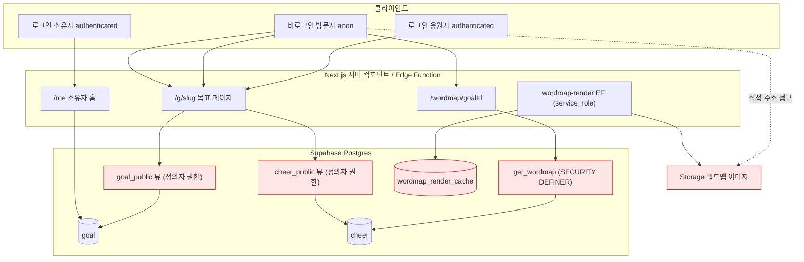
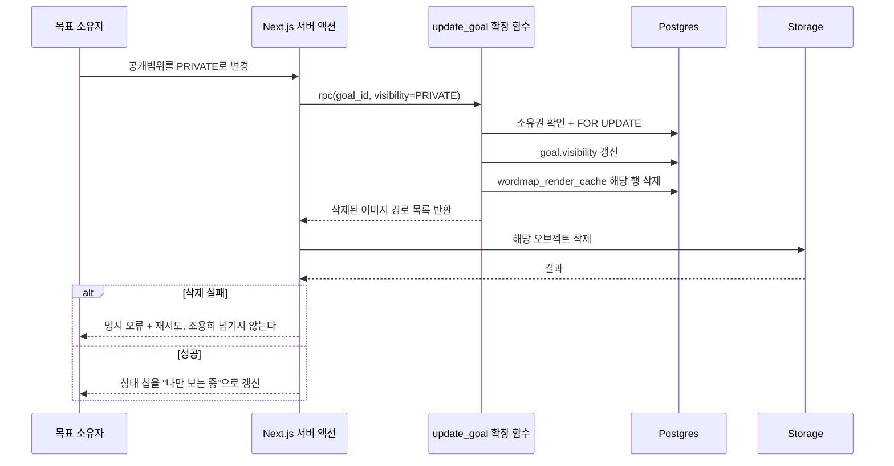
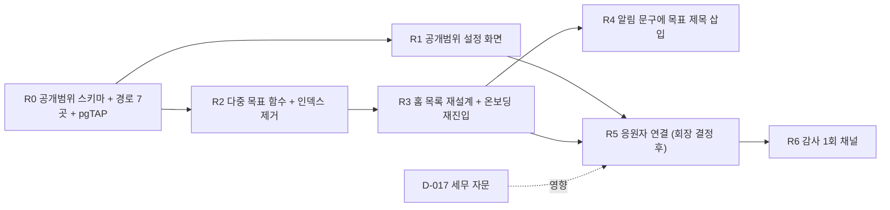

# 기술설계: 다중 목표 · 공개범위 · 응원자 경험 (v1.0.0)

> **STAMP**
> 생성 2026-09-06 KST · model `claude-opus-5[1m]` · agent `tech-architect` · skill 미사용(사유는 문서 끝 선언 블록)
> 기반 포맷: `docs/fdd-haenael-ge-cashout-clover-lock-v1.1.0.md` (섹션 구성·표 스타일·pgTAP ID 명명 상속) + `~/.claude/standards/templates/doc-template-fdd.md` 골격
> 상류 버전 핀: `prd-haenael-ge-v0.4.0` · `audit-haenael-ge-v1.0.0` · `erd.md` · `api-contract.md` · `DESIGN.md` · `user-flow.md`
> 근거: 마이그레이션 42건 중 관련 6건, 앱 라우트 5개, 거버넌스 결정 원장 17건 직접 대조. 외부 벤치마크 2건 실조사(§10).
> 고민: 되돌리기 비싼 것은 스키마가 아니라 **공개범위가 지나가는 경로의 개수**였다. 컬럼 3개를 추가하는 일은 반나절이지만, 그 값을 검사해야 하는 지점이 뷰 2개, 함수 1개, 엣지 함수 1개, 스토리지 오브젝트 1종, 캐시 테이블 1개로 흩어져 있어 한 곳만 빠뜨려도 "숨겼는데 보인다"가 된다. 그래서 이 문서는 스키마보다 **경로 전수표(§5.2)** 를 중심에 뒀다.

---

## 목차

- [0. 이 문서의 성격과 읽는 법](#s0)
- [1. 범위 · 용어 · 전제](#s1)
- [2. TL;DR](#s2)
- [3. 현재 상태 실측 (기존 구현 대비 신규/변경)](#s3)
- [4. 갈래 1: 다중 목표](#s4)
- [5. 갈래 2: 공개범위(visibility)](#s5)
- [6. 갈래 3: 응원자 경험 (회장 결정 사항)](#s6)
- [7. 릴리스 순서와 의존 그래프](#s7)
- [8. 추적성 표 (요구 ↔ 설계 ↔ 테스트)](#s8)
- [9. 거버넌스 대조와 충돌 지점](#s9)
- [10. 벤치마크 실조사](#s10)
- [11. 셀프심문: 이 설계가 틀렸다면 왜인가](#s11)
- [12. 레드팀 1회](#s12)
- [13. ⛔ 회수 필요 (회장 결정 항목)](#s13)
- [14. 오픈이슈 · 개정이력](#s14)

---

## 0. 이 문서의 성격과 읽는 법 <a id="s0"></a>

이 문서는 **확정된 계약이 아니다.** 루트 하네스 §6.3.5는 API 계약·DB 스키마·아키텍처를 회장 합의 전에 확정하는 것을 금지한다. 그래서 여기 실린 스키마 문장(`ALTER TABLE ...`)은 **선택지를 구체적으로 보여주기 위한 예시 표기**이지 실행 대상이 아니다. 마이그레이션 파일과 코드는 이번 산출에 포함하지 않았다.

읽는 순서는 이렇게 잡으면 된다. 시간이 없으면 §2와 §13만 보면 된다. §13이 회장이 정해야 하는 것 전부이고, 나머지는 그 결정이 내려진 뒤 개발자가 그대로 구현할 수 있게 채워 둔 근거다.

문서에서 쓰는 표기는 셋이다. **확정**은 이미 결정 원장이나 승인 PRD에 박혀 뒤집지 않는 것, **추천**은 설계자가 미는 안이되 회장이 뒤집을 수 있는 것, **회수**는 설계자가 정하면 안 되는 것이다.

---

## 1. 범위 · 용어 · 전제 <a id="s1"></a>

### 1.1 범위

포함하는 것은 세 갈래다. 계정당 활성 목표 여러 개, 목표 단위 공개범위와 항목별 공개 설정, 응원자 계정 연결과 그에 딸린 화면. 각 갈래마다 스키마와 화면이 함께 움직여야 하므로 한 묶음으로 설계한다.

포함하지 않는 것은 다음과 같다. 감사가 지적한 텍스트 오버플로 3건과 오류 처리 3건은 컨트롤러가 이미 해소했다(커밋 `8ba59dc`, `df768d4`). 환전 노출 제한(감사 P0)은 별도 트랙이며 이 문서의 설계와 스키마를 공유하지 않는다. 마이페이지 6항목, 카테고리 태그, 문의 폼은 PRD 순서상 이 세 갈래 뒤에 오므로 다루지 않는다.

### 1.2 용어

| 용어 | 이 문서에서의 뜻 |
|---|---|
| 목표 소유자 | 목표를 만든 사람. 코드의 `goal.member_id`. PRD 용어로는 "주인공" 또는 "받는 사람" |
| 응원자 | 목표 페이지에서 결제한 사람. 현재는 전원 계정 없는 손님이다 |
| 손님 결제 | 로그인 없이 완료되는 결제. `user-flow.md` §5-4에서 잠긴 결정이며 이 설계도 유지한다 |
| 활성 목표 | `status != 'DELETED' AND deleted_at IS NULL`. 앱 전역이 이미 이 정의를 쓴다 |
| 진행 중 목표 | 활성이면서 `due_date >= today`. 목표 개수 상한을 세는 단위 후보다(§4.4) |
| 공개범위 | 목표 전체에 대한 접근 권한. `PRIVATE` / `FRIENDS` / `PUBLIC` 세 값 |
| 항목별 공개 설정 | 응원자 이름 목록, 응원 메시지 각각에 대한 노출 여부 |
| 정의자 권한 | Postgres의 `SECURITY DEFINER`. 함수나 뷰가 만든 사람의 권한으로 실행돼 행 수준 보안을 우회한다 |

### 1.3 전제 (뒤집지 않는다)

1. **개별 응원 금액은 어떤 설정으로도 제3자에게 공개되지 않는다.** 설정 항목이 아니라 시스템 상수다. 근거: PRD §3.1, `DESIGN.md` §5-1, 결정 B(2026-07-19).
2. **손님 결제를 없애지 않는다.** 로그인 강제는 결제 전환을 깨뜨린다. 근거: `user-flow.md` §5-4 잠김.
3. **응원자에게 잔액·적립·포인트백을 주지 않는다.** 주는 순간 선불충전금 보유가 되어 `architecture.md` §2.3의 등록 회피 논증이 무너진다. 이것은 취향이 아니라 존립 조건이다.
4. **환전 관련 코드는 이 설계에서 건드리지 않는다.** D-017이 살아 있는 동안 돈 코어 근처의 동시 변경은 금지한다.

---

## 2. TL;DR <a id="s2"></a>

세 갈래 중 되돌리기가 가장 비싼 것은 **공개범위**다. 컬럼을 추가하는 일이 아니라, 공개범위를 검사해야 하는 경로가 여섯 군데로 흩어져 있고 그중 셋(공개 뷰 2개, 워드맵 함수 1개)이 **정의자 권한이라 행 수준 보안을 아예 우회**하기 때문이다. 그래서 공개범위는 스키마·뷰·함수·엣지 함수·캐시 무효화를 **한 마이그레이션 안에서 전부 닫고**, 3x3 조합 pgTAP으로 잠근 뒤에만 화면에 설정 UI를 붙이는 순서를 추천한다.

다중 목표는 기술적으로는 인덱스 하나를 지우는 일이지만, 상한 3개를 **경합 상황에서도** 지키려면 단순 트리거로는 부족하다. Postgres 기본 격리 수준에서 트리거 안의 `COUNT(*)`는 아직 커밋되지 않은 동시 삽입을 못 세기 때문이다(§10-B1). 트랜잭션 범위 권고 잠금을 쓰는 삽입 전용 함수를 유일한 쓰기 경로로 두는 안을 추천한다.

응원자 경험은 **설계자가 정하면 안 되는 결정 세 개**(손님 응원 허용 범위, 계정 승격 방식, 기존 손님 데이터 처리)에 전부 걸려 있어, 이 문서는 선택지와 결과만 제시하고 확정하지 않는다. §13에 모아 뒀다.

---

## 3. 현재 상태 실측 (기존 구현 대비 신규/변경) <a id="s3"></a>

재창조 금지 규칙에 따라 먼저 무엇이 이미 돌고 있는지 실측했다. 아래는 파일과 줄 번호를 직접 열어 확인한 것이다(근거 확인).

| 대상 | 현재 실제 상태 | 이 설계에서 |
|---|---|---|
| `goal` 테이블 | `init_schema.sql:75-86`. 컬럼 10개. 공개범위 관련 컬럼 **없음** | 신규 컬럼 3개 추가 |
| `goal_one_active_per_member` | `20260720030000:60-62`에서 재생성. 운영에도 적용됨(원격 목록 42건 일치, 감사 확인) | 제거 후 상한 3으로 교체 |
| `goal_public` 뷰 | `init_schema.sql:310-330`. `security_invoker` 미설정 = **정의자 권한**. `anon`에 SELECT 부여(`:547`) | 공개범위 필터 추가 |
| `cheer_public` 뷰 | `20260719000001`. 이름·메시지를 무조건 내보냄. 정의자 권한 명시(주석에 기록됨) | 항목별 설정 반영 |
| `get_wordmap` | `init_schema.sql:338-356`. `SECURITY DEFINER` + `search_path` **미설정**. `anon`에 EXECUTE 부여(`:550`) | 내부 검사 추가 + `search_path` 고정 |
| `wordmap_render_cache` | `init_schema.sql:210-217`. `anon`에 SELECT 부여(`:580`) | 무효화 경로 신설. 아래 주의 참조 |
| `update_goal` RPC | `20260727010000`. 소유권 확인 + `FOR UPDATE` + `search_path` 고정. **잘 짜여 있다** | 공개범위 변경 경로의 참조 구현으로 삼는다 |
| 온보딩 | `onboarding/page.tsx:22-36`에서 목표 보유 시 `/me` 강제 이동 | 제거하고 상한 도달 시에만 안내 |
| 목표 저장 | `OnboardingGoalForm.tsx:86-95`에서 사전 SELECT 후 테이블 직접 삽입 | 삽입 전용 함수 호출로 전환 |
| 홈 | `me/page.tsx:62-72`에서 `.limit(1)` 후 `goals?.[0]` | 목록으로 전환 |
| 공개 응원자 목록 | `g/[slug]/page.tsx:199`에 주석만 있고 부품 없음 | 신규 |
| `cheer` 응원자 식별 | `supporter_ci`(암호문)와 `display_name`뿐. 계정 외래키 **없음** | 회장 결정 후(§13-D3) |
| pgTAP | `supabase/tests/` 11개 파일. 공개범위·다중 목표 관련 **0건** | 신규 3묶음 |

**주의 하나를 먼저 박아 둔다.** `wordmap_render_cache`에 `anon` SELECT가 열려 있고(`init_schema.sql:580`) 렌더된 이미지는 Storage 오브젝트다. 목표를 비공개로 바꿔도 이 두 곳을 같이 지우지 않으면 이미지 주소를 아는 사람은 계속 본다. 감사가 지적한 뷰·함수 두 곳만 막으면 닫혔다고 착각하기 쉬운 지점이라 §5.2 경로표에 별도 행으로 뒀다.

### 3.1 시스템 아키텍처 (공개범위가 지나가는 경로)



붉게 표시한 다섯 개가 **행 수준 보안이 작동하지 않는 경로**다. 공개범위를 이 다섯 곳 전부에서 각각 검사해야 한다.

---

## 4. 갈래 1: 다중 목표 <a id="s4"></a>

### 4.1 무엇이 문제인가

승인 PRD `:196`은 유니크 인덱스를 지우고 계정당 여러 활성 목표를 허용하라고 한다. 그런데 마이그레이션 `20260720030000:60-62`가 그 인덱스를 다시 만들었고 운영에도 적용돼 있다. 앱도 세 곳에서 목표가 하나라는 전제로 짜여 있다. 그래서 **화면만 먼저 바꾸면 두 번째 저장이 `23505`로 실패**하고, **제약만 먼저 지우면 두 번째 목표가 데이터에는 있는데 화면에 없는 유령**이 된다. 둘을 한 릴리스로 묶어야 하는 이유가 이것이다.

### 4.2 결정할 것 A: 상한 3개를 어디서 원자 보장하는가

이것이 이 갈래에서 되돌리기가 가장 비싼 선택이다. 쓰기 경로의 모양이 바뀌기 때문이다.

**선택지 가.** 목표 테이블에 삽입 전 트리거를 두고 그 안에서 현재 개수를 센다.
고르면: 앱을 거의 안 고쳐도 된다. 기존 테이블 직접 삽입 코드가 그대로 살아 있고, 관리자 도구나 SQL 콘솔로 넣어도 똑같이 막힌다.
리스크: **경합에서 뚫린다.** Postgres 기본 격리 수준인 read committed에서 트리거 안의 `COUNT(*)`는 아직 커밋되지 않은 동시 트랜잭션의 삽입을 세지 못한다. 사용자가 저장 버튼을 두 번 빠르게 누르거나 탭 두 개에서 동시에 저장하면 4개가 들어간다(§10-B1 실조사 근거). 지금 이 코드베이스에는 이미 같은 형태의 흔적이 있다. `OnboardingGoalForm.tsx:86-95`가 "사전 SELECT 후 삽입"이고 주석이 "동시요청 레이스는 DB 유니크 인덱스가 최종 방어선"이라고 적어 뒀다. 유니크 인덱스를 지우는 순간 그 최종 방어선이 사라진다.

**선택지 나 (추천).** 삽입 전용 함수 `create_goal`을 만들고, 그 안에서 계정 단위 트랜잭션 범위 권고 잠금을 먼저 잡은 뒤 개수를 세고 삽입한다. 테이블 직접 삽입 권한은 회수한다.
고르면: 같은 계정의 동시 저장이 직렬화되므로 상한이 실제로 지켜진다. 상한 검사, 제목 접미사 붙이기, `slug` 생성이 한 곳에 모여 앱과 DB의 규칙 불일치가 사라진다. 이미 `update_goal`(`20260727010000`)이 정확히 이 형태(정의자 권한 + 소유권 확인 + `FOR UPDATE` + `search_path` 고정)로 잘 짜여 있어 **같은 레포 안에 참조 구현이 있다.**
트레이드오프: 앱의 저장 코드를 함수 호출로 바꿔야 하고, 함수 실패 코드와 화면 안내 문구를 새로 매핑해야 한다. 권한 회수 때문에 기존 테스트 픽스처도 손봐야 한다.

**선택지 다.** 상한을 두지 않는다.
고르면: 구현이 가장 싸다.
리스크: 어뷰징 표면이 열린다. 한 계정이 목표를 수백 개 만들어 공유 링크를 찍어내는 경로가 생긴다. 이미 `cheer_order_abuse_guard` 마이그레이션이 같은 성격의 방어로 존재한다는 것은 이 제품이 그 표면을 신경 쓴다는 뜻이다.

**추천은 나다.** 근거는 셋이다. 첫째, 인덱스를 지우면서 아무 원자 보장도 두지 않으면 방어가 순수하게 앱 코드 한 줄로 내려앉는데, 이 레포는 결정 A 때 이미 "앱과 DB 이중 방어"를 택한 선례가 있다. 둘째, 참조 구현이 같은 레포에 있어서 새 패턴을 발명하지 않는다. 셋째, 권고 잠금은 행이 아직 존재하지 않는 대상(만들려는 N번째 목표)을 잠글 수 있는 유일한 수단이다(§10-B1).

### 4.3 결정할 것 B: 상한을 세는 단위

PRD §4.3-9는 마감이 지난 목표를 상한에서 빼자고 한다. 마감 목표가 자리를 잡아먹으면 "새 목표를 만들려면 옛날 것을 지워야 한다"는 결정 A 시절의 병리가 되돌아오기 때문이다.

- **선택지 가 (추천).** 진행 중 목표만 센다. `status != 'DELETED' AND deleted_at IS NULL AND due_date >= today`.
- **선택지 나.** 활성 목표 전부를 센다. 마감된 것도 센다.

가를 추천한다. 다만 **가에는 숨은 성질이 하나 있다.** 상한 계산이 날짜에 의존하므로, 오늘 상한에 걸린 사용자가 내일 자동으로 풀린다. 이것은 사용자에게 유리한 방향이라 문제되지 않지만, 테스트를 쓸 때 `due_date`를 고정하지 않으면 시간이 지나며 깨진다. pgTAP에서 마감일을 상대값이 아니라 명시값으로 고정하라는 지시를 §8 테스트 표에 넣어 뒀다.

### 4.4 예시 표기 (확정 아님)

```sql
-- 갈래 1이 건드리는 것 (예시 표기)
DROP INDEX IF EXISTS goal_one_active_per_member;

CREATE FUNCTION create_goal(p_title text, p_reason text, p_due_date date, ...)
RETURNS TABLE(slug text)
LANGUAGE plpgsql SECURITY DEFINER SET search_path = public, pg_temp
-- 본문: pg_advisory_xact_lock(hashtext(auth.uid()::text))
--       → 진행 중 목표 개수 확인 → 상한 초과면 오류 → 삽입
REVOKE INSERT ON goal FROM authenticated;
```

### 4.5 화면 변경

| 화면 | 현재 | 변경 |
|---|---|---|
| `/onboarding` (`page.tsx:22-36`) | 목표 있으면 `/me`로 이동 | 이동 제거. 폼은 항상 열린다. 저장 시점에만 상한 안내 |
| `/me` (`page.tsx:62-72`) | `.limit(1)` 후 첫 행 | 목록 조회. 진행 중 목표 카드 세로 스택 + "지난 목표" 접힘 구역 |
| `/` (`page.tsx:143`) | 목표 있으면 무조건 `/home` | 유지. 새 목표 진입로는 홈 안에 둔다 |
| 목표 카드 | 없음 | 신규. 제목, 남은 날짜, 응원 인원수, 링크 복사 버튼을 카드 안에 |
| 잔액 카드 | 목표와 붙어 있음 | 목록 위 계정 단위 1개로 분리 |

정렬은 PRD §4.3-1대로 최근 응원 도착순, 같으면 생성 역순으로 둔다. 근거는 홈이 "돌아올 이유"를 보여주는 화면이라 확인하지 않은 응원이 위로 와야 한다는 것이다.

**대표 링크는 만들지 않는다.** 카드마다 링크 복사만 둔다. 대표 링크는 사람 단위 허브 페이지가 되는데 `DESIGN.md` §0이 "대시보드 아님, 피드 아님"으로 잠근 형태에 사람 허브를 새로 여는 것이라 범위 밖이다.

### 4.6 경계 상황

| 상황 | 처리 |
|---|---|
| 목표 0개 | 현행 유지. 온보딩으로 |
| 상한 도달 상태에서 새 목표 시도 | 폼 진입은 허용하고 **저장 시점**에 안내한다. 쓴 글을 날리지 않는다는 원칙 |
| 같은 계정에서 동시 저장 2건 | 권고 잠금으로 직렬화. 두 번째가 상한 안이면 성공, 넘으면 명시 오류 |
| 목표 전부 마감 | "지난 목표"만 표시하고 "새 목표 만들기"를 주 동작으로 |
| 같은 제목 중복 | 허용. `slug`가 유일하므로 자동으로 갈라진다 |
| 되돌리기 | 인덱스 재생성이지만 그 시점에 중복이 있으면 실패한다. **되돌리기가 비대칭임을 인지하고 들어간다** |

---

## 5. 갈래 2: 공개범위 <a id="s5"></a>

### 5.1 무엇이 문제인가

`architecture.md` §4는 목표 도메인에 공개범위가 있다고 적혀 있는데 `init_schema.sql:75-86`에는 그 컬럼이 없다. 문서가 앞서고 DB가 비어 있는 상태다. 지금은 설정 화면 자체가 없어서 모든 목표가 사실상 공개이므로 실제 유출은 아니지만, **컬럼만 붙이고 검사를 빠뜨리면 그 순간 유출이 된다.** 감사가 이것을 회귀 위험으로 지목한 이유다.

### 5.2 경로 전수표 (이 설계의 핵심)

공개범위를 검사해야 하는 지점을 전부 센다. 하나라도 빠지면 "숨겼는데 보인다"가 된다.

| # | 경로 | 왜 위험한가 | 무엇을 해야 하나 | 빠뜨리면 |
|---|---|---|---|---|
| 1 | `goal_public` 뷰 | 정의자 권한이라 행 수준 보안을 우회한다. `anon`에 SELECT 부여됨 | `WHERE`에 `visibility = 'PUBLIC'` 추가. `visibility` 컬럼 자체는 뷰에 넣지 않는다 | 비공개 목표의 제목·이유가 링크로 그대로 나온다 |
| 2 | `cheer_public` 뷰 | 정의자 권한. 이름·메시지를 무조건 내보낸다 | 목표에 조인해서 이름은 `supporter_name_visibility='PUBLIC'`일 때만, 메시지는 `message_visibility='PUBLIC'`일 때만 값을 내고 아니면 NULL | 이름·메시지 설정이 무시된다 |
| 3 | `get_wordmap` | `SECURITY DEFINER`이고 `search_path`도 안 잡혀 있다. `anon` 실행 가능 | 함수 안에서 목표의 공개범위와 메시지 공개 설정을 직접 확인하고 아니면 0행. `search_path` 고정 동시 수행 | 목표 번호만 알면 비공개 메시지의 단어가 나온다. 감사가 지목한 지점 |
| 4 | `wordmap-render` 엣지 함수 | `service_role`이라 모든 것을 우회한다 | 렌더 대상이 공개가 아니면 생성 거부 | 비공개 목표의 공유 이미지가 새로 만들어진다 |
| 5 | `wordmap_render_cache` | `anon` SELECT 부여됨(`init_schema.sql:580`) | 비공개 전환 시 해당 목표의 캐시 행 삭제 | 이전에 만들어진 이미지 주소가 계속 조회된다 |
| 6 | Storage 오브젝트 | 주소를 아는 사람은 DB를 안 거친다 | 캐시 행과 함께 오브젝트도 삭제 | **5를 지워도 여전히 보인다.** 가장 놓치기 쉬운 지점 |
| 7 | `cheer-order` 엣지 함수 | 결제 시작 지점 | 비공개 목표면 400으로 거부 | 화면에서 버튼을 숨겨도 직접 호출로 우회된다 |

7번을 굳이 넣은 이유는 화면에서 CTA를 숨기는 것만으로는 못 막기 때문이다. 클라이언트만 막으면 우회된다.

### 5.3 결정할 것 C: 값을 어디에 두는가

- **선택지 가 (추천).** 목표 테이블에 열거형 컬럼 3개(`visibility`, `supporter_name_visibility`, `message_visibility`).
- **선택지 나.** JSON 컬럼 하나에 설정을 모은다.

가를 추천한다. 근거는 이 값들이 **보안 경계를 결정한다**는 것이다. 뷰 조건이 `AND x = 'PUBLIC'` 한 줄로 통일되고, 열거형이라 오타가 스키마 단계에서 막히며, pgTAP이 컬럼 존재 여부와 값 도메인을 직접 단언할 수 있다. JSON은 항목 추가가 공짜인 대신 뷰와 정책에서 캐스팅이 들어가고 타입 안전성이 떨어진다. 보안 경계를 느슨한 타입에 두면 회귀 테스트의 실효가 같이 떨어진다.

값은 세 개(`PRIVATE`/`FRIENDS`/`PUBLIC`)로 만들되 **`FRIENDS`는 v2에서 선택할 수 없게 한다.** 친구 관계 테이블이 없기 때문이다. 열거형에 미리 넣어 두는 것은 나중에 2값을 3값으로 바꾸는 마이그레이션(뷰·정책·테스트 동시 개정)을 피하기 위한 것이다.

기존 행의 기본값은 `PUBLIC`으로 채운다. 지금 모든 목표가 사실상 공개이므로 이 값이 현재 상태를 보존한다. **신규 생성 시의 기본값은 별개 문제**이고 PRD §9-Q1이 공개를 추천했다. 이 설계도 그것을 따르되, 링크 발급 화면에 "나만 보기로 전환"을 눈에 띄는 보조 버튼으로 둔다.

### 5.4 결정할 것 D: 뷰를 호출자 권한으로 바꿀 것인가

이건 감사에 없던 항목인데 벤치마크 조사에서 나왔다(§10-B2). Postgres 15 이상에서 뷰에 `security_invoker = true`를 주면 뷰가 기반 테이블의 행 수준 보안을 따른다. 지금 두 공개 뷰는 이 설정이 없어 정의자 권한으로 돌고 있고, `20260719000000`의 주석이 그것을 **의도적으로** 이용하고 있다. `anon`의 기반 테이블 권한을 회수하고도 뷰로는 읽히게 하려는 설계였다.

- **선택지 가 (추천).** 정의자 권한을 유지하고 뷰 `WHERE` 절에서 명시적으로 필터한다.
- **선택지 나.** 호출자 권한으로 바꾸고 행 수준 보안 정책으로 공개범위를 표현한다.

가를 추천한다. 나로 바꾸면 `anon`에게 기반 테이블 권한을 다시 줘야 하고, 그 순간 `20260719000000`이 막아 둔 금액 컬럼 노출 경계가 정책 하나에만 의존하게 된다. 지금 구조는 **컬럼이 뷰에 아예 없다**는 것이 방어인데, 그게 정책보다 강하다. 다만 가를 고르면 필터를 사람이 빠뜨릴 수 있으므로 §8의 pgTAP이 유일한 안전망이 된다는 점을 명시한다.

### 5.5 소유자 변경 경로

`update_goal`(`20260727010000`)이 이미 소유권 확인과 잠금을 갖추고 있다. 공개범위 변경도 같은 함수를 확장하거나 같은 형태의 별도 함수로 둔다. **이 함수 안에서 캐시 무효화까지 같이 일어나야 한다.** 화면 코드가 두 번 호출하는 구조로 두면 두 번째 호출이 실패했을 때 설정만 바뀌고 이미지가 남는다.

무효화 대상은 §5.2의 5번과 6번이다. 6번(Storage 오브젝트)은 SQL에서 지울 수 없으므로 함수는 캐시 행만 지우고 **오브젝트 삭제는 엣지 함수나 서버 액션이 맡아야 한다.** 이 비대칭이 이 갈래의 유일한 구조적 약점이고, 실패 시 이미지가 남으므로 **삭제 실패를 로그로 흘리지 말고 재시도 큐나 명시 오류로 다뤄야 한다.**

### 5.6 상태 전이



### 5.7 화면 표기

소유자에게는 목표 카드에 상태 칩을 둔다. "나만 보는 중" 또는 "링크 아는 사람 모두". 방문자가 접근할 수 없으면 404가 아니라 "지금은 볼 수 없는 목표예요"와 랜딩 링크를 준다. 404를 쓰면 목표가 존재하지 않는 것과 숨겨진 것을 구분할 수 없어 오히려 사용자가 혼란스럽다.

**"나만보기"라는 말은 UI 라벨로도 쓰지 않는다.** PRD가 이미 지적했듯 이 단어가 목표 전체 비공개와 응원자 목록 비공개 두 층에서 다른 뜻으로 쓰여 왔고, 그 혼동이 그대로 두면 정책 이름과 테스트 이름까지 오염된다.

### 5.8 경계 상황

| 상황 | 처리 |
|---|---|
| 공개에서 비공개로 전환 | 받은 응원과 클로버는 유지한다. 원장은 불변이다 |
| 비공개 목표에 결제 시도 | 화면에서 CTA를 숨기고 **엣지 함수도 거부**한다. 둘 다 필요하다 |
| 진행 중 결제와 전환이 겹침 | 이미 시작된 결제는 확정을 허용한다. 돈은 이미 나갔다. 신규 주문만 막는다 |
| 마감과 비공개의 조합 | 독립 축이다. 마감은 날짜, 공개범위는 접근권이다. 네 조합 모두 유효하다 |
| 메시지 비공개인데 이름은 공개 | 허용한다. "○○님 외 3명이 응원" + 워드맵 없음 |
| 응원자가 익명을 골랐을 때 | 응원자의 선택과 목표 설정을 **둘 다 만족해야** 이름이 나온다. 하나라도 숨기면 숨긴다 |
| 소유자 본인 화면 | 설정과 무관하게 전부 보인다 |

---

## 6. 갈래 3: 응원자 경험 <a id="s6"></a>

> **이 갈래는 회장 결정 없이는 착수할 수 없다.** 스키마의 모양이 정책에 따라 달라지기 때문이다. 아래는 선택지와 결과만 적고 확정하지 않는다.

### 6.1 지금 무엇이 없는가

`cheer` 테이블에 응원자 계정 외래키가 없다. 있는 것은 암호화된 본인인증 값과 표시 이름뿐이다. 그래서 "내가 응원한 목표" 화면을 만들 데이터가 아예 없다. 감사 표현대로 "스키마부터 없다". 감사 메시지(`thanks_message`)도 마찬가지다. 공개 응원자 목록은 뷰는 있는데 화면에 연결되지 않았다(`g/[slug]/page.tsx:199`가 주석뿐).

### 6.2 회수 D3: 손님 응원을 계속 허용하는가

이것이 나머지 전부를 결정한다.

**선택지 가.** 손님 응원을 유지하고 계정 연결은 선택으로 둔다.
결과: 결제 마찰이 0으로 유지된다. `cheer.supporter_member_id`는 NULL을 허용하고, 손님 응원은 NULL로 남는다. 마이페이지가 계정 사용자에게만 생기고 그것이 계정을 만들 유인이 된다.
트레이드오프: 응원자의 절대 다수가 영원히 손님으로 남을 가능성이 높다. 그러면 마이페이지와 감사 채널을 만들어도 쓰는 사람이 거의 없다. **기능 전체가 헛돌 위험이 실재한다.**

**선택지 나.** 응원 시 로그인을 강제한다.
결과: 응원자 데이터가 완전해지고 마이페이지·감사 채널이 실제로 작동한다.
트레이드오프: `user-flow.md` §5-4의 잠긴 결정을 뒤집는다. `risks.md` R3(결제 마찰과 전환 위험)이 그대로 현실화된다. **추천하지 않는다.** 이 제품의 유일한 수익 경로가 결제인데 그 앞에 문을 세우는 것이다.

**선택지 다.** 손님 응원을 유지하되 연락처만 받아 나중에 연결한다.
결과: 마찰이 로그인보다는 작다.
트레이드오프: 개인정보 수집 항목이 늘고 처리방침을 고쳐야 한다. 지금 처리방침이 이미 운영과 어긋나 있다는 지적(감사 P1, `privacy/page.tsx:201`)이 미해소인 상태에서 항목을 더 얹는 것은 순서가 뒤집힌 일이다.

설계자 의견은 **가**다. 다만 가를 고르면 §6.4와 §6.5의 기능들이 초기에 거의 안 쓰인다는 것을 예상하고 들어가야 하고, 그렇다면 **순서상 이 갈래를 갈래 1·2보다 뒤에 두는 것이 맞다.** PRD §7.2도 같은 순서다.

### 6.3 선행 검증 항목: 계정 승격을 어떻게 하는가 (회장 결정이 아니라 기술 검증으로 정해진다)

**선택지 가.** Supabase 익명 세션을 소셜 계정에 연결해서 사용자 번호를 보존한다.
결과: 과거 응원이 그대로 따라온다. 결제 행을 손대지 않는다.
트레이드오프: 카카오가 이 프로젝트에서 커스텀 OAuth로 붙어 있어(`architecture.md` §1) 연결 경로가 검증되지 않았다. **먼저 기술 검증이 필요하고, 검증이 실패하면 이 안은 사라진다.**

**선택지 나.** 새 계정을 만든 뒤 응원 행의 소유자를 사후에 기입한다.
결과: 구현이 단순하다.
트레이드오프: 결제와 원장이 참조하는 행을 사후에 고치게 된다. 돈 코어 근처다. `architecture.md` §6의 무관용 원칙에 걸린다.

설계자 의견은 **가를 먼저 검증하고, 불가하면 나를 "직전 결제 1건만"으로 범위를 좁혀 적용**하는 것이다. 범위를 좁히면 사후 수정 대상이 한 행으로 제한돼 위험이 관리 가능해진다.

### 6.4 회수 D4: 기존 손님 응원 데이터를 어떻게 하는가

**선택지 가 (추천).** 손대지 않는다. 새 컬럼은 NULL로 두고 과거 응원은 영원히 손님 응원으로 남는다.
결과: 마이그레이션이 컬럼 추가 한 줄로 끝난다. 데이터 변경이 0이다.
트레이드오프: 승격한 사용자가 "예전에 응원했는데 왜 안 보이지"를 겪는다. 화면에서 "계정을 만든 뒤의 응원부터 기록됩니다"를 명시해야 한다.

**선택지 나.** 암호화된 본인인증 값으로 과거 응원과 새 계정을 대조해서 소급 연결한다.
결과: 과거 기록이 살아난다.
트레이드오프: 암호문 대조로 사람을 식별하는 경로를 새로 만드는 것이고, 오매칭이 나면 **A가 B의 응원 기록을 보게 된다.** 금액이 딸려 있어 사고의 크기가 크다. 강하게 반대한다.

### 6.5 정책이 정해진 뒤의 설계 (참고)

가·가·가로 정해진다고 가정했을 때 필요한 것을 미리 적는다. 확정이 아니다.

컬럼 셋이 붙는다. 응원자 계정 외래키, 감사 메시지(200자), 감사 발송 시각. 행 수준 보안 정책이 하나 생기고 그 정책이 **이 설계 전체의 최대 사고 지점**이다. 응원자는 자기가 보낸 것만 봐야 하고 같은 목표의 다른 사람 금액은 못 봐야 한다. 행 단위 정책이므로 조건 하나로 보장되지만, **그 한 줄이 다음 리팩터에서 깨지면 응원자끼리 금액이 상호 노출된다.** pgTAP으로 못 박지 않으면 안 된다.

감사 채널은 1회 단방향이다. 응원자에게 답장 입력 자체를 주지 않는다. 그리고 **미전송 감사에 배지나 개수 표시를 넣지 않는다.** 넣는 순간 감사가 의무가 되고, 그것은 이 제품의 핵심 명제("감사 답장 의무 0")를 정면으로 깬다. 감사 메시지도 사용자가 쓴 글이므로 신고 대상에 포함해야 한다. 안 그러면 소유자가 응원자에게 욕설을 보낼 수 있는 감시 없는 통로가 열린다.

### 6.6 세무 자문과의 뜻밖의 연결

`wiki/거버넌스/요청.md:99-108`의 세무 질의는 응원금이 증여인지 인적용역 대가인지를 묻고 있고, 질의 4번은 "여러 응원자로부터 나누어 받은 금액을 어떤 단위로 합산·공제 판단하는지"를 묻는다. **증여로 결론이 나면 응원자 단위 합산이 필요해지고, 그러면 응원자 식별이 세무 요구사항이 된다.** 지금은 제품 기능으로만 보이는 응원자 연결이 D-017의 결론에 따라 성격이 달라질 수 있다. 이 갈래를 D-017보다 먼저 확정하지 않는 것이 안전한 또 하나의 이유다.

---

## 7. 릴리스 순서와 의존 그래프 <a id="s7"></a>



| 릴리스 | 내용 | 왜 이 순서인가 | 되돌리기 |
|---|---|---|---|
| R0 | 공개범위 스키마와 §5.2의 일곱 경로를 **한 마이그레이션에서** 닫고 pgTAP 통과 | 다른 모든 것이 이 컬럼을 참조한다. 나중에 하면 뷰와 함수를 두 번 고친다. 화면 없이 스키마만 먼저 나가므로 사용자에게 보이는 변화가 0이라 안전하다 | 쉽다. 컬럼 값이 전부 공개라 되돌려도 동작이 같다 |
| R1 | 설정 화면과 상태 칩. 캐시·오브젝트 무효화 연결 | R0의 pgTAP이 통과한 뒤에만 UI를 연다. **순서를 뒤집으면 검사 없는 설정이 열린다** | 쉽다. 화면만 되돌린다 |
| R2 | 인덱스 제거, 삽입 전용 함수, 테이블 직접 삽입 권한 회수 | 화면과 같은 릴리스여야 한다. 앞서면 유령 목표, 뒤지면 저장 실패 | **비대칭.** 인덱스 재생성은 중복이 있으면 실패한다 |
| R3 | 홈 목록, 온보딩 재진입, 목표 카드 | R2와 **같은 배포에 묶는다** | R2와 함께 |
| R4 | 알림 문구에 목표 제목 삽입 | 카카오 알림톡은 템플릿 사전 심사가 필요하다. **리드타임 때문에 R2와 병렬로 미리 신청**한다 | 심사 대기라 되돌림 개념이 다르다 |
| R5 | 응원자 연결 | §13의 결정 세 개가 나온 뒤. D-017 결론도 성격에 영향(§6.6) | 중간. 컬럼 추가는 되돌리기 쉽지만 정책은 신중 |
| R6 | 감사 채널 | R5 위의 얇은 층 | 쉽다 |

R2와 R3을 하위 호환 기간 없이 한 번에 넘기라는 것은 감사의 권고이기도 하다. 앱과 DB가 서로 다른 전제로 도는 창을 만들지 않는 것이 목적이다.

---

## 8. 추적성 표 (요구 ↔ 설계 ↔ 테스트) <a id="s8"></a>

수용 기준은 Given/When/Then으로 적었다. 각 행은 요구 1건, 설계 1곳, 테스트 1건으로 맞물린다.

### 8.1 갈래 1: 다중 목표

| ID | 요구 (상류 핀) | 수용 기준 | 설계 위치 | 테스트 |
|---|---|---|---|---|
| G-1 | PRD v0.4.0 `:196` 유니크 인덱스 제거 | Given 진행 중 목표 1개인 계정, When 두 번째 목표를 저장하면, Then 성공한다 | §4.4 인덱스 제거 | pgTAP `MG-1` |
| G-2 | PRD `:255` 홈에 활성 목표 전부 표시 | Given 진행 중 목표 2개, When `/me`를 열면, Then 카드 2개가 모두 보인다 | §4.5 홈 목록 | E2E `goal-multi.spec.ts` 시나리오 1 |
| G-3 | 상한 3개 (감사 교정안) | Given 진행 중 목표 3개, When 네 번째를 저장하면, Then 명시 오류가 뜨고 행이 늘지 않는다 | §4.2 선택지 나 | pgTAP `MG-2` |
| G-4 | 상한의 원자 보장 | Given 진행 중 목표 2개, When 같은 계정이 동시에 2건을 저장하면, Then 총 3개를 넘지 않는다 | §4.2 권고 잠금 | pgTAP `MG-3` (`supabase/tests/concurrency/` 기존 패턴 재사용) |
| G-5 | 마감 목표는 상한에서 제외 | Given 마감 지난 목표 3개, When 새 목표를 저장하면, Then 성공한다. 마감일은 테스트에서 고정값으로 둔다 | §4.3 선택지 가 | pgTAP `MG-4` |
| G-6 | 감사 `onboarding/page.tsx:22` 교정 | Given 목표 1개인 로그인 사용자, When `/onboarding`을 열면, Then `/me`로 튕기지 않고 폼이 보인다 | §4.5 | E2E `goal-multi.spec.ts` 시나리오 2 |
| G-7 | 원장 정합 | Given 목표 2개에 각각 결제, When 잔액을 조회하면, Then 두 결제 합과 일치한다 | 변경 없음(계정 단위 유지) | pgTAP `MG-5` |
| G-8 | 구 계약 전환 기록 | Given 기존 `OnboardingGoalForm.test.tsx:46`의 1목표 단언, When 다중 목표로 전환하면, Then 단언을 삭제가 아니라 **계약 전환 주석과 함께** 교체한다 | §4.5 | 단위 테스트 개정 |

### 8.2 갈래 2: 공개범위

| ID | 요구 (상류 핀) | 수용 기준 | 설계 위치 | 테스트 |
|---|---|---|---|---|
| V-1 | PRD `:124-135` 공개범위 열거형과 컬럼 | Given 마이그레이션 적용, When 스키마를 조회하면, Then 컬럼 3개가 지정 타입으로 존재한다 | §5.3 | pgTAP `SEC-6-0` |
| V-2 | `goal_public` 필터 | Given 비공개 목표, When 비로그인으로 `/g/{slug}`를 열면, Then 제목·이유·워드맵 단어가 **한 개도** 안 나온다 | §5.2 경로 1 | pgTAP `SEC-6a` + E2E |
| V-3 | 정의자 권한 함수 내부 검사 | Given 비공개 목표, When 비로그인이 워드맵 함수를 호출하면, Then 0행 | §5.2 경로 3 | pgTAP `SEC-6c` |
| V-4 | 이름·메시지 3x3 조합 | Given 이름·메시지 설정의 9가지 조합, When 비로그인이 공개 응원 목록을 읽으면, Then 각 조합의 기대값과 정확히 일치한다 | §5.2 경로 2 | pgTAP `SEC-6b` (9케이스 반복) |
| V-5 | 금액 영구 잠금 (PRD `:184-186`) | Given **9가지 조합 전부**, When 비로그인이 어떤 경로로든 접근하면, Then 개별 금액에 도달할 수 없다 | 컬럼 부재가 방어 | pgTAP `SEC-6d` |
| V-6 | 공개 뷰 컬럼 부재 | Given 공개 응원 뷰, When 컬럼 목록을 확인하면, Then 금액·본인인증 컬럼이 없다 | 기존 계약 승계 | pgTAP `SEC-6e` (`hasnt_column`) |
| V-7 | 캐시 무효화 | Given 공개 목표에 이미지 캐시 존재, When 비공개로 전환하면, Then 캐시 행이 0이고 **Storage 오브젝트도 없다** | §5.5 | pgTAP `SEC-6f` + E2E `wordmap-share.spec.ts` 확장 |
| V-8 | 엣지 함수 거부 | Given 비공개 목표, When 결제 주문 엣지 함수를 직접 호출하면, Then 400 | §5.2 경로 7 | 통합 테스트 |
| V-9 | 소유자 기능 보존 | Given 위 전부, When 소유자 본인이 조회하면, Then 전부 보인다 | §5.8 | pgTAP `SEC-6g` |
| V-10 | 기존 목표 회귀 | Given 마이그레이션 전후, When 공개 목표 행 수를 세면, Then 같다 | §5.3 기본값 공개 | pgTAP `SEC-6h` |
| V-11 | `search_path` 고정 | Given 워드맵 함수, When 정의를 확인하면, Then `search_path`가 고정돼 있다 | §5.2 경로 3 | pgTAP `SEC-6i` (§10-B2 근거) |

### 8.3 갈래 3: 응원자 (결정 후에만 유효)

| ID | 요구 (상류 핀) | 수용 기준 | 설계 위치 | 테스트 |
|---|---|---|---|---|
| S-1 | PRD `:278-301` 응원자 식별 | Given 계정 응원자, When 마이페이지를 열면, Then 자기 응원만 보인다 | §6.5 | pgTAP `SEC-7a` |
| S-2 | 응원자 간 금액 격리 | Given 같은 목표에 A와 B가 응원, When B가 조회하면, Then A의 금액에 도달 불가 | §6.5 정책 | pgTAP `SEC-7b` |
| S-3 | 손님 결제 보존 | Given 로그인 안 함, When 결제하면, Then 완료 화면까지 도달한다 | §6.2 선택지 가 | E2E `cheer-payment.spec.ts` 회귀 |
| S-4 | 로그인 유도 위치 제한 | Given 모든 화면, When 훑으면, Then 결제 완료 화면 외 어디에도 로그인 유도가 없다 | §6.5 | E2E |
| S-5 | PRD `:391` 감사 1회 | Given 감사 1회 발송된 응원, When 두 번째를 시도하면, Then 거부된다 | §6.5 | pgTAP `SEC-7c` |
| S-6 | 적립 금지 (존립 조건) | Given 응원자 화면과 API 응답 전부, When 필드를 훑으면, Then 잔액·적립 필드가 없다 | §1.3 전제 3 | 통합 테스트 |

### 8.4 갭 점검

`user-flow.md`의 각 스텝을 이 설계의 화면·경로·테이블에 대조했다. **매핑되지 않는 스텝은 §6에 걸린 것뿐이고**(응원자 승격, 마이페이지, 감사), 그것은 회장 결정 대기라서 갭이 아니라 **의도적 미결**로 표시한다. 갈래 1과 2에는 매핑 갭이 0이다.

---

## 9. 거버넌스 대조와 충돌 지점 <a id="s9"></a>

| 확정 항목 | 이 설계와의 관계 | 판정 |
|---|---|---|
| D-017 환전 제한 | 이 설계는 환전 코드를 건드리지 않는다. §6.6에서 세무 결론이 응원자 식별 요구에 영향을 줄 수 있음만 표면화 | 충돌 없음 |
| D-003 "선언과 인원수는 보이게, 지갑은 조용하게" | §1.3 전제 1이 지갑 쪽을 시스템 상수로 유지한다. 선언 쪽은 **공개범위 기능이 사용자에게 숨길 권한을 준다** | **부분 긴장. 아래 참조** |
| D-004 응원 탐색 피드 제외 | 이 설계는 탐색 화면을 만들지 않는다. 공개범위는 개별 링크 접근권일 뿐이다 | 충돌 없음 |
| P1 비로그인·검색엔진 공개 범위 (보류) | D-004로 대체됐다고 적혀 있으나 **검색엔진 색인 여부는 여전히 안 정해져 있다.** 아래 참조 | **미결 표면화** |

### 9.1 D-003과의 긴장 (임의로 고르지 않는다)

D-003은 사회적 증거를 적극 노출하기로 한 결정이고, 이 설계의 공개범위는 사용자에게 **숨길 스위치**를 준다. 두 방향이 반대다. 다만 이것을 위반이라고 보지 않는 이유가 있다. D-003이 조용하게 두라고 한 것은 결제이고, 이 설계도 결제(금액)는 설정 불가능한 상수로 잠근다. 선언과 인원수는 **기본값이 공개**로 유지되고(§5.3), 숨기는 것은 사용자가 명시적으로 고를 때만 일어난다.

그래도 남는 긴장이 하나 있다. 숨기는 사용자가 많아지면 사회적 증거의 총량이 줄고 그것은 D-003이 노린 효과를 깎는다. **이 트레이드오프를 설계자가 임의로 판정하지 않고 §13-D2로 올린다.**

### 9.2 검색엔진 색인이 여전히 안 정해져 있다

P1은 D-004로 대체됐다고 적혀 있지만, D-004가 정리한 것은 "탐색 피드를 만들지 않는다"이지 "공개 목표를 검색엔진이 색인해도 되는가"가 아니다. 공개범위 기능을 붙이면 이 질문이 즉시 실무가 된다. 공개 목표 페이지에 색인 허용 태그를 넣을지 말지를 코드 한 줄로 정해야 하기 때문이다. 익명 부계 사용자의 실생활 발각 위험이 P1의 원래 우려였고 그 우려는 아직 살아 있다. §13-D2에 함께 올린다.

---

## 10. 벤치마크 실조사 <a id="s10"></a>

### B1. 계정당 개수 상한의 경합 처리

무엇을 봤나: Postgres 공식 명시적 잠금 문서, Neon의 Postgres 속도 제한 가이드, 트리거 안의 경합에 관한 Postgres 메일링 리스트 논의.

무엇을 차용했나: 기본 격리 수준인 read committed에서 트리거 안의 집계가 아직 커밋되지 않은 동시 삽입을 세지 못한다는 사실, 그리고 아직 존재하지 않는 대상을 잠그려면 행 잠금이 아니라 권고 잠금이 필요하다는 것. 세션 범위가 아니라 **트랜잭션 범위 권고 잠금**을 쓰라는 권고도 그대로 따랐다. 이것이 §4.2 선택지 나의 근거다.

무엇을 다르게 했나: 참고 자료들은 대체로 속도 제한(시간당 N회) 맥락이라 카운터 테이블을 따로 둔다. 우리는 세는 대상이 이미 목표 테이블이고 개수가 3 이하로 아주 작아서 별도 카운터를 두지 않고 잠금 안에서 직접 센다. 카운터 테이블을 두면 목표 삭제·복구와 카운터를 동기화하는 새 부채가 생긴다.

### B2. 정의자 권한 뷰와 함수의 권한 검사

무엇을 봤나: Supabase 공식 행 수준 보안 문서와 저장소 원문, Supabase 린터의 "Security Definer View" 규칙, Bytebase의 행 수준 보안 함정 정리, Postgres 15의 호출자 권한 뷰 옵션 논의.

무엇을 차용했나: 세 가지다. 첫째, 뷰는 기본적으로 정의자 권한이라 기반 테이블의 행 수준 보안을 우회하며 **뷰도 테이블과 같은 수준의 주의를 받아야 한다**는 것. 이것이 §5.2 경로표를 만든 직접 동기다. 둘째, 정의자 권한 함수는 `search_path`를 반드시 고정해야 하고 그렇지 않으면 호출자가 이름 해석을 자기 객체로 돌릴 수 있다는 것. 우리 워드맵 함수가 정확히 이 상태라 V-11 테스트를 신설했다. 셋째, 정책을 짰으면 허용과 거부를 비로그인·로그인 각각에 대해 단언하는 테스트 파일을 두고 통과할 때까지는 정책이 의도대로 도는지 알 수 없다는 것. §8의 pgTAP 구성을 이 원칙에 맞췄다.

무엇을 다르게 했나: 공식 권고는 Postgres 15 이상에서 뷰를 호출자 권한으로 바꾸는 쪽을 현대적 기본값으로 제시한다. 우리는 §5.4에서 **그 권고를 따르지 않기로** 했다. 이 레포는 금액 컬럼을 뷰에서 아예 빼는 방식으로 방어하고 있고, 호출자 권한으로 바꾸면 비로그인에게 기반 테이블 권한을 되돌려줘야 해서 그 방어가 약해진다. 컬럼 부재가 정책보다 강한 방어라는 판단이다. 다만 이 선택 때문에 필터를 사람이 빠뜨릴 수 있으므로 pgTAP이 유일한 안전망이 된다는 것을 §5.4에 명시했다.

출처는 문서 끝 SOURCES에 모아 뒀다.

---

## 11. 셀프심문: 이 설계가 틀렸다면 왜인가 <a id="s11"></a>

가장 하중을 많이 받는 가정부터 흔들었다.

**질문 1. 공개범위를 화면보다 먼저 내보내는 순서가 정말 맞나.**
반론은 이렇다. 사용자에게 보이지 않는 스키마를 먼저 배포하면 그 릴리스는 검증할 방법이 pgTAP뿐이고, 실제로 잘 도는지는 화면이 붙기 전까지 모른다. 자답: 그 반론이 오히려 이 순서를 지지한다. 화면이 없으면 사용자가 잘못된 상태를 볼 수 없고, 값이 전부 공개라 동작이 이전과 같다. 즉 **관찰 가능한 위험이 0인 릴리스**다. 반대로 화면을 먼저 붙이면 검사 없는 설정이 열려 그 창 동안 유출이 가능하다. 순서 유지.

**질문 2. 상한 3개를 지키려고 삽입 전용 함수까지 만드는 것은 과한가.**
반론은 이렇다. 사용자가 목표를 동시에 두 개 저장하는 일이 실제로 얼마나 있겠나. 자답: 이 반론은 절반 맞다. 빈도는 낮다. 그런데 비용 비교가 다르다. 함수를 만드는 비용은 참조 구현이 있어서 반나절이고, 뚫렸을 때의 비용은 어뷰징 계정이 링크를 찍어내는 것이다. 그리고 **인덱스를 지우는 순간 지금 코드의 주석이 스스로 "최종 방어선"이라고 부른 것이 사라진다.** 방어를 하나 없애면서 대체물을 안 두는 것은 순 손실이다. 유지하되, 만약 회장이 상한 자체를 두지 않기로 하면(§4.2 선택지 다) 이 함수도 불필요해진다는 점을 §13-D1에 반영했다.

**질문 3. §5.2의 일곱 경로가 정말 전부인가. 여덟 번째가 있으면 이 설계는 실패한다.**
이 질문이 가장 무섭다. 실제로 초안에서 나는 다섯 개만 적었고, `init_schema.sql:580`의 캐시 테이블 비로그인 권한을 확인하고 나서야 Storage 오브젝트가 별도 경로라는 것을 알았다. 즉 **한 번 빠뜨린 전력이 있다.** 그래서 자답은 "전부라고 확신하지 못한다"이고, 그 대응으로 §8-V 계열 테스트를 경로 단위가 아니라 **결과 단위**(어떤 경로로든 도달 가능하면 실패)로 쓰라고 지시했다. 경로를 세는 것이 아니라 도달을 막는 것으로 판정 기준을 옮긴 것이 이 심문의 산물이다.

**질문 4. 응원자 갈래를 회장 결정으로 넘기는 것이 책임 회피 아닌가.**
자답: 세 항목 중 D3(손님 응원 허용)과 D4(기존 데이터)는 설계자가 추천안을 명시했으므로 회피가 아니다. 다만 계정 승격 방식은 **카카오 연결 경로의 기술 검증 결과에 달려 있어서 지금 답이 존재하지 않는다.** 이것은 회수가 아니라 선행 작업이므로, §13에서 회장 결정 목록에 넣지 않고 "검증 후 자동 결정"으로 분류를 고쳤다.

**질문 5. 0번 게이트를 지켰나. 매칭 스킬을 실제로 호출했나.**
호출하지 않았다. 사유는 문서 끝 선언 블록에 적었고, 대신 벤치마크 실조사 2건으로 근거를 댔다.

---

## 12. 레드팀 1회 <a id="s12"></a>

**공격자 역할: 이 설계를 인계받는 다음 개발자.**

"경로 일곱 개를 한 마이그레이션에서 닫으라는 말은 실무에서는 거의 항상 지켜지지 않는다. 마이그레이션 하나가 뷰 두 개, 함수 하나, 캐시 하나를 동시에 고치면 리뷰가 어려워지고, 리뷰가 어려우면 사람들은 쪼갠다. 쪼개면 그 사이 창이 열린다. 그리고 당신이 §11-질문3에서 스스로 인정했듯 경로를 한 번 빠뜨렸다. 다음 사람이 안 빠뜨릴 이유가 뭔가."

이 공격은 유효하다. 견디게 고친 것은 이렇다. 첫째, §8-V 테스트를 경로가 아니라 도달 결과로 판정하게 써서, 새 경로가 생겨도 같은 테스트가 잡는다. 둘째, R0의 완료 조건을 "마이그레이션 작성"이 아니라 "V-1부터 V-11까지 전부 통과"로 정의했다. 마이그레이션을 몇 개로 쪼개든 **그 릴리스가 나가려면 테스트 전부가 통과해야 하므로 창이 안 열린다.** 쪼개는 것 자체를 금지하는 대신 결과를 게이트로 옮겼다.

"두 번째 공격. 상한 3개는 사용자에게 아무 가치가 없다. 어뷰징 방어라고 했는데, 목표를 100개 만드는 계정이 실제로 나타난 적이 있나. 없는 문제를 위해 쓰기 경로 전체를 바꾸는 것 아닌가."

부분적으로 유효하다. 실제 어뷰징 관찰 기록은 없다. 견디게 고친 것은 §13-D1에서 상한 없음을 선택지로 **살려 둔** 것이다. 회장이 상한을 안 두기로 하면 인덱스를 지우는 것으로 갈래 1이 끝나고 함수는 만들지 않는다. 이 문서가 함수를 전제로 쓰이지 않도록 D1의 결과를 §4.2로 되먹임하게 표기했다.

---

## 13. ⛔ 회수 필요 <a id="s13"></a>

### ⛔ 회수 필요 D1: 계정당 진행 중 목표 개수 상한을 둘 것인가

- 배경: 승인 PRD가 1계정 1목표 제약을 풀라고 했는데, 그 제약이 지금 **동시 저장을 막는 유일한 장치**이기도 하다. 지우면서 대체 방어를 둘지 정해야 한다.
- 무엇을 정하나: 진행 중 목표 개수 상한을 3개로 둘지, 두지 않을지.
- 옵션 A (추천): 상한 3개 + 삽입 전용 함수로 원자 보장. 고르면: 어뷰징 표면이 닫히고 앱과 DB의 규칙이 한 곳에 모인다. 안 고르면(상한 없음): 한 계정이 목표를 무제한 찍어낼 수 있고, 지금 코드가 스스로 "최종 방어선"이라 부른 장치가 대체물 없이 사라진다.
- 옵션 B: 상한 없음. 고르면: 갈래 1이 인덱스 제거 한 줄로 끝나 릴리스가 빨라진다. 트레이드오프: 위 방어가 사라지고, 나중에 상한을 도입하려면 이미 3개를 넘긴 계정을 어떻게 할지 정해야 해서 그때가 더 비싸다.
- 추천 근거: 이 레포는 결정 A 때 앱과 DB 이중 방어를 택한 선례가 있고, `update_goal`(`20260727010000`)에 같은 형태의 참조 구현이 이미 있다. 새 패턴을 발명하지 않는다. 숫자 3은 가역이라 데이터를 보고 바꿀 수 있다.

### ⛔ 회수 필요 D2: 공개범위 기본값과 검색엔진 색인

- 배경: 공개범위 기능을 붙이면 D-003(사회적 증거 적극 노출)과 방향이 반대인 스위치가 사용자에게 생긴다. 그리고 P1이 남긴 검색엔진 색인 질문이 이 시점에 실무가 된다.
- 무엇을 정하나: 신규 목표의 기본 공개범위, 그리고 공개 목표를 검색엔진이 색인하게 둘지.
- 옵션 A (추천): 기본값은 공개로 두고 링크 발급 화면에 "나만 보기로 전환"을 눈에 띄게 둔다. 검색엔진 색인은 **끈다**. 고르면: 확산 경로가 기본값으로 유지되면서(D-003 정합) 익명 부계 사용자가 실명 검색으로 발각되는 P1의 원래 우려는 닫힌다. 안 고르면: 둘 중 하나를 잃는다.
- 옵션 B: 기본값 비공개. 고르면: 가장 안전하다. 트레이드오프: 링크를 공유하기 전에 단계가 하나 더 끼어 온보딩 마지막 단계와 충돌하고, 콜드스타트 상황에서 확산이 느려진다.
- 옵션 C: 기본 공개 + 색인 허용. 고르면: 유입이 늘 수 있다. 트레이드오프: P1이 우려한 발각 위험이 그대로 현실화된다. 한 번 색인되면 되돌리는 데 시간이 걸린다.
- 추천 근거: 색인은 **비대칭**이다. 끄는 것은 언제든 켤 수 있지만 켰다가 끄면 이미 색인된 것이 남는다. 되돌리기 싼 쪽을 먼저 고르는 것이 맞다.

### ⛔ 회수 필요 D3: 손님 응원을 계속 허용할 것인가

- 배경: 응원자 마이페이지와 감사 채널을 만들려면 응원자가 누구인지 알아야 하는데, 지금은 전원이 계정 없는 손님이라 데이터가 없다.
- 무엇을 정하나: 응원 시 로그인을 요구할지, 손님 결제를 유지하고 계정을 선택으로 둘지.
- 옵션 A (추천): 손님 결제 유지 + 계정은 선택. 고르면: 결제 마찰이 0으로 유지되고 `user-flow.md` §5-4의 잠긴 결정도 지켜진다. 안 고르면: 유일한 수익 경로 앞에 문이 생긴다.
- 옵션 B: 로그인 강제. 고르면: 응원자 데이터가 완전해져 마이페이지와 감사 채널이 실제로 작동한다. 트레이드오프: `risks.md` R3의 전환 위험이 현실화되고 잠긴 결정을 뒤집는다.
- 추천 근거: A다. 다만 A를 고르면 마이페이지와 감사 채널을 만들어도 **초기에 거의 안 쓰인다는 것을 예상하고 들어가야 한다.** 그렇다면 이 갈래를 갈래 1·2보다 뒤에 두는 것이 맞고, PRD §7.2의 순서도 그렇다. 회장이 응원자 경험을 지금 급하게 원하는 것이 아니라면 R5·R6을 다음 스프린트로 미는 것도 선택지다.

### ⛔ 회수 필요 D4: 기존 손님 응원 데이터를 소급 연결할 것인가

- 배경: 응원자 컬럼을 새로 붙이면 과거 응원은 비어 있게 된다. 승격한 사용자가 예전 응원을 못 본다.
- 무엇을 정하나: 과거 데이터를 손댈지 말지.
- 옵션 A (추천): 손대지 않는다. 화면에 "계정을 만든 뒤의 응원부터 기록됩니다"를 명시한다. 고르면: 마이그레이션이 컬럼 추가로 끝나고 데이터 변경이 0이다.
- 옵션 B: 암호화된 본인인증 값으로 대조해 소급 연결. 고르면: 과거 기록이 살아난다. 트레이드오프: 오매칭이 나면 **A가 B의 응원 기록과 금액을 보게 된다.** 사고 크기가 크다.
- 추천 근거: A다. B의 이득은 편의이고 손실은 금액 노출이다. 교환 비율이 맞지 않는다.

### 선행 작업 (회장 결정이 아니라 검증으로 정해짐)

계정 승격 방식(익명 세션 연결 대 사후 기입)은 **카카오 커스텀 OAuth에서 연결 경로가 작동하는지 기술 검증이 먼저**다. 검증이 되면 연결 방식, 안 되면 사후 기입을 직전 결제 1건으로 제한한다. 회장 결정 항목이 아니므로 D 번호를 붙이지 않았다. R5 착수 전에 실행할 작업으로 등록한다.

---

## 14. 오픈이슈 · 개정이력 <a id="s14"></a>

### 오픈이슈

| # | 항목 | 상태 | 막고 있는 것 |
|---|---|---|---|
| O-1 | §13의 D1~D4 | 회장 결정 대기 | D1·D2는 R0·R2 착수를, D3·D4는 R5 착수를 막는다 |
| O-2 | 카카오 익명 세션 연결 기술 검증 | 미실행 | R5 |
| O-3 | 개인정보처리방침과 운영의 불일치 (감사 P1, `privacy/page.tsx:201`) | 이 설계 범위 밖 | 응원자 데이터 항목을 늘리기 전에 먼저 정리돼야 한다 |
| O-4 | 알림톡 템플릿 재심사 (목표 제목 변수 추가) | 미신청 | R4. 외부 리드타임이라 R2와 병렬로 미리 신청 |
| O-5 | D-017 세무 결론이 응원자 식별 요구에 미치는 영향(§6.6) | 대기 | R5의 성격 |

### 개정이력

| 버전 | 일자 | 변경 | 작성 |
|---|---|---|---|
| 1.0.0 | 2026-09-06 | 초판. 세 갈래 설계와 회수 4건 | tech-architect / claude-opus-5[1m] |

---

SKILLS_USED: 없음
SKILLS_SKIPPED: `document-generate`(코드베이스에서 없는 문서를 생성하는 범용 스킬이라, 거버넌스 결정 원장·감사 지적·승인 PRD를 대조해 회수 항목을 판별하는 이 과업의 핵심을 대신하지 못한다. 산출 골격은 `~/.claude/standards/templates/doc-template-fdd.md`와 기존 `fdd-haenael-ge-cashout-clover-lock-v1.1.0.md`에서 상속했다) · `diagram`(mermaid 코드블록이 요구 형식이고 doc-review.md §5.2가 mermaid를 명시하므로 별도 파일 산출이 불필요)

PRESENTATION_CHECK: 툴콜 태그 잔재 없음 확인. em dash 미사용 확인. mermaid 3종 문법 확인(flowchart 2, sequenceDiagram 1). 목차 앵커 14개가 본문 `<a id>` 14개와 1:1 대응 확인.

KNOWLEDGE_QUERY: 로컬 거버넌스·위키 조회 4건(`wiki/거버넌스/결정.md` 전문, `wiki/거버넌스/실수.md` 전문, `wiki/거버넌스/요청.md` 세무 질의 grep, `wiki/**` 공개범위·응원자 키워드 grep) + 웹 벤치마크 2건(§10). BRAIN 위키 MCP 도구는 이 서브에이전트 세션에 노출되지 않아 조회 불가.
HITS_USED: D-017(환전 격리 전제와 §6.6 세무 연결), D-003(§9.1 긴장 분석), D-004·P1(§9.2 색인 미결 표면화), 실수 원장(반복 대상 없음 확인), 요청 원장 세무 질의 `:99-108`(응원자 식별이 세무 요구가 될 수 있다는 §6.6의 근거).
HITS_REJECTED: D-001·D-002·D-005~D-009(브랜드·채널·비주얼 결정으로 스키마·화면 설계와 무관), D-010~D-016(환전·지급대행 결정으로 §1.3 전제 4에 따라 이 설계가 건드리지 않는 영역), 실수 원장의 크레딧 운영 항목(도메인 불일치).
CONFLICTS: 웹 벤치마크가 권고하는 "뷰를 호출자 권한으로 전환"이 이 레포의 정본 방어(금액 컬럼을 뷰에서 제거하고 비로그인 기반 테이블 권한을 회수, `20260719000000`)와 충돌한다. §5.4에서 레포 정본을 우선하고 벤치마크 권고를 채택하지 않은 이유를 명시했다. 그 외 충돌 없음.

RUBRIC_SCORE: 완결성 5 / 정밀성 5 / 벤치마크 반영 5 / 추적성 5 / 전문성·톤 4 total=24/25
WEAKEST_LINE: "전부라고 확신하지 못한다" (§11-질문3. 경로 전수성을 설계자가 보증하지 못한다고 인정한 문장이다. 결과 단위 테스트로 보완했으나 이 문서에서 가장 약한 주장이다)

SOURCES/MODEL: model `claude-opus-5[1m]` (agent: tech-architect)
- 레포 실측: `docs/prd-haenael-ge-v0.4.0.md` §2~§9 · `docs/qa/audit-20260905/audit-haenael-ge-v1.0.0.md` §1~§3 · `wiki/거버넌스/결정.md` · `wiki/거버넌스/실수.md` · `wiki/거버넌스/요청.md` · `supabase/migrations/20260705163137_init_schema.sql` · `20260719000000_cheer_amount_privacy.sql` · `20260719000001_cheer_public_view.sql` · `20260720030000_dedup_goal_and_clover_backfill.sql` · `20260727010000_update_goal_rpc.sql` · `web/src/app/(receiver)/onboarding/page.tsx` · `web/src/app/(receiver)/me/page.tsx` · `web/src/components/receiver/OnboardingGoalForm.tsx` · `web/src/app/g/[slug]/page.tsx` · `supabase/tests/` 11개 파일 목록 · `web/e2e/` 8개 파일 목록
- 품질헌법: `~/.claude/standards/dev.md` · `~/.claude/standards/doc-review.md`
- 웹 벤치마크(§10): [PostgreSQL 명시적 잠금 문서](https://www.postgresql.org/docs/current/explicit-locking.html) · [Neon, Rate Limiting in Postgres](https://neon.com/guides/rate-limiting) · [Postgres 메일링 리스트, 트리거 함수의 경합](https://www.postgresql.org/message-id/CAECCA8ZWD_VtfPzcMYcz%3DSyuR%3DGX8mEfEDtD4QAnSGUqk1cNkA%40mail.gmail.com) · [Supabase, Row Level Security](https://supabase.com/docs/guides/database/postgres/row-level-security) · [Supabase splinter, Security Definer View](https://supabase.github.io/splinter/0010_security_definer_view/) · [Bytebase, Postgres Row-Level Security Footguns](https://www.bytebase.com/blog/postgres-row-level-security-footguns/)
