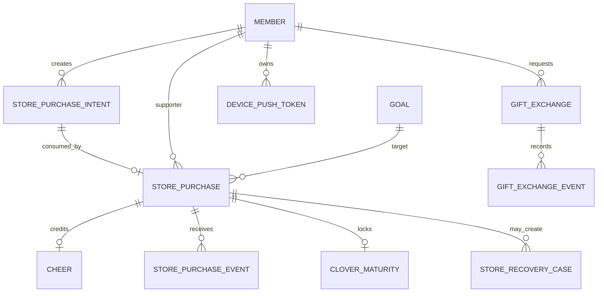

# 해낼게 V2 앱 3채널 ERD 변경 v0.1.0

기반 포맷: `docs/eng-design/erd-social-viral-loop-web-first-v1.2.5.md`
STAMP: 2026-11-18 13:22 KST, GPT-5 Codex, code-builder, haenael-supabase-build.

## 변경 원칙

기존 `payment`는 웹 토스 주문 전용으로 유지한다. 스토어 거래는 환불·검증·보고 수명주기가 달라 `store_purchase`가 소유한다. 기존 `cheer`, `clover_ledger`, `clover_balance`는 적립 정본으로 재사용한다.

## 테이블 계약

### `app_channel_release_gate`, `store_purchase_intent`

`app_channel_release_gate`는 `channel text PRIMARY KEY`, `sandbox_enabled boolean NOT NULL DEFAULT false`, `production_enabled boolean NOT NULL DEFAULT false`, `approval_reference text`, `updated_at timestamptz NOT NULL DEFAULT now()`를 가진다. `channel`은 `APPLE|GOOGLE_PLAY|GOOGLE_ALTERNATIVE|TOSS_IAP`만 허용하고 `CHECK (NOT production_enabled OR approval_reference IS NOT NULL)`로 production 승인을 강제한다. 환경은 행을 복제하지 않고 두 boolean으로 분리하므로 채널당 행은 정확히 하나다.

`store_purchase_intent` 실행 계약은 다음과 같다. `id uuid PRIMARY KEY DEFAULT gen_random_uuid()`, `supporter_member_id uuid NOT NULL REFERENCES member(id) ON DELETE RESTRICT`, `goal_id bigint NOT NULL REFERENCES goal(id) ON DELETE RESTRICT`, `provider text NOT NULL CHECK (provider IN ('APPLE','GOOGLE_PLAY','GOOGLE_ALTERNATIVE','TOSS_IAP'))`, `product_id text NOT NULL CHECK (length(product_id) BETWEEN 3 AND 160)`, `clover_amount integer NOT NULL CHECK (clover_amount IN (1,3,5,10))`, `account_binding uuid UNIQUE NOT NULL DEFAULT gen_random_uuid()`, `request_key text NOT NULL`, `status text NOT NULL DEFAULT 'CREATED' CHECK (status IN ('CREATED','CONSUMED','EXPIRED','CANCELED'))`, `expires_at timestamptz NOT NULL DEFAULT now() + interval '30 minutes'`, `created_at timestamptz NOT NULL DEFAULT now()`, `consumed_at timestamptz`, `UNIQUE (supporter_member_id, request_key)`, `CHECK ((status='CONSUMED') = (consumed_at IS NOT NULL))`다. 소비는 `status='CREATED' AND expires_at>now()` 조건부 UPDATE의 영향 행이 1일 때만 성공한다. `CONSUMED` 재진입은 동일 provider 거래의 멱등 재생만 허용하며 새 거래 생성은 거부한다. Apple·Play·Google 대체결제·Toss IAP 모두 이 intent를 거치며 공급자 검증 결과가 결합과 다르면 구매 원장을 만들지 않는다.

### `store_purchase`

`id bigint`, `supporter_member_id uuid`, `intent_id uuid UNIQUE`, `goal_id bigint`, `provider text`, `provider_transaction_id text`, `environment text`, `product_id text`, `currency char(3)`, `gross_amount_minor integer`, `refunded_amount_minor integer NOT NULL DEFAULT 0`, `clover_amount integer`, `refunded_clover_amount integer NOT NULL DEFAULT 0`, `status text`, `cheer_id bigint null`, `purchased_at timestamptz`, `verified_at timestamptz null`, `refunded_at timestamptz null`, `request_key text`, `policy_risk text null`, timestamps.

유일키: `(provider, provider_transaction_id)`, `(supporter_member_id, request_key)`. 체크: 공급자 `APPLE|GOOGLE_PLAY|GOOGLE_ALTERNATIVE|TOSS_IAP`, 환경 `SANDBOX|PRODUCTION`, 상태 `VERIFIED|CREDITED|REFUND_PENDING|PARTIALLY_REFUNDED|REFUNDED|RECOVERY_REQUIRED`, 수량 1·3·5·10, 양수 금액. 검증 전 취소·거절은 `store_purchase_intent`가 소유하며 구매 행을 만들지 않는다. RLS는 자기 구매 SELECT만, write는 service_role만.

### `store_purchase_event`

공급자 이벤트 멱등 원장. `(provider, provider_event_id)` 유일, `provider_transaction_id`, `refund_transaction_id`, `event_type`, `refund_amount_minor`, `currency`, `refund_scope FULL|PARTIAL`, `occurred_at`, `normalization_status VERIFIED|REJECTED|RETRY`, `payload_hash`, `processed_at`, `result_code`를 가진다. 원문 payload 저장 금지다. 구매의 누적 `refunded_amount_minor <= gross_amount_minor`, `refunded_clover_amount <= clover_amount` 체크로 중복·과다 회수를 차단한다.

### `clover_maturity`

`purchase_id` 유일, `member_id`, `clover_amount`, `available_at`, `released_at null`, `reversed_at null`. 지급불가 수량은 `released_at IS NULL AND reversed_at IS NULL AND available_at > now()` 합계다.

### `store_recovery_case`

환불 회수 부족분. `purchase_id`, `member_id`, `clover_shortfall`, `status OPEN|RESOLVED|WAIVED`, `resolution_note`, timestamps. 관리자만 접근한다.

### `google_external_transaction`

`purchase_id` 유일, `external_transaction_token`, `external_transaction_id`, 거래시각, 세전액, 세액, 사용자 과세 지역, 보고 상태, `report_due_at`, `next_attempt_at`, `reported_at`, `attempt_count`, `last_error_code`. 토큰 값은 암호화하고 로그하지 않는다.

### `device_push_token`

`member_id`, `device_id`, `platform`, `token_enc`, `enabled`, `last_seen_at`, timestamps. `(member_id, device_id)` 유일. 탈퇴 시 삭제한다.

### `gift_exchange`, `gift_exchange_event`

교환 요청은 회원·상품·수량·상태·마스킹 목적지·암호화 목적지·공급사 멱등키·공급사 주문 ID·마지막 상태조회 시각을 가진다. 불확정 응답은 `PENDING_RECONCILIATION`으로 잠금을 유지한다. 공급사 상태조회가 미발송을 확인한 뒤에만 `FAILED_CONFIRMED`와 잠금 해제가 가능하다.

## 기존 함수 변경

`clover_eligibility`는 현금 환전 잠금에 더해 성숙도 보류와 기프티콘 잠금을 빼서 지급가능을 계산한다. 환전·환불·기프티콘은 모두 `cashout_member:{uuid}` advisory lock을 먼저 잡고 `clover_balance FOR UPDATE`를 잡는다. 거래 환불 함수는 이 순서 안에서 원장 상쇄와 잔액 갱신을 한 트랜잭션으로 처리한다.

`member(provider, provider_id)`는 값이 있는 행에 유일 인덱스를 둔다. 토스 로그인과 토스 IAP 구매자 검증은 이 identity를 공유한다.

## 마이그레이션·롤백

추가형 마이그레이션만 허용한다. 기존 enum은 `ALTER TYPE` 대신 새 테이블의 text+CHECK를 써 롤백 잠금을 줄인다. 코드 롤백은 기능 플래그 OFF이며 테이블·원장은 보존한다.

SKILLS_USED: haenael-supabase-build, 기존 원장 재사용과 추가형 마이그레이션에 적용
SKILLS_SKIPPED: 없음
SOURCES/MODEL: GPT-5 Codex. 현재 DB migrations, FDD와 API 계약

RUBRIC_SCORE: 독립 리뷰 재검수 대기
WEAKEST_LINE: 기존 데이터의 provider identity 중복 여부는 staging 적용 전 사전 조회가 필요하다.
