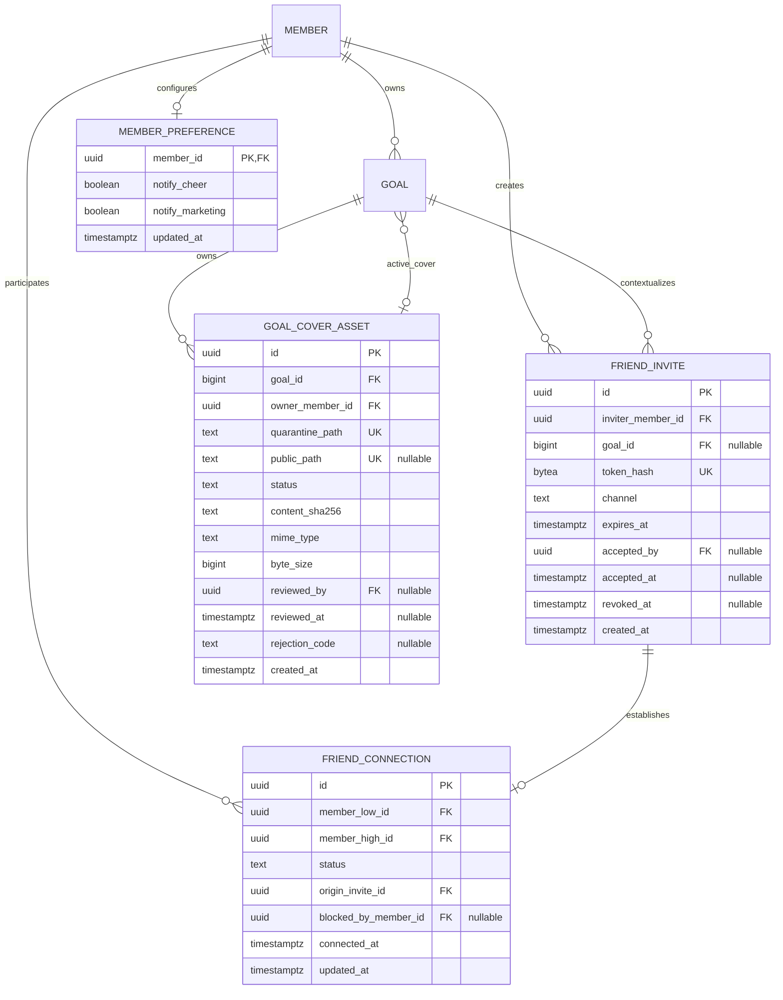

# 해낼게 V2 소셜 바이럴 루프 웹 우선 ERD

| 항목 | 값 |
|---|---|
| 버전 | v1.0.1 |
| 작성일 | 2026-10-13 02:42 KST |
| 작성자/모델 | tech-architect / gpt-5-codex |
| 작업 라인 | v2 |
| 상태 | 웹 1차 additive migration 계약 |
| 상류 핀 | `fdd-social-viral-loop-web-first-v1.0.0.md`, 운영 기준 `supabase/migrations/20260705163137_init_schema.sql` |
| 기반 포맷 | `docs/eng-design/erd-social-viral-loop-v0.1.0.md` |

> STAMP: 생성 2026-10-13 02:42 KST. 모델 gpt-5-codex. 에이전트 tech-architect. 스킬 docs. 근거는 현재 운영 스키마, D-003·D-018·D-SOCIAL-V6, Supabase·PostgreSQL 공식 문서다. 가장 오래 고민한 지점은 친구공개를 기존 정의자 권한 view와 함수에서 누락 없이 강제하는 방법이었다.

> PATCH v1.0.1 사유: D-019 확정에 맞춰 FRIENDS 커버의 `public_path`를 금지하고 private object path와 120초 Presigned URL 경계를 명시했다.

## 목차

- [0. 요약](#0-요약)
- [1. 기존 스키마 재사용](#1-기존-스키마-재사용)
- [2. ERD](#2-erd)
- [3. 기존 테이블 변경](#3-기존-테이블-변경)
- [4. 신규 테이블](#4-신규-테이블)
- [5. 공개범위·RLS 행렬](#5-공개범위rls-행렬)
- [6. Storage 계약](#6-storage-계약)
- [7. 무결성·인덱스·동시성](#7-무결성인덱스동시성)
- [8. 마이그레이션과 롤백](#8-마이그레이션과-롤백)
- [9. 데이터 안전 수용기준](#9-데이터-안전-수용기준)
- [10. 비범위](#10-비범위)
- [11. 개정 이력](#11-개정-이력)

## 0. 요약

기존 `goal`, `cheer`, `member`, `notification`을 유지하고 `friend_connection`, `friend_invite`, `goal_cover_asset`, `member_preference`만 신설한다. `goal`에는 공개범위와 커버 포인터 세 컬럼만 additive로 붙인다. 앱인토스 다중 신원 `member_identity`는 모바일 2차 migration으로 남긴다.

## 1. 기존 스키마 재사용

| 실물 | 재사용 | 변경 |
|---|---|---|
| `member` | 친구 양끝, 초대자·수락자, 선호 소유자 | 없음 |
| `goal` | 친구 목표와 커버의 소유 집합 | `visibility`, `cover_preset_key`, `active_cover_asset_id` 추가 |
| `cheer` | 응원 인원과 워드맵 원천 | 금액 컬럼은 기존 receiver 경로에만 유지 |
| `notification` | 추후 초대·친구 알림 확장 가능 | 1차 migration에서 새 타입 강제하지 않음 |
| `goal_public`, `cheer_public` | 공개 화면 projection | visibility 필터·필드 최소화 |
| `get_wordmap` | 공개 워드맵 | 공개범위 검사와 search path 보강 |
| `wordmap_render_cache` | 공유 이미지 캐시 | 비공개 전환 시 동기 무효화 |
| cashout 전 테이블 | 그대로 유지 | 변경 0 |

## 2. ERD



## 3. 기존 테이블 변경

### 3.1 `goal`

| 컬럼 | 타입 | 제약·기본값 | 의미 |
|---|---|---|---|
| `visibility` | text | NOT NULL DEFAULT `PUBLIC`, CHECK `PUBLIC|FRIENDS|PRIVATE` | 조회 경계 |
| `cover_preset_key` | text | NOT NULL DEFAULT `c1`, CHECK `c1`부터 `c6` | 커버 fallback |
| `active_cover_asset_id` | uuid | NULL FK `goal_cover_asset(id)` ON DELETE SET NULL | 승인 커스텀 커버 |

기존 goal은 모두 `PUBLIC`, `c1`, `NULL`로 backfill한다. 기존 `/g/[slug]` 접근성을 바꾸지 않는다. `active_cover_asset_id`는 같은 goal에 속하고 `status='APPROVED'`인 asset만 가리켜야 한다. 일반 UPDATE로는 바꿀 수 없고 승인 함수만 변경한다.

### 3.2 공개 projection

`goal_public`은 `visibility='PUBLIC' AND deleted_at IS NULL`만 내보낸다. 공개 필드는 기존 목록에 `cover_preset_key`, PUBLIC 승인 asset의 `public_path`만 더한다. FRIENDS 승인 asset은 `public_path=NULL`이어야 하며 private `quarantine_path`는 공개 projection에 포함하지 않는다. `visibility`, `active_cover_asset_id`, owner 내부 ID는 노출하지 않는다.

`cheer_public`과 `get_wordmap`은 PUBLIC goal에만 결과를 반환한다. FRIENDS는 `friend_goal_detail`의 인증 projection으로만 제공한다.

`wordmap_render_cache`는 PUBLIC 전용이다. 목표가 FRIENDS 또는 PRIVATE으로 바뀌면 해당 goal 캐시 행을 같은 transaction에서 삭제하고, Storage object 삭제 작업을 재시도 큐에 넣는다.

## 4. 신규 테이블

### 4.1 `member_preference`

| 컬럼 | 타입 | 제약 |
|---|---|---|
| `member_id` | uuid | PK, FK `member(id)` ON DELETE CASCADE |
| `notify_cheer` | boolean | NOT NULL DEFAULT true |
| `notify_marketing` | boolean | NOT NULL DEFAULT false |
| `updated_at` | timestamptz | NOT NULL DEFAULT now() |

본인만 SELECT 가능하다. write는 `update_member_preferences` RPC만 허용한다. 마케팅은 opt-in이다.

### 4.2 `friend_invite`

| 컬럼 | 타입 | 제약 |
|---|---|---|
| `id` | uuid | PK DEFAULT gen_random_uuid() |
| `inviter_member_id` | uuid | NOT NULL FK `member(id)` ON DELETE CASCADE |
| `goal_id` | bigint | NULL FK `goal(id)` ON DELETE SET NULL |
| `token_hash` | bytea | NOT NULL UNIQUE, `digest(token,'sha256')` |
| `channel` | text | NOT NULL CHECK `WEB|KAKAO|LINK|INTOSS` |
| `expires_at` | timestamptz | NOT NULL, 생성 시 now()+7 days |
| `accepted_by` | uuid | NULL FK `member(id)` ON DELETE CASCADE |
| `accepted_at` | timestamptz | NULL |
| `revoked_at` | timestamptz | NULL |
| `created_at` | timestamptz | NOT NULL DEFAULT now() |

Check constraints:

- `expires_at > created_at`
- `(accepted_by IS NULL) = (accepted_at IS NULL)`
- `accepted_by IS NULL OR accepted_by <> inviter_member_id`
- 수락 가능 상태는 `accepted_at IS NULL AND revoked_at IS NULL AND expires_at > now()`를 함수 안에서 검사한다. `now()`는 CHECK에 두지 않는다.

토큰 생성은 `gen_random_bytes(32)`를 base64url로 변환한다. 평문은 함수 응답에서만 한 번 반환하며 DB·로그·analytics에 저장하지 않는다.

### 4.3 `friend_connection`

| 컬럼 | 타입 | 제약 |
|---|---|---|
| `id` | uuid | PK DEFAULT gen_random_uuid() |
| `member_low_id` | uuid | NOT NULL FK `member(id)` ON DELETE CASCADE |
| `member_high_id` | uuid | NOT NULL FK `member(id)` ON DELETE CASCADE |
| `status` | text | NOT NULL DEFAULT `ACTIVE`, CHECK `ACTIVE|REMOVED|BLOCKED` |
| `origin_invite_id` | uuid | NULL FK `friend_invite(id)` ON DELETE SET NULL |
| `blocked_by_member_id` | uuid | NULL FK `member(id)` ON DELETE SET NULL |
| `connected_at` | timestamptz | NOT NULL DEFAULT now() |
| `updated_at` | timestamptz | NOT NULL DEFAULT now() |

Constraints:

- CHECK `member_low_id < member_high_id`
- UNIQUE `(member_low_id, member_high_id)`
- `status='BLOCKED'`일 때만 `blocked_by_member_id`가 관계 당사자 중 하나다.
- `ACTIVE|REMOVED`일 때 `blocked_by_member_id IS NULL`이다.

관계 해제는 row 삭제가 아니라 `REMOVED`다. 새 초대를 상대가 수락하면 REMOVED를 ACTIVE로 복원할 수 있다. BLOCKED는 차단자 해제 전 재활성화할 수 없다. 이번 UI는 `remove_friend`만 노출하고 BLOCKED UI는 다음 안전 슬라이스에 둔다. BLOCKED 상태 계약은 미리 넣어 우회 재초대를 막는다.

### 4.4 `goal_cover_asset`

| 컬럼 | 타입 | 제약 |
|---|---|---|
| `id` | uuid | PK DEFAULT gen_random_uuid() |
| `goal_id` | bigint | NOT NULL FK `goal(id)` ON DELETE CASCADE |
| `owner_member_id` | uuid | NOT NULL FK `member(id)` ON DELETE CASCADE |
| `quarantine_path` | text | NOT NULL UNIQUE |
| `public_path` | text | NULL UNIQUE |
| `status` | text | NOT NULL CHECK `UPLOADING|REVIEW|APPROVED|REJECTED|SUPERSEDED|DELETED` |
| `content_sha256` | text | NOT NULL CHECK 64 lowercase hex |
| `mime_type` | text | NOT NULL CHECK `image/jpeg|image/png|image/webp` |
| `byte_size` | bigint | NOT NULL CHECK `1..5242880` |
| `reviewed_by` | uuid | NULL FK `member(id)` ON DELETE SET NULL |
| `reviewed_at` | timestamptz | NULL |
| `rejection_code` | text | NULL CHECK `adult|violence|personal_info|copyright|other` |
| `created_at` | timestamptz | NOT NULL DEFAULT now() |

State constraints:

- APPROVED: `public_path`, `reviewed_by`, `reviewed_at` 모두 NOT NULL, rejection NULL.
- REJECTED: reviewer·time·rejection 모두 NOT NULL, public path NULL.
- UPLOADING·REVIEW: public path NULL.
- 승인 전·반려 asset이 현재 active cover가 될 수 없다.
- 한 goal의 APPROVED active asset은 `goal.active_cover_asset_id` 하나뿐이다. 이전 승인본은 `SUPERSEDED`로 전환한다.

## 5. 공개범위·RLS 행렬

### 5.1 테이블 정책

| 테이블 | anon | authenticated SELECT | authenticated write | service/admin |
|---|---|---|---|---|
| `friend_invite` | 직접 접근 0 | 직접 접근 0 | 0, RPC only | 필요한 작업만 |
| `friend_connection` | 0 | 직접 접근 0 | 0, RPC only | 관리 목적 최소 |
| `goal_cover_asset` | 0 | owner의 메타만. public URL은 APPROVED만 | 0, EF only | 검수·전환 |
| `member_preference` | 0 | 본인 1행 | 0, RPC only | 없음 |
| `goal` | 기존 owner 정책 | owner 직접 조회만 | 기존 owner RPC | 기존 유지 |

### 5.2 조회 경로 전수표

| 경로 | PUBLIC | FRIENDS | PRIVATE | 강제 위치 |
|---|---:|---:|---:|---|
| `goal_public` | 허용 | 0행 | 0행 | view WHERE |
| `/g/[slug]` | 허용 | 404 | 404 | goal_public 결과 |
| `get_wordmap` anon | 허용 | 0행 | 0행 | 함수 내부 |
| `wordmap_render_cache` anon | 허용 | 0행 | 0행 | 캐시 생성·무효화 |
| 워드맵 Storage | 허용 | 삭제 | 삭제 | object cleanup |
| `my_friend_goals` | 허용 | ACTIVE 친구만 | 0행 | 함수 내부 |
| `friend_goal_detail` | 허용 | ACTIVE 친구만 | 0행 | 함수 내부 |
| owner detail | 허용 | 허용 | 허용 | owner query |

`friend_goal_detail`은 `cheer_count`와 공개 가능한 message word projection만 반환한다. `cheer.clover_amount`, payment, supporter_ci, cashout 관계는 join하지 않는다.

PRIVATE 목표에는 goal 연결 초대를 만들 수 없다. PUBLIC 또는 FRIENDS 목표가 PRIVATE으로 바뀌면 그 goal의 미사용 초대를 같은 transaction에서 revoke한다.

### 5.3 함수 보안

- `SECURITY DEFINER SET search_path = ''`.
- relation과 함수 이름은 `public.goal`처럼 완전 수식한다.
- `REVOKE EXECUTE ... FROM PUBLIC, anon, authenticated` 후 필요한 함수만 role별 grant한다.
- 소유권과 `auth.uid()` NULL을 함수 첫 단계에서 검사한다.
- 같은 이름의 overload를 만들지 않는다. PostgREST 호출 모호성을 막는다.

## 6. Storage 계약

| bucket | public | upload | read | delete |
|---|---:|---|---|---|
| `goal-cover-quarantine` | false | signed URL, owner path only | owner·admin, FRIENDS는 ACTIVE 친구 확인 후 서버 발급 120초 Presigned URL | service cleanup |
| `goal-cover-public` | true | PUBLIC 승인 시 service only | PUBLIC object만 익명 read | service only |

Object path:

```text
goal-cover-quarantine/{member_id}/{goal_id}/{asset_id}.{ext}
goal-cover-public/{goal_id}/{asset_id}.{ext}
```

브라우저는 public bucket에 직접 write하지 못한다. signed upload 발급 시 goal owner를 재검사한다. upsert와 동일 path overwrite는 금지한다. 승인 함수는 quarantine의 실제 MIME, byte size, SHA-256을 asset row와 비교한다. PUBLIC 목표만 public bucket으로 복사한다. FRIENDS 목표는 private object를 유지하고 `friend_goal_detail`의 ACTIVE 친구 확인 후 120초 Presigned URL로만 내려준다. private Storage object 직접 GET은 owner 외 RLS로 차단한다.

## 7. 무결성·인덱스·동시성

| 대상 | 인덱스·잠금 | 이유 |
|---|---|---|
| `friend_invite.token_hash` | UNIQUE btree | 추측·충돌·중복 토큰 차단 |
| `friend_invite(inviter_member_id, created_at desc)` | btree | 시간당 10개 rate limit |
| `friend_invite(expires_at)` WHERE unused | partial btree | 만료 cleanup |
| `friend_connection(low, high)` | UNIQUE | 양방향 중복 방지 |
| `friend_connection(low, status)`와 `(high, status)` | btree | 친구목록 양방향 조회 |
| `goal(visibility, status)` | btree | 공개·친구 목표 필터 |
| `goal_cover_asset(goal_id, status, created_at desc)` | btree | 검수·활성 커버 조회 |
| `goal_cover_asset(content_sha256)` | btree | 같은 파일 재업로드 관측 |

초대 수락은 `SELECT ... FOR UPDATE`로 invite row를 잠근다. 이어서 ordered pair UNIQUE에 `INSERT ... ON CONFLICT ...`를 사용한다. 같은 token을 동시에 두 계정이 수락하면 한 transaction만 accepted_by를 기록하고 다른 transaction은 `invite_already_used`로 끝난다.

`set_goal_visibility`은 현 `update_goal`과 같은 소유권 검사와 advisory lock 관습을 따른다. goal 변경, 캐시 행 삭제, cleanup job enqueue는 한 transaction이다.

## 8. 마이그레이션과 롤백

### 8.1 적용 순서

1. `pgcrypto` 존재 확인. 없을 때만 extension 추가.
2. 신규 테이블을 FK 의존 순서로 생성하고 즉시 RLS enable.
3. `goal` nullable 컬럼 추가 후 기존 row backfill.
4. `goal` 세 컬럼을 NOT NULL·FK·CHECK로 고정.
5. 인덱스와 table policies 생성.
6. 기존 공개 view·함수·캐시 정책을 같은 migration에서 교체.
7. RPC와 exact grants 생성.
8. Storage bucket·policy와 cleanup queue 생성.
9. pgTAP이 green인 뒤에만 web feature flag를 연다.

### 8.2 롤백

- UI와 RPC grant를 먼저 닫는다.
- `goal_public`, `cheer_public`, `get_wordmap`은 migration 전 정의로 되돌리되 PUBLIC row만 보이던 기존 의미를 보존한다.
- 신규 데이터가 생긴 뒤에는 table·column을 drop하지 않는다. orphan 데이터를 남기고 feature flag만 닫는 forward rollback을 사용한다.
- Storage bucket은 삭제하지 않는다. public object 접근을 닫고 cleanup한다.
- PUBLIC backfill은 기존 공개 동작과 같으므로 역변환하지 않는다.

### 8.3 영향 0 확인 대상

- `create_goal`과 다중 목표 상한 3.
- cashout 전 테이블·function·trigger·index.
- `cheer_public`의 금액 컬럼 부재.
- 기존 payment·notification·report 경로.

## 9. 데이터 안전 수용기준

| ID | Given / When / Then |
|---|---|
| DB-AC-01 | Given FRIENDS 목표, When anon이 view·함수·cache·Storage 모든 경로를 조회, Then 제목·이유·커버·워드맵이 0건이다. |
| DB-AC-02 | Given A-B ACTIVE와 A-C 무관계, When B와 C가 A 목표를 조회, Then B만 FRIENDS 목표를 받고 둘 다 금액 필드는 받지 않는다. |
| DB-AC-03 | Given 동일 token 동시 수락 2건, When commit, Then accepted_by와 ACTIVE 관계는 각각 1건이다. |
| DB-AC-04 | Given REVIEW 커버, When 공개 URL 추정, Then public bucket object가 없어 404다. |
| DB-AC-05 | Given PUBLIC에서 PRIVATE 전환, When commit 완료, Then cache row는 0이고 object cleanup은 완료 또는 명시적 retry 상태다. |
| DB-AC-06 | Given 기존 goal 15행, When migration, Then 모두 PUBLIC·c1이고 기존 slug 응답 상태가 유지된다. |
| DB-AC-07 | Given social RPC response, When JSON key 전수 검사, Then amount·clover·rank·payment·cashout key가 0개다. |

## 10. 비범위

- `member_identity`: 토스 로그인과 함께 모바일 2차에 추가한다.
- timeline, achievement, boost table: 1차에서 만들지 않는다.
- contact sync, recommendation graph: 만들지 않는다.
- cashout schema: 변경하지 않는다.
- 자동 moderation result JSON: 공급자 결정 전 만들지 않는다. 수동 review 메타만 저장한다.

## 11. 개정 이력

| 버전 | 일자 | 변경 | 작성자 |
|---|---|---|---|
| v1.0.1 | 2026-10-13 | D-019 반영. FRIENDS 커버의 private Storage와 Presigned URL 경계 명시 | code-builder / gpt-5-codex |
| v1.0.0 | 2026-10-13 | 웹 우선 친구·초대·커버·선호 스키마 계약 | tech-architect / gpt-5-codex |

KNOWLEDGE_QUERY: BRAIN의 공유장벽·신뢰 마찰을 조회하고, 외부에서 Supabase RLS·security definer, PostgreSQL row security·pgcrypto, OWASP single-use token을 조회.

HITS_USED: 신뢰를 위해 수락·검수라는 명시적 마찰을 유지. Supabase의 기본 거부와 함수 권한 최소화, PostgreSQL의 CSPRNG·row policy, OWASP의 token 만료·1회성을 스키마 불변식으로 채택.

HITS_REJECTED: 자동 친구 추천과 공격적 바이럴은 개인정보·신뢰 비용이 커 미채택. 외부 moderation 공급자 메타는 공급자 미결이라 미채택.

CONFLICTS: 기존 공개 view와 SECURITY DEFINER 함수는 RLS를 우회할 수 있어 단순 table policy만으로는 친구공개를 보장하지 못한다. 이에 view·함수·cache·Storage를 한 migration 단위로 묶었다.

SKILLS_USED: docs. ERD 전달 문서 구조·표·수용기준에 적용.

SKILLS_SKIPPED: diagram 스킬은 현재 available-skills에 없어 Mermaid erDiagram을 직접 작성하고 정적 검증한다.

RUBRIC_SCORE: 완결5 정밀5 벤치5 추적5 톤5 total=25/25

WEAKEST_LINE: "BLOCKED UI는 1차에 없지만 우회 재초대를 막기 위해 상태 계약만 선반영한다."

PRESENTATION_CHECK: 내부 태그 잔재 0 / 목차 앵커 PASS / Mermaid ERD 실제 렌더 PASS / 컨트롤러 표시용 창은 열지 않음

SOURCES/MODEL: gpt-5/codex | `fdd-social-viral-loop-web-first-v1.0.0.md`; `docs/eng-design/erd-social-viral-loop-v0.1.0.md`; `docs/eng-design/eng-design-goal-visibility-supporter-v1.0.0-claude-opus.md`; `supabase/migrations/20260705163137_init_schema.sql`; `wiki/거버넌스/결정.md`; `miniapp/src/gateway.ts`; `~/SJ_BRAIN_wiki/wiki/business/마케팅/concept-공유장벽-선언vs요청-UGC바이럴.md`; `~/SJ_BRAIN_wiki/wiki/business/마케팅/question-전환-마찰-제거인가-신뢰-마찰-추가인가.md`; https://supabase.com/docs/guides/database/postgres/row-level-security; https://supabase.com/docs/guides/database/functions; https://supabase.com/docs/guides/storage/security/access-control; https://www.postgresql.org/docs/current/ddl-rowsecurity.html; https://www.postgresql.org/docs/17/pgcrypto.html; https://cheatsheetseries.owasp.org/cheatsheets/Forgot_Password_Cheat_Sheet.html
