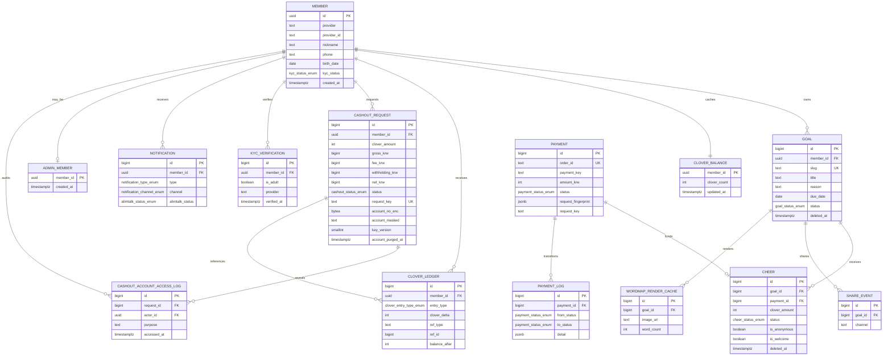

# ERD: 해낼게 운영 데이터 모델 v1.0.0

> 기준 시각: 2026-08-29 04:46 KST
> 상태: 운영 구현 역추적본. `web/src/lib/supabase/database.types.ts`와 `supabase/migrations/20260705163137_init_schema.sql`부터 `20260825020000_cashout_total_threshold_contract.sql`까지를 기준으로 한다.
> 범위: 현재 운영 테이블, 환전 A1 잠금, 수동 지급, 알림. 미래 자동 지급대행 구조는 포함하지 않는다.

## 목차

- [1. 운영 관계도](#1-운영-관계도)
- [2. 환전 데이터의 진실원](#2-환전-데이터의-진실원)
- [3. A1 잠금 원장 규약](#3-a1-잠금-원장-규약)
- [4. 무결성 및 접근 경계](#4-무결성-및-접근-경계)
- [5. 운영 스키마와 타입 파일의 차이](#5-운영-스키마와-타입-파일의-차이)
- [5.1 지급 신원정보 모델 회수](#51-지급-신원정보-모델-회수)
- [6. 벤치마크 적용](#6-벤치마크-적용)
- [7. 검증 메모](#7-검증-메모)

## 1. 운영 관계도

## 2. 환전 데이터의 진실원

| 값 | 진실원 | 계산 또는 변화 규칙 |
|---|---|---|
| 총 클로버 | `clover_balance.clover_count` | 결제 확정 `EARN`과 실제 지급 확정 `CASHOUT_SETTLED`가 바꾼다 |
| 웰컴 클로버 | `SUM(clover_ledger.clover_delta)` where type in `WELCOME_GRANT`, `WELCOME_REVERSAL` | 음수로 내려가지 않게 0으로 하한 처리 |
| 잠긴 클로버 | `SUM(cashout_request.clover_amount)` where status=`REQUESTED` | 신청 접수 시 생기고 PAID 또는 REJECTED 전이 시 사라진다 |
| 사용 가능 | `total - locked` | `clover_eligibility` 한 스냅샷에서 반환한다 |
| 지급 가능 | `total - welcome - locked` | 실제 신청 상한이다 |
| 자격 도달 | `total >= min_cashout_clover()` | 신청량 하한과 분리한다 |
| 지급 확정 전후 잔액 | `CASHOUT_SETTLED.balance_after`와 `balance_after - clover_delta` | PAID 화면은 라이브 잔액으로 역산하지 않는다 |

## 3. A1 잠금 원장 규약

| 이벤트 | `cashout_request.status` | 원장 타입 | delta | balance_after | 의미 |
|---|---|---|---:|---:|---|
| 신청 접수 | `REQUESTED` | `CASHOUT_HOLD` | 0 | 신청 전 총량 | 잠금 감사 표식. 총량 불변 |
| 관리자 반려 | `REJECTED` | `CASHOUT_REVERSAL` | 0 | 현재 총량 | 복원이 아니라 잠금 해제 표식 |
| 수동 이체 완료 | `PAID` | `CASHOUT_SETTLED` | `-clover_amount` | 차감 후 총량 | 환전 경로에서 총량이 줄어드는 유일한 이벤트 |

`2026-08-22` 이전 `CASHOUT_HOLD delta<0` 행은 과거 B안 기록이다. 소급 변경하지 않고 발생 시각과 migration 적용 시각으로 해석한다. 신규 로직이 과거 행을 A1 규칙으로 재해석하면 안 된다.

## 4. 무결성 및 접근 경계

- `cashout_request.request_key`는 부분 유니크 인덱스로 멱등성을 보장한다.
- 진행 중 신청은 회원당 `REQUESTED` 1건만 허용한다. `clover_eligibility`, 신청 중복 가드, 관리자 종결 RPC가 같은 상태 집합을 사용한다.
- 지급 완료 원장은 `(entry_type, ref_type, ref_id)` 유니크 가드와 상태 전이 가드로 이중 차감을 막는다.
- 계좌번호는 `account_no_enc`에 암호화하고 공개 표면에는 `account_masked`만 제공한다. 관리자 원문 열람은 `cashout_account_access_log`에 남으며 같은 관리자의 최근 10분 열람이 있어야 PAID 전이가 가능하다.
- `account_purged_at`이 채워진 요청은 지급 확정할 수 없다.
- 돈 테이블 쓰기는 브라우저 RLS가 아니라 Vercel Server Action의 service-role RPC와 관리자 인증 RPC에 한정한다.
- 모든 `SECURITY DEFINER` 환전 함수는 `search_path=''`와 schema-qualified 객체를 사용한다.

## 5. 운영 스키마와 타입 파일의 차이

`web/src/lib/supabase/database.types.ts`의 `my_cashout_status` 반환 타입에는 운영 migration이 추가한 `settled_balance_before`, `settled_balance_after`가 아직 없다. 현재 페이지는 `as never`와 별도 도메인 타입으로 우회한다. 런타임 계약은 migration이 우선이지만, 다음 build에서 운영 DB 기준 타입을 재생성해 이 우회를 없애야 한다.

### 5.1 지급 신원정보 모델 회수

PRD v0.4.0 §10.3은 실제 지급 단계에 주민등록번호·신원·세무정보를 수집한다고 요구하지만, 현재 migration과 ERD에는 그 정보를 담는 확정 entity가 없다. 이를 `member`, `cashout_request`, 새 vault table 중 어디에도 임의 추가하지 않는다. 아래 결정이 모두 합의된 뒤 ERD와 migration을 함께 개정한다.

| 미결정 | ERD 영향 |
|---|---|
| 해낼게 직접 수집 또는 수탁사 직접 수집 | 제품 DB entity 존재 여부 |
| 최소 필드와 법적 목적 | column 집합과 nullability |
| 암호화, key custody, 운영자 열람 | ciphertext·key version·access log 관계 |
| 보존·파기 기간 | retention metadata와 purge job |
| 미수집·검증 실패 상태 | cashout status 전이와 FK 경계 |

현재 gap은 1건이며 "제품 저장 0"이 확정된 상태가 아니다. 이 ERD는 확정된 환전 신청·잠금·수동 이체 완료 데이터만 표현한다.

## 6. 벤치마크 적용

- [Supabase Database Functions](https://supabase.com/docs/guides/database/functions): `SECURITY DEFINER` 사용 시 빈 `search_path`와 명시적 권한 부여를 적용했다.
- [PostgreSQL Explicit Locking](https://www.postgresql.org/docs/current/explicit-locking.html): 짧은 트랜잭션 범위의 advisory lock과 row lock을 회원별 신청 및 요청별 관리자 전이에 적용했다.
- [Stripe Idempotent Requests](https://docs.stripe.com/api/idempotent_requests): 동일 키 재시도는 최초 결과를 재생하고, 같은 키에 다른 인자가 오면 충돌시키는 원리를 `request_key`와 `request_fingerprint`에 적용했다.

## 7. 검증 메모

Mermaid는 `@mermaid-js/mermaid-cli`로 PNG 렌더했고 2384×967 결과를 직접 확인했다. 구문 오류와 잘린 entity는 없었다. ERD는 논리 관계를 보여주는 문서이며 FK가 없는 `clover_ledger.ref_id`의 다형 참조는 선으로 강제하지 않았다.

---

🏷 STAMP | line: core | 생성: 2026-08-29 04:46 KST | model: gpt-5.6-sol | agent: tech-architect
skills: 없음 | 근거: 운영 migration, generated DB types, Supabase/PostgreSQL/Stripe 공식 문서, Mermaid CLI 렌더 PASS
고민: 원장만으로 잠금을 계산하면 delta=0인 A1에서 값이 사라지므로, 진행 상태의 `cashout_request.clover_amount`를 잠금 진실원으로 고정했다.

SKILLS_USED: 없음
SKILLS_SKIPPED: 현재 세션에 기술설계 전용 스킬이 없어 프로젝트 코드와 공식문서를 직접 역추적했다.

RUBRIC_SCORE: 완결성=5/5 정밀성=5/5 벤치마크반영=4/5 추적성=5/5 전문성·톤=5/5 total=24/25
WEAKEST_LINE: 지급 단계 주민등록번호·신원·세무정보의 수집·저장 결정이 없어 관련 entity는 회수 상태다.

SOURCES/MODEL: gpt-5.6-sol | `web/src/lib/supabase/database.types.ts`; `supabase/migrations/20260802010000_cashout_security_hardening.sql`; `supabase/migrations/20260822000000_cashout_clover_lock_a1.sql`; `supabase/migrations/20260825020000_cashout_total_threshold_contract.sql`; https://supabase.com/docs/guides/database/functions; https://www.postgresql.org/docs/current/explicit-locking.html; https://docs.stripe.com/api/idempotent_requests
