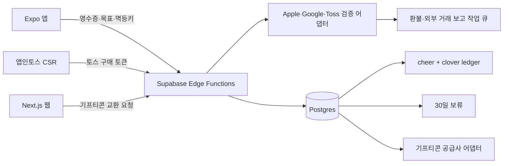
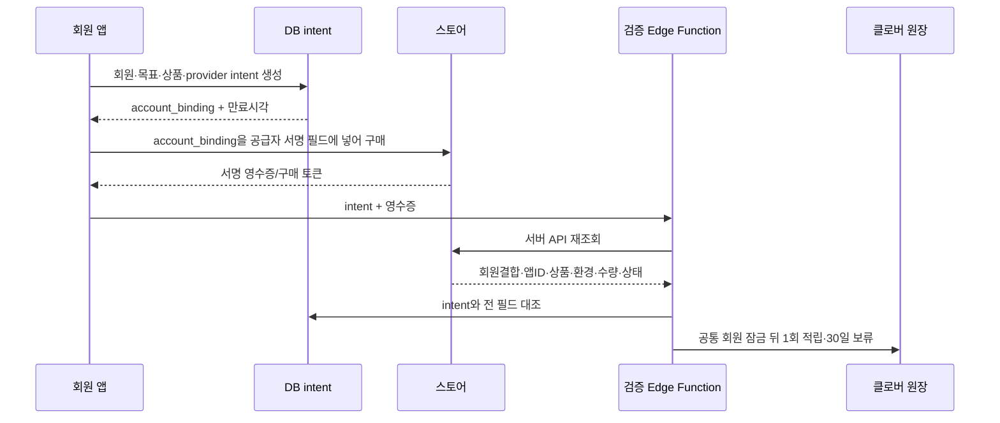
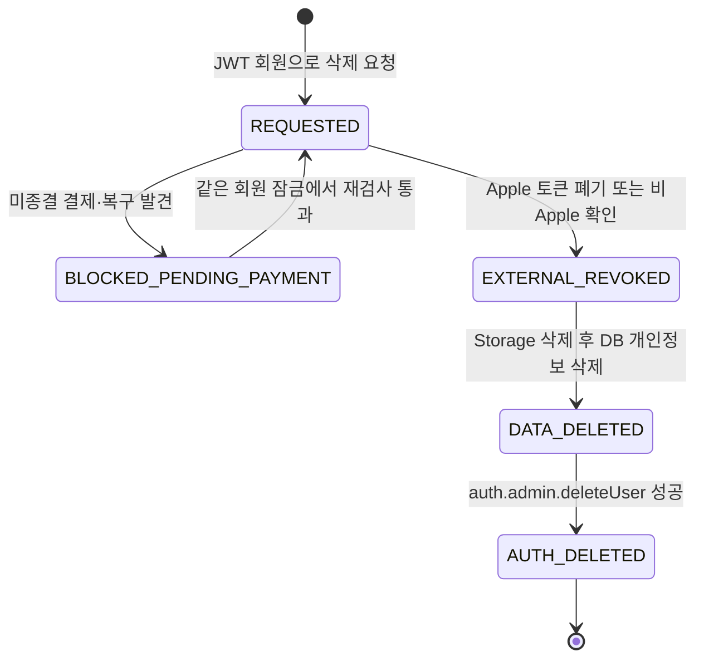

# 해낼게 V2 앱 3채널 FDD

| 항목 | 값 |
|---|---|
| 버전 | v0.1.0 |
| 작성 | 2026-11-18 13:22 KST, code-builder, GPT-5 Codex |
| 상태 | 개발 입력. 외부 계약과 스토어 등록 전까지 비가역 행동 금지 |
| 기반 포맷 | `docs/eng-design/fdd-social-viral-loop-web-first-v1.2.5.md` |
| 상류 정본 | D-056·D-055·D-054·D-049·D-047·D-021, PRD v0.2.0, 웹 프로토타입 v3.1.1, 앱 프로토타입 v0.1.0, `DESIGN.md` |

> STAMP: 생성 2026-11-18 13:22 KST. 모델 GPT-5 Codex. 에이전트 code-builder. 스킬 haenael-supabase-build. 근거는 레포 결정·PRD·프로토타입·현재 코드, Apple StoreKit·Google Play 대체 결제·Expo IAP·앱인토스 IAP·기프티쇼 비즈·카카오 선물하기 for Biz 공식 문서다. 가장 오래 고민한 지점은 스토어 환불이 수취인의 이미 적립된 클로버에 미치는 영향을 원장 불변식으로 막는 것과, 앱인토스 정책 충돌을 숨기지 않으면서 D-056의 사업 결정을 구현하는 것이었다.

## 0. 결론

하나의 `store_purchase` 원장이 Apple·Google Play·Google 대체 결제·앱인토스 거래를 멱등 처리하고, 검증된 거래만 기존 `cheer`·`clover_ledger`에 연결한다. 네 채널 적립은 모두 `available_at = purchased_at + 30 days` 전까지 환전·기프티콘 지급가능에서 제외한다. 앱인토스는 D-056-3에 따라 같은 클로버 적립을 만들되 정책 충돌을 `policy_risk=INTOSS_CASH_EQUIVALENT`로 기록하고 숨기지 않는다.

### 0.1 독립 리뷰 반려 후 교정

첫 판은 독립 리뷰 9/25로 반려됐다. 다음 다섯 계약을 추가하지 않으면 구현하지 않는다.

| 반려 원인 | 교정 계약 |
|---|---|
| Apple·앱인토스 정책 충돌을 기록만 함 | DB `app_channel_release_gate`가 기본 OFF다. 비운영 검증과 production은 별도이며 production은 irreversible approval reference 없이는 켤 수 없다 |
| 유효 영수증 선점 가능 | 구매 전 `store_purchase_intent`를 만들고 회원·목표·상품·공급자·`account_binding`을 묶는다. Apple `appAccountToken`, Google `obfuscatedExternalAccountId`, 토스 검증 회원을 이 값과 대조한다 |
| 환전·환불·교환 경합 | 세 경로 모두 회원 advisory lock `cashout_member:{uuid}` → `clover_balance FOR UPDATE` 순서를 쓴다 |
| 공급사 응답 유실 뒤 중복 발송 | 기프티콘은 공급사 멱등키를 보내고, 타임아웃은 실패가 아니라 `PENDING_RECONCILIATION`이다. 상태조회로 미발송이 확인되기 전 잠금을 풀지 않는다 |
| PRD 테스트 ID 단절 | `TC-APP-*`·`TC-TOSS-*` 48개를 그대로 유지한다 |

### 0.2 정책 집행 게이트

Apple의 IAP 선물·교환 규칙과 앱인토스 환가성 상품 금지는 D-056과 충돌한다. 회장 결정은 사실대로 구현하고 제출하는 것이지만, 제출 승인과 구매 활성화는 같은 것이 아니다. 코드와 비운영 검증 경로는 만들되 `production_enabled=false`를 유지한다. 앱인토스 SDK 3.x는 샌드박스가 없어 로컬 mock 밖의 확인은 실제 결제 승인 뒤에만 한다. 컨트롤러가 정책 충돌·심사 메모를 포함해 irreversible approval을 기록한 뒤에만 채널별 production gate를 켠다. 반려 시 앱인토스는 광고 모드로, Apple은 심사 피드백에 따라 구매 경로를 다시 설계한다.

## 1. 현재 지도와 변경 경계

| 영역 | 현재 실물 | 이번 변경 |
|---|---|---|
| 웹 분석 동의 | 루트에서 비회원에게 배너 노출, 허용 뒤 GA4·Clarity·Meta 적재 | 루트 배너 제거, 로그인된 수취인 레이아웃에서만 배너. GA4 Consent Mode v2 기본 거부 명령은 선행, Clarity·Meta는 허용 전 미적재 |
| 웹 환전 | 현금 환전과 서버 전용 자격 판정 | 기프티콘 교환을 나란히 표시. 공급사 계약 전 기능 플래그 OFF와 서버 `503 gift_provider_unavailable` |
| 앱 | 코드 없음 | `apps/mobile` Expo 57/RN 0.86, iOS·Android 공용 UI와 채널별 결제 어댑터 |
| 앱인토스 | `miniapp/` Vite CSR, 토스 로그인·친구 목표·공유 | V2 응원 아이템 결제, 클로버 적립. 잔액·환전·기프티콘 UI는 계속 제외. 광고는 플래그만 준비 |
| 서버 | 웹 토스 주문·확정과 클로버 원장 | 스토어 거래 검증, 보류, 환불 회수, 외부 거래 보고, 기프티콘 주문 어댑터 |

## 2. 불변식

1. 클라이언트 영수증과 가격은 신뢰하지 않는다. 서버가 스토어 API와 서버 상품 카탈로그로 검증한다.
2. `(provider, provider_transaction_id)`는 유일하다. 같은 영수증 재전송은 같은 결과를 반환하고 적립을 반복하지 않는다.
3. 한 거래의 `clover_amount`는 서버 상품 카탈로그의 1·3·5·10 중 하나다. 수취인 적립 가치는 채널과 무관하게 클로버당 1,000원이다.
4. Apple·Play·Android 대체 결제·앱인토스 IAP는 모두 결제 시각부터 30일간 지급불가다. 보류는 총잔액에는 보이지만 `clover_eligibility.payable_amount`에서 빠진다.
5. 환불은 같은 거래의 적립 원장을 최대 한 번 상쇄한다. 잔액 부족이면 화면 잔액을 음수로 만들지 않고 `store_recovery_case`에 남긴다.
6. 앱인토스에는 잔액·환전·기프티콘 교환·외부 결제 유도 UI가 0개다. 서버 적립은 웹·앱과 동일하다.
7. 공급사 계약이 없는 기프티콘 교환은 실패 닫힘이다. 클로버를 먼저 잠그거나 차감하지 않는다.
8. 로그인 전 동의 배너는 0개다. GA4 기본 동의는 거부이며 Clarity·Meta 스크립트는 허용 전 DOM에 없다.

## 3. 시스템 구조

스토어 검증 어댑터는 네이티브 앱에 비밀을 두지 않는다. Edge Function은 서비스 계정·스토어 키를 로컬 시크릿에서 주입받는다. 모든 공급사 응답 원문은 저장하지 않고 거래 식별자 해시·상태·검증 시각만 저장한다.

## 4. 채널 계약

### 4.1 iOS

- 상품: `haenael.cheer.clover.1|3|5|10`, 소모품, 앱 표시 단가는 클로버당 1,200원.
- StoreKit 결제 후 JWS를 `verify-store-purchase`로 보내고 서버가 App Store Server API로 검증한다.
- 구매 의도의 `account_binding`은 StoreKit `appAccountToken`에 넣는다. 검증 서버는 JWS의 `appAccountToken`, bundle ID, product ID, environment, quantity, transaction reason, revocation 상태를 대조한다.
- 검증 지연은 `VERIFYING` 화면과 로컬 미완료 거래 큐로 복구한다.
- 앱 안에 웹 가격·웹 결제 링크·외부 결제 유도 문구가 없다.

### 4.2 Android

- Play 상품은 iOS와 같은 수량, 클로버당 1,200원.
- `account_binding`을 `obfuscatedExternalAccountId`로 전달하고 Developer API 응답의 package, product, purchase state, quantity와 함께 대조한다.
- 한국 사용자 선택 결제는 Google이 제공하는 선택 UI와 외부 거래 토큰을 사용한다. 토스페이먼츠 단가는 클로버당 1,100원.
- 대체 결제도 결제 전에 `provider=GOOGLE_ALTERNATIVE` 구매 의도를 만들고, Google 외부 거래 토큰의 계정 결합값과 토스 승인 회원을 그 intent의 회원·목표·상품에 대조한다. 승인과 적립은 같은 production gate를 트랜잭션 안에서 검사한다.
- 대체 결제 성공은 기존 토스 승인 뒤 `google_external_transaction` 큐에 들어가며 24시간 안 보고한다. 보고 실패는 적립을 되돌리지 않고 운영 경보와 재시도로 처리한다.

### 4.3 앱인토스

- 토스 로그인만 쓴다. 자체 로그인 UI는 없다.
- D-056-3에 따라 토스 IAP 소모품이 수취인 클로버를 적립한다.
- `auth-toss`는 토스 서명 회원 ID를 `member(provider='TOSS', provider_id)`에 유일 매핑한다. 구매 검증의 토스 회원 ID가 intent 회원과 다르면 적립하지 않는다.
- 앱인토스 공식 정책은 환가성 상품 판매를 금지하므로 심사 위험이 높다. 구현은 숨기지 않고 상품 설명과 심사 메모에 적립 구조를 그대로 쓴다.
- 심사 불가 시 `VITE_INTOSS_MONETIZATION_MODE=ads`로 전환한다. 광고 SDK 호출은 플래그가 `ads`일 때만 로드한다.

### 4.4 웹 동의와 기프티콘

- `layout.tsx`는 배너를 렌더하지 않는다. `(receiver)/layout.tsx`가 인증된 회원에게만 배너를 렌더한다.
- Consent Mode 기본값은 `analytics_storage`, `ad_storage`, `ad_user_data`, `ad_personalization` 전부 `denied`다.
- 기프티콘은 현금 환전과 같은 `clover_eligibility` 결과를 쓴다. 공급사 계약·선불 잔액·상품 카탈로그가 없으면 교환 버튼은 준비중 상태이며 서버 주문을 만들지 않는다.
- 기프티쇼 비즈는 유료 플랫폼 재판매 제한 문구가 있어 1순위로 채택하지 않는다. 카카오 선물하기 for Biz Open API의 리워드 교환 허용 여부를 계약 담당자가 서면 확인한 뒤 공급사를 켠다.

## 5. 화면과 컴포넌트 매핑

| 화면 | 라우트 | 컴포넌트 | 서버 계약 | 데이터 |
|---|---|---|---|---|
| A1 소개 | `/` | `WelcomeScreen` | 없음 | SecureStore `introSeen` |
| A2 로그인 | `/auth` | `AuthSheet` | Supabase OAuth Apple·Kakao | `member` |
| A3 푸시 안내 | `/home` | `PushPrimerCard` | `register-push-token` | `device_push_token` |
| A4 워드맵 | `/goals/[id]/wordmap` | `WordMapScreen` | 기존 목표·응원 RPC | 기존 테이블 |
| A6 공개 목표 | `/goals/[id]` | `GoalScreen` | 기존 상세 RPC | `goal`, `cheer` |
| A12·A13 결제 | `/goals/[id]/support` | `SupportCheckoutScreen` | `create_store_purchase_intent` → `verify-store-purchase` 또는 `confirm-alternative-payment` | `store_purchase_intent`, `store_purchase` |
| A14 잔액·환전 | `/cashout` | `CashoutScreen` | 조회 `clover_eligibility`, 쓰기 `mobile-cashout` | 보류·잔액·환전 요청 |
| A9 알림 | `/settings/notifications` | `NotificationSettingsScreen` | 설정 RPC | `member_preference` |
| A11 탈퇴 | `/settings/delete-account` | `DeleteAccountScreen` | 기존 삭제 접수 | 토큰 정리 |
| T4 결제 | miniapp `/goals/:slug/support` | `TossSupportSheet` | `verify-store-purchase` | `store_purchase` |
| 기프티콘 | web `/cashout/gift` | `GiftExchangePanel` | `gift-exchange` | `gift_exchange` |

## 6. 상태 전이

`store_purchase` 행은 서버 검증이 끝난 `VERIFIED`로 생성되고 같은 트랜잭션에서 `CREDITED`가 된다. 검증 전 상태는 행이 아니라 Edge Function의 처리 상태다. 검증 실패·취소는 구매 행을 만들지 않고 intent를 `CANCELED|EXPIRED`로 닫는다. 부분환불은 `CREDITED|PARTIALLY_REFUNDED → REFUND_PENDING → PARTIALLY_REFUNDED`를 반복할 수 있고, 누적 전액환불은 `→ REFUNDED`, 잔액 부족은 어느 환불에서도 `RECOVERY_REQUIRED`다. `CREDITED` 전에는 cheer와 원장을 만들지 않는다.

`gift_exchange`: `CREATED → PROVIDER_PENDING → SENT`. 타임아웃·5xx·연결 종료는 `PENDING_RECONCILIATION`으로 가며 잠금을 유지한다. 공급사 주문 상태조회가 미발송을 확정한 경우만 `FAILED_CONFIRMED`로 전이하고 잠금을 해제한다. 모든 요청은 공급사 멱등키와 공급사 주문 ID를 가진다. 계약 미설정 상태에서는 `CREATED` 행 자체를 만들지 않는다.

### 6.1 계정 삭제 상태 기계와 불변식

계정 삭제의 정본은 서버 소유 `account_deletion_job` 한 행이다. 기본키는 JWT에서 확인한 `member_id`이며 회원당 최대 1행이다. 클라이언트 요청 키는 생성·재개·전이에 사용하지 않는다. 앱 재설치나 기기 변경 뒤에도 서버는 현재 JWT의 회원 ID로 같은 작업을 찾는다.

| 불변식 | 계약 | 자동 시험 |
|---|---|---|
| `AD-INV-01` 서버 단일 소유 | 회원당 삭제 작업은 1행이고 요청·재개는 JWT 회원 ID만 사용한다. 클라이언트 요청 키 컬럼과 입력은 없다. | `TC-APP-09-3` |
| `AD-INV-02` 단방향 전이 | `REQUESTED → BLOCKED_PENDING_PAYMENT → REQUESTED → EXTERNAL_REVOKED → DATA_DELETED → AUTH_DELETED` 외 전이는 거절한다. `BLOCKED_PENDING_PAYMENT`는 재검사 통과 때만 `REQUESTED`로 돌아간다. | `TC-APP-09-4` |
| `AD-INV-03` 회원 정산 직렬화 | 모든 결제의 공급자 확인 시작·적립·복구 건 생성과 삭제 작업의 모든 DB 전이는 `member_settlement:<member_id>` PostgreSQL transaction advisory lock을 잡는다. 결제자와 목표 소유자가 다르면 UUID 문자열 오름차순으로 두 회원 잠금을 잡고, 잠금 안에서 결제 intent·확인 작업·OPEN 복구 건을 다시 검사한다. 만료 시각은 진행 중인 공급자 확인을 종결 상태로 만들지 않는다. | `TC-APP-09-5`, `TC-APP-09-6`, `TC-APP-09-11` |
| `AD-INV-04` 외부 폐기 선행 | Apple 회원은 로그인 때 서버가 refresh token을 암호화 저장한다. 토큰이 없거나 공급자가 무효로 거절하면 사용자 재인증으로 새 토큰을 받은 뒤 폐기한다. `EXTERNAL_REVOKED` 전에는 Storage·회원 데이터·Auth 사용자를 삭제하지 않는다. | `TC-APP-09-7`, `TC-APP-09-8` |
| `AD-INV-05` 삭제 중 결제 금지 | 삭제 작업이 `REQUESTED` 이상이면 새 결제 확인 시작을 거절한다. 먼저 시작된 확인 작업이 있으면 삭제는 `BLOCKED_PENDING_PAYMENT`에 머문다. | `TC-APP-09-9` |
| `AD-INV-06` 계정 세션 격리 | 모바일은 삭제를 시작한 회원 ID만 로컬에 저장한다. Apple 재인증 또는 일반 로그인 뒤 현재 세션 회원이 달라지면 이전 회원의 삭제 재개 정보를 즉시 폐기하고 서버 삭제를 재호출하지 않는다. | `TC-APP-09-10` |
| `AD-INV-07` 모든 적립 경로의 단일 진입점 | StoreKit·Google Play·Google 대체결제·Toss 인앱결제·웹 Toss 결제는 공급자 확인 시작부터 적립 종결까지 `credit_purchase` RPC만 호출한다. 이 RPC는 결제 참조에서 결제자와 목표 소유자를 서버 조회하고, 두 회원 잠금 안에서 결제 소유권·삭제 작업 상태·목표 소유권을 재검사한 뒤에만 채널별 내부 적립 함수를 호출한다. 채널별 내부 함수의 `service_role` 직접 실행 권한은 제거한다. | `TC-APP-09-11`, `TC-APP-09-12`, `TC-APP-09-13` |

삭제 실행 순서는 고정한다. `request_account_deletion`이 작업 행을 만들거나 재개하고 잔액·환전·미성숙 적립·미종결 결제를 검사한다. Apple 폐기가 끝난 뒤 `mark_account_deletion_external_revoked`가 같은 회원 잠금 안에서 같은 정산 조건을 다시 검사한다. Storage 객체 삭제 뒤 `delete_account_data`가 같은 잠금 안에서 같은 조건을 다시 검사하고 개인정보를 삭제하며 `DATA_DELETED`로 전이한다. 마지막으로 Auth 사용자를 삭제한 뒤 `complete_account_deletion_auth`가 `AUTH_DELETED`를 기록한다. 각 호출은 현재 상태를 읽어 멱등 재개한다.

`credit_purchase`는 `BEGIN`, `CREDIT`, `CANCELED`, `RECOVERY_REQUIRED` 네 동작을 같은 계약으로 처리한다. `BEGIN`은 외부 공급자 조회 전에 서버 작업을 `VERIFYING`으로 기록한다. 삭제가 먼저 시작됐으면 `BEGIN`을 거절하고, 확인이 먼저 시작됐으면 삭제 전이를 `BLOCKED_PENDING_PAYMENT`에 둔다. `CREDIT`은 기존 `VERIFYING` 작업과 결제 소유권을 잠금 안에서 대조하고 적립을 완료한다. 실패가 확정되면 `CANCELED`, 공급자 승인 뒤 보상 실패처럼 자동 종결할 수 없으면 `RECOVERY_REQUIRED`로 남겨 삭제를 계속 차단한다.

## 7. 요구 추적성

기존 디자인 요구 R1, R2, R3, R4, R5, R6, R7, R8, R9, R10, D-024, D-034, BACKLOG-CLAMP는 웹 정본 v1.2.5가 계속 소유한다.

| 요구 | 코드 | 서버 | 데이터 | 정확한 예약 테스트 ID |
|---|---|---|---|---|
| FR-APP-01 | `apps/mobile/app/goals/[id]/support.tsx` | intent → `verify-store-purchase` | intent·purchase·maturity | `TC-APP-01-1`, `TC-APP-01-2`, `TC-APP-01-3`, `TC-APP-01-4`, `TC-APP-01-5` |
| FR-APP-02 | 같은 화면의 Android 결제수단 선택 | intent → `confirm-alternative-payment`, 외부거래 보고 | purchase·google_external_transaction | `TC-APP-02-1`, `TC-APP-02-2`, `TC-APP-02-3` |
| FR-APP-03 | 잔액·내역·A14 환전 UI | `store-refund-webhook`, `clover_eligibility`, `mobile-cashout` | maturity·recovery·cashout_request | `TC-APP-03-1`, `TC-APP-03-2`, `TC-APP-03-3`, `TC-APP-03-4` |
| FR-APP-04 | `AuthSheet` | Supabase OAuth | member | `TC-APP-04-1`, `TC-APP-04-2`, `TC-APP-04-3` |
| FR-APP-05 | 푸시 프라이머·설정 | `register-push-token`, 발송 작업 | device_push_token | `TC-APP-05-1`, `TC-APP-05-2`, `TC-APP-05-3`, `TC-APP-05-4`, `TC-APP-05-5`, `TC-APP-05-6` |
| FR-APP-06 | Expo Router 링크 설정 | 기존 초대 RPC | 없음 | `TC-APP-06-1`, `TC-APP-06-2`, `TC-APP-06-3`, `TC-APP-06-4` |
| FR-APP-07 | 리뷰 요청 정책 | 없음 | 기기 로컬 상태 | `TC-APP-07-1`, `TC-APP-07-2`, `TC-APP-07-3` |
| FR-APP-08 | A1 소개·오프라인·A10 업데이트 | 최소버전 조회, 네트워크 자동 복구 | 기기 introSeen·세션·minimum_version | `TC-APP-08-1`, `TC-APP-08-2`, `TC-APP-08-3`, `TC-APP-08-4` |
| FR-APP-09 | A11 앱 안 계정 삭제 | 회원당 서버 삭제 작업·Apple 폐기·회원 정산 잠금·Auth 삭제 | account_deletion_job·member·push token·cashout_request·maturity | `TC-APP-09-1`~`TC-APP-09-10` |
| FR-TOSS-01 | `miniapp/` 토스 로그인 | `auth-toss` | member identity | `TC-TOSS-01-1`, `TC-TOSS-01-2`, `TC-TOSS-01-3` |
| FR-TOSS-02 | 번들 static guard·친구 목표 금지 surface | 정적 검사, 조회 API만 | cashout·잔액·외부 이동 데이터 0 | `TC-TOSS-02-1`, `TC-TOSS-02-2` |
| FR-TOSS-03 | 초대·목표 공유 | Apps in Toss Share SDK | `intoss://` 링크 | `TC-TOSS-03-1` |
| FR-TOSS-04 | 앱인토스 결제·복구·금지 UI | 토스 검증·복구 | purchase·event | `TC-TOSS-04-1`, `TC-TOSS-04-2`, `TC-TOSS-04-3`, `TC-TOSS-04-4` |
| FR-TOSS-05 | 광고 대체 플래그 | 광고 SDK 어댑터 | release gate | `TC-TOSS-05-1`, `TC-TOSS-05-2`, `TC-TOSS-05-3` |
| 출시 점검 | T5 내비·라이트 모드·CSR/SSG | 정적 검사 | 없음 | `TC-TOSS-06-1` |

## 8. 배포, 관측, 롤백

1. 로컬 DB 테스트 후 staging에만 마이그레이션한다.
2. Edge Function은 검증 공급자별 기능 플래그 OFF로 배포 가능하다. Apple·Google은 앱 빌드 전에 테스트 키로 켠다. 앱인토스는 로컬 mock과 서버 계약을 먼저 검증하고 실제 결제 승인이 있기 전에는 켜지 않는다.
3. 모바일은 development build에서 sandbox 영수증만 쓴다. Expo Go는 IAP 검증 증거가 아니다.
4. 앱인토스 SDK 3.x는 로컬 devtools mock에서 결제 흐름을 검증한다. 콘솔 QR은 실제 결제이므로 실결제 승인 전에는 실행하지 않는다.
5. 롤백은 구매 진입 플래그 OFF다. 이미 검증된 원장과 환불 웹훅은 끄지 않는다.
6. 관측 지표는 검증 지연, 중복 차단, 환불 회수, 24시간 외부 거래 보고, 공급사 실패율이다. 영수증 원문과 계정 비밀은 로그 금지다.

### 8.1 D-047 모바일 환전 경로

모바일은 DB 돈 함수를 직접 호출하지 않는다. `mobile-cashout` Edge Function이 JWT 회원을 확인하고, 전역 환전 플래그·모바일 채널 플래그·승인 reference·D-047 공통 회원 허용목록을 모두 검사한 뒤 기존 service-role 환전 RPC를 부른다. 네 조건 중 하나라도 없으면 `cashout_channel_disabled`로 실패 닫힘이다. 서버 함수와 환불·기프티콘은 모두 `cashout_member:{member_id}` advisory lock을 먼저 잡고 잔액 행을 잠근다.

## 9. 미검증과 결정 경계

- Apple·Play 신규 앱·상품·번들 식별자 등록은 비가역이고 미실행이다.
- Linux 실행 환경이라 iOS 시뮬레이터 실구동은 불가하다. EAS development build 또는 macOS 실기 설치가 필요하다.
- 기프티콘 공급사 계약과 선불 충전은 돈이므로 미실행이다.
- 앱인토스 정책과 D-056-3은 충돌한다. 심사 통과는 미검증이며 사실대로 제출한다.

## 10. 벤치마크와 레드팀

- 차용: Apple JWS·서버 검증, Google user-choice billing·24시간 보고, Expo development build, 공급사 서버 API.
- 변경: RevenueCat 종속 대신 기존 Supabase 원장에 맞춘 검증 어댑터를 둔다. 환전 보류와 앱인토스 정책 위험은 제품 고유 계약이다.
- 레드팀 반박: “결제 성공 뒤 외부 보고 실패가 나면 적립을 취소해야 한다.” 반박은 사용자에게 이미 제공한 디지털 재화를 보고 장애 때문에 회수하면 이중 피해라는 점이다. 적립과 규제 보고를 분리하고 보고 큐를 끝까지 재시도한다.
- 이 결론이 틀릴 가능성이 가장 큰 곳은 스토어 심사 정책 해석과 기프티콘 공급사의 리워드 허용 범위다. 그래서 코드 플래그와 외부 계약 게이트를 둔다.

## 11. 오픈 이슈와 개정 이력

| ID | 이슈 | 현재 처리 |
|---|---|---|
| OI-A1 | Apple 수취인 환전 모델 심사 | production gate OFF, 사실대로 심사 후 판단 |
| OI-A2 | 앱인토스 환가성 금지 | production gate OFF, 반려 시 광고 모드 |
| OI-A3 | 기프티콘 리워드 계약 허용 | 공급사 미확정, UI·API 실패 닫힘 |
| OI-A4 | iOS 실기 검증 환경 | Linux에서 불가, EAS build 뒤 macOS/실기 필요 |

| 버전 | 일시 | 변경 |
|---|---|---|
| v0.1.0 | 2026-11-18 13:22 | 최초 기술설계 |
| v0.1.0-retake1 | 2026-11-18 | 독립 리뷰 9/25 반려: 정책 게이트·구매자 결합·공통 잠금·기프티콘 재조정·PRD TC ID 복구 |
| v0.1.0-retake2 | 2026-11-18 | 독립 재검수 12/25 반려: 대체결제 intent·gate, 전 채널 30일 보류, A14 서버 쓰기 경로, 정확한 TC 종단 추적성 보강 |
| v0.1.0-retake3 | 2026-11-18 | 재검수 P0 0·P1 4건 반려: 부분환불 상태, intent DDL, 상류 요구 의미 매핑, 돈 경로 추가 테스트 보강 |
| v0.1.0-retake5 | 2026-11-18 | 6회차 결제·탈퇴 경합 근본 수정: 모든 적립 채널의 `credit_purchase` 단일 진입점, 결제자·목표 소유자 이중 잠금, 삭제 단계별 정산 재검사 불변식 |
| v0.1.0-retake4 | 2026-11-18 | 5회차 삭제 회귀 근본 수정: 회원당 서버 작업 1행, 공통 정산 잠금, Apple 폐기 선행, 클라이언트 세션 격리 불변식 |

RUBRIC_SCORE: 독립 리뷰 재검수 대기
WEAKEST_LINE: Apple·앱인토스 정책 충돌은 기술로 합법화할 수 없으므로 production gate와 사실 기반 심사 결과가 필요하다.

KNOWLEDGE_QUERY: 해낼게 앱 채널, 앱인토스 유통, 소모품 적립화
HITS_USED: BRAIN 앱인토스 유통 후보와 소모품 적립화 문서. 채널 제약과 누적 보상 설계에 사용
HITS_REJECTED: 다른 벤처 가격·콘텐츠 전략은 결제 원장과 무관해 제외
CONFLICTS: 앱인토스 환가성 금지와 D-056-3이 충돌. 회장 결정대로 투명 구현하되 심사 통과는 주장하지 않음
SKILLS_USED: haenael-supabase-build, 마이그레이션→타입→코드→테스트 순서와 staging 한정 경계를 적용
SKILLS_SKIPPED: ponytail candidate는 미설치이고 결제 고위험 코드에 시험할 근거가 없어 제외
SOURCES/MODEL: GPT-5 Codex. 레포 결정·PRD·프로토타입·현재 코드, Apple App Store Server API, Google Play Billing, Expo IAP, 앱인토스 IAP, Giftishow Biz, Kakao Gift for Biz 공식 문서
