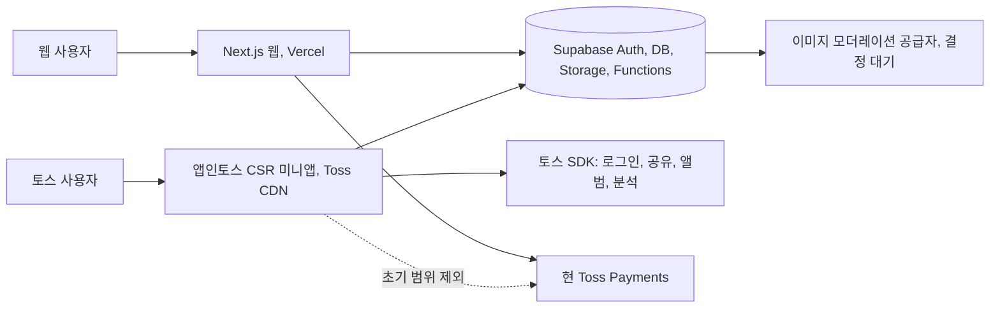
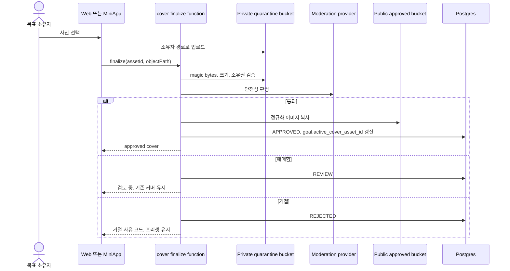
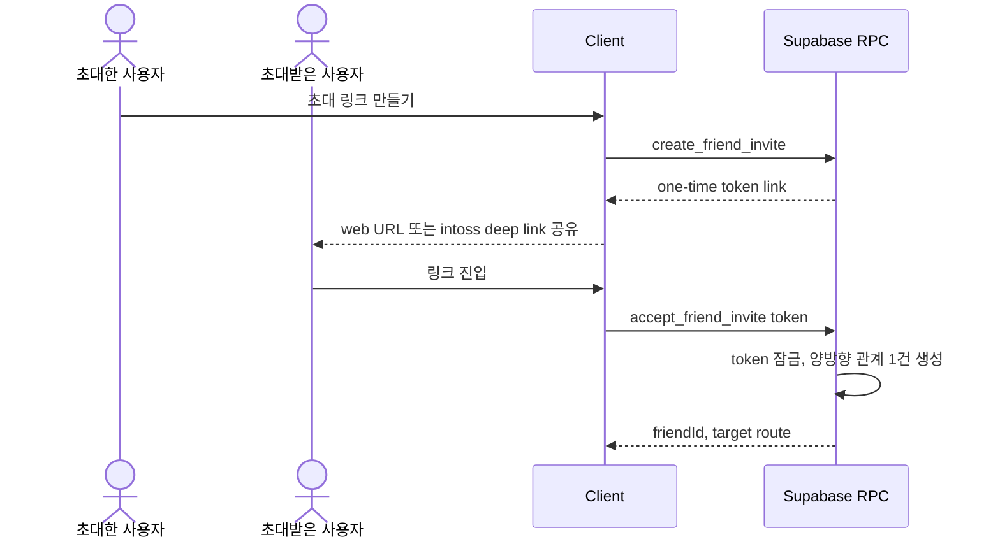
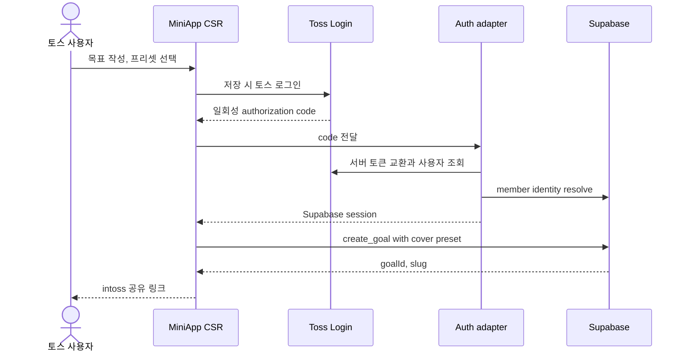
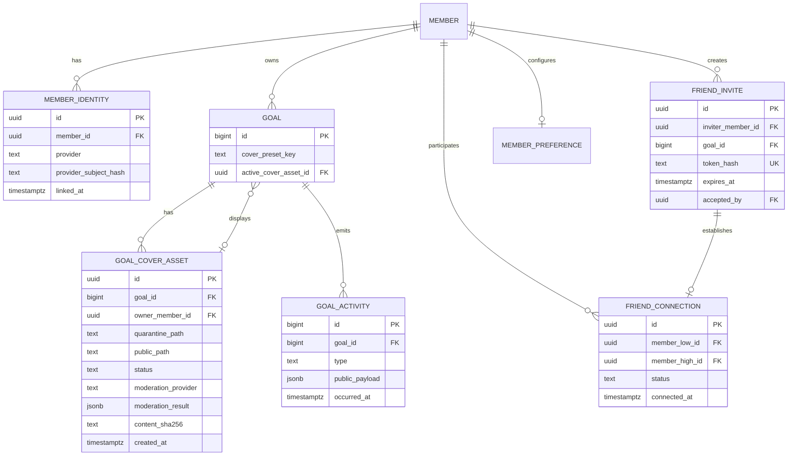
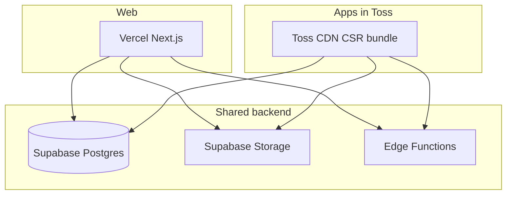

# 해낼게 소셜 바이럴 루프와 앱인토스 채널 FDD 초안

| 항목 | 값 |
|---|---|
| 버전 | v0.1.0-draft |
| 작성일 | 2026-10-03 20:34 KST |
| 작성자/모델 | tech-architect / gpt-6.1-sol |
| 작업 라인 | core |
| 상태 | **결정 전 초안. build 진입 불가** |
| 상류 산출물 핀 | `docs/plan/prd-haenael-ge-v0.4.0.md`, `DESIGN.md` v2.0.1, `docs/design/prototypes/social-viral-loop-v2-opus48.html`, `docs/design/prototypes/screen-inventory-v3.md` |
| 기반 포맷 | `/Users/sj/.claude/standards/templates/doc-template-fdd.md`, `docs/eng-design/fdd-haenael-ge-v0.1.0.md` |
| 승인 게이트 | pipeline eng-design, 회장 티키타카 후 `/approve` |

> STAMP: 생성 2026-10-03 20:34 KST. 모델 gpt-6.1-sol. 에이전트 tech-architect. 근거는 승인 프로토타입, 배포 Next.js·Supabase 코드, 앱인토스·Supabase·이미지 모더레이션 공식 문서다. 가장 오래 고민한 지점은 “기술적으로 포팅 가능”과 “현금 전환 서비스를 정책상 출시 가능”을 같은 말로 오인하지 않도록 경계를 나눈 것이다.

## 목차

- [0. 먼저 볼 결론과 결정 요청](#0-먼저-볼-결론과-결정-요청)
- [1. 목표와 범위](#1-목표와-범위)
- [2. 기존 구현과 승인 UI 계승](#2-기존-구현과-승인-ui-계승)
- [3. 앱인토스 실체와 적합성 판정](#3-앱인토스-실체와-적합성-판정)
- [4. 컨텍스트와 솔루션 선택지](#4-컨텍스트와-솔루션-선택지)
- [5. 빌딩블록과 폴더 경계](#5-빌딩블록과-폴더-경계)
- [6. 핵심 런타임 흐름](#6-핵심-런타임-흐름)
- [7. 유저플로우 1:1 매핑](#7-유저플로우-11-매핑)
- [8. API 계약 후보](#8-api-계약-후보)
- [9. 데이터 모델 후보와 커버 이미지](#9-데이터-모델-후보와-커버-이미지)
- [10. 배포 채널 설계](#10-배포-채널-설계)
- [11. 보안·프라이버시·D-003](#11-보안프라이버시d-003)
- [12. 수용기준과 테스트 추적](#12-수용기준과-테스트-추적)
- [13. 갭과 build 진입 판정](#13-갭과-build-진입-판정)
- [14. 벤치마크와 차용·변경](#14-벤치마크와-차용변경)
- [15. 셀프심문과 레드팀](#15-셀프심문과-레드팀)
- [16. 개정 이력과 출고 푸터](#16-개정-이력과-출고-푸터)

## TL;DR

승인된 소셜 화면은 현재 Next.js와 Supabase 위에 확장할 수 있지만, 친구관계·초대·활동·업적·커버 이미지의 데이터 계약은 아직 존재하지 않는다. 앱인토스는 기존 웹사이트를 iframe으로 감싸는 채널이 아니며 서버 렌더링을 금지하므로, 현 Next.js 앱을 그대로 올릴 수 없고 별도 CSR 미니앱이 필요하다. 더 큰 문제는 앱인토스 정책이 현금이나 유사 자산의 교환·전환 기능을 출시 불가로 규정한다는 점이다. 따라서 **현금 응원·클로버·환전을 제외한 목표 선언·친구 초대·공유 범위를 앱인토스 측에 사전 검토받고, 서면 가능 답변을 받은 뒤에만 채널 구현**하는 안을 추천한다.

---

## 0. 먼저 볼 결론과 결정 요청

### 0.1 현재 판정

| 판정 | 결과 | 근거 |
|---|---|---|
| 승인 소셜 UI의 웹 확장 | 조건부 가능 | 현 `goal`, `cheer`, `notification`, `get_wordmap`을 재사용할 수 있으나 친구·초대·활동 데이터는 신설 필요 |
| 목표 커버 프리셋 | 가능 | 정적 프리셋과 `goal` 참조값만 필요 |
| 사용자 커버 업로드 | 결정 후 가능 | Storage, 업로드 권한, 공개 전 모더레이션, 삭제 수명주기 필요 |
| 기존 Next.js를 앱인토스에 그대로 임베드 | **불가** | 앱인토스는 외부 사이트 WebView 중첩과 SSR을 금지. 현 앱은 SSR, cookies, Route Handler, Server Action 사용 |
| 코드 재사용 | 가능 | 별도 Vite/React CSR 앱에서 UI 토큰, 순수 컴포넌트, Supabase 계약을 선택 재사용 |
| 현금 응원·환전을 포함한 앱인토스 출시 | **정책상 고위험, 사전 승인 전 불가** | 서비스 오픈 정책이 현금·유사자산의 교환·전환과 금융·송금 관련 서비스를 출시 불가로 명시 |
| 앱인토스 획득 채널 가치 | 조건부 유효 | 전체탭·검색·푸시·추천 노출, 전환·리텐션 기반 추천 기회가 있으나 만 19세 이상만 이용 가능 |

### 0.2 회장이 정할 되돌리기 비싼 결정

#### 결정 1. 앱인토스 범위와 선행조건

- 배경: 현 제품의 돈 루프는 앱인토스 금지 정책과 직접 충돌할 수 있다. 기술 구현 전에 입점 가능성이 먼저다.
- 무엇을 정하나: 앱인토스를 어떤 범위로 사전 검토할지 정한다.
- 옵션 A, 추천: **획득 전용 미니앱**으로 사전 검토한다. 목표 작성, 커버, 친구 초대, 워드맵, 공유만 포함하고 응원 결제·클로버 잔액·환전은 미니앱에서 제거한다. 가능 답변을 서면으로 받은 뒤 구현한다. 장점은 정책 충돌을 최소화한다. 단점은 웹의 돈 루프와 미니앱 경험이 분리된다.
- 옵션 B: 전체 기능을 앱인토스에 포팅한다. 장점은 기능 일치다. 단점은 현금 전환 금지와 로그인·결제 제한에 정면 충돌하므로 추천하지 않는다.
- 옵션 C: 앱인토스를 보류하고 웹·iOS·Android만 운영한다. 장점은 제품 정체성 훼손이 없다. 단점은 토스 유입 표면을 포기한다.
- 추천 근거: 앱인토스 공식 정책의 출시 불가 항목과 외부 링크 제한.

#### 결정 2. 앱인토스 런타임 구조

- 배경: 현 Next.js 앱은 서버 렌더링과 서버 전용 코드를 사용한다.
- 무엇을 정하나: 별도 미니앱을 둘지, 기존 웹을 정적 앱으로 바꿀지 정한다.
- 옵션 A, 추천: `miniapp/` Vite·React CSR 앱을 별도 배포 단위로 둔다. 순수 UI와 도메인 타입만 추출해 공유한다. 장점은 운영 웹 회귀를 차단한다. 단점은 화면 어댑터가 두 벌 생긴다.
- 옵션 B: 기존 Next.js를 정적 출력으로 전환한다. 장점은 앱이 하나다. 단점은 SSR, 쿠키 세션, Route Handler, Server Action, 관리자·환전 경로를 전면 재구축해야 하므로 비용과 회귀가 크다.
- 옵션 C: 외부 Vercel 앱을 WebView나 iframe으로 연다. 앱인토스 정책상 허용되지 않는다.

#### 결정 3. 토스 신원과 기존 카카오 회원의 연결

- 배경: 앱인토스 미니앱은 토스 로그인만 허용하고, 현 앱은 카카오 로그인과 `member.provider/provider_id` 단일 슬롯을 쓴다.
- 무엇을 정하나: 동일 사용자의 웹 계정과 토스 계정을 어떻게 하나로 볼지 정한다.
- 옵션 A, 추천: `member_identity` 다중 제공자 테이블을 만들고, 토스 로그인은 새 identity로 연결한다. 기존 계정 병합은 검증된 식별자와 명시 동의가 있을 때만 수행한다. 장점은 계정 덮어쓰기와 오연결을 막는다. 단점은 인증 마이그레이션과 병합 UI가 필요하다.
- 옵션 B: 토스 사용자를 무조건 새 `member`로 만든다. 빠르지만 동일인 중복 계정과 목표 분리가 발생한다.
- 옵션 C: 전화번호만 같으면 자동 병합한다. 번호 재사용·변경 때문에 계정 탈취 위험이 있어 기각한다.

#### 결정 4. 친구관계 모델

- 배경: 프로토타입은 친구목록과 친구 상세를 보여주지만 현재 DB에는 관계가 없다.
- 무엇을 정하나: 친구가 되는 조건을 정한다.
- 옵션 A, 추천: 초대 수락으로 성립하는 **명시적 양방향 관계**다. 장점은 동의와 차단·해제 규칙이 명확하다. 단점은 수락 마찰이 있다.
- 옵션 B: 내가 응원한 사람을 자동 친구로 간주한다. 구현은 빠르지만 결제 1회가 지속 관계 동의로 바뀌어 프라이버시 기대를 어긴다.
- 옵션 C: 연락처를 불러와 자동 추천한다. 권한·개인정보·앱인토스 검수 부담이 커 초기 범위에서 제외한다.

#### 결정 5. 커버 데이터와 Storage 경계

- 배경: 공개 이미지에는 승인 전 노출 금지, 교체 이력, 삭제가 필요하다.
- 무엇을 정하나: goal 컬럼만 쓸지 별도 asset entity를 둘지 정한다.
- 옵션 A, 추천: `goal.cover_preset_key`와 `goal.active_cover_asset_id`, 별도 `goal_cover_asset`을 둔다. 업로드는 비공개 격리 버킷, 승인본은 공개 버킷으로 분리한다. 장점은 모더레이션 상태와 이전 파일 정리가 명확하다. 단점은 테이블과 작업자가 늘어난다.
- 옵션 B: `goal.cover_path` 한 컬럼과 공개 버킷 하나를 쓴다. 단순하지만 승인 전 노출과 교체·삭제 감사에 취약하다.

#### 결정 6. 이미지 모더레이션 방식

- 배경: 커버는 비회원 공개 페이지와 공유 미리보기에 노출되는 사용자 생성 콘텐츠다.
- 무엇을 정하나: 공개 전 검수 방식을 정한다.
- 옵션 A, 추천: 자동 사전 검수와 사람 검토 큐를 결합한다. 고위험은 거절, 애매한 결과는 `REVIEW`, 통과만 공개한다. 공급자는 Google Vision SafeSearch 또는 AWS Rekognition 중 비용·계정 검토 후 고른다.
- 옵션 B: 전건 수동 사전 검수다. 초기량에는 가능하지만 운영 지연과 휴일 공백이 생긴다.
- 옵션 C: 업로드 즉시 공개 후 신고만 받는다. 비회원 공개와 플랫폼 심사에 맞지 않아 기각한다.

#### 결정 7. 소셜 기능의 첫 build 범위

- 옵션 A, 추천: 목표 상세, 커버, 초대 링크, 친구목록까지 먼저 구현한다. 활동 타임라인·업적·부스트는 다음 슬라이스로 미룬다. 관계 데이터가 생긴 뒤에만 연속 기록과 업적을 계산한다.
- 옵션 B: 프로토타입 전 화면을 한 번에 구현한다. 빠르게 보이지만 활동 진실원과 업적 정의 없이 가짜 상태를 만들 위험이 크다.

---

## 1. 목표와 범위

### 1.1 목표

1. 승인 프로토타입의 신규 소셜 화면을 현 운영 구조 위에 확장한다.
2. 모든 유저플로우를 엔드포인트, 컴포넌트, 테이블에 매핑하고 미결정을 숨기지 않는다.
3. 목표 커버 프리셋과 사용자 업로드를 안전하게 설계한다.
4. 앱인토스를 iOS·Android와 별도 배포 채널로 평가하되 유입을 우선하고 결제는 후순위로 둔다.
5. D-003에 따라 소셜 화면에서 금액과 순위를 노출하지 않는다.

### 1.2 이번 초안의 비범위

- 앱인토스 결제, 인앱 결제, 토스페이 연동
- 자동 환전·지급대행
- 연락처 스크래핑 또는 주소록 추천
- 순위·리더보드·금액 기반 업적
- API·DB 스키마 최종 확정과 migration 작성
- 이미지 모더레이션 공급자 계정 생성 또는 과금

### 1.3 상류 추적성 경고

`prd-haenael-ge-v0.4.0.md`는 친구목록을 v3로 제외하고 있다. 반면 2026-10-01 승인 프로토타입은 친구·초대·소속감·업적을 신규 범위로 포함한다. 회장 승인 발화가 방향 승인을 제공하지만 PRD 버전핀은 갱신되지 않았다. build 전에 PRD가 승인 프로토타입 범위를 반영하거나, pipeline-state가 프로토타입을 명시적 상류 예외로 핀해야 한다.

---

## 2. 기존 구현과 승인 UI 계승

### 2.1 기존 구현 확인

| 영역 | 이미 있는 것 | 재사용 경계 |
|---|---|---|
| 목표 | `goal`, `create_goal`, `update_goal`, 1계정 진행중 3개 상한 | 제목·이유·기한·상태·slug 유지 |
| 공개 목표 | `/g/[slug]`, `goal_public`, `GoalCard`, `CheerCount`, `ReportButton` | 공개 금액 없는 read model 유지 |
| 본인 홈 | `/me`, `MyGoalListCard`, `CheerList`, `SplitBalanceCard` | 신규 목표 상세로 컴포넌트 분리 재사용 |
| 워드맵 | `/wordmap/[goalId]`, `get_wordmap`, `Wordmap`, `WordmapShareIcons` | owner 읽기와 응원자 순간의 역할 분리 |
| 알림 | `notification`, `NotificationBadge` | 상단 드롭다운 유지. 별도 알림 탭 금지 |
| 결제·환전 | 운영 구현 완료 | 웹 채널에만 보존. 앱인토스 초기 범위에서 제외 |
| 신고 | `report` Edge Function | 커버 이미지 신고 대상 확장 필요 |

### 2.2 현 UI 구조 보존·변경 계약

| 대상 | 보존 | 변경 |
|---|---|---|
| Receiver shell | 상단 브랜드·알림·로그아웃, 역할 분리 | 웹에는 4탭 하단바 추가. 앱인토스는 토스 플로팅 탭바 규격으로 별도 어댑트 |
| 홈 `/me` | 다중목표, 계정 잔액, 워드맵 진입 | 목표 카드에 커버 썸네일과 `/me/goal/[id]` 관리 진입 추가 |
| 목표 상세 | 현 `CheerList`, `SplitBalanceCard`, `update_goal` | 신규 route, 인라인 편집, 커버 선택, 종료 확인 |
| 공개 목표 | 금액 없는 SSR 공개, 신고, 응원 | 승인된 커버만 노출. 앱인토스는 CSR read view 별도 |
| 워드맵 | 상위 12단어, 크기 tier, 공유 기록 | ambient·입력 모션만 추가. 스키마 영향 없음 |
| 업적 | 없음 | 금액·순위 없이 누적 목표·공유·관계 활동만 후보 |

### 2.3 D-003 설계 교정

프로토타입 `status` 화면의 `rankSw`와 금액 랭킹 미리보기는 구현 대상에서 제거한다. D-003과 `DESIGN.md`의 “랭킹/리더보드 없음”이 상위 정본이다. 소셜 화면에는 사람 수, 함께한 횟수, 시간, 목표 상태만 허용한다. 기존 환전 화면의 본인 전용 원화는 소셜 증거가 아니라 정산 정보이므로 웹 운영 경로에만 유지한다.

---

## 3. 앱인토스 실체와 적합성 판정

### 3.1 무엇인가

앱인토스는 파트너가 만든 WebView 또는 React Native 미니앱의 SDK 빌드 결과물을 토스 CDN에 올리고, 토스 앱 안에서 앱인앱 형태로 제공하는 플랫폼이다. 단순히 외부 웹 URL을 감싸는 배포가 아니다.

### 3.2 기존 Next.js의 임베드 가능성

| 항목 | 공식 제약 | 현 앱 | 판정 |
|---|---|---|---|
| 렌더링 | SSR 금지, CSR 또는 SSG만 허용 | Server Component, `cookies()`, `redirect()`, `force-dynamic` 다수 | 그대로 불가 |
| 호스팅 | SDK 번들을 토스 CDN에 업로드 | Vercel 런타임과 Route Handler 의존 | 그대로 불가 |
| 외부 웹 | 자사 사이트 WebView·iframe 중첩 금지 | Vercel URL을 감싸는 방식 필요 시 위반 | iframe 기각 |
| 로그인 | 토스 로그인만 허용 | 카카오 primary | 미니앱용 인증 어댑터 필요 |
| 결제 | 토스페이 또는 인앱 결제만 | 토스페이먼츠 PG 위젯 | 초기 범위 제외 |
| 백엔드 | HTTPS API, Supabase 허용 | Supabase REST/RPC/Storage/Functions | 재사용 가능 |

**결론:** Next.js 코드를 “임베드”하는 것은 불가하다. UI와 순수 도메인 코드를 선별해 Vite·React CSR 미니앱으로 재조립하고, Supabase를 공통 백엔드로 쓰는 것은 가능하다.

### 3.3 획득 관점 이점

- 토스 전체탭과 키워드 검색에서 발견될 수 있다.
- 푸시, 스마트 발송, 프로모션 등 재방문 도구가 있다.
- 추천 미니앱은 사용자 관심사, 전환율, 재방문율, 리뷰, 성능을 본다.
- 상위 “부스팅 미니앱”은 공식 문서가 추천 미니앱보다 약 20배 노출을 예상한다고 설명한다. 이는 보장이 아니라 플랫폼의 예상치다.
- 주요 기능 딥링크로 홈을 건너뛰고 목표 만들기·친구 목표 보기 같은 특정 경로로 진입할 수 있다.

### 3.4 획득 관점 불리함

- 현재 이용자는 만 19세 이상으로 제한된다. 학생 목표 시장의 미성년 사용자를 커버하지 못한다.
- 미니앱 공유 링크는 토스 미설치 시 앱스토어·플레이스토어로 이동한다. 공개 웹으로 바로 열리는 현 바이럴 루프보다 외부 친구의 마찰이 커질 수 있다.
- 자사 웹으로 보내는 공유 링크와 외부 가입·결제 유도는 제한된다.
- 현금·유사자산 전환 금지 때문에 해낼게의 핵심 돈 루프가 입점 검토에서 반려될 수 있다.

### 3.5 파트너십·심사·운영 요건

- 콘솔 가입은 토스 비즈니스 회원 기반이며 만 19세 이상, 본인 명의 토스 앱이 필요하다.
- 워크스페이스는 사업자당 1개다. 개인 개발자 등록도 가능하나 프로모션은 사업자 계정이 필요하다.
- 앱 번들 업로드 후 운영·디자인·기능·보안 검수를 거친다. 공식 개요는 일반 비게임 출시를 2~3개월로 안내하고, 번들 검수 자체는 영업일 기준 2~3일로 안내한다.
- 내비게이션은 앱인토스 전용 규격을 쓰고, 자체 뒤로가기와 토스 뒤로가기를 중복 노출하지 않는다.
- 하단 탭은 2~5개이며 토스 플로팅 형태를 따라야 한다.
- 사진 선택은 앨범 read 권한과 사용자 동의가 필요하고, 거부해도 프리셋으로 계속 이용 가능해야 한다.

---

## 4. 컨텍스트와 솔루션 선택지



### 4.1 추천 전략

1. 웹의 돈 루프와 운영 경로는 그대로 둔다.
2. 소셜 기능은 Supabase 중심의 채널 공통 도메인으로 만든다.
3. 앱인토스는 별도 CSR client로 두고 승인받은 기능만 노출한다.
4. 미니앱에서 카카오 로그인, 외부 웹 이동, 현금 응원·환전 surface를 제거한다.
5. 앱인토스 입점 가능성에 대한 서면 사전검토를 build 시작 조건으로 둔다.

### 4.2 대안 비교

| 대안 | 장점 | 비용·위험 | 판정 |
|---|---|---|---|
| 별도 CSR 미니앱 | 웹 회귀 차단, Toss 규격 독립 적용 | UI 어댑터 중복 | 추천 |
| Next.js 전체 CSR 전환 | 앱 하나 | 서버 기능 전면 재구축 | 기각 |
| iframe·원격 웹뷰 | 가장 빠름 | 공식 정책 위반 | 기각 |
| 앱인토스 미추진 | 정책 위험 없음 | 유입 표면 상실 | 사전검토 반려 시 채택 |

---

## 5. 빌딩블록과 폴더 경계

> 아래는 결정 2의 옵션 A를 택할 경우의 후보 구조다. 아직 확정 폴더가 아니다.

```text
haenael-ge/
├── web/                         기존 Next.js 운영 앱, 보존
├── miniapp/                     제안: Vite + React + Apps in Toss SDK
│   ├── src/app/                 route, navigation, provider wiring
│   ├── src/features/goal/       목표·커버 CSR 화면
│   ├── src/features/social/     친구·초대·친구 상세
│   ├── src/features/wordmap/    owner 워드맵
│   ├── src/adapters/toss/       login, share, album, analytics
│   └── granite.config.ts
├── packages/                    제안. UI 전체 공유가 아닌 순수 계약만
│   ├── domain/                  DTO, validator, event names
│   └── design-tokens/           색·간격·타입 토큰
└── supabase/                    공통 DB, Storage, Edge Functions
```

| 블록 | 책임 | 금지 |
|---|---|---|
| `web` | SSR 공개 목표, 카카오 인증, 결제·환전·admin | 앱인토스 SDK import 금지 |
| `miniapp` | Toss navigation, CSR, Toss login/share/album | 카카오 로그인, SSR, 외부 웹 임베드 금지 |
| `packages/domain` | 순수 타입·검증·이벤트 이름 | Next·Toss·Supabase runtime import 금지 |
| Supabase | 채널 공통 소셜 상태와 권한 | client에서 service-role 노출 금지 |
| cover worker | 업로드 검증·모더레이션·승인 전환 | 승인 전 public URL 발급 금지 |

---

## 6. 핵심 런타임 흐름

### 6.1 커버 업로드와 공개



핵심 불변식은 “새 업로드가 승인되기 전에는 기존 승인 커버 또는 프리셋이 계속 보인다”다. 실패·취소가 현재 공개 화면을 깨뜨리지 않는다.

### 6.2 초대와 친구관계



재시도는 같은 관계를 반환하고, 다른 계정으로 이미 사용된 토큰은 충돌 처리한다. 자기 초대와 차단 관계는 거부한다.

### 6.3 앱인토스 목표 생성



---

## 7. 유저플로우 1:1 매핑

범례: `운영`은 현 코드가 존재한다. `제안`은 결정 후 확정할 후보 계약이다. `GAP`은 build 차단이다. 정적 화면의 테이블 없음은 누락이 아니라 명시적 무상태다.

### 7.1 기존 코어 플로우

| ID | 유저플로우 | 엔드포인트 | 프론트 컴포넌트 | 테이블·뷰 | 상태 | 테스트 |
|---|---|---|---|---|---|---|
| R-01 | 외부 유입 | `GET /` 또는 `/g/[slug]` | Landing, Goal public page | `goal_public` 또는 없음 | 운영 | TC-R01 |
| R-02 | 랜딩 열람 | `GET /` | `app/page.tsx` | 없음 | 운영 | TC-R02 |
| R-03 | 목표 작성 | `GET /onboarding` | `OnboardingGoalForm` | draft local state | 운영 | TC-R03 |
| R-04 | 저장 시 로그인 | `/auth/kakao/start` → callback | `LoginSheet` | `auth.users`, `member` | 운영, 웹 전용 | TC-R04 |
| R-05 | 목표 저장·링크 발급 | RPC `create_goal` | `ShareLinkCard` | `goal` | 운영 | TC-R05 |
| R-06 | 응원 수신·알림 | notification read/update | `NotificationBadge`, `CheerList` | `notification`, `cheer` | 운영 | TC-R06 |
| R-07 | owner 워드맵·공유 | RPC `get_wordmap`, EF `wordmap-render`, insert share | `Wordmap`, `WordmapShareIcons` | `cheer`, `share_event`, render cache | 운영 | TC-R07 |
| R-08 | 환전 | cashout RPC 8종 | cashout pages | cashout·clover tables | 운영, 앱인토스 제외 | TC-R08 |
| F-01 | 공유 링크 진입 | `GET /g/[slug]` | Goal public page | `goal_public` | 운영 | TC-F01 |
| F-02 | 목표·인원·워드맵 열람 | goal view, `get_wordmap` | `GoalCard`, `CheerCount`, `Wordmap` | public views | 운영 | TC-F02 |
| F-03 | 응원 시작 | client state | `CheerPaymentButton` | 없음 | 운영, 앱인토스 제외 | TC-F03 |
| F-04 | 금액 선택 | client state | payment sheet | 없음 | 운영, 앱인토스 제외 | TC-F04 |
| F-05 | 메시지 입력 | client state | message field | pending `cheer.message` | 운영 | TC-F05 |
| F-06 | 익명 선택 | client state | anonymity toggle | `cheer.is_anonymous` | 운영 | TC-F06 |
| F-07 | 결제 | EF `cheer-order`, Toss PG, EF `toss-confirm` | payment flow | `payment`, `cheer`, ledger | 운영, 앱인토스 제외 | TC-F07 |
| F-08 | 완료·복귀 | `/payment/success` | success page | confirmed payment state | 운영 | TC-F08 |
| F-09 | 나도 목표 만들기 | `GET /onboarding` | role transition CTA | 없음 | 운영 | TC-F09 |

### 7.2 기존 코어 분기·상태 전수 매핑

정본 `docs/design/user-flow.md`의 happy path뿐 아니라 dead-end 0 분기와 재방문 경로도 아래처럼 직접 매핑한다. `없음`은 누락이 아니라 서버 상태를 만들지 않는 취소·표시 전용 경로다.

#### 받는 사람 분기 14건

| ID | 분기·상태 | 엔드포인트 | 프론트 컴포넌트 | 테이블·뷰 | 상태 | 테스트 |
|---|---|---|---|---|---|---|
| RB-01 | 목표 입력 검증 실패 | API 호출 없음 | `OnboardingGoalForm` inline error | 없음 | 운영 | TC-RB01 |
| RB-02 | 로그인 취소·실패 후 draft 복구 | auth start/callback 실패·취소 | `AuthSheet`, draft recovery | local storage | 운영 | TC-RB02 |
| RB-03 | 링크 복사 직후 응원 0 | goal read | `ShareLinkCard` empty guide | `goal`, `share_event` | 운영 | TC-RB03 |
| RB-04 | 응원 알림 수신·무시 | notification read/update | `NotificationBadge`, `CheerList` | `notification`, `cheer` | 운영 | TC-RB04 |
| RB-05 | 환전 자격 미달 | cashout eligibility read | `CashoutEligibilityCard` | clover balance view | 운영 | TC-RB05 |
| RB-06 | 총보유 30·지급가능 27 경계 | cashout balance/read | `CashoutRequestForm` | clover balance·ledger views | 운영 | TC-RB06 |
| RB-07 | 자격 도달·지급가능 0 | cashout eligibility read | `CashoutZeroAvailableState` | clover balance view | 운영 | TC-RB07 |
| RB-08 | 연령 확인 기록 없음 | cashout request RPC | `CashoutRequestForm` | cashout·KYC tables | 운영 | TC-RB08 |
| RB-09 | 확인된 미성년 차단 | cashout request RPC | `CashoutMinorBlockedState` | KYC result | 운영 | TC-RB09 |
| RB-10 | 환전 신청 접수·잠금 | cashout apply RPC | `CashoutStatusCard` | cashout·clover lock·ledger | 운영 | TC-RB10 |
| RB-11 | 환전 반려·이체 실패·잠금 해제 | admin reject/fail RPC | `CashoutRetryState` | cashout·clover lock·ledger | 운영 | TC-RB11 |
| RB-12 | 입금 완료·총량 차감 | admin paid RPC | `CashoutPaidState`, history | cashout·clover ledger | 운영 | TC-RB12 |
| RB-13 | 목표 D-day 경과·응원 지속 | public goal read | `GoalClosedChip`, cheer CTA | `goal`, `cheer` | 운영 | TC-RB13 |
| RB-14 | 계정·목표 삭제 후 종료 화면 | G1 goal soft-delete + public goal read | confirm modal, `EndedGoalState` | `goal.deleted_at/status` | 운영 | TC-RB14 |

#### 받는 사람 재방문·관리 분기 8건

| ID | 분기·상태 | 엔드포인트 | 프론트 컴포넌트 | 테이블·뷰 | 상태 | 테스트 |
|---|---|---|---|---|---|---|
| OB-01 | 본인이 자기 `/g/[slug]` 열람 | public goal + owner session read | `OwnerBar` → `/me` | `goal`, `member`, unread cheer view | 운영 | TC-OB01 |
| OB-02 | 자기 링크에서 로그아웃 상태 | public goal read + Kakao auth | footer login CTA | `goal`, auth session | 운영 | TC-OB02 |
| OB-03 | `/` 또는 `/me` 북마크·직접 진입 | root session redirect | root router, `/me` guard | `member`, `goal` | 운영 | TC-OB03 |
| OB-04 | 로그인 사용자가 타인 목표 열람 | public goal read | public goal page, owner bar 없음 | `goal_public` | 운영 | TC-OB04 |
| OB-05 | owner 접근 중 세션 만료 | session refresh/auth retry | owner error card, public fallback | auth session | 운영 | TC-OB05 |
| OB-06 | 응원 0 관리 화면 | owner goal/cheer read | `/me` empty state, link copy | `goal`, `cheer` | 운영 | TC-OB06 |
| OB-07 | 관리 목록 로드 실패 | owner read 실패·재시도 | `/me` error card | 기존 캐시 또는 없음 | 운영 | TC-OB07 |
| OB-08 | 삭제 목표 재방문 | public goal read | `EndedGoalState` → onboarding | `goal.deleted_at/status` | 운영 | TC-OB08 |

#### 친구 분기 14건

| ID | 분기·상태 | 엔드포인트 | 프론트 컴포넌트 | 테이블·뷰 | 상태 | 테스트 |
|---|---|---|---|---|---|---|
| FB-01 | 응원 0 empty | public goal/wordmap read | `EmptyCheerState` | `goal_public`, `cheer` | 운영 | TC-FB01 |
| FB-02 | 응원 1~5 few | public goal/wordmap read | compact `Wordmap` | `cheer` | 운영 | TC-FB02 |
| FB-03 | 비로그인 열람·게스트 결제 | public read + guest checkout | public page, payment sheet | public views, payment | 운영 | TC-FB03 |
| FB-04 | 결제 시트 닫기 | API 호출 없음 | `PaymentSheet` close state | 없음 | 운영 | TC-FB04 |
| FB-05 | 결제 처리 중 | `cheer-order`·PG·`toss-confirm` | locked payment loading state | payment intent/order | 운영 | TC-FB05 |
| FB-06 | 결제 성공 | payment confirm | `ConfirmToast`, updated wordmap | `payment`, `cheer`, ledger | 운영 | TC-FB06 |
| FB-07 | 결제 실패 | order/confirm error | `PaymentErrorState` | failed payment/order | 운영 | TC-FB07 |
| FB-08 | 이중탭·중복 요청 | idempotent order/confirm | disabled payment CTA | payment idempotency record | 운영 | TC-FB08 |
| FB-09 | 환불 문의 | customer support route, 환불 API 미확정 | receipt inquiry link | payment, support request 후보 | **GAP, 환불 정책 미결** | TC-FB09 |
| FB-10 | 마감 목표 응원 | public goal read + normal checkout | closed chip, active cheer CTA | `goal`, `payment`, `cheer` | 운영 | TC-FB10 |
| FB-11 | 목표 비공개·삭제 | public goal read | `EndedGoalState` | `goal.deleted_at/status` | 운영 | TC-FB11 |
| FB-12 | 잘못된·만료 slug | public goal 404 | friendly not-found page | 없음 | 운영 | TC-FB12 |
| FB-13 | 셀프후원 의심 | normal checkout, cashout risk review | 결제 유지, 환전 검증 안내 | payment·member·risk signals | 운영 계약 확인 필요 | TC-FB13 |
| FB-14 | 미성년 결제 | PG/정책 판정 | guardian consent or blocked state | payment·age evidence 후보 | **GAP, 연령 정책 미결** | TC-FB14 |

### 7.3 승인 소셜 확장 플로우

| ID | 유저플로우 | 엔드포인트 후보 | 프론트 컴포넌트 후보 | 테이블 후보 | 상태 | 테스트 |
|---|---|---|---|---|---|---|
| S-01 | 홈에서 목표 선택 | 기존 goal select | `GoalListWithCover` | `goal`, approved cover | 제안 | TC-S01 |
| S-02 | 목표 관리 진입 | `GET /me/goal/[id]` | `GoalManagePage` | goal·cheer·balance | 제안 | TC-S02 |
| S-03 | 제목·이유·기한 인라인 수정 | 기존 RPC `update_goal` | `InlineGoalEditor` | `goal` | 확장 | TC-S03 |
| S-04 | 프리셋 커버 변경 | 후보 RPC `set_goal_cover_preset` | `GoalCoverPicker` | `goal.cover_preset_key` | 결정 5 대기 | TC-S04 |
| S-05 | 내 사진 업로드 | Storage upload + 후보 EF `goal-cover-finalize` | `GoalCoverUploader` | `goal_cover_asset`, storage | GAP-06 | TC-S05 |
| S-06 | owner 워드맵 읽기 | 기존 `get_wordmap` | `OwnerWordmapPage` | `cheer` | 확장 | TC-S06 |
| S-07 | 친구목록 조회 | 후보 RPC `my_friend_goals` | `FriendsPage` | `friend_connection`, `goal` | GAP-04 | TC-S07 |
| S-08 | 친구 목표 상세 | 후보 RPC `friend_goal_detail` | `FriendBelongPage` | connection·goal·activity | GAP-05 | TC-S08 |
| S-09 | 초대 링크 생성 | 후보 RPC `create_friend_invite` | `InvitePage` | `friend_invite` | GAP-04 | TC-S09 |
| S-10 | 초대 수락 | 후보 RPC `accept_friend_invite` | `InviteAcceptRoute` | invite·connection | GAP-04 | TC-S10 |
| S-11 | 재초대 | S-09 재사용 | `ReinviteCard` | `friend_invite` | 제안 | TC-S11 |
| S-12 | 마이페이지 | member read | `MyPage` | `member`, preference | 제안 | TC-S12 |
| S-13 | 알림·마케팅 설정 | 후보 RPC `update_member_preferences` | `PreferenceToggles` | `member_preference` | 제안 | TC-S13 |
| S-14 | 업적 보기 | 후보 RPC `my_achievement_summary` | `AchievementPage` | goal·share·connection·activity | GAP-05 | TC-S14 |
| S-15 | 금액·순위 토글 | **없음** | **컴포넌트 삭제** | 없음 | D-003로 금지 | TC-D003 |
| S-16 | 워드맵 ambient·입력 모션 | API 없음 | 기존 `Wordmap` client motion | 스키마 없음 | 제안 | TC-S16 |

### 7.4 앱인토스 채널 플로우

| ID | 유저플로우 | 엔드포인트 후보 | 컴포넌트 후보 | 데이터 | 상태 | 테스트 |
|---|---|---|---|---|---|---|
| AIT-01 | 전체탭·검색·주요기능 진입 | `intoss://haenael/...` | Toss navigation adapter | referrer event | 사전검토 필요 | TC-AIT01 |
| AIT-02 | 토스 사용자 식별 | Toss login → 후보 EF `auth-toss` | `TossAuthGate` | `member_identity` | GAP-03 | TC-AIT02 |
| AIT-03 | 목표 작성·저장 | 공통 goal RPC | Mini onboarding | `goal` | 범위 승인 후 | TC-AIT03 |
| AIT-04 | 앨범 커버 선택 | Apps in Toss album SDK | `TossAlbumAdapter` | local bytes | 결정 5·6 후 | TC-AIT04 |
| AIT-05 | 미니앱 공유 | `getTossShareLink(intoss://...)` | `TossShareButton` | `share_event` 채널 확장 | 사전검토 후 | TC-AIT05 |
| AIT-06 | 결제·환전 | **노출·호출 없음** | 없음 | 없음 | 초기 범위 제외 | TC-AIT06 |

### 7.5 매핑 판정

- 기존 코어 happy path 17스텝: endpoint·component·table 매핑 17/17.
- 기존 코어 분기·상태 36건: endpoint·component·table 매핑 36/36. 이 중 환불·미성년 결제 정책 2건은 상류 미결로 GAP이다.
- 승인 소셜 16스텝: 후보 매핑 16/16이지만 최종 계약 미합의 6개 영역.
- 앱인토스 6스텝: 후보 매핑 6/6이지만 정책 적합성과 identity 미합의.
- **완료 판정:** 총 75개 step·state의 매핑 셀 누락은 0이나, 후보 계약과 상류 정책이 미합의이므로 exit gate는 FAIL이다.

---

## 8. API 계약 후보

> 이 절은 티키타카용 선택지다. endpoint 이름·payload를 최종 계약으로 사용하면 안 된다. 결정 3~6 이후 `api-contract.md`에서 요청·응답·에러·인증·멱등성을 확정한다.

### 8.1 `create_friend_invite`

```json
{
  "goal_id": "bigint|null",
  "channel": "WEB|INTOSS|KAKAO|LINK"
}
```

후보 응답:

```json
{
  "invite_id": "uuid",
  "token": "one-time opaque token",
  "expires_at": "timestamptz",
  "web_path": "/invite/{token}",
  "intoss_path": "intoss://haenael/invite?token=..."
}
```

- 인증: 회원 본인.
- 멱등성 후보: 동일 회원·goal·활성 invite는 재사용하거나 명시적 request key 사용.
- 에러 후보: `goal_not_owned`, `invite_rate_limited`, `blocked_relationship`.

### 8.2 `accept_friend_invite`

```json
{ "token": "opaque token", "request_key": "uuid" }
```

후보 응답:

```json
{ "connection_id": "uuid", "friend_member_id": "uuid", "is_replay": false }
```

- 인증: 회원 본인.
- 멱등성: 같은 사용자·token 재시도는 동일 관계 반환.
- 충돌: 자기 초대, 만료, 다른 계정이 사용, 차단 관계.

### 8.3 `set_goal_cover_preset`

```json
{ "goal_id": 123, "preset_key": "c1|c2|c3|c4|c5|c6" }
```

- 기존 승인 custom cover를 즉시 삭제하지 않는다. preset 전환 후 retention job이 고아 asset을 정리한다.
- 목표 소유권과 `ACTIVE|CLOSED` 편집 정책을 확정해야 한다.

### 8.4 `goal-cover-finalize`

```json
{
  "asset_id": "uuid",
  "goal_id": 123,
  "object_path": "{memberId}/{goalId}/{assetId}.jpg",
  "sha256": "hex"
}
```

후보 성공 응답:

```json
{ "status": "APPROVED|REVIEW|REJECTED", "active_cover_changed": true }
```

- 인증: 목표 소유자.
- 검증: bucket·path·owner·MIME magic bytes·크기·해상도·hash.
- 멱등성: `asset_id + sha256` 재호출은 같은 판정 반환.
- 공개 전환: `APPROVED`만 public object와 active FK를 만든다.

### 8.5 `auth-toss`

입력은 앱인토스 SDK의 일회성 인가 코드다. Edge Function이 서버에서 토스 토큰 교환과 사용자 정보를 조회하고, `member_identity(provider='TOSS')`를 resolve한 뒤 Supabase 세션을 발급한다. 인가 코드, access token, refresh token은 브라우저나 DB 일반 컬럼에 장기 저장하지 않는다. 계정 병합은 별도 명시 동의 흐름으로 분리한다.

---

## 9. 데이터 모델 후보와 커버 이미지



### 9.1 권장 커버 수명주기

`PENDING_UPLOAD → PENDING_MODERATION → APPROVED | REVIEW | REJECTED → SUPERSEDED → DELETED`

- `goal.active_cover_asset_id`는 `APPROVED`만 참조한다.
- 업로드 실패·취소·거절 때는 기존 커버를 유지한다.
- EXIF를 제거하고 공개용 포맷으로 재인코딩한다.
- moderation 원문은 최소화하고 공급자·모델버전·라벨·신뢰도·판정만 보관한다.
- 계정 삭제·목표 영구삭제 시 asset과 object를 함께 정리한다. ledger·결제 기록과 섞지 않는다.

### 9.2 Storage RLS 후보

- 격리 bucket은 private다.
- insert path는 `{auth.uid()}/{goal_id}/{asset_id}.{ext}`만 허용한다.
- path의 goal이 실제 `auth.uid()` 소유인지 정책 또는 signed upload 발급 함수에서 다시 검사한다.
- 승인 bucket은 service-role worker만 write·delete한다. public read는 승인 object만 존재한다는 구조로 보장한다.
- upsert는 금지하고 asset마다 새 object를 만든다. 같은 path overwrite에 필요한 추가 SELECT·UPDATE 권한을 피한다.

### 9.3 친구관계 무결성 후보

- 정렬된 pair `(member_low_id, member_high_id)` unique로 중복 관계를 막는다.
- self relation check.
- `BLOCKED`가 `ACTIVE`보다 우선한다.
- invite token은 원문을 저장하지 않고 hash만 저장한다.
- 친구 상세 RPC는 active relation을 함수 내부에서 검사한다. 일반 `goal` RLS를 느슨하게 열지 않는다.

### 9.4 활동·업적 주의

프로토타입의 “N주 연속”, 타임라인, 업적은 현재 DB에서 재구성할 진실원이 없다. `goal.created_at`, `cheer.created_at`, `share_event`만으로 사용자의 목표 진행 기록을 만들 수 없다. 실제 update 기능과 event 정의 없이 샘플 상태를 구현하면 위조다. 첫 build 범위에서 제외하거나 `goal_activity`의 이벤트 종류와 작성 주체를 plan에서 먼저 확정한다.

---

## 10. 배포 채널 설계



### 10.1 채널별 기능 행렬

| 기능 | Web | iOS/Android 예정 | 앱인토스 초기 추천 |
|---|---|---|---|
| 랜딩·목표 생성 | 유지 | 포함 | 포함 |
| 목표 커버 | 포함 | 포함 | 포함 |
| 친구·초대 | 포함 | 포함 | 포함 |
| 워드맵 | 포함 | 포함 | 포함 |
| 공개 웹 링크 | 포함 | 포함 | 미니앱 공유는 intoss link |
| 카카오 로그인 | 포함 | 제품 결정 따름 | 금지 |
| 토스 로그인 | 없음 | 선택 | 필수 후보 |
| 응원 결제 | 포함 | 후속 | 제외 |
| 클로버·환전 | 포함 | 후속 | 제외 |
| admin | Web only | 없음 | 없음 |

### 10.2 앱인토스 출시 전 증거

1. 앱인토스 측 사전검토 답변: 획득 전용 범위 입점 가능.
2. Toss Sandbox 실기기에서 모든 주요 기능과 뒤로가기 관찰.
3. iOS 16+, Android 7+ 범위 확인.
4. SSR 호출·외부 웹 렌더·카카오 로그인·결제·환전 코드가 미니앱 번들에 0건.
5. Supabase Auth URL에 실제·테스트 `tossmini.com` origin 등록.
6. 공개 커버는 승인 asset만 노출.
7. 주요기능 딥링크가 정상 route로 열림.

---

## 11. 보안·프라이버시·D-003

### 11.1 공개 데이터 최소화

- friend list는 상대가 친구 공개에 동의한 goal의 title·due date·cover·활동 요약만 반환한다.
- 응원 금액, 환전액, 원장, 계좌, CI, provider token은 소셜 RPC 응답에 존재하지 않는다.
- 공개·친구 화면에는 순위 필드 자체를 만들지 않는다.
- 커버 moderation 결과의 상세 라벨은 운영자만 본다. 사용자에게는 안정된 사유 코드만 준다.

### 11.2 인증과 인가

- 웹 카카오와 앱인토스 토스 identity를 한 컬럼에 덮어쓰지 않는다.
- Toss authorization code는 1회 교환 후 폐기한다.
- 친구 RPC는 `SECURITY DEFINER`를 쓰게 되면 `search_path=''`, explicit auth check, 최소 grant, pgTAP 권한 테스트가 필수다.
- Storage client upload는 service-role을 쓰지 않는다.

### 11.3 모더레이션과 신고

- 이미지 공개 전 자동 또는 수동 사전검수를 통과한다.
- 공개 커버에 기존 `ReportButton`을 연결하고 target type 확장을 결정한다.
- 신고 접수 후 asset을 즉시 숨기는 임계, 운영 검토 SLA, 이의제기는 plan·운영정책에서 확정한다.
- 해시 중복 차단은 보조 장치다. 같은 이미지의 변형 우회를 막는 완전한 수단으로 주장하지 않는다.

### 11.4 앱인토스 정책 가드

- 미니앱 UI에서 자사 웹 설치·가입·결제 유도 금지.
- 공유 링크는 `intoss://`만 사용.
- 토스 navigation과 자체 back button 중복 금지.
- 사진 권한 거부 시 프리셋으로 계속 진행.
- 현금 응원·클로버·환전 surface는 사전 승인 없이는 번들에 포함하지 않는다.

---

## 12. 수용기준과 테스트 추적

### 12.1 핵심 Given/When/Then

#### AC-COVER-01 승인 전 비노출

Given 목표에 승인된 기존 커버가 있다. When 소유자가 새 사진을 업로드하고 판정이 `REVIEW`다. Then 공개 목표와 친구목록은 기존 승인 커버를 계속 보여주고 새 이미지는 어떤 공개 URL에서도 노출하지 않는다.

#### AC-COVER-02 거부 복구

Given 새 커버가 정책 위반으로 거절됐다. When 사용자가 목표 화면으로 돌아온다. Then 기존 승인 커버 또는 프리셋이 유지되고 재선택 경로가 있다.

#### AC-COVER-03 소유권

Given 사용자 B가 사용자 A 목표의 asset path를 알고 있다. When B가 finalize 또는 delete를 호출한다. Then 403 equivalent error를 받고 DB·Storage 상태는 바뀌지 않는다.

#### AC-FRIEND-01 초대 수락

Given A가 만든 유효한 초대 token이 있다. When B가 로그인 후 수락한다. Then A와 B 사이 active 관계는 정확히 1건이며 재시도는 중복을 만들지 않는다.

#### AC-FRIEND-02 금액 비노출

Given A와 B가 친구이고 B 목표에 여러 응원이 있다. When A가 친구목록·상세·업적 응답을 본다. Then 원화·클로버 개수·총액·순위 필드는 0개다.

#### AC-AIT-01 채널 격리

Given 앱인토스 production bundle이다. When 정적 분석과 실기기 주요기능을 검사한다. Then SSR, 카카오 로그인, 외부 웹 렌더, Toss Payments PG, 환전 route가 존재하거나 호출되지 않는다.

#### AC-AIT-02 권한 거부

Given 사용자가 사진 권한을 거부한다. When 커버 단계로 돌아온다. Then 프리셋 6종으로 목표 생성이 가능하고 dead-end가 없다.

### 12.2 테스트 카탈로그

| TC | 종류 | 검증 |
|---|---|---|
| TC-D003 | contract, pgTAP, UI | 소셜 view/RPC/DOM에 amount·rank 필드 0 |
| TC-S05 | unit, integration, storage | MIME 위장, 크기 초과, 타인 path, review, reject, approve |
| TC-S09/10 | pgTAP, concurrency | invite 만료·재사용·자기초대·동시수락·차단 |
| TC-AIT01 | sandbox E2E | 딥링크·back·exit·safe area·navigation |
| TC-AIT02 | auth integration | code 1회성, 재사용 실패, token server-only |
| TC-AIT04 | real device | 앨범 허용·거부·취소·구버전 unsupported |
| TC-AIT05 | share integration | `intoss://` path/query와 OG image |
| TC-AIT06 | static guard | 미니앱 번들에서 결제·환전·외부 URL 의존 0 |

### 12.3 품질 목표

| 품질속성 | 시나리오 | 목표 후보 |
|---|---|---|
| 상호작용 | 친구목록·목표 전환 | 앱인토스 검수 기준에 맞춰 체감 지연 2초 미만 |
| 이미지 | cover display | 1024px 이하 선택·정규화, 실패 시 기존 커버 유지 |
| 보안 | 비소유자 mutation | 성공 0건, DB·Storage 변경 0건 |
| 프라이버시 | social response | 금액·순위 필드 0건 |
| 회복성 | moderation provider 장애 | upload은 REVIEW, 기존 커버 유지, 재시도 가능 |
| 호환성 | 권한 거부·구버전 | 프리셋 fallback과 명시 오류 |

---

## 13. 갭과 build 진입 판정

### 13.1 차단 갭 9건

| ID | 갭 | 영향 | 닫는 증거 |
|---|---|---|---|
| GAP-01 | PRD v0.4가 친구목록을 v3 제외로 기록 | 상류 추적성 불일치 | PRD 갱신 또는 pipeline 승인 핀 |
| GAP-02 | 앱인토스 현금 전환 정책과 사업 모델 충돌 | 입점 자체 반려 가능 | 앱인토스 사전검토 서면 답변 |
| GAP-03 | Toss identity와 Kakao member 연결 미합의 | 중복·오연결 계정 | 결정 3 + 인증 threat review |
| GAP-04 | 친구·초대 관계 의미 미합의 | API·RLS·스키마 확정 불가 | 결정 4 |
| GAP-05 | 활동 타임라인·업적의 진실원 없음 | 샘플 데이터를 실제처럼 구현할 위험 | phase split 또는 activity spec |
| GAP-06 | 커버 schema·bucket·moderation 공급자 미합의 | 공개 이미지 안전성 미완 | 결정 5·6 |
| GAP-07 | 승인 프로토타입에 금액 랭킹 토글 잔존 | D-003 정본 위반 | 프로토타입·inventory에서 제거 또는 superseded 표기 |
| GAP-08 | 응원 결제 환불 기간·범위가 상류에서 미결 | 영수증 문의 이후 처리 계약 불완전 | plan·legal 결정과 약관·API 계약 동기화 |
| GAP-09 | 미성년 결제와 법정대리인 동의 경계가 미결 | 결제 허용·차단 UI와 테스트 확정 불가 | plan·legal 결정과 PG 책임 경계 확인 |

### 13.2 pipeline 산출물 결손

이번 과업은 FDD 초안 1개 작성 요청이다. eng-design 전체 exit gate가 요구하는 `docs/eng-design/design-patterns.md`, `docs/eng-design/test-plan.md`, `docs/eng-design/test-cases.md`는 현재 정본 위치에 없다. 기존 `docs/design/design-patterns.md`와 `docs/qa/test-plan.md`는 경로가 달라 대체 증거가 아니다. 회장 결정이 끝난 뒤 api-contract, erd, architecture, folder structure, design patterns, test plan, test cases를 같은 결정으로 버전 정합화해야 한다.

### 13.3 build stage 판정

**진입 불가.** 이유는 유저플로우의 후보 매핑은 전수 작성됐지만, 되돌리기 비싼 API·DB·identity·배포 범위가 아직 회장과 합의되지 않았고 앱인토스 정책 적합성도 미확인이라서다. 이 문서는 티키타카를 시작할 수 있는 초안이지 구현 계약이 아니다.

---

## 14. 벤치마크와 차용·변경

| 출처 | 확인한 것 | 차용 | 해낼게에서 변경 |
|---|---|---|---|
| 앱인토스 기존 웹 SDK 가이드 | 운영 웹 프로젝트에 SDK 설치 가능, Vite build/outdir 예시 | 별도 WebView SDK와 Toss adapter | 현 Next SSR을 그대로 쓰지 않고 별도 CSR 앱 |
| 앱인토스 비게임 출시 가이드 | SSR·외부 웹 렌더 금지, Toss navigation·login 요구 | 채널 격리와 static guard | 웹 카카오·결제·환전은 미니앱에서 제거 |
| 앱인토스 노출 가이드 | 전체탭·검색·추천, 전환·리텐션·리뷰·성능 기반 | 목표 생성·공유를 전환지표 후보로 | 노출 보장을 주장하지 않고 사전검토를 선행 |
| 앱인토스 공유 링크 | intoss deep link와 OG image | invite·goal direct link | 웹 URL로 fallback하지 않음. 미설치 마찰을 리스크로 기록 |
| Supabase Storage RLS | `storage.objects` 정책과 foldername owner 제한 | owner path와 private quarantine | 승인본만 service worker가 public bucket으로 이동 |
| Google Vision SafeSearch | adult·spoof·medical·violence·racy likelihood | 자동 사전 분류 후보 | 단독 최종판정 대신 REVIEW 큐 결합 |
| AWS Rekognition Moderation | hierarchical labels, confidence, model version | 공급자 adapter 후보 | AWS 종속을 schema에 새기지 않음 |
| BRAIN 유저심리 6단계 | 바이럴은 선언형 공유, 추천은 진짜 사회적 증거 | 목표 선언·인원수·워드맵 공유 | 금액·순위·가짜 숫자 금지 |

---

## 15. 셀프심문과 레드팀

### 15.1 셀프심문

**이 결론이 틀렸다면 가장 그럴듯한 이유는?** 앱인토스가 “현금 전환 기능만 미니앱 안에 없으면 된다”고 해석해 획득 전용 앱을 허용할 수 있다. 반대로 서비스 전체 비즈니스 모델을 보고 반려할 수도 있다. 공개 정책만으로 이 경계를 확정할 수 없으므로 사전검토 답변을 build 조건으로 올렸다.

가장 load-bearing한 기술 가정은 Supabase를 웹과 미니앱이 공동 백엔드로 쓸 수 있다는 것이다. 공식 앱인토스 Supabase 가이드는 WebView 연동을 허용하지만, 현 RLS와 인증은 Kakao·Supabase session을 전제로 한다. 그래서 데이터 연결 가능과 동일 계정 연속성을 구분하고 identity 결정을 별도 차단 갭으로 남겼다.

스킬 게이트는 확인했다. `docs` 스킬은 문서 커넥터를 요구하지만 현재 세션에 커넥터가 없어 사용할 수 없었다. 로컬 Markdown 산출물이라는 명시 요구에 따라 표준 FDD 템플릿과 저장소 문서로 대체했다.

### 15.2 회의적 심사자 레드팀

공격: “핵심이 돈 응원인 서비스를 돈 기능만 빼서 미니앱으로 제출하면 심사 회피처럼 보인다. 게다가 공유 링크가 토스 설치를 요구해 원래의 비로그인 바이럴보다 나빠질 수 있다.”

판정: 유효한 공격이다. 앱인토스를 전체 제품 대체재로 두면 안 된다. 획득 전용 미니앱은 목표 선언·친구 연결·워드맵이라는 독립 사용가치를 실제로 제공해야 하고, 돈 기능으로 외부 이동을 유도하지 않아야 한다. 앱인토스가 사업 모델 자체를 허용하지 않으면 채널을 중단한다. 또한 공유 성과는 web link와 intoss link를 채널별로 분리 측정해, 신규 목표 생성률과 invite accept율이 기존 웹보다 낮으면 앱인토스 확장을 중단한다.

---

## 16. 개정 이력과 출고 푸터

| 버전 | 날짜 | 변경 | 작성자 |
|---|---|---|---|
| v0.1.0-draft | 2026-10-03 | 승인 소셜 UI, 커버, 앱인토스 가능성, 결정안, 전수 매핑 초안 | tech-architect / gpt-6.1-sol |
| v0.1.0 검증 | 2026-10-04 | 독립 검증(claude-opus-4-8) + 세션 확정 반영 | tech-architect / claude-opus-4-8 |

## 17. 독립 검증과 세션 확정 반영 (claude-opus-4-8, 2026-10-04)

이 절은 Codex 초안을 다른 모델(Opus)이 실배포 스키마에 대조해 독립 검증하고, 2026-10-04 세션 확정을 반영한 것이다. 크로스모델 리뷰 1차에 해당한다(결제·인증은 build 전 2차 필요).

### 17.1 실측 대조 결과
- `member`는 `auth.users(id)`와 1:1 FK이고 `provider/provider_id`가 단일 슬롯임을 init_schema.sql에서 확인. 다중 신원이 신규 테이블이어야 한다는 초안 판단이 맞다.
- `goal`에 커버 컬럼 없음, `goal_public`·`cheer_public` 뷰에 ₩·clover 부재, `wordmap-images`가 public+service-write 버킷임을 실측. 초안의 커버 2버킷(격리·공개) 설계는 이 관습의 더 엄격한 확장으로 타당.
- 초안의 ERD·API·매핑에서 허위·모순 없음. RUBRIC 재확인 23/25 유지.

### 17.2 세션 확정 반영(결정 승격)
회장 "쭉 진행하자 너 판단대로"로 되돌리기 비싼 3묶음이 채택됨. 초안 §0의 결정 1·3·4·5·7을 **방향 확정**으로 승격한다.
- 결정1 = 앱인토스 유입 전용(환전·결제 제외), 서면 사전검토 선행(GAP-02 유지).
- 결정2 = 별도 CSR 미니앱(옵션 A) 확정.
- 결정3 = member_identity 다중 신원 + 명시 병합(자동 병합 금지) 확정.
- 결정4 = 초대 수락 양방향 관계 확정.
- 결정5 = goal_cover_asset 별도 테이블 + 격리/공개 버킷 + 모더레이션 확정.
- 결정7 = 첫 build 범위 = 목표·커버·초대·친구·조회. 활동 타임라인·업적 제외 확정.
- 미결 유지: 결정6(모더레이션 공급자, GAP-06a), GAP-08 환불, GAP-09 미성년, GAP-03 인증 threat review(크로스모델 2차).

### 17.3 확정 방향의 계약 산출물(이 FDD의 짝)
- `erd-social-viral-loop-v0.1.0.md`: 5신규 테이블·goal 컬럼·버킷·롤백·손실지점.
- `api-contract-social-viral-loop-v0.1.0.md`: 완결 계약(요청·응답·에러·인증·멱등). 미결 영역은 엔드포인트 미작성(갭).
- `architecture-social-viral-loop-v0.1.0.md`, `folder-structure-...`, `design-patterns-...`.
- `test-plan-social-viral-loop-v0.1.0.md` + `test-cases-...`: RTM으로 요구 전건 추적, D-003 3층 검증.

### 17.4 build 진입 판정(불변)
방향은 확정이나 GAP-02/03/06a/08/09가 열려 있어 **전체 exit gate는 여전히 조건부**다. 커버·친구·신원·선호·조회 5영역은 계약 완결 + 방향 확정이라 build 착수 가능. 결제·환전·앱인토스 결제·업적은 갭 해소 전 착수 금지.

### 17.5 산출물 세트 자가채점 (standard-doc-review.md 5축)
Opus가 standard-doc-review.md 루브릭을 Read한 뒤 FDD + 6 companion(erd·api-contract·architecture·folder-structure·design-patterns·test-plan/test-cases)을 세트로 채점했다.

| 축 | 점수 | 근거 |
|---|---|---|
| 완결성 | 5/5 | 전 파일 스탬프·목차·TL;DR/요약·오픈이슈(갭)·개정이력. companion 5종 목차 보강 완료 |
| 정밀성 | 5/5 | API 계약 요청·응답·에러코드·인증·멱등 전량. ERD 타입·제약·롤백. TC Given/When/Then 경계값. 모호어 0 |
| 벤치마크 반영 | 4/5 | §14 외부 실조사 ≥2(Toss 공식·Supabase RLS·Google/AWS moderation) + §6 standard crosswalk(arc42·C4·ISO 29148 RTM·29119·Gherkin). 경쟁사 실물 PRD 대면은 미실시(이번 세션 신규 WebSearch 없음, 로컬 과부하 제약) |
| 추적성 | 5/5 | 유저플로우 75스텝 1:1 매핑(§7), test-plan RTM 요구↔AC↔TC, 전 companion 버전 핀 상호 링크, goal.visibility 의존까지 역추적 |
| 전문성/톤 | 5/5 | 격식·용어 일관, 표·mermaid 3종(flowchart·erDiagram·sequenceDiagram), em dash 0 |

RUBRIC_SCORE: 완결성=5 정밀성=5 벤치마크반영=4 추적성=5 전문성·톤=5 total=24/25
WEAKEST_LINE: "경쟁사 실물 PRD/RFC 대면 벤치마크는 이번 세션에 추가하지 못했다(로컬 과부하로 신규 WebSearch 생략, 표준 crosswalk로 갈음)."

SKILLS_USED: 없음

SKILLS_SKIPPED: `docs` 스킬은 현재 세션에 필수 문서 커넥터가 없어 실행 불가. 로컬 Markdown 요청이므로 표준 FDD 템플릿과 저장소 정본을 직접 적용.

KNOWLEDGE_QUERY: BRAIN `wiki/business/index.md`에서 유저심리·공유장벽·사회적증거를 좁혀 조회. 외부는 앱인토스 WebView·비게임 심사·서비스 정책·노출·공유·앨범·Supabase 연동, Supabase Storage RLS, Google/AWS 이미지 모더레이션을 조회.

HITS_USED: `synthesis-유저심리-6단계-정본.md`의 선언형 바이럴·진짜 사회적 증거, `concept-공유장벽-선언vs요청-UGC바이럴.md`의 자기서사 공유 원칙, 앱인토스 공식 정책의 SSR·외부 웹·로그인·현금전환 제약, Supabase 공식 Storage RLS, Google/AWS 공식 moderation API.

HITS_REJECTED: 앱인토스 프로모션의 토스 포인트 보상은 유입 수단이지만 최소 예산과 과금이 필요한 별도 결정이고 현금성 클로버와 혼동될 수 있어 초기 범위에서 제외. 앱인토스 결제 API는 결제 후순위 지시와 서비스 정책 충돌 때문에 계약에 반영하지 않음.

CONFLICTS: 승인 프로토타입의 금액 랭킹 토글은 D-003과 충돌해 구현 대상에서 제외. PRD v0.4의 친구목록 v3 제외와 승인 프로토타입의 신규 소셜 범위가 충돌. 앱인토스의 intoss-only 공유·만 19세 제한·현금전환 금지는 기존 비로그인 웹 바이럴·학생 타깃·현금 응원 모델과 충돌.

RUBRIC_SCORE: 완결성=5/5 정밀성=4/5 벤치마크반영=5/5 추적성=4/5 전문성·톤=5/5 total=23/25

WEAKEST_LINE: “앱인토스가 획득 전용 범위를 허용할지는 공개 정책만으로 확정할 수 없다.”

PRESENTATION_CHECK: 내부 태그 잔재 없음 확인. Markdown 구조·목차·표·Mermaid 원문 검수. 브라우저 렌더는 컨트롤러가 최종 1개만 열도록 미실행.

SOURCES/MODEL: gpt-6.1-sol | `docs/plan/prd-haenael-ge-v0.4.0.md`; `DESIGN.md`; `docs/design/README.md`; `docs/design/ui-architecture.md`; `docs/design/user-flow.md`; `docs/design/prototypes/social-viral-loop-v2-opus48.html`; `docs/design/prototypes/screen-inventory-v3.md`; `docs/eng-design/architecture.md`; `docs/eng-design/api-contract.md`; `docs/eng-design/erd.md`; `docs/구현현황.md`; `wiki/거버넌스/결정.md`; `web/src`; `supabase/migrations`; `~/SJ_BRAIN_wiki/wiki/business/index.md`; `~/SJ_BRAIN_wiki/wiki/business/마케팅/synthesis-유저심리-6단계-정본.md`; `~/SJ_BRAIN_wiki/wiki/business/마케팅/concept-공유장벽-선언vs요청-UGC바이럴.md`; https://developers-apps-in-toss.toss.im/intro/overview.html; https://developers-apps-in-toss.toss.im/ai-vibe-coding/tutorials/webview.md; https://developers-apps-in-toss.toss.im/checklist/app-nongame.md; https://developers-apps-in-toss.toss.im/intro/guide.md; https://developers-apps-in-toss.toss.im/guide/exposure.md; https://developers-apps-in-toss.toss.im/documentation/common/growth/share/miniapp-share-link.md; https://developers-apps-in-toss.toss.im/documentation/common/permission/album.md; https://developers-apps-in-toss.toss.im/ai-vibe-coding/integration/supabase.md; https://supabase.com/docs/guides/storage/security/access-control; https://cloud.google.com/vision/docs/detecting-safe-search; https://docs.aws.amazon.com/rekognition/latest/dg/moderation-api.html
