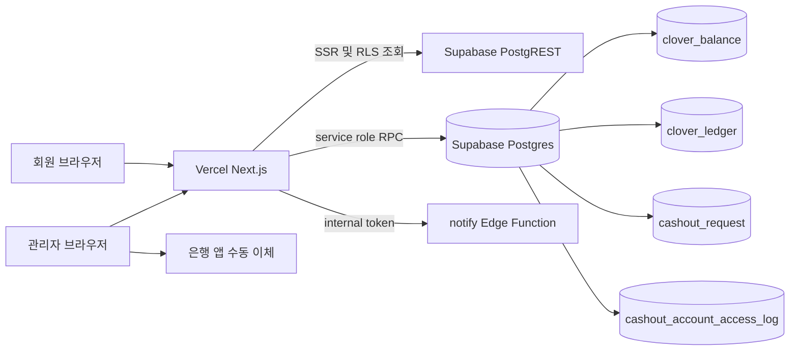
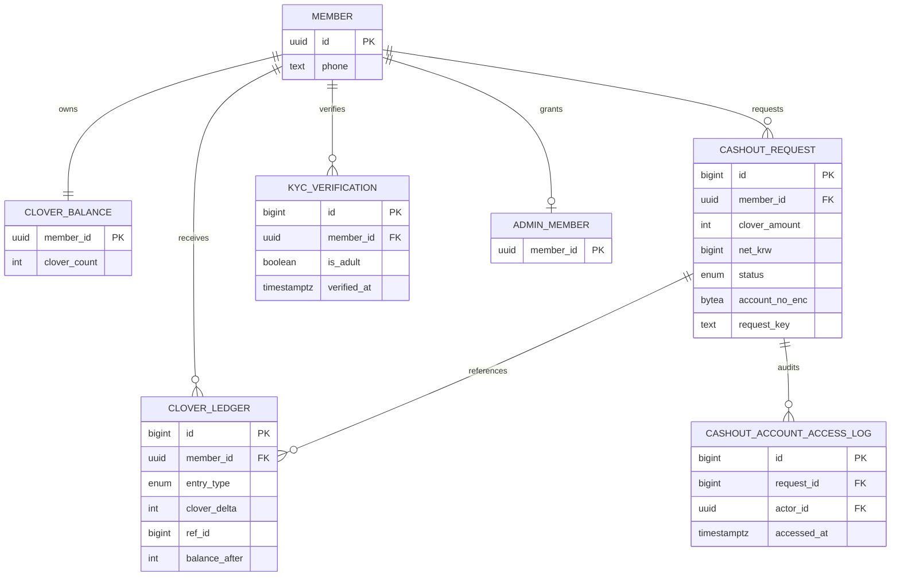
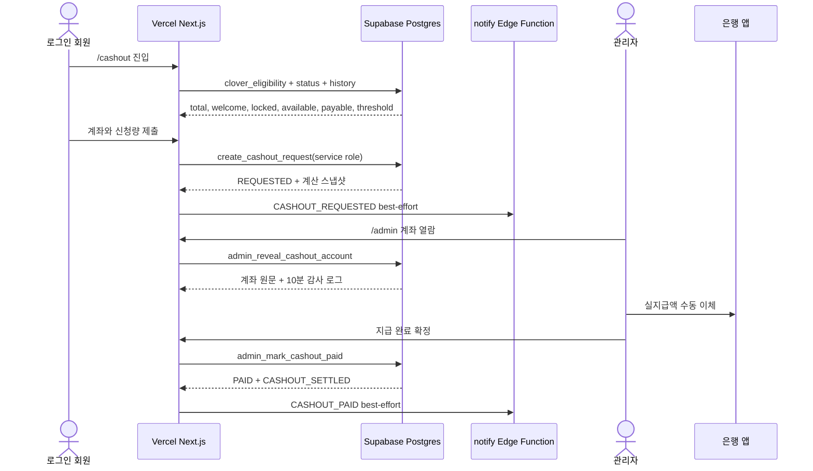

# FDD: 운영 환전 30/27 계약과 A1 클로버 잠금 v1.1.0

> 기준 시각: 2026-08-29 04:46 KST
> 상류: `docs/plan/prd-haenael-ge-v0.4.0.md` §10.9, `DESIGN.md` v2.0.1, `docs/design/user-flow.md` v0.3.1
> 이전본: `docs/eng-design/fdd-haenael-ge-cashout-clover-lock-v1.0.0-opus5.md`. 이전본은 결정 과정과 migration 당시 검토 이력으로 보존한다.
> 정본 범위: 현재 운영되는 수동 환전 신청, 잠금, 관리자 이체 완료 또는 반려. 자동 지급대행은 범위 밖이다.

## 목차

- [1. 결론](#1-결론)
- [2. 기능 범위](#2-기능-범위)
- [3. 시스템 컨텍스트](#3-시스템-컨텍스트)
- [4. 잔액 모델과 불변식](#4-잔액-모델과-불변식)
- [5. 상태 머신](#5-상태-머신)
- [6. RPC 계약 8개](#6-rpc-계약-8개)
- [7. Server Action과 알림 계약](#7-server-action과-알림-계약)
- [8. 화면과 API 1:1 매핑](#8-화면과-api-11-매핑)
- [9. 요구부터 테스트까지 추적성](#9-요구부터-테스트까지-추적성)
- [10. build 인계](#10-build-인계)
- [11. 위험과 운영 관찰](#11-위험과-운영-관찰)
- [12. 벤치마크, 셀프심문, 레드팀](#12-벤치마크-셀프심문-레드팀)

## 1. 결론

운영 환전은 다음 세 규칙으로 고정한다.

1. 자격 기준은 `total_balance >= 30`이다.
2. 신청량은 `1 <= requested <= payable_amount`다. total 30, welcome 3, payable 27이면 27을 신청할 수 있다.
3. 신청은 총량을 줄이지 않는다. `CASHOUT_HOLD delta=0`으로 잠그고, 실제 수동 이체 완료 시 `CASHOUT_SETTLED delta=-N`으로 한 번만 줄인다. 반려는 `CASHOUT_REVERSAL delta=0`으로 잠금만 푼다.

현재 웹의 신청 진입점은 `cashout` Edge Function이 아니라 Vercel Next.js Server Action `createCashoutRequest`다. `supabase/functions/cashout`은 410 폐기 응답이고 `cashout-payout`은 501 stub이다. 운영 지급은 `/admin`에서 관리자가 은행 이체를 실제로 완료한 뒤 PAID를 확정하는 수동 처리다.

## 2. 기능 범위

### 포함

- 로그인 회원의 환전 자격 및 다섯 잔액값 조회
- 신청량, 은행, 계좌, 예금주, 전화번호, request key 검증
- 계좌번호 암호화, 마스킹, fingerprint 멱등 검증
- 확인된 미성년 차단. KYC 기록 없음은 신청 단계에서 통과
- 회원별 신청 직렬화와 진행 중 1건 제한
- 수수료 10%, 수수료 부가세 10%, 이용료 차감 후 금액의 원천징수 3.3% 계산
- 신청 뒤 CASHOUT_REQUESTED 알림 best-effort
- 관리자 목록, 계좌 원문 열람 감사, 수동 이체 완료, 반려
- 지급 완료 뒤 CASHOUT_PAID 알림 best-effort
- 상태 및 이력 조회, PAID 시점 잔액 스냅샷 표시

### 제외

- `cashout-payout` 자동 지급대행. 현재 501 stub이다.
- 신청 시 PASS 강제. 최신 확인 결과가 미성년인 경우만 차단한다.
- 운영 시험 거래 생성. 자연 계정이 없으면 운영 쓰기 E2E는 미검증으로 남긴다.
- `KYC_PENDING`, `APPROVED`, `PAYOUT_SENT`, `FAILED`로의 자동 전이. enum에는 남아 있지만 현재 수동 흐름의 활성 상태가 아니다.

## 3. 시스템 컨텍스트

### 3.1 배포 아키텍처



Vercel은 화면과 Server Action을 소유하고, 원자적 잔액 변경은 Supabase Postgres RPC가 소유한다. 은행 이체는 현재 외부 API와 연결되지 않은 관리자 수동 단계다.

### 3.2 환전 ERD



`clover_ledger.ref_id`는 다형 참조라 물리 FK가 아니다. 환전 행은 `ref_type='cashout_request'`와 `ref_id=cashout_request.id` 조합으로 논리 연결한다.

### 3.3 수동 지급 시퀀스



## 4. 잔액 모델과 불변식

`clover_eligibility(member)`는 아래 값을 한 DB 스냅샷에서 반환한다.

```text
total       = clover_balance.clover_count
welcome     = max(sum(WELCOME_GRANT + WELCOME_REVERSAL), 0)
locked      = sum(cashout_request.clover_amount where status='REQUESTED')
available   = max(total - locked, 0)
payable     = max(total - welcome - locked, 0)
threshold   = total >= min_cashout_clover()
```

필수 불변식:

| ID | 불변식 | 강제 지점 |
|---|---|---|
| I1 | `available = total - locked` | `clover_eligibility` 단일 스냅샷 |
| I2 | `0 <= locked <= total` | 신청 상한, 단일 진행 요청, 음수 정산 방어 |
| I3 | 진행 상태 집합은 신청 중복 가드, locked 계산, 관리자 종결 가드 모두 `REQUESTED` | migration 20260822000000 |
| I4 | 신청과 반려는 총량 불변 | HOLD 0, REVERSAL 0 |
| I5 | 환전 경로의 총량 감소는 PAID 한 번뿐 | SETTLED -N, 상태 및 unique 가드 |
| I6 | 자격과 신청 상한은 다른 값 | total threshold와 payable upper bound 분리 |
| I7 | PAID 전후 값은 확정 원장 스냅샷 | `my_cashout_status.settled_balance_*` |

## 5. 상태 머신

| 현재 | 명령 | 다음 | 원장 | 사용자 의미 |
|---|---|---|---|---|
| 없음 | 신청 성공 | REQUESTED | HOLD 0 | N개가 잠기고 총량은 그대로 |
| REQUESTED | 관리자 반려 | REJECTED | REVERSAL 0 | 잠금 해제, 재신청 가능 |
| REQUESTED | 관리자 수동 이체 완료 후 확정 | PAID | SETTLED -N | 총량 감소, 이력 보존 |
| REQUESTED | 같은 회원 재신청 | 변화 없음 | 없음 | `cashout_already_requested` |
| PAID | 지급 완료 재호출 | 변화 없음 | 없음 | `cashout_already_paid` |
| REJECTED | 반려 재호출 | 변화 없음 | 없음 | `invalid_cashout_status` |

자동 지급대행 상태 4개는 예약 enum일 뿐 현재 전이 경로가 없다. 활성 상태처럼 locked 계산에 넣으면 종결 RPC가 처리하지 못해 영구 잠금이 되므로 현재 설계에서는 사용하지 않는다.

## 6. RPC 계약 8개

### R1 `clover_eligibility(p_member_id uuid)`

- 권한: 본인, service_role. anon과 타 회원 금지.
- 반환: `total_balance`, `welcome_amount`, `locked_amount`, `available_amount`, `payable_amount`, `min_cashout_clover`, `reached_threshold`.
- 소비자: `/me`, `/cashout`, `/cashout/status`, `create_cashout_request`.
- 실패: 타 회원 `forbidden`.

### R2 `create_cashout_request(...)`

- 호출자: Vercel Server Action의 service-role client. 브라우저 직접 EXECUTE 금지.
- 입력: 회원, 신청량, 은행코드, 계좌번호, 예금주, request key, 암호화 key version, 암호화 key, fingerprint key.
- 입력 경계: 신청량 1 이상, bank 2~20, 계좌 숫자 8~20, 예금주 2~40, request key 8~128.
- 순서: 입력 정규화 → purge opportunistic → 회원 advisory xact lock → 최신 미성년 판정 → request key replay → 진행 중 중복 확인 → balance row `FOR UPDATE` → eligibility 조회 → total threshold → payable upper bound → 계산 → 요청 insert → HOLD 0 insert.
- 반환: request id, REQUESTED, clover, gross, fee, withholding, net, requested_at, is_replay.
- 30/27: `p_clover_amount < 1`만 입력 하한이며, total threshold는 별도 `v_total < v_min`으로 판정한다.

### R3 `my_cashout_status()`

- 권한: authenticated 본인.
- 반환: 최신 진행 또는 종결 1건, 계좌 마스킹, 처리시각, 사유, `settled_balance_before`, `settled_balance_after`.
- PAID 스냅샷: SETTLED 원장의 `balance_after - clover_delta`, `balance_after`를 그대로 반환한다.

### R4 `my_cashout_history(p_limit integer default 20)`

- 권한: authenticated 본인.
- 반환: 최근 이력, 마스킹 계좌, 실지급액, 상태. 암호문은 반환하지 않는다.

### R5 `admin_list_cashouts_v2(p_limit integer default 100)`

- 권한: `is_admin()`인 authenticated 회원.
- 반환: 운영 큐, 닉네임, 계산 스냅샷, 마스킹 계좌, 처리 메모.

### R6 `admin_reveal_cashout_account(p_request_id, p_actor_id, p_account_keys)`

- 호출 경계: Server Action이 사용자 JWT로 `requireAdmin()`을 먼저 통과한 뒤 service-role client로 호출한다. DB 함수는 `p_actor_id`가 `admin_member`인지 다시 확인한다. service-role 호출이라 함수 내부 `auth.uid()` 일치 비교는 하지 않는다.
- 동작: key version에 맞춰 복호화하고 `cashout_account_access_log(purpose='payout')`를 남긴다.
- 실패: 관리자 아님, 암호문 없음, 파기됨, key version 없음.

### R7 `admin_mark_cashout_paid(p_request_id, p_processing_note)`

- 권한: 관리자와 auth.uid 존재.
- 선행: 같은 관리자의 최근 10분 계좌 열람, REQUESTED, 계좌 미파기.
- 동작: 요청별 advisory lock → PAID 전이 → balance row `FOR UPDATE` → 음수 방어 → SETTLED -N.
- 멱등 방어: 상태 가드와 terminal ledger unique index.

### R8 `admin_reject_cashout(p_request_id, p_processing_note)`

- 권한: 관리자.
- 입력: 반려 사유 2~500자.
- 동작: 요청별 advisory lock → REQUESTED에서 REJECTED → 현재 balance 스냅샷의 REVERSAL 0.

## 7. Server Action과 알림 계약

`web/src/app/(receiver)/cashout/actions.ts`는 다음 책임만 가진다.

1. `getUser()`로 호출자 인증.
2. 입력 정규화와 빠른 검증.
3. `member.phone` 저장.
4. 로컬 secret에서 계좌 암호화 설정을 읽어 service-role RPC 호출.
5. DB 성공 뒤 신규 요청인 경우에만 CASHOUT_REQUESTED 알림을 best-effort로 전달.
6. `/me`, `/cashout`, `/cashout/status`, `/cashout/history` 재검증.

알림 실패는 이미 확정된 신청을 실패로 바꾸지 않는다. 재시도 때문에 중복 신청이 생기는 것보다 신청 성공과 알림 관측 실패를 분리하는 것이 안전하다.

관리자 Server Action은 사용자 JWT로 관리자 확인을 먼저 하고, 계좌 복호화 key가 필요한 RPC만 service-role로 호출한다. PAID 또는 REJECTED 성공 뒤 알림을 시도하고 관리자·사용자 페이지를 재검증한다.

## 8. 화면과 API 1:1 매핑

| user-flow | 라우트·컴포넌트 | API | DB | 구현 상태 |
|---|---|---|---|---|
| §1.1-8 환전 진입 | `/cashout`, `CashoutPageView` | R1, R3, R4 | balance, request, ledger, member | 구현 |
| §1.2 미달 | `CashoutPageView` | R1 | balance, ledger | 구현 |
| §1.2 30/27 | `CashoutRequestForm` | R1, R2 | request, ledger | 구현 및 경계 테스트 존재 |
| §1.2 지급가능 0 | `CashoutPageView` | R1 | balance, ledger | 구현 |
| §1.2 신청 접수 | `CashoutRequestForm` → Server Action | R2 | request, ledger | 구현 |
| §1.2 진행 상태 | `/cashout/status`, `SplitBalanceCard` | R1, R3 | request, ledger | 구현 |
| §1.2 반려 | status + admin queue | R8 | request, ledger | 구현 |
| §1.2 입금 완료 | status + admin queue | R6, R7, R3 | access log, request, ledger | 구현 |
| §1.1-8 이력 | `/cashout/history` | R4 | request | 구현 |
| §5.5 여섯 불변식 | DB functions + SplitBalanceCard | R1, R2, R7, R8 | balance, request, ledger | 구현·테스트 존재 |
| PRD §10.3 지급 신원정보 | 미정 | 미정 | 미정 | 회수 필요 |

30/27 및 A1 환전 흐름의 매핑 gap은 0이고 active UI drift도 0이다. 다만 PRD §10.3의 지급 단계 주민등록번호·신원·세무정보 수집은 별도 매핑 gap 1건이다. 수집 주체, 필드 최소화, 전송 경로, 암호화, 접근 감사, 보존·파기 기간, 세무 처리 주체가 합의되지 않아 endpoint, component, table을 임의로 확정하지 않는다. 이는 "제품 저장 0"을 뜻하지 않으며, 결정 전에는 해당 지급 신원정보 범위의 build 진입이 불가하다.

## 9. 요구부터 테스트까지 추적성

| 요구 | 설계 | migration | 코드 | 테스트 |
|---|---|---|---|---|
| CASHOUT-THRESHOLD-01 | §1, §4, R2 | `20260825020000` | page, form, action | CO-TH-01~04, contract mutation |
| A1 신청 총량 불변 | §4 I4, 상태 머신 | `20260822000000` | `SplitBalanceCard` | CO-A1-01, pgTAP C3 |
| A1 반려 잠금 해제 | §5, R8 | `20260822000000` | admin actions, status | CO-A1-02, pgTAP C6/T10 |
| A1 지급 시 단일 차감 | §5, R7 | `20260822000000` | admin actions, status | CO-A1-04~05, paid race |
| PAID 시점 스냅샷 | I7, R3 | `20260822000000` | status page | CO-A1-08 |
| 계좌 보호 | R2, R6, R7 | `20260802010000` | service client, admin action | CO-SEC-03~04 |
| 확인된 미성년만 차단 | R2 | `20260825010000`, `20260825020000` | error mapping | CO-AUTH-02~03 |
| 알림 실패와 신청 분리 | §7 | `20260811010000` | cashout notifications | CO-NOTIFY-01~03 |

## 10. build 인계

30/27 및 A1 잠금 범위는 build 진입이 가능하다. 이 범위에는 신규 API나 DB 결정 gap이 없다. 아래는 확정 계약을 구현에 맞추는 작업이다.

1. 운영 DB 기준 Supabase 타입을 재생성해 `my_cashout_status.settled_balance_before/after`의 `as never` 우회를 제거한다.
2. `cashout-payout`은 자동 지급이 승인되기 전까지 501 stub과 범위 밖 표기를 유지한다. 문서나 UI가 자동 지급이라고 쓰면 회귀다.

30/27 UI 카피와 경계 테스트는 이 문서 갱신 중 build가 해소했다. 남은 build drift는 generated type 1건이다.

PRD §10.3의 지급 신원정보 범위는 build 진입이 불가하다. 회장이 다음 항목을 결정한 뒤 별도 FDD/API/ERD/test 계약을 추가해야 한다.

1. 수집 주체: 해낼게 직접 수집 또는 세무·지급 수탁사 직접 수집.
2. 최소 필드와 사용 목적: 주민등록번호 전부 또는 대체 식별값, 법정 의무별 목적.
3. 저장·전송·접근: 제품 DB 저장 여부, 암호화·키 경계, 운영자 열람과 감사.
4. 보존·파기: 법정 보존기간, 지급 취소·반려·탈퇴 시 처리.
5. 미수집·검증 실패 시 상태 전이와 사용자 복구 경로.

## 11. 위험과 운영 관찰

- 운영 DB에는 30/27 자연 계정이 없어 실제 운영 쓰기 신청은 미검증이다. 로컬 PostgREST와 migration 실덤프로 계약을 검증했으며 가짜 운영 거래를 만들지 않는다.
- `cashout_status_enum`에 예약 상태가 남아 있다. 미래 자동 지급 설계는 locked 집합과 종결 RPC를 동시에 확장해야 한다.
- generated type drift는 런타임 오류를 당장 만들지 않았지만 고위험 RPC를 `as never`로 숨긴다. build에서 닫아야 한다.
- legal 정책 중 환불 기간과 미성년 연령 기준은 상류 미결이다. 현재 DB는 최신 확인이 미성년인 회원만 신청을 차단한다.
- 지급 단계 주민등록번호·신원·세무정보는 상류 요구만 있고 데이터 처리 계약이 없다. 개인정보 결정을 임의 구현하지 않으며, 회수 전에는 관리자 수동 지급 절차의 외부 운영 입력으로도 완료 처리했다고 간주하지 않는다.

## 12. 벤치마크, 셀프심문, 레드팀

- [Supabase Database Functions](https://supabase.com/docs/guides/database/functions): `SECURITY DEFINER`, 빈 `search_path`, 최소 EXECUTE 권한을 적용했다.
- [PostgreSQL Explicit Locking](https://www.postgresql.org/docs/current/explicit-locking.html): 회원별 신청과 요청별 종결에 transaction advisory lock을 쓰고 balance row를 `FOR UPDATE`한다.
- [Stripe Idempotent Requests](https://docs.stripe.com/api/idempotent_requests): 동일 키 재시도는 같은 결과를 재생하고 인자 변경은 충돌로 막는다.

이 설계가 틀렸다면 가장 그럴듯한 이유는 잠금을 원장 delta로 계산해야 한다고 오해하는 것이다. A1의 HOLD와 REVERSAL은 delta 0이므로 원장 합계만으로 잠금량을 복원할 수 없다. 잠금은 진행 중 request의 amount가 진실원이고, 원장은 감사 표식이다.

회의적인 지급 담당자는 "관리자가 은행 이체를 안 하고 체크박스만 누를 수 있다"고 공격할 수 있다. 현재 수동 지급은 은행 시스템과 원자적으로 결합되지 않는다. 계좌 열람 감사, 명시적 확인 문구, 상태·원장 이중 가드는 실수 가능성을 줄이지만 외부 이체 완료 자체를 기술적으로 증명하지는 못한다. 자동 지급대행이 승인될 때까지 이 잔여 위험은 운영 통제다.

---

🏷 STAMP | line: core | 생성: 2026-08-29 04:46 KST | model: gpt-5.6-sol | agent: tech-architect
skills: 없음 | 근거: PRD v0.4.0, DESIGN v2.0.1, user-flow v0.3.1, 운영 migration, 실제 Next.js/Supabase 코드, 공식문서 3건, Mermaid architecture 1043×482·ERD 1503×988·sequence 1474×831 렌더 PASS
고민: 과거 문서의 자동 지급·PASS 선행·신청 최소 30을 모두 제거하고 현재 수동 지급과 30/27 계약으로 잠갔다.

SKILLS_USED: 없음
SKILLS_SKIPPED: 기술설계 전용 스킬이 현재 세션에 제공되지 않아 코드와 공식문서를 직접 역추적했다.

RUBRIC_SCORE: 완결성=4/5 정밀성=5/5 벤치마크반영=5/5 추적성=5/5 전문성·톤=5/5 total=24/25
WEAKEST_LINE: 지급 단계 주민등록번호·신원·세무정보의 데이터 처리 결정이 없어 해당 범위는 설계 완료와 build 진입을 선언할 수 없다.

SOURCES/MODEL: gpt-5.6-sol | `docs/plan/prd-haenael-ge-v0.4.0.md`; `DESIGN.md`; `docs/design/user-flow.md`; `supabase/migrations/20260802010000_cashout_security_hardening.sql`; `supabase/migrations/20260822000000_cashout_clover_lock_a1.sql`; `supabase/migrations/20260825010000_cashout_verified_minor_only.sql`; `supabase/migrations/20260825020000_cashout_total_threshold_contract.sql`; `web/src/app/(receiver)/cashout/actions.ts`; `web/src/app/admin/actions.ts`; https://supabase.com/docs/guides/database/functions; https://www.postgresql.org/docs/current/explicit-locking.html; https://docs.stripe.com/api/idempotent_requests
