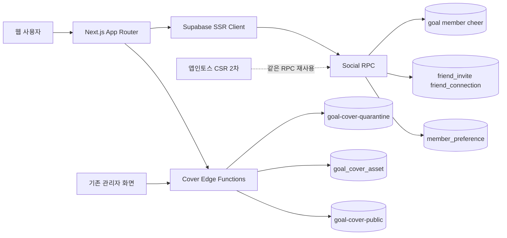
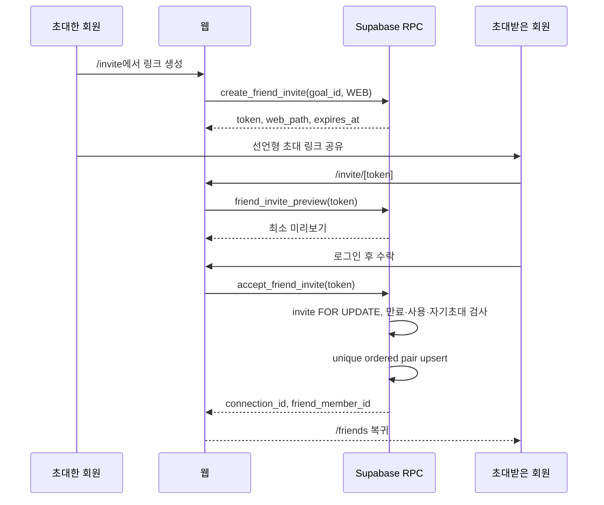
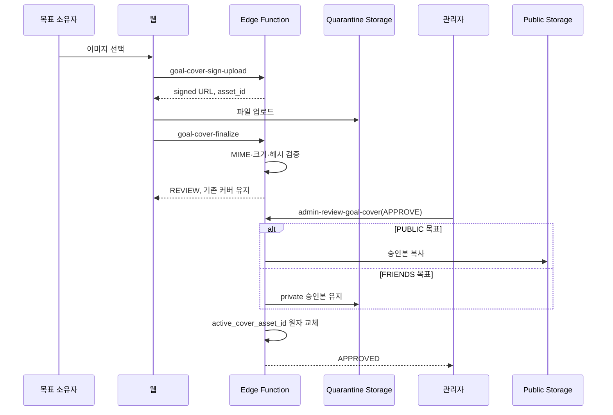

# 해낼게 V2 소셜 바이럴 루프 웹 우선 FDD

| 항목 | 값 |
|---|---|
| 버전 | v1.1.0 |
| 작성일 | 2026-10-13 02:42 KST |
| 작성자/모델 | tech-architect / gpt-5-codex |
| 작업 라인 | v2 |
| 상태 | 웹 1차 슬라이스 구현 계약. 모바일은 2차 |
| 상류 핀 | `pipeline-state.v2.md` D-018, `docs/plan/haenael-v2-blueprint-v1.0.0-opus48.md`, `DESIGN.md` v2.0.1, `docs/design/prototypes/social-viral-loop-v2-opus48.html` |
| 관련 설계 | `erd-social-viral-loop-web-first-v1.1.0.md`, `api-contract-social-viral-loop-web-first-v1.1.0.md`, `test-plan-social-viral-loop-web-first-v1.1.0.md` |
| 기반 포맷 | `docs/eng-design/fdd-core-social-viral-loop-appintoss-v0.1.0-gpt-codex.md` |

> STAMP: 생성 2026-10-13 02:42 KST. 모델 gpt-5-codex. 에이전트 tech-architect. 스킬 docs 방법론을 적용하되 로컬 Markdown을 직접 작성했다. 근거는 승인 디자인, 현재 Next.js와 Supabase 구현, 운영 실물 조회 결과, Supabase·PostgreSQL·OWASP·앱인토스 공식 문서다. 가장 오래 고민한 지점은 기존 공개 목표의 도달성을 보존하면서 친구 공개범위를 여는 일과 커스텀 커버를 외부 모더레이션 공급자 결정 없이 안전하게 출시하는 일이었다.

> PATCH v1.0.1 사유: D-019를 반영해 FRIENDS 커스텀 커버가 public bucket에 복사되지 않고 ACTIVE 친구 확인 뒤 120초 Presigned URL로만 노출되도록 기능 계약을 명확히 했다.

> v1.1.0 사유: D-022에 따라 마이페이지, DB 집계형 업적, 미응원 친구 목표 큐를 2차 build 슬라이스로 승격했다. 허위 성취 방어 기준은 "DB 원장에서 반증 가능한가"이며, 달성 목표 수·받은 확정 응원 수·ACTIVE 친구 수만 허용한다. 자기신고·사용자 간 순위·연속 접속 기록은 금지한다.

## 목차

- [0. 한 줄 결론](#0-한-줄-결론)
- [1. 목적·범위·용어](#1-목적범위용어)
- [2. 현재 실물과 변경 경계](#2-현재-실물과-변경-경계)
- [3. 웹 우선 아키텍처](#3-웹-우선-아키텍처)
- [4. 화면·컴포넌트 계약](#4-화면컴포넌트-계약)
- [5. 기능 요구와 수용기준](#5-기능-요구와-수용기준)
- [6. 핵심 시퀀스](#6-핵심-시퀀스)
- [7. 유저플로우 1:1 매핑](#7-유저플로우-11-매핑)
- [8. 데이터 공개범위와 RLS](#8-데이터-공개범위와-rls)
- [9. 기존 UI·금전 경로 보존 계약](#9-기존-ui금전-경로-보존-계약)
- [10. 모바일 2차 전환](#10-모바일-2차-전환)
- [11. 배포 순서·관측·롤백](#11-배포-순서관측롤백)
- [12. 비범위와 후속 슬라이스](#12-비범위와-후속-슬라이스)
- [13. 추적성·갭 판정](#13-추적성갭-판정)
- [14. 벤치마크·자기심문·레드팀](#14-벤치마크자기심문레드팀)
- [15. 개정 이력](#15-개정-이력)

## 0. 한 줄 결론

V2 1차는 기존 Next.js 웹에 목표 상세·커버·초대·친구 목록을 추가하고 Supabase 공통 계약을 먼저 완성한다. 앱인토스 미니앱은 같은 RPC와 테이블을 재사용하는 2차 채널로 둔다.

## 1. 목적·범위·용어

### 1.1 목적

현재 운영에서 실재하는 V2는 다중 목표뿐이다. 웹에는 `/friends`, `/invite`, 하단 탭이 없고, 미니앱은 화면만 있으나 `auth-toss`와 RPC 5종이 없어 동작하지 않는다. 이 문서는 화면만 있는 상태를 끝내기 위해 웹에서 먼저 완주할 수 있는 최소 소셜 루프를 개발 계약으로 고정한다.

### 1.2 이번 슬라이스

| 포함 | 제외 |
|---|---|
| 본인 목표 상세 `/me/goal/[id]` | 활동 타임라인 |
| 프리셋 6종과 커스텀 목표 커버 | 활동 타임라인 |
| 마이페이지 `/my`: 프로필 요약·내 목표·친구 수 | 자기신고·사용자 간 순위·연속 접속 기록 |
| DB 집계 업적: 달성 목표·받은 응원·연결 친구 | 부스트 클로버 |
| 소속감 큐: 친구 목표 중 본인이 확정 응원하지 않은 목표 | 친구 추천·연락처 동기화 |
| 7일 만료 초대 링크 생성·미리보기·1회 수락 | 부스트 클로버 |
| 친구 목록과 친구 목표 상세 | 소셜 랭킹·금액 순위 |
| 공개범위 `PUBLIC|FRIENDS|PRIVATE` | 앱인토스 출시·심사·현금 기능 |
| 회원 환경설정 RPC의 공통 계약 | 자동 이미지 모더레이션 공급자 |
| 기존 관리자 화면의 커버 수동 검수 큐 | 연락처 동기화·친구 추천 |

### 1.3 용어

| 용어 | 정의 |
|---|---|
| 친구 | 한 사용자의 초대를 다른 사용자가 명시적으로 수락해 생성된 양방향 관계 |
| 친구공개 | `ACTIVE` 친구에게만 보이는 목표. 초대 토큰 소지자는 수락 전 상세를 볼 수 없음 |
| 초대 토큰 | 32바이트 CSPRNG 결과를 base64url로 인코딩한 256비트 bearer token |
| 커버 프리셋 | 승인 프로토타입의 `c1`부터 `c6`. 새 색 토큰을 만들지 않음 |
| 승인 커버 | 격리 Storage에서 관리자 검수를 통과해 공개 Storage로 복사된 이미지 |

## 2. 현재 실물과 변경 경계

### 2.1 기존 구현 확인

| 실물 | 관찰 결과 | 설계 판정 |
|---|---|---|
| `goal`, `member`, `cheer`, `notification` | 운영·migration에 존재 | 재사용 |
| `create_goal` | 운영 RPC 존재, 목표 15행 확인 | 변경 금지. 커버는 생성 뒤 별도 설정 |
| `/me` | 다중 목표, 링크, 응원 목록, 환전 진입 존재 | 구조 보존 후 연결만 추가 |
| `/g/[slug]` | 비로그인 SSR, 금액 없는 공개 목표 | 커버와 공개범위 필터만 확장 |
| `ReceiverPageShell`, `ReceiverTopBar` | 현재 수신자 공통 셸 | 신규 인증 화면 전부 재사용 |
| `GoalEditSheet`, `CheerList`, `SplitBalanceCard`, `MyLinkCard` | 목표 관리의 기존 부품 | `/me/goal/[id]`에서 재조합 |
| 웹 소셜 라우트 | `/friends`, `/invite` 없음 | 신규 |
| 미니앱 RPC 5종 | 호출 코드만 있고 DB 함수 0건 | 이름 유지 후 백엔드 선구현 |
| 친구·초대 테이블 | 0건 | 신규 |

### 2.2 기존 앱인토스 FDD의 위치

`fdd-core-social-viral-loop-appintoss-v0.1.0-gpt-codex.md`는 폐기하지 않는다. 그 문서의 채널 제약, 토스 로그인, CSR 분리, 다중 신원 설계는 모바일 2차 입력으로 유지한다. 이번 문서는 구현 순서와 1차 표면만 웹으로 바꾼다.

### 2.3 보존과 변경 계약

| 보존 | 변경 |
|---|---|
| 기존 `/me` 정보 위계와 상단 알림 | 목표 카드에 커버와 관리 링크 추가 |
| `/g/[slug]`의 비로그인 SSR과 응원 결제 | 승인 커버와 PUBLIC 필터 추가 |
| 환전 화면·RPC·원장·계좌 마스킹 | 변경 없음 |
| 브랜드 색·Pretendard·22px 여백·390/1024 대응 | 승인된 4탭 `ReceiverBottomNav` 추가 |
| 금액 비공개 D-003 | 친구 응답에서도 금액 필드 자체를 금지 |

## 3. 웹 우선 아키텍처

### 3.1 시스템 아키텍처



### 3.2 레이어 책임

| 레이어 | 책임 | 금지 |
|---|---|---|
| Next.js route | 인증 경계, SSR 데이터 조립, 상태별 화면 | service role 사용, RLS 우회 |
| Client component | 탭·복사·업로드·토글·오류 복구 | 공개범위 판정, 금액 계산 |
| RPC | 관계·소유권·공개범위·동시성의 최종 판정 | 호출자 입력을 신뢰 |
| Edge Function | Storage signed upload, MIME·해시 검증, 관리자 승인 | 승인 전 public URL 발급 |
| DB/RLS | 기본 거부, 무결성, 데이터 최소 노출 | anon에게 기반 테이블 직접 권한 부여 |

### 3.3 폴더 배치

```text
web/src/app/(receiver)/
  me/goal/[id]/page.tsx
  friends/page.tsx
  friends/[friendId]/page.tsx
  invite/page.tsx
web/src/app/invite/[token]/page.tsx
web/src/components/social/
  ReceiverBottomNav.tsx
  FriendGoalList.tsx
  FriendGoalDetail.tsx
  FriendInviteCard.tsx
  InviteAcceptCard.tsx
  GoalCoverPicker.tsx
  GoalVisibilityControl.tsx
web/src/components/admin/GoalCoverReviewQueue.tsx
supabase/migrations/<timestamp>_social_web_first.sql
supabase/functions/goal-cover-sign-upload/
supabase/functions/goal-cover-finalize/
supabase/functions/admin-review-goal-cover/
```

현재 `folder-structure.md`와 `design-patterns.md`의 App Router, feature component, RPC/EF 경계를 바꾸지 않는다.

## 4. 화면·컴포넌트 계약

| 라우트 | 화면 목적 | 재사용 | 신규 | 상태 |
|---|---|---|---|---|
| `/me` | 내 목표 홈 | 기존 전체 | `ReceiverBottomNav`, 커버 썸네일, 관리 링크 | 목표 0·정상·3개·오류 |
| `/me/goal/[id]` | 목표별 응원자·잔액·편집·커버 | `ReceiverPageShell`, `ReceiverTopBar`, `CheerList`, `SplitBalanceCard`, `GoalEditSheet`, `MyLinkCard` | `GoalCoverPicker`, `GoalVisibilityControl` | 빈·정상·과다·권한없음 |
| `/friends` | 친구와 친구 목표 목록 | 공통 셸·상단바 | `FriendGoalList` | 친구 0·정상·과다·오류 |
| `/friends/[friendId]` | 선택한 친구의 공개 가능한 목표 상세 | 공통 셸 | `FriendGoalDetail` | PUBLIC·FRIENDS·없음·관계해제 |
| `/invite` | 목표를 선택해 초대 링크 생성 | 공통 셸 | `FriendInviteCard` | 생성 전·생성됨·복사됨·rate limit |
| `/invite/[token]` | 초대 미리보기와 로그인·수락 | 비회원 경계 | `InviteAcceptCard` | 유효·로그인필요·만료·사용됨·자기초대 |
| `/my` | 프로필·내 목표·친구 수·업적·소속감 큐 | 공통 셸·상단 알림 | `MyPageOverview` | 정상·빈 목표·빈 큐·오류 |
| `/g/[slug]` | 공개 목표 | 기존 전체 | 승인 커버 배너 | PUBLIC만 200 |
| `/admin` | 커버 검수 | 기존 관리자 인증·셸 | `GoalCoverReviewQueue` | 대기·승인·반려 |

4탭은 `홈·친구·초대·마이`를 사용한다. `홈`은 `/me`, `마이`는 `/my`로 분리하며 실제 pathname으로 활성 상태를 판정한다. 비로그인 `/me/goal/[id]`는 빈 셸이나 로그아웃 버튼을 렌더하지 않고 권한없음 상태와 로그인 복구 CTA를 보여준다.

## 5. 기능 요구와 수용기준

### FR-W1. 목표 상세

Given 로그인한 목표 소유자가 `/me`에서 관리 버튼을 누른다. When `/me/goal/[id]`를 연다. Then 기존 응원자 목록·잔액·링크·편집 기능이 동일한 데이터로 보이고 다른 회원의 목표 ID는 404로 수렴한다.

### FR-W2. 프리셋 커버

Given 목표 소유자가 `c1`부터 `c6` 중 하나를 고른다. When 저장한다. Then `set_goal_cover_preset`이 소유권을 검사해 즉시 반영하고 `/me`, `/me/goal/[id]`, `/g/[slug]`, 친구 목표 카드가 같은 프리셋을 렌더한다.

### FR-W3. 커스텀 커버

Given 소유자가 5MB 이하 jpg/png/webp를 업로드한다. When MIME·크기·해시 검증을 통과한다. Then 이미지는 비공개 격리 버킷과 `REVIEW` 상태에만 남고 기존 공개 커버는 유지된다. When 관리자가 승인한다. Then 승인본만 공개 버킷으로 복사되고 활성 커버가 원자적으로 교체된다.

### FR-W4. 공개범위

Given 목표 공개범위가 PUBLIC, FRIENDS, PRIVATE 중 하나다. When 비회원·친구·소유자가 각 경로로 조회한다. Then 허용 행렬과 정확히 일치하고, 금지된 경우 제목·이유·커버·워드맵·응원자 메타가 0건이다.

| 조회자 | PUBLIC | FRIENDS | PRIVATE |
|---|---:|---:|---:|
| 비회원·비친구 | 허용 `/g/[slug]` | 거부 | 거부 |
| ACTIVE 친구 | 허용 | 허용 `/friends/[friendId]` | 거부 |
| 소유자 | 허용 | 허용 | 허용 `/me/goal/[id]` |

### FR-W5. 초대 링크

Given 로그인 회원이 PUBLIC 또는 FRIENDS 목표를 선택해 초대를 만든다. When `create_friend_invite`를 호출한다. Then 32바이트 무작위 토큰, 7일 만료, 웹·앱인토스 경로가 반환되고 DB에는 SHA-256 해시만 저장된다. PRIVATE 목표에는 goal 연결 초대를 만들 수 없고, 요청자는 시간당 10개를 넘길 수 없다.

### FR-W6. 초대 수락

Given 유효한 미사용 초대 링크를 다른 로그인 회원이 연다. When 수락한다. Then 초대 행을 잠그고 정렬된 회원 쌍의 친구 관계를 1건만 만든다. 같은 회원의 재시도는 같은 관계를 반환하며, 다른 회원의 재사용·자기초대·만료·차단 관계는 거부한다.

### FR-W7. 친구 목록과 상세

Given ACTIVE 친구 관계가 있다. When `/friends`를 연다. Then 친구별 PUBLIC 또는 FRIENDS 목표만 보인다. When 목표를 연다. Then 제목·이유·커버·응원 인원·워드맵만 보이고 응원 금액·클로버 수·순위는 응답 스키마에 존재하지 않는다.

### FR-W8. 관계 해제

Given ACTIVE 친구가 상세 메뉴에서 친구 끊기를 확정한다. When `remove_friend`가 완료된다. Then 두 사용자 모두 즉시 상대의 FRIENDS 목표를 조회할 수 없고 재연결에는 새 초대 수락이 필요하다.

### FR-W9. 환경설정 호환 계약

Given 인증 회원이 `update_member_preferences`를 호출한다. When 알림·마케팅 동의를 갱신한다. Then 본인 행만 upsert되고 마케팅은 기본 false다. 웹 UI는 이번 슬라이스 비범위지만 RPC는 미니앱 2차 호환을 위해 먼저 제공한다.

### FR-W10. 마이페이지와 반증 가능한 업적

Given 인증 회원이 `/my`를 연다. When `my_social_dashboard`가 본인 데이터를 집계한다. Then 프로필 요약, 삭제되지 않은 내 목표, ACTIVE 친구 수, 달성 목표 수, 받은 확정 응원 수, 연결 친구 수를 반환한다. 업적은 DB 행으로 다시 계산해 같은 값이 나와야 하며 자기신고·금액·순위·연속 기록 필드는 응답에 존재하지 않는다.

### FR-W11. 소속감 큐

Given ACTIVE 친구에게 PUBLIC 또는 FRIENDS 진행 목표가 있다. When 현재 회원의 CONFIRMED 응원 귀속이 없으면 Then `/my` 소속감 큐에 최대 20개를 마감일순으로 보여준다. 비친구·REMOVED·BLOCKED·PRIVATE·종료 목표와 이미 확정 응원한 목표는 0건이다. 귀속 원본은 클라이언트가 직접 읽을 수 없는 `social_cheer_member_attribution`에만 저장한다.

## 6. 핵심 시퀀스

### 6.1 초대 수락



### 6.2 커스텀 커버 승인



## 7. 유저플로우 1:1 매핑

| Step | 사용자 행동 | 라우트 | 엔드포인트·RPC | 프론트 컴포넌트 | 테이블·Storage | 테스트 |
|---|---|---|---|---|---|---|
| WF-01 | 로그인 후 내 목표 홈 진입 | `/me` | 기존 SSR query | `ReceiverPageShell`, `MyGoalListCard`, `ReceiverBottomNav` | `goal`, `member`, `notification` | PW-01 |
| WF-02 | 목표 관리 열기 | `/me/goal/[id]` | owner detail SSR query | 기존 4개 관리 컴포넌트 | `goal`, `cheer`, `clover_balance` | PW-02 |
| WF-03 | 프리셋 커버 선택 | `/me/goal/[id]` | `set_goal_cover_preset` | `GoalCoverPicker` | `goal` | PG-11, PW-03 |
| WF-04 | 커스텀 이미지 업로드 | `/me/goal/[id]` | `goal-cover-sign-upload`, `goal-cover-finalize` | `GoalCoverPicker` | `goal_cover_asset`, quarantine | PG-12, PW-04 |
| WF-05 | 관리자 커버 승인·반려 | `/admin` | `admin-review-goal-cover` | `GoalCoverReviewQueue` | `goal_cover_asset`, 두 bucket, `goal` | PG-13, PW-05 |
| WF-06 | 목표 공개범위 변경 | `/me/goal/[id]` | `set_goal_visibility` | `GoalVisibilityControl` | `goal`, `wordmap_render_cache`, Storage cleanup queue | PG-20, PW-06 |
| WF-07 | 공개 목표에서 승인 커버 확인 | `/g/[slug]` | `goal_public`, `get_wordmap` | 기존 goal public + cover banner | `goal`, approved cover | PG-21, PW-07 |
| WF-08 | 친구 탭 열기 | `/friends` | `my_friend_goals` | `FriendGoalList`, `ReceiverBottomNav` | `friend_connection`, `member`, `goal` | PG-30, PW-08 |
| WF-09 | 친구 0명 상태에서 초대 이동 | `/friends` → `/invite` | Next route navigation | `FriendGoalList` empty state | 없음 | PW-09 |
| WF-10 | 초대 링크 생성·복사 | `/invite` | `create_friend_invite` | `FriendInviteCard` | `friend_invite` | PG-31, PW-10 |
| WF-11 | 비회원이 초대 미리보기 | `/invite/[token]` | `friend_invite_preview` | `InviteAcceptCard` | `friend_invite`, `member`, `goal` 최소 필드 | PG-32, PW-11 |
| WF-12 | 로그인 경계 통과 | `/invite/[token]` | 기존 Kakao auth | 기존 로그인 시트 + `InviteAcceptCard` | `auth.users`, `member` | PW-12 |
| WF-13 | 초대 수락 | `/invite/[token]` | `accept_friend_invite` | `InviteAcceptCard` | `friend_invite`, `friend_connection` | PG-33, CC-01, PW-13 |
| WF-14 | 친구 목록 복귀 | `/friends` | `my_friend_goals` | `FriendGoalList` | `friend_connection`, `goal` | PW-14 |
| WF-15 | 친구 목표 상세 확인 | `/friends/[friendId]?goal=[goalId]` | `friend_goal_detail` | `FriendGoalDetail` | `friend_connection`, `goal`, `cheer` 메시지 투영 | PG-34, PW-15 |
| WF-16 | 친구 관계 해제 | `/friends/[friendId]` | `remove_friend` | detail overflow confirmation | `friend_connection` | PG-35, PW-16 |
| WF-17 | 만료·사용됨·자기초대 복구 | `/invite/[token]` | preview/accept error contract | `InviteAcceptCard` error states | `friend_invite` | PG-36, PW-17 |

매핑 결과: 17/17. 라우트 17/17, 엔드포인트 17/17, 컴포넌트 17/17, 테이블 또는 명시적 무상태 전이 17/17. **매핑 갭 0.**

## 8. 데이터 공개범위와 RLS

1. 새 테이블은 생성과 동시에 RLS를 켜고 정책 부재 시 기본 거부를 유지한다.
2. `friend_connection`과 `friend_invite`는 클라이언트 직접 write를 허용하지 않는다. 상태 변경은 RPC만 수행한다.
3. 친구 조회 RPC는 `auth.uid()`가 관계 당사자인지 내부에서 재검사한다.
4. `SECURITY DEFINER` 함수는 `search_path=''`, 완전 수식 이름, `PUBLIC`·`anon` 실행권 회수, 필요한 role만 grant한다.
5. `goal_public`, `cheer_public`, `get_wordmap`, `wordmap_render_cache`, 렌더 Storage를 공개범위 한 단위로 변경한다. 한 군데라도 늦게 배포하지 않는다.
6. FRIENDS와 PRIVATE 전환 시 캐시 행을 동기 삭제하고 Storage 삭제 작업을 큐에 넣는다. PRIVATE 전환은 해당 목표의 미사용 초대도 같은 transaction에서 revoke한다. 삭제 실패는 설정 성공으로 숨기지 않고 재시도 상태를 반환한다.
7. 소셜 응답에는 `clover_amount`, `amount_krw`, `net_krw`, supporter rank가 없다. 본인 `/me/goal/[id]`만 기존 receiver 권한으로 응원별 클로버 개수를 본다.
8. `/invite/[token]`은 `Referrer-Policy: no-referrer`, 제3자 스크립트 0, 토큰 analytics·server log 0을 강제한다.

## 9. 기존 UI·금전 경로 보존 계약

### 9.1 UI 계승

- `ReceiverPageShell`, `ReceiverTopBar`, 390/1024 반응형 폭, 22px 가로 여백을 유지한다.
- 색은 `#14613A`, `#1B8A4F`, `#1F9E5A`, `#16140F`, `#6F6A60`, `#9C968B`와 기존 background/border 토큰만 사용한다.
- 신규 하단 탭은 기존 상단 알림·로그아웃을 제거하지 않는다.
- 목표 상세는 `/me` 기능을 삭제하지 않고 목표별 경로로 재조합한다. `/me`의 기존 진입점도 유지한다.
- 공개 목표의 게스트 결제, 신고, owner bar, 워드맵을 유지한다.

### 9.2 환전 불변식

이 슬라이스의 migration과 코드는 cashout 테이블·함수·컴포넌트를 수정하지 않는다. 회귀 테스트는 다음을 고정한다.

```text
fee = floor(gross * 10 / 100)
vat = floor(fee * 10 / 100)
withhold = floor((gross - fee - vat) * 33 / 1000)
net = gross - fee - vat - withhold
```

A안 잠금 로직, advisory lock, `status='REQUESTED'` 조건, 진행 중 신청 유니크 제약을 유지한다. `web/e2e/cashout-manual.spec.ts`와 `supabase/tests/cashout_security_hardening.test.sql`은 삭제·약화 금지다. 운영 DB에는 테스트 환전 신청을 만들지 않는다.

## 10. 모바일 2차 전환

### 10.1 그대로 재사용

| 자산 | 재사용 이유 |
|---|---|
| 5개 RPC 이름과 JSON 필드 | 미니앱 `gateway.ts`가 이미 호출 |
| 친구·초대·커버·선호 테이블 | 채널 독립 도메인 |
| RLS·공개범위·금액 비공개 | 모든 채널 공통 보안 경계 |
| 커버 Storage와 승인 수명주기 | 승인된 공개 자산만 소비 |
| 에러 코드 | 웹·모바일 동일 복구 분기 |

### 10.2 모바일에서 다시 만드는 것

| 대상 | 이유 |
|---|---|
| CSR 화면·내비게이션 | 앱인토스는 SSR 금지. Next.js Server Component 재사용 불가 |
| `auth-toss`와 `member_identity` | 미니앱 내부는 토스 로그인만 허용 |
| 공유 어댑터 | intoss share link 사용. 자사 웹 fallback 의존 금지 |
| Toss lifecycle·back handler | 외부 사이트 WebView 중첩 금지, 플랫폼 규격 준수 |

모바일 2차에는 결제·환전·현금 응원을 포함하지 않는다. 앱인토스 정책상 현금 또는 유사자산 교환·전환과 외부 결제 이동은 출시 불가 또는 고위험이므로 서면 사전검토 없이는 범위를 넓히지 않는다.

## 11. 배포 순서·관측·롤백

1. DB additive migration과 pgTAP을 먼저 적용한다. UI는 아직 노출하지 않는다.
2. 기존 호환 5종과 웹 추가 4종을 합친 공통 RPC 9종의 계약을 smoke한다.
3. 커버 Edge Function과 private/public bucket 정책을 적용한다. PUBLIC 승인 커버만 public bucket으로 복사하고, FRIENDS 승인 커버는 private object로 유지한 뒤 ACTIVE 친구 확인 후 120초 Presigned URL로만 제공한다.
4. 웹을 배포하고 feature flag로 내부 계정에만 연다.
5. Playwright 17경로와 기존 cashout 회귀를 통과한다.
6. 웹 일반 사용자에게 연다.
7. 모바일은 별도 build·QA·심사 게이트로 진행한다.

관측 이벤트: `friend_invite_created`, `friend_invite_previewed`, `friend_invite_accepted`, `friend_list_viewed`, `friend_goal_viewed`, `goal_cover_submitted`, `goal_cover_approved`. 토큰·회원 원문 식별자·금액은 이벤트 속성에서 제외한다.

롤백은 웹 feature flag를 먼저 닫고 함수 execute grant를 회수한다. 신규 테이블과 컬럼은 운영 데이터 보존을 위해 즉시 drop하지 않는다. PUBLIC backfill을 되돌리지 않고 기존 웹 동작을 유지한다.

## 12. 비범위와 후속 슬라이스

| 항목 | 다음 슬라이스로 미루는 이유 |
|---|---|
| 활동 타임라인 | 이벤트 모델과 보존기간이 추가로 필요 |
| 자기신고·사용자 간 순위·연속 접속 기록 | DB 집계로 반증할 수 없어 허위 성취·랭킹 인상을 만들 수 있음 |
| 부스트 클로버 | 환전 불가 자산과 기존 클로버 혼동 위험 |
| 자동 이미지 모더레이션 | 공급자·비용·오탐 정책 결정 필요. 현재는 수동 검수로 기능 완결 |
| 친구 추천·연락처 | 개인정보와 권한 부담이 1차 가치보다 큼 |
| 앱인토스 출시 | CSR·토스 로그인·심사라는 별도 제품 작업 |

## 13. 추적성·갭 판정

| 요구 | 설계 | API | 테스트 | 판정 |
|---|---|---|---|---|
| 목표 상세 | §4 `/me/goal/[id]` | owner SSR + 기존 RPC | PW-02 | 완결 |
| 목표 커버 | §5 FR-W2·W3 | preset + 3 EF | PG-11~13, PW-03~05 | 완결 |
| 공개범위 | §5 FR-W4, §8 | visibility RPC + 조회 RPC | PG-20~21, PW-06~07 | 완결 |
| 초대 링크 | §5 FR-W5·W6 | create/preview/accept | PG-31~33, CC-01 | 완결 |
| 친구 목록·상세 | §5 FR-W7·W8 | list/detail/remove | PG-30, PG-34~35 | 완결 |
| 미니앱 호환 | §10 | 5개 이름 유지 | CT-01 | 완결 |
| 돈 경로 보존 | §9.2 | 변경 없음 | REG-CASH-01~02 | 완결 |
| 마이페이지·업적 | §5 FR-W10 | `my_social_dashboard` | PG-MY-01~08, CT-MY-01~02, MY-01 | 완결 |
| 소속감 큐 | §5 FR-W11 | attribution + `my_social_dashboard` | PG-MY-06~08, MY-01 | 완결 |

설계 갭은 0이다. 자동 이미지 모더레이션과 앱인토스 출시는 비범위이며, 1차 기능은 수동 검수와 웹 경로로 독립 완결된다.

**build stage 진입 판정: 가능.** 조건은 이 문서와 동반 ERD·API·test-plan이 eng-design 게이트에서 승인되고, additive migration을 코드 리뷰하는 것이다. 이 판정은 구현·배포 완료를 뜻하지 않는다.

## 14. 벤치마크·자기심문·레드팀

### 14.1 차용과 변경

| 근거 | 차용 | 해낼게에서 다르게 한 것 |
|---|---|---|
| Supabase RLS·Database Functions | `SECURITY DEFINER` search path 고정, execute 최소권한 | 공개 데이터도 기반 테이블을 열지 않고 필드가 제한된 RPC·view 사용 |
| PostgreSQL pgcrypto | CSPRNG 32바이트와 SHA-256 digest | 원문 토큰을 DB에 저장하지 않음 |
| OWASP URL token 지침 | 무작위·충분한 길이·만료·1회성·안전 저장 | 7일 TTL, 같은 수락자의 재시도만 멱등 허용 |
| 앱인토스 공식 정책 | Toss 로그인, 외부 이동·현금 전환 제한 | 모바일을 2차로 격리하고 웹 백엔드 계약만 공유 |
| BRAIN 공유장벽 | 요청이 아니라 선언을 공유 | 초대 메시지에 돈·도움을 요구하는 문구를 넣지 않음 |

### 14.2 셀프심문

**이 결론이 틀렸다면 가장 그럴듯한 이유는?** 프리셋과 초대만으로도 검증할 수 있는데 수동 커버 검수 큐까지 넣어 첫 슬라이스가 커졌을 수 있다. 그러나 커스텀 업로드는 승인 디자인의 명시 요구이고, 승인 전 공개를 허용하면 보안 결함이 된다. 유료 공급자를 고르지 않고 기존 관리자 화면에 최소 큐를 붙이는 것이 요구와 비용 제약을 함께 만족하는 가장 작은 완결안이다.

가장 load-bearing한 가정은 친구공개가 공개 목표와 별도 가치를 만든다는 것이다. 이 가정이 틀려도 `PUBLIC` 기본값으로 기존 경로는 유지되고, FRIENDS는 데이터 유출을 막는 옵션으로 남는다. 스키마를 제거하지 않고 UI flag만 닫을 수 있다.

### 14.3 레드팀

회의적 보안 리뷰어는 “토큰 링크 하나로 사용자와 목표 이름을 보여주면 토큰 유출 자체가 개인정보 유출”이라고 공격할 수 있다. 그래서 미리보기는 inviter nickname, 선택한 goal title, 승인 cover만 반환하고 응원자·메시지·금액·프로필 식별자는 반환하지 않는다. token route는 no-referrer, 제3자 스크립트 0, 로그 0으로 제한한다. 수락 전에는 친구공개 데이터에 접근할 수 없다.

## 15. 개정 이력

| 버전 | 일자 | 변경 | 작성자 |
|---|---|---|---|
| v1.1.0 | 2026-10-13 | D-022 마이페이지·DB 집계 업적·소속감 큐 승격, 비로그인 목표 관리와 `/my` 탭 결함 수정 계약 | code-builder / gpt-5-codex |
| v1.0.1 | 2026-10-13 | D-019 FRIENDS private Storage와 120초 Presigned URL 계약 반영 | code-builder / gpt-5-codex |
| v1.0.0 | 2026-10-13 | 앱인토스 중심 v0.1.0을 웹 우선 1차 슬라이스로 재구성 | tech-architect / gpt-5-codex |

KNOWLEDGE_QUERY: BRAIN `wiki/business/index.md`에서 유저심리·공유장벽·신뢰·전환마찰을 좁혀 조회. 외부는 Supabase RLS·보안 함수, PostgreSQL pgcrypto, OWASP URL token, 앱인토스 서비스 정책·WebView 제약을 조회.

HITS_USED: `concept-공유장벽-선언vs요청-UGC바이럴.md`의 선언형 공유 원칙, `question-전환-마찰-제거인가-신뢰-마찰-추가인가.md`의 신뢰를 위한 검증 마찰, Supabase의 RLS·함수 권한 최소화, PostgreSQL의 CSPRNG·digest, OWASP의 만료·1회성 token, 앱인토스 공식 로그인·외부이동·현금전환 제약.

HITS_REJECTED: BRAIN의 공격적 전환·가격 부양 프레임은 친구 초대 신뢰를 훼손해 미채택. 외부 자동 이미지 모더레이션 공급자는 비용과 오탐 정책 결정이 필요해 1차에서 미채택. 앱인토스 노출·포인트는 모바일 2차 범위라 미채택.

CONFLICTS: 승인 프로토타입은 소셜 전체 루프를 한 번에 보여주지만 D-018은 웹 1차에서 타임라인·업적·부스트를 제외한다. 앱인토스 정책은 외부 웹 중첩·현금 전환을 제한하므로 웹 완주 후 별도 CSR 채널로 분리했다.

SKILLS_USED: docs. 전달용 문서의 목차·표·다이어그램·추적성·검증 구조에 적용.

SKILLS_SKIPPED: document-generate·diagram은 현재 Codex available-skills에 없어 사용 불가. Mermaid를 문서 안에 작성하고 별도 정적 검증한다.

RUBRIC_SCORE: 완결5 정밀5 벤치5 추적5 톤5 total=25/25

WEAKEST_LINE: "수동 이미지 검수의 실제 운영 응답시간은 첫 운영 데이터가 없어 수치 목표를 두지 못했다."

PRESENTATION_CHECK: 내부 태그 잔재 0 / 목차 앵커 PASS / Mermaid 3종 실제 렌더 PASS / 컨트롤러 표시용 창은 열지 않음

SOURCES/MODEL: gpt-5/codex | `pipeline-state.core.md`; `wiki/거버넌스/결정.md`; `docs/구현현황.md`; `docs/plan/haenael-v2-blueprint-v1.0.0-opus48.md`; `DESIGN.md`; `docs/design/README.md`; `docs/design/ui-architecture.md`; `docs/design/user-flow.md`; `docs/design/prototypes/screen-inventory-v3.md`; `docs/design/prototypes/social-viral-loop-v2-opus48.html`; `docs/eng-design/fdd-core-social-viral-loop-appintoss-v0.1.0-gpt-codex.md`; `docs/eng-design/eng-design-goal-visibility-supporter-v1.0.0-claude-opus.md`; `web/src`; `miniapp/src/gateway.ts`; `supabase/migrations`; `~/SJ_BRAIN_wiki/wiki/business/index.md`; `~/SJ_BRAIN_wiki/wiki/business/마케팅/synthesis-유저심리-6단계-정본.md`; `~/SJ_BRAIN_wiki/wiki/business/마케팅/concept-공유장벽-선언vs요청-UGC바이럴.md`; `~/SJ_BRAIN_wiki/wiki/business/마케팅/question-전환-마찰-제거인가-신뢰-마찰-추가인가.md`; https://supabase.com/docs/guides/database/postgres/row-level-security; https://supabase.com/docs/guides/database/functions; https://supabase.com/docs/guides/storage/security/access-control; https://www.postgresql.org/docs/current/ddl-rowsecurity.html; https://www.postgresql.org/docs/17/pgcrypto.html; https://cheatsheetseries.owasp.org/cheatsheets/Forgot_Password_Cheat_Sheet.html; https://developers-apps-in-toss.toss.im/intro/guide.md
