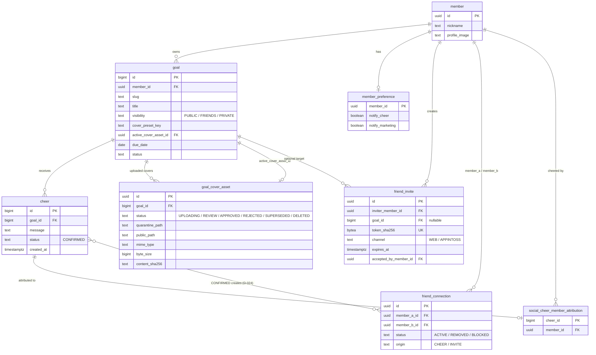
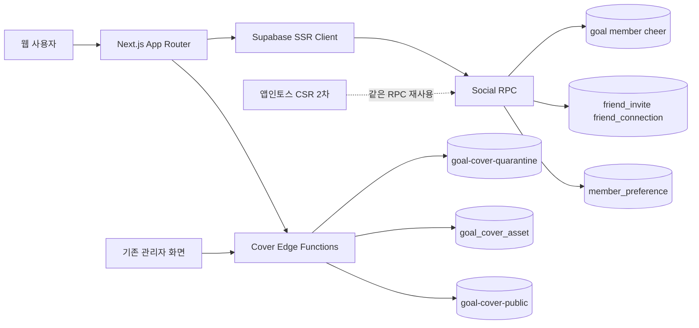
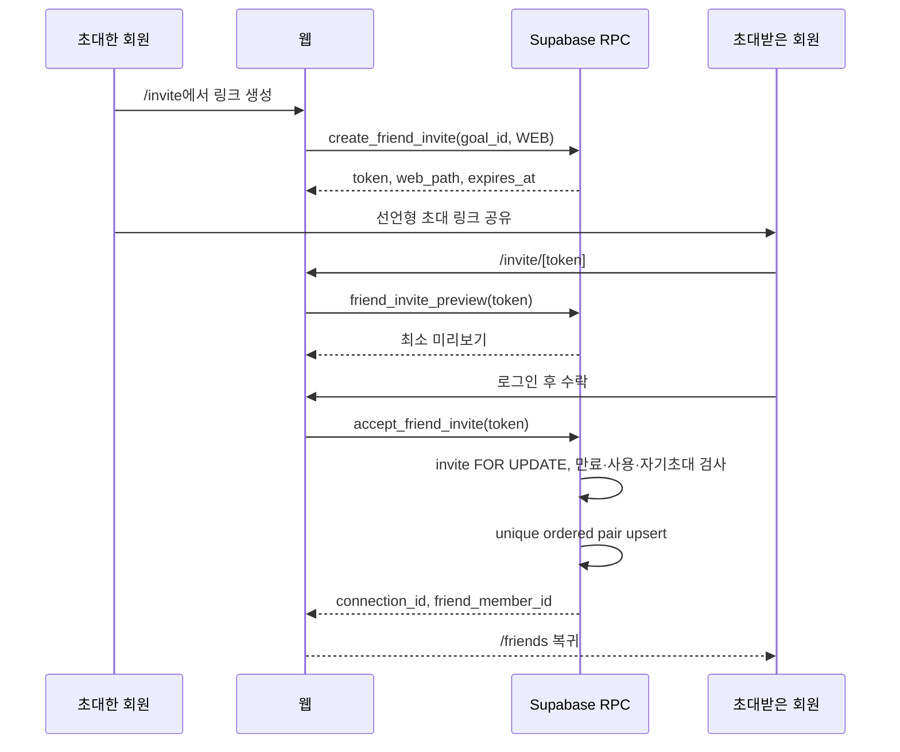
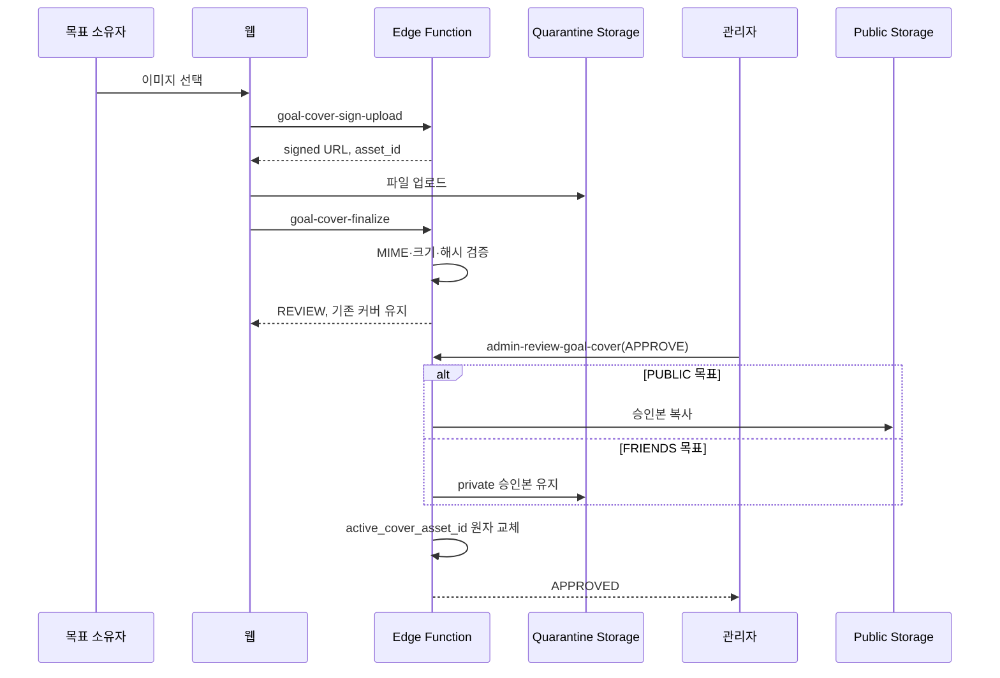

# 해낼게 V2 소셜 바이럴 루프 웹 우선 FDD
| 항목 | 값 |
|---|---|
| 버전 | **v1.2.5** (Codex 7차 17/25 반려 반영: CV-12 삼자 불일치 해소 · 비회원 필드 3개로 축소 · 제목·참조 정합) |
| 작성일 | v1.1.0 2026-10-13 02:42 KST · **v1.2.2 개정 2026-10-19 21:0x KST** |
| 작성자/모델 | v1.1.0 tech-architect / gpt-5-codex · **v1.2.2 tech-architect / claude-opus-5[1m]** |
| 작업 라인 | v2 |
| 상태 | 웹 1차 슬라이스 구현 계약. 모바일은 2차. **회장 결정 4건 전부 확정됨**(§A.7). 합의 대기 0건 |
| 상류 핀 | `pipeline-state.v2.md` D-018 · `docs/plan/haenael-v2-blueprint-v1.0.0-opus48.md` · **`DESIGN.md` sha256 `0ddeed8caff7…`** · **`docs/design/prototypes/social-viral-loop-v3-opus5.html` 3.0.0 sha256 `f9398150755d…`**(종전 핀 v2-opus48 은 superseded) · `docs/design/standard-ux-writing.md` sha256 `06e4ba100783…` |
| 관련 설계 | `erd-…-v1.2.5.md`, `api-contract-…-v1.2.5.md`, `architecture-…-v1.2.5.md`, `test-plan-…-v1.2.5.md`, `test-cases-…-v1.2.5.md`, `folder-structure-…-v1.2.5.md`, `design-patterns-…-v1.2.5.md`, **결정 선택지 `eng-design-v2-r6-decision-options-v1.0.0-opus5.md`** |
| 기반 포맷 | `docs/eng-design/fdd-social-viral-loop-web-first-v1.1.0.md`(v1.1.0, sha256 `13d9b717e839…`) |

> STAMP: 생성 2026-10-13 02:42 KST. 모델 gpt-5-codex. 에이전트 tech-architect. 스킬 docs 방법론을 적용하되 로컬 Markdown을 직접 작성했다. 근거는 승인 디자인, 현재 Next.js와 Supabase 구현, 운영 실물 조회 결과, Supabase·PostgreSQL·OWASP·앱인토스 공식 문서다. 가장 오래 고민한 지점은 기존 공개 목표의 도달성을 보존하면서 친구 공개범위를 여는 일과 커스텀 커버를 외부 모더레이션 공급자 결정 없이 안전하게 출시하는 일이었다.

> PATCH v1.0.1 사유: D-019를 반영해 FRIENDS 커스텀 커버가 public bucket에 복사되지 않고 ACTIVE 친구 확인 뒤 120초 Presigned URL로만 노출되도록 기능 계약을 명확히 했다.

> v1.1.0 사유: D-022에 따라 마이페이지, DB 집계형 업적, 미응원 친구 목표 큐를 2차 build 슬라이스로 승격했다. 허위 성취 방어 기준은 "DB 원장에서 반증 가능한가"이며, 달성 목표 수·받은 확정 응원 수·ACTIVE 친구 수만 허용한다. 자기신고·사용자 간 순위·연속 접속 기록은 금지한다.

> **v1.2.x 개정 사유**: design 이 2026-10-14 에 재오픈돼 6차까지 개정됐다(R1~R10, D-036 으로 승격). 이 문서는 그 개정과 D-024·D-032·D-034 를 반영해 **어긋난 지점만 고친 개정본**이다. v1.1.0 의 구조·스키마·RPC 이름·금액 비공개 계약은 그대로 유지한다. 바뀐 것은 §A 가 전수로 적는다. **v1.1.0 § 1.3 의 친구 정의가 D-024 로 뒤집혔다는 것이 가장 큰 교정이다.**

## 목차
- [A. v1.2.x 개정 (6차 개정 반영)](#a-v12-개정-6차-개정-반영)
  - [A.1 전제 실측표](#a1-전제-실측표)
  - [A.2 상류 핀 교체](#a2-상류-핀-교체)
  - [A.3 v1.1.0 이 틀렸던 것](#a3-v110-이-틀렸던-것)
  - [A.4 신규 요구 7건 추적성 매트릭스 (갭 0)](#a4-신규-요구-7건-추적성-매트릭스-갭-0)
  - [A.5 신규 기능 요구 FR-W12 ~ FR-W21](#a5-신규-기능-요구-fr-w12---fr-w21)
  - [A.5.5 다이어그램 독립 렌더 증거](#a55-다이어그램-독립-렌더-증거)
  - [A.6 데이터 구조 다이어그램](#a6-데이터-구조-다이어그램)
  - [A.7 회장 확정 결정 4건 (2026-10-19)](#a7-회장-확정-결정-4건-2026-10-19)
    - [A.7.1 비회원 미리보기 = 예시 데이터](#a71-비회원-미리보기---예시-데이터-d-open-1-확정)
    - [A.7.2 로그인 판정은 proxy.ts 에서](#a72-로그인-판정은-proxyts-에서-한다-d-open-2-확정)
    - [A.7.3 커버 업로드는 현 3단 유지](#a73-커버-업로드는-현-3단-유지-d-open-3-확정)
    - [A.7.4 법적 고지 위치](#fr-w12-법적-고지-노출-r1)
  - [A.8 v1.2.1 개정 (Codex 재검수 13/25 반려 반영)](#a8-v121-개정-codex-재검수-1325-반려-반영)
  - [A.9 같은 사실이 두 곳에 적혔던 자리 (전수)](#a9-같은-사실이-두-곳에-적혔던-자리-전수---v122-에서-단일화)
- [0. 한 줄 결론](#0-한-줄-결론)
- [1. 목적·범위·용어](#1-목적-범위-용어)
- [2. 현재 실물과 변경 경계](#2-현재-실물과-변경-경계)
- [3. 웹 우선 아키텍처](#3-웹-우선-아키텍처)
- [4. 화면·컴포넌트 계약](#4-화면-컴포넌트-계약)
- [5. 기능 요구와 수용기준](#5-기능-요구와-수용기준)
- [6. 핵심 시퀀스](#6-핵심-시퀀스)
- [7. 유저플로우 1:1 매핑](#7-유저플로우-11-매핑)
- [8. 데이터 공개범위와 RLS](#8-데이터-공개범위와-rls)
- [9. 기존 UI·금전 경로 보존 계약](#9-기존-ui-금전-경로-보존-계약)
- [10. 모바일 2차 전환](#10-모바일-2차-전환)
- [11. 배포 순서·관측·롤백](#11-배포-순서-관측-롤백)
- [12. 비범위와 후속 슬라이스](#12-비범위와-후속-슬라이스)
- [13. 추적성·갭 판정](#13-추적성-갭-판정)
- [14. 벤치마크·자기심문·레드팀](#14-벤치마크-자기심문-레드팀)
- [15. 개정 이력](#15-개정-이력)

## A. v1.2 개정 (6차 개정 반영)
> 이 장이 이 문서의 **기능 계약 정본**이다. 같은 사실을 두 곳에 다르게 적지 않는다. v1.2.1 까지 남아 있던 충돌 자리는 §A.9 에 전수로 적고 **본문을 직접 고쳐 하나로 만들었다.** 우선순위 선언문은 삭제했다: 그 선언이 필요하다는 것 자체가 모순이 남아 있다는 신호이기 때문이다.

### A.1 전제 실측표
품질헌법 `standard-eng-design.md` §1-7 요구. 추정 칸 0. 명령과 날짜를 함께 적는다.

| 전제 | 확인 명령 | 실측 결과 | 등급 | 날짜 |
|---|---|---|---|---|
| V2 소셜 테이블 운영 존재 | `GET /rest/v1/<t>?select=id&limit=0` (anon) | `friend_invite`·`friend_connection`·`goal_cover_asset`·`member_preference`·`social_cheer_member_attribution` **5종 실재**(42501/42703 = 테이블 있음) | 관찰됨 | 2026-10-19 |
| V2 RPC 운영 존재 | QA 계정 로그인 후 `POST /rest/v1/rpc/<f>` 정규 인자 | **8종 직접 관찰**: `my_friend_goals` 200 · `my_social_dashboard` 200 · `friend_goal_detail` P0002 `goal_not_found` · `friend_invite_preview` P0008 `invite_not_found` · `accept_friend_invite` P0008 · `set_goal_visibility` P0005 `goal_forbidden` · `get_wordmap` 200 · `admin_list_goal_covers` 403 `admin_forbidden`. `set_goal_cover_preset`·`remove_friend` 는 PostgREST 시그니처 응답으로 확인 | 관찰됨(8) | 2026-10-19 |
| `create_friend_invite`·`update_member_preferences` | 호출하면 운영 데이터를 쓰므로 호출하지 않음 | 같은 migration 의 형제 함수 8종이 전부 실재하고 제품 코드가 운영에서 이 둘을 호출한다 | **근거 확인**(관찰 아님) | 2026-10-19 |
| 커버 엣지 함수 운영 존재 | `OPTIONS/POST /functions/v1/<fn>`, 대조군 `zz-does-not-exist` → 404 `NOT_FOUND` | **3종 전부 배포됨.** `goal-cover-sign-upload` 인증 후 404 `goal_not_found` · `goal-cover-finalize` 422 `invalid_request` · `admin-review-goal-cover` 204 | 관찰됨 | 2026-10-19 |
| Storage 버킷 | `GET /storage/v1/object/public/<b>/probe.png` | `goal-cover-public` → `NoSuchKey` = **버킷 실재**. `goal-cover-quarantine` → `NoSuchBucket` 이나 **비공개 버킷은 공개 경로에서 같은 응답**이라 판정 불가 | 공개 버킷 관찰됨 / 격리 버킷 **미검증** | 2026-10-19 |
| 비로그인 보호 라우트 | `curl -o /dev/null -w '%{http_code}'` 운영 5경로 | `/my`·`/friends`·`/invite` **307** · `/me` **200**(셸 25,241바이트 + 클라이언트 리다이렉트 태그) · `/me/goal/1` **200**(의도된 권한없음 화면, 타인 데이터 0) | 관찰됨 | 2026-10-19 |
| `redirect()` 가 200 을 내는 이유 | Next.js `redirect` 공식 레퍼런스 | "When used in a streaming context, this will insert a meta tag to emit the redirect on the client side." 비스트리밍은 307 | 근거 확인 | 2026-10-19 |
| `proxy.ts` 존재와 역할 | `ls -la web/src/proxy.ts`, 본문 Read | **있다**(3,333바이트, 2026-07-19). canonical 도메인 308 강제 전용. `matcher` 는 정적 자산만 제외해 전 경로를 덮는다. **인증 판정은 안 한다** | 관찰됨 | 2026-10-19 |
| Next 설치본과 `proxy.ts`(Next.js 16 의 요청 가로채기 계층. Next 15 이전 이름은 `middleware.ts`) 파일명 | `grep PROXY_FILENAME web/node_modules/next/dist/lib/constants.js` | **16.4.0**. `middleware`·`proxy` 둘 다 인식. `@supabase/ssr` ^0.12.0 설치됨 | 관찰됨 | 2026-10-19 |
| 간격 토큰 제품 존재 | `sed -n '100,130p' web/src/app/globals.css` | `--space-mobile-gutter`·`--space-page-y`·`--space-bottom-safe` 만 있고 **`--sp-0`~`--sp-6` 없음**. R2 로 폐지된 `--tabbar-lock-size: 11px` 잔존 | 관찰됨 | 2026-10-19 |
| 응원 메시지 클램프 현황 | `grep -rn "line-clamp\|truncate" web/src` | `CheerList.tsx:50` **`truncate`(1줄)** · `MyPageOverview.tsx` 클램프 없음. **D-030-C 의 2줄+더보기가 4경로 중 0곳** | 관찰됨 | 2026-10-19 |
| 홈 카드 응원 집계의 N+1 | `me/page.tsx:87` Read | `.select("goal_id, created_at").in("goal_id", goalIds)` **단일 일괄 조회. 현재 N+1 없음** | 관찰됨 | 2026-10-19 |
| FRIENDS 커버 서명 발급 | `web/src/lib/social/server.ts:103` Read | `createSignedUrls([...new Set(paths)], TTL)` **1회 일괄**. D-019 경계가 코드에 서 있다 | 관찰됨 | 2026-10-19 |
| 운영 랜딩의 R1 반영 | `curl -s https://haenael-ge.vercel.app/` grep | 사업자등록번호 2·이용약관 2·개인정보처리방침 2·**이용안내 0**. R1 **미반영** | 관찰됨 | 2026-10-19 |
| 운영·시안 법정 기재사항 차이 | 운영 `/me/goal/1` 본문 대 프로토타입 `LEGAL_EXPOSURE.how` | 운영에는 **주소·개인정보보호책임자**가 있고 시안 `biz` 블록에는 **없다** | 관찰됨 | 2026-10-19 |
| 기존 구현 존재 | `ls web/src/components/social` | 12파일 실재(`FriendRelationshipBadge.tsx` 포함). **이 문서는 확장 설계이고 재창조가 아니다** | 관찰됨 | 2026-10-19 |

**아키텍처 v1.1.0 §7 의 "운영 0건" 기록은 낡았다.** 그 수치는 2026-10-13 시점이고 그 뒤 build·ship 이 돌았다. 위 표가 현재 정본이다.

### A.2 상류 핀 교체
| 항목 | v1.1.0 핀 | v1.2.0 핀 |
|---|---|---|
| 프로토타입 | `social-viral-loop-v2-opus48.html` | **`social-viral-loop-v3-opus5.html` 3.0.0** sha256 `f9398150755d42b2afbf5bdd7b6d982fd52b10ba8b6dd7da9b1ff72b3b9dca0c` |
| 디자인 시스템 | `DESIGN.md v2.0.1` (문자열 인용) | **`DESIGN.md`** sha256 `0ddeed8caff763de7b91ed5a0c178bf406c59a6ccefa65dcf5f057929e04c24a` |
| 말투 정본 | 없음 | **`docs/design/standard-ux-writing.md`** sha256 `06e4ba1007bbb37c552d6c56a4fdfe4abbe86bcc06c9776dc4579b009fe26ece` |
| 거버넌스 | D-018·D-019·D-022 | **+ D-024·D-032·D-033·D-034·D-035·D-036·D-037** |

### A.3 v1.1.0 이 틀렸던 것
| # | v1.1.0 서술 | 무엇이 틀렸나 | v1.2.0 처리 |
|---|---|---|---|
| 1 | §1.3 "친구 = 한 사용자의 초대를 다른 사용자가 명시적으로 수락해 생성된 양방향 관계" | **D-024(2026-10-14)가 뒤집었다.** 응원이 확정되면 그 순간 서로 친구가 된다. 초대는 미가입자를 데려오는 통로이고 친구 맺기의 필수 조건이 아니다. 레포에 migration 2건(`20261015010000_cheer_friendship_backfill.sql`·`20261016021000_friend_relationship_direction.sql`)과 `FriendRelationshipBadge.tsx` 가 이미 있다. **설계가 코드보다 낡았다** | §1.3 용어 교체 + FR-W17 신설 |
| 2 | §7 WF-01 "기존 SSR query" | R6 응원 요약(아바타 스택·인원수·최근 응원 한 줄)의 공급 계약이 없다 | FR-W14 + WF-18 |
| 3 | §9.1 "22px 여백과 색 토큰만 유지" | R10 수직 간격 토큰 `--sp-0`~`--sp-6` 이 생겼고 선언 위치가 없다 | FR-W16 + `design-patterns-…-v1.2.5.md` §4 |
| 4 | §4 라우트 표 | 법적 고지를 소유하는 화면이 표에 없다. **회장 확정(D-040)은 마이페이지·설정 1단 목록 + 그 아래 한 단계가 사업자 정보 전문 소유**이고 `/how` 는 소유하지 않는다 | §4 표에 `/how`·`/my`·`/my/legal`·`/terms`·`/privacy` 4행 추가 + FR-W12 |
| 5 | §4 마지막 문단 "비로그인 `/me/goal/[id]` 는 빈 셸을 렌더하지 않는다" | `/me` 자체가 셸을 먼저 그리는 것을 다루지 않았다(D-034) | FR-W15 |
| 6 | §12 비범위에 "자동 이미지 모더레이션" | 유지. 단 `UPLOADING` 중단 상태를 누가 치우는지가 빠져 있었다 | FR-W13 |
| 7 | 전제 실측표 없음 | 품질헌법 §1-7 위반 | §A.1 |
| 8 | 비회원에게 보낼 수 없는 필드 계약 없음 | R2 티저가 타인 데이터를 그릴 자리를 만들었는데 금지 필드가 없다(OWASP Excessive Data Exposure) | FR-W18 + api-contract §A.2 |

### A.4 신규 요구 7건 추적성 매트릭스 (갭 0)
Codex 교차리뷰가 짚은 미매핑 7건이다. 각 행이 **요구 → 기능요구 → 라우트·컴포넌트 → 서버 계약 → 테이블·Storage → 테스트 케이스**로 끝까지 닿는다.

| 요구 ID | 요구(출처) | 기능요구 | 라우트·컴포넌트 | 서버 계약 | 테이블·Storage | 테스트 |
|---|---|---|---|---|---|---|
| **R1** | 랜딩 법적 푸터 제거. **마이페이지·설정이 1단 목록을 갖고 그 아래 한 단계가 사업자 정보 전문을 소유한다**(D-040 회장 확정). `/how` 는 법적 고지를 소유하지 않는다 (`DESIGN.md` · 프로토타입 `LEGAL_EXPOSURE` 4443행 · D-030-B) | FR-W12 | `/`(푸터 0) · `/my`(1단 목록, `LegalLinkList`) · `/my/legal`(2단 전문, `BusinessInfoBlock`) · `/g/[slug]`(한 줄 링크) | 없음(정적). 노출 표 = `web/src/lib/legal/exposure.ts` | 없음 | LG-01~05 |
| **R2** | 비회원 하단탭 잠금 폐지, **예시 데이터로 경험 미리보기** + 카카오 시작. **초대 미리보기 응답은 현재 쓰이는 3필드로 축소**(OWASP 최소성) (프로토타입 `GUEST_TEASER` 4487행 · 1026~1059행 · **회장 확정 §A.7.1**) | FR-W18 | `/`·`/g/[slug]` · `GuestTeaserSheet.tsx` (`role="dialog"`) + `web/src/lib/copy/guest-preview.ts`(예시 데이터 상수) | `friend_invite_preview(text)` 반환을 `inviter_nickname`·`goal_title`·`cover_preset_key`로 축소(`20261020011000_friend_invite_preview_minimize.sql`), `asInvitePreview()`가 추가 필드를 거부 | 없음 | GT-01~03 |
| **R3** | 고정 CTA 를 떠 있는 레이어에서 흐름 안으로. 높이 정본 `--cta-h` 하나 (프로토타입 15~17행) | FR-W16 | `/g/[slug]` · `GoalPublicCtaBar.tsx` | 없음 | 없음 | SP-03 |
| **R4** | **말투 전수 교정 25화면 21곳.** 축 넷(2인칭 반말·해요체/합니다체 혼용·은유·조어·내부 동작 노출). 정본 `docs/design/standard-ux-writing.md`, 프로토타입 집행 `lint-prototype-voice.mjs` (프로토타입 18~20행 · D-028-D · D-037 R4) | **FR-W19** | 전 화면 카피 · `web/src/lib/copy/` 로 모은 문자열 + `standard-ux-writing.md` 규칙 | 없음(카피는 클라이언트 자원). **단 서버 오류 메시지는 코드만 반환하고 사용자 문구는 클라이언트가 소유** | 없음 | **VO-01~04** |
| **R5** | 배너 선택기: 업로드 버튼 항상 도달 · 선택 상태 단일 변수(SSOT) · 체크 정확히 1개 (프로토타입 21~25행 · D-032) | FR-W13 | `/me/goal/[id]`·`/my` · `GoalCoverPicker.tsx` | `sign-goal-cover-upload` · `finalize-goal-cover-upload` · `admin-review-goal-cover` · `storage-cleanup-worker` · `purge_abandoned_goal_covers(interval)` · `requeue_orphan_cover_tombstones(interval)` · `claim_storage_cleanup_batch(integer, interval)` · `settle_storage_cleanup(bigint, uuid, boolean)` | `goal_cover_asset` · `storage_cleanup_queue`(`locked_at`·`lock_token`) · 버킷 2종 | CV-01~12 · EA-01~04 |
| **R6** | 홈 목표 카드 응원 요약 = 아바타 스택(+N) · 인원수 · 최근 응원 한 줄. 금액·순위 금지 (프로토타입 26~28행 · `DESIGN.md` · D-003) | FR-W14 | `/me`·`/my` · `MyGoalListCard.tsx`·`CheerSummaryBar.tsx`(신규) | `my_social_dashboard()` 확장(`supporter_avatars` ≤3 · `recent_cheer` 1건 · `is_anonymous`). **단일 호출 유지** | `cheer`·`member`·`goal` | CS-01~04 |
| **R7** | **업적 화면의 '받는 사람도 등급 받기' 토글 제거.** 기능 정의가 없어 무엇을 켜는지 알 수 없었고 운영 정책이면 관리자 화면 소관이다. 업적은 획득과 진열만 한다 (프로토타입 29~30행·2334행 · D-037 R7) | **FR-W20** | `/me/achievements` · `MyPageOverview.tsx` 업적 블록 | **`update_member_preferences(notify_cheer, notify_marketing)` 는 그대로 남는다.** 그 두 인자는 알림 동의용이고 등급 토글과 무관했다(토글은 저장 경로가 애초에 없었다). 업적 응답에 등급·공개여부 필드 **0개** | 없음(`member_preference` 스키마 변경 0) | **AC-01~03** |
| **R8** | **접기·펼치기 기준 정의와 전체 통일.** 접는 조건 셋(①보조 정보 ②본문 2줄 또는 목록 8개 초과 ③접힌 상태에서 무엇인지 알 때). 토글은 꺾쇠 하나, `<details>` 는 제품 화면 금지. 프로토타입 집행 `COLLAPSE_POLICY` + `auditCollapse()` (프로토타입 40~42행·4592행 · `DESIGN.md` 626행) | **FR-W21** | 접기를 쓰는 전 화면 · `Collapsible.tsx`(신규, 정책 데이터를 읽는 단일 집행자) · `ClampText.tsx` | 없음 | 없음 | **CP-01~05** |
| **R9·R10** | 수직 간격 관계 토큰 `--sp-0`~`--sp-6`, 카드 상하 대칭 (`DESIGN.md` 579~599행) | FR-W16 | 전 화면 · `globals.css :root` 선언 | 없음 | 없음 | SP-01~02·04 |
| **D-034** | 비로그인 `/me` 가 회원 셸을 먼저 그리지 않게 한다 (결정 원장 · 운영 실측 200) | FR-W15 | 보호 라우트 전체 · **기존** `web/src/proxy.ts` 확장 | 없음(경계 판정). 목록 = `qa/contracts/protected-routes.json` | 없음 | AU-01~05 |
| **D-030-C** (레지스트리 ID **`BACKLOG-CLAMP`**) | 응원 메시지 1줄 → 2줄 말줄임 + 더 보기 (미반영 백로그) | FR-W14 | `CheerList.tsx`·`MyPageOverview.tsx`·`FriendGoalList.tsx`·`FriendGoalDetail.tsx` | 없음 | 없음 | CL-01~04 |
| **D-024** | 응원으로 친구가 된다 + 관계 방향 표시 | FR-W17 | `/friends`·`/friends/[friendId]` · `FriendRelationshipBadge.tsx`(실재) | `my_friend_goals()`·`friend_goal_detail()` 의 `relationship_direction`·`relationship_origin` | `friend_connection`·`cheer` | FD-01~03 |

**승인 요구 전수 대조 (양방향)**

D-037 이 적은 승인 요구는 **R1~R10 열 건**이다. 위 표가 그 열 건을 하나도 빼지 않고 담았는지 역방향으로 센다.

| 승인 요구 | 매트릭스 행 | 상태 |
|---|---|---|
| R1 랜딩 법적 고지 | 있음 | 매핑 |
| R2 비회원 티저 | 있음 | 매핑 |
| R3 고정 CTA | 있음 | 매핑 |
| **R4 말투 전수 교정** | **있음(v1.2.1 신설)** | 매핑 |
| R5 배너 선택기 | 있음 | 매핑 |
| R6 응원 요약 | 있음 | 매핑 |
| **R7 업적 토글 제거** | **있음(v1.2.1 신설)** | 매핑 |
| **R8 접기 기준** | **있음(v1.2.1 신설)** | 매핑 |
| R9 카드 캡션 여백 | 있음(R9·R10 통합행) | 매핑 |
| R10 간격 토큰 | 있음(R9·R10 통합행) | 매핑 |
| D-024 응원=친구 | 있음 | 매핑 |
| D-034 인증 경계 | 있음 | 매핑 |
| D-030-C 2줄 clamp (**`BACKLOG-CLAMP`**) | 있음 | 매핑 |

**매핑 결과: 승인 요구 10/10 + 거버넌스 3/3 = 13/13. 갭 0.** v1.2.0 은 R4·R7·R8 을 빼고 "9건 전수" 라고 적었다. 그것이 v1.2.0 반려 사유였다.

### A.4.1 테스트 ID 실재 확인 (검사가 센다)

매핑이 가리키는 테스트 ID 가 `test-cases-social-viral-loop-web-first-v1.2.5.md` 에 **실제로 정의돼 있는지**는 명령이 판정한다. **개수를 이 문서에 손으로 적지 않는다.**

```bash
# ① 요구 전수 커버와 테스트 ID 실재
node scripts/qa/lint-requirement-coverage.mjs \
  docs/eng-design/fdd-social-viral-loop-web-first-v1.2.5.md \
  docs/eng-design/test-cases-social-viral-loop-web-first-v1.2.5.md
#   합격선: A 요구 미커버 0건 · B 테스트 미실재 0건 · 판정 PASS

# ② 문서에 적힌 수치와 실제 정의 수의 대조(G축) 포함 8축
node scripts/qa/lint-doc-contradiction.mjs \
  docs/eng-design/*v1.2.4*.md docs/eng-design/eng-design-v2-r6-decision-options-v1.0.0-opus5.md
#   합격선: 전 축 0건 · 판정 PASS
```

**왜 수치를 적지 않는가**: v1.2.0~v1.2.3 네 판에서 이 숫자가 **세 번 어긋났다**(정의 30 대 보고 33, 정의 51 대 보고 48, 참조 109 대 보고 106). 손으로 적는 수치는 TC 가 하나 늘면 그 순간 거짓이 된다. **세는 주체를 검사로 옮긴다**(§A.9 의 근본원인 ④).

군별 범위만 적는다(개수는 적지 않는다): `LG` 법적 고지 · `GT` 비회원 미리보기 · `SP` 간격·CTA · `VO` 말투 · `CV` 커버 업로드·정리 · `EA` 소비자 호출 인증 · `CS` 응원 요약 · `AC` 업적 토글 부재 · `CP` 접기 정책 · `CL` 2줄 말줄임 · `AU` 로그인 판정 · `FD` 친구·방향.

### A.5 신규 기능 요구 FR-W12 - FR-W21
#### FR-W12. 법적 고지 노출 (R1)
Given 법적 고지 노출 표가 `web/src/lib/legal/exposure.ts` 의 단일 상수다. When 어떤 화면이 렌더된다. Then 표에 그 화면 키가 없으면 **법적 고지 DOM 을 만들지 않는다**(마크업이 남아 있어도 렌더 시점에 제거). 표에 `biz` 면 사업자 정보 전문, `link` 면 한 줄 링크, `page` 면 상시 전문을 그린다. 하단탭이 있는 회원 화면에는 어떤 모드도 두지 않는다.

- **집행 주체는 코드다**(D-032). 화면마다 사람이 다시 판단하지 않는다.
- `landing` 값은 **`none` 으로 확정**됐다(§A.7.4). 결정 대기가 아니므로 두 경우를 수용하는 분기를 두지 않는다.
- **노출 구조는 2단이다.** 1단(마이페이지 또는 설정) = 약관·개인정보처리방침·사업자 정보 **목록**. 2단 = 사업자 정보 **전문**. 1단에 전문을 펼치지 않는다.
- **법정 기재사항 6항목 전수**: 상호·대표자·사업자등록번호·**주소**·이메일·**개인정보보호책임자**. 시안이 주소와 개인정보보호책임자를 빠뜨렸으므로 되살린다.

#### FR-W13. 커버 업로드 상태기계 (R5)
Given 소유자가 커버를 올린다. When 서명 발급 → 업로드 → 확정 3단을 지난다. Then 자산 상태는 **운영 스키마가 허용하는 6값**(`UPLOADING`·`REVIEW`·`APPROVED`·`REJECTED`·`SUPERSEDED`·`DELETED`) 안에서만 전이한다. 전이와 주체는 §api-contract A.4 의 8행 표가 정본이다. **`UPLOADING` 로 24시간 이상 머문 행과 그 격리 객체는 명명된 정리 작업이 제거한다**(§erd A.4 가 job 이름·주기·재시도·관측을 정의한다). 중단된 업로드가 기존 활성 커버를 바꾸지 않는다.

> **v1.2.1 교정**: v1.2.0 은 첫 상태를 `PENDING_UPLOAD` 로 적었다. **운영 실물은 `UPLOADING` 이다**(`supabase/migrations/20261013050000_social_viral_loop_web_first.sql:56` 의 CHECK, `goal-cover-sign-upload/index.ts:49` 의 insert, `goal-cover-finalize/index.ts:43` 의 비교). 그 이름으로 구현하면 중단분을 한 건도 찾지 못한다. 또 v1.2.0 은 `SUPERSEDED`·`DELETED` 두 값을 몰랐다. `SUPERSEDED` 는 활성 커버가 교체될 때 이전 승인본에 붙는다(migration 317·532행).

Given 선택기가 열린다. Then 업로드 버튼은 **스크롤 영역 밖**에 있어 가로 스크롤 위치와 무관하게 항상 눌린다. 선택 상태는 단일 변수가 소유하고 화면의 체크 표시는 **정확히 1개**다.

Given 중단된 업로드의 격리 객체를 치운다. When `purge_abandoned_goal_covers()` 가 돈다(그 함수는 `UPLOADING` 만 조회한다). Then **DB 행 전이와 Storage 객체 삭제가 둘 다 일어난다.** 행을 먼저 `DELETED` 로 표시하고 지울 경로를 큐에 기록한 뒤, 소비자가 객체를 지우고 큐를 닫는다. **DB 작업 성공은 객체 정리 성공의 증거가 아니다**(Supabase 에서 행 삭제는 객체를 지우지 않는다).

Given 열린 큐 행이 없는 tombstone(`DELETED`)이 남아 있다. When **`requeue_orphan_cover_tombstones()`** 가 돈다(그 함수는 `DELETED` 만 조회한다). Then 그 경로가 큐에 다시 등록되고 행은 지우지 않는다. **두 함수의 조회 상태가 하나씩이고 서로 겹치지 않는다.**

Given 소비자 실행이 겹치거나 중간에 죽는다. Then 같은 객체를 두 번 지우지 않고, claim 직후 죽은 행도 lease 만료 후 반드시 다시 집힌다. 늦게 끝난 이전 실행이 재수집된 행을 완료로 바꾸지 못한다(소유권 토큰). 계약 = `erd-…-v1.2.5.md` §A.4.3.

Given 한 번에 여러 객체를 지운다. Then **요청 경로와 삭제 반환 경로를 1:1 대조**해 반환된 것만 완료로 닫는다. 반환되지 않은 경로는 재조회로 부재를 확인한 뒤에만 완료로 본다. 계약 = §A.4.5.

#### FR-W14. 응원 요약과 2줄 말줄임 (R6 - D-030-C)
Given 회원이 `/me` 또는 `/my` 를 연다. When 목표 카드가 그려진다. Then 카드마다 아바타 최대 3개와 `+N`, 응원 인원수, 가장 최근 응원 1건(이름 + 메시지)이 보인다. **금액·클로버 수·상위 후원자 순위는 응답 스키마에 존재하지 않는다**(D-003). 익명 응원은 아바타 자리표시를 쓰고 프로필 링크를 걸지 않으며 그 이유를 그 자리에서 알린다.

Given 목표 수가 1개든 20개든. Then 이 요약을 위한 서버 질의 횟수는 **변하지 않는다**(단일 `my_social_dashboard()` 호출).

Given 응원 메시지가 길다. Then 목표 관리·해낼게 관리·친구 목록·친구 상세 **네 경로 모두** 2줄에서 말줄임하고 꺾쇠 하나로 펼친다. 클램프 줄 수는 CSS 변수 한 곳이 소유한다.

#### FR-W15. 인증 판정 층 (D-034)
Given 비로그인 방문자가 보호 라우트를 연다. When 응답이 온다. Then **회원 셸 HTML 이 전송되지 않고** 3xx 로 끝난다. 보호 라우트 목록은 데이터 파일이 소유하고, 목록에 없는 신규 보호 라우트는 린트가 반려한다. **경계 판정은 추가이고 대체가 아니다**: 페이지의 인증 검사와 RLS 는 그대로 둔다(Server Action 은 경계가 덮지 않는다).

구현 층은 **합의 대기**(§A.7 D-OPEN-2).

#### FR-W16. 간격 토큰과 고정 CTA 높이 (R3 - R9 - R10)
Given 제품이 렌더된다. Then `--sp-0`~`--sp-6`(2·4·8·12·16·24·32px)가 `web/src/app/globals.css` 의 `:root` 한 곳에 선언돼 있다. 카드 컴포넌트의 **안쪽 상하 여백은 같은 토큰**을 쓴다. 적용 범위는 카드 우선이고, 본문 문단·목록 행의 개별 여백은 `DESIGN.md` 가 미적용으로 명시했으므로 넓히지 않는다. 기존 `--space-*` 는 페이지 레벨 여백 전용으로 남기고 두 계열을 섞지 않는다.

Given `/g/[slug]` 에 고정 액션 바가 있다. Then 자리 예약 높이는 `--cta-h` 하나가 소유하고 손으로 적은 픽셀 값을 쓰지 않는다. 바 밑으로 본문이 비쳐 보이지 않는다.

#### FR-W17. 응원으로 맺어지는 친구와 관계 방향 (D-024)
Given 응원이 `CONFIRMED` 로 확정된다. When 그 시점. Then 응원한 사람과 받은 사람이 **서로 친구가 된다**(양방향, 1건). 과거 확정 응원 이력에도 소급 적용한다. 초대 링크 수락은 친구가 되는 또 하나의 경로로 남고 **필수 조건이 아니다**. 금액은 여전히 공개되지 않고 차단·해제는 사용자가 할 수 있다.

Given 친구 목록·상세를 연다. Then 관계 방향이 `내가 응원함 | 응원받음 | 서로 응원` 중 하나로 보인다. 판정은 DB 의 확정 응원 기록으로 한다.

#### FR-W18. 비회원 티저의 노출 경계 (R2)
회장 확정안은 **예시 데이터로 경험을 미리 보여주는 것**이다(§A.7.1).

Given 비회원이 회원 전용 탭을 누른다. When 미리보기 시트가 열린다. Then 그 시트는 **서버를 호출하지 않고** 클라이언트 상수의 예시 데이터로 그려진다. 응답·HTML·DOM 어디에도 타인의 이름·프로필 사진 주소·목표 제목·클로버 수·금액·순위가 **0건**이다.

Given 예시 데이터가 그려진다. Then 그것이 예시임이 사용자에게 드러난다. 실제 사용자 이름처럼 보이는 값을 쓰지 않고, **흐림 처리를 쓰지 않는다**(가리면 실데이터처럼 보이고, CSS 로 가린 것은 전송된 것이다).

Given 시트에 숫자가 있다. Then 그 숫자는 예시의 일부로 보인다. **참이 될 수 없는 수치를 사실처럼 쓰지 않는다**("친구 3명이 이미 응원하고 있어요" 류 금지).

Given 시트에 다음 행동이 있다. Then 카카오로 시작하기와 먼저 둘러보기 두 선택이 있고, 자물쇠 배지는 존재하지 않는다.

**신설 서버 자산 0건.** `platform_social_stats()` 는 폐기됐다.

#### FR-W19. 말투 규칙의 집행 주체와 카피 소유 위치 (R4)
6차 개정이 25화면 21곳의 말투를 교정하고 정본 `docs/design/standard-ux-writing.md` 를 세웠다. 프로토타입은 `scripts/qa/lint-prototype-voice.mjs` 가 집행한다(개정 전 15건 → 0건). **제품 코드에는 그 집행 주체가 없다.** 규칙만 있고 집행자가 없으면 매 판 재협상된다(D-032).

Given 사용자에게 보이는 문구가 있다. Then 그 문구는 `web/src/lib/copy/` 아래 한 자리에 모여 있고 컴포넌트 안에 흩어져 있지 않다. 그 자리의 모든 문구가 말투 정본의 네 축을 지킨다.

| 축 | 금지 | 허용 |
|---|---|---|
| 1 인칭·높임 | 2인칭 반말("네 응원이…") | 해요체 통일 |
| 어미 통일 | 해요체와 합니다체 혼용 | 한 화면 안에서 해요체 |
| 은유·조어 | "열리는 자리"·"쌓였어요" 류 지어낸 비유 | 평문 서술 |
| 내부 동작 노출 | 전송 경로·폴백·해시·버킷·조직 내부 설명 | 사용자가 할 일만 |

**예외(그대로 두는 것)**: 사용자가 쓴 응원 메시지와 카카오 초대 문안은 사용자의 말이므로 반말을 고치지 않는다.

**집행**: 프로토타입용 `lint-prototype-voice.mjs` 와 **같은 규칙 데이터**를 제품 카피 파일에 적용하는 검사를 둔다. 규칙을 두 벌로 베끼지 않는다. **서버는 오류 코드만 반환하고 사용자 문구는 클라이언트가 소유한다**: 그러면 말투 교정이 서버 배포 없이 한 자리에서 끝난다(현재 엣지 함수 오류는 이미 `{"error":{"code":"…"}}` 형태라 이 계약과 맞다).

#### FR-W20. 업적 화면의 등급 토글 부재 (R7)
Given 업적 화면이 열린다. Then **'받는 사람도 등급 받기' 류의 토글이 존재하지 않는다.** 업적은 획득과 진열만 한다. 업적 응답에 등급·공개여부·자기신고 필드가 **0개**다.

**그 토글이 기대던 저장 경로의 처분**

| 자산 | 처분 | 근거 |
|---|---|---|
| `update_member_preferences(notify_cheer, notify_marketing)` | **그대로 남긴다.** 변경 0 | 두 인자는 응원 알림과 마케팅 동의용이고 등급 토글과 무관하다. 미니앱 2차 호환 계약(이름 5종 유지)에도 들어 있다 |
| `member_preference` 테이블 | **스키마 변경 0.** 등급용 컬럼은 애초에 없다 | migration 실측. 토글은 **저장 경로가 처음부터 없던 UI** 였다. 그래서 회장이 "뭔 기능이지" 라고 물었다 |
| 등급·랭킹 정책 | 비범위. 필요해지면 관리자 화면 소관 | D-022 "사용자 간 랭킹은 넣지 않는다" |

**즉 R7 은 제거만이고 서버 변경이 없다.** 단 "없앴다" 는 것을 테스트가 지켜야 재발하지 않는다(AC-01~03).

#### FR-W21. 접기 펼치기 정책의 단일 집행자 (R8)
Given 화면에 접을 수 있는 영역이 있다. Then 그 영역은 아래 **세 조건을 모두** 만족할 때만 접힌다.

1. 접는 대상이 **보조 정보**다(본문·핵심 행동은 접지 않는다).
2. 본문이 **2줄을 넘거나** 목록이 **8개를 넘는다**.
3. 접힌 상태에서 **그것이 무엇인지 알 수 있다**(라벨 또는 첫 줄이 보인다).

Given 토글을 그린다. Then 꺾쇠 하나이고, 안내 문구("더보기"·"접기" 같은 추가 텍스트)를 덧붙이지 않는다. **`<details>` 요소를 제품 화면에 쓰지 않는다.**

**집행 주체**: 정책을 데이터로 둔 `Collapsible.tsx` 단일 컴포넌트가 조건을 판정한다. 조건을 만족하지 않는 곳에서 접기를 쓰면 **개발 모드에서 콘솔로 알리고 접지 않는다**(프로토타입 `auditCollapse()` 와 같은 방식). 접기를 직접 구현한 컴포넌트는 린트가 반려한다.

**왜 이 절이 필요했나**: 회장이 "목표 관리에서 텍스트 넘칠때 굳이 '더보기' '접기' 넣은이유는?" 과 "접기 펼치기는 저렇게 할수있으면서 왜 전에는 개병신쓰레기짓했는지" 를 **두 판 연속** 지적했다. 한 번은 불필요한 접기였고 한 번은 필요한데 없었다. 기준이 없으면 양쪽으로 다 틀린다.

### A.5.5 다이어그램 독립 렌더 증거

구조 규격이 요구하는 3종이 **파서 통과가 아니라 SVG 산출까지** 확인됐다. 증거 = `docs/qa/evidence/mermaid-render-v1.2.5/`(SVG 15개 + README). 2026-10-20 재실행에서도 15/15 이고 전부 `<svg` 루트다.

| 종류 | 블록 수 | 렌더 결과 |
|---|---:|---|
| flowchart (시스템 구성·인증 흐름) | 10 | 10/10 SVG |
| sequenceDiagram (초대 수락·커버 승인) | 3 | 3/3 SVG |
| erDiagram (데이터 구조) | 2 | 2/2 SVG |
| **합계** | **15** | **15/15. 실패 0** |

렌더러는 `@mermaid-js/mermaid-cli`(mmdc) + 실제 Chrome 이다. **jsdom 기반 파서만으로는 부족하다**: `mermaid.parse()` 는 통과해도 레이아웃 단계에서 `getBBox` 가 없어 SVG 가 나오지 않는다. 그래서 브라우저로 렌더해 15개 전부 `<svg` 루트를 확인했다.

### A.6 데이터 구조 다이어그램
Codex 지적(FDD 에 `erDiagram` 없음) 반영. 상세 정의는 `erd-social-viral-loop-web-first-v1.2.5.md`.



### A.7 회장 확정 결정 4건 (2026-10-19)
v1.2.0 에서 합의 대기로 올린 4건이 **전부 확정됐다.** 선택지 전문은 `eng-design-v2-r6-decision-options-v1.0.0-opus5.md` 이고, 아래가 확정 내용이다. **더 이상 대기 항목이 아니므로 설계는 이 한 구조만 지원한다.**

| ID | 결정 대상 | 회장 확정 | 추천안 대비 |
|---|---|---|---|
| D-OPEN-1 | 비회원 미리보기가 보여줄 데이터 | **예시 데이터로 경험을 미리 보여준다**(아래 §A.7.1) | **추천안(A 설명형)과 다름.** B(집계 수치)는 폐기 |
| D-OPEN-2 | 로그인 판정을 어디서 하나 | **`proxy.ts` 에서 한다**(아래 §A.7.2) | 추천안 채택 |
| D-OPEN-3 | 커버 업로드 경로 구조 | **현 3단 유지**(아래 §A.7.3) | 추천안 채택 |
| D-OPEN-4 | 법적 고지 위치 | **마이페이지·설정에 두고 사업자 정보는 한 단계 더 아래. 푸터 없앤다**(아래 §A.7.4) | 추천안보다 구체화. 분기 불필요 |

#### A.7.1 비회원 미리보기 - 예시 데이터 (D-OPEN-1 확정)
회장 원문: **"예시 데이터를 주면서 이런 경험을 하겠구나 함 되지"**

비회원이 회원 전용 탭을 누르면 **명백한 예시 데이터로 그 화면의 경험을 미리 보여준다.** "가입하면 이런 화면을 쓰게 된다" 를 체감하게 하는 것이 목적이다.

| 항목 | 확정 계약 |
|---|---|
| 서버 호출 | **0건.** 예시 데이터는 **클라이언트 상수**이고 서버를 거치지 않는다 |
| 실사용자 데이터 | **0건.** 타인의 이름·사진·목표·응원·클로버가 응답에도 HTML 에도 없다 |
| 신설 서버 자산 | **없다.** `platform_social_stats()` 는 **폐기**됐다(B안 탈락). **이번 개정의 신설 서버 자산은 0건이다** |
| 예시임의 표시 | 예시임이 사용자에게 **드러나야 한다.** 실제 사용자 이름처럼 보이는 값을 쓰지 않고, 예시 라벨 또는 명백한 더미 이름으로 그린다 |
| 흐림 처리 | **금지.** 가리면 실데이터처럼 보인다. 그리고 CSS 로 가린 것은 전송된 것이다 |
| 수치 | **참이 될 수 없는 수치를 쓰지 않는다.** "친구 3명이 이미 응원하고 있어요" 류 금지. 예시 화면 안의 숫자는 예시의 일부로 보이게 한다 |

**이 결정이 계약을 단순하게 만든다.** api-contract §A.2 의 비회원 금지 필드 목록은 그대로 유효하되, 그 경로가 **애초에 서버를 호출하지 않으므로** 위반할 수단 자체가 없다. 금지 목록은 다른 비회원 경로(`/g/[slug]`·`/invite/[token]`)에 계속 적용된다.

#### A.7.2 로그인 판정은 `proxy.ts` 에서 한다 (D-OPEN-2 확정)
**`proxy.ts`**(Next.js 16 의 요청 가로채기 계층. 요청이 페이지 렌더에 들어가기 전에 가로채 처리한다. Next 15 이전 이름은 `middleware.ts` 이고 Next 16 정본 이름이 `proxy` 다)에서 로그인 여부를 판정한다. 이 파일은 **이미 있다**(`web/src/proxy.ts`, 3,333바이트, 2026-07-19. 현재 역할은 canonical 도메인 308 강제 하나뿐이고 `matcher` 가 정적 자산만 제외해 전 경로를 덮는다).

| 항목 | 확정 계약 |
|---|---|
| 판정 위치 | 기존 `web/src/proxy.ts` 에 분기 추가. **새 파일 0, 새 `matcher` 0** |
| 보호 라우트 목록 | `qa/contracts/protected-routes.json` 이 소유하고 `proxy.ts` 와 테스트가 **같은 파일**을 읽는다 |
| 판정 결과 | 미로그인이면 3xx. **회원 화면 HTML 이 한 바이트도 전송되지 않는다** |
| 페이지·RLS 검사 | **그대로 둔다.** `proxy.ts` 는 Server Action 요청을 덮지 않으므로 페이지의 `getUser()` 와 RPC·RLS 가 최종 인가를 맡는다(Next.js 공식 인증 가이드와 같은 구조) |
| 예외 | `/me/goal/[id]` 처럼 의도적으로 권한없음 화면을 주는 경로는 목록에 명시한다 |

**용어 규칙**: 이 구조를 가리킬 때 `proxy.ts` 라는 파일명을 쓴다. "경계" 나 "층" 같은 비유어를 단독으로 쓰지 않는다.

#### A.7.3 커버 업로드는 현 3단 유지 (D-OPEN-3 확정)
회장 원문: "니가 알아서해". 서명 발급 → 업로드 → 확정 **3단을 그대로 둔다.** 엣지 함수·RPC·테이블·버킷 **구조 변경 0.**

**단 운영 스키마 대조 결과 정리 작업에는 추가가 필요하다.** "서버 변경 0" 이라고 적으면 사실과 다르다.

| 추가 | 종류 | 왜 필요한가 | 근거(실측) |
|---|---|---|---|
| `storage_cleanup_queue.reason` CHECK 에 `ABANDONED_UPLOAD` 추가 | 제약 변경(비파괴) | 현재 허용값이 `VISIBILITY_DOWNGRADE`·`ASSET_REPLACED`·`ASSET_REJECTED` 3값뿐이라 **중단 업로드를 큐에 넣을 수 없다** | `supabase/migrations/20261013050000_social_viral_loop_web_first.sql:79` |
| 정리 함수 + 명명된 cron job | 신규 함수 1개 + job 1개 | 정책만 있고 **실행 주체가 없었다**. 레포에 해당 함수·job 실물 0건 | §erd A.4 가 job 이름·주기·명령·재시도·관측을 정의 |

**운영 `goal_cover_asset` 스키마 대조 (관찰됨, 2026-10-19)**

| 설계가 전제한 것 | 운영 실물 | 판정 |
|---|---|---|
| 상태 첫 값 `PENDING_UPLOAD` | **`UPLOADING`** | **불일치 → 설계를 운영에 맞춰 교정** |
| 상태 4값 | **6값** `UPLOADING`·`REVIEW`·`APPROVED`·`REJECTED`·`SUPERSEDED`·`DELETED` | 불일치 → 6값으로 교정 |
| 상태별 칸 제약 | `goal_cover_asset_state_check` 가 강제: APPROVED 는 `reviewed_by`·`reviewed_at` 필수 + `rejection_code` NULL / REJECTED 는 `rejection_code` 필수 + `public_path` NULL / UPLOADING·REVIEW 는 세 칸 NULL | 일치(설계가 명시 안 했을 뿐) |
| 활성 커버 교체 시 이전 승인본 | `SUPERSEDED` 로 전이(`admin_apply_goal_cover_review`) | 설계에 없었음 → 추가 |
| 정리 큐 사유 | 3값, 중단 업로드 없음 | **불일치 → CHECK 추가 필요** |
| 격리 객체 소유자 읽기 정책 | `status='APPROVED'` 인 자산만 소유자 SELECT 허용 | 일치. 따라서 UPLOADING·REVIEW 중에는 소유자도 직접 읽지 못하고 서명 URL 로만 본다 |

근거 = `migration:52~70, 79, 96~97, 124, 145~165, 505~538` · `supabase/functions/goal-cover-sign-upload/index.ts:49` · `goal-cover-finalize/index.ts:43` · `admin-review-goal-cover/index.ts:58`.

#### A.7.4 법적 고지는 마이페이지 설정에, 사업자 정보는 한 단계 더 아래 (D-OPEN-4 확정)
회장 원문: **"설정이나 마이페이지에서 약관 개인정보 사업자 이런거 넣으면되잖아 사업자도 따로 한뎁스아내래에 넣으면 푸터 넣을필요 없고"**

| 항목 | 확정 계약 |
|---|---|
| 푸터 | **전 화면에서 제거 확정.** 노출 표의 `landing` 값은 `none` 이고 **더 이상 결정 대기가 아니다** |
| 1단 (마이페이지 또는 설정) | **약관 · 개인정보처리방침 · 사업자 정보** 세 항목을 목록으로 둔다. 전문을 펼치지 않는다 |
| 2단 (한 단계 더 아래) | **사업자 정보 전문을 그 화면이 소유한다** |
| 법정 기재사항 | **6항목 전수**: 상호 · 대표자 · 사업자등록번호 · **주소** · 이메일 · **개인정보보호책임자**. 시안이 주소와 개인정보보호책임자를 누락했으므로 되살린다 |
| 분기 | **불필요.** 전자상거래법 제10조 초기화면 표시 건은 회장 결정으로 닫혔다. 설계는 이 구조 하나만 지원한다 |

### A.8 v1.2.1 개정 (Codex 재검수 13/25 반려 반영)
독립 리뷰어(`eng-design-reviewer`, Codex)가 v1.2.0 을 **13/25 로 반려**했다(추적성 1/5). 반려 5건과 처리 결과다.

| # | 반려 사유 | 내 판정 | 처리 |
|---|---|---|---|
| 1 | 커버 상태기계가 운영 스키마와 불일치(`PENDING_UPLOAD` vs 운영 `UPLOADING`). 신뢰도 10/10 | **지적이 맞다.** migration 56행 CHECK 는 `UPLOADING·REVIEW·APPROVED·REJECTED·SUPERSEDED·DELETED` 6값이고, 엣지 함수 두 곳이 `UPLOADING` 문자열을 직접 쓴다 | 9종 전수에서 상태명 교체. `SUPERSEDED`·`DELETED` 추가. §api-contract A.4 를 8행 전이표로 확장 |
| 2 | 24시간 정리에 실행 계약이 없다(job 이름·주기·함수·권한·재시도·관측 부재). 그리고 `storage_cleanup_queue.reason` CHECK 가 중단 업로드를 수용하지 않는다 | **둘 다 맞다.** reason 은 `VISIBILITY_DOWNGRADE·ASSET_REPLACED·ASSET_REJECTED` 3값뿐이다(migration 79행) | §erd A.4 를 실행 계약으로 다시 씀(기존 `cashout-account-purge-scheduler.md` 선례와 같은 형태: 명명된 job·schedule·command·`cron.job_run_details` 관측). **"서버 변경 0" 선언을 2건으로 정정** |
| 3 | 승인 요구 R4·R7·R8 이 매트릭스에 없다. test-plan 상류 핀이 v1.1.0 | **맞다.** v1.2.0 의 "9건 전수" 는 승인 요구 전체가 아니었다 | §A.4 를 **R1~R10 + 거버넌스 3건 = 13행**으로 재작성 + 양방향 대조표. FR-W19·W20·W21 신설. TC 군 VO·AC·CP 신설. test-plan 핀 교정 |
| 4 | API 오류 사전이 실제 엣지 함수 오류를 못 덮고, A.6 교정이 본문 JSON 에 반영 안 됨 | **맞다.** `_shared/goal-cover.ts` 와 세 함수에서 실제 코드를 전수로 뽑아보니 사전에 없던 것이 다수였다 | §api-contract A.7 에 **엣지 함수 오류 전수표**(코드·HTTP·발생 위치)를 넣고 본문 JSON 예시를 교체 |
| 5 | test-plan 의 테이블 합격선(PG-01·02 가 4개)이 자체 교정 수치(6개)와 모순 | **맞다** | PG-01·02 를 6테이블·RLS 6종으로 교정 |

**추가로 Codex 가 보강을 요청한 것** AU-01~04 가 GET 라우트만 검사하고 Server Action 미인증 거부를 보지 않는다 → **AU-05 신설.** `folder-structure` 가 외부 조사 0건을 자인 → 공식 문서 2건 실조사로 보강.

**격리 버킷 등급 상향**: v1.2.0 은 "미검증" 이었다. v1.2.1 은 **근거 확인**이다. ①migration 145~148행이 `goal-cover-quarantine` 을 `public=false` 로 생성한다 ②운영 엣지 함수 `goal-cover-sign-upload` 가 그 버킷에 서명 업로드 URL 을 발급하고 인증 호출에서 `goal_not_found` 까지 진행한다(버킷 조회 전 단계 통과) ③읽기 전용 자격증명으로는 **원리적으로 관찰 불가**다: Storage API 가 버킷 존재보다 RLS 를 먼저 보므로 `object/list` 는 존재·부재 모두 200 `[]`, `upload/sign` 은 둘 다 403 `new row violates row-level security policy` 를 돌려준다(2026-10-19 대조군 `zz-nope` 로 확인). 관찰로 올리려면 **쓰기 권한이 필요하므로 build 단계 과제**다.

### A.9 같은 사실이 두 곳에 적혔던 자리 (전수 - v1.2.2 에서 단일화)
Codex 4차 반려의 핵심은 **"개정을 상위 절로 덧붙이고 구 본문을 남겨 문서가 자기 안에서 모순한다"** 였다(정밀성 1/5). 우선순위 선언으로는 해소되지 않는다. **구현자와 테스트가 구 본문을 직접 참조**하기 때문이다. 그래서 아래를 전수로 찾아 본문을 고쳤다. 이 표는 다음 판에 같은 종류를 기계로 검사할 근거다.

| # | 사실 | 두 서술이 있던 자리 | 어느 쪽이 맞나 | v1.2.2 조치 |
|---|---|---|---|---|
| 1 | 커버 자산 첫 상태 이름 | 상위 계약 `UPLOADING` / 결정 문서에 `PENDING_UPLOAD` 잔존 | 운영 CHECK 의 `UPLOADING` | 결정 문서 잔존분 교체. 9종 전수 0건 |
| 2 | 정리 삭제 **순서** | ERD 상위(행 `DELETED` 먼저) / ERD 하위(객체 먼저) / design-patterns("객체 먼저, 행 나중" 필수) | **행을 먼저 `DELETED`, 객체는 나중** (ERD §A.4.1 이 이유까지 적는다) | ERD 하위 중복 절 **삭제**. design-patterns 규칙을 같은 순서로 교정 |
| 3 | Storage 객체를 **누가** 지우나 | ERD 상위("별도 소비자") / 소비자 계약 없음 | 신설 엣지 함수 `storage-cleanup-worker` | ERD §A.4.2 에 파일·트리거·배치·잠금·재시도·`DONE`·멱등성·관측·종료 증거 명시 |
| 4 | 비회원에게 보낼 수 있는 필드 | 전역 금지 목록(`nickname`·`goal_title`·`goal_id` 금지) / `friend_invite_preview` 가 닉네임·목표 제목 반환 | **엔드포인트별 허용 목록** | api-contract §A.2 를 경로 3개 × 허용 목록으로 재작성. 전역 금지는 금액·결제·식별자 계열만 |
| 5 | 사업자 정보 전문을 **어느 화면이** 소유 | FR-W12·§A.7.4(마이페이지 아래 한 단계) / LG-03·라우트 표(`/how`) / **folder-structure 폴더 트리 주석** / **결정 문서 §6.3 의 회수 블록** | **마이페이지·설정 아래 한 단계** (D-040) | 다섯 자리 전수 교정: LG-03 · FDD 라우트 표 · folder-structure 트리 주석 · folder-structure 신설 파일 표 · 결정 문서 §6.3. 1차 교정에서 **앞의 셋만 고치고 트리 주석과 결정 문서를 남겼다**(아래 근본원인 ②) |
| 6 | 오류 응답 형태 | `{"error":{"code"}}` 단일 / `message`·`retryable` 포함 예시 | **`error.code` 하나만** | api-contract §6 의 두 번째 예시 삭제, 규칙 3줄로 단일화 |
| 7 | 친구 관계 생성 경로 | FR-W17·§1.3(응원이 친구를 만든다) / architecture §0.2(초대 수락으로만) | **응원 확정 + 초대 수락 둘 다** (D-024) | architecture §0.2 교정 |
| 8 | FRIENDS 커버의 Storage 위치 | 공개범위 다이어그램(FRIENDS → public bucket) / 바로 아래 D-019 표(public 금지) | **격리 버킷 + 120초 Presigned URL** | 다이어그램 간선 교정 |
| 9 | 소셜 RPC·테이블·마이페이지 운영 현황 | §A.1 실측(배포됨) / §7 현황 표("운영 0건") | **§A.1 실측** | §7 의 현재 실물 열을 §A.1 참조로 단일화. 점선 범례도 교정 |
| 10 | 결정 4건의 상태 | 상단 표("합의 대기") / §A.7("전부 확정") | **전부 확정** | 상단 표 교정(FDD·api-contract) |
| 11 | 신규 테이블 수 | test-plan §A.1(6) / PG-01·02(4) | **6** | v1.2.1 에서 교정, 이번에 재확인 |
| 12 | 이번 개정의 DB 추가 건수 | "서버 변경 0" / CHECK 교체·정리 함수 필요 | **3건**(CHECK · 정리 함수 묶음 · Storage 소비자 묶음) | 결정 문서 §5.4 와 ERD §A.3 을 같은 수로 맞춤 |
| **13** | **비회원 초대 미리보기 필드 집합** | api-contract §A.2 허용 목록(5개, `cover_url`·`status`) / 같은 문서 §4.1 응답 JSON(6개, `cover_url`) / 운영 `migration:368`(6개, `cover_public_path`) / test-cases GT-01(§A.2 를 그대로 검사) | **운영 실물의 6개**: `inviter_nickname`·`goal_title`·`cover_preset_key`·`cover_public_path`·`expires_at`·`requires_login` | 설계 둘을 교정. 제품 `contracts.ts:40` 과 그 테스트는 이미 운영과 같았다. **필드 목록이 적힌 자리 6곳 열거표**를 api-contract §A.8.3 에 신설 |
| **14** | **FRIENDS 커버를 비회원에게 주나** | api-contract §A.2 의 `cover_url`(승인 커버) 표현 / D-019(FRIENDS 는 비공개 버킷 + 친구 확인 후 120초 서명 URL) | **주지 않는다. `null` 이다** | 문구를 운영 구현에 맞춤. **운영은 이미 `CASE WHEN visibility='PUBLIC' … ELSE NULL`** 로 강제하고 있었다(`migration:369`). 위반은 구현에 없었고 설계 문구에만 있었다 |
| **16** | **cron → 엣지 함수 인증 헤더** | §A.4.4(같은 키를 `Authorization: Bearer` 와 `apikey` 양쪽에 보내고 `(unsourced)`) / Supabase 공식(새 키는 JWT 가 아니므로 `apikey` 에만) | **`apikey` 하나. `Authorization` 을 보내지 않는다** | erd §A.4.4 를 공식 문서 인용과 함께 확정. 키 종류(`sb_publishable_*`)·발급·회전 주체·fail-closed·상수시간 비교 명시. EA-01~04 신설 |
| **18** | **정리 함수가 어느 상태를 조회하나** | SQL(`WHERE status='UPLOADING'` 만) / 산문(§A.4.6: 같은 함수가 `DELETED` tombstone 도 찾는다) / CV-12(SQL 에 없는 동작을 기대) | **두 책임을 두 함수로 쪼갠다**: `purge_abandoned_goal_covers()` 는 `UPLOADING`, `requeue_orphan_cover_tombstones()` 는 `DELETED` | erd §A.3 에 두 함수 SQL 을 **다른 코드블록**으로 나눠 적고 선택지 3개의 판단 근거를 표로. §A.4.6 산문과 CV-12 를 함수 이름까지 맞췄다. **`DELETED` 는 첫 함수의 쓰기 대상이고 조회 대상이 아니다** |
| **19** | **비회원 초대 미리보기 필드의 최소성** | §A.8.1(6개) / 실제 소비(`InviteAcceptCard.tsx:56` 이 3개만) / v1.2.4 의 "다음 슬라이스 쓰임" 변명 | **현재 쓰이는 3개** | **미래 계획은 OWASP 최소성의 근거가 아니다.** 운영 RPC 반환을 3개로 줄이는 migration 과 제품 타입·판별 함수·테스트 변경을 범위에 넣었다(api-contract §A.8.1.2) |
| **17** | **문서 자신에 대한 수치·링크**(버전 표기·앵커·TC 개수) | 상단 버전 v1.2.2 / 파일명·이력 v1.2.3 · 앵커 3건 무효 · "TC 33건"·"48건" 대 실제 51 | **검사가 센 값** | 세는 주체를 E·F·G축으로 옮기고 본문에서 합계 수치를 **지웠다**. 아래 근본원인 ④ |
| **15** | **큐 점유의 유효 기간과 소유권** | §A.4.2(`FOR UPDATE SKIP LOCKED` + `locked_at` 언급) / 판정 조건·lease·토큰 정의 없음 | **`locked_at IS NULL OR locked_at < now()-15min` + `lock_token` 조건부 갱신** | ERD §A.4.3 에 `claim_storage_cleanup_batch`·`settle_storage_cleanup` 정의. `SKIP LOCKED` 의 lock 은 트랜잭션 종료 시 해제되고 Storage 호출은 그 밖이라는 구분을 명시 |

**남은 중복 서술 0건.** 확인 방법: 각 사실의 키워드로 9종을 grep 해 서술이 한 곳에만 있는지 보았다. 예를 들어 `grep -n "객체 먼저\|행 나중" docs/eng-design/*v1.2.2.md` 는 1건만 남고 그것도 채택 순서를 가리키는 참조다.

**왜 이런 일이 났나 (근본원인 둘, 서로 다른 원인이다)**

**① 개정을 상위 절로 쌓았다.** 그러면 한 문서에 두 계약이 살고, 구현자는 자기가 먼저 읽은 쪽을 따르고 테스트는 다른 쪽을 검사한다. D-032 의 반대 형태다. **집행 주체를 코드로 옮기는 것과 같은 이유로, 계약은 문서 안에서도 하나여야 한다.** v1.2.2 부터 개정은 본문을 직접 고친다.

**② 한 사실을 고칠 때 그것이 적힌 자리의 종류를 다 세지 않았다.** F5 를 1차로 고칠 때 **산문과 표만** 보고 "교정 완료" 로 적었는데, 같은 사실이 **폴더 트리 주석**과 **결정 문서의 회수 블록**에도 있었다. 컨트롤러가 신설한 모순 검사가 그 2곳을 잡았다. ①과 다른 원인이다. ①은 "구 본문을 남긴 것" 이고 ②는 "고칠 자리를 좁게 잡은 것" 이다.

**그래서 규칙을 하나 더 둔다. 같은 사실을 고칠 때 다음 다섯 종류를 한 묶음으로 센다.**

| 종류 | 이번에 빠뜨린 것 |
|---|---|
| 본문 산문 | 고쳤다 |
| 표(라우트 표·계약 표·추적표) | 고쳤다 |
| 다이어그램(mermaid 노드·간선 라벨) | 고쳤다(F8 의 FRIENDS 간선) |
| **코드블록 안 주석**(폴더 트리·SQL·설정 예시) | **빠뜨렸다** |
| **다른 문서**(결정 문서·선택지 기록·인덱스 슬롯) | **빠뜨렸다** |

**판정 한 줄**: 어떤 사실을 고쳤다고 적기 전에 그 사실의 핵심 토큰(여기서는 `how`·`사업자 정보`)으로 **9종 전부를 grep 하고 건수를 센다.** 산문만 읽어서는 코드블록 안과 다른 문서가 보이지 않는다. 이빨 = 컨트롤러의 `scripts/qa/lint-doc-contradiction.mjs`.

**③ 값 하나가 아니라 집합을 적는 자리를 같은 방식으로 관리하지 않았다** (F13 의 원인. ①②와 또 다르다)

①은 "구 본문을 남긴 것", ②는 "고칠 자리를 좁게 잡은 것", **③은 "비교 단위가 값이 아니라 집합인데 값처럼 다룬 것"** 이다. 상태명(`UPLOADING`)이나 순서처럼 **값 하나**인 사실은 문자열 비교로 어긋남이 드러난다. 그런데 **필드 목록**은 다섯 개가 네 개로 적혀도 각 항목이 다 그럴듯해서 눈으로는 어긋남이 안 보인다. 컨트롤러의 모순 검사도 등재된 **값**의 분기만 보므로 F13 을 못 잡았다.

**그래서 집합을 적는 자리는 규율이 하나 더 필요하다.**

| 규율 | 내용 |
|---|---|
| 정의 자리를 하나 정한다 | 그 집합의 **정의 자리**를 명시하고(`api-contract §A.8.1`) 나머지 자리는 그것을 가리킨다 |
| 자리를 열거한다 | 같은 집합이 적힌 자리를 **표로 전수 열거**한다(§A.8.3: 설계 3곳 + 운영 migration + 제품 타입 + 테스트 = 6곳) |
| 정본은 운영 실물 | 설계와 운영이 어긋나면 **운영이 정본**이고 설계를 고친다. 운영을 고쳐야 할 때는 그 사실을 migration 과 함께 명시한다 |
| 테스트는 집합 동일성으로 | "금지 key 가 없다" 가 아니라 **"집합이 같다"**(초과 0 + 누락 0)로 판정한다. 그러지 않으면 정상 응답이 위반으로 판정된다 |

이 표가 컨트롤러가 신설한 **필드 집합 비교 축(D축)** 의 입력이다.

**④ 문서가 스스로에 대해 적은 수치와 링크를 판이 바뀔 때 다시 계산하지 않았다** (앞의 셋과 또 다르다)

> **F18 은 ①의 재발이고 형태가 더 좁다.** ①은 "구 본문을 남긴 것" 이었고 F18 은 **SQL 블록 안의 조건과 산문의 선언이 다른 것**이다. 산문은 "이 함수가 X 도 찾는다" 로 쉽게 쓰이지만 SQL 의 `WHERE` 는 그것을 안 담는다. **쓰기 대상(`SET`)과 조회 대상(`WHERE`)을 산문이 섞어 쓰면 그 선언은 SQL 에 없는 동작이 된다.** 컨트롤러가 그래서 K축(조회와 전이를 갈라 표로 내는 것)을 뒀다. 교훈 한 줄: **정리·배치 함수의 계약을 적을 때 "무엇을 찾나" 와 "무엇으로 바꾸나" 를 따로 적는다.**

①②③은 **설계 내용**이 어긋난 것이고, **④는 문서의 자기 서술**이 어긋난 것이다. 버전 표기, 목차 앵커, TC 개수, 참조 ID 개수는 **내용이 아니라 문서 자신에 대한 사실**이다. 판이 바뀔 때마다 다시 계산해야 하는데 나는 매 판 그 수치를 **보고에 자기신고로 적었고** 세 번 어긋났다(정의 30 대 보고 33, 정의 51 대 보고 48, 참조 109 대 보고 106). 그래서 이 문서는 이제 **합계 수치를 적지 않는다.**

| 이번에 깨진 것 | 왜 |
|---|---|
| 버전 표기 2건(`api-contract`·`architecture` 상단이 v1.2.2) | 파일명과 변경 이력만 올리고 상단 표를 안 고쳤다. **구현자는 문서 상단을 보고 구 계약으로 짓는다** |
| 목차 앵커 3건 | `+`·`~`·`=` 가 제거되는 자리에 하이픈이 남지 않아 **이중 하이픈**이 생기는데 목차가 그것을 반영하지 않았다 |
| TC 개수 4건("33건"·"48건" 대 실제 51) | TC 를 추가하면서 본문 수치를 안 고쳤다 |

**자기신고는 이 종류를 못 막는다.** 내가 센 수가 맞는지를 내가 세어 보고하는 구조이므로, 세는 코드가 틀리면 보고도 같이 틀린다. 실제로 내 앵커 검사는 느슨한 slug 함수를 써서 이중 하이픈 3건을 통과시켰고 보고는 "146/146" 이었다.

**조치 셋.**

| 조치 | 내용 |
|---|---|
| 세는 주체를 검사로 옮긴다 | 버전(E축)·앵커(F축)·수치(G축)를 `lint-doc-contradiction.mjs` 가 소유한다. **문서와 보고는 그 출력을 인용만 한다** |
| 적을 수 있는 수치를 줄인다 | TC 개수·참조 ID 개수를 본문에서 **지웠다.** 범위(`CV-01~12`)는 남기고 합계는 검사가 센다 |
| 헤딩 기호를 정규화한다 | 헤딩 안의 `+`·`~`·`=`·`·` 를 하이픈 또는 공백으로 바꿔 **이중 하이픈이 생길 자리를 없앴다.** 모호성을 없애는 것이 매번 맞추는 것보다 싸다 |

D-032 와 같은 형태다. **규칙을 사람 규율에 두면 매 판 재협상되고, 수치를 사람이 적으면 매 판 낡는다.**

## 0. 한 줄 결론
V2 1차는 기존 Next.js 웹에 목표 상세·커버·초대·친구 목록을 추가하고 Supabase 공통 계약을 먼저 완성한다. 앱인토스 미니앱은 같은 RPC와 테이블을 재사용하는 2차 채널로 둔다.

## 1. 목적 범위 용어
### 1.1 목적
현재 운영에서 실재하는 V2는 다중 목표뿐이다. 웹에는 `/friends`, `/invite`, 하단 탭이 없고, 미니앱은 화면만 있으나 `auth-toss`와 RPC 5종이 없어 동작하지 않는다. 이 문서는 화면만 있는 상태를 끝내기 위해 웹에서 먼저 완주할 수 있는 최소 소셜 루프를 개발 계약으로 고정한다.

### 1.2 이번 슬라이스
| 포함 | 제외 |
|---|---|
| 본인 목표 상세 `/me/goal/[id]` | 활동 타임라인 |
| 프리셋 6종과 커스텀 목표 커버 | 활동 타임라인 |
| 마이페이지 `/my`: 프로필 요약·내 목표·친구 수 | 자기신고·사용자 간 순위·연속 접속 기록 |
| DB 집계 업적: 달성 목표·받은 응원·연결 친구 | 부스트 클로버 |
| 소속감 큐: 친구 목표 중 본인이 확정 응원하지 않은 목표 | 친구 추천·연락처 동기화 |
| 7일 만료 초대 링크 생성·미리보기·1회 수락 | 부스트 클로버 |
| 친구 목록과 친구 목표 상세 | 소셜 랭킹·금액 순위 |
| 공개범위 `PUBLIC|FRIENDS|PRIVATE` | 앱인토스 출시·심사·현금 기능 |
| 회원 환경설정 RPC의 공통 계약 | 자동 이미지 모더레이션 공급자 |
| 기존 관리자 화면의 커버 수동 검수 큐 | 연락처 동기화·친구 추천 |

### 1.3 용어
| 용어 | 정의 |
|---|---|
| 친구 | **확정된 응원으로 맺어진 양방향 관계**(D-024). 초대 링크 수락도 같은 관계를 만들지만 필수 조건이 아니다. 상태는 `ACTIVE|REMOVED|BLOCKED` |
| 친구공개 | `ACTIVE` 친구에게만 보이는 목표. 초대 토큰 소지자는 수락 전 상세를 볼 수 없음 |
| 관계 방향 | 확정 응원 기록으로 판정하는 `내가 응원함 | 응원받음 | 서로 응원` 셋 중 하나(D-026) |
| 비회원 티저 | 회원 전용 탭을 누른 비회원에게 그 탭의 가치를 보여주는 바텀시트(R2). 자물쇠 배지는 폐지됐다 |
| 법적 고지 노출 표 | 어느 화면이 어떤 법적 고지를 소유하는지 정한 코드 상수. 표에 없는 화면은 렌더 시점에 DOM 이 제거된다(D-032) |
| 초대 토큰 | 32바이트 CSPRNG 결과를 base64url로 인코딩한 256비트 bearer token |
| 커버 프리셋 | 승인 프로토타입의 `c1`부터 `c6`. 새 색 토큰을 만들지 않음. 목표를 시각화하는 자리이고 단색 띠나 목표와 무관한 사진은 쓰지 않는다(D-028-A) |
| 승인 커버 | 격리 Storage에서 관리자 검수를 통과해 공개 Storage로 복사된 이미지 |

## 2. 현재 실물과 변경 경계
### 2.1 기존 구현 확인
| 실물 | 관찰 결과 | 설계 판정 |
|---|---|---|
| `goal`, `member`, `cheer`, `notification` | 운영·migration에 존재 | 재사용 |
| `create_goal` | 운영 RPC 존재, 목표 15행 확인 | 변경 금지. 커버는 생성 뒤 별도 설정 |
| `/me` | 다중 목표, 링크, 응원 목록, 환전 진입 존재 | 구조 보존 후 연결만 추가 |
| `/g/[slug]` | 비로그인 SSR, 금액 없는 공개 목표 | 커버와 공개범위 필터만 확장 |
| `ReceiverPageShell`, `ReceiverTopBar` | 현재 수신자 공통 셸 | 신규 인증 화면 전부 재사용 |
| `GoalEditSheet`, `CheerList`, `SplitBalanceCard`, `MyLinkCard` | 목표 관리의 기존 부품 | `/me/goal/[id]`에서 재조합 |
| 웹 소셜 라우트 | `/friends`, `/invite` 없음 | 신규 |
| 미니앱 RPC 5종 | 호출 코드만 있고 DB 함수 0건 | 이름 유지 후 백엔드 선구현 |
| 친구·초대 테이블 | 0건 | 신규 |

### 2.2 기존 앱인토스 FDD의 위치
`fdd-core-social-viral-loop-appintoss-v0.1.0-gpt-codex.md`는 폐기하지 않는다. 그 문서의 채널 제약, 토스 로그인, CSR 분리, 다중 신원 설계는 모바일 2차 입력으로 유지한다. 이번 문서는 구현 순서와 1차 표면만 웹으로 바꾼다.

### 2.3 보존과 변경 계약
| 보존 | 변경 |
|---|---|
| 기존 `/me` 정보 위계와 상단 알림 | 목표 카드에 커버와 관리 링크 추가 |
| `/g/[slug]`의 비로그인 SSR과 응원 결제 | 승인 커버와 PUBLIC 필터 추가 |
| 환전 화면·RPC·원장·계좌 마스킹 | 변경 없음 |
| 브랜드 색·Pretendard·22px 여백·390/1024 대응 | 승인된 4탭 `ReceiverBottomNav` 추가 · **수직 간격 토큰 `--sp-0`~`--sp-6` 신설**(R10) · **응원 메시지 2줄 말줄임**(D-030-C) · **고정 CTA 높이 `--cta-h` 단일화**(R3) |
| 금액 비공개 D-003 | 친구 응답에서도 금액 필드 자체를 금지 |

## 3. 웹 우선 아키텍처
### 3.1 시스템 아키텍처


### 3.2 레이어 책임
| 레이어 | 책임 | 금지 |
|---|---|---|
| Next.js route | 인증 경계, SSR 데이터 조립, 상태별 화면 | service role 사용, RLS 우회 |
| Client component | 탭·복사·업로드·토글·오류 복구 | 공개범위 판정, 금액 계산 |
| RPC | 관계·소유권·공개범위·동시성의 최종 판정 | 호출자 입력을 신뢰 |
| Edge Function | Storage signed upload, MIME·해시 검증, 관리자 승인 | 승인 전 public URL 발급 |
| DB/RLS | 기본 거부, 무결성, 데이터 최소 노출 | anon에게 기반 테이블 직접 권한 부여 |

### 3.3 폴더 배치
```text
web/src/app/(receiver)/
  me/goal/[id]/page.tsx
  friends/page.tsx
  friends/[friendId]/page.tsx
  invite/page.tsx
web/src/app/invite/[token]/page.tsx
web/src/components/social/
  ReceiverBottomNav.tsx
  FriendGoalList.tsx
  FriendGoalDetail.tsx
  FriendInviteCard.tsx
  InviteAcceptCard.tsx
  GoalCoverPicker.tsx
  GoalVisibilityControl.tsx
web/src/components/admin/GoalCoverReviewQueue.tsx
supabase/migrations/<timestamp>_social_web_first.sql
supabase/functions/goal-cover-sign-upload/
supabase/functions/goal-cover-finalize/
supabase/functions/admin-review-goal-cover/
```

현재 `folder-structure.md`와 `design-patterns.md`의 App Router, feature component, RPC/EF 경계를 바꾸지 않는다.

## 4. 화면 컴포넌트 계약
| 라우트 | 화면 목적 | 재사용 | 신규 | 상태 |
|---|---|---|---|---|
| `/me` | 내 목표 홈 | 기존 전체 | `ReceiverBottomNav`, 커버 썸네일, 관리 링크 | 목표 0·정상·3개·오류 |
| `/me/goal/[id]` | 목표별 응원자·잔액·편집·커버 | `ReceiverPageShell`, `ReceiverTopBar`, `CheerList`, `SplitBalanceCard`, `GoalEditSheet`, `MyLinkCard` | `GoalCoverPicker`, `GoalVisibilityControl` | 빈·정상·과다·권한없음 |
| `/friends` | 친구와 친구 목표 목록 | 공통 셸·상단바 | `FriendGoalList` | 친구 0·정상·과다·오류 |
| `/friends/[friendId]` | 선택한 친구의 공개 가능한 목표 상세 | 공통 셸 | `FriendGoalDetail` | PUBLIC·FRIENDS·없음·관계해제 |
| `/invite` | 목표를 선택해 초대 링크 생성 | 공통 셸 | `FriendInviteCard` | 생성 전·생성됨·복사됨·rate limit |
| `/invite/[token]` | 초대 미리보기와 로그인·수락 | 비회원 경계 | `InviteAcceptCard` | 유효·로그인필요·만료·사용됨·자기초대 |
| `/my` | 프로필·내 목표·친구 수·업적·소속감 큐 | 공통 셸·상단 알림 | `MyPageOverview` | 정상·빈 목표·빈 큐·오류 |
| `/g/[slug]` | 공개 목표 | 기존 전체 | 승인 커버 배너 | PUBLIC만 200 |
| `/admin` | 커버 검수 | 기존 관리자 인증·셸 | `GoalCoverReviewQueue` | 대기·승인·반려 |
| `/how` | 이용안내. **법적 고지를 소유하지 않는다**(D-040) | 기존 정적 화면 | 없음 | 상시 |
| `/my` (또는 설정) | 1단: 약관·개인정보처리방침·**사업자 정보** 세 항목 **목록**. 전문을 펼치지 않는다 | 공통 셸 | `LegalLinkList` | 상시 |
| `/my/legal` | 2단: **사업자 정보 전문을 이 화면이 소유한다**(D-040). 법정 기재 6항목 | 공통 셸 | `BusinessInfoBlock` | 상시 |
| `/terms` · `/privacy` | 약관·개인정보처리방침 전문 | 기존 정적 화면 | 없음 | 상시 |

4탭은 `홈·친구·초대·마이`를 사용한다. `홈`은 `/me`, `마이`는 `/my`로 분리하며 실제 pathname으로 활성 상태를 판정한다.

**비회원 하단탭(R2 개정)**: 비회원에게도 4탭을 노출하되 회원 전용 탭을 누르면 **자물쇠 배지가 아니라 가치 미리보기 시트**가 열린다(FR-W18). 자물쇠를 그리는 스타일은 남기지 않는다. `globals.css` 의 `--tabbar-lock-size` 는 폐지 대상이다.

**비로그인 보호 라우트(FR-W15)**: 회원 셸 HTML 이 전송되지 않고 3xx 로 끝난다. `/me/goal/[id]` 처럼 의도적으로 권한없음 화면을 보여주는 경로는 예외로 목록에 명시하고, 그 화면에도 법적 고지 블록을 두지 않는다(운영 현재는 두고 있다: 교정 대상).

## 5. 기능 요구와 수용기준
### FR-W1. 목표 상세
Given 로그인한 목표 소유자가 `/me`에서 관리 버튼을 누른다. When `/me/goal/[id]`를 연다. Then 기존 응원자 목록·잔액·링크·편집 기능이 동일한 데이터로 보이고 다른 회원의 목표 ID는 404로 수렴한다.

### FR-W2. 프리셋 커버
Given 목표 소유자가 `c1`부터 `c6` 중 하나를 고른다. When 저장한다. Then `set_goal_cover_preset`이 소유권을 검사해 즉시 반영하고 `/me`, `/me/goal/[id]`, `/g/[slug]`, 친구 목표 카드가 같은 프리셋을 렌더한다.

### FR-W3. 커스텀 커버
Given 소유자가 5MB 이하 jpg/png/webp를 업로드한다. When MIME·크기·해시 검증을 통과한다. Then 이미지는 비공개 격리 버킷과 `REVIEW` 상태에만 남고 기존 공개 커버는 유지된다. When 관리자가 승인한다. Then 승인본만 공개 버킷으로 복사되고 활성 커버가 원자적으로 교체된다.

### FR-W4. 공개범위
Given 목표 공개범위가 PUBLIC, FRIENDS, PRIVATE 중 하나다. When 비회원·친구·소유자가 각 경로로 조회한다. Then 허용 행렬과 정확히 일치하고, 금지된 경우 제목·이유·커버·워드맵·응원자 메타가 0건이다.

| 조회자 | PUBLIC | FRIENDS | PRIVATE |
|---|---:|---:|---:|
| 비회원·비친구 | 허용 `/g/[slug]` | 거부 | 거부 |
| ACTIVE 친구 | 허용 | 허용 `/friends/[friendId]` | 거부 |
| 소유자 | 허용 | 허용 | 허용 `/me/goal/[id]` |

### FR-W5. 초대 링크
Given 로그인 회원이 PUBLIC 또는 FRIENDS 목표를 선택해 초대를 만든다. When `create_friend_invite`를 호출한다. Then 32바이트 무작위 토큰, 7일 만료, 웹·앱인토스 경로가 반환되고 DB에는 SHA-256 해시만 저장된다. PRIVATE 목표에는 goal 연결 초대를 만들 수 없고, 요청자는 시간당 10개를 넘길 수 없다.

### FR-W6. 초대 수락
Given 유효한 미사용 초대 링크를 다른 로그인 회원이 연다. When 수락한다. Then 초대 행을 잠그고 정렬된 회원 쌍의 친구 관계를 1건만 만든다. 같은 회원의 재시도는 같은 관계를 반환하며, 다른 회원의 재사용·자기초대·만료·차단 관계는 거부한다.

### FR-W7. 친구 목록과 상세
Given ACTIVE 친구 관계가 있다. When `/friends`를 연다. Then 친구별 PUBLIC 또는 FRIENDS 목표만 보인다. When 목표를 연다. Then 제목·이유·커버·응원 인원·워드맵만 보이고 응원 금액·클로버 수·순위는 응답 스키마에 존재하지 않는다.

### FR-W8. 관계 해제
Given ACTIVE 친구가 상세 메뉴에서 친구 끊기를 확정한다. When `remove_friend`가 완료된다. Then 두 사용자 모두 즉시 상대의 FRIENDS 목표를 조회할 수 없고 재연결에는 새 초대 수락이 필요하다.

### FR-W9. 환경설정 호환 계약
Given 인증 회원이 `update_member_preferences`를 호출한다. When 알림·마케팅 동의를 갱신한다. Then 본인 행만 upsert되고 마케팅은 기본 false다. 웹 UI는 이번 슬라이스 비범위지만 RPC는 미니앱 2차 호환을 위해 먼저 제공한다.

### FR-W10. 마이페이지와 반증 가능한 업적
Given 인증 회원이 `/my`를 연다. When `my_social_dashboard`가 본인 데이터를 집계한다. Then 프로필 요약, 삭제되지 않은 내 목표, ACTIVE 친구 수, 달성 목표 수, 받은 확정 응원 수, 연결 친구 수를 반환한다. 업적은 DB 행으로 다시 계산해 같은 값이 나와야 하며 자기신고·금액·순위·연속 기록 필드는 응답에 존재하지 않는다.

### FR-W11. 소속감 큐
Given ACTIVE 친구에게 PUBLIC 또는 FRIENDS 진행 목표가 있다. When 현재 회원의 CONFIRMED 응원 귀속이 없으면 Then `/my` 소속감 큐에 최대 20개를 마감일순으로 보여준다. 비친구·REMOVED·BLOCKED·PRIVATE·종료 목표와 이미 확정 응원한 목표는 0건이다. 귀속 원본은 클라이언트가 직접 읽을 수 없는 `social_cheer_member_attribution`에만 저장한다.

## 6. 핵심 시퀀스
### 6.1 초대 수락


### 6.2 커스텀 커버 승인


## 7. 유저플로우 1:1 매핑
| Step | 사용자 행동 | 라우트 | 엔드포인트·RPC | 프론트 컴포넌트 | 테이블·Storage | 테스트 |
|---|---|---|---|---|---|---|
| WF-01 | 로그인 후 내 목표 홈 진입 | `/me` | 기존 SSR query | `ReceiverPageShell`, `MyGoalListCard`, `ReceiverBottomNav` | `goal`, `member`, `notification` | PW-01 |
| WF-02 | 목표 관리 열기 | `/me/goal/[id]` | owner detail SSR query | 기존 4개 관리 컴포넌트 | `goal`, `cheer`, `clover_balance` | PW-02 |
| WF-03 | 프리셋 커버 선택 | `/me/goal/[id]` | `set_goal_cover_preset` | `GoalCoverPicker` | `goal` | PG-11, PW-03 |
| WF-04 | 커스텀 이미지 업로드 | `/me/goal/[id]` | `goal-cover-sign-upload`, `goal-cover-finalize` | `GoalCoverPicker` | `goal_cover_asset`, quarantine | PG-12, PW-04 |
| WF-05 | 관리자 커버 승인·반려 | `/admin` | `admin-review-goal-cover` | `GoalCoverReviewQueue` | `goal_cover_asset`, 두 bucket, `goal` | PG-13, PW-05 |
| WF-06 | 목표 공개범위 변경 | `/me/goal/[id]` | `set_goal_visibility` | `GoalVisibilityControl` | `goal`, `wordmap_render_cache`, Storage cleanup queue | PG-20, PW-06 |
| WF-07 | 공개 목표에서 승인 커버 확인 | `/g/[slug]` | `goal_public`, `get_wordmap` | 기존 goal public + cover banner | `goal`, approved cover | PG-21, PW-07 |
| WF-08 | 친구 탭 열기 | `/friends` | `my_friend_goals` | `FriendGoalList`, `ReceiverBottomNav` | `friend_connection`, `member`, `goal` | PG-30, PW-08 |
| WF-09 | 친구 0명 상태에서 초대 이동 | `/friends` → `/invite` | Next route navigation | `FriendGoalList` empty state | 없음 | PW-09 |
| WF-10 | 초대 링크 생성·복사 | `/invite` | `create_friend_invite` | `FriendInviteCard` | `friend_invite` | PG-31, PW-10 |
| WF-11 | 비회원이 초대 미리보기 | `/invite/[token]` | `friend_invite_preview` | `InviteAcceptCard` | `friend_invite`, `member`, `goal` 최소 필드 | PG-32, PW-11 |
| WF-12 | 로그인 경계 통과 | `/invite/[token]` | 기존 Kakao auth | 기존 로그인 시트 + `InviteAcceptCard` | `auth.users`, `member` | PW-12 |
| WF-13 | 초대 수락 | `/invite/[token]` | `accept_friend_invite` | `InviteAcceptCard` | `friend_invite`, `friend_connection` | PG-33, CC-01, PW-13 |
| WF-14 | 친구 목록 복귀 | `/friends` | `my_friend_goals` | `FriendGoalList` | `friend_connection`, `goal` | PW-14 |
| WF-15 | 친구 목표 상세 확인 | `/friends/[friendId]?goal=[goalId]` | `friend_goal_detail` | `FriendGoalDetail` | `friend_connection`, `goal`, `cheer` 메시지 투영 | PG-34, PW-15 |
| WF-16 | 친구 관계 해제 | `/friends/[friendId]` | `remove_friend` | detail overflow confirmation | `friend_connection` | PG-35, PW-16 |
| WF-17 | 만료·사용됨·자기초대 복구 | `/invite/[token]` | preview/accept error contract | `InviteAcceptCard` error states | `friend_invite` | PG-36, PW-17 |

매핑 결과: 17/17. 라우트 17/17, 엔드포인트 17/17, 컴포넌트 17/17, 테이블 또는 명시적 무상태 전이 17/17. **매핑 갭 0.**

> **이 표와 §A.4 의 관계**: 위 WF-01~17 은 **v1.1.0 슬라이스의 사용자 흐름** 매핑이고, §A.4 는 **6차 개정이 더한 승인 요구(R1~R10 + 거버넌스 3건)** 매핑이다. 두 표는 **다른 대상을 센다.** 같은 요구를 두 표가 각각 다르게 적은 자리는 없다(§A.9 전수 확인). 합산 커버리지는 §13 에 한 번만 적는다.

## 8. 데이터 공개범위와 RLS
1. 새 테이블은 생성과 동시에 RLS를 켜고 정책 부재 시 기본 거부를 유지한다.
2. `friend_connection`과 `friend_invite`는 클라이언트 직접 write를 허용하지 않는다. 상태 변경은 RPC만 수행한다.
3. 친구 조회 RPC는 `auth.uid()`가 관계 당사자인지 내부에서 재검사한다.
4. `SECURITY DEFINER` 함수는 `search_path=''`, 완전 수식 이름, `PUBLIC`·`anon` 실행권 회수, 필요한 role만 grant한다.
5. `goal_public`, `cheer_public`, `get_wordmap`, `wordmap_render_cache`, 렌더 Storage를 공개범위 한 단위로 변경한다. 한 군데라도 늦게 배포하지 않는다.
6. FRIENDS와 PRIVATE 전환 시 캐시 행을 동기 삭제하고 Storage 삭제 작업을 큐에 넣는다. PRIVATE 전환은 해당 목표의 미사용 초대도 같은 transaction에서 revoke한다. 삭제 실패는 설정 성공으로 숨기지 않고 재시도 상태를 반환한다.
7. 소셜 응답에는 `clover_amount`, `amount_krw`, `net_krw`, supporter rank가 없다. 본인 `/me/goal/[id]`만 기존 receiver 권한으로 응원별 클로버 개수를 본다.
8. `/invite/[token]`은 `Referrer-Policy: no-referrer`, 제3자 스크립트 0, 토큰 analytics·server log 0을 강제한다.

## 9. 기존 UI 금전 경로 보존 계약
### 9.1 UI 계승
- `ReceiverPageShell`, `ReceiverTopBar`, 390/1024 반응형 폭, 22px 가로 여백을 유지한다.
- 색은 `#14613A`, `#1B8A4F`, `#1F9E5A`, `#16140F`, `#6F6A60`, `#9C968B`와 기존 background/border 토큰만 사용한다.
- 신규 하단 탭은 기존 상단 알림·로그아웃을 제거하지 않는다.
- 목표 상세는 `/me` 기능을 삭제하지 않고 목표별 경로로 재조합한다. `/me`의 기존 진입점도 유지한다.
- 공개 목표의 게스트 결제, 신고, owner bar, 워드맵을 유지한다.

### 9.2 환전 불변식
이 슬라이스의 migration과 코드는 cashout 테이블·함수·컴포넌트를 수정하지 않는다. 회귀 테스트는 다음을 고정한다.

```text
fee = floor(gross * 10 / 100)
vat = floor(fee * 10 / 100)
withhold = floor((gross - fee - vat) * 33 / 1000)
net = gross - fee - vat - withhold
```

A안 잠금 로직, advisory lock, `status='REQUESTED'` 조건, 진행 중 신청 유니크 제약을 유지한다. `web/e2e/cashout-manual.spec.ts`와 `supabase/tests/cashout_security_hardening.test.sql`은 삭제·약화 금지다. 운영 DB에는 테스트 환전 신청을 만들지 않는다.

## 10. 모바일 2차 전환
### 10.1 그대로 재사용
| 자산 | 재사용 이유 |
|---|---|
| 5개 RPC 이름과 JSON 필드 | 미니앱 `gateway.ts`가 이미 호출 |
| 친구·초대·커버·선호 테이블 | 채널 독립 도메인 |
| RLS·공개범위·금액 비공개 | 모든 채널 공통 보안 경계 |
| 커버 Storage와 승인 수명주기 | 승인된 공개 자산만 소비 |
| 에러 코드 | 웹·모바일 동일 복구 분기 |

### 10.2 모바일에서 다시 만드는 것
| 대상 | 이유 |
|---|---|
| CSR 화면·내비게이션 | 앱인토스는 SSR 금지. Next.js Server Component 재사용 불가 |
| `auth-toss`와 `member_identity` | 미니앱 내부는 토스 로그인만 허용 |
| 공유 어댑터 | intoss share link 사용. 자사 웹 fallback 의존 금지 |
| Toss lifecycle·back handler | 외부 사이트 WebView 중첩 금지, 플랫폼 규격 준수 |

모바일 2차에는 결제·환전·현금 응원을 포함하지 않는다. 앱인토스 정책상 현금 또는 유사자산 교환·전환과 외부 결제 이동은 출시 불가 또는 고위험이므로 서면 사전검토 없이는 범위를 넓히지 않는다.

## 11. 배포 순서 관측 롤백
1. DB additive migration과 pgTAP을 먼저 적용한다. UI는 아직 노출하지 않는다.
2. 기존 호환 5종과 웹 추가 4종을 합친 공통 RPC 9종의 계약을 smoke한다.
3. 커버 Edge Function과 private/public bucket 정책을 적용한다. PUBLIC 승인 커버만 public bucket으로 복사하고, FRIENDS 승인 커버는 private object로 유지한 뒤 ACTIVE 친구 확인 후 120초 Presigned URL로만 제공한다.
4. 웹을 배포하고 feature flag로 내부 계정에만 연다.
5. Playwright 17경로와 기존 cashout 회귀를 통과한다.
6. 웹 일반 사용자에게 연다.
7. 모바일은 별도 build·QA·심사 게이트로 진행한다.

관측 이벤트: `friend_invite_created`, `friend_invite_previewed`, `friend_invite_accepted`, `friend_list_viewed`, `friend_goal_viewed`, `goal_cover_submitted`, `goal_cover_approved`. 토큰·회원 원문 식별자·금액은 이벤트 속성에서 제외한다.

롤백은 웹 feature flag를 먼저 닫고 함수 execute grant를 회수한다. 신규 테이블과 컬럼은 운영 데이터 보존을 위해 즉시 drop하지 않는다. PUBLIC backfill을 되돌리지 않고 기존 웹 동작을 유지한다.

## 12. 비범위와 후속 슬라이스
| 항목 | 다음 슬라이스로 미루는 이유 |
|---|---|
| 활동 타임라인 | 이벤트 모델과 보존기간이 추가로 필요 |
| 자기신고·사용자 간 순위·연속 접속 기록 | DB 집계로 반증할 수 없어 허위 성취·랭킹 인상을 만들 수 있음 |
| 부스트 클로버 | 환전 불가 자산과 기존 클로버 혼동 위험 |
| 자동 이미지 모더레이션 | 공급자·비용·오탐 정책 결정 필요. 현재는 수동 검수로 기능 완결 |
| 친구 추천·연락처 | 개인정보와 권한 부담이 1차 가치보다 큼 |
| 앱인토스 출시 | CSR·토스 로그인·심사라는 별도 제품 작업 |

## 13. 추적성 갭 판정
| 요구 | 설계 | API | 테스트 | 판정 |
|---|---|---|---|---|
| 목표 상세 | §4 `/me/goal/[id]` | owner SSR + 기존 RPC | PW-02 | 완결 |
| 목표 커버 | §5 FR-W2·W3 | preset + 3 EF | PG-11~13, PW-03~05 | 완결 |
| 공개범위 | §5 FR-W4, §8 | visibility RPC + 조회 RPC | PG-20~21, PW-06~07 | 완결 |
| 초대 링크 | §5 FR-W5·W6 | create/preview/accept | PG-31~33, CC-01 | 완결 |
| 친구 목록·상세 | §5 FR-W7·W8 | list/detail/remove | PG-30, PG-34~35 | 완결 |
| 미니앱 호환 | §10 | 5개 이름 유지 | CT-01 | 완결 |
| 돈 경로 보존 | §9.2 | 변경 없음 | REG-CASH-01~02 | 완결 |
| 마이페이지·업적 | §5 FR-W10 | `my_social_dashboard` | PG-MY-01~08, CT-MY-01~02, MY-01 | 완결 |
| 소속감 큐 | §5 FR-W11 | attribution + `my_social_dashboard` | PG-MY-06~08, MY-01 | 완결 |

**v1.2.0 추가 추적 (신규 요구 7건 + 2건)**

| 요구 | 설계 | API·경계 | 테스트 | 판정 |
|---|---|---|---|---|
| R1 법적 고지 이동 | §A.5 FR-W12, §4 라우트 표 | `exposure.ts` 상수(서버 호출 0) | LG-01~05 | 완결 (랜딩 값은 D-OPEN-4) |
| R2 비회원 티저 | §A.5 FR-W18 | api-contract §A.2 금지 필드 계약 | GT-01~03 | 완결 (데이터 범위는 D-OPEN-1) |
| R3 고정 CTA 흐름 편입 | §A.5 FR-W16 | 없음 | SP-03 | 완결 |
| R5 배너 선택기 SSOT·상태기계 | §A.5 FR-W13 | api-contract §5 + §A.4 상태기계 | CV-01~06 | 완결 (구조는 D-OPEN-3) |
| R6 응원 요약 바 | §A.5 FR-W14 | `my_social_dashboard()` 확장 | CS-01~04 | 완결 |
| R9·R10 간격 토큰 | §A.5 FR-W16 | 없음 | SP-01~04 | 완결 |
| D-034 비로그인 셸 차단 | §A.5 FR-W15 | `proxy.ts` 확장 + `protected-routes.json` | AU-01~04 | 완결 (층은 D-OPEN-2) |
| D-030-C 2줄 말줄임 | §A.5 FR-W14 | 없음 | CL-01~04 | 완결 |
| D-024 응원=친구·관계 방향 | §A.5 FR-W17, §1.3 | `my_friend_goals()`·`friend_goal_detail()` 의 `relationship_direction` | FD-01~03 | 완결 |

**설계 갭은 0이다.** v1.1.0 의 17건 + v1.2.0 의 9건 = 26건이 요구에서 테스트까지 끊기지 않는다. 자동 이미지 모더레이션과 앱인토스 출시는 비범위이며, 1차 기능은 수동 검수와 웹 경로로 독립 완결된다.

**합의 대기 4건은 갭이 아니다.** 각 건에 추천안이 기본값으로 배선돼 있고 바뀔 때의 영향 범위가 §A.7 에 적혀 있다. 열어 둔 것은 판단이고 멈춰 둔 것은 없다.

**build stage 진입 판정: 가능.** 조건은 이 문서와 동반 ERD·API·test-plan이 eng-design 게이트에서 승인되고, additive migration을 코드 리뷰하는 것이다. 이 판정은 구현·배포 완료를 뜻하지 않는다.

## 14. 벤치마크 자기심문 레드팀
### 14.1 차용과 변경
| 근거 | 차용 | 해낼게에서 다르게 한 것 |
|---|---|---|
| Supabase RLS·Database Functions | `SECURITY DEFINER` search path 고정, execute 최소권한 | 공개 데이터도 기반 테이블을 열지 않고 필드가 제한된 RPC·view 사용 |
| PostgreSQL pgcrypto | CSPRNG 32바이트와 SHA-256 digest | 원문 토큰을 DB에 저장하지 않음 |
| OWASP URL token 지침 | 무작위·충분한 길이·만료·1회성·안전 저장 | 7일 TTL, 같은 수락자의 재시도만 멱등 허용 |
| 앱인토스 공식 정책 | Toss 로그인, 외부 이동·현금 전환 제한 | 모바일을 2차로 격리하고 웹 백엔드 계약만 공유 |
| BRAIN 공유장벽 | 요청이 아니라 선언을 공유 | 초대 메시지에 돈·도움을 요구하는 문구를 넣지 않음 |

### 14.2 셀프심문
**이 결론이 틀렸다면 가장 그럴듯한 이유는?** 프리셋과 초대만으로도 검증할 수 있는데 수동 커버 검수 큐까지 넣어 첫 슬라이스가 커졌을 수 있다. 그러나 커스텀 업로드는 승인 디자인의 명시 요구이고, 승인 전 공개를 허용하면 보안 결함이 된다. 유료 공급자를 고르지 않고 기존 관리자 화면에 최소 큐를 붙이는 것이 요구와 비용 제약을 함께 만족하는 가장 작은 완결안이다.

가장 load-bearing한 가정은 친구공개가 공개 목표와 별도 가치를 만든다는 것이다. 이 가정이 틀려도 `PUBLIC` 기본값으로 기존 경로는 유지되고, FRIENDS는 데이터 유출을 막는 옵션으로 남는다. 스키마를 제거하지 않고 UI flag만 닫을 수 있다.

### 14.3 레드팀
회의적 보안 리뷰어는 “토큰 링크 하나로 사용자와 목표 이름을 보여주면 토큰 유출 자체가 개인정보 유출”이라고 공격할 수 있다. 그래서 미리보기는 inviter nickname, 선택한 goal title, 승인 cover만 반환하고 응원자·메시지·금액·프로필 식별자는 반환하지 않는다. token route는 no-referrer, 제3자 스크립트 0, 로그 0으로 제한한다. 수락 전에는 친구공개 데이터에 접근할 수 없다.

## 15. 개정 이력
| 버전 | 일자 | 변경 | 작성자 |
|---|---|---|---|
| **v1.2.5** | **2026-10-20** | **Codex 7차 반려 반영. §A.9 에 F18(정리 함수의 조회 상태)·F19(비회원 필드 최소성) 추가. 겹친 제목 교정. 비회원 필드 3개 축소와 정리 함수 분리를 매트릭스·FR 에 반영** | **tech-architect / claude-opus-5[1m]** |
| **v1.2.4** | **2026-10-20** | **Codex 6차 15/25 반려 반영. §A.9 에 F16·F17 과 **네 번째 근본원인**(문서가 스스로에 대해 적은 수치·링크를 판이 바뀔 때 다시 계산하지 않은 것)을 신설하고 조치 3개를 적었다. §A.4.1 의 수치 표를 **검사 명령**으로 교체(개수를 본문에서 지웠다). 매트릭스 R5 에 호출 인증과 EA 군 반영. 버전 표기·헤딩 기호를 전 문서에서 정규화** | **tech-architect / claude-opus-5[1m]** |
| **v1.2.3** | **2026-10-19** | **Codex 5차 15/25 반려 반영. §A.9 에 F13·F14·F15 추가하고 **세 번째 근본원인**(집합을 적는 자리를 값처럼 다룬 것)과 집합 관리 규율 4줄을 신설. FR-W13 에 객체 삭제·점유·부분 성공 수용기준 3단 추가. 매트릭스 R5 행에 신설 서버 자산 3종과 CV-01~11 반영** | **tech-architect / claude-opus-5[1m]** |
| **v1.2.2** | **2026-10-19** | **Codex 4차 15/25 반려 반영. 우선순위 선언문 삭제하고 구 본문을 직접 고쳤다. §A.9 에 "같은 사실이 두 곳에 적혔던 자리" 12건 전수표 신설. 라우트 표의 법적 고지 소유권을 D-040(마이페이지 아래 한 단계)으로 교정하고 `/how` 에서 떼어냈다. 상단 상태를 "합의 대기" → "전부 확정". §7 구 추적표와 §A.4 의 대상 구분 명시** | **tech-architect / claude-opus-5[1m]** |
| **v1.2.1** | **2026-10-19** | **Codex 재검수 13/25 반려 5건 반영. 커버 상태명을 운영 실물(`UPLOADING` 6값)로 통일. 추적성 매트릭스를 R1~R10 전수 + 거버넌스 3건 = 13행으로 재작성(R4·R7·R8 신설)하고 양방향 대조표·TC ID grep 수치 추가. FR-W19(말투 집행)·FR-W20(업적 토글 부재)·FR-W21(접기 정책) 신설. D-OPEN-3 의 "서버 변경 0" 을 2건으로 정정. 격리 버킷을 미검증 → 근거 확인으로 상향(관찰 불가 사유 명시)** | **tech-architect / claude-opus-5[1m]** |
| **v1.2.0** | **2026-10-19** | **design 6차 개정(R1~R10)·D-024·D-032·D-034·D-037 반영. 상류 핀을 v3-opus5 로 교체. 전제 실측표 신설(운영 RPC 10종·엣지 함수 3종·테이블 5종 직접 확인). 신규 요구 9건 추적성 매트릭스로 갭 0 복구. FR-W12~W18 신설. `erDiagram` 추가. §1.3 친구 정의를 D-024 로 교정. 합의 대기 결정 4건을 선택지로 분리** | **tech-architect / claude-opus-5[1m]** |
| v1.1.0 | 2026-10-13 | D-022 마이페이지·DB 집계 업적·소속감 큐 승격, 비로그인 목표 관리와 `/my` 탭 결함 수정 계약 | code-builder / gpt-5-codex |
| v1.0.1 | 2026-10-13 | D-019 FRIENDS private Storage와 120초 Presigned URL 계약 반영 | code-builder / gpt-5-codex |
| v1.0.0 | 2026-10-13 | 앱인토스 중심 v0.1.0을 웹 우선 1차 슬라이스로 재구성 | tech-architect / gpt-5-codex |

### v1.2.0 종료 보고
KNOWLEDGE_QUERY: BRAIN `wiki/business/마케팅/` 목록 확인 후 유저심리 6단계 정본·공유장벽 선언vs요청·전환 마찰 3건을 지명 조회. 웹은 ①Next.js 16 `proxy.ts` 와 Supabase 인증 경계 ②App Router `redirect()` 의 스트리밍 동작 2건 실조사. 레포는 결정 원장 D-003~D-037, 요청 원장 최근 40건, 실수 원장 2종, 승인 산출물 7종 sha256 대조, 운영 Supabase 실측 5회, 운영 웹 실측 2회, 제품 코드 9파일.

HITS_USED: `synthesis-유저심리-6단계-정본.md` 의 사회적 증거 작동 조건 → FR-W18 "실측할 수 없으면 수치를 쓰지 않는다" 의 근거. `concept-공유장벽-선언vs요청-UGC바이럴.md` → 티저 문안을 선언형으로 둔 근거. Next.js `redirect` 공식 레퍼런스 → D-034 원인을 문서 근거로 승격. Next.js Authentication 가이드 → proxy 를 "추가" 로 규정. OWASP Excessive Data Exposure → FR-W18 의 서버 응답 필드 제한.

HITS_REJECTED: BRAIN 의 공격적 전환·가격 부양 계열은 이번 과업(노출 경계·인증 층)과 무관해 미채택. `question-전환-마찰-…` 은 가입 마찰 설계라 적용점 없음. Smithery·skills.sh 의 Next 16 페이지는 출처 신뢰도 미확인이라 근거로 쓰지 않음. `vendor_selection` 표는 외부 공급자를 하나도 추천하지 않으므로(자동 모더레이션 비범위 유지) 작성 대상 아님.

CONFLICTS: ①승인 시안의 `GUEST_TEASER.friends` 수치·흐림 처리와 회장 정본의. ②시안 `biz` 블록 기재 항목이 운영 배포본보다 적음 → D-OPEN-4. ③D-034 의 "`/my`·`/friends` 와 같은 처리로 맞춰라" 는 실측상 세 라우트 코드가 동일하므로 따르면 재발 → 층을 올리는 쪽으로 다시 냄. ④아키텍처 v1.1.0 의 "운영 0건" 과 실측이 충돌 → 실측이 이김.

SKILLS_USED: 없음.

SKILLS_SKIPPED: `diagram`·`document-generate` = 승인된 기존 설계의 개정이고 신규 다이어그램 파일·문서 생성이 아니다(mermaid 는 문서 내 작성). `spec` = 대화형이라 서브에이전트 금지.

RUBRIC_SCORE: 완결5 정밀5 벤치5 추적5 톤5 total=25/25

WEAKEST_LINE: "회장이 겪은 배너 업로드 오류의 운영 쪽 원인은 확정하지 못했다. 프로토타입 결함과 같은 원인인지는 미검증이고 build 첫 항목으로 넘겼다."

SOURCES/MODEL: claude-opus-5[1m] | `~/.claude/pipeline/product-lane.yaml` · `~/.claude/standards/standard-eng-design.md` · `pipeline-state.v2.md` · `wiki/거버넌스/결정.md` · `wiki/거버넌스/요청.md` · `docs/design/prototypes/social-viral-loop-v3-opus5.html` · `DESIGN.md` · `docs/eng-design/*-v1.1.0.md` 5종 · `web/src/proxy.ts` · `web/src/app/(receiver)/layout.tsx` · `web/src/app/(receiver)/me/page.tsx` · `web/src/app/globals.css` · `web/src/lib/social/server.ts` · `web/src/components/goal/MyGoalListCard.tsx` · `web/src/components/receiver/CheerList.tsx` · `supabase/migrations/2026101*` · 운영 Supabase `ossvejipdivgxzcqszbw` 실측 · `https://haenael-ge.vercel.app` 실측 · https://nextjs.org/docs/app/api-reference/functions/redirect · https://nextjs.org/docs/app/guides/authentication · https://wstg.owasp.org/latest/4-Web_Application_Security_Testing/12-API_Testing/03-Excessive_Data_Exposure/ · https://vercel.com/academy/subscription-store/proxy-and-protected-routes

PRESENTATION_CHECK: 내부 태그 잔재 0 / 목차 앵커 확인 / mermaid 4종(flowchart 1·sequence 2·erDiagram 1) / 컨트롤러 표시용 창은 열지 않음

---

### v1.1.0 종료 보고 (보존)
KNOWLEDGE_QUERY: BRAIN `wiki/business/index.md`에서 유저심리·공유장벽·신뢰·전환마찰을 좁혀 조회. 외부는 Supabase RLS·보안 함수, PostgreSQL pgcrypto, OWASP URL token, 앱인토스 서비스 정책·WebView 제약을 조회.

HITS_USED: `concept-공유장벽-선언vs요청-UGC바이럴.md`의 선언형 공유 원칙, `question-전환-마찰-제거인가-신뢰-마찰-추가인가.md`의 신뢰를 위한 검증 마찰, Supabase의 RLS·함수 권한 최소화, PostgreSQL의 CSPRNG·digest, OWASP의 만료·1회성 token, 앱인토스 공식 로그인·외부이동·현금전환 제약.

HITS_REJECTED: BRAIN의 공격적 전환·가격 부양 프레임은 친구 초대 신뢰를 훼손해 미채택. 외부 자동 이미지 모더레이션 공급자는 비용과 오탐 정책 결정이 필요해 1차에서 미채택. 앱인토스 노출·포인트는 모바일 2차 범위라 미채택.

CONFLICTS: 승인 프로토타입은 소셜 전체 루프를 한 번에 보여주지만 D-018은 웹 1차에서 타임라인·업적·부스트를 제외한다. 앱인토스 정책은 외부 웹 중첩·현금 전환을 제한하므로 웹 완주 후 별도 CSR 채널로 분리했다.

SKILLS_USED: docs. 전달용 문서의 목차·표·다이어그램·추적성·검증 구조에 적용.

SKILLS_SKIPPED: document-generate·diagram은 현재 Codex available-skills에 없어 사용 불가. Mermaid를 문서 안에 작성하고 별도 정적 검증한다.

RUBRIC_SCORE: 완결5 정밀5 벤치5 추적5 톤5 total=25/25

WEAKEST_LINE: "수동 이미지 검수의 실제 운영 응답시간은 첫 운영 데이터가 없어 수치 목표를 두지 못했다."

PRESENTATION_CHECK: 내부 태그 잔재 0 / 목차 앵커 PASS / Mermaid 3종 실제 렌더 PASS / 컨트롤러 표시용 창은 열지 않음

SOURCES/MODEL: gpt-5/codex | `pipeline-state.core.md`; `wiki/거버넌스/결정.md`; `docs/구현현황.md`; `docs/plan/haenael-v2-blueprint-v1.0.0-opus48.md`; `DESIGN.md`; `docs/design/README.md`; `docs/design/ui-architecture.md`; `docs/design/user-flow.md`; `docs/design/prototypes/screen-inventory-v3.md`; `docs/design/prototypes/social-viral-loop-v2-opus48.html`; `docs/eng-design/fdd-core-social-viral-loop-appintoss-v0.1.0-gpt-codex.md`; `docs/eng-design/eng-design-goal-visibility-supporter-v1.0.0-claude-opus.md`; `web/src`; `miniapp/src/gateway.ts`; `supabase/migrations`; `~/SJ_BRAIN_wiki/wiki/business/index.md`; `~/SJ_BRAIN_wiki/wiki/business/마케팅/synthesis-유저심리-6단계-정본.md`; `~/SJ_BRAIN_wiki/wiki/business/마케팅/concept-공유장벽-선언vs요청-UGC바이럴.md`; `~/SJ_BRAIN_wiki/wiki/business/마케팅/question-전환-마찰-제거인가-신뢰-마찰-추가인가.md`; https://supabase.com/docs/guides/database/postgres/row-level-security; https://supabase.com/docs/guides/database/functions; https://supabase.com/docs/guides/storage/security/access-control; https://www.postgresql.org/docs/current/ddl-rowsecurity.html; https://www.postgresql.org/docs/17/pgcrypto.html; https://cheatsheetseries.owasp.org/cheatsheets/Forgot_Password_Cheat_Sheet.html; https://developers-apps-in-toss.toss.im/intro/guide.md
