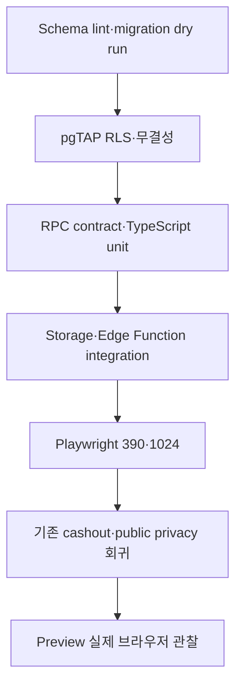

# 해낼게 V2 소셜 바이럴 루프 웹 우선 테스트 계획

| 항목 | 값 |
|---|---|
| 버전 | v1.0.1 |
| 작성일 | 2026-10-13 02:42 KST |
| 작성자/모델 | tech-architect / gpt-5-codex |
| 작업 라인 | v2 |
| 상태 | 개발·QA 실행 계약 |
| 상류 핀 | `fdd-social-viral-loop-web-first-v1.0.1.md`, `erd-social-viral-loop-web-first-v1.0.1.md`, `api-contract-social-viral-loop-web-first-v1.0.1.md` |
| 기반 포맷 | `docs/eng-design/test-plan-social-viral-loop-v0.1.0.md`, `docs/eng-design/test-plan.md` |

> STAMP: 생성 2026-10-13 02:42 KST. 모델 gpt-5-codex. 에이전트 tech-architect. 스킬 docs. 근거는 기존 pgTAP·Vitest·Playwright 구조, 승인 디자인 상태축, Supabase RLS 지침, OWASP token 수명주기다. 가장 오래 고민한 지점은 “각 경로를 테스트”하는 데서 끝내지 않고 어떤 우회 경로로도 FRIENDS·PRIVATE 데이터에 도달하지 못함을 증명하는 fixture를 만드는 일이었다.

> PATCH v1.0.1 사유: D-019 확정에 따라 FRIENDS 승인 커버의 public object 0건, ACTIVE 친구의 private Storage 직접 GET 차단, 120초 Presigned URL 발급을 필수 검증으로 추가했다.

## 목차

- [0. 판정 목표](#0-판정-목표)
- [1. 범위·환경·금지](#1-범위환경금지)
- [2. 테스트 피라미드와 실행 순서](#2-테스트-피라미드와-실행-순서)
- [3. 고정 fixture](#3-고정-fixture)
- [4. pgTAP·SQL 보안 테스트](#4-pgtapsql-보안-테스트)
- [5. 계약·단위 테스트](#5-계약단위-테스트)
- [6. Playwright 경로 테스트](#6-playwright-경로-테스트)
- [7. 동시성·실패주입·Storage](#7-동시성실패주입storage)
- [8. 기존 기능 회귀](#8-기존-기능-회귀)
- [9. 유저플로우 커버리지](#9-유저플로우-커버리지)
- [10. exit gate와 증거](#10-exit-gate와-증거)
- [11. 비범위·미검증](#11-비범위미검증)
- [12. 개정 이력](#12-개정-이력)

## 0. 판정 목표

웹 1차의 완료 조건은 화면 렌더가 아니다. 다음 네 가지가 동시에 참이어야 한다.

1. 초대 생성부터 친구 목록 복귀까지 실제 브라우저 경로가 완주한다.
2. PUBLIC·FRIENDS·PRIVATE 공개범위가 view·RPC·함수·cache·Storage 모든 경로에서 일치한다.
3. 기존 `/me`, `/g/[slug]`, 결제·환전·계좌 마스킹이 변하지 않는다.
4. miniapp gateway의 기존 5개 RPC 계약이 동일 fixture로 통과한다.

## 1. 범위·환경·금지

### 1.1 대상

| 층 | 대상 |
|---|---|
| DB | 4 신규 table, goal 3컬럼, RLS, 9 RPC, 공개 view·wordmap·cache |
| Storage | private quarantine/public bucket, signed upload, PUBLIC approval copy, FRIENDS Presigned URL, cleanup |
| Web | `/me`, `/me/goal/[id]`, `/friends`, `/friends/[friendId]`, `/invite`, `/invite/[token]`, `/g/[slug]`, `/admin` |
| 호환 | miniapp gateway 5 RPC response shape |
| 회귀 | cashout formula·A-lock·REQUESTED·unique·masking, public amount privacy |

### 1.2 환경

- SQL과 E2E는 로컬 Supabase 또는 전용 preview project만 사용한다.
- production URL·project ref·service role이 감지되면 social seed와 destructive test를 즉시 중단한다.
- fixture member·goal·invite·cover는 test namespace와 고정 UUID를 쓴다.
- Playwright는 390x844, 1024x900 두 viewport를 돈다.
- 외부 카카오 로그인은 storage state fixture 또는 test auth adapter로 대체하되, redirect 경로는 별도 smoke한다.
- 이미지 fixture는 repo의 테스트 전용 10KB png·6MB png·확장자 위장 파일을 쓴다.

### 1.3 절대 금지

- 운영 DB에 초대·친구·커버·환전 test row 생성 금지.
- `web/e2e/cashout-manual.spec.ts` 삭제·skip·assert 완화 금지.
- `supabase/tests/cashout_security_hardening.test.sql` 삭제·skip·assert 완화 금지.
- 실제 현금 결제·실지급·운영 환전 신청 금지.
- token·signed URL·access token을 test log·screenshot에 출력 금지.

## 2. 테스트 피라미드와 실행 순서



| 단계 | 명령 계열 | 산출 로그 |
|---|---|---|
| migration | `supabase db reset`, schema diff | `/tmp/haenael-social-db.log` |
| pgTAP | repo의 Supabase test runner | `/tmp/haenael-social-pgtap.log` |
| unit·contract | `npm test`·Vitest | `/tmp/haenael-social-unit.log` |
| build | `heavy-slot.sh npm run build` | `/tmp/haenael-social-build.log` |
| E2E | `heavy-slot.sh npx playwright test ...` | `/tmp/haenael-social-e2e.log` |

출력은 모두 파일로 리다이렉트하고 요약과 실패 부분만 터미널에 표시한다.

## 3. 고정 fixture

| ID | 관계 | 목표 공개범위 | 목적 |
|---|---|---|---|
| M-A | 초대자·goal owner | PUBLIC P1, FRIENDS F1, PRIVATE R1 | owner·공개범위 기준 |
| M-B | A와 ACTIVE 친구 | PUBLIC P2 | friend 허용 기준 |
| M-C | A와 무관계 | 없음 | nonfriend 거부 기준 |
| M-D | A와 REMOVED | 없음 | 관계 해제 거부 기준 |
| M-E | A와 BLOCKED | 없음 | 재초대 우회 차단 |
| I-VALID | A→C, 7일 내, unused | F1 연결 | happy path |
| I-EXPIRED | A→C, 만료 | 없음 | 410 |
| I-USED | A→B, accepted | 없음 | 1회성·replay |
| C-REVIEW | A의 F1 cover | REVIEW | 승인 전 비노출 |
| C-APPROVED | A의 P1 cover | APPROVED | 공개 노출 |

각 공개범위 목표에는 서로 다른 sentinel을 넣는다.

```text
PUBLIC_SENTINEL
FRIENDS_SENTINEL
PRIVATE_SENTINEL
```

제목·이유·wordmap·cover filename에 같은 sentinel을 넣어 결과 전체 검색으로 누출을 검출한다.

## 4. pgTAP·SQL 보안 테스트

권장 파일:

```text
supabase/tests/social_web_first_schema.test.sql
supabase/tests/social_web_first_rls.test.sql
supabase/tests/social_web_first_invite.test.sql
supabase/tests/social_web_first_cover.test.sql
supabase/tests/social_web_first_contract.test.sql
```

### 4.1 Schema·grant

| ID | Given / When / Then |
|---|---|
| PG-01 | Given migration 적용, When catalog 조회, Then 신규 table 4개와 goal 컬럼 3개가 정확한 type·constraint로 존재한다. |
| PG-02 | Given 신규 table, When `pg_class.relrowsecurity` 조회, Then 4개 모두 true다. |
| PG-03 | Given 함수 전수, When `prosecdef`·`proconfig` 조회, Then definer 함수는 search_path 빈 값이고 overload가 0이다. |
| PG-04 | Given grant catalog, When anon 권한 조회, Then preview 외 social 함수 EXECUTE는 0이다. |
| PG-05 | Given existing 15 goal fixture copy, When migration, Then PUBLIC·c1·NULL로 backfill되고 slug·status는 동일하다. |

### 4.2 공개범위·금액 비공개

| ID | Given / When / Then |
|---|---|
| PG-20 | Given P1·F1·R1, When anon이 `goal_public`, `get_wordmap`, cache를 조회, Then PUBLIC_SENTINEL만 도달한다. |
| PG-21 | Given M-B JWT, When list/detail 호출, Then PUBLIC_SENTINEL·FRIENDS_SENTINEL은 보이고 PRIVATE_SENTINEL은 0이다. |
| PG-22 | Given M-C JWT, When A의 목표를 list/detail, Then PUBLIC은 public route에서만 보이고 friend RPC의 F1·R1은 0이다. |
| PG-23 | Given M-D·M-E JWT, When F1 detail 호출, Then `goal_not_found`다. |
| PG-24 | Given 모든 social JSON, When recursive key scan, Then 금지 key가 0개다. |
| PG-25 | Given F1→PRIVATE 전환, When commit, Then cache row 0과 cleanup queue 1건이다. |

### 4.3 친구·초대

| ID | Given / When / Then |
|---|---|
| PG-30 | Given ACTIVE·REMOVED·BLOCKED 관계, When `my_friend_goals`, Then ACTIVE만 반환하고 정렬이 고정된다. |
| PG-31 | Given M-A, When 초대 10개 생성 후 11번째 생성, Then 앞 10개는 256비트 token이고 11번째는 rate limit다. |
| PG-32 | Given VALID·EXPIRED·USED token, When anon preview, Then valid 최소필드만 200, expired·used는 410이다. |
| PG-33 | Given I-VALID, When M-C 수락, Then accepted fields·ACTIVE ordered pair가 각 1행이다. |
| PG-34 | Given A-B ACTIVE, When B가 F1 detail, Then reason·cover·cheer_count·wordmap만 받는다. |
| PG-35 | Given A-B ACTIVE, When B가 remove 후 재조회, Then status REMOVED와 FRIENDS 결과 0건이다. |
| PG-36 | Given self·revoked·blocked·malformed token, When accept, Then 각각 stable error이고 관계 row는 늘지 않는다. |
| PG-37 | Given same accepted token and actor, When retry, Then 같은 connection과 `is_replay=true`다. |
| PG-38 | Given PRIVATE goal 또는 PUBLIC→PRIVATE 전환, When 초대 생성·기존 token preview, Then 새 goal 연결 초대는 거부되고 미사용 기존 초대는 revoked 410이다. |

### 4.4 커버·선호

| ID | Given / When / Then |
|---|---|
| PG-11 | Given owner와 nonowner, When preset 변경, Then owner만 성공하고 c1..c6 외 값은 거부된다. |
| PG-12 | Given REVIEW asset, When DB와 storage policy 조회, Then owner/admin 외 read 0이고 public object 0이다. |
| PG-13 | Given APPROVE·REJECT, When admin review, Then PUBLIC 승인만 public path를 갖고 모든 승인만 active pointer를 가지며 반려는 rejection code를 갖는다. |
| PG-14 | Given APPROVED asset A와 새 asset B, When B 승인, Then B active, A SUPERSEDED, active pointer 1개다. |
| PG-15 | Given FRIENDS asset 승인, When 저장 경계를 조회, Then `public_path`와 public bucket object는 0건이고 private object가 유지된다. |
| PG-16 | Given ACTIVE 친구, When private Storage object path로 직접 GET, Then RLS에 의해 0건 또는 404이고 `friend_goal_detail` 뒤 서버 발급 120초 Presigned URL만 성공한다. |
| PG-40 | Given preference row 없음·있음, When upsert, Then 본인 1행만 변경되고 marketing default false다. |

## 5. 계약·단위 테스트

권장 파일:

```text
miniapp/src/gateway.contract.test.ts
web/src/lib/social/__tests__/contracts.test.ts
web/src/components/social/__tests__/ReceiverBottomNav.test.tsx
web/src/components/social/__tests__/GoalCoverPicker.test.tsx
web/src/components/social/__tests__/InviteAcceptCard.test.tsx
web/src/components/social/__tests__/FriendGoalList.test.tsx
```

| ID | 검증 |
|---|---|
| CT-01 | `my_friend_goals` fixture를 현재 `FriendGoalsResponse`로 읽고 변환한다. |
| CT-02 | `friend_goal_detail`의 `reason`, `cheer_count`, `wordmap`을 현재 gateway가 읽는다. |
| CT-03 | `create_friend_invite`의 `token`, `intoss_path`, `expires_at`을 현재 gateway가 읽는다. |
| CT-04 | `set_goal_cover_preset`의 기존 argument 이름으로 호출한다. |
| CT-05 | `update_member_preferences`의 기존 key로 round-trip한다. |
| CT-06 | preview 응답에 최소 필드 외 key가 있으면 실패한다. |
| CT-07 | accept error code별 카드 상태가 정확하다. |
| CT-08 | remove confirmation 취소 시 RPC 호출 0, 확정 시 1이다. |
| CT-09 | visibility 변경 중 이중 클릭이 RPC 1회다. |
| CT-10 | 5MB 경계, 5MB+1, MIME spoof를 구분한다. |
| CT-11 | finalize REVIEW가 기존 cover를 지우지 않는다. |
| CT-12 | admin approve/reject UI가 stable reason code만 전송한다. |

컴포넌트 공통:

- keyboard focus, accessible name, disabled/loading/error recovery.
- 390px에서 horizontal overflow 0.
- reduced motion에서 정보 손실 0.
- 승인 토큰 외 신규 hex color 0.

## 6. Playwright 경로 테스트

권장 파일:

```text
web/e2e/social-web-first.spec.ts
web/e2e/social-invite.spec.ts
web/e2e/social-privacy.spec.ts
web/e2e/social-cover.spec.ts
```

### 6.1 핵심 경로

| ID | 브라우저 시나리오 | 종료 증거 |
|---|---|---|
| PW-01 | 로그인 후 `/me` 진입 | 상단 알림·기존 목표·4탭 동시 존재 |
| PW-02 | 목표 카드 관리→`/me/goal/[id]` | CheerList·SplitBalanceCard·MyLinkCard·편집 모두 렌더 |
| PW-03 | c1→c3 변경 후 reload·public 확인 | 두 경로 같은 c3 |
| PW-04 | custom upload finalize | REVIEW 안내, 기존 cover 유지, token·signed URL screenshot 0 |
| PW-05 | admin 승인 후 owner·public 확인 | 승인 cover만 보임 |
| PW-06 | PUBLIC→FRIENDS→PRIVATE 변경 | 각 단계 접근 행렬 일치 |
| PW-07 | anon `/g/[slug]` | PUBLIC 200, FRIENDS·PRIVATE는 sentinel 0 |
| PW-08 | 친구 탭 정상·과다 | stable order, 2줄 clamp, overflow 0 |
| PW-09 | 친구 0명 | 정직한 empty와 초대 CTA. 가짜 친구 0 |
| PW-10 | `/invite` 링크 생성·복사 | 복사 feedback, 7일 만료 표기 |
| PW-11 | 새 context로 token 열기 | 최소 preview, no-referrer metadata |
| PW-12 | 비로그인 수락→로그인 | 동일 token route 복귀 |
| PW-13 | 수락 확정 | 성공 후 `/friends`, 새 친구 1명 |
| PW-14 | `/friends` reload | 같은 친구와 목표 유지 |
| PW-15 | friend detail | title·reason·cover·count·wordmap, 금액 text 0 |
| PW-16 | 관계 해제 | 목록 제거, direct detail 거부 |
| PW-17 | 만료·사용·자기초대 | 각 error card와 새 초대 복구 CTA |

### 6.2 UI 계승 회귀

각 viewport에서 다음을 screenshot 비교한다.

- `/me`: 기존 상단바·알림·목표 카드·환전 카드·응원 목록이 유지된다.
- `/me/goal/[id]`: 기존 컴포넌트가 스타일 token을 재사용한다.
- `/g/[slug]`: owner bar·신고·게스트 응원 CTA가 커버 추가 뒤에도 유지된다.
- `/cashout`, `/cashout/history`, `/cashout/status`: 하단 탭 도입이 폼·상태·고정 CTA를 가리지 않는다.
- 390·1024에서 horizontal overflow가 0이다.

## 7. 동시성·실패주입·Storage

권장 스크립트:

```text
supabase/tests/concurrency/accept_friend_invite_race.sh
supabase/tests/concurrency/set_goal_visibility_race.sh
```

| ID | 주입 | 기대 |
|---|---|---|
| CC-01 | 동일 token에 M-C·M-D 동시 accept | 성공 1, used 1, connection 1 |
| CC-02 | 동일 actor 10회 동시 accept | 모두 같은 connection, row 1 |
| CC-03 | visibility PRIVATE 전환과 friend detail 동시 | commit 이후 상세 0, 캐시 0 |
| ST-01 | upload 후 object missing | finalize 404, asset active 아님 |
| ST-02 | MIME spoof | 422, quarantine cleanup 예정, public 0 |
| ST-03 | public copy 실패 | 기존 cover 유지, DB active pointer 불변 |
| ST-04 | DB commit 실패 후 public copy 존재 | compensating cleanup으로 orphan 0 |
| ST-05 | Storage delete 실패 | view 즉시 차단, retry queue 유지, 상태 RETRYING |

## 8. 기존 기능 회귀

### 8.1 현금·환전

| ID | 기존 증거 | 추가 판정 |
|---|---|---|
| REG-CASH-01 | `web/e2e/cashout-manual.spec.ts` | 그대로 PASS. 수정·skip 0 |
| REG-CASH-02 | `supabase/tests/cashout_security_hardening.test.sql` | 그대로 PASS. 수정·skip 0 |
| REG-CASH-03 | formula unit fixtures | fee·vat·withhold·net 전 경계 동일 |
| REG-CASH-04 | pending race | advisory lock, REQUESTED condition, unique 유지 |
| REG-CASH-05 | account display | 기존 masking snapshot 동일 |

공식 계산식:

```text
fee=floor(gross*10/100)
vat=floor(fee*10/100)
withhold=floor((gross-fee-vat)*33/1000)
net=gross-fee-vat-withhold
```

### 8.2 공개 응원

| ID | Given / When / Then |
|---|---|
| REG-PUB-01 | Given anon, When PUBLIC goal 조회, Then cheer_count·message projection만 있고 amount 0이다. |
| REG-PUB-02 | Given owner, When `/me/goal/[id]`, Then 기존 receiver 권한의 응원별 클로버 개수는 유지된다. |
| REG-PUB-03 | Given guest payment, When `/g/[slug]`, Then CTA와 success/fail return route가 유지된다. |

## 9. 유저플로우 커버리지

| FDD step | DB·contract | Playwright | 결과 |
|---|---|---|---|
| WF-01 | PG-05 | PW-01 | 2/2 |
| WF-02 | owner RLS | PW-02 | 2/2 |
| WF-03 | PG-11, CT-04 | PW-03 | 3/3 |
| WF-04 | PG-12, CT-10~11 | PW-04 | 3/3 |
| WF-05 | PG-13~14, CT-12 | PW-05 | 3/3 |
| WF-06 | PG-20·25, CT-09 | PW-06 | 3/3 |
| WF-07 | PG-20 | PW-07 | 2/2 |
| WF-08 | PG-30, CT-01 | PW-08 | 3/3 |
| WF-09 | PG-30 empty | PW-09 | 2/2 |
| WF-10 | PG-31, CT-03 | PW-10 | 3/3 |
| WF-11 | PG-32, CT-06 | PW-11 | 3/3 |
| WF-12 | auth route test | PW-12 | 2/2 |
| WF-13 | PG-33·37, CT-07, CC-01~02 | PW-13 | 4/4 |
| WF-14 | PG-30 | PW-14 | 2/2 |
| WF-15 | PG-21·34, CT-02 | PW-15 | 3/3 |
| WF-16 | PG-35, CT-08 | PW-16 | 3/3 |
| WF-17 | PG-36, CT-07 | PW-17 | 3/3 |

계획 커버리지: FDD 17/17, DB/RPC 17/17, component contract 17/17, browser path 17/17. 설계 단계 매핑 갭 0.

## 10. exit gate와 증거

| Gate | 합격선 | 증거 |
|---|---|---|
| migration | reset·up·rollback rehearsal 0 error | DB log + schema diff |
| RLS | 허용·거부·결과단위 sentinel test 전부 PASS | pgTAP TAP output |
| contract | miniapp 5 RPC shape 5/5 | Vitest output |
| concurrency | duplicate connection 0 | race script row count |
| storage | 승인 전 public 0, PUBLIC 승인 후 1, FRIENDS 승인 후 public 0과 direct GET 차단, 실패 rollback | integration log |
| web build | exit 0 | heavy-slot build log |
| E2E | 17/17 두 viewport, console error 0 | Playwright report·screenshots |
| regression | cashout·public privacy 기존 test 무수정 PASS | git diff + test logs |
| manual observation | 실제 preview에서 invite accept와 cover approval 각 1회 | timestamped screenshot·DB count |

QA는 위 증거 전부를 직접 재검증한다. mock PASS, file exists, build PASS만으로 기능 완료를 선언하지 않는다.

## 11. 비범위·미검증

- 앱인토스 실기기, Toss login, review: 모바일 2차 QA.
- 활동 timeline·achievement·boost: 다음 슬라이스.
- 자동 image moderation 정확도·SLA: 공급자 미선정, 현재 수동 검수.
- production data: 이 계획에서는 변경·관찰하지 않음.

## 12. 개정 이력

| 버전 | 일자 | 변경 | 작성자 |
|---|---|---|---|
| v1.0.1 | 2026-10-13 | D-019 Storage 직접 접근 차단과 Presigned URL 검증 추가 | code-builder / gpt-5-codex |
| v1.0.0 | 2026-10-13 | 웹 1차 RLS·RPC·route·회귀 test plan | tech-architect / gpt-5-codex |

KNOWLEDGE_QUERY: BRAIN에서 공유장벽·신뢰 마찰을 조회. 외부에서 Supabase RLS·보안 함수, PostgreSQL row policy·pgcrypto, OWASP token 만료·재사용 방지를 조회.

HITS_USED: 공개범위 검증을 사용자 노력 없는 마찰이 아니라 신뢰를 위한 보안 마찰로 채택. Supabase의 member/nonmember RLS test 권고와 OWASP의 token 수명주기를 허용·거부 fixture에 반영.

HITS_REJECTED: happy path만 검증하는 화면 중심 테스트는 정의자 권한 우회·Storage 잔존을 못 잡아 미채택. production smoke data 생성은 금전·개인정보 오염 위험으로 미채택.

CONFLICTS: 기존 프로토타입은 시각 상태 전환을 검증하지만 운영 공개범위는 view·함수·Storage까지 지나므로 screenshot만으로 안전을 증명할 수 없다. pgTAP sentinel과 Storage integration을 추가했다.

SKILLS_USED: docs. QA 전달 문서의 목차·테스트 매트릭스·증거 gate에 적용.

SKILLS_SKIPPED: qa 스킬은 “QA를 실제 실행하고 버그를 수정”하는 build 이후 작업이라 설계 단계의 test-plan 작성에는 호출하지 않음.

RUBRIC_SCORE: 완결5 정밀5 벤치5 추적5 톤5 total=25/25

WEAKEST_LINE: "수동 커버 검수의 실제 운영 응답시간은 첫 운영 측정 전까지 미검증이다."

PRESENTATION_CHECK: 내부 태그 잔재 0 / 목차 앵커 PASS / Mermaid test flow 실제 렌더 PASS / 컨트롤러 표시용 창은 열지 않음

SOURCES/MODEL: gpt-5/codex | `fdd-social-viral-loop-web-first-v1.0.0.md`; `erd-social-viral-loop-web-first-v1.0.0.md`; `api-contract-social-viral-loop-web-first-v1.0.0.md`; `docs/eng-design/test-plan-social-viral-loop-v0.1.0.md`; `docs/eng-design/test-plan.md`; `web/e2e/cashout-manual.spec.ts`; `supabase/tests/cashout_security_hardening.test.sql`; `miniapp/src/gateway.test.ts`; `docs/design/prototypes/social-viral-loop-v2-opus48.html`; `~/SJ_BRAIN_wiki/wiki/business/마케팅/concept-공유장벽-선언vs요청-UGC바이럴.md`; `~/SJ_BRAIN_wiki/wiki/business/마케팅/question-전환-마찰-제거인가-신뢰-마찰-추가인가.md`; https://supabase.com/docs/guides/database/postgres/row-level-security; https://supabase.com/docs/guides/database/functions; https://www.postgresql.org/docs/current/ddl-rowsecurity.html; https://www.postgresql.org/docs/17/pgcrypto.html; https://cheatsheetseries.owasp.org/cheatsheets/Forgot_Password_Cheat_Sheet.html
