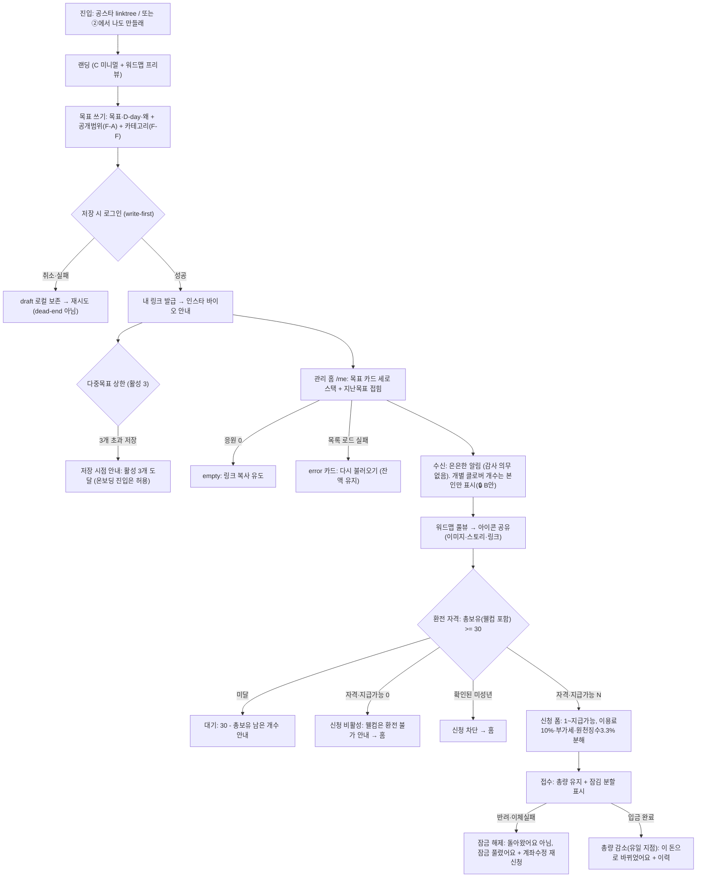
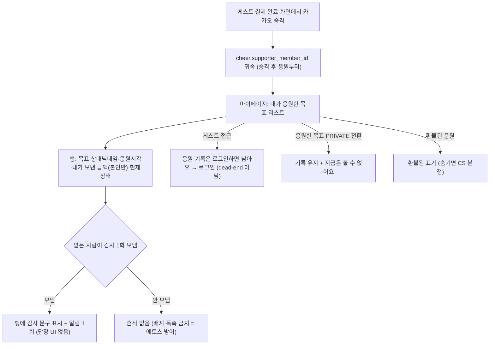
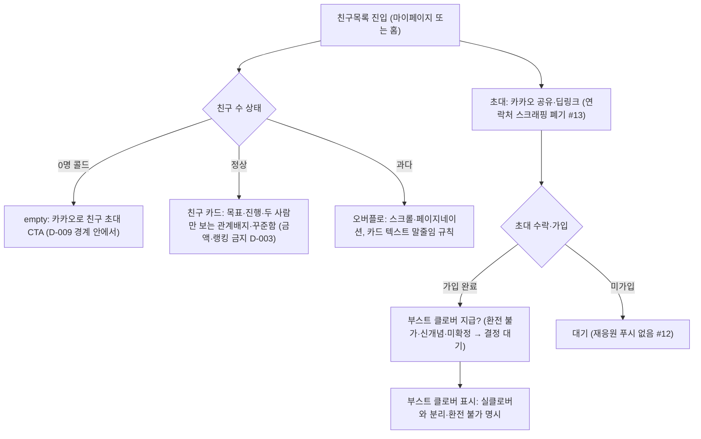
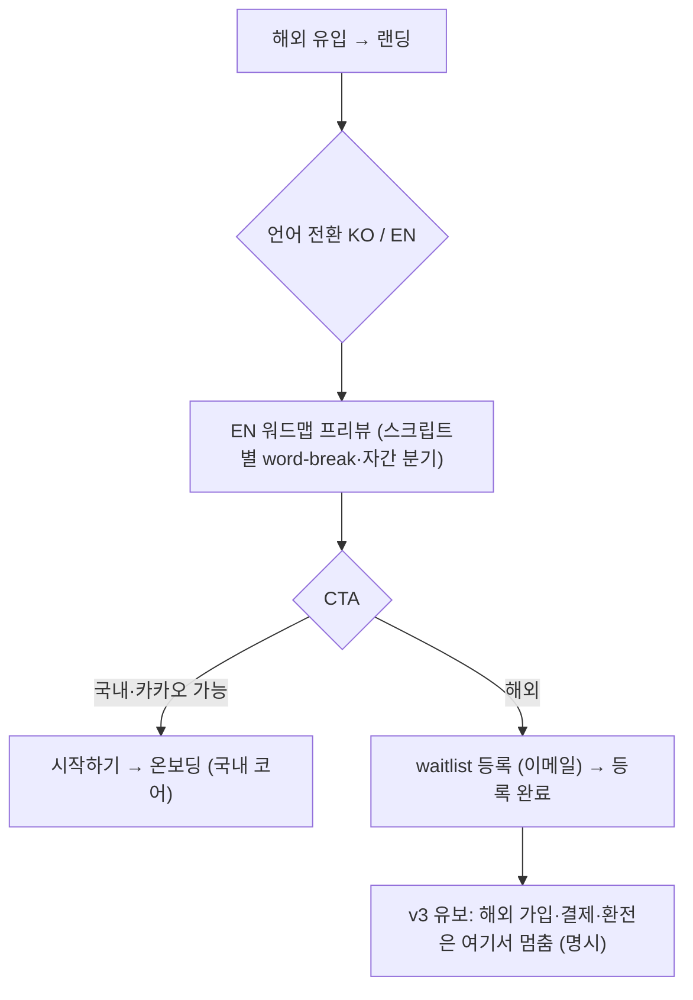

<!-- STAMP
파일: docs/plan/haenael-v2-blueprint-v1.0.0-opus48.md
생성: 2026-09-21 KST · model: claude-opus-4-8 · agent: product-designer
skills: design-consultation(방향 세팅 — 저충실 청사진이라 hi-fi 미생성)
근거: docs/plan/prd-haenael-ge-v0.4.0.md·v0.3.0(F-A~F-F) · docs/eng-design/eng-design-goal-visibility-supporter-v1.0.0-claude-opus.md · docs/plan/haenael-v2-idea-ledger-v1-gpt-codex.md · docs/design/user-flow.md v0.3.1 · docs/plan/one-thing.md · wiki/거버넌스/결정.md(D-003·D-009·D-013~017) · docs/design/prototypes/friends-invite-v1-opus48.html · docs/design/prototypes/landing-wordmap-i18n-v2-opus48.html · docs/design/screen-inventory.md · web/src/app 실라우트
고민 한 줄: 이번 세션이 신규 조각(친구·초대·워드맵·다국어)만 그리고 PRD에 이미 박힌 v2 코어(공개범위·프라이버시·다중목표·응원자경험·마이페이지·카테고리)는 시안이 0인 비대칭을 한 장의 지도로 드러내는 것이 이 문서의 전부다. 새 결정은 만들지 않는다.
성격: plan 단계 기록 문서(청사진). 코드 배포·PRD 정본 수정 없음. HTML 렌더 가능(GitHub Markdown + mermaid).
-->

# 해낼게 v2 통합 청사진 (Blueprint) v1.0.0

> 이 문서는 **한 장의 지도**다. v2에 들어갈 모든 화면을 한자리에 모으고, 각 화면이 지금 어디까지 왔는지(스펙됨·시안됨·빠짐)를 표로 드러낸다.
> **개별 hi-fi 시안이 아니다.** 방향·구조·갭만 담는다. 결정은 회장이 하고, 이 문서는 결정 대기 항목을 "결정 대기"로 표시만 한다.
> 기반 포맷: `docs/design/user-flow.md` v0.3.1(전 경로 열거·dead-end 0 원칙) + `docs/plan/prd-haenael-ge-v0.3.0.md`(F-A~F-F 명세 골격)을 상속.

---

## 0. 왜 이 문서가 필요한가 (문제의식)

이번 세션은 **신규 아이디어의 조각 프로토타입**만 만들었다: 친구목록·연락처 초대·워드맵·다국어 랜딩. 그런데 PRD v0.4.0(계승 v0.3.0)에 **이미 스펙된 v2 코어**는 시안이 하나도 없다: 마이페이지·다중목표 홈·공개범위 설정·항목 프라이버시·응원자 경험·카테고리.

비대칭이 둘이다.
- **PRD에 있는데 시안이 없다** (v2 코어 6종). 개발이 곧 붙어야 하는데 화면 그림이 없다.
- **시안이 있는데 PRD에 없다** (친구 레이어·다국어). 방향은 그려졌지만 정본 스펙이 없다.

이 둘을 하나의 v2 지도로 묶지 않으면 build 단계가 제각각 해석한다. 이 문서가 그 지도다.

---

## 1. v2 범위 경계 (회장 (b) 확정)

> 🔒 회장 확정: **v2 = 국내 코어 완성 + 친구 레이어 + 다국어는 랜딩·waitlist까지.** 해외 코어(카카오 없는 가입·해외 결제·해외 환전)는 **v3로 미룬다.**

### 1.1 포함 (v2 IN)

| 묶음 | 내용 | 근거 |
|---|---|---|
| **국내 코어 완성** | F-A 공개범위 enum · F-B 항목별 프라이버시 · F-C 응원자 경험(내가 응원한 목표·감사 1회) · F-D 동시 다중 목표 · F-E 마이페이지 6항목 · F-F 카테고리 태그 | PRD v0.4.0 §2~6 |
| **친구 레이어** | 친구목록(두 사람만 보는 관계 배지·꾸준함) · 카카오 공유·딥링크 초대 · 부스트 클로버(환전 불가, 신개념·미확정) | idea-ledger #1 발화(2026-09-15)·#11·#13 대체안, 프로토 `friends-invite-v1-opus48.html` |
| **다국어(랜딩·waitlist만)** | 랜딩 KO/EN 전환 · 해외 유입 waitlist 등록 | 프로토 `landing-wordmap-i18n-v2-opus48.html` |

### 1.2 제외 (v3 유보 또는 폐기)

| 항목 | 판정 | 근거 |
|---|---|---|
| 해외 코어 가입(카카오 없는 소셜/이메일) | **v3 유보** | (b) 경계. One Thing이 특정 provider 비의존이나 실경로는 v3 |
| 해외 결제(Stripe 등) · 해외 환전 | **v3 유보** | (b) 경계. 국내 토스·수동정산과 별 트랙 |
| 공개 해낼게 탐색·모르는 사람 응원 커뮤니티 | **v3 이월** | idea-ledger #14, PRD §6.4. v2는 `visibility` 3값·카테고리만 확보하고 공개 피드 미제작 |
| 재응원 "근황 궁금해요" 푸시 | **폐기(#12)** | 조용함 훼손 + 광고성 알림 사전동의 부담 |
| 연락처 스크래핑으로 친구 찾기 | **영구 폐기(#13)** | 웹 주소록 API 부재 + 제3자 무동의. 대체 = 카카오 공유·딥링크 |
| pledge(조건부 후원) · 달성('해냄') 흐름 | **MVP 제외 유지** | user-flow §6. 적립형 즉시 응원만 |
| 후기 모음 | **마케팅 이관(#8)** | 워드맵과 역할 중복·소재 0건 |

> **다국어 경계 주의:** 랜딩·waitlist "까지"다. 해외 사용자가 랜딩에서 EN을 보고 waitlist에 이름을 남기는 데까지가 v2. 그 뒤 실제 가입·결제·환전은 v3. 청사진의 해외 코어 화면은 전부 **"v3 유보"**로 표기한다.

---

## 2. 전체 사이트맵 (v2)

역할(actor) 두 축을 유지한다: **받는 사람(주인공·공급)** 과 **친구(응원자·수요)**. user-flow §0의 "두 행위자 절대 분리"를 계승한다.

```mermaid
graph TD
  ROOT["해낼게 v2"]

  ROOT --> PUB["공개/비로그인 진입"]
  ROOT --> RCV["받는 사람 (로그인·주인공)"]
  ROOT --> SUP["친구 (응원자)"]
  ROOT --> FRD["친구 레이어 (신규·v2)"]
  ROOT --> SYS["운영·정책 화면"]

  PUB --> L1["랜딩 (KO/EN 전환·워드맵 프리뷰)"]
  PUB --> L2["해외 waitlist 등록 (신규·v2)"]
  PUB --> G1["목표 페이지 /g/slug (공유 링크 타깃)"]
  PUB --> G2["결제 시트 (금액·메시지·익명·게스트결제)"]
  PUB --> G3["결제 완료 + 계정 승격 CTA"]
  PUB --> AUTH["로그인 시트 (카카오)"]

  RCV --> H1["온보딩 /onboarding (목표쓰기·공개범위·카테고리)"]
  RCV --> H2["관리 홈 /me (다중목표 리스트·지난목표)"]
  RCV --> H3["목표 상세·수신 (owner bar)"]
  RCV --> H4["워드맵 /wordmap/goalId + 공유"]
  RCV --> H5["공개범위 설정 (F-A)"]
  RCV --> H6["항목 프라이버시 설정 (F-B)"]
  RCV --> H7["감사 1회 보내기 (F-C)"]
  RCV --> CO["환전 /cashout (신청·이력·상태)"]

  SUP --> S1["내가 응원한 목표 (F-C·마이페이지)"]
  SUP --> S2["받은 감사 표시"]

  RCV --> MY["마이페이지 (F-E)"]
  MY --> MY1["알림 + 수신설정"]
  MY --> MY2["프로필 (닉네임·한줄소개)"]
  MY --> MY3["계정관리 (로그아웃·탈퇴)"]
  MY --> MY4["결제·정산 (준비중 뼈대)"]
  MY --> MY5["이용약관·개인정보"]
  MY --> MY6["고객센터 (FAQ·문의폼)"]

  FRD --> F1["친구목록 (관계배지·꾸준함)"]
  FRD --> F2["친구 초대 (카카오 공유·딥링크)"]
  FRD --> F3["부스트 클로버 (환전불가·미확정)"]

  SYS --> Y1["운영자 대시보드 /admin"]
  SYS --> Y2["문의·신고 읽기 큐 (선결조건)"]
  SYS --> Y3["사용법 /how"]
  SYS --> Y4["아동안전 /child-safety"]
  SYS --> Y5["결제 결과 /payment/success·fail"]
```



> 실배포 라우트(`web/src/app`) 실측: `/me` `/g/[slug]` `/onboarding` `/wordmap/[goalId]` `/cashout(/history,/status)` `/admin` `/how` `/child-safety` `/terms` `/privacy` `/auth/*` `/payment/*`. 즉 코어 라우트 골격은 이미 서 있고, v2는 그 위에 **화면 상태(다중목표·공개범위·프라이버시·응원자·마이페이지 확장)를 얹는 작업**이다. 재창조가 아니다.

---

## 3. 유저플로우 (happy / edge / empty / error)

> user-flow §0 계승: 인스타 링크는 항상 **② 목표 페이지**로 떨어진다. 친구는 랜딩(①)에 오지 않는다. 역할 전환은 ②→① 한 방향.

### 3.1 받는 사람 코어 (가입 → 목표 → 링크 → 수신 → 워드맵 → 환전)



### 3.2 친구 응원 결제 (② 목표 페이지 → 조용한 결제 → 승격)

```mermaid
flowchart TD
  A["인스타 링크 클릭 → ② 목표 페이지 (비로그인 열람)"] --> B{"응원 수 상태"}
  B -->|empty 0| B1["첫 응원이에요 초대 카피 (콜드스타트 윤활)"]
  B -->|few 1~5| B2["작은 워드맵 + 첫 응원 문구"]
  B -->|비공개(PRIVATE) 목표| B3["종료·비공개 안내 + 다른 목표 만들기 (404 아님)"]
  B --> C["조용히 밀어줄게 → 결제 시트"]
  C --> D["금액칩(3·5·10천·직접) → 메시지(선택) → 익명(선택)"]
  D --> E{"게스트 결제 (PG)"}
  E -->|시트 닫음| E1["페이지 복귀, 잃는 것 없음"]
  E -->|처리중| E2["시트 로딩 (닫기 잠금·침묵 금지)"]
  E -->|실패| E3["error: 사유 + 다시 시도 + 다른 수단"]
  E -->|성공| F["완료 toast (조용히 닿았어요)"]
  F --> G["하단 subtle: 이 응원 내 기록으로 남길까요? → 카카오 승격 (이 화면 1곳만)"]
  F --> H["하단 subtle: 나도 해낼게 만들래 → ① 온보딩 (역할전환)"]
```

### 3.3 응원자 경험 (승격 후 마이페이지 · 감사 수신) — F-C



### 3.4 친구 레이어 (친구목록 · 초대 · 부스트) — 신규 v2



### 3.5 다국어 랜딩 + waitlist (v2 = 여기까지)



### 3.6 신규 x 기존 접점 (확산 + 친구 레이어 접합)

- **워드맵 확산 고리**(기존): 받는사람 워드맵 공유 → 친구가 스토리 링크 탭 → ② 도착 → 결제 → 워드맵 갱신. 🔒 유지.
- **친구 레이어 접점**(신규): 승격한 응원자가 "친구"가 되면 친구목록에서 서로의 목표·진행을 pull로 본다. 재응원은 **푸시 없이** 친구목록 재방문에서 일어난다(#12 준수).
- **부스트 클로버 x 환전**: 부스트 클로버는 환전 원장에 들어가면 안 된다. 환전 자격(총보유 30)·지급가능 계산에서 **제외**돼야 한다. 웰컴 클로버가 이미 "총보유엔 포함, 지급가능엔 제외"인 구조와 같은 자리에 놓거나, 아예 별 원장으로 둔다(결정 대기, §5).

---

## 4. 갭맵 (화면별 스펙됨 · 시안됨 · 정본반영 · 상태 · 다음 소유자)

> 판정 규칙:
> - **PRD 스펙**: PRD v0.4.0/v0.3.0에 명세가 있는가.
> - **세션 시안**: 이번 세션(2026-09) 또는 legacy 프로토타입에 화면 그림이 있는가.
> - **정본 반영**: 코드(`web/`)·DESIGN.md·eng-design에 실제로 반영됐는가.
> - **상태**: `스펙됨`(스펙 O, 시안 X) / `시안됨`(시안 O) / `빠짐`(둘 다 X 또는 정본 부재).

| # | 화면 | PRD 스펙 | 세션 시안 | 정본 반영 | 상태 | 다음 소유자 |
|---|---|---|---|---|---|---|
| 1 | 랜딩 (C 미니멀+워드맵 프리뷰) | ✅ user-flow §1.1-2 | ✅ legacy `landing-final` + 신규 i18n | 코드 존재 | 시안됨 | build(다국어 얹기) |
| 2 | 다국어 랜딩 KO/EN | ⚠️ PRD 미기재 | ✅ `landing-wordmap-i18n-v2` | 미반영 | 시안됨(스펙 공백) | **plan**(PRD에 다국어 절 신설) |
| 3 | 해외 waitlist 등록 | ❌ | ⚠️ 랜딩 프로토에 CTA만 | 미반영 | **빠짐** | plan → design |
| 4 | 온보딩(목표쓰기+공개범위+카테고리) | ✅ §2·§6.3 | ⚠️ legacy `onboarding-compare`(공개범위·카테고리 필드 없음) | 코드 존재(필드 미반영) | 스펙됨(부분 시안) | design(필드 3종 추가안) |
| 5 | 관리 홈 /me 다중목표 리스트 | ✅ §4.5 | ⚠️ legacy `receiver-manage`(단일목표 전제) | eng-design R2 설계 | **스펙됨(시안 없음)** | **design** |
| 6 | 목표 상세·수신 owner bar | ✅ §1.3 | ✅ legacy `receiver-manage` | 코드 존재 | 시안됨 | build |
| 7 | 워드맵 + 공유 | ✅ §1.1-7 | ✅ legacy `wordmap-share` + 신규 i18n | 코드 존재 | 시안됨 | build |
| 8 | 공개범위 설정 (F-A) | ✅ §2 | ❌ | eng-design R1 설계 | **스펙됨(시안 없음)** | **design** |
| 9 | 항목 프라이버시 설정 (F-B) | ✅ §3 | ❌ | eng-design §5.7 설계 | **스펙됨(시안 없음)** | **design** |
| 10 | 목표 페이지 ② + 결제시트 | ✅ user-flow §2 | ✅ legacy `goal-page`·`payment-flow` | 코드 존재 | 시안됨 | build |
| 11 | 결제 완료 + 계정 승격 CTA | ✅ §5.2 | ⚠️ legacy `payment-flow`(승격 CTA 미반영) | eng-design §6 설계 | 스펙됨(부분 시안) | design(승격 카드) |
| 12 | 응원자 마이페이지 "내가 응원한 목표" | ✅ §5.3 | ❌ | eng-design §6 설계 | **스펙됨(시안 없음)** | **design** |
| 13 | 감사 1회 보내기·받기 (F-C) | ✅ §5.4 | ❌ | 스키마 설계만 | **스펙됨(시안 없음)** | **design** |
| 14 | 마이페이지 6항목 (F-E) | ✅ §6.2 | ⚠️ legacy 프로토 일부(3a·3c·5) | 부분 | 스펙됨(부분 시안) | design(6항목 통합 허브) |
| 15 | 문의·신고 읽기 큐 (선결조건) | ✅ §6.1 | ❌ | `/admin` 일부 | **스펙됨(시안 없음)** | design/build |
| 16 | 카테고리 태그 선택 (F-F) | ✅ §6.3 | ❌ | 미반영 | **스펙됨(시안 없음)** | design(온보딩에 통합) |
| 17 | 환전 신청·이력·상태 | ✅ user-flow §1.1-8 | ✅ legacy `cashout` v3.8·30/27 | 코드 존재 | 시안됨 | build |
| 18 | 친구목록 (관계배지·꾸준함) | ⚠️ PRD 미기재(v3 이월분) | ✅ `friends-invite-v1` | 미반영 | 시안됨(스펙 공백) | **plan**(v2 승격 스펙) |
| 19 | 친구 초대 (카카오·딥링크) | ⚠️ PRD 미기재 | ✅ `friends-invite-v1` | 미반영 | 시안됨(스펙 공백) | plan |
| 20 | 부스트 클로버 | ❌ 미확정 신개념 | ✅ `friends-invite-v1`(열린결정) | 미반영 | **빠짐(결정 대기)** | plan(§5-A 결정 후) |
| 21 | 운영자 대시보드 /admin | ⚠️ MVP 부분해제 | ❌ | 코드 존재 | 시안됨(코드만) | build |
| 22 | 해외 가입·결제·환전 | ❌ | ❌ | 미반영 | **v3 유보** | v3 |

### 4.1 갭맵 한 줄 요약

- **가장 큰 구멍 = "스펙됨(시안 없음)" 7종**: #5 다중목표 홈, #8 공개범위, #9 항목 프라이버시, #12 응원자 마이페이지, #13 감사, #15 문의 큐, #16 카테고리. **PRD·설계는 있는데 화면 그림이 0.** design 단계가 다음에 그릴 1순위.
- **스펙 공백(시안 있음) 3종**: #2 다국어, #18 친구목록, #19 초대. 시안은 앞섰는데 PRD 정본이 없다. plan이 PRD에 절을 신설해야 build가 근거를 갖는다.
- **결정 대기 1종**: #20 부스트 클로버(§5-A).

---

## 5. 미결 결정 목록 (결정 대기 — 임의 확정 금지)

> 이 문서는 결정하지 않는다. 표시만 한다. 각 항목은 회장 판단 대상.

| ID | 결정 대상 | 배경 | 옵션(추천 표시) | 걸린 화면 |
|---|---|---|---|---|
| **A. 부스트 클로버 성격** | 초대 보상을 무엇으로 줄지 | 실클로버 직결은 환전·선불충전금 규제 리스크(risks#1 패스스루 붕괴) | A1(추천) 환전 불가 "부스트 클로버" 별 원장 / A2 보상 없음(관계배지만) / A3 실클로버 소액 | #20 부스트, 환전 원장 |
| **B. v2 정체성 A/B** | 친구 레이어가 "조용한 응원"을 관계 지위로 확장하는데, 정체성 문장을 바꿀지 | idea-ledger 2026-09-15: "응원이 관계적 지위를 만든다" | A(추천) One Thing 유지 + 친구 레이어는 부속 / B 정체성 재정의 | §6, 친구목록 |
| **C. 다중목표 상한 세는 단위** | 활성 3개의 "활성" 정의 | PRD §4.4 추천 3개, 마감·비공개 조합 존재 | C1(추천) 마감 전(진행중)만 카운트 / C2 visibility 무관 전체 | #5 홈, #4 온보딩 |
| **D. visibility 신규 기본값** | 목표 생성 시 기본 공개범위 | eng-design: 기존행 PUBLIC, 신규는 별개(PRD §9-Q1 공개 추천) | D1(추천) PUBLIC + "나만보기 전환" 보조버튼 / D2 FRIENDS(친구 테이블 v2 부재로 사실상 불가) | #8 공개범위, #4 온보딩 |
| **E. 초대 수락 후 친구 관계 모델** | "친구"를 어떤 데이터로 성립시킬지 | v2에 친구 관계 테이블 없음(응원 기반 vs 상호수락) | E1(추천) 상호 응원 기반 자동 / E2 초대·수락 명시 관계 | #18 친구목록, #19 초대 |
| **F. 가벼운 "안돼요·좋아요" 피드백** | 1탭 신호를 별도로 둘지 | idea-ledger #10: 문의 폼에 흡수됐으나 회장 원뜻은 가벼운 반응 | F1(추천) 문의 폼 유지 / F2 1탭 신호 신설 | #14 마이페이지, #15 문의 |
| **G. 프라이버시 설정 진입 위치** | 목표 카드 단독 vs 마이페이지 중복 | idea-ledger 미결 2 | G1(추천) 목표 상세 내부 / G2 양쪽 진입 | #9, #14 |
| **H. 고객센터 실운영 이메일** | help@haenael.app vs 현재 정본 gmail | idea-ledger 미결 3 | 회장 확인 필요 | #14 마이페이지 CS |

> 위 미결은 **user-flow §5 / PRD §9 / idea-ledger §3**의 열린 항목을 v2 범위로 모은 것이다. 새 미결을 발명하지 않았다.

---

## 6. 정체성 영향 노트 (One Thing을 바꾸는가)

> One Thing 정본: **"친구가 선언한 목표에, 그 과정을 조용히 돈으로 응원한다."** 에토스 = 조용함(discreet).

세 신규 축이 One Thing을 바꾸는지 판정한다.

| 신규 축 | One Thing 침범 여부 | 판정 |
|---|---|---|
| **친구 레이어(관계 지위)** | ⚠️ 잠재 충돌 | idea-ledger 2026-09-15가 "응원이 관계적 지위를 만든다"로 한 칸 더 나갔다. **랭킹·금액 노출은 D-003 "지갑은 조용하게"와 정면충돌**한다. 프로토는 이를 두 사람만 보는 횟수·꾸준함 배지로 우회해 에토스를 지켰다. **판정: One Thing 문장은 유지(결정 B-A 추천). 단 친구목록에서 금액·순위 랭킹이 들어오는 순간 정체성 위반이므로 배지는 관계·꾸준함만.** |
| **부스트 클로버** | ⚠️ 존립 조건 충돌 가능 | 응원자에게 잔액을 쥐여주면 선불충전금 보유 → risks#1 패스스루 붕괴(PRD §5.1 존립 조건). **판정: 실클로버 직결 금지. 환전 불가 별 원장이어야 One Thing과 존립 조건 둘 다 산다(결정 A-A1 추천).** |
| **다국어(랜딩·waitlist)** | ✅ 무영향 | 언어 전환은 유입 표면일 뿐 관계·결제 모델 불변. One Thing은 provider·언어 비의존(one-thing.md §운영계약). **판정: 정체성 변경 없음.** |

**결론: One Thing 한 문장은 바꾸지 않는다.** 바뀔 위험이 있는 자리는 단 두 곳 — ①친구목록의 배지가 금액·랭킹으로 흐르면 D-003 위반 ②부스트가 환전 가능해지면 존립 조건 붕괴. 이 두 가드레일을 DESIGN.md·PRD에 명문화하는 것이 정체성 방어의 전부다.

---

## 7. 다음 단계 (이 청사진이 지목하는 것)

1. **plan**: PRD에 3개 절 신설 — 다국어(랜딩·waitlist), 친구 레이어(친구목록·초대), 부스트 클로버(결정 A 이후). 미결 A~H를 회장 결정 큐로.
2. **design**: "스펙됨(시안 없음)" 7종을 화면 시안으로. 1순위 = #5 다중목표 홈, #8·#9 공개범위·프라이버시(eng-design R0~R1 순서 준수), #12·#13 응원자·감사.
3. **build**: 이미 시안·설계가 선 코어(#6·#7·#10·#17)에 v2 상태 얹기. eng-design R0(공개범위 스키마+pgTAP) → R1(설정 화면) → R2(다중목표) 순서 고정.

> 순서 근거: eng-design가 "공개범위 스키마를 한 마이그레이션에서 닫고 pgTAP 통과 뒤에만 UI"라고 못박았다. 화면을 먼저 그리되 build는 그 순서를 따른다.

---

SKILLS_USED: design-consultation — 저충실 청사진의 방향(시니어 디자이너 관점·리서치 근거·IA 일관성) 세팅에 사용. hi-fi 화면 생성 단계(Phase 5~6)는 청사진 성격상 미실행.
SKILLS_SKIPPED: design-shotgun·design-html·design-review — 시각 산출물이 아니라 IA/플로우/갭 문서라 화면 변형·목업·시각 QA 대상이 없음.

STAMP: line=core · 생성=2026-09-21 KST · model=claude-opus-4-8 · agent=product-designer · skills=design-consultation · 근거=PRD v0.4.0/v0.3.0·eng-design v1.0.0·idea-ledger v1·user-flow v0.3.1·one-thing·결정.md·신규 프로토 2종·실라우트 · 고민=PRD에 있는데 시안 없는 v2 코어 7종과 시안 있는데 PRD 없는 신규 3종의 비대칭을 한 지도로 드러냈다.

SOURCES/MODEL: claude-opus-4-8 · docs/plan/prd-haenael-ge-v0.4.0.md · docs/plan/prd-haenael-ge-v0.3.0.md · docs/eng-design/eng-design-goal-visibility-supporter-v1.0.0-claude-opus.md · docs/plan/haenael-v2-idea-ledger-v1-gpt-codex.md · docs/design/user-flow.md v0.3.1 · docs/plan/one-thing.md · wiki/거버넌스/결정.md(D-003·D-009·D-013~017) · docs/design/prototypes/friends-invite-v1-opus48.html · docs/design/prototypes/landing-wordmap-i18n-v2-opus48.html · docs/design/screen-inventory.md · web/src/app 실라우트 목록

KNOWLEDGE_QUERY: 로컬 정본 실독(PRD v0.4.0 헤더·v0.3.0 F-A~F-F 본문·eng-design 화면변경절·idea-ledger 전문·user-flow 전문·one-thing 전문·결정.md D-003/D-009/D-013~017·신규 프로토 2종 STAMP·screen-inventory·web 라우트 트리). 외부 웹 벤치마크는 저충실 IA 문서라 신규 방향 조회 불요(§2.3 면제: 이미 정해진 스펙 통합).
HITS_USED: PRD F-A~F-F(v2 코어 스펙 정본) → 갭맵 스펙 판정 근거. eng-design R0~R2·화면변경절 → 다음단계 순서·정본반영 판정. idea-ledger #1·#8·#10~14·미결 3종 → 신규축·미결·제외 판정. user-flow §0·§5 → 두 행위자 분리·dead-end 플로우 골격. 결정.md D-003 → 정체성 가드레일(금액·랭킹 금지). one-thing → 정체성 영향 판정.
HITS_REJECTED: cashout 30/27 세부 계약·welcome clover 마이그레이션은 환전 별 트랙이라 청사진에선 플로우 노드로만 요약하고 계산식 상세는 인용 안 함(user-flow가 이미 정본). DESIGN.md 토큰·globals.css는 저충실 청사진에 불요.
CONFLICTS: 없음. 웹 벤치마크 미조회(면제 대상)라 회장 정본과 충돌 지점 없음. 단 내부 비대칭 2건을 드러냄(시안 있는데 PRD 없는 신규 3종 vs PRD 있는데 시안 없는 코어 7종) — 이는 충돌이 아니라 이 문서가 지목하는 갭.
