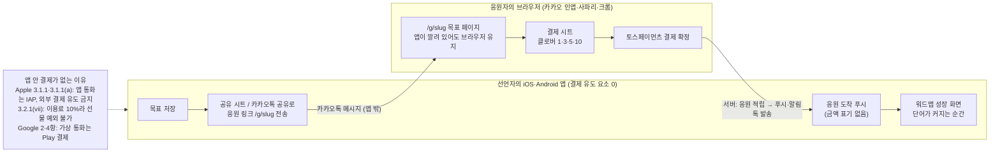

# 해낼게 V2 앱 채널 PRD v0.1.2 (iOS · Android · 앱인토스)

| 항목 | 값 |
|---|---|
| 문서 | `docs/plan/prd-app-channels-v0.1.2-claude-opus-20261116-1827.md` (line: v2) |
| 버전 | 0.1.2 (직전 0.1.1, 독립 재검수 19/25 경미 반려 반영) |
| 상태 | draft, 재검수 대기. 범위는 기획까지(화면 설계 = 디자이너, API·DB·폴더 = 기술설계에서 회장 합의 후) |
| 작성 | 2026-11-16 19시대 KST · claude-opus-5-5 · prd-architect |
| 상류 버전핀 | 청사진 `haenael-v2-blueprint-v1.0.0-opus48.md`(1.0.0 승인) · 프로토타입 `social-viral-loop-v3-opus5.html`(3.0.0 승인) · 운영 릴리스 2.3.0(운영)·2.3.1(후보) · 결정 D-018·D-021·D-049·OD-001 |
| 근거 | `docs/plan/refs/app-channels-v0.1.0-claude-opus-20261116-1807/*-excerpt.md` (Apple·Google·앱인토스 공식 원문, 2026-11-16 조회) |
| 기반 포맷 | `docs/plan/prd-haenael-ge-v0.4.0.md` 의 표·AC 구조 + `standard-doc-review.md` 표준 섹션 |
| 고민 | 클로버 후원이 스토어 정책상 '돈 선물'로 인정받을 수 있는지가 문서 전체를 좌우한다. 10% 이용료 때문에 Apple 선물 예외(100% 수령자)를 못 쓴다는 판정이 출발점이다. |

**화면 기준(D-049).** 앱 화면의 정본은 승인 프로토타입이다. 현재 승인본 v3 에는 운영 2.3.0 회장 피드백 변경(카카오톡 공유, 초대 미리보기, 프로필 펜 통합, 마감 지난 목표 D+N, 로그인 뒤 원래 화면 복귀, 결제창 높이 수정)이 없고, 별도 디자이너가 그 변경을 역반영한 **v3 다음 버전**을 만드는 중이다. 이 PRD 의 앱 화면 기준은 그 다음 버전이다. 다음 버전이 승인되기 전까지 범위 판정(무엇을 넣고 빼나)은 운영 2.3.x 동작으로 했고, 화면 그림의 기준으로 운영 캡처를 쓰지 않는다.

## TL;DR

- **결론:** iOS·Android 는 운영 웹을 Capacitor 로 감싸고 네이티브 기능(푸시·딥링크·공유·Apple 로그인·오프라인 화면·소유 증명)을 붙여 낸다. **앱 안에서는 클로버 결제를 하지 않는다.** 응원 결제는 친구가 카카오톡에서 연 웹 링크에서만 일어난다. 앱인토스는 기존 미니앱을 V2 화면으로 갱신하되 결제·환전·잔액을 모두 뺀다.
- **왜:** 환전 때 10% 이용료를 떼므로 Apple 의 개인 간 선물 예외(3.2.1(vii) "100% of the funds")를 못 쓴다. 앱에서 팔면 인앱결제뿐이고 수수료는 15~30% 다. 응원자는 앱이 아니라 링크로 들어오므로 앱 결제를 빼도 손실이 작다.
- **함정 하나:** 응원 링크 `/g/*` 를 앱 딥링크로 가로채면 결제가 사라진다. 그래서 `/g/*` 는 앱 연결 대상에서 뺀다.
- **회장 결정 3건:** ①앱 결제 제외(돈) ②앱인토스 한정 무료 "응원 한마디"(정체성) ③스토어 명의·앱 이름·번들 ID(비가역).
- **실패 판정:** 8주 뒤 앱 선언자 D7 재방문 +5%p 미만이고 푸시 허용 40% 미만이면 앱 신규 개발 중단(K-1) 외 3건.

## 목차

- [용어 정의](#용어-정의)
- [0. 이번 버전 핵심 가치 카드](#0-이번-버전-핵심-가치-카드)
- [1. 현재 상태](#1-현재-상태-위키문서운영-기준)
- [2. 채널별 범위표](#2-채널별-범위표)
- [3. 심사 정책 위험과 클로버 판정](#3-심사-정책-위험과-클로버-판정)
- [4. 구조 선택지](#4-구조-선택지-iosandroid)
- [5. 앱 전용 화면·흐름 목록](#5-앱-전용-화면흐름-목록-디자이너-입력)
- [6. 기능 요구와 수용 기준](#6-기능-요구와-수용-기준)
- [7. 성공 지표와 kill criteria](#7-성공-지표와-kill-criteria)
- [8. 반론·사전 부검·레드팀](#8-반론사전-부검레드팀)
- [9. 회장 결정 항목](#9-회장-결정-항목-돈정체성비가역만)
- [10. 업계 사례](#10-업계-사례-응원후원형-앱의-스토어-결제-처리)
- [11. 7원칙 판정표](#11-7원칙-판정표-standard-planning-2)
- [12. 레퍼런스 사용 기록](#12-레퍼런스-사용-기록)
- [13. 오픈 이슈](#13-오픈-이슈)
- [14. 개정 이력](#14-개정-이력)

## 용어 정의

| 용어 | 정의 |
|---|---|
| 클로버 | 해낼게의 응원 단위. 1클로버 = 1,000원. 응원자가 결제하면 받는 사람 계정에 즉시 쌓이고, 총보유 30 이상에서 원화로 환전 신청한다(bm.md §1) |
| 응원 결제 | 응원자가 클로버를 사서 목표에 보내는 결제. 웹에서 토스페이먼츠로 처리 |
| 환전 | 받은 클로버를 원화로 바꿔 계좌로 받는 것. 이용료 10% + 그 부가세 + 원천징수 3.3% 차감 |
| 응원 한마디 | (회장 결정 2 후보) 돈 없이 문구만 남기는 응원. 클로버 0 |
| 결제 유도 요소 | 결제 버튼, 클로버 금액 칩, 결제 시트, 결제 안내 문구, `/payment/*` 이동, 앱 밖 결제로 보내는 링크·문구. FR-APP-01 이 앱 안에서 0개를 요구하는 대상 |
| 선언자 | 목표를 쓰고 응원 링크를 퍼뜨리는 회원 |
| 응원자 | 링크를 받고 응원 결제를 하는 사람. 대부분 비회원 손님 |
| write-first | 목표를 먼저 쓰게 하고 저장하는 순간에 로그인을 요구하는 흐름. 로그인을 취소해도 쓴 초안은 남는다 |
| D-003 | 결정 원장 항목: "선언과 인원수는 보이게, 지갑은 조용하게". 금액·순위를 남에게 보이지 않는다 |
| D-049 | 결정 원장 항목: V2 화면 정본은 승인 프로토타입 |
| OD-001 | 결정 원장 미결 항목: 앱인토스 미니앱에 환전을 실을 수 없다(정책 원문 확인) |
| K-1~K-4 | 이 문서 §7 의 kill criteria 번호 |
| FR-APP-nn / FR-TOSS-nn | 이 문서의 기능 요구 번호(앱 공통 / 앱인토스) |
| A1~A10 / T1~T5 | §5 화면 ID(앱 / 앱인토스) |
| C안 | §3.3 선택지 C: 앱에서 결제 제외, 응원 결제는 웹 링크에서만 |
| 1안 | §4 구조 선택지 1: Capacitor 감싸기 + 네이티브 기능 묶음 |
| 유니버설 링크·앱 링크 | iOS·Android 에서 특정 웹 주소를 누르면 설치된 앱이 대신 열리게 하는 OS 기능 |
| IAP | In-App Purchase. 스토어(Apple·Google)의 인앱 결제 |

---

## 0. 이번 버전 핵심 가치 카드

| 칸 | 내용 |
|---|---|
| 목표 한 문장 | 웹 V2 의 "목표 선언 → 친구 응원 → 쌓임 → 공유" 루프를 설치형 채널에 올리되, **돈이 오가는 칸은 웹에 남겨** 심사 반려 없이 첫 출시를 통과한다. |
| 철학 | 앱은 목표를 선언한 사람의 도구다. 응원하는 친구는 카카오톡 링크로 들어와 웹에서 결제한다. 앱이 그 결제 경로를 빼앗지 않게 링크 라우팅을 설계한다. |
| 북극성 지표 | 주간 응원 받은 목표 수(웹·앱 합산). 앱 채널의 기여 = 앱에서 선언·관리된 목표가 받은 웹 응원 수. |
| 제약 | ①Apple 3.1.1·3.1.1(a): 미국 밖 스토어에서 IAP 외 결제로 보내는 버튼·링크 금지 ②Apple 4.2·Google 웹뷰 스팸 정책: 웹 감싸기만 한 앱 반려 ③앱인토스 3의2: 현금·유사 자산 교환 금지, SSR 금지, 토스 로그인만 ④1인 CEO, 개발은 11-18 13:03 Codex 재개 뒤, 해낼게는 회장 우선순위 2등급 |
| 고유명사 문장(positioning 칸 9) | "우리 서로 해낼게하자" = 각자 목표를 선언하고, 서로의 과정에 조용히 클로버를 두고 가는 것. 스토어 부제·첫 화면·푸시 문구에 이 입말을 쓴다(최종 카피는 content-growth-marketer). |

**건드리는 욕망·채우는 결핍.**
- 선언자: "누가 내 과정을 보고 있다"는 확인이 필요하다. 웹은 그 확인이 알림톡과 재방문에 묶여 있다. 앱은 응원이 닿는 순간을 잠금화면 푸시로 바로 준다.
- 응원자: 기프티콘·DM 은 껄끄럽다. 조용히 마음을 두고 가는 손쉬운 경로가 필요하다. 이 욕구는 카카오톡 링크에서 생기므로 결제는 웹에 둔다.

**돈을 내는 순간.** 친구가 카카오톡에서 응원 링크(`/g/[slug]`)를 열고 목표 문장과 워드맵을 본 직후다. 이 순간은 앱 밖(카카오 인앱 브라우저·사파리·크롬)에서 일어난다. 그래서 앱에서 결제를 빼도 매출 손실이 작다(근거: §3.4).

**퍼널 칸.** 앱은 관심→신뢰 칸의 재방문(리텐션)과 바이럴(공유) 칸을 맡는다. 결제 칸은 웹이 맡는다.

---

## 1. 현재 상태 (위키·문서·운영 기준)

| 영역 | 현재 상태 | 출처 |
|---|---|---|
| iOS 앱 | 없음. 기획·디자인·코드 0. Apple 로그인 버튼은 웹 코드에 숨김 상태로 보존("앱 출시 시 부활 예정") | `web/src/components/auth/LoginSheet.tsx:81·199` |
| Android 앱 | 없음. 기획·디자인·코드 0 | 레포 검색 결과 0 |
| 앱인토스 미니앱 | V1 시기(10-06) Vite+React CSR 미니앱. 결제·환전·금액·잔액·순위 제외. 토스 로그인용 `auth-toss` 서버 계약이 레포에 없어 실로그인·라이브 데이터 미동작. V2 화면(워드맵·목표 관리·마이·업적·친구 상세·8종 사진 커버) 미반영 | `miniapp/README.md`, D-018, OD-001 |
| 앱인토스 사전문의 | 초안만 있음, 미발송(회장 결정 대기) | `docs/growth/appintoss-pre-inquiry-v0.1.0.html`, `pipeline-state.v2.md:343` |
| 웹 PWA | manifest·서비스워커 있음(설치형 웹) | `web/src/app/manifest.ts`, `web/public/sw.js` |
| 알림 | 응원 도착은 카카오 알림톡(솔라피). 기기 푸시 없음 | `supabase/functions/_shared/alimtalk.ts` |
| 카카오 공유 | 2.3.0 운영 반영(카카오 JS 키 설정 시) | RELEASE.md 2.3.0 ships |
| 계정 탈퇴 | 웹에 있음 | `AccountWithdrawalButton` 생성 카피 |
| 클로버 결제 | 웹 토스페이먼츠, 1클로버 = 1,000원, 프리셋 1·3·5·10 | `CheerPaymentButton.tsx:14`, bm.md §1 |
| 같은 회사 선례 | 경제링고: iOS 심사 제출·앱인토스 검토 중(11-16), Android 는 Play "Webviews and Affiliate Spam" 정지 후 이의 2회 기각. 로미오: 앱인토스 2.0.0 이 "토스 로그인 외 자체 로그인" 으로 반려 | `~/.claude/harness/open-decisions.md` |

위키(`wiki/`)에 앱 채널 현황 페이지가 없다. 이번 판단은 결정 원장·RELEASE·README·하네스 결정 원장으로 했고, 코드 grep 은 Apple 로그인 숨김·푸시 부재·탈퇴 존재 세 가지만 키워드로 확인했다.
⛔ 회수 필요(기록 결손): 위키에 앱 채널 현황 미기록. ship 때 `wiki/cto/제품현황/status-haenael-ge.md` 에 채널 상태를 남겨야 한다(release-and-artifacts §5).

---

## 2. 채널별 범위표

표기: 포함 / 제외 / 신규 / 변경. "현재 상태" 는 §1 기준.

| 웹 V2 기능 | 현재 상태 | iOS | Android | 앱인토스 | 근거 |
|---|---|---|---|---|---|
| 목표 선언·홈·다중 목표·목표 관리 | 웹 운영 | 포함 | 포함 | 포함(V1 화면을 V2 로 갱신) | D-049 |
| 워드맵 풀뷰·공유 아이콘 | 웹 운영 | 포함 | 포함 | 포함 | D-049 |
| 친구 목록·친구 상세(주고받은 응원) | 웹 운영 | 포함 | 포함 | 포함 | D-024, D-050 |
| 초대 링크·초대 수락 | 웹 운영 | 포함(딥링크로 앱에서 열기) | 포함(앱 링크) | 변경(토스 공유 `intoss://` 링크) | 체크리스트 공유 항목 |
| 마이페이지·업적·환경설정·탈퇴 | 웹 운영 | 포함 | 포함 | 포함(탈퇴는 토스 연결 해제 포함, 기술설계) | Apple 5.1.1(v) |
| **클로버 후원 결제(응원 보내기)** | 웹 운영, 토스페이먼츠 | **제외(1차)** | **제외(1차)** | **제외** | §3 판정 |
| 클로버 잔액·분할 잔액 표시 | 웹 운영 | 포함(받은 사람 본인만) | 포함 | **제외** | 앱인토스 3의2, D-003 |
| 환전 신청·진행·내역 | 웹 운영 | 포함(위험 주석 §3.3) | 포함 | **제외** | OD-001 |
| 카카오 로그인 | 웹 운영 | 포함(시스템 브라우저 인증) | 포함 | **제외**(토스 로그인만) | 앱인토스 2-3 |
| Apple 로그인 | 숨김 보존 | **신규 노출(필수)** | 선택 | 제외 | Apple 4.8 |
| 토스 로그인 | 없음 | 제외 | 제외 | **신규(필수)** | 앱인토스 2-3, 로미오 반려 |
| 카카오톡 공유 | 웹 운영 | 포함 | 포함 | 제외(토스 공유로 대체) | 체크리스트 "자사 서비스 이동 유도 금지" |
| 기기 푸시 알림 | 없음 | 신규(응원 도착·환전 상태·친구 맺어짐) | 신규 | 미정(토스 스마트 메시지 조건 미검증) | Apple 4.5.4 |
| 응원 한마디(돈 없이 문구만) | 없음 | 제외 | 제외 | **신규 후보(회장 결정 2)** | §3.5 |
| 관리자(/admin) | 웹 운영 | 제외 | 제외 | 제외 | 데스크톱 운영 도구 |
| 랜딩·이용안내 | 웹 운영 | 변경(첫 실행 소개 1화면) | 변경 | 변경(토스 로그인 인트로) | 체크리스트 인트로 항목 |
| 약관·개인정보 | 웹 운영 | 포함 | 포함 | 포함(정적 번들) | 스토어 공통 |
| 업데이트 기록·한 줄 의견(`/updates`) | 웹 운영(2.2.0·2.3.0) | 포함 | 포함 | 포함(의견 전송은 서버 함수 호출, 외부 이동 없음) | RELEASE 2.2.0·2.3.0 |
| 아동안전(`/child-safety`) | 웹 운영 | 포함(스토어 아동안전 정책 링크로도 사용) | 포함 | 포함(정적) | 스토어 공통 |

**코드 기능 이름 대조(feature-drop-check 기준 19개 중 화면 이름).** onboarding(목표 선언) · wordmap(워드맵) · friends(친구) · achievements(업적) · history(환전 내역: iOS·Android 포함, 앱인토스 제외) · legal(`/my/legal` 사업자·법적 고지) · terms · privacy · child-safety · updates 는 위 표대로 iOS·Android 에 모두 포함한다. 앱인토스는 history 만 제외하고 나머지를 포함한다. payment·cashout·admin 의 제외 사유는 §3·위 표에 있다.

**유지·개선·교체·신규 판정 요약.** 유지 = 목표·워드맵·친구·마이(웹 그대로). 개선 = 로그인(채널별 필수 로그인), 초대(채널별 링크). 교체 = 앱인토스 미니앱 V1 화면 → V2. 신규 = 푸시, 딥링크, 스토어 리뷰 요청, 첫 실행 소개, 오프라인 화면, 토스 로그인, (결정 시) 응원 한마디.

---

## 3. 심사 정책 위험과 클로버 판정

원문은 `docs/plan/refs/app-channels-v0.1.0-claude-opus-20261116-1807/*-excerpt.md` 에 저장했다. 조회일은 모두 2026-11-16 18시대 KST.

### 3.1 정책 원문 (판정에 쓰는 문장만)

| 정책 | 원문 | 우리에게 뜻하는 것 |
|---|---|---|
| Apple 3.1.1 | "If you want to unlock features or functionality within your app, (by way of example: subscriptions, in-game currencies, ...) you must use in-app purchase." / "Apps may use in-app purchase currencies to enable customers to "tip" the developer or digital content providers in the app." | 앱 안에서 파는 통화(클로버)는 IAP. 후원을 IAP 통화로 하는 것은 허용 |
| Apple 3.1.1(a) | "In all other storefronts, except for the United States storefront, ... apps and their metadata may not include buttons, external links, or other calls to action that direct customers to purchasing mechanisms other than in-app purchase." | 한국 스토어 앱에서 "웹에서 응원하기" 버튼·링크·문구 금지 |
| Apple 3.1.3 머리말 | "The following apps may use purchase methods other than in-app purchase. Apps in this section cannot, within the app, encourage users ... Developers can send communications outside of the app to their user base about purchasing methods other than in-app purchase." | **이 문장은 3.1.3(a)~(g) 유형 앱(리더 앱·멀티플랫폼 서비스 등)에 대한 것이다.** 해낼게가 그 유형이라는 근거는 없으므로 앱 밖 안내가 허용된다는 보장은 없다. 그래서 앱 안 결제 유도를 0으로 만들어 위험을 낮추고, 앱 밖 안내(알림톡·카카오톡 링크)는 응원자(앱 비사용 제3자)에게 가는 기존 웹 흐름으로만 둔다 |
| Apple 3.1.3(d) | "real-time person-to-person services between two individuals (for example tutoring ...)" | 실시간 1:1 서비스가 아니므로 해당 없음 |
| Apple 3.1.5 | "Cryptocurrencies: (i) Wallets ... (v) ..." | **암호화폐 조항이다.** 브리프의 "3.1.5 기부 예외"는 오기. 실제 선물·기부 조항은 3.2.1(vii)·3.2.2(iv) |
| Apple 3.2.1(vii) | "Apps may enable individual users to give a monetary gift to another individual without using in-app purchase, provided that (a) the gift is a completely optional choice by the giver, and (b) 100% of the funds go to the receiver of the gift. However, a gift that is connected to or associated at any point in time with receiving digital content or services must use in-app purchase." | 환전 때 이용료 10%+부가세를 떼므로 (b) 불충족. 응원이 워드맵 성장(디지털 반응)과 연결돼 단서 조항에도 걸릴 수 있음 |
| Apple 3.2.2(iv) | "... collecting funds within the app for charities and fundraisers. Apps that seek to raise money for such causes must be free on the App Store and may only collect funds outside of the app, such as via Safari or SMS." | 개인 목표 후원을 '모금'으로 읽으면 앱 안 결제 자체가 금지되고 앱 밖 수금만 허용. 해석 갈림 |
| Apple 4.2 | "Your app should include features, content, and UI that elevate it beyond a repackaged website." | 웹 감싸기 반려 위험 |
| Apple 4.8 | 소셜 로그인을 쓰면 "must also offer as an equivalent option another login service" (이름·이메일만, 이메일 비공개 가능, 광고 추적 없음) | 카카오 로그인 → Apple 로그인 노출 필수 |
| Apple 한국 외부 결제 권한 | "Apple will charge a 26% commission" / "can only be used with a new binary distributed solely on the South Korea storefront" / "cannot be used in the same app with Apple's in-app purchase system" | 대체 결제도 26%. 번들 ID 를 처음 낼 때 정해야 함(비가역) |
| Google Play Payments 2항 | "Items (such as virtual currencies, ...)" | 가상 통화는 Play 결제 대상 |
| Google Play Payments 3항 | "Google Play's billing system must not be used in cases where: ... payments include peer-to-peer payments, online auctions, and tax exempt donations;" | 개인 간 송금으로 인정되면 Play 결제를 쓰면 안 되고 토스페이먼츠 사용 가능 |
| Google Play Payments 5항 | "In-app virtual currencies must only be used within the app or game title for which they were purchased." | 클로버는 현금으로 환전되므로 '가상 통화'로 보면 이 조항과 충돌 |
| Google 한국 대체 결제 | "the Google Play service fee will be reduced by 4%." | 대체 결제도 수수료가 남음 |
| Google 웹뷰 스팸 | "We don't allow apps whose primary purpose is ... provide a webview of a website without permission from the website owner or administrator." | 경제링고 정지 사유. 소유 증명(Digital Asset Links)과 네이티브 기능이 방어 |
| 앱인토스 2-3 | "디지털 상품(비실물) 결제는 인앱 결제만 쓸 수 있어요." / "미니앱 안 로그인은 토스 로그인만 쓸 수 있어요." | 토스페이먼츠 결제 불가, 카카오 로그인 불가 |
| 앱인토스 3의 2) | "미니앱 안에서 현금이나 유사 자산을 직접 교환·전환·환불하는 기능이 포함되면 ... 등록할 수 없어요." | 환전 제외(OD-001 재확인). 잔액 표시 제외는 이 조항보다 넓은 보수적 해석(§3.2 주석) |
| 앱인토스 3의 5) 금융 서비스 및 송금 관련 서비스 | "대출·보험·카드·증권 등 금융 상품 관련 서비스는, 법적 인허가 여부와 관계없이 ... 등록할 수 없어요." | 조항 제목이 "송금 관련"을 포함한다. 응원 결제 → 쌓임 → 환전 전체가 송금 구조로 읽힐 수 있어 OD-001 이 이 조항을 근거로 들었다. 본문 예시는 금융 상품 중심이라 직접 적용 여부는 해석이다 |
| OD-001 권고(사내 결정) | "**'목표 둘러보기·응원 메시지 남기기'처럼 금전이 들어가지 않는 기능으로 선언해야 완결성이 성립한다.**" | 2-2 완결성의 근거. 결정 2(응원 한마디)가 이 권고를 기능으로 만든 것 |
| 앱인토스 체크리스트 | "링크나 컴포넌트로 자사 서비스 이동이나 자사 앱 설치를 유도하지 않아요." / "서버 사이드 렌더링(SSR)은 사용할 수 없어요." | 웹 결제로 보내는 우회 금지, D-021 재확인 |
| 앱인토스 §4 | 조건부 서비스 = 웹보드 게임, 만남·소개팅, AI 채팅·상담, 채팅, 중고거래 | 후원·기부 항목이 없다. 금지 업종 목록에 '후원'이 직접 있지는 않다(관찰) |

### 3.2 클로버 후원은 "디지털 재화"인가 "개인 간 금전 지원"인가

**제품 사실(bm.md §1, 운영 계약).** 응원자가 1클로버 = 1,000원으로 결제하면 받는 사람 계정에 클로버가 쌓인다. 받는 사람은 총보유 30 이상에서 환전을 신청하고, 해낼게가 이용료 10%와 그 부가세, 원천징수 3.3%를 뗀 원화를 계좌로 보낸다. 응원은 워드맵 단어 성장으로 화면에 반영된다.

| 판정 축 | 디지털 재화로 읽히는 근거 | 개인 간 금전 지원으로 읽히는 근거 |
|---|---|---|
| 단위 | 앱 고유 단위 "클로버"로 잔액이 쌓인다(Apple 3.1.1 "in-game currencies", Google 2항 "virtual currencies") | 1클로버 = 1,000원 고정, 결국 원화로 나간다 |
| 수령 비율 | 플랫폼이 10%+부가세를 뗀다 → Apple 3.2.1(vii)(b) "100% of the funds" 불충족 | Google 3항은 수령 비율을 요건으로 두지 않는다 |
| 디지털 반응 | 응원이 워드맵 성장·도파민 오버레이와 연결 → 3.2.1(vii) 단서 "connected to ... digital content" | 응원자가 받는 디지털 상품은 없다 |
| 업계 사례 | **사실(전자신문 2026-05-05, 다음 뉴스 전재 https://v.daum.net/v/20260505120234450?f=p):** SOOP 은 2022-08 이후 아웃링크로 별풍선을 팔다가 2026-04-28 부터 구글·애플 인앱결제를 재개했다. 앱 개당 160원, 웹 110원. 기사 문장: "구글, 애플이 아웃링크 방식을 원칙적으로 허용하지 않고 있어 아웃링크 방식 결제를 포기하고 인앱결제로 선회했다." **해석:** 후원형 앱 통화도 스토어가 인앱결제 대상으로 본다는 방증이다(스토어 공식 판정문은 아님). Patreon: 미국 밖 iOS 에서 IAP 요구(뉴시스 2024-08-14) | GoFundMe 류 개인 모금 앱이 스토어에 있으나 결제 방식은 확인 못 함(미검증) |

**판정.**
- **iOS = 디지털 재화(IAP 대상)로 본다.** 선물 예외의 100% 조건을 구조적으로 못 맞춘다. 10% 이용료를 앱 유입 응원에만 면제하는 우회는 매출 정본(bm.md §2.1)을 바꾸는 일이고, 그래도 '클로버 잔액'과 '워드맵 반응' 때문에 단서 조항이 남는다. 근거 등급: 근거 확인(공식 원문) + 업계 사례.
- **Android = 판정 불확실(개인 간 송금 주장 가능, 가상 통화로 읽힐 위험 큼).** Google 3항이 peer-to-peer 를 명시하므로 Apple 보다 여지가 있다. 하지만 클로버는 앱 고유 단위로 쌓이는 잔액이라 2항 "virtual currencies"로 읽힐 수 있고, 같은 후원형 통화인 SOOP 별풍선도 아웃링크를 포기하고 Play 인앱결제로 돌아섰다(사실, 위 표). 그래서 반려·정지 위험이 크다고 본다(해석). 같은 회사 경제링고가 이미 Play 정지 이력이 있어 계정 경고가 더 쌓이면 회사 전체 Android 출시가 막힌다.
- **앱인토스 = 판정 불필요, 제외 확정.** 결제 수단이 인앱결제뿐이고(2-3), 환전은 3의2 로 금지되며, 전체 구조가 3의5 "송금 관련"으로 읽힐 수 있다(OD-001 그대로).
- **주석(보수적 해석):** 3의2 가 막는 것은 "교환·전환·환불하는 기능"이다. **클로버 잔액을 보여주기만 하는 것은 조항 문언상 직접 금지가 아니다.** 그래도 잔액을 뺀 이유는 ①잔액이 보이면 환전 경로를 찾게 되고 그 경로가 미니앱 밖(웹)이라 2-2·체크리스트 "자사 서비스 이동 유도 금지"와 부딪히며 ②기존 미니앱 README 가 이미 "금액, 잔액"을 제외로 선언했고 ③D-003 "지갑은 조용하게"와 맞기 때문이다. 사전문의에서 잔액 표시가 허용된다는 회신을 받으면 다시 연다(오픈 이슈 OI-5).

### 3.3 판정별 선택지와 추천

| 선택지 | iOS | Android | 매출·사용자 영향 | 심사 위험 | 비용 |
|---|---|---|---|---|---|
| A. 인앱 결제(IAP·Play 결제)로 클로버 판매 | 허용(3.1.1 tip) | 허용 | 수수료 30%(Apple 소규모 사업자 프로그램 가입 시 15%, 전년 수익 100만 달러 이하. 근거: developer.apple.com/app-store/small-business-program, 2026-11-16 조회). 웹 1,000원 클로버를 앱에서는 약 1,300~1,500원에 팔거나 회사가 떠안음. 환불을 스토어가 처리해 환전된 뒤 환불되면 회수 불가 | 낮음 | 높음: 스토어 상품 등록, 영수증 검증 서버, 환불 웹훅, 클로버 원장에 결제 경로 구분 |
| B. 외부 결제(한국 대체 결제·아웃링크) | 한국 전용 새 번들 + 26% + IAP 병행 불가. 아웃링크 금지 | 대체 결제 4% 인하(26%), PCI DSS·24시간 보고 | 수수료 절감폭 작음 | 중간 | 가장 높음 |
| B'. Google 3항 개인 간 송금으로 토스페이먼츠 유지 | 불가 | 주장 가능 | 웹과 같은 가격 | **높음**(정지 시 계정 경고 누적) | 낮음 |
| **C. 앱에서 결제 제외, 응원 결제는 웹 링크에서만** | 앱 안 결제 유도 0이면 3.1.1(a) 저촉 요소 없음. 단 앱 밖 안내 허용은 보장 없음(§3.1 3.1.3 행) | 앱 안 유도 0이면 4항 저촉 요소 없음 | 손실 작음(§3.4) | **낮음~중간**(심사관 재량, §8 레드팀) | 가장 낮음 |

**추천: iOS·Android 모두 C (1차 출시).** 결제는 친구가 카카오톡에서 연 웹 링크에서만 일어난다. 앱 안에는 결제 버튼·금액 칩·"웹에서 응원하기" 같은 유도 문구를 0개 둔다. A 는 §7 의 재검토 조건을 만족하면 2차로 연다. B·B' 는 채택하지 않는다.

**환전을 앱에 넣는 위험(주석).** 환전은 구매가 아니라 지급이라 3.1.1 대상이 아니다. 다만 Apple 3.2.1(viii) "money management" 를 심사관이 적용할 여지가 있다(낮음, 해석). 반려되면 1차 대응은 "받은 응원을 원화로 돌려받는 지급 기능이며 송금·투자가 아니다"라는 심사 노트, 2차 대응은 앱에서 환전을 빼고 잔액만 보여주는 것이다.

### 3.4 앱에서 결제를 빼도 손실이 작은 이유

응원자의 진입점은 받는 사람이 퍼뜨린 응원 링크다. 해낼게 V2 의 결제 흐름은 "인스타·카카오톡 링크 클릭 → 목표 페이지(비로그인) → 결제 시트"다(청사진 §3.2). 응원자 대부분은 앱이 없고 가입도 안 한 손님이다(D-050: 손님 응원은 친구로 묶이지 않음). 그래서 앱이 가져가는 것은 선언자의 재방문이지 응원자의 결제가 아니다.



**단 하나의 함정은 딥링크다.** 앱이 `/g/[slug]` 를 유니버설 링크로 가로채면, 앱을 깐 회원이 친구 링크를 눌렀을 때 결제가 없는 앱 화면이 열린다. 그래서 FR-APP-04 에서 **응원 링크 `/g/*` 는 앱 연결 대상에서 뺀다.** 초대 수락·내 화면 경로만 앱으로 연다.

### 3.5 결제가 없는 채널에서 친구는 무엇을 하나

웹 V2 에는 돈 없는 응원이 없다(프리셋 최소 1클로버, `CheerPaymentButton.tsx:14`). iOS·Android 에서는 문제가 작다. 앱 사용자는 주로 선언자이고, 친구 목표를 보는 것은 근황 확인이다. **앱인토스는 다르다.** 미니앱에서 공유한 링크는 `intoss://` 로 다시 미니앱을 열고, 미니앱은 결제도 웹 이동도 못 한다. 친구가 미니앱에서 할 수 있는 행동이 0개면 루프가 끊기고 2-2 완결성("앱 내 기능을 미니앱 안에서 완결적으로")도 약해진다. 그래서 앱인토스에 한해 **응원 한마디(0클로버, 문구만, 워드맵에 반영)** 를 넣을지가 회장 결정 2 다. 이것은 슬로건 "응원은 돈으로 하는 겁니다"와 부딪히는 정체성 결정이다.

---

## 4. 구조 선택지 (iOS·Android)

웹 V2 는 Next.js 서버 렌더링(`/g/[slug]` 비로그인 SSR)과 Supabase 다. API·폴더 구조는 기술설계에서 정한다. 여기서는 방향만 고른다.

| 안 | 내용 | 4.2·웹뷰 반려 위험 | 1인 운영 부담 | 개발량(추정, unsourced) | 화면 정본 일치(D-049) |
|---|---|---|---|---|---|
| **1. Capacitor 감싸기 + 네이티브 기능 묶음** | 운영 웹을 앱 셸에서 열고, 푸시·딥링크·공유 시트·Apple 로그인·리뷰 요청·오프라인 화면·햅틱을 네이티브로 붙인다 | 중간. 네이티브 기능 묶음과 소유 증명으로 낮춘다 | 낮음. 웹 배포가 곧 앱 화면 갱신, 스토어 재심사는 네이티브 변경 때만 | 셸·플러그인·푸시 서버 2~3주 | 높음(같은 화면) |
| 2. Expo(React Native) 재작성 | 화면 24개를 네이티브로 다시 만들고 Supabase 를 직접 부른다. 경제링고 `apps/mobile` 과 같은 구조 | 낮음 | 높음. 화면 정본이 웹·앱 두 벌이 되고 매 릴리스 두 번 QA | 6~10주 | 낮음(이중 구현) |
| 3. Expo 셸 + 일부 네이티브 + 웹뷰 | 홈·알림·위젯만 네이티브, 나머지 웹뷰 | 낮음~중간 | 중간 | 4~6주 | 중간 |

**추천: 1안.** 이유는 셋이다. ①해낼게는 2등급 사업이고 화면 변경이 잦다(2.2.0~2.3.1 을 나흘에 네 번 출고). 화면을 두 벌로 두면 회장 피드백 반영이 두 배 느려진다. ②D-049 가 프로토타입을 화면 정본으로 고정했으므로 웹과 앱 화면이 같은 편이 정본 대조가 쉽다. ③4.2 위험은 아래 묶음으로 낮출 수 있다.

**4.2·웹뷰 반려 회피 묶음(1안의 출시 조건).**
1. 기기 푸시(응원 도착·환전 상태·친구 맺어짐): 웹이 못 주는 잠금화면 알림. 앱 존재 이유의 1순위.
2. 유니버설 링크·앱 링크: 초대 링크가 앱에서 바로 열린다.
3. 네이티브 공유 시트 + 카카오톡 공유: 워드맵 이미지를 기기 공유로 보낸다.
4. Apple 로그인(iOS 네이티브), 시스템 브라우저 카카오 인증.
5. 오프라인·네트워크 오류 전용 화면(빈 웹뷰 금지).
6. 햅틱: 응원 도착 확인·워드맵 성장 순간.
7. (2순위) 홈 화면 위젯: 목표 D-day 와 이번 주 받은 응원 수. 첫 심사가 4.2 로 반려되면 이것을 넣고 재제출한다.
8. Android 소유 증명: `/.well-known/assetlinks.json` 을 운영 도메인에 둔다(경제링고 정지 사유 대응 A안과 같은 처방).

반려 2회 연속이면 kill criteria K-3 에 따라 3안으로 간다.

**앱인토스 구조.** 기존 `miniapp/`(Vite CSR)을 V2 화면으로 갱신한다. 웹을 웹뷰로 여는 것은 D-021 로 금지다. 서버는 같은 Supabase 를 쓰고, V1 README 가 적은 "auth-toss 계약 부재"를 먼저 메워야 한다. 새로 만들지 않고 기존 가드(`check-static-guard.mjs`)를 유지·확장한다.

---

## 5. 앱 전용 화면·흐름 목록 (디자이너 입력)

화면마다 디자인 단계가 받을 "이 화면이 설계하는 감정·보상" 한 줄을 붙인다. 화면 구조·배치는 디자이너가 정한다. 공통 기준: 프로토타입 v3 다음 버전(운영 2.3.x 역반영본)을 상속하고, 앱에서는 결제 진입 요소(금액 칩·결제 버튼·결제 안내 문구)를 그리지 않는다.

| ID | 화면·흐름 | 채널 | 언제 나오나 | 감정·보상 | 상태(필수) |
|---|---|---|---|---|---|
| A1 | 첫 실행 소개 1화면 | iOS·Android | 설치 후 첫 실행 | 기대: "여기서 내 목표가 응원받는다" | 기본·로그인 상태로 재설치 |
| A2 | 로그인 시트(카카오 + Apple) | iOS(Apple 필수)·Android | 목표 저장 시(write-first 유지) | 마찰 최소 | 인증 취소·실패·이메일 비공개 Apple 계정 |
| A3 | 푸시 권한 사전 안내 → 시스템 권한 | iOS·Android | **첫 목표 저장 직후**("응원이 오면 바로 알려드릴까요?") | 기대: 응원 도착을 기다림 | 허용·거부·나중에, 거부 후 설정 이동 안내 |
| A4 | 응원 도착 푸시 → 탭하면 워드맵 성장 화면 | iOS·Android | 응원 결제 확정 직후 | 즉시 보상: 단어가 커지는 순간 | 앱 종료·백그라운드·이미 열린 상태, 같은 목표 연속 응원 묶음 |
| A5 | 딥링크 열기: 초대 링크 → 앱 초대 수락 | iOS·Android | 앱 설치자가 `/invite/[token]` 탭 | 소속: "친구가 됐어요" | 앱 미설치(웹 유지)·만료 토큰·이미 친구 |
| A6 | 응원 링크 `/g/*` 는 브라우저 유지(화면 없음, 라우팅 규칙) | iOS·Android | 앱 설치자가 친구 응원 링크 탭 | 결제 경로 보존 | 앱 안에서 친구 목표를 열었을 때 결제 요소 0 |
| A7 | 스토어 리뷰 요청(시스템 창) | iOS·Android | 받은 응원 3번째 워드맵을 본 직후, 사용자당 120일 1회 | 해소: 성취 직후 | 환전 실패·오류 직후 금지 |
| A8 | 오프라인·서버 오류 화면 | iOS·Android | 네트워크 끊김·웹 5xx | 안심: 잃은 것 없음 | 재시도·자동 복구 |
| A9 | 알림 설정(응원 도착·환전·친구 맺어짐 개별 토글) | iOS·Android | 마이 > 환경설정 | 통제감 | 시스템 권한 꺼짐 상태 표시 |
| A10 | 강제 업데이트 안내 | iOS·Android | 최소 지원 버전 미만 | 안심 | 스토어 이동 |
| T1 | 토스 로그인 인트로(서비스 설명) | 앱인토스 | 첫 진입 | 신뢰: 무엇을 하는 곳인지 | 동의 거부·토스 인증 실패 |
| T2 | V2 홈·목표 관리·워드맵·친구·마이 (잔액·환전 영역 없이) | 앱인토스 | 상시 | 진척감 | 목표 0·친구 0 |
| T3 | 토스 공유(`intoss://`) 초대·목표 공유 | 앱인토스 | 목표 저장 후, 초대 탭 | 바이럴: 선언 | 공유 취소 |
| T4 | (결정 2 가 A 일 때) 응원 한마디 입력 → 워드맵 반영 | 앱인토스 | 친구 목표 화면 | 반응: 내 말이 친구 워드맵에 남음 | 금칙어·길이 초과·비로그인 |
| T5 | 내비게이션 바·라이트 모드 고정 | 앱인토스 | 상시 | 일관성 | 다크 모드 기기 |

디자이너 전달 형식: 위 표의 각 ID 를 **프로토타입 v3 다음 버전**(별도 디자이너가 운영 2.3.x 변경을 역반영 중)에 앱 프레임으로 추가한다. D-049 에 따라 그 다음 버전이 앱 화면의 정본이다. 다음 버전이 승인되기 전에 앱 디자인을 시작하면 v3 의 낡은 화면을 옮기게 되므로, 앱 프레임 작업은 그 판 위에서 한다.

---

## 6. 기능 요구와 수용 기준

형식: 목적 → 입력/출력 → AC(Given/When/Then). 데이터 스키마·API 계약은 기술설계에서 회장과 정한다(standard-planning §3).

### FR-APP-01 앱 안 결제 유도 0 (iOS·Android)
- 목적: 3.1.1(a) 와 Google 4항 반려를 막는다. 3.1.3 머리말의 "앱 밖 안내 허용"은 3.1.3 유형 앱에만 해당해 우리에게 보장되지 않으므로, 앱 안에서 결제 유도 요소를 0개로 만드는 것이 유일한 통제 수단이다.
- 입력: 앱 셸에서 연 모든 웹 화면 / 출력: 결제 버튼·금액 칩·결제 안내 문구·`/payment/*` 이동이 없는 화면.

```gherkin
Given iOS 앱에 로그인한 회원이 친구 목록에서 친구 목표를 연다
When  화면이 다 그려진다
Then  "결제하고 응원하기" 버튼, 클로버 금액 칩, 결제 시트가 DOM 에 0개다
And   "웹에서 응원", "링크에서 결제" 같은 앱 밖 결제 유도 문구가 0개다
And   응원 수와 공개 메시지는 웹과 같게 보인다

Given 앱 셸 안에서 /payment/success 또는 /payment/fail 로 직접 이동을 시도한다
When  주소가 열린다
Then  앱 홈으로 돌려보내고 결제 페이지를 그리지 않는다

Given 같은 계정이 모바일 사파리에서 같은 친구 목표를 연다
When  화면이 그려진다
Then  웹 결제 버튼이 그대로 보인다(채널 판별이 웹 사용자를 막지 않는다)
```

### FR-APP-02 로그인 (iOS·Android)
```gherkin
Given iOS 앱 로그인 시트
When  시트가 열린다
Then  카카오 로그인과 Apple 로그인이 같은 크기·같은 위계로 둘 다 보인다

Given 사용자가 Apple 로그인에서 "이메일 가리기"를 고른다
When  인증이 끝난다
Then  가입이 완료되고 목표 저장이 이어진다(실제 이메일 요구 0)

Given 카카오 인증 화면에서 사용자가 취소한다
When  앱으로 돌아온다
Then  작성 중이던 목표 초안이 그대로 남아 있다(write-first draft 보존)
```

### FR-APP-03 기기 푸시
- 목적: 응원 도착을 잠금화면으로 전한다. 마케팅 푸시는 보내지 않는다(청사진 #12 폐기 유지, Apple 4.5.4).
- 조용함 원칙과의 관계: 청사진 §3.1 "은은한 알림(감사 의무 없음)"은 **받는 사람 본인에게만, 금액 없이, 묶어서** 알린다는 뜻으로 읽는다. 그래서 푸시는 선언자 본인 기기에만 가고(제3자 노출 0), 본문에 금액·클로버 수가 없고(D-003), 10분 안 연속 응원은 2건으로 묶고, 종류별로 끌 수 있다. 재응원 독촉·근황 요청 푸시는 보내지 않는다.
- 입력: 응원 결제 확정 이벤트, 환전 상태 변경, 친구 맺어짐 / 출력: 수신자 기기 푸시 1건(개별 토글이 켜진 종류만).

```gherkin
Given 푸시를 허용한 회원 A 의 목표에 손님이 3클로버 응원을 결제 완료한다
When  결제가 확정된다
Then  60초 안에 A 의 기기에 푸시 1건이 온다
And   푸시 본문에 금액·클로버 개수가 없다(D-003, 잠금화면 노출)
And   푸시를 누르면 그 목표의 워드맵 화면이 열린다

Given 같은 목표에 10분 안에 응원이 4건 들어온다
When  푸시를 보낸다
Then  첫 1건 + 묶음 1건("응원이 3개 더 왔어요")으로 최대 2건만 보낸다

Given 회원이 첫 목표를 저장했다
When  푸시 사전 안내(A3)에서 "알림 받기"를 누르고 시스템 권한 창에서 허용한다
Then  기기 푸시 토큰이 등록되고 알림 설정(A9)의 세 토글이 모두 켜진 상태로 보인다

Given 회원이 푸시 사전 안내(A3)에서 "나중에"를 누른다
When  안내가 닫힌다
Then  시스템 권한 창을 띄우지 않고(권한 요청 1회를 아낀다), 다음 응원이 처음 도착해 홈에 들어왔을 때 사전 안내를 1번 더 보인다
And   두 번째도 "나중에"면 다시 띄우지 않고 알림 설정(A9)에서만 켤 수 있다

Given 회원이 시스템 푸시 권한을 거부했다
When  응원이 도착한다
Then  알림톡은 기존 규칙대로 가고, 앱 안 🔔 배지가 늘고, 앱 기능은 모두 정상이다(4.5.4 "must not be required")

Given 회원이 알림 설정에서 "환전 상태" 토글만 껐다
When  환전이 지급 완료된다
Then  푸시는 0건, 앱 안 알림 목록에는 1건 남는다
```

### FR-APP-04 딥링크 라우팅
```gherkin
Given 앱을 설치한 회원이 카카오톡에서 /invite/{token} 링크를 누른다
When  링크가 열린다
Then  앱의 초대 수락 화면이 열린다

Given 앱을 설치한 회원이 사파리에서 /g/{slug} 응원 링크를 누른다
When  링크가 열린다
Then  앱이 아니라 브라우저에서 웹 목표 페이지가 열리고 결제 버튼이 보인다

Given 앱이 없는 사용자가 /invite/{token} 을 연다
When  링크가 열린다
Then  웹 초대 수락이 지금처럼 동작한다(스토어 강제 이동 없음)

Given 만료된 초대 토큰
When  앱에서 열린다
Then  웹과 같은 만료 안내를 보이고 홈으로 갈 수 있다
```

### FR-APP-05 스토어 리뷰 요청
```gherkin
Given 회원이 받은 응원이 3건 이상인 목표의 워드맵을 처음 본다
When  워드맵 성장 연출이 끝난다
Then  시스템 리뷰 요청 창을 1회 요청한다

Given 같은 회원에게 120일 안에 이미 요청했다
When  조건이 다시 충족된다
Then  요청하지 않는다

Given 직전 화면이 환전 반려·결제 오류·네트워크 오류다
When  조건이 충족된다
Then  요청하지 않는다
```

### FR-APP-06 오프라인과 업데이트
```gherkin
Given 앱 실행 중 네트워크가 끊긴다
When  다음 화면으로 이동한다
Then  앱 자체 오프라인 화면이 1초 안에 보이고 빈 흰 화면은 0초다
And   네트워크가 돌아오면 자동으로 원래 화면을 다시 불러온다

Given 앱을 처음 설치하고 처음 실행한다
When  앱이 열린다
Then  첫 실행 소개(A1) 1화면이 보이고, "시작하기"를 누르면 목표 쓰기(write-first)로 간다

Given 이미 로그인 세션이 있는 상태로 앱을 지웠다 다시 설치했거나, 소개를 이미 본 기기다
When  앱을 연다
Then  소개를 건너뛰고 세션이 있으면 홈, 없으면 목표 쓰기로 바로 간다

Given 설치 버전이 서버가 정한 최소 버전보다 낮다
When  앱을 연다
Then  업데이트 안내와 스토어 이동 버튼이 보이고 다른 화면으로 못 간다
```

### FR-APP-07 계정 삭제
```gherkin
Given iOS 앱 회원이 마이 > 계정에서 탈퇴를 누른다
When  확인한다
Then  웹 탈퇴와 같은 처리 후 로그아웃되고, 기기 푸시 토큰이 지워진다
And   환전 진행 중(REQUESTED)이면 웹과 같은 차단·안내 규칙을 따른다
```

### FR-TOSS-01 토스 로그인 전용
```gherkin
Given 미니앱 첫 진입
When  인트로가 보인다
Then  서비스 설명 1화면과 토스 로그인 버튼만 있다. 카카오·이메일·전화번호 로그인 버튼 0개

Given 토스 인증을 마친다
When  서버가 세션을 만든다
Then  V2 회원으로 홈에 들어간다(토스 전용 회원 허용, 기존 카카오 회원 연결은 기술설계 결정)

Given 사용자가 토스 동의 화면에서 거부한다
When  미니앱으로 돌아온다
Then  인트로로 돌아오고 오류 문구 1줄을 본다
```

### FR-TOSS-02 돈 요소 0
```gherkin
Given 미니앱 번들
When  static guard 를 돌린다
Then  cashout·TossPay·결제 위젯·클로버 잔액·금액 표기·외부 웹 이동(openURL, 외부 href) 0건으로 통과한다(종료코드 0)

Given 미니앱에서 친구 목표를 연다
When  화면이 그려진다
Then  클로버 개수·금액·잔액이 0곳이고, 응원 수(명)만 보인다
```

### FR-TOSS-03 공유
```gherkin
Given 목표를 저장한 회원이 공유를 누른다
When  공유 링크를 만든다
Then  intoss:// 스킴 링크가 만들어지고 intoss-private:// 는 0건이다
And   받은 사람이 누르면 미니앱 안 그 목표 화면이 열린다
```

### FR-TOSS-04 응원 한마디 (회장 결정 2 가 A 일 때만)
```gherkin
Given 토스 로그인한 친구가 미니앱에서 친구 목표를 연다
When  응원 한마디 40자를 남긴다
Then  클로버 0, 결제 0으로 저장되고 목표 주인의 워드맵 단어 빈도에 반영된다
And   목표 주인 웹·앱 화면에는 "응원 한마디"로 클로버 응원과 구분돼 보인다

Given 같은 친구가 같은 목표에 하루 4번째 한마디를 시도한다
When  저장한다
Then  하루 3건 상한 안내를 보이고 저장하지 않는다

Given 비로그인 상태
When  한마디 입력란을 누른다
Then  토스 로그인으로 보낸다
```

### 6.1 요구 ↔ AC ↔ TC 추적표 (RTM)

AC 번호는 §6 각 FR 의 Gherkin 시나리오 순서다. TC 번호는 기술설계 단계가 `docs/qa/testcases.md` 에 적립할 때 이 ID 를 그대로 쓴다(새로 짓지 않는다).

| 요구 | 상류 근거 | AC | 내용 | TC(예약) | 종류 태그 | 화면 |
|---|---|---|---|---|---|---|
| FR-APP-01 | Apple 3.1.1(a), Google 4항, §3.3 C안 | AC-APP-01-1 | 앱 안 친구 목표에 결제 유도 요소 0 | TC-APP-01-1 | 기능-엣지 | 친구 상세 |
| FR-APP-01 | 같음 | AC-APP-01-2 | 앱 안 `/payment/*` 이동 차단 | TC-APP-01-2 | 기능-엣지 | 없음(라우팅) |
| FR-APP-01 | 같음 | AC-APP-01-3 | 같은 계정 모바일 웹은 결제 버튼 유지 | TC-APP-01-3 | 회귀 | `/g/[slug]` |
| FR-APP-02 | Apple 4.8 | AC-APP-02-1 | 카카오·Apple 로그인 동등 노출 | TC-APP-02-1 | 기능-해피 | A2 |
| FR-APP-02 | Apple 4.8 | AC-APP-02-2 | Apple 이메일 가리기로 가입 완료 | TC-APP-02-2 | 기능-엣지 | A2 |
| FR-APP-02 | write-first | AC-APP-02-3 | 인증 취소 후 초안 보존 | TC-APP-02-3 | 기능-엣지 | A2 |
| FR-APP-03 | Apple 4.5.4, 청사진 #12 | AC-APP-03-1 | 응원 확정 60초 안 푸시 1건, 금액 없음, 탭 시 워드맵 | TC-APP-03-1 | 기능-해피·다인원 | A4 |
| FR-APP-03 | 같음 | AC-APP-03-2 | 10분 4건 → 최대 2건 묶음 | TC-APP-03-2 | 기능-엣지 | A4 |
| FR-APP-03 | Apple 4.5.4 | AC-APP-03-A | A3 허용 → 토큰 등록, 세 토글 켜짐 | TC-APP-03-A | 기능-해피 | A3·A9 |
| FR-APP-03 | Apple 4.5.4 | AC-APP-03-B | A3 "나중에" → 시스템 창 미표시, 1회 재안내 후 설정에서만 | TC-APP-03-B | 기능-엣지 | A3 |
| FR-APP-03 | Apple 4.5.4 | AC-APP-03-3 | 권한 거부 시 알림톡·배지 유지, 기능 정상 | TC-APP-03-3 | 기능-엣지 | A3·A9 |
| FR-APP-03 | 같음 | AC-APP-03-4 | 종류별 토글 끔 → 푸시 0, 목록 1 | TC-APP-03-4 | 기능-엣지 | A9 |
| FR-APP-04 | §3.4 함정 | AC-APP-04-1 | `/invite/{token}` → 앱 초대 수락 | TC-APP-04-1 | 기능-해피 | A5 |
| FR-APP-04 | 같음, K-2 | AC-APP-04-2 | `/g/{slug}` → 브라우저 유지, 결제 버튼 보임 | TC-APP-04-2 | 기능-엣지·회귀 | A6 |
| FR-APP-04 | 같음 | AC-APP-04-3 | 앱 미설치 웹 초대 정상 | TC-APP-04-3 | 회귀 | 웹 초대 |
| FR-APP-04 | 같음 | AC-APP-04-4 | 만료 토큰 안내 | TC-APP-04-4 | 기능-엣지 | A5 |
| FR-APP-05 | Apple 5.6.1("Use the provided API to prompt users to review your app") | AC-APP-05-1 | 응원 3건 워드맵 첫 열람 후 1회 요청 | TC-APP-05-1 | 기능-해피 | A7 |
| FR-APP-05 | Apple 5.6.1 | AC-APP-05-2 | 120일 안 재요청 0 | TC-APP-05-2 | 기능-엣지 | A7 |
| FR-APP-05 | Apple 5.6.1 | AC-APP-05-3 | 오류 직후 요청 0 | TC-APP-05-3 | 기능-엣지 | A7 |
| FR-APP-06 | Apple 4.2 회피 묶음 5 | AC-APP-06-1 | 오프라인 화면 1초, 흰 화면 0초, 자동 복구 | TC-APP-06-1 | 기능-엣지 | A8 |
| FR-APP-06 | 본 문서 §4 4.2 회피 묶음 5(빈 웹뷰 금지)·§5 A10 | AC-APP-06-2 | 최소 버전 미만 강제 업데이트 | TC-APP-06-2 | 기능-엣지 | A10 |
| FR-APP-06 | 본 문서 §5 A1, 청사진 v1.0.0 §3.1 write-first | AC-APP-06-3 | 첫 실행 소개 1화면, 재설치·이미 본 기기는 건너뜀 | TC-APP-06-3 | 기능-해피·엣지 | A1 |
| FR-APP-07 | Apple 5.1.1(v) | AC-APP-07-1 | 앱 탈퇴 = 웹 탈퇴 + 푸시 토큰 삭제, 환전 진행 중 규칙 | TC-APP-07-1 | 기능-해피·엣지 | 마이 > 계정 |
| FR-TOSS-01 | 앱인토스 2-3, 로미오 반려 | AC-TOSS-01-1 | 인트로 1화면 + 토스 로그인만 | TC-TOSS-01-1 | 기능-해피 | T1 |
| FR-TOSS-01 | 같음 | AC-TOSS-01-2 | 토스 인증 후 V2 회원 홈 진입 | TC-TOSS-01-2 | 기능-해피 | T1→T2 |
| FR-TOSS-01 | 같음 | AC-TOSS-01-3 | 동의 거부 시 인트로 복귀 | TC-TOSS-01-3 | 기능-엣지 | T1 |
| FR-TOSS-02 | 3의2·3의5·2-2, OD-001 | AC-TOSS-02-1 | static guard 돈 요소·외부 이동 0, 종료코드 0 | TC-TOSS-02-1 | 보안(정적)·회귀 | 번들 전체 |
| FR-TOSS-02 | 같음, D-003 | AC-TOSS-02-2 | 친구 목표에 클로버·금액·잔액 0곳 | TC-TOSS-02-2 | 기능-엣지 | T2 |
| FR-TOSS-03 | 체크리스트 공유 항목 | AC-TOSS-03-1 | `intoss://` 링크 생성, 받은 사람 미니앱에서 열림 | TC-TOSS-03-1 | 기능-해피·다인원 | T3 |
| FR-TOSS-04 | OD-001 권고, 결정 2 | AC-TOSS-04-1 | 한마디 40자 저장, 클로버 0, 워드맵 반영·구분 표기 | TC-TOSS-04-1 | 기능-해피·다인원 | T4 |
| FR-TOSS-04 | 같음 | AC-TOSS-04-2 | 하루 3건 상한 | TC-TOSS-04-2 | 기능-엣지 | T4 |
| FR-TOSS-04 | 같음 | AC-TOSS-04-3 | 비로그인 → 토스 로그인 | TC-TOSS-04-3 | 기능-엣지 | T4 |
| (출시 점검) | 체크리스트 내비게이션·라이트 모드 | 없음 | T5 정적 점검 | TC-TOSS-05-1 | 디자인 | T5 |

커버리지: 요구 11건(FR-APP 7, FR-TOSS 4) 모두 AC 1개 이상, AC 32개 모두 TC 예약 1개(정적 점검 TC-TOSS-05-1 포함 TC 33개). 화면 ID 15개 중 14개(A1~A10, T1~T4)는 AC 로 연결되고, T5 만 AC 없이 정적 점검 TC 로 연결된다. FR-TOSS-04 는 결정 2 가 B 이면 AC·TC 3건을 `스킵(회장 결정 YYYY-MM-DD)`으로 남긴다.

### 6.2 QA 가 이 PRD 를 검수하는 방법 (standard-qa-methodology 연결)

| AC 묶음 | TC 종류 태그 | 환경 | 증거 |
|---|---|---|---|
| FR-APP-01 결제 유도 0 | 기능-엣지·회귀 | iOS 시뮬레이터 + TestFlight 실기기, Android 내부 테스트 트랙 | 앱 셸 DOM 검사 로그(결제 요소 셀렉터 0), 웹 대조 캡처 |
| FR-APP-03 푸시 | 기능-해피·엣지·**다인원** | staging DB, 계정 A(선언자 앱)·손님 결제자(웹)·관리자 | A 기기 수신 시각 로그, 묶음 규칙, 거부 상태 캡처 |
| FR-APP-04 딥링크 | 기능-엣지 | 실기기(시뮬레이터는 유니버설 링크 검증 불충분, 해석) | 링크별 열린 앱/브라우저 녹화 |
| FR-TOSS-02 | 보안(정적)·회귀 | CI static guard | 종료코드 0 로그 |
| 디자인 정합 | 디자인 | 승인 앱 프레임 vs 실화면 7축 | design-conformance-matrix |
| 심사 | env-blocked(외부 심사) | App Store·Play·앱인토스 콘솔 | 심사 상태·반려 사유 원문 |

TC 정본은 기술설계 단계에서 `docs/qa/testcases.md` 에 적립한다(Q7). 시험 회원은 일반 3 + 관리자 1, 결제는 staging 전용 테스트 키(D-053 정신).

---

## 7. 성공 지표와 kill criteria

**성공 지표(출시 후 8주).**

| 지표 | 정의 | 목표 |
|---|---|---|
| 앱 선언자 D7 재방문 | 앱에서 첫 목표를 저장한 회원 중 7일 안 재실행 비율 | 웹 선언자 D7 + 10%p |
| 푸시 허용률 | A3 에서 시스템 권한 허용 / A3 노출 | 50% 이상 |
| 앱 유입 응원 | 앱에서 선언·공유된 목표가 받은 웹 응원 결제 건수 / 주 | 웹 전체의 20% 이상 |
| 첫 심사 통과 | 반려 없이 통과한 채널 수 | 3채널 중 2 이상 |
| 앱인토스 선언 | 미니앱 신규 목표 저장 / 주 | 주 10건 이상 |

**IAP(선택지 A) 재검토 조건.** 8주 동안 앱 세션의 30% 이상이 친구 목표 화면을 열고, 그중 같은 친구 목표를 웹에서 결제한 비율이 5% 미만이면 "앱에서 응원하고 싶은데 못 한다"는 수요가 있다고 보고 A 를 다시 연다.

**kill criteria (측정 가능).**
- **K-1 앱 효과 없음:** 출시 8주 뒤 앱 선언자 100명 이상 모집단에서 D7 재방문이 웹 선언자 대비 +5%p 미만이고 푸시 허용률이 40% 미만이면 앱 신규 기능 개발을 멈추고 유지보수만 한다. 모집단 100명 미만이면 성공이 아니라 데이터 부족으로 보고 확장을 보류한다.
- **K-2 결제 잠식:** 출시 4주 뒤 웹 응원 결제 성공률(시트 열림 대비 결제 완료)이 출시 전 4주 대비 5%p 이상 떨어지고 원인이 앱 딥링크(FR-APP-04)로 확인되면 유니버설 링크 범위를 초대 경로로 더 좁히고, 2주 안 회복이 없으면 딥링크를 끈다.
- **K-3 4.2 반려:** iOS 가 4.2(또는 Android 가 웹뷰 스팸)로 2회 연속 반려되면 1안을 멈추고 3안(Expo 셸 + 네이티브 홈·위젯)으로 간다. 3회째 반려면 해당 채널을 보류하고 웹·PWA 로 받는다.
- **K-4 앱인토스:** 출시 6주 뒤 미니앱 신규 목표 저장이 누적 30건 미만이면 미니앱 화면 갱신을 멈추고 유입 실험(공유 문구)만 남긴다.

---

## 8. 반론·사전 부검·레드팀

**Steelman 반론: 앱에서 IAP 로 바로 팔아야 한다.** 앱을 깐 회원은 이미 해낼게를 믿는 사람이고, 친구 목표를 볼 때 응원하고 싶은 마음이 가장 크다. 그 순간 결제 버튼이 없으면 그 마음은 사라지고, SOOP 도 2026-04 에 인앱결제로 바꿨듯 결국 그쪽으로 갈 거라면 처음부터 넣는 편이 출시 뒤 재작업을 줄인다. 반박: 지금 운영 유저가 거의 없어(2.2.0 승인 원문 "아직 유저가 없고") 앱 안 응원 수요를 잴 데이터가 없다. IAP 는 영수증 서버·환불 회수·가격 이원화까지 돈 코드를 새로 여는 일이라 고위험 교차 리뷰가 필요하다. 그래서 §7 의 재검토 조건이 수요를 보여줄 때 연다. 이 반론은 견디지만 근거가 "아직 데이터 없음"이므로 8주 뒤 반드시 다시 본다.

**Steelman 반론 2: 앱 자체가 필요 없다, PWA 로 충분하다.** 웹에 이미 manifest·서비스워커가 있고, 웹 푸시는 iOS 16.4 이후 홈 화면 추가 웹앱에서 된다(unsourced). 스토어 심사 위험을 아예 안 진다. 반박: 회장이 iOS·Android 를 두 번 지시했고(11-10, 11-16), 홈 화면 추가는 일반 사용자 전환이 낮다(unsourced). 다만 이 반론은 K-1 의 기준선이다. 앱 D7 이 웹보다 나아지지 않으면 이 반론이 맞았던 것이다.

**사전 부검(1년 뒤 망했다면).**
1. 앱은 출시됐는데 응원이 늘지 않았다. 앱을 깐 사람은 선언자뿐이었고 그들은 웹으로도 충분히 재방문했다. 푸시가 알림톡과 겹쳐 두 번 울려 오히려 알림을 껐다. 그래서 FR-APP-03 에 "푸시 허용 회원은 알림톡을 줄일지"를 기술설계 질문으로 넘긴다(알림톡 비용 절감 효과도 있음).
2. 딥링크 설정 실수로 `/g/*` 가 앱으로 열려 3주 동안 앱 설치 회원의 친구 결제가 0이 됐다. 아무도 몰랐던 이유는 결제 실패가 아니라 "결제 시도 0"이라 오류 로그가 없었기 때문이다. 그래서 K-2 와 FR-APP-04 AC 를 둔다.
3. 앱인토스에서 응원 한마디를 열었더니 웹에서도 공짜 응원을 원하는 목소리가 커지고 유료 응원 단가가 무너졌다. 그래서 결정 2 의 추천은 앱인토스 한정이고, 웹 확대는 별도 결정으로 막는다.

**레드팀(까다로운 심사관 관점).** "클로버 잔액이 보이고 환전까지 되는데 앱에서는 살 수가 없다. 사는 곳은 어딘가에 있을 테고, 그게 웹이라면 3.1.3 머리말의 '앱 밖 결제 우회'를 앱 밖 커뮤니케이션으로 하고 있는 것 아닌가." 대응: 3.1.3 머리말의 "Developers can send communications outside of the app"은 3.1.3(a)~(g) 유형 앱에 대한 문장이라 우리가 기댈 근거가 아니다. 기댈 수 있는 사실은 둘이다. 앱 안에는 결제 유도 요소가 0개이고(FR-APP-01), 응원자는 앱 사용자가 아니라 선언자가 보낸 링크를 받은 제3자라 앱이 그 결제 흐름에 관여하지 않는다. 심사 노트에 "앱은 목표 선언자용, 응원은 제3자가 웹 링크에서 한다, 앱 안 구매 요소 없음"을 적는다. 그래도 반려되면 환전을 앱에서 빼는 2차 대응(§3.3)으로 간다. 이 공격은 완전히 막지 못한다. 심사관 재량 영역이라 C안의 위험 등급은 §3.3 과 같은 '낮음~중간'이다.

**6사업 잠식·시너지.** 경제링고(haejo-danta)가 같은 주에 iOS·Android·앱인토스 3채널을 같은 회사 계정으로 내고 있다(D-090). 시너지: 같은 개발자 계정·심사 노하우·푸시 인프라 설정을 재사용한다. 잠식 위험: Android 계정 경고가 회사 단위로 쌓이므로 해낼게 Android 반려가 경제링고 재출시를 막을 수 있다. 그래서 Android 는 B'(개인 간 송금 주장)를 쓰지 않는다. 데이팅 계열(로미오·다크큐피드)과는 사용자 잠식이 없다.

---

## 9. 회장 결정 항목 (돈·정체성·비가역만)

### 결정 1. 앱(iOS·Android)에서 클로버 결제를 뺄 것인가 (돈)
- 배경: 클로버는 환전 때 10% 이용료를 떼므로 Apple 의 "100% 수령자" 선물 예외를 못 쓴다. 앱에서 팔려면 인앱결제(수수료 30% 또는 15%)뿐이다.
- 무엇을: 1차 출시에서 앱 결제를 빼고 응원 결제는 카카오톡 링크(웹)에서만 받을지.
- A(추천) 앱 결제 제외: 세 선택지 중 심사 위험이 가장 낮음(낮음~중간), 돈 코드 신규 0, 웹 가격 1,000원 유지. 안 고르면 출시 전 인앱결제 서버·환불 회수·가격 이원화를 먼저 만들어야 한다.
- B 인앱결제로 판매: 앱 안 즉시 응원 가능. 클로버 앱 가격을 올리거나(SOOP 은 웹 110원·앱 160원) 수수료를 회사가 떠안는다. 개발 2~3주 추가(추정).
- 추천 근거: 응원자의 진입점이 웹 링크라 손실이 작고(§3.4), 수요 데이터가 생기면 §7 조건으로 B 를 연다.

### 결정 2. 앱인토스에 돈 없는 "응원 한마디"를 넣을 것인가 (정체성)
- 배경: 앱인토스는 결제와 웹 이동을 둘 다 막는다. 미니앱에서 공유된 링크는 미니앱으로만 열리므로, 친구가 할 행동이 없으면 루프가 끊긴다. 슬로건은 "응원은 돈으로 하는 겁니다"다.
- A(추천) 앱인토스 한정 응원 한마디 허용(클로버 0, 40자, 하루 3건, 워드맵 반영, 클로버 응원과 구분 표기): 미니앱 루프가 닫히고 2-2 완결성이 선다. 웹·iOS·Android 는 지금처럼 돈 응원만.
- B 허용 안 함: 슬로건 유지. 미니앱은 선언·워드맵·초대만 하는 선언자 도구가 되고, 친구 쪽 가치가 0이라 K-4 에 걸릴 가능성이 크다.
- 추천 근거: 토스 채널의 역할은 D-SOCIAL-V6 가 정한 "유입 우선·결제 후순위"다. 결정 후 사전문의 초안(`appintoss-pre-inquiry-v0.1.0.html`)을 이 범위로 고쳐 발송 승인을 따로 받는다(외부 발신).

### 결정 3. 스토어 등록 명의·앱 이름·번들 ID (비가역)
- 배경: 번들 ID 와 패키지명은 한 번 내면 못 바꾼다. Apple 한국 외부 결제 권한은 "아직 게시되지 않은 번들 ID"에만 붙으므로, 나중에 대체 결제를 쓰려면 새 번들로 새 앱을 내야 한다. Android 는 같은 회사 경제링고 정지 이력이 있는 계정이다.
- A(추천) 경제링고가 쓰는 기존 회사(조직) 개발자 계정으로, 앱 이름 "해낼게", 일반 번들 1개(대체 결제 권한 없이, 배포 국가는 한국부터). Android 는 같은 계정에 운영 도메인 소유 증명(assetlinks)을 먼저 올린 뒤 제출.
- B Android 를 새 계정으로 분리: 경제링고 경고와 분리되지만 계정 신설·신원 확인 비용과 비공개 테스트 요건(개인 계정이면 12명 14일, BRAIN 개발자 계정 페이지)이 붙는다.
- 추천 근거: 결정 1 이 A 면 대체 결제 권한이 필요 없어 일반 번들로 충분하다. 실제 계정 상태(명의·경고 누적)는 개발 착수 전 콘솔에서 세션이 확인한다(미검증).

---

## 10. 업계 사례: 응원·후원형 앱의 스토어 결제 처리

| 사례 | 처리 방식 | 결과 | 해낼게 차용 / 버림 |
|---|---|---|---|
| SOOP(구 아프리카TV) 별풍선 | 사실: 2022-08 이후 아웃링크 판매, 2026-04-28 구글·애플 인앱결제 재개, 앱 개당 160원·웹 110원(전자신문 2026-05-05, 다음 뉴스 전재 https://v.daum.net/v/20260505120234450?f=p) | 사실: 기사는 선회 이유를 "구글, 애플이 아웃링크 방식을 원칙적으로 허용하지 않고 있어"라고 적었다. 해석: 후원형 통화도 아웃링크로는 버티기 어렵다 | 차용: 웹·앱 가격 분리가 현실적 선택지라는 점 / 버림: 아웃링크(한국 스토어에서 금지 확인) |
| Patreon | Apple 이 미국 밖 iOS 에서 IAP 를 요구, 신규 구독 30% 수수료(2024 공지). 미국 스토어는 2025-04-30 판결 뒤 웹 결제 허용 | 크리에이터 후원도 디지털 재화로 취급 | 차용: "후원도 IAP 대상"이라는 판정 근거 / 버림: 미국 스토어 한정 예외(우리는 한국) |
| Buy Me a Coffee | 후원자·크리에이터용 무료 앱. 다른 개발자 앱의 외부 후원 링크가 3.1.1 로 반려된 포럼 사례 | 외부 후원 링크는 심사관이 IAP 를 권고 | 차용: 앱을 관리 도구로 두는 구조 / 버림: 앱 안 외부 후원 링크 |

---

## 11. 7원칙 판정표 (standard-planning §2)

| # | 원칙 | 판정 | 근거 |
|---|---|---|---|
| 1 | 용어 통일 | PASS | "응원 결제", "응원 한마디", "결제 유도 요소"(결제 버튼·금액 칩·결제 안내 문구·`/payment/*` 이동)를 한 정의로 고정 |
| 2 | 구체화 | PASS | 푸시 60초·묶음 2건, 리뷰 120일 1회, 한마디 40자·하루 3건, 지표 수치·모집단 100명 |
| 3 | 입출력 분리 | PASS | FR 마다 입력·출력 분리, AC 는 사용자 화면 기준 |
| 4 | 정합성 | PASS | §2 범위표·§3 판정·§6 AC·§9 결정이 같은 제외 범위를 쓴다(교차 확인: 잔액은 iOS·Android 포함, 앱인토스 제외로 세 곳 일치) |
| 5 | 정책 상세 | PASS | 권한 거부, 만료 토큰, 앱 미설치, 환전 진행 중 탈퇴, 연속 응원 묶음 명시 |
| 6 | 추출 철저 | PASS | §5 화면 목록 각 ID 가 FR 과 AC 에 대응(A1 → AC-APP-06-3, A8 → AC-APP-06-1, A10 → AC-APP-06-2, A3 → AC-APP-03-A·B, A4·A9 → FR-APP-03, A5·A6 → FR-APP-04, A7 → FR-APP-05, T1 → FR-TOSS-01, T2 → FR-TOSS-02, T3 → FR-TOSS-03, T4 → FR-TOSS-04, A2 → FR-APP-02). T5 는 출시 체크 항목이라 FR 없이 QA 정적 점검 |
| 7 | 논리 영역 | PASS | "4.2 회피"를 기능 8개 묶음과 반려 횟수 기준으로 바꿈 |

**마감 체크.** One Thing 축약: "선언자의 앱, 응원은 링크에서" ("그리고" 없이 한 문장). 페르소나 근거: 응원자 진입 경로는 청사진 §3.2 흐름과 운영 결제 계약에서 왔다. 선언자가 푸시를 원한다는 가설은 인터뷰 근거가 없다(합성 페르소나, persona.md 보정 문구) → K-1 이 반증 장치다.

---

## 12. 레퍼런스 사용 기록

- 레퍼런스: `docs/plan/refs/app-channels-v0.1.0-claude-opus-20261116-1807/apple-review-excerpt.md` → 차용: 3.1.1·3.1.1(a)·3.1.3 머리말·3.2.1(vii)·3.2.2(iv)·4.2·4.5.4·4.8·5.1.1(v) 원문으로 iOS 판정·FR-APP-01·02·03·07 수용 기준 작성 / 버림: 3.1.3(d) 실시간 1:1 서비스 예외(해당 없음), 3.1.5(암호화폐, 브리프 오기 정정만)
- 레퍼런스: `apple-kr-external-purchase-excerpt.md` → 차용: 26%·새 번들·IAP 병행 불가를 결정 3 의 비가역 근거로 / 버림: 대체 결제 채택(수수료 절감 작음)
- 레퍼런스: `google-play-payments-excerpt.md` → 차용: 2항 가상 통화·3항 peer-to-peer·5항 앱 안 사용 원문으로 Android 판정 / 버림: 3항을 근거로 한 토스페이먼츠 유지(B', 계정 경고 위험)
- 레퍼런스: `google-kr-alt-billing-excerpt.md` → 차용: 4% 인하 수치를 선택지 B 비교에 / 버림: 프로그램 가입
- 레퍼런스: `google-webview-spam-excerpt.md` → 차용: 소유 증명(assetlinks)을 4.2 회피 묶음 8번과 결정 3 에 / 버림: 없음
- 레퍼런스: `appintoss-policy-excerpt.md` → 차용: 2-2·2-3·3의2·체크리스트 SSR·공유 스킴·유도 금지로 앱인토스 범위와 FR-TOSS-01~03 / 버림: §4 조건부 서비스(후원 항목 없음, 채팅 기능 없음은 OD-002 그대로)
- 레퍼런스: `benchmarks-payment-cases-excerpt.md` → 차용: SOOP 기사 사실(4-28 인앱 재개·160원 대 110원·아웃링크 중단)·Patreon IAP 요구·BMC 외부 링크 반려를 판정 근거로 / 버림: 인뉴스24·겟차 2차 보도(원문 미열람이라 본문에서 삭제), 아웃링크, 미국 한정 예외
- 레퍼런스: Apple Small Business Program(https://developer.apple.com/app-store/small-business-program/) → 차용: 15%·100만 달러 기준을 선택지 A 수수료에 / 버림: 없음
- 레퍼런스: haejo-danta `wiki/거버넌스/결정.md` D-090·D-088 → 차용: 3채널 동시 반영 운영 방식, "돈 기능은 다음 판" 분리 원칙(이번 PRD 의 결제 제외와 같은 결) / 버림: Android 재제출 판단(해낼게는 경고 누적을 피하려고 B' 를 쓰지 않음)
- 레퍼런스: `miniapp/README.md` → 차용: CSR 구조·돈 요소 제외 선언·static guard 를 FR-TOSS-02 로 / 버림: V1 6종 프리셋 커버(V2 8종 사진 커버로 교체)

## 13. 오픈 이슈

| ID | 이슈 | 영향 | 해소 주체·조건 |
|---|---|---|---|
| OI-1 | Apple 3.1.3 머리말의 "앱 밖 안내 허용"이 해낼게에 적용된다는 보장이 없다 | C안 위험 등급 낮음~중간의 근거 | 첫 iOS 심사 결과. 반려 시 §3.3 2차 대응 |
| OI-1a | 앱 공유 시트가 내보내는 `/g/slug` 링크는 결제가 있는 웹 페이지로 가므로, 심사관이 3.1.1(a) "external links, or other calls to action that direct customers to purchasing mechanisms"로 볼 위험이 있다. 공유 문구에 결제·응원 금액 표현을 넣지 않고 "내 목표를 보여주기" 문구로 두어 낮춘다 | C안, §4 4.2 회피 묶음 3(공유 시트) | 첫 iOS 심사 결과. 반려 시 공유 대상을 결제 없는 목표 보기 화면으로 바꾸는 안을 기술설계에서 검토 |
| OI-2 | 앱인토스 기기 알림(토스 스마트 메시지)의 사용 조건 미검증 | T 화면 알림 범위 | 기술설계에서 `guide/marketing/smart-message.md` 조회 |
| OI-3 | 개발자 계정 명의·경고 누적 상태 미검증 | 결정 3 | 개발 착수 전 세션이 콘솔 확인(메인 크롬) |
| OI-4 | 토스 전용 회원과 기존 카카오 회원의 연결 방식 | FR-TOSS-01 | 기술설계에서 회장과 결정(기존 앱인토스 FDD 결정 3) |
| OI-5 | 앱인토스에서 잔액 표시 허용 여부(보수적 제외 중) | §3.2 주석 | 사전문의 회신. 발송은 회장 승인 필요 |
| OI-6 | 푸시 허용 회원에게 알림톡을 줄일지 | 알림 중복·비용 | 기술설계 |
| OI-7 | 환전 기능이 Apple 3.2.1(viii) money management 로 읽힐 가능성 | iOS 범위 | 첫 심사 결과, 반려 시 환전 제외로 재제출 |
| OI-8 | 위키에 앱 채널 현황 미기록 | 다음 기획의 입력 결손 | ship 때 `wiki/cto/제품현황/status-haenael-ge.md` |
| OI-9 | 프로토타입 v3 다음 버전 미승인 | §5 앱 프레임 착수 시점 | 디자이너 산출 승인 후 |

## 14. 개정 이력

| 버전 | 일시 | 작성 | 변경 |
|---|---|---|---|
| 0.1.0 | 2026-11-16 18:4x KST | claude-opus-5-5 · prd-architect | 첫 판 |
| 0.1.2 | 2026-11-16 19시대 KST | claude-opus-5-5 · prd-architect | 재검수(19/25) 반영: A1 첫 실행 AC-APP-06-3·TC 추가, RTM 커버리지·§11 원칙 6 정정, A3 허용·나중에 시나리오, 공유 링크의 3.1.1(a) 해석 위험(OI-1a), SOOP 매체·링크 일치, RTM 근거열 구체화(Apple 5.6.1 등), 푸시와 조용함 원칙 관계 명시 |
| 0.1.1 | 2026-11-16 19시대 KST | claude-opus-5-5 · prd-architect | 독립 검수(prd-reviewer, Sonnet 5.5, 17/25) 반영: 표지·TL;DR·목차·용어·오픈 이슈·개정 이력 추가, mermaid 흐름, RTM, Apple 3.1.3 머리말 적용 범위 정정, SOOP 사실·해석 분리, 화면 기준 D-049 정합, OD-001 권고·3의5 인용, C안 위험 등급 통일(낮음~중간), 앱인토스 잔액 제외를 보수적 해석으로 표기, 소규모 사업자 15% 근거 보강 |

---

SKILLS_USED: 없음
SKILLS_SKIPPED: document-generate(이 레포에 PRD 전용 스킬이 없고, document-generate 는 코드·모듈 문서 생성용이라 정책 판정 PRD 와 맞지 않아 standard-planning 방법론을 직접 적용), postagi-prd(postAGI 데이팅 5개 서비스 톤 전용, 해낼게와 불일치), spec(대화형, 메인 세션 전용)

KNOWLEDGE_QUERY: BRAIN 파일 검색 "앱스토어|인앱결제|미니앱|앱인토스|App Store" (12건), 유저심리 6단계 정본, 레포 결정·실수·요청 원장, 하네스 open-decisions 의 앱 채널·경제링고·로미오 블록, 웹 공식 원문 9건(Apple 지침·한국 외부 결제, Google 결제·한국 대체 결제·웹뷰 스팸, 앱인토스 sitemap·정책·체크리스트), 웹 검색 4건(Patreon, GoFundMe, Buy Me a Coffee, SOOP 별풍선)
HITS_USED: concept-PWA-WebView-하이브리드-미니앱(채널 3갈래 구분을 §4 에), concept-앱마켓-개발자계정-개인vs조직-정산(비공개 테스트 요건을 결정 3 에), synthesis-유저심리-6단계-정본(③반응 "응원 도네이션 알림을 variable reward로"를 푸시·워드맵 성장 화면 감정 설계에), idea-유통채널-후보-앱인토스(채널이 기획 제약이라는 원칙), 경제링고 Play 정지·로미오 앱인토스 반려(4.2·로그인 위험 실측 선례)
HITS_REJECTED: 유저심리 정본의 "윤리는 나중" 우선순위(헌법 §1-5·standard-planning §4 의 윤리 1선이 우선, 푸시 묶음·마케팅 푸시 금지 유지), GoFundMe 검색 결과(결제 방식 공식 근거 없음, 사례 표에서 제외), BRAIN concept-OAuth2-소셜로그인(카카오 인증 구현 세부라 기술설계 몫)
CONFLICTS: ①브리프가 Apple 3.1.5 를 기부 예외로 적었으나 원문은 암호화폐 조항이다. 실제 선물 조항은 3.2.1(vii)이고 100% 조건 때문에 우리에게 적용되지 않는다. ②BRAIN 유저심리 정본(10-23 개정)은 윤리를 후순위로 두지만 헌법 §1-5 는 윤리 1선 유지를 명시해 헌법을 따랐다. ③refs.json 의 앱인토스 주소와 D-021·OD-001 이 인용한 intro/guide.md 는 현재 404 다. 같은 문장이 guide/undefined.md·checklist/app-nongame.md 에 있어 판정은 바뀌지 않는다.

SOURCES/MODEL: claude-opus-5-5 · prd-architect · Apple App Review Guidelines(https://developer.apple.com/app-store/review/guidelines/), Apple KR External Purchase(https://developer.apple.com/support/storekit-external-entitlement-kr/), Google Play Payments(https://support.google.com/googleplay/android-developer/answer/9858738), Google KR 대체 결제(https://support.google.com/googleplay/android-developer/answer/11222040), Google 웹뷰 스팸(https://support.google.com/googleplay/android-developer/answer/9899034), 앱인토스 정책(https://developers-apps-in-toss.toss.im/guide/undefined.md)·체크리스트(https://developers-apps-in-toss.toss.im/checklist/app-nongame.md), 전자신문 SOOP 기사, 다음 뉴스 전재(https://v.daum.net/v/20260505120234450?f=p), 뉴시스 Patreon(https://www.newsis.com/view/NISX20240813_0002848965), TechCrunch Patreon(https://techcrunch.com/2025/05/06/patreons-app-can-now-accept-web-payments-after-u-s-app-store-changes/), Apple 포럼(https://developer.apple.com/forums/thread/844046), 레포 내부 정본(§1 표 출처열)
PRESENTATION_CHECK: 태그 잔재 없음 확인 / 마크다운 표·코드블록·mermaid 구조 확인(렌더 미리보기는 컨트롤러 몫)

RUBRIC_SCORE: 완결4 정밀4 벤치4 추적5 톤4 total=21/25 (기준 = 독립 재검수 19. A1 AC·RTM 커버리지 정정으로 추적 +1, A3 시나리오·근거열 구체화로 정밀 +1)
WEAKEST_LINE: "C안의 위험 등급은 §3.3 과 같은 '낮음~중간'이다." (심사관 재량을 공식 근거로 닫지 못했고, 앱 결제 제외가 통과한다는 직접 사례를 찾지 못했다)
