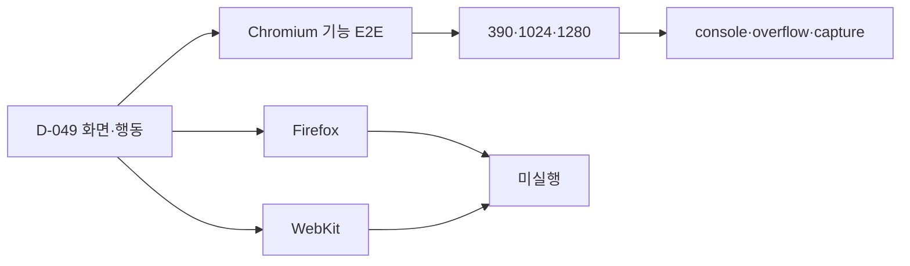

# 해낼게 V2 Cross-browser Verification Matrix

| 항목 | 값 |
|---|---|
| 버전 | v2.0.0 |
| 작성일 | 2026-10-25 |
| 작성자/모델 | qa-verifier / gpt-codex gpt-5.6-sol, reasoning high |
| 대상 빌드 | Vercel preview `dpl_6ngntmdYQpZHbo83PvuQyhbtiYvu` |
| 상류 산출물(핀) | D-049, prototype v3.0.0 SHA-256 `afca1c03…24d5de9a` |
| 검사 성격 | `product-lane.yaml`의 선택 검사 |

## 목차

- [1. 목적·범위](#1-목적범위)
- [2. 실행 매트릭스](#2-실행-매트릭스)
- [3. 커버리지 흐름](#3-커버리지-흐름)
- [4. 수용기준·판정](#4-수용기준판정)
- [5. 안 한 것·오픈 이슈](#5-안-한-것오픈-이슈)
- [6. 벤치마크·자체 검토](#6-벤치마크자체-검토)
- [7. 개정 이력](#7-개정-이력)

## TL;DR

최신 V2 staging은 Chromium에서 기능·반응형·프로토타입 캡처를 검증했다. Firefox와 WebKit은 이번 QA 계약의 선택 검사로 실행하지 않았으므로 교차브라우저 판정은 **미확인**이며, Chromium 통과를 세 브라우저 통과로 확대하지 않는다.

## 1. 목적·범위

목적은 브라우저 엔진별 렌더·입력·네트워크 차이를 분리해 기록하는 것이다. 운영 배포 전 필수 회귀와 별개이며, 이번 실행 환경은 Vercel preview와 Supabase staging이다.

| 용어 | 정의 |
|---|---|
| Chromium | 현재 Playwright E2E와 9쌍 캡처에 사용한 브라우저 엔진 |
| WebKit | Safari 계열 엔진을 모사하는 Playwright 프로젝트 |
| 선택 검사 | 미실행 자체가 QA 필수 게이트 실패는 아니지만 결과를 PASS로 쓸 수 없는 검사 |

## 2. 실행 매트릭스

| 브라우저 엔진 | 390px 기능 | 1024/1280 overflow·console | 쓰기 경로 | 판정 | 증거 |
|---|---|---|---|---|---|
| Chromium | 실행 | 390·1024·1280 HTTP 200, console error 0, overflow 0 | profile·goal·friend·cover staging fixture | 테스트됨 | `staging-e2e-20261025-123617.log`, `staging-e2e-20261025-124755.log`, `captures-v10-staging-20261025-123603/` |
| Firefox | 미실행 | 미실행 | 미실행 | 미확인 | 없음 |
| WebKit | 미실행 | 미실행 | 미실행 | 미확인 | 없음 |

## 3. 커버리지 흐름

## 4. 수용기준·판정

| 요청 번호 | 수용기준 | 결과 |
|---|---|---|
| D-049 | 승인 프로토타입과 실제 화면을 같은 상태·viewport에서 비교 | Chromium 390px 9쌍 확보 |
| BUILD-V2-20261025-05 | console error 0, horizontal overflow 0 | Chromium 실행 범위에서 충족 |
| 선택 검사 | Firefox·WebKit 각각 핵심 읽기·쓰기·responsive 경로 통과 | 미확인 |

**판정:** Chromium 범위 테스트됨. 교차브라우저 전체는 미확인. 이 문서는 QA 필수 실패를 만들지 않지만, 운영 승격 뒤 세 브라우저가 통과했다고 주장할 근거도 아니다.

## 5. 안 한 것·오픈 이슈

| ID | 상태 | 내용 | 권고 시점 |
|---|---|---|---|
| XB-01 | 미검증 | Firefox 최신에서 프로필 편집·친구·초대·공개 목표 미실행 | 운영 승인 전 |
| XB-02 | 미검증 | WebKit 최신에서 동일 경로 미실행 | 운영 승인 전 |
| XB-03 | 미검증 | 실제 iOS Safari·Android Chrome 물리 기기 미실행 | 공개 범위 확대 전 |

## 6. 벤치마크·자체 검토

Playwright의 browser project 분리와 web-first assertion 원칙을 차용했다. 이번에는 Chromium만 실행했으므로 프로젝트별 결과 표의 빈칸을 미확인으로 유지했다.

셀프심문: Chromium이 Blink 시장 점유율을 대표하니 충분한가. 아니다. Safari/WebKit의 viewport, form, cookie 차이는 Chromium 결과로 증명되지 않는다.

레드팀: 선택 검사라는 말로 미실행을 숨길 수 있다. 그래서 필수 QA 차단 여부와 교차브라우저 사실 판정을 분리하고, Firefox·WebKit은 명시적으로 미확인으로 남겼다.

## 7. 개정 이력

| 버전 | 날짜 | 변경 | 작성자 |
|---|---|---|---|
| v2.0.0 | 2026-10-25 | 최신 V2 staging 범위로 전면 재작성 | qa-verifier |

---

KNOWLEDGE_QUERY: 해낼게 V2 브라우저별 QA 범위와 선택 검사 계약
HITS_USED: `product-lane.yaml` optional_tests와 Playwright browser project 원칙을 판정 경계에 사용
HITS_REJECTED: 2026-08 운영 Firefox·WebKit 결과는 다른 bundle이라 현재 V2에 승계하지 않음
CONFLICTS: 없음. 선택 검사와 사실 판정을 분리함
SKILLS_USED: qa, 실행한 엔진과 미실행 엔진의 판정을 분리하는 데 사용
SKILLS_SKIPPED: 없음
SOURCES: ISO/IEC/IEEE 29119 | https://playwright.dev/docs/test-projects | `docs/qa/evidence/v2-ssot-20261025/`
MODEL: gpt-codex/gpt-5.6-sol, reasoning high
RUBRIC_SCORE: 완결성=5/5 정밀성=5/5 벤치마크=4/5 추적성=4/5 전문성=5/5 total=23/25
WEAKEST_LINE: "Firefox와 WebKit은 이번 선택 검사에서 실행하지 않았다."
🏷 STAMP | line: v2 | 생성: 2026-10-25 12:45 KST | model: gpt-5.6-sol high | agent: qa-verifier | skill: qa | 근거: 선택 검사 계약, Chromium staging E2E | 고민: 선택 미실행을 필수 실패로 과장하지 않되 교차브라우저 PASS로도 포장하지 않음
