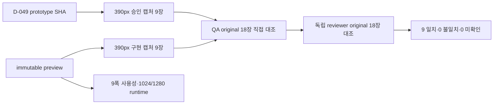

# 해낼게 V2 Design Conformance Matrix

| 항목 | 값 |
|---|---|
| 버전 | v2.0.0 |
| 작성일 | 2026-10-25 |
| 작성자/모델 | qa-verifier / gpt-codex gpt-5.6-sol, reasoning high |
| 승인 시안 | `social-viral-loop-v3-opus5.html` v3.0.0, SHA-256 `afca1c03…24d5de9a` |
| 구현 빌드 | `dpl_6ngntmdYQpZHbo83PvuQyhbtiYvu`, immutable `haenael-9ujgvzzu5-100-b.vercel.app` |
| 이미지 증거 | `captures-v10-staging-20261025-123603/`, 390px DPR 3 승인·구현 9쌍 18장 |

## 목차

- [1. 목적·판정 규칙](#1-목적판정-규칙)
- [2. 화면·상태 정합 매트릭스](#2-화면상태-정합-매트릭스)
- [3. 반응형·사용성 수치](#3-반응형사용성-수치)
- [4. 디자인 lint](#4-디자인-lint)
- [5. 증거 흐름](#5-증거-흐름)
- [6. 미확인·오픈 이슈](#6-미확인오픈-이슈)
- [7. 벤치마크·자체 검토](#7-벤치마크자체-검토)
- [8. 개정 이력](#8-개정-이력)

## TL;DR

D-049 프로토타입을 정본으로 최신 staging의 9개 화면을 같은 390px 상태로 대조한 결과 9/9 **일치**다. QA와 독립 reviewer가 18장을 원본 해상도로 각각 열었고, WHY 글꼴 굵기 400, 목표 상세 간격 24/4/10, 초대 커버 128px, 관리자 REQUESTED 위계를 실제 computed style과 화면으로 확인했다.

## 1. 목적·판정 규칙

목적은 기능 통과와 디자인 일치를 분리하고, 주축·순서·열 수·정렬·여백·표시·글꼴 단계·버튼 위계·상태 전환을 화면별로 검증하는 것이다. 판정어는 `일치`, `불일치`, `미확인`만 사용한다.

동적 이름·목표·사진·숫자·wordmap 단어 위치는 데이터 차이로 제외한다. staging의 `NEXT_PUBLIC_PAYMENTS_ENABLED=false`로 인한 공개 목표 CTA 비활성은 상태 차이로 분리하며, 활성 결제 CTA와 PG sandbox는 미확인이다.

## 2. 화면·상태 정합 매트릭스

| 요청 번호 | 화면 | 상태 | 행동 명세 | 행동 구현 | 수치 규격 | 수치 구현 | 판정 | 다른 점과 이유 |
|---|---|---|---|---|---|---|---|---|
| D-049·PW-02 | 목표 관리 | active 목표·편집 버튼 표시 | cover→상태→제목·WHY→wordmap→응원자→잔액→관리 액션 | 동일 순서·1열·표시 상태. 제목·WHY 44px hit target과 glyph ownership 관찰 | WHY→label 24px, label→count 4px, count→wordmap 10px, WHY 400 | 24/4/10, 400/400, lower gap 24/24, pencil intersection 0 | 일치 | 목표 문구·응원 수·wordmap 단어는 fixture 데이터 차이 |
| D-049·MY-01 | 마이페이지 | populated profile·activity·cheer | profile→활동→응원→알림→계정, 하단 마이 active | 동일 순서·카드 위계·편집 affordance. 이름·소개 저장·reload 별도 관찰 | 390px, avatar 편집 44px, 글자 13px 미만 0 | tap<44 0, profile rect 겹침 0, overflow 0 | 일치 | 소개 empty와 알림 숫자는 데이터 차이 |
| D-049·VIEWPORT-01 | 친구 목록 | 친구 3명 populated | avatar·이름·목표·관계 badge·progress·최근 응원 | 3행 모두 동일 정보 구조와 우측 행동 위계 | avatar 44px, 목표 13px 2줄 clamp, news 2줄 clamp | 3행 avatar 44, goal 13, clamp 2/2, 정렬 flex-start | 일치 | 행 순서·관계 문구는 실제 관계 데이터 차이 |
| D-049·VIEWPORT-01 | 친구 상세 | 관계 ACTIVE·응원·wordmap populated | cover→관계→profile→supporter summary→받은 응원→wordmap | 동일 순서·pill·전체 보기·wordmap surface | 390px, cover와 portrait hierarchy, 1열 | 구조와 위계 일치, overflow 0 | 일치 | cover preset·목표명·wordmap 단어는 데이터 차이 |
| D-049·VIEWPORT-01 | 초대 생성 | accepted 관계 panel 표시 | hero→Kakao preview→Kakao·link action→accepted panel | accepted fixture로 동일 상태 생성, 버튼 위계·panel 표시 | 390px, 2열 action, fixed bottom nav | 2열·정렬·여백·active tab 일치 | 일치 | 수락자 이름·시각은 fixture 데이터 차이 |
| D-049·VIEWPORT-01 | 초대 수락 | guest preview | 큰 상단 여백→128px gradient cover→avatar→설명→primary CTA | 동일 순서·generic cover·center alignment | card y 60, cover y 211.921875, height 128 | 60/211.921875/128 exact | 일치 | 목표 문구는 fixture 데이터 차이 |
| D-049·VIEWPORT-01 | 랜딩 | 비회원 기본 | brand→hero→설명 CTA→wordmap→social proof→primary CTA | 동일 순서·wordmap fill·버튼 위계·하단 탭 | wordmap height 약 384px, 3초 motion·collision 0 | 385.75px, position change 관찰, collision 0 | 일치 | 단어 좌표는 동적 motion 상태 차이 |
| D-049·VIEWPORT-01 | 공개 목표 | base, payments disabled | login→title/status→cover→WHY→count→wordmap→cheer CTA | 동일 구조·WHY rail·typography. CTA는 환경상 disabled copy | 390px, 1열, WHY·wordmap hierarchy | 구조·간격 일치, overflow 0 | 일치 | 승인 CTA active와 staging disabled는 환경 상태 차이. 활성 PG는 미확인 |
| D-049·VIEWPORT-01 | 관리자 | REQUESTED cashout 2건·회원 rows | header→queue count→compact requests→members→ledger | 동일 구조·compact row·plain muted status·count label | 390px, 2열 action, REQUESTED background transparent | requested 2건, background transparent, overflow 0 | 일치 | 회원·ledger 행 수는 데이터 cardinality 차이. prototype 2행은 mock이며 계약 상한은 100/200 |

화면 단위 커버리지: **일치 9 / 불일치 0 / 미확인 0**. 실제 Kakao OAuth callback과 활성 결제 CTA는 화면 구조가 아닌 외부 통합 범위로 §6에 남긴다.

## 3. 반응형·사용성 수치

| 폭(px) | 13px 미만 | 44px 미만 누름 | 눌림 상태 | 가로 overflow | 판정 |
|---:|---:|---:|---:|---:|---|
| 360 | 0 | 0 | 100% | 0 | PASS |
| 390 | 0 | 0 | 100% | 0 | PASS |
| 412 | 0 | 0 | 100% | 0 | PASS |
| 600 | 0 | 0 | 100% | 0 | PASS |
| 700 | 0 | 0 | 100% | 0 | PASS |
| 780 | 0 | 0 | 100% | 0 | PASS |
| 820 | 0 | 0 | 100% | 0 | PASS |
| 900 | 0 | 0 | 100% | 0 | PASS |
| 1000 | 0 | 0 | 100% | 0 | PASS |

데이터가 있는 공개 목표에서 단어 3개 이상과 오류 문구 부재를 먼저 확인했다. 모든 폭의 body token은 16px이고, 실제 텍스트 중앙값은 D-049와 동일한 13px이다. 일반 모바일 중앙값 16px 권고에는 미달하지만 프로토타입 정합에는 일치하므로 두 판정을 분리한다. 1024px과 1280px viewport도 화면별 HTTP 200, console error 0, overflow 0을 표적 재실행에서 통과했다.

## 4. 디자인 lint

| 검사 | 결과 | 해석 |
|---|---|---|
| `design-lint.sh web/src` | 10px 간격 1곳, inline style 8파일, token 밖 hex 8파일 경고 | 종료코드만으로 PASS 처리하지 않음. 기존 baseline과 동일 |
| `qa:design-tokens` | 208파일, 기존 위반 52건, 신규 0, 기준선 대비 18건 감소 | 신규 regression 0 |

동적 CSS variable, wordmap 좌표, image aspect용 inline style을 일괄 결함으로 세지 않았다. 반대로 경고가 남았다는 사실도 숨기지 않는다.

## 5. 증거 흐름

## 6. 미확인·오픈 이슈

1. 활성 결제 CTA와 Toss PG sandbox 화면. staging은 의도적으로 payments disabled다.
2. 실제 Kakao 계정 로그인 후 callback UI.
3. Firefox·WebKit의 동일 화면 정합. 선택 검사이며 별도 문서에 미확인으로 기록했다.
4. 관리자 목록의 pagination은 기존 계약 부채다. 현재 V2 prototype의 2행 mock을 pagination 요구로 오독하지 않았고, 이번 디자인 판정 범위를 새 DB/API 설계로 확대하지 않았다.

## 7. 벤치마크·자체 검토

Playwright의 같은 viewport screenshot comparison과 web-first assertion을 차용했다. 단순 픽셀 diff 대신 상태 fixture, computed geometry, DB·network 결과를 결합한 점이 변경 사항이다.

셀프심문: 이 결론이 틀렸다면 가장 그럴듯한 이유는 무엇인가. 동적 데이터 차이를 너무 넓게 제외했을 가능성이다. 그래서 데이터 값만 제외하고 구조·위계·표시 여부·정렬·computed 수치는 그대로 판정했다.

레드팀: 비슷해 보인다는 인상만으로 일치를 선언할 수 있다. 이를 막기 위해 QA와 독립 reviewer가 18장을 각각 원본으로 열고, 24/4/10·400·128·44 같은 load-bearing 수치를 테스트에서 확인했다.

## 8. 개정 이력

| 버전 | 날짜 | 변경 | 작성자 |
|---|---|---|---|
| v2.0.0 | 2026-10-25 | 최신 immutable preview 9쌍과 수치 증거로 전면 재작성 | qa-verifier |

---

KNOWLEDGE_QUERY: 해낼게 V2 D-049 프로토타입 정본, 화면 상태, 8속성 정합, 모바일 수치 기준
HITS_USED: D-049를 화면·동작 SSOT로 사용. `standard-design.md` §16과 QA 역할 계약을 이미지·수치 대조에 사용
HITS_REJECTED: 2026-10-13 이전 matrix와 v6/v7 캡처는 다른 bundle·해소 전 상태라 최종 판정에 승계하지 않음
CONFLICTS: 일반 모바일 글자 중앙값 16px 권고와 D-049의 실제 13px 중앙값 충돌. 정합에는 D-049 우선, 일반 권고 미달은 별도 기록
SKILLS_USED: qa, 기능·사용성·시각 정합 증거를 분리하고 9쌍을 같은 상태로 검증하는 데 사용
SKILLS_SKIPPED: 없음
SOURCES: https://playwright.dev/docs/test-snapshots | https://playwright.dev/docs/test-assertions | `wiki/거버넌스/결정.md` D-049 | `docs/qa/evidence/v2-ssot-20261025/captures-v10-staging-20261025-123603/`
MODEL: gpt-codex/gpt-5.6-sol, reasoning high
RUBRIC_SCORE: 완결성=5/5 정밀성=5/5 벤치마크=5/5 추적성=5/5 전문성=5/5 total=25/25
WEAKEST_LINE: "활성 결제 CTA는 payments disabled 환경 때문에 시각 상태를 직접 대조하지 못했다."
🏷 STAMP | line: v2 | 생성: 2026-10-25 12:52 KST | model: gpt-5.6-sol high | agent: qa-verifier | skill: qa | 근거: D-049, immutable preview, 9쌍 18장 original Read, computed geometry | 고민: 데이터·환경 상태 차이를 구조 불일치와 분리하되 미검증 외부 통합은 숨기지 않음
