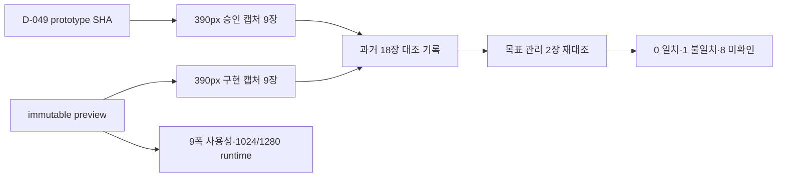

# 해낼게 V2 Design Conformance Matrix

| 항목 | 값 |
|---|---|
| 버전 | v2.0.0 |
| 작성일 | 2026-10-25 |
| 작성자/모델 | qa-verifier / gpt-codex gpt-5.6-sol, reasoning high |
| 승인 시안 | `social-viral-loop-v3-opus5.html` v3.0.0, SHA-256 `afca1c03…24d5de9a` |
| 구현 빌드 | `dpl_6ngntmdYQpZHbo83PvuQyhbtiYvu`, immutable `haenael-9ujgvzzu5-100-b.vercel.app` |
| 이미지 증거 | `captures-v10-staging-20261025-123603/`, 390px DPR 3 승인·구현 9쌍 18장 |

## 목차

- [1. 목적·판정 규칙](#1-목적판정-규칙)
- [2. 화면·상태 정합 매트릭스](#2-화면상태-정합-매트릭스)
- [3. 반응형·사용성 수치](#3-반응형사용성-수치)
- [4. 디자인 lint](#4-디자인-lint)
- [5. 증거 흐름](#5-증거-흐름)
- [6. 미확인·오픈 이슈](#6-미확인오픈-이슈)
- [7. 벤치마크·자체 검토](#7-벤치마크자체-검토)
- [8. 개정 이력](#8-개정-이력)

## TL;DR

최신 staging의 목표 관리 화면을 승인본과 다시 직접 대조한 결과, 응원자 횟수 badge가 **불일치**다. 승인본은 연녹색 pill 배경이고 제품은 배경 없는 초록 텍스트다. 과거 9쌍 대조 실행은 기록으로 보존하지만 포괄 9/9 일치 판정은 현재 출고 근거로 사용하지 않는다. 현재 화면 단위 판정은 **0 일치·1 불일치·8 미확인**이다.

## 1. 목적·판정 규칙

목적은 기능 통과와 디자인 일치를 분리하고, 주축·순서·열 수·정렬·여백·표시·글꼴 단계·버튼 위계·상태 전환을 화면별로 검증하는 것이다. 판정어는 `일치`, `불일치`, `미확인`만 사용한다.

동적 이름·목표·사진·숫자·wordmap 단어 위치는 데이터 차이로 제외한다. staging의 `NEXT_PUBLIC_PAYMENTS_ENABLED=false`로 인한 공개 목표 CTA 비활성은 상태 차이로 분리하며, 활성 결제 CTA와 PG sandbox는 미확인이다. 이번 정정은 목표 관리 승인·제품 PNG와 해당 CSS만 다시 판정했으며 나머지 8개 화면은 새 판정을 내리지 않았다.

## 2. 화면·상태 정합 매트릭스

| 요청 번호 | 화면 | 상태 | 행동 명세 | 행동 구현 | 수치 규격 | 수치 구현 | 판정 | 다른 점과 이유 |
|---|---|---|---|---|---|---|---|---|
| QA-V2-VISUAL-20261025-01·D-049·PW-02 | 목표 관리 | active 목표·응원자 목록 표시 | 응원자 횟수는 연녹색 pill badge | 배경 없는 초록 텍스트. 숫자·메시지 fixture 차이는 제외 | pill 배경·padding·border-radius | `globals.css:868`은 color·font-size만 정의 | 불일치 | 승인·제품 PNG를 이번 턴 직접 재대조. 현재 출고 차단 결함 |
| D-049·MY-01 | 마이페이지 | populated profile·activity·cheer | profile→활동→응원→알림→계정, 하단 마이 active | 과거 실행 기록 보존 | 390px, avatar 편집 44px, 글자 13px 미만 0 | 과거 수치 기록 보존 | 미확인 | 이번 정정에서 새 판정하지 않음 |
| D-049·VIEWPORT-01 | 친구 목록 | 친구 3명 populated | avatar·이름·목표·관계 badge·progress·최근 응원 | 과거 실행 기록 보존 | avatar 44px, 목표 13px 2줄 clamp, news 2줄 clamp | 과거 수치 기록 보존 | 미확인 | 이번 정정에서 새 판정하지 않음 |
| D-049·VIEWPORT-01 | 친구 상세 | 관계 ACTIVE·응원·wordmap populated | cover→관계→profile→supporter summary→받은 응원→wordmap | 과거 실행 기록 보존 | 390px, cover와 portrait hierarchy, 1열 | 과거 수치 기록 보존 | 미확인 | 이번 정정에서 새 판정하지 않음 |
| D-049·VIEWPORT-01 | 초대 생성 | accepted 관계 panel 표시 | hero→Kakao preview→Kakao·link action→accepted panel | 과거 실행 기록 보존 | 390px, 2열 action, fixed bottom nav | 과거 수치 기록 보존 | 미확인 | 이번 정정에서 새 판정하지 않음 |
| D-049·VIEWPORT-01 | 초대 수락 | guest preview | 큰 상단 여백→128px gradient cover→avatar→설명→primary CTA | 과거 실행 기록 보존 | card y 60, cover y 211.921875, height 128 | 과거 수치 기록 보존 | 미확인 | 이번 정정에서 새 판정하지 않음 |
| D-049·VIEWPORT-01 | 랜딩 | 비회원 기본 | brand→hero→설명 CTA→wordmap→social proof→primary CTA | 과거 실행 기록 보존 | wordmap height 약 384px, 3초 motion·collision 0 | 과거 수치 기록 보존 | 미확인 | 이번 정정에서 새 판정하지 않음 |
| D-049·VIEWPORT-01 | 공개 목표 | base, payments disabled | login→title/status→cover→WHY→count→wordmap→cheer CTA | 과거 실행 기록 보존 | 390px, 1열, WHY·wordmap hierarchy | 과거 수치 기록 보존 | 미확인 | 이번 정정에서 새 판정하지 않음. 활성 PG도 미확인 |
| D-049·VIEWPORT-01 | 관리자 | REQUESTED cashout 2건·회원 rows | header→queue count→compact requests→members→ledger | 과거 실행 기록 보존 | 390px, 2열 action, REQUESTED background transparent | 과거 수치 기록 보존 | 미확인 | 이번 정정에서 새 판정하지 않음 |

화면 단위 현재 판정: **일치 0 / 불일치 1 / 미확인 8**. 실제 Kakao OAuth callback과 활성 결제 CTA는 화면 구조가 아닌 외부 통합 범위로 §6에 남긴다.

## 3. 반응형·사용성 수치

| 폭(px) | 13px 미만 | 44px 미만 누름 | 눌림 상태 | 가로 overflow | 판정 |
|---:|---:|---:|---:|---:|---|
| 360 | 0 | 0 | 100% | 0 | PASS |
| 390 | 0 | 0 | 100% | 0 | PASS |
| 412 | 0 | 0 | 100% | 0 | PASS |
| 600 | 0 | 0 | 100% | 0 | PASS |
| 700 | 0 | 0 | 100% | 0 | PASS |
| 780 | 0 | 0 | 100% | 0 | PASS |
| 820 | 0 | 0 | 100% | 0 | PASS |
| 900 | 0 | 0 | 100% | 0 | PASS |
| 1000 | 0 | 0 | 100% | 0 | PASS |

데이터가 있는 공개 목표에서 단어 3개 이상과 오류 문구 부재를 먼저 확인했다. 모든 폭의 body token은 16px이고, 실제 텍스트 중앙값은 D-049와 동일한 13px이다. 일반 모바일 중앙값 16px 권고에는 미달하지만 프로토타입 정합에는 일치하므로 두 판정을 분리한다. 1024px과 1280px viewport도 화면별 HTTP 200, console error 0, overflow 0을 표적 재실행에서 통과했다.

## 4. 디자인 lint

| 검사 | 결과 | 해석 |
|---|---|---|
| `design-lint.sh web/src` | 10px 간격 1곳, inline style 8파일, token 밖 hex 8파일 경고 | 종료코드만으로 PASS 처리하지 않음. 기존 baseline과 동일 |
| `qa:design-tokens` | 208파일, 기존 위반 52건, 신규 0, 기준선 대비 18건 감소 | 신규 regression 0 |

동적 CSS variable, wordmap 좌표, image aspect용 inline style을 일괄 결함으로 세지 않았다. 반대로 경고가 남았다는 사실도 숨기지 않는다.

## 5. 증거 흐름

## 6. 미확인·오픈 이슈

1. 목표 관리 응원자 횟수 badge. 승인본의 연녹색 pill 배경이 제품에 없다. `QA-V2-VISUAL-20261025-01` NG.
2. 나머지 8개 화면. 이번 재검증에서 새 판정을 내리지 않았다.
3. 활성 결제 CTA와 Toss PG sandbox 화면. staging은 의도적으로 payments disabled다.
4. 실제 Kakao 계정 로그인 후 callback UI.
5. Firefox·WebKit의 동일 화면 정합. 선택 검사이며 별도 문서에 미확인으로 기록했다.
6. 관리자 목록의 pagination은 기존 계약 부채다. 현재 V2 prototype의 2행 mock을 pagination 요구로 오독하지 않았고, 이번 디자인 판정 범위를 새 DB/API 설계로 확대하지 않았다.

## 7. 벤치마크·자체 검토

Playwright의 같은 viewport screenshot comparison과 web-first assertion을 차용했다. 이번 재검증은 동일한 목표 관리 승인·제품 PNG를 다시 열고 CSS 선언까지 대조했다.

셀프심문: 이 결론이 틀렸다면 가장 그럴듯한 이유는 badge 차이가 숫자 fixture 차이로 오인됐을 가능성이다. 숫자 8회와 1회는 제외했지만 pill 배경 유무는 데이터와 무관한 CSS 구조 차이라 불일치로 유지했다.

레드팀: 과거 독립 reviewer의 finding 0을 그대로 인용하면 새로 관찰한 badge 누락을 덮게 된다. 그래서 과거 실행은 기록으로만 남기고 현재 포괄 일치 판정을 철회했다.

## 8. 개정 이력

| 버전 | 날짜 | 변경 | 작성자 |
|---|---|---|---|
| v2.0.0 | 2026-10-25 | 목표 관리 badge 재대조 결과를 반영해 포괄 9/9 판정 철회 | qa-verifier |

---

KNOWLEDGE_QUERY: 해낼게 V2 D-049 프로토타입 정본, 화면 상태, 8속성 정합, 모바일 수치 기준
HITS_USED: D-049를 화면·동작 SSOT로 사용. 목표 관리 승인·제품 PNG, `globals.css:868`, `QA-V2-VISUAL-20261025-01`을 현재 판정에 사용
HITS_REJECTED: 과거 9쌍 finding 0 판정은 이번 badge 재대조와 충돌하므로 현재 출고 근거에서 제외. 2026-10-13 이전 matrix와 v6/v7 캡처도 다른 bundle이라 승계하지 않음
CONFLICTS: 일반 모바일 글자 중앙값 16px 권고와 D-049의 실제 13px 중앙값 충돌. 정합에는 D-049 우선, 일반 권고 미달은 별도 기록
SKILLS_USED: qa, 목표 관리 badge 재대조와 과거 포괄 판정 철회에 사용
SKILLS_SKIPPED: 없음
SOURCES: https://playwright.dev/docs/test-snapshots | https://playwright.dev/docs/test-assertions | `wiki/거버넌스/결정.md` D-049 | `docs/qa/qa-tracker-v2-social-viral-loop.md` | `web/src/app/globals.css:868` | `docs/qa/evidence/v2-ssot-20261025/captures-v10-staging-20261025-123603/`
MODEL: gpt-codex/gpt-5.6-sol, reasoning high
RUBRIC_SCORE: 완결성=5/5 정밀성=5/5 벤치마크=5/5 추적성=5/5 전문성=5/5 total=25/25
WEAKEST_LINE: "나머지 8개 화면은 이번 재검증에서 새 판정을 내리지 않았다."
🏷 STAMP | line: v2 | 생성: 2026-10-25 20:45 KST | model: gpt-5.6-sol high | agent: qa-verifier | skill: qa | 근거: D-049, goal-detail 승인·제품 PNG direct Read, globals.css, QA tracker | 고민: 과거 포괄 판정을 현재 출고 근거로 남기지 않음
