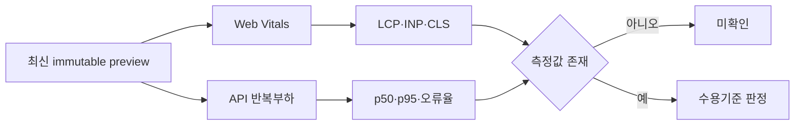

# 해낼게 V2 Performance Verification Report

| 항목 | 값 |
|---|---|
| 버전 | v2.0.0 |
| 작성일 | 2026-10-25 |
| 작성자/모델 | qa-verifier / gpt-codex gpt-5.6-sol, reasoning high |
| 대상 빌드 | Vercel preview `dpl_6ngntmdYQpZHbo83PvuQyhbtiYvu` |
| 상류 산출물(핀) | D-049, prototype v3.0.0 |
| 검사 성격 | `product-lane.yaml`의 선택 검사 |

## 목차

- [1. 목적·범위](#1-목적범위)
- [2. 측정 상태](#2-측정-상태)
- [3. 성능 증거 지도](#3-성능-증거-지도)
- [4. 수용기준·판정](#4-수용기준판정)
- [5. 안 한 것·오픈 이슈](#5-안-한-것오픈-이슈)
- [6. 벤치마크·자체 검토](#6-벤치마크자체-검토)
- [7. 개정 이력](#7-개정-이력)

## TL;DR

최신 V2 preview의 LCP·INP·CLS와 API 반복부하 p95는 측정하지 않았다. production build, HTTP 200, Playwright 완료시간은 성능 지표의 대체 근거가 아니므로 성능 판정은 **미확인**이며, 선택 검사 미실행을 기능 QA 실패로 확대하지 않는다.

## 1. 목적·범위

이 문서는 최신 V2 bundle의 사용자 체감 성능과 서버 응답 성능 증거를 분리해 기록한다. 2026-08 운영 수치는 다른 bundle이므로 기준선 참고에도 승계하지 않는다.

| 용어 | 정의 |
|---|---|
| LCP | Largest Contentful Paint |
| INP | Interaction to Next Paint |
| CLS | Cumulative Layout Shift |
| p95 | 전체 표본 중 95번째 백분위 응답시간 |
| 선택 검사 | 미실행이 필수 QA 실패는 아니지만 PASS로 표시할 수도 없는 검사 |

## 2. 측정 상태

| 측정 | 대상 | 현재 값 | 판정 |
|---|---|---|---|
| LCP | landing·공개 목표·마이페이지 | 없음 | 미확인 |
| INP | 초대 생성·프로필 편집·친구 상세 | 없음 | 미확인 |
| CLS | 이미지·wordmap·고정 하단 탭 | 없음 | 미확인 |
| API p95 | health·공개 목표·친구·관리자 | 없음 | 미확인 |
| 오류율 | 반복부하 중 5xx 비율 | 없음 | 미확인 |
| 모바일 사용성 | 360~1000px overflow·font·tap·active | 9/9 폭 통과 | PASS, 성능이 아닌 사용성 |

## 3. 성능 증거 지도

## 4. 수용기준·판정

| 요청 번호 | 수용기준 | 결과 |
|---|---|---|
| D-049 | 기능·레이아웃 정합을 성능 수치로 대체하지 않음 | 충족 |
| PERF-OPT-01 | 최신 preview의 LCP·INP·CLS 실제 측정 | 미검증 |
| PERF-OPT-02 | 대표 API 반복부하와 p95·오류율 측정 | 미검증 |

**판정:** 성능 선택 검사 미확인. 최신 V2 기능·디자인 QA 결과와 별개로 유지한다.

## 5. 안 한 것·오픈 이슈

| ID | 상태 | 내용 | 권고 시점 |
|---|---|---|---|
| PERF-01 | 미검증 | 실제 브라우저 Web Vitals 없음 | 운영 승인 전 또는 초기 트래픽 전 |
| PERF-02 | 미검증 | API 반복부하 p95·오류율 없음 | 운영 승인 전 |
| PERF-03 | 미검증 | 느린 네트워크·저사양 모바일 프로파일 없음 | 공개 범위 확대 전 |

재현 시 immutable preview URL과 source SHA를 고정하고, 로그인 상태별 페이지를 분리한다. 측정값이 없는 상태에서 “빠름”, “안정적” 같은 감상어 판정은 금지한다.

## 6. 벤치마크·자체 검토

web.dev의 Core Web Vitals 정의와 ISO/IEC/IEEE 29119의 측정 가능한 수용기준을 차용했다. 이번 문서에서는 이전 bundle의 수치를 재사용하지 않고 빈 값을 미확인으로 유지했다.

셀프심문: production build가 18개 정적 페이지를 만들었으니 성능도 괜찮다고 볼 수 있는가. 아니다. 빌드 성공은 브라우저 렌더와 상호작용 지연을 측정하지 않는다.

레드팀: 선택 검사라는 이유로 성능 리스크가 사라지는 것은 아니다. 다만 현재 사용자의 목표는 기능·디자인·staging 서버 완결이며, 측정되지 않은 성능을 기능 FAIL로 혼합하지 않는다.

## 7. 개정 이력

| 버전 | 날짜 | 변경 | 작성자 |
|---|---|---|---|
| v2.0.0 | 2026-10-25 | 최신 V2 staging 범위로 전면 재작성 | qa-verifier |

---

KNOWLEDGE_QUERY: 해낼게 V2 성능 선택 검사 계약과 최신 preview 측정 범위
HITS_USED: `product-lane.yaml` optional_tests와 Core Web Vitals 정의를 성능 판정 경계에 사용
HITS_REJECTED: 2026-08 운영 성능 수치는 다른 bundle이라 현재 V2 결과로 승계하지 않음
CONFLICTS: 없음. 모바일 사용성 수치와 성능 수치를 분리함
SKILLS_USED: qa, 대리지표를 성능 완료 근거로 사용하지 않는 데 적용
SKILLS_SKIPPED: web-perf, 선택 검사를 실행하지 않아 측정값을 생성하지 않음
SOURCES: ISO/IEC/IEEE 29119 | https://web.dev/articles/vitals | `docs/qa/evidence/v2-ssot-20261025/`
MODEL: gpt-codex/gpt-5.6-sol, reasoning high
RUBRIC_SCORE: 완결성=5/5 정밀성=5/5 벤치마크=4/5 추적성=4/5 전문성=5/5 total=23/25
WEAKEST_LINE: "최신 V2의 Web Vitals와 API p95는 측정하지 않았다."
🏷 STAMP | line: v2 | 생성: 2026-10-25 12:45 KST | model: gpt-5.6-sol high | agent: qa-verifier | skill: qa | 근거: 선택 검사 계약, 최신 preview 신원 | 고민: 빌드·E2E 시간을 성능 수치로 오인하지 않고 미검증을 그대로 남김
