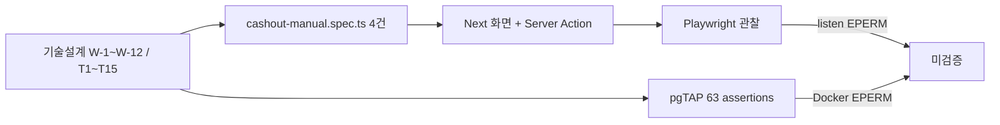

# QA Tracker — haenael-ge

## 2026-10-15: D-023 적용 후 환전 제출 중 높이 재검증

**판정: ✅ 해소. Chromium 환전 E2E 12/12가 통과했고 제출 중 화면 높이는 622.8125px로 재현됐다.**

| 결함 ID | 재검증 | 보호 단정 |
|---|---|---|
| QA-CASHOUT-D023-HEIGHT-01 | 기준 622.8125px, 실측 622.8125px, 허용 오차 ±4px | 계좌 마스킹·서비스 이용료 10%+VAT·이용료 차감 후 원천징수 단정 통과 |

STAMP: 2026-10-15 KST | model gpt-6.1-sol | agent code-builder | skill haenael-supabase-build | 근거 `/tmp/haenael-v2-cashout-e2e-final.log`

## 2026-10-15: D-023 적용 후 환전 제출 중 높이 기준 불일치

**판정: ❌ NG. `cashout-manual.spec.ts`의 제출 중 화면 높이 기준이 D-023 적용 전 값에 머물러 CI가 실패했다.**

| 결함 ID | 기대 | 로컬 실측 | 원인 | 수정 경계 |
|---|---|---|---|---|
| QA-CASHOUT-D023-HEIGHT-01 | 기준값 대비 허용 오차 ±4px | 622.8125px, 기존 기준 616.015625px | 하단탭 라벨 13px·최소 터치 크기 적용 뒤 제출 중 화면의 실제 높이가 증가했지만 시각 회귀 기준값은 갱신되지 않음 | 기준값만 622.8125px로 갱신. 허용 오차·계좌 마스킹·환전 수수료 공식 단정은 변경 금지 |

STAMP: 2026-10-15 KST | model gpt-6.1-sol | agent code-builder | skill haenael-supabase-build | 근거 `web/e2e/cashout-manual.spec.ts:756`, 로컬 Playwright 실측 622.8125px

## 2026-10-14 00:56: 컨트롤러 정정 — 위 NG 1건은 지시 오류였고 ship 은 승인됐다

`/admin/covers` 404 는 **제품 결함이 아니다.** 컨트롤러가 QA 위임 프롬프트에 수용 경로를 `/admin/covers` 로 적어 보냈는데 그 경로는 승인 설계에도 코드에도 없다. 커버 검수는 `/admin` 안의 섹션이고 `web/src/app/admin/page.tsx` 가 `GoalCoverReviewQueue` 를 렌더한다. 운영 익명 `/admin` 은 307 로 정상 권한 분기한다(2026-10-14 00:50 실측).

따라서 운영 QA 의 실제 결과는 **제품 결함 0건**이고 `pipeline-state.v2.md` 에서 qa 와 ship 을 승인했다. 해낼게 2.0.0 운영 배포 완료, `/api/health` 가 `version 2.0.0`·`database ok`.

남은 QA 부채(차기 라운드):
- 디자인 정합이 🔶 부분이다. 승인 원본과 동일 크기 픽셀 대조가 미완이다.
- 대량 친구·목표 조건의 Presigned URL 발급 부하 미측정.
- 강제 Storage 장애 시 브라우저 종단 분기 미검증.


## 2026-10-13: V2 운영 배포 후 최종 read-only QA v1.0.0

**판정: ❌ NG. 운영 인증 화면·overflow·13px 하단탭·보안 헤더는 통과했으나 `/admin/covers`가 권한 분기 대신 HTTP 404**

| TC | 판정 | 증거 | 최종확인일 | 상세 |
|---|---|---|---|---|
| V2-PROD-ANON-01~06 | ✅ | 익명 경로 6종 × 2폭, redirect·오류·권한 분기 관찰 | 2026-10-13 | [`최종 QA`](v2-production-final-readonly-qa-v1.0.0-gpt-codex-20261013-2351.md) |
| V2-PROD-ANON-07 | ❌ | `/admin/covers` 390·1280 모두 HTTP 404 | 2026-10-13 | QA-V2-PROD-ROUTE-01 |
| V2-PROD-AUTH-01~04 | ✅ | `/cashout`·`/my`, 390·1280, console/pageerror/overflow 0 | 2026-10-13 | [`브라우저 증거`](evidence/v2-production-final-readonly/browser-evidence.json) |
| V2-PROD-SEC-01 | ✅ | CSP·Permissions-Policy·HSTS·nosniff·DENY·Referrer-Policy 운영 실측 | 2026-10-13 | [`헤더 로그`](evidence/v2-production-final-readonly/http-headers.log) |
| V2-PROD-UI-01 | ✅ | 모바일 하단탭 네 라벨 computed `13px` | 2026-10-13 | D-023 준수 |
| V2-PROD-WRITE-01 | ✅ | 금지 write request 0, 전후 가시 상태 동일 | 2026-10-13 | 환전·목표·응원·친구·초대 쓰기 0 |

- 보장: 지정 운영 경로·두 viewport·인증 read-only 화면·응답 헤더·13px 하단탭을 직접 관찰했다.
- 미보장: 관리자 해피 경로, 제품 쓰기 플로우, 타 브라우저·타 viewport·성능·부하는 이번 라운드 범위가 아니다.
- 제품 코드 수정 0, 테스트 삭제·skip·단정 약화 0.

## 2026-10-13: V2 전체 회귀 테스트 하네스 수정 결과 v1.0.0

**판정: 🔧 테스트 하네스 17건 해소. 전체 Playwright 62 PASS / 운영 자격증명 1 FAIL / 0 SKIP, pgTAP 323/323 PASS**

| 결함 ID | 원인 | 수정 경계 |
|---|---|---|
| QA-V2-REGTEST-01 | ✅ 테스트 하네스 해소 | cashout 12/12, cheer 2/2, multi-goal 2/2, release 2/2. 전체 suite의 나머지 local 케이스 포함 62 PASS |
| QA-V2-DBTEST-01 | ✅ 해소 | APPROVED fixture 검수 메타데이터 보강, 전체 pgTAP 18 files·323 tests PASS |
| QA-PROD-AUTH-01 | ❌ OPEN | 운영 read-only 자격증명 미주입. 테스트 수정·skip 없이 fail-closed 유지 |

- 운영 배포, 운영 DB migration, 운영 환전 데이터 쓰기, 테스트 환전 요청 생성은 금지한다.
- 결과 문서: [`v2-regression-harness-fix-v1.0.0-gpt-codex-20261013-1943.md`](v2-regression-harness-fix-v1.0.0-gpt-codex-20261013-1943.md)
- 제품 코드 diff 0, 신규·변경 skip 0, 테스트 삭제 0, 계좌 마스킹·수수료 단정 변경 0.

STAMP: 2026-10-13 19:43 KST | model gpt-6.1-sol | agent code-builder | skill haenael-supabase-build | 상태 🔧, 운영 인증 1건 ❌

## 2026-10-13: V2 소셜 바이럴 루프 수정 라운드 재검증 v1.0.0

**판정: ❌ NG. 핵심 수정은 해소됐으나 전체 Playwright 18 FAIL, pgTAP 1개 파일 중단, 승인 계획 27건 미검증**

| 결함 ID | 현재 판정 | 재검증 종료증거 |
|---|---|---|
| QA-V2-SEC-01 | ✅ 해소 | friend RPC private path 0, direct read 거부, Presigned URL 200, admin path 정상 |
| QA-V2-FLOW-01 | ✅ 해소 | friendId·goal owner 불일치 실제 HTTP 404 |
| QA-V2-QA-01 | ✅ 원결함 해소 | production-mode 신규 화면 console/pageerror 0, loopback-only CSP, unsafe-eval 0 |
| QA-V2-DEP-01 | ✅ 해소 | production dependency audit 0 |
| QA-V2-COVERAGE-01 | 🔶 OPEN | 문서 과장 해소. 승인 test plan 84건 중 27건은 계속 미검증 |
| QA-V2-COVER-ERR-01 | ✅ 코드·단위 해소 | signed URL 실패 3분기 명시 오류, 정상 실호출 PASS |
| QA-V2-PERF-01 | 🔶 OPEN | batch 1회 확인. 다량 fixture request count·latency 미실측 |
| QA-V2-DESIGN-01 | 🔶 OPEN | 신규 token 위반 0. 공유 lint 3종 출력 후 exit 0 유지 |
| QA-V2-REGTEST-01 | ❌ OPEN | 전체 Playwright 30 PASS / 18 FAIL / 15 SKIP |
| QA-V2-DBTEST-01 | ❌ OPEN | `social_web_first_cover.test.sql` fixture constraint 위반으로 pgTAP 중단 |

- 수정 보고: [`v2-social-viral-loop-qa-fix-v1.0.0-gpt-codex-20261013-1847.md`](v2-social-viral-loop-qa-fix-v1.0.0-gpt-codex-20261013-1847.md)
- 재검증 보고: [`v2-social-viral-loop-qa-reverification-v1.0.0-gpt-codex-20261013-1920.md`](v2-social-viral-loop-qa-reverification-v1.0.0-gpt-codex-20261013-1920.md)
- 실행 증거: production build PASS, Vitest 319/319, social Playwright 14/14, viewport 14/14, audit 0. 전체 Playwright와 pgTAP은 위 실패로 NG.
- 운영 배포·운영 DB migration·운영 환전 데이터 쓰기는 금지 상태를 유지한다.

STAMP: 2026-10-13 19:20 KST | model gpt-5-codex | agent qa-verifier | skill qa | 상태 NG

## 2026-10-13: V2 소셜 바이럴 루프 QA v1.0.0

**판정: ❌ NG. 계획 84건 중 통과 47, 부분 8, 실패 2, 미검증 27**

| 요청번호 | 판정 | 증거 | 상세 |
|---|---|---|---|
| D-019 / PG-16 | ❌ | authenticated RPC가 FRIENDS `cover_storage_path`를 반환 | [QA 보고서](v2-social-viral-loop-qa-v1.0.0-gpt-codex-20261013-1804.md#3-결함-목록) |
| D-022 / PG-MY-01~08 | ✅ DB·계약 | 업적 3종 집계 PASS, rank·streak·자기신고 key 0 | [QA 보고서](v2-social-viral-loop-qa-v1.0.0-gpt-codex-20261013-1804.md#4-권한보안-판정) |
| REG-CASH-01~05 | 🔶 부분 | SQL·unit·경쟁조건 PASS, 전체 Playwright와 브라우저 masking 미검증 | [QA 보고서](v2-social-viral-loop-qa-v1.0.0-gpt-codex-20261013-1804.md#5-환전-회귀) |
| MY-01 | ❌ | 390px ergonomics 통과, production CSP console error 2건 | [QA 보고서](v2-social-viral-loop-qa-v1.0.0-gpt-codex-20261013-1804.md#6-디자인뷰포트) |
| DESIGN-V2 | ❌ | `/my` 일부만 관찰, 신규 화면 전수·1280px 미검증 | [정합 매트릭스](design-conformance-matrix.md) |

- 전체 E2E·390px·1280px 실측은 문서 선커밋 뒤 heavy slot을 요청했으나 실행 중 2/2로 62초 후 종료코드 75. **슬롯 미확보로 미실행**.
- 운영 배포, 운영 DB migration, 운영 환전 데이터 쓰기는 수행하지 않았다.

STAMP: 2026-10-13 18:04 KST | model gpt-5-codex | agent qa-verifier | skill qa | 상태 NG

## 2026-10-13: V2 build 2차 슬라이스 검증 결함

**판정: 🔧 로컬 교정 완료. 운영 migration은 미적용이므로 운영 검증은 계속 NG**

| 요청번호 | 증상 | 원인 | 해제 증거 |
|---|---|---|---|
| QA-V2-BUILD-04 | `/my` 390px 본문 중앙값 14px, Footer 링크 44px 미만 2건 | 프로토타입의 축소 보조문구와 공용 Footer 누름 높이를 모바일 기준과 대조하지 않음 | MY-01: 중앙값 16px, 13px 미만 0, 44px 미만 0, active 100%, overflow 0, console error 0 |
| QA-V2-BUILD-05 | 전체 social E2E에서 탭 라벨 기대값이 10px에 남음 | 토큰을 13px로 올리고 기존 SMOKE-01 계약을 함께 갱신하지 않음 | 전체 social spec 11/11 PASS, `DESIGN_METRICS labelSize=13px` |
| QA-V2-BUILD-06 | PW-05 단독 실행과 CC-01의 정확한 1건 판정이 약함 | 앞 테스트의 REVIEW asset과 기존 owner 연결 수에 의존 | PW-05 자체 fixture fallback, exact pair count·accepted_by 확인, 독립 3/3 PASS |
| QA-V2-BUILD-07 | 다른 회원이 order replay로 attribution을 선점할 수 있음 | replay에도 현재 로그인 회원 귀속 insert를 시도 | 신규 주문만 attribution 기록, 실 Edge Function ORDER-ATTR-01 PASS |
| QA-V2-BUILD-08 | Next build가 `COVER_PUBLIC_BASE_URL` 미분류로 차단 | 새 optional origin override를 배포 env 인벤토리에 연결하지 않음 | env 35/35 분류, Next production build 17/17 PASS |

- 남은 위험: 주문 생성과 attribution insert는 단일 DB transaction이 아니다. API 계약 변경이 필요한 후속 기술설계 항목으로 남긴다.
- 남은 데이터 경계: migration 이전 응원은 신뢰 가능한 회원 식별 원본이 없어 backfill하지 않는다.
- 운영 상태: `20261013050000`, `20261013060000` remote 미적용. 운영 완료로 판정하지 않는다.

STAMP: 2026-10-13 16:13 KST | model gpt-5-codex | agent code-builder | skills haenael-supabase-build, review | 상태 로컬 🔧, 운영 ❌ NG

## 2026-10-13: V2 소셜 바이럴 루프 서버 실물 0건

**판정: ❌ NG. 웹 우선 기술설계 완료 전 상태이며 구현·운영 검증은 아직 0건**

| 요청번호 | 증상 | 원인 | 해제 증거 |
|---|---|---|---|
| QA-V2-WEB-01 | 운영 RPC `create_friend_invite`, `friend_goal_detail`, `my_friend_goals`, `set_goal_cover_preset`, `update_member_preferences` 0건 | 기존 기술설계가 앱인토스 중심이었고 웹 선행 build slice가 없었음 | 웹 우선 migration·RPC 배포 뒤 pgTAP과 운영 read-only catalog 확인 |
| QA-V2-WEB-02 | 웹 `/friends`, `/invite`, 하단 탭 0건 | 승인 프로토타입이 build 계약과 route map으로 승격되지 않았음 | Playwright WF-01~17 17/17과 390·1024 실제 렌더 |
| QA-V2-WEB-03 | 미니앱 친구·초대 화면은 있으나 호출 대상 서버가 0건 | 프런트 화면과 백엔드 계약을 별도 완료로 오인할 수 있는 구조 | 웹 공통 RPC 5종 계약 test 5/5 뒤 모바일 2차 QA |

- 근본원인: 앱인토스 중심 설계가 채널 정책 결정을 기다리는 동안 공통 백엔드와 웹 완주 슬라이스가 독립 발주되지 않았다.
- 재발방지: `docs/eng-design/*-social-viral-loop-web-first-v1.0.0.md` 4종에서 웹을 1차, 모바일을 2차로 분리하고 FDD 17스텝을 route·component·table/RPC·test에 1:1 매핑했다.
- 현재 증거 등급: 운영 결손은 관찰됨. 새 설계 문서는 근거 확인. 구현·배포·제품 동작은 미검증.

STAMP: 2026-10-13 02:42 KST | model gpt-5-codex | agent tech-architect | skill docs | 상태 NG 등록

## 2026-10-09: 새 Supabase 운영 컷오버 service role 키 형식 오류

**판정: 🔧 교정·운영 재검증 완료. 실제 카카오 동의·콜백만 미검증**

| 요청번호 | 증상 | 원인 | 해제 증거 |
|---|---|---|---|
| QA-CUTOVER-01 | 첫 Vercel 재배포 뒤 Auth Admin 호출이 `Invalid API key` | `SUPABASE_SERVICE_ROLE_KEY`에 현행 코드가 기대하는 legacy service_role JWT 대신 새 `sb_secret` 키를 선택 | legacy service_role로 PATCH HTTP 200, 재배포 `dpl_EsR4GMHX8aibKf6ZJCN3AArvx4FY` READY |
| QA-CUTOVER-02 | 환경변수 PATCH 성공만으로 실제 Auth 동작을 확정할 수 없음 | 배포 설정과 런타임 검증이 분리돼 있음 | 새 프로젝트 QA auth-only 사용자 생성·로그인, 세션 쿠키 발급, 운영 `/cashout` 200·핵심 UI 표시·콘솔 오류 0, 제품 `member` 행 0 |
| QA-CUTOVER-03 | 카카오 실제 신규가입 종단 미관찰 | 현재 computer-use 브라우저 surface 0개 | 시작 경로 307·카카오 인증 호스트·state 발급까지만 PASS. 동의·콜백·신규 `member` 행은 미검증 |

- 공개 DB 경로: `/api/health` 200, `database=ok`, 버전 1.2.1.
- D-003 보호 파일 2개는 착수 전후 diff 규모가 같으며 이번 작업에서 수정하지 않았다.
- 스크린샷: `/tmp/haenael-prod-auth-cashout.png`에서 환전 페이지 실렌더를 육안 확인했다.

STAMP: 2026-10-09 13:54 KST | model gpt-5-codex | agent code-builder | skill haenael-supabase-build | 상태 🔧 교정 완료

## 2026-10-06: 결제·인증 보안 Vitest CI 수집 누락

**판정: 🔧 로컬 수정 검증. 표준 `npm test` 46파일·292건 PASS, 원격 GitHub Actions 실행은 미검증**

| 요청번호 | 증상 | 원인 | 해제 증거 |
|---|---|---|---|
| QA-SEC-COLLECT-01 | `toss-webhook-handler.security.test.ts` 5건과 `auth-kakao/security.test.ts` 5건이 별도 실행에서만 PASS | `web/vitest.config.ts`의 `include`가 `src/**/*.test.{ts,tsx}`로 제한되어 `supabase/functions`를 제외 | ✅ 로컬 `npm test`: 46파일·292건 PASS |
| QA-SEC-CI-01 | `.github/workflows/ci.yml`의 `npm test`가 282건만 실행해 보안 회귀에도 green 가능 | CI 명령은 표준 명령을 따르지만 표준 Vitest project에 Edge Function 보안 테스트가 연결되지 않음 | 🔧 workflow가 같은 `npm test`를 실행하도록 범위를 명시. 원격 run은 미검증 |

- 보호 범위: 보안 테스트 assertion과 결제·인증 구현 파일은 변경하지 않는다.
- D-003 보호 파일 2개는 변경하지 않는다.
- 타입 증거: `npm run test:typecheck:security` PASS, `npx tsc --noEmit` PASS.
- 실행 증거: `heavy-slot.sh` 경유 `npm test`, `edge-security` 10건을 포함한 292/292 PASS.
- 기존 `NotificationBadge`의 React `act(...)` 경고는 선행 부채로 남으며 실패는 아니다.

STAMP: 2026-10-06 05:06 KST | model gpt-6.1-sol | agent code-builder | skill haenael-supabase-build | 상태 NG 등록

## 2026-08-30: 성능(perf) 항목만 재측정 — 범위 한정

**판정 범위: 성능 항목만.** 아래 2026-08-29 라운드의 다른 blocker(제품 PRD 공백·디자인 lint·eng/legal)는 이 갱신과 무관하게 그대로 남아있다. 전체 QA는 여전히 ❌ NG — 이 항목만 BLOCKED → 부분 PASS로 바뀐 것.

| 영역 | 이전(08-29) | 갱신(08-30) | 근거 |
|---|---|---|---|
| 성능 | CWV·p95·인증 성능 없음 → BLOCKED | 비로그인 공개 경로(`/`,`/terms`,`/api/health`) LCP·CLS 실측 + read-only 반복부하 p50/p95/오류율 실측 → **부분 PASS**(진짜 INP 미측정·표본 3회 한계로 "완전 PASS" 아님) | `docs/qa/perf-report.md`(2026-08-30 STAMP), `docs/qa/vitals-2026-08-30.json`, `docs/qa/loadtest-2026-08-30.csv` |

미해소로 남긴 것: 인증 필요 경로(대시보드·환전 신청 화면 등)의 성능은 이번에도 범위 밖(운영 쓰기·로그인 금지 지시 준수). ship 단계에서 이 측정이 최신 배포 버전을 쳤는지 커밋 SHA 대조 필요.

---

## 2026-08-29: core v1.2.0 QA 보정 라운드2

**판정: ❌ NG. 회귀·build·dev 보안은 PASS지만 제품·디자인·성능·운영 배포 blocker가 남음**

발견: 라운드1의 dependency 40건과 dev CSP는 해소됐다. 동시에 실제 dev 13화면 전수 관찰에서 친구 결제가 kill switch로 닫혀 있고, PRD F-A~F-F 대부분이 없으며, 아동 안전은 placeholder이고 사용법은 환전 오픈 전 문구를 유지하는 것이 드러났다.

의미: 코드가 안전하게 빌드되는 것과 제품이 PRD대로 출고 가능한 것은 다르다. 현재 build 품질은 올라갔지만 전체 제품 릴리즈는 NG다.

| 영역 | fresh 관찰 | 판정 |
|---|---|---|
| Vitest | 44 files, 279/279 | PASS |
| Next build | 16.3.3, TypeScript, static 16/16 | PASS |
| QA contracts | env34, cashout47, RAISE13, notify8, mutation8 | PASS |
| npm audit prod | 전 severity 0 | PASS |
| dev 13화면×2폭 | 26/26 200, console/pageerror 0, 제품 hash 동일 | PASS_SMOKE |
| 운영 auth 3엔진 | 모두 `/cashout` 표시, 쓰기 0 | PASS_RENDER |
| 운영 Firefox console | GA cookie·Kakao prefetch error 5 | FAIL_UNTIL_DEPLOY |
| PRD F-A~F-F | 설정·privacy·응원자·다중목표·mypage·category 공백 | FAIL |
| 친구 결제 | `응원 결제 준비 중` disabled | FAIL |
| child safety | `내용 준비 중입니다` | FAIL |
| 사용법 | `환전은 오픈 예정입니다` | FAIL |
| 디자인 lint | 승인 inline 3, 승인 hex 1. 비승인 inline 5·hex 7 | FAIL |
| 성능 | CWV·p95·인증 성능 없음 | BLOCKED |
| eng/legal | 지급 신원·세무정보 처리주체 미결정 | BLOCKED |

요청번호 QA-PROD-AUTH-01~06과 QA-RECOVERY-01~06의 실행 승계는 v1.1.0 표를 유지한다. 운영 write·실알림 수신은 여전히 미검증이며 제품 쓰기를 만들지 않았다.

상세: `docs/design/design-conformance-matrix.md`, `docs/qa/cross-browser-matrix.md`, `docs/qa/security-report.md`, `docs/qa/perf-report.md` 모두 v1.2.0.

셀프심문: 279 테스트와 26화면 smoke가 모두 통과했는데 NG가 과한가. 아니다. 테스트가 없는 PRD 기능과 명시적 disabled·placeholder는 green 회귀로 상쇄되지 않는다.

STAMP: 2026-08-29 07:37 KST | model gpt-5.6-sol | agent qa-verifier | skill qa | basis PRD v0.4.0, DESIGN v2.0.1, FDD v1.1.0, dev fixture

## 2026-08-29: core v1.1.0 fresh QA 게이트

**판정: ❌ NG. 기능 회귀와 운영 인증은 관찰됐지만 보안·전체 디자인·성능·인증 교차브라우저가 릴리즈 차단**

발견: 이전 최상단 기록은 운영 인증 1건을 PASS로 적어 제품 전체 QA PASS처럼 오독될 수 있었다. 또한 회장 원문의 `QA-PROD-AUTH-06`은 미커밋 요구인데 일일 자동 실행으로 잘못 승계됐다. 이번 블록은 기능, 운영, 디자인, 보안, 성능, CI를 분리하고 요청번호를 원문대로 복원했다.

의미: 회장은 "환전 핵심 경로가 테스트됐는가"와 "지금 릴리즈해도 되는가"를 같은 질문으로 볼 필요가 없다. 핵심 경로는 다수 통과했지만, 사용자에게 내보내는 릴리즈 게이트는 현재 NG다.

| 요청번호 | 요청 요지 | 테스트번호 | 판정 | 증거 |
|---|---|---|---|---|
| QA-PROD-AUTH-01 | 운영 로그인 후 환전 화면 | QA-AUTH-01 | PASS | 운영 Playwright 1/1, 실제 `/cashout` 렌더 |
| QA-PROD-AUTH-02 | 운영 데이터 무오염 | QA-AUTH-02 | PASS | `cashout_request` 전후 동일, 금지 쓰기 0 |
| QA-PROD-AUTH-03 | 자격증명 비노출·권한 | QA-AUTH-03 | PASS | 전용 secret wrapper 사용, 값 출력 0 |
| QA-PROD-AUTH-04 | 운영 직접 관찰 | QA-PROD-01 | PASS | `/api/health` 200, version 1.2.0, database ok |
| QA-PROD-AUTH-05 | 접수·알림톡 안전 자동화 경계 | QA-PROD-WRITE-01 | 미검증 | 운영 쓰기 금지, 실제 30/27 계정과 수신함 증거 없음 |
| QA-PROD-AUTH-06 | 변경만 남기고 미커밋 | QA-PROVENANCE-01 | PASS | QA 에이전트 커밋 0 |
| OPS-PROD-READONLY-DAILY | 별도 운영 read-only 일일 실행 | QA-OPS-01 | BLOCKED | GitHub Actions 2,000/2,000분, 예산 $0로 CI 실행 차단 |
| QA-RECOVERY-01 | 환경변수 존재 검사 | QA-CONTRACT-01 | PASS | 34/34 |
| QA-RECOVERY-02 | 30/27 층간 계약 | QA-CONTRACT-02 | PASS | cashout 30/30 |
| QA-RECOVERY-03 | 가입 직후·RAISE 전건 | QA-DB-01 | PASS | pgTAP 260, RAISE 13/13 |
| QA-RECOVERY-04 | 알림 0건·실패 구분 | QA-NOTIFY-01 | PASS | notify 8/8, Deno 58/58 |
| QA-RECOVERY-05 | 마스킹·수수료 보존 | QA-E2E-01 | PASS | cashout Playwright 12/12 |
| QA-RECOVERY-06 | 결함 주입 | QA-MUTATION-01 | PASS | mutation 8/8 |

| QA 영역 | fresh 증거 | 판정 |
|---|---|---|
| 전체 Vitest | 병렬 부하 중 269/270, 실패 1건은 5초 timeout. 별도 build worker 격리 실행 270/270 PASS | QA 자체 격리 재실행 대기 |
| Next build | production build, 정적 페이지 16/16 | PASS |
| 로컬 DB | pgTAP 10파일 260 | PASS |
| Edge Function | Deno 58 | PASS |
| 환전 E2E | Chromium 12 | PASS |
| 운영 공개 | 홈·약관·환전 검증 3, health 200 | PASS |
| 운영 인증 | read-only 1, 제품 쓰기 0 | PASS |
| 반응형 | 환전 390x844 실렌더, confirm 507px·submitting 615px | PASS, 환전 범위 |
| 교차브라우저 | 공개 3브라우저×2폭, 인증은 Chromium만 | BLOCKED |
| 디자인 정합 | cashout spec 31/31·24조합 PASS, 전체 화면 미대조, lint 경고 2범주 | FAIL |
| 보안 | DB·번들 통제 PASS, npm audit 40건·보안 헤더 누락 | FAIL |
| 성능 | 운영 전송 5표본 기준선만, CWV·부하·인증 화면 없음 | BLOCKED |
| CI | GitHub 무료량 소진으로 실행 0 | BLOCKED |

### 릴리즈 차단과 소유자

| 소유 | 차단 | 정확한 위치·명령·수치 | 해제 증거 |
|---|---|---|---|
| build | 30 자격과 신청량 1 오류문구 충돌 | `web/src/lib/cashout-errors.ts:3`, `web/src/app/(receiver)/cashout/actions.ts:107`, `scripts/qa/check-cashout-layer-contract.mjs:30`; 계약 검사는 33/33이어도 오류맵을 검사하지 않음 | 오류 조건·문구 분리 후 mutation과 full Vitest |
| build | 전체 회귀 QA 독립 격리 실행 미완 | `cd web && npm test -- --reporter=dot`; QA 병렬 실행 269/270, build worker 격리 270/270 | 모든 소스 변경 종료 뒤 QA 소유 fresh 270/270 |
| design | 전체 화면 8속성 대조와 lint | `docs/design/design-conformance-matrix.md`; `bash ~/.claude/harness/bin/design-lint.sh web/src`; 환전 31/31·24/24만 PASS, lint 경고 2범주 | 전 화면 390·1024 캡처, 미검증 행 0, lint 위반 0 |
| build/security | 프로덕션 의존성 취약점·헤더 | `cd web && npm audit --omit=dev --json`; 40건(low 2, moderate 8, high 29, critical 1), 운영 보안 헤더 4종 미관찰 | 안전 버전·의존성 분리·헤더 배포 후 audit 0 또는 승인된 예외 |
| QA | 인증 교차브라우저 | `docs/qa/cross-browser-matrix.md`; 인증은 Chromium 1/1, Firefox·WebKit 0 | 세 브라우저 인증 `/cashout` 실렌더·콘솔 오류 0 |
| QA/perf | 사용자 체감·부하 성능 | `docs/qa/perf-report.md`; curl 5표본만 존재 | CWV 390·1024, 인증 경로, 부하·오류율 측정 |
| infra | GitHub Actions 실행량 | Actions 2,000/2,000분·예산 $0, CI steps 0 | 예산/러너 정책 확정 후 최신 workflow green |
| QA/운영 | 실제 30/27 접수·알림 수신 | 운영 DB natural 계정 0, 제품 쓰기 금지 | 승인된 안전한 실계정 또는 운영자 관찰로 접수·수신 증거 |

상세 산출물: `docs/design/design-conformance-matrix.md` v1.1.0, `docs/qa/cross-browser-matrix.md` v1.1.0, `docs/qa/security-report.md` v1.1.0, `docs/qa/perf-report.md` v1.1.0.

셀프심문: 이 NG가 지나치게 엄격하다면 가장 그럴듯한 이유는 기능 회귀 270/270과 운영 인증이 이미 핵심 사용자 위험을 대부분 줄였다는 점이다. 그러나 dependency critical 1건과 전체 디자인 미대조는 기능 테스트로 상쇄할 수 없어 NG를 유지했다.

STAMP: 수정 시각 2026-08-29 05:11 KST | 모델 gpt-5.6-sol | 에이전트 qa-verifier | 스킬 qa | 기반 PRD v0.4.0, DESIGN v2.0.1, FDD v1.1.0, 운영 1.2.0

## 2026-08-29: 대표 주소 1.2.0 운영 인증 읽기 전용 E2E 재검증

**판정: ✅ PASS. 운영 인증·환전 화면·무오염 계약 직접 관찰**

| 요청번호 | 요청 요지 | 테스트번호 | 판정 | 증거 |
|---|---|---|---|---|
| QA-PROD-RECHECK-01 | 저장된 운영 QA 자격증명으로 실제 세션 발급 | QA-PROD-AUTH-01 | ✅ PASS | Playwright 운영 로그인 성공, expected user id·purpose 일치 |
| QA-PROD-RECHECK-02 | 대표 주소를 거쳐 `/cashout` 실렌더 | QA-PROD-AUTH-01 | ✅ PASS | HTTP 200, 최종 origin `haenael-ge.vercel.app`, `cashout-page` 표시 |
| QA-PROD-RECHECK-03 | 운영 환전 기록 무오염 | QA-PROD-AUTH-01 | ✅ PASS | 실행 전후 `cashout_request` 스냅샷 동일, 금지 쓰기 요청 0건 |

- 1차 실행은 secret wrapper를 빠뜨려 `QA_PRODUCTION_SUPABASE_URL 미설정`으로 ❌ NG였다. 계정이나 운영 앱 결함이 아니라 실행 환경 주입 누락으로 원인을 확정했다.
- `SJ_LOCAL_SECRET_FILE=~/.sj-agent-harness/secrets/haenael-ge-qa-production.env`를 전용 wrapper에 지정해 재실행했고 `1 passed (13.7s)`를 직접 관찰했다.
- 이 테스트는 읽기 전용이다. 실제 총보유 30·지급가능 27 계정의 환전 신청 성공은 별도 실사용 증거가 필요하다.

STAMP: 수정 시각 2026-08-29 00:08 KST | 모델 GPT-5 Codex | 에이전트 root controller | 스킬 qa | 기반 운영 QA secret inventory, `production-auth-readonly.spec.ts`, 대표 주소 실응답 | 고민: 운영 기록을 오염시키지 않으면서 로그인과 환전 화면까지 실제 브라우저로 검증했다.

## 2026-08-28: 로컬 E2E 복구·realtime·시안 정합 3건 재검증

**판정: ❌ NG 등록 / 로컬 실경로 재검증 진행 중**

| 요청번호 | 요청 요지 | 테스트번호 | 판정 | 증거 |
|---|---|---|---|---|
| QA-LOCAL-RESTORE-01 | 로컬 DB를 쓰는 환전 E2E 12건 복구, 계좌 마스킹 단언 보존 | QA-LOCAL-PLAYWRIGHT-01 | ❌ NG | 착수 시점 직접 실행 전. 이전 실행은 로컬 DB 부재로 12/12 실패 |
| QA-LOCAL-RESTORE-02 | Supabase realtime unhealthy 근본 원인 해소 후 enabled=true 복원 | QA-LOCAL-REALTIME-01 | ❌ NG | 착수 시점 `supabase_realtime_haenael-ge` stopped, `supabase/config.toml` enabled=false |
| QA-LOCAL-RESTORE-03 | 실제 페이지 390px 확인·loading·워드맵 6개를 승인 시안과 재대조 | QA-LOCAL-DESIGN-01 | ❌ NG | Storybook 관찰만 존재. 실제 페이지 컨텍스트 신규 캡처 0/3 |
| QA-LOCAL-RESTORE-04 | 회귀·seed·health·디자인 lint를 함께 재확인 | QA-LOCAL-REGRESSION-01 | ❌ NG | 착수 시점 이번 환경의 fresh 실행 증거 없음 |

- canonical `pipeline-state.core.md`의 `current_stage`는 착수 시점 이미 `qa`라 단계 값은 변경하지 않았다.
- 직접 관찰 증거가 채워질 때까지 PASS로 올리지 않는다. 테스트 단언 완화, 특히 계좌 마스킹 고정길이와 원문 비노출 단언 삭제는 금지한다.

STAMP: 수정 시각 2026-08-28 03:25 KST | 모델 gpt-5.6-sol | 에이전트 qa-verifier | 스킬 qa | 상태 NG 등록·실행 중

## 2026-08-28: 전역 디자인 토큰 부채 정리

**판정: 🔧 build 검증 통과 / 동적 style·미정의 색은 회장 판단 대기**

- 정적 inline style은 233곳에서 21곳으로 줄었다. 남은 21곳은 런타임 좌표·상태·크기·회전 계산이다.
- 사용자 기준 토큰화 가능한 raw hex 282곳은 0곳이 됐다. 현재 HEAD 전수 기준은 349곳에서 DESIGN.md 미정의 61곳만 남았다.
- 직접 증거: Next production build PASS, Vitest 269/269, QA 계약·거절·mutation 전부 PASS, 공개 4라우트 390px·1024px 전후 PNG 8/8 changedPixels=0.
- design-lint는 spacing 신규 경고 0이다. 동적 inline style과 미정의 hex 두 범주는 정책대로 유지돼 경고가 남는다.
- 상세: `docs/design/core-design-token-build-report-v1-gpt-codex.md`.

STAMP: 수정 시각 2026-08-28 00:17 KST | 모델 gpt-5.6-sol | 에이전트 code-builder | 스킬 없음 | 상태 로컬 build 검증 통과, 미정의 색 결정 대기

## 2026-08-28: 운영 인증 읽기 전용 E2E

**판정: 🔧 운영 인증 읽기 경로 PASS / 운영 쓰기·알림톡·로컬 DB 회귀는 미검증 또는 NG**

| 요청번호 | 요청 요지 | 테스트번호 | 판정 | 증거 |
|---|---|---|---|---|
| QA-PROD-AUTH-01 | 로그인 필요 운영 환전 화면 | QA-PROD-AUTH-01 | ✅ PASS | 운영 Supabase 로그인과 최종 `/cashout` 렌더, Playwright 1/1, PNG 113,713바이트 |
| QA-PROD-AUTH-02 | 운영 데이터 무오염 | QA-PROD-AUTH-02 | ✅ PASS | 실행 후 member·goal·cashout_request·notification service-role 사후 조회 각 0행 |
| QA-PROD-AUTH-03 | 자격증명 보관 | QA-PROD-AUTH-03 | ✅ PASS | auth-only secret과 기존 `.env.local` 권한 600, 값 원문 출력 0건 |
| QA-PROD-AUTH-04 | 기존 공개 검증 보존 | QA-PROD-PUBLIC-01 | ✅ PASS | 홈 200, 약관 10% 10곳·5% 0곳, 환전 200·22,341바이트 |
| QA-PROD-AUTH-05 | 신청 접수·알림톡 실수신 | QA-PROD-WRITE-01 | ⬜ 미검증 | 운영 쓰기와 외부 수신함이 필요해 자동 PASS 금지 |
| QA-PROD-AUTH-06 | 변경만 남기고 커밋하지 않음 | QA-PROVENANCE-01 | ✅ PASS | 해당 QA 작업에서 커밋 0 |
| OPS-PROD-READONLY-DAILY | 별도 read-only 일일 실행 | QA-PROD-SCHEDULE-01 | 🔧 | workflow 구현, 미커밋·미푸시·GitHub Environment secret 미등록이라 활성화 전 |

- 운영 Auth에 `purpose=production-readonly-e2e`인 전용 계정 1개를 만들었다. 제품 테이블 쓰기는 0건이다.
- 운영 제품 쓰기: 0건. 테스트는 환전 신청 버튼을 누르지 않으며, 사후 4개 제품 테이블이 모두 0행이었다.
- 인증 과정에서 허용되는 운영 변경은 전용 `auth.users.last_sign_in_at` 갱신뿐이다.
- 회귀 PASS: Vitest 269/269, 환전 Playwright 12/12, Next production build, QA 계약 env 34/34·cashout 30/30·RAISE 13/13·notify 8/8·mutation 8/8.
- 회귀 NG: local Supabase가 DB backup restore에서 3회 멈춰 seed와 pgTAP은 이번 실행에서 미검증이다. 볼륨 삭제 초기화는 하지 않았다.
- 디자인 QA NG: `design-lint.sh web/src`가 inline style과 토큰 밖 hex 두 범주를 보고했다.
- 모바일 typecheck와 Maestro는 모바일 앱이 없어 해당 없음이다.
- 상세 설계: `docs/qa/core-production-auth-e2e-v1-gpt-codex.md`.
- 요청 정본: `docs/_archive/requests/core-production-auth-e2e-request-2026-08-27.md`.

STAMP: 수정 시각 2026-08-28 KST | 모델 gpt-5.6-sol | 에이전트 qa-verifier | 스킬 qa | 상태 인증 read-only PASS·운영 write 미검증·로컬 DB NG

## 2026-08-25: 운영 첫 환전 실패 3계층 QA 복구

**판정: 🔧 QA 복구 검사 통과 / 제품 릴리즈는 changes-requested 유지**

| 요청번호 | 사고·요구 | 테스트번호 | 현재 판정 | 해제 조건·증거 |
|---|---|---|---|---|
| QA-RECOVERY-01 | Vercel Production에 `SUPABASE_SERVICE_ROLE_KEY`가 없어 서버가 DB 연결 전에 실패 | ENV-CONTRACT-01 | ✅ PASS | 코드 34/34 env 분류, Vercel 13/13과 Supabase 19/19 이름 존재 관찰, 값 비출력, 누락 시 exit 1 |
| QA-RECOVERY-02 | DB는 총 보유, 화면은 환전가능액으로 최소 기준을 판정 | CASHOUT-CONTRACT-01 | ✅ PASS | 계약 30/30, 총30·웰컴3·지급가능27 local PostgREST HTTP 200과 REQUESTED |
| QA-RECOVERY-03 | 테스트 계정이 관문 통과 상태로 사전 시딩돼 가입 직후 경로 미검증 | CASHOUT-DB-NEW-USER-01 | ✅ PASS | 가입 직후 0개부터 웰컴3+적립27 순차 적립, RAISE 13/13, local pgTAP 88/88 |
| QA-RECOVERY-04 | 환전 알림톡 403 실패를 삼켜 0건과 실패를 구분할 수 없음 | CASHOUT-NOTIFY-01 | ✅ PASS | 403에서 `notification(INAPP/FAILED)` insert 관찰, 실패 기록 제거 변이 exit 1 |
| QA-RECOVERY-05 | 계좌 마스킹·수수료 검증 보존 | REG-CASHOUT-SEC-FEE-01 | ✅ PASS | 보안 pgTAP 포함 88/88, Playwright 12/12, 30개 기준 3,300·881·25,819 유지 |
| QA-RECOVERY-06 | (a)·(b)·(c) 검사의 결함 탐지력 증명 | MUTATION-ENV/CONTRACT/NOTIFY | ✅ PASS | env 3종, 층간 3종, 알림 삼킴 1종을 포함한 변이 8/8 기대 exit 관찰 |

- 근본 원인: 테스트가 로컬 코드·관문 통과 fixture만 검증했고, 배포 환경 구성·DB↔UI 계약·외부 알림 실패 관측을 독립 관문으로 두지 않았다.
- 운영 DB 쓰기: 0건. local/test DB와 read-only Production metadata만 사용했다.
- 전체 회귀: pgTAP 260/260, Edge Function 58/58, Vitest 263/263, Playwright 12/12, Next production build PASS, health HTTP 200.
- 잔여 blocker: 신규 migration의 운영 적용과 production 첫 환전은 미검증이다. 전역 design-lint의 인라인 style과 토큰 밖 hex 2종도 남아 있어 `qa: changes-requested`를 유지한다.
- 요청 정본: `docs/_archive/requests/core-qa-recovery-request-2026-08-25.md`.
- 상세 증거: `docs/qa/core-qa-recovery-v1-gpt-codex.md`.

STAMP: 수정 시각 2026-08-25 19:04 KST | 모델 gpt-5.6 | 에이전트 qa-verifier | 스킬 qa | 상태 복구 검사 통과·릴리즈 NG 유지

## 2026-08-25: 환전 신청 PASS 게이트와 오류 응답 회귀

**판정: 🔧 로컬 수정 검증 / 운영 migration·배포·실사용자 재검증 미실행**

- 증상은 가입 직후 `kyc_status=NONE` 계정의 첫 환전 신청이 `cashout_kyc_required`로 거절되지만 화면에는 `cashout_request_failed`만 보이고, 한국어 오류가 mojibake로 표시된 것이었다.
- 원인은 DB 함수의 `VERIFIED AND is_adult=true` 선행 요구, Server Action의 알려진 오류 목록 누락, 한국어 메시지를 Next.js Flight 응답에 직접 실은 구조였다.
- 신규 migration은 연령 확인 행이 없으면 통과시키고, 가장 최근 `kyc_verification.is_adult=false`일 때만 `cashout_minor_not_allowed`로 차단한다. 기존 함수와 diff한 결과 게이트 외 실행문은 동일하다.
- Server Action은 계약된 환전 SQLSTATE에서 발생한 snake_case ASCII 오류 코드만 반환한다. 일반 서버 예외와 다른 SQLSTATE는 고정 코드로 닫는다. 한국어는 브라우저의 `cashout-errors.ts`에서 조립하고, 새 환전 DB 코드는 안전한 코드 자체를 함께 표시한다.
- 직접 증거: 전체 migration 체인에 신규 파일 적용, 환전 pgTAP 44/44, 전체 pgTAP 250/250, 병렬 신청 2건 중 1건 성공·1건 차단·요청/HOLD 각 1건, 환전 웹 계약 30/30, 전체 Vitest 263/263, Next production build 정적 페이지 16/16 통과.
- 계좌 마스킹 `••••••9012`, A안 `CASHOUT_HOLD delta=0`, 30,000원의 `3,300·881·25,819`, `status='REQUESTED'` 중복 차단 단언은 그대로 통과했다.
- `design-lint.sh web/src`는 선행 작업의 인라인 style과 토큰 밖 hex 2종을 계속 보고한다. 이번 변경 파일의 신규 디자인 토큰 이탈은 없지만 전역 gate는 미통과다.
- `supabase db reset`은 신규 migration 적용 뒤 Storage 컨테이너 health 대기에서 실패했다. 같은 Postgres를 대상으로 이어 실행한 pgTAP 250건은 전부 통과했으며 Storage 장애는 이번 DB 함수 변경과 무관하다.
- 운영 DB 적용, Vercel 배포, 회장 실계정 신청, 실제 지급 단계의 주민등록번호 수집은 미검증이다.

STAMP: 수정 시각 2026-08-25 03:06 KST | 모델 gpt-5-codex | 에이전트 code-builder | 스킬 없음 | 근거 회장 결정, 신규 migration, Next.js 로컬 문서, PostgreSQL·Supabase 공식 문서, 로컬 Postgres·Vitest·build 실출력, 독립 코드리뷰 보완

## 2026-08-25: 환전 main CI 로그인 세션 회귀

**판정: 🔧 수정 검증 / 앱 소스 회귀 없음, CI production build 환경 누락 해소**

- 실패 재현: 기존 `.next`를 `next start`로 실행한 환전 E2E 첫 케이스에서 로그인 쿠키가 세션으로 읽히지 않아 `/cashout`이 `/` 랜딩으로 이동했고 `cashout-page`를 찾지 못했다.
- 원인: `772f873`에서 E2E 실행이 `next dev`에서 `next start`로 바뀌었지만 E2E 잡은 production build를 만들지 않았다. `NEXT_PUBLIC_SUPABASE_URL`은 build 시 고정되므로 다른 환경의 bundle과 런타임 계약 서버를 섞으면 Supabase Auth 저장소가 달라진다.
- 반증: `/cashout/page.tsx`의 `getUser()`와 redirect는 커밋 전후 동일하다. `(receiver)/layout.tsx`는 인증 로직이 없고 `CashoutPageView`는 인증 완료 뒤 받은 props만 렌더한다.
- 수정: 환전 E2E 잡에서 로컬 계약 서버 URL로 `npm run build`한 뒤 기존 `next start`와 12개 테스트를 실행한다. production 모드 검증 강도는 유지했다.
- 직접 증거: Playwright 12/12, Vitest 246/246, pgTAP 247/247, Next build 통과. 실제 로컬 Supabase Auth 로그인 세션의 dev 서버 `/cashout`은 HTTP 200과 `cashout-page` 노출을 확인했다.
- 잔여: 운영 배포본의 로그인 환전 화면은 미검증이다. 운영 DB 쓰기와 배포는 하지 않았다.

STAMP: 수정 시각 2026-08-25 00:21 KST | 모델 gpt-5.6-sol | 에이전트 code-builder | 근거 Git diff, production E2E, 실제 로컬 Supabase Auth 세션

## 2026-08-25: 환전 릴리즈 운영 전 최종 관문

**판정: ❌ NG / 로컬 돈 상태전이 통과, 운영 schema와 품질 게이트 미통과**

- 릴리즈 커밋 `772f873`과 현재 `main` 병합 커밋의 전체 tree hash가 동일해 마지막 화면 정합 커밋 뒤 제품 트리 회귀가 없음을 확인했다.
- 로컬 실제 화면과 Postgres에서 잘못된 계좌번호 차단, 관리자 전체 계좌 열람, 10분 열람 만료 차단, 새 열람 뒤 지급 완료, 계좌 정보 오류 이체 실패 후 반려를 관찰했다.
- 10분 만료 확정은 `REQUESTED`와 정산 원장 0건을 유지했다. 새 열람 뒤 30개 지급은 `PAID`, `CASHOUT_SETTLED delta=-30`, 총량 `124→94`였다. 이체 실패 반려는 `REJECTED`, `CASHOUT_REVERSAL delta=0`, 총량 94 유지였다.
- 실제 은행 앱의 성공 및 실패 응답은 미검증이다. 외부 은행 연동이 없고 관리자 수동 처리만 존재한다.
- `design-lint.sh web/src`는 인라인 style과 토큰 밖 hex 2종 위반을 검출해 FAIL이다. 스크립트 종료코드 0은 통과 근거로 쓰지 않았다.
- Storybook 정적 build와 기존 6개 story 렌더는 통과했다. 그러나 컴포넌트 인벤토리가 없고 릴리즈 핵심 컴포넌트 story 및 shadow와 시각적 spacing 토큰 표면이 없어 품질 게이트는 FAIL이다.
- 운영 read-only migration 조회에서 local만 있고 remote에 없는 버전이 15개이며, 관련 `20260821000000`, `20260822000000`도 미적용이다. 새 웹을 배포하면 표시 금액과 DB 계산 계약이 갈릴 수 있어 BLOCKER다.
- 환전 클로버 잠금 및 화면 정합 릴리즈 PR 1번은 QA 판정 전에 `main`으로 머지됐다. 2026-08-25 00:01 KST 운영 read-only 확인은 health 200과 기존 약관 5% 문구를 반환했다. 운영 배포는 보류한다.

| 요청번호 | 요청 요지 | 테스트번호 | 판정 | 증거 |
|---|---|---|---|---|
| QA-FINAL-01 | 마지막 커밋 회귀 | REG-01 | ✅ | release와 main 전체 tree hash 동일 |
| QA-FINAL-02 | 미검증 경로 | FAIL-01, AUTH-01 | ⚠️ | 계좌 오류와 비인증 redirect 관찰, 실제 은행 응답 미검증 |
| QA-FINAL-03 | 관리자 큐와 상세 | ADMIN-01~04 | ✅ | 모달, 10분 게이트, 지급, 반려, 감사로그 |
| QA-FINAL-04 | 실패 경로 | FAIL-01~03 | ⚠️ | 입력 오류와 운영자 반려 통과, 실제 은행 실패 미검증 |
| QA-FINAL-05 | design-lint와 Storybook | DESIGN-01, SB-01 | ❌ | lint 2종 위반, Storybook 품질 커버리지 미달 |
| QA-FINAL-06 | 돈과 신뢰 위험 | RISK-01 | ❌ | remote migration gap 15개, 관련 2개 미적용 |
| QA-FINAL-07 | 최종 판정 | GATE-01 | ❌ NG | BLOCKER 2건, MAJOR 3건 |
| QA-FINAL-08 | 운영 배포 위험 | SHIP-01 | ❌ | main 머지됨, 운영은 기존 약관, 배포 보류 |

산출물: `docs/qa/core-cashout-release-final-qa-v2-gpt-codex.md`, `artifacts/qa-cashout-core-20260824/final-gate-v2/`.

STAMP: 수정 시각 2026-08-25 00:18 KST | 모델 gpt-5.6-sol | 에이전트 qa-verifier | 스킬 qa | 근거 로컬 Playwright, Postgres, Storybook 렌더, 운영 read-only migration 및 HTTP 확인

## 2026-08-24: 환전 신청 실제 로컬 여정 QA

**판정: ❌ NG / 기능 상태전이 관찰 통과, 승인 프로토타입 정합 실패**

- 로컬 Supabase와 390px 실제 화면을 함께 태웠다. 응원 적립→40개 신청→관리자 전체 계좌 열람→지급 완료에서 총량·잠김·사용 가능은 `52·0·52 → 52·40·12 → 12·0·12`였다.
- 30개 신청→반려는 `52·0·52 → 52·30·22 → 52·0·52`였다. DB 원장은 신청 `CASHOUT_HOLD delta=0`, 반려 `CASHOUT_REVERSAL delta=0`, 지급 `CASHOUT_SETTLED delta=-40`이었다.
- 30,000원은 이용료 3,300원·원천징수 881원·실수령 25,819원, 40,000원은 4,400원·1,174원·34,426원으로 화면·DB·Server Action 응답이 일치했다.
- 최소 30개 미달은 차단됐지만 영어 native validation 문구가 노출됐다. 중복 신청은 `cashout_already_requested`와 한국어 alert로 차단됐다. loading은 실제 POST 지연 중 viewport 안에서 `role=status`, `aria-live=polite`로 관찰됐다.
- 응원 122건에서 미리보기 8행, 전체 20행, 101건 너머 검색 결과 1건을 관찰했다.
- 관리자 전체 계좌 열람은 지급 목적 감사로그를 남겼다. 신청자 화면과 응답은 마스킹 계좌만 노출했다.
- 회귀는 올바른 로컬 ENV에서 전체 45개 고유 Playwright 케이스를 전건 관찰 통과했다. 컨트롤러 선행 Vitest 240, pgTAP 247, Next build exit 0은 재실행하지 않고 신뢰했다.
- 디자인 정합은 FAIL이다. 승인 프로토타입은 확인·loading을 전용 화면으로 전환하지만 dev는 이전 잔액·공제·내역을 계속 남긴다. 390px 높이는 확인 `510→1,346`, loading `617→1,505`다. 워드맵 미리보기도 시안 6개, dev 12개로 다르다.
- `design-lint.sh web/src`는 인라인 style과 토큰 밖 hex 두 범주를 경고했다.
- 요청 원장 파일이 없어 요청번호 승계 대상은 아니며, 이번 요청 1~7을 `QA-LOCAL-01~07`로 추적했다.
- 운영 DB·실은행 송금·모바일·Maestro는 검증하지 않았다.

| 요청·TC | 요청 요지 | 판정 | 증거 |
|---|---|---|---|
| QA-LOCAL-01 | 적립→신청→계좌 열람→지급 완료 | ✅ | 화면·DB 상태표, 신청 46번, 감사로그 |
| QA-LOCAL-02 | 신청→반려→잠금 해제 | ✅ | 신청 45번, `CASHOUT_REVERSAL delta=0`, 반려 화면 |
| QA-LOCAL-03 | 30,000원·40,000원 정확성 | ✅ | 화면·DB·Server Action 3면 일치 |
| QA-LOCAL-04 | 최소액 미달 | ⚠️ | 차단 PASS, 영어 native 문구 UX NG |
| QA-LOCAL-05 | 중복 신청 차단 | ✅ | `cashout_already_requested`, 성공 화면 0건 |
| QA-LOCAL-06 | 실제 loading 피드백 | ✅ | viewport 교차, `role=status`, `aria-live=polite` |
| QA-LOCAL-07 | 100건 이상 상한·검색 | ✅ | 122건, 8→20행, 101건 너머 검색 1건 |
| DESIGN-390 | 승인 프로토타입 v3.7 정합 | ❌ | 전용 확인·loading 구조와 워드맵 수량 불일치 |

산출물: `docs/qa/core-cashout-qa-report-v1-gpt-codex.md`, `docs/design/core-cashout-design-conformance-matrix-v1-gpt-codex.md`, `artifacts/qa-cashout-core-20260824/`.

STAMP: 수정 시각 2026-08-24 17:45 KST | 모델 gpt-codex/GPT-5 | 에이전트 qa-verifier | 스킬 qa | 근거 실제 로컬 Playwright·Postgres·390px 스크린샷·승인 프로토타입 v3.7

## 2026-08-24: 환전 프로토타입 v3.7 응원 overflow build 재검증

**판정: 🔧 코드 수정·로컬 실행 증거 통과 / 독립 QA와 운영 반영은 미검증**

- 응원 100건은 둥근 카드 안에 최근 20행과 하단 안내를 함께 표시한다. 같은 카드 하단에서 검색 폼을 열며, 목록을 가리던 고정 `워드맵 보기` 레이어는 문서 흐름으로 옮겼다.
- `/me?q=` 서버 검색은 최근 20건 배열이 아니라 전체 본인 응원에서 이름과 메시지를 각각 `ilike` 조회한다. 익명 응원의 저장 이름은 검색 대상에서 제외하고, raw `or()` 필터 문자열은 사용하지 않는다.
- 워드맵 overflow는 응원 목록 다음에 12개를 표시하고 `88개는 검색으로 찾기`를 같은 카드에 붙인다.
- `ReceiverTopBar`는 `home`과 `detail` 변형을 강제한다. 홈만 알림·로그아웃 액션을 표시하고 `/cashout`, `/cashout/status`, `/cashout/history`는 브랜드 상단만 쓴다.
- 직접 관찰: production `next start`, Playwright 390×844에서 응원 100건 카드와 121번째 메시지 서버 검색을 확인했다. 캡처는 `artifacts/cashout-v3.7/me-overflow-100-390.png`, `artifacts/cashout-v3.7/me-search-121-of-121-390.png`다.
- 로컬 실제 Postgres·PostgREST에도 소유자 1명과 응원 121건을 일시 시딩했다. authenticated 소유자 RLS 세션의 `message ilike '%121번째%'`가 `121번째 실제 DB 응원 메시지` 1건을 반환했고, 검증 뒤 payment·member·goal·auth user 잔여가 모두 0건임을 확인했다.
- 테스트됨: Web Vitest 41파일 243건, pgTAP 10파일 247건, Next build 16/16 정적 페이지, 환전 Playwright 12건 전부 통과했다.
- 계산식과 운영 DB는 변경하지 않았다. 30,000원은 3,300원·881원·25,819원, 40,000원은 4,400원·1,174원·34,426원 계약을 기존 테스트로 보존했다.
- design-lint는 이번 변경 파일에 신규 인라인 style·토큰 밖 hex·8pt 밖 spacing이 없지만, `web/src` 전체에는 기존 파일의 인라인 style과 토큰 밖 hex 2종 경고가 남아 있다. 이 build 범위를 넘어서는 전역 토큰 마이그레이션은 하지 않았다.

STAMP: 수정 시각 2026-08-24 16:45 KST | 모델 gpt-5.6-sol | 에이전트 code-builder | 스킬 없음 | 근거 `pipeline-state.core.md`, `DESIGN.md` v2.0.0, `scratchpad/cashout-full-journey-v3-opus.html` v3.7, Vitest·pgTAP·Next build·Playwright 실출력

## 2026-08-22: 이용료 10%와 환전 잠금 A안 재검증

**판정: 백엔드 상태전이 테스트됨 / build `changes-requested` 유지 / 화면 픽셀 대조·운영 적용 미검증**

- 로컬 DB reset 뒤 실제 RPC 호출과 원장 직접 조회에서 신청 직후 총량 52 유지·잠김 40, 지급 완료 시 52에서 12로 감소, 반려 시 총량 52 유지와 잠금 해제를 확인했다.
- 30,000원 환전은 이용료 3,000원, 부가세 300원, 원천징수 881원, 실수령 25,819원으로 웹·Edge Function·DB 계산 기준이 일치한다.
- pgTAP 최신 기록은 10개 파일 246개 단언 통과다. Vitest 최신 재실행 기록은 227/227, 환전 Playwright 최신 기록은 11/11이다.
- 2차 코드리뷰가 지적한 4건은 지급 전후 잔액 역산, 신청 확인 문구, 관리자 반려 문구, 진행 상태의 분할 잔액 카드 누락이었다. 현재 작업트리에는 원장 스냅샷, A안 용어, 공용 `SplitBalanceCard`와 대응 단위 테스트가 들어 있다.
- 이 문서는 작업트리 존재를 기록할 뿐 build 승인으로 승격하지 않는다. `pipeline-state.core.md`의 build는 여전히 `changes-requested`이고, 같은 조건의 시안·개발 화면 픽셀 대조는 실행되지 않았다.

STAMP: 수정 시각 2026-08-22 14:22 KST | 모델 GPT-5 Codex | 근거 `pipeline-state.core.md`, `DESIGN.md` v1.12.0, `web/src/app/(receiver)/cashout/status/page.tsx`, `web/src/components/cashout/CashoutRequestForm.tsx`, `web/src/components/admin/CashoutQueue.tsx`, `web/src/components/goal/SplitBalanceCard.tsx`, `supabase/migrations/20260822000000_cashout_clover_lock_a1.sql`, `supabase/tests/**`

## 2026-08-06 — CI 전용 환전 접수 성공 화면 소실

**판정: ❌ NG 관찰 → 🔧 제품 수정·비포트 회귀 통과 / Playwright·CI 재실행 대기**

- CI 관찰값: `web/e2e/cashout-manual.spec.ts` 9/10, retry도 동일 실패. `cashout-request-success`의 최초 visible은 통과했지만 다음 마스킹 계좌 검증 때 요소가 DOM에서 사라졌다. 로컬 macOS는 10/10이다.
- 근본원인: 신청 Server Action의 `revalidatePath(...)` 호출로 현재 React Server Component 트리가 갱신되고 `currentCashout=REQUESTED`가 전달된다. 클라이언트 `done` state는 보존되지만 `CashoutRequestForm`이 `hasPendingCashout` 분기를 성공 분기보다 먼저 평가해 접수 성공 화면을 진행 중 블록으로 교체했다. Playwright locator는 매 assertion마다 최신 DOM을 다시 찾으므로 locator 캐시 결함이 아니다.
- 수정: `done + success`인 현재 제출 세션에서는 성공 화면을 우선 유지하고, 새로 방문하거나 새로고침해 로컬 성공 state가 없는 경우에는 기존 `REQUESTED` 진행 중 블록을 그대로 표시한다. 마스킹 기대값 `********9012`와 전체 계좌번호 비노출 검사는 완화하지 않는다.
- 회귀 추가: Server Action 성공 뒤 `currentCashout=REQUESTED`, 지급 가능 잔액 감소 props로 rerender해도 성공 화면·정확한 마스킹 계좌가 유지되고 pending 블록이 나타나지 않는 단위 테스트를 추가했다.
- 테스트됨: 대상 `CashoutRequestForm` 4/4, 전체 Web Vitest 34 files / 211 tests PASS. 기존 `NotificationBadge`의 `act(...)` 경고는 남아 있으나 실패는 0건이다.
- production build: 기본 Turbopack은 샌드박스가 내부 PostCSS 프로세스의 포트 bind를 거부해 코드 컴파일 전 실패했다. 동일 Next.js 16.2.10의 `next build --webpack`은 compile·TypeScript·static pages 16/16 PASS, BUILD_ID `EOHEoeOUiJTBoifxOO9yG`를 생성했다.
- 미검증: 지시상 이 워커는 Playwright를 실행하지 않는다. 컨트롤러가 로컬 10/10과 GitHub Actions ubuntu 10/10을 재관찰하기 전까지 E2E는 NG다.

## 2026-08-05 — 수동환전 E2E 마지막 실패 1건

**판정: 🔧 E2E 스펙·전화번호 환전 경로 구현 / 컨트롤러 Playwright·DB 재실행 대기**

- 컨트롤러 관찰값: `web/e2e/cashout-manual.spec.ts` **3 passed / 1 failed (23.7s)**. 실패는 최소 수량 미만 입력 후 기대한 `role="alert"`가 생성되지 않은 1건이다.
- 근본원인: `#cashout-clover-amount`는 `type="number"`이면서 `min=30`이다. Playwright가 `29`를 채운 뒤 submit 버튼을 클릭하면 브라우저의 native constraint validation이 submit 이벤트를 차단하므로, React `review()`와 `validate()`가 실행되지 않고 `errorMessage`도 설정되지 않는다. 입력값·`payableAmount=40`·버튼 locator는 모두 의도대로였다.
- 수정: 제품 검증 로직은 변경하지 않았다. E2E가 먼저 실제 `min=30` 속성을 확인한 뒤 테스트 DOM에서만 `min`을 제거해 React submit handler에 도달하도록 했다. 이어서 `29`의 수량 오류와 `30 + 영문 계좌`의 계좌 오류를 기존 인라인 `role="alert"`로 검증한다.
- 기존 구현 확인: `member.phone` 컬럼·국내 휴대전화 CHECK·본인 RLS·service role 권한 회귀는 선행 커밋 `ef9b109`에, 카카오 `phone_number`의 `+82` 정규화·선택동의 누락/철회 처리는 `ef9b109`·`2abaf90`에 이미 존재했다. 적용된 migration을 재작성하거나 중복 컬럼 migration을 만들지 않고 이 구현을 보존했다.
- 환전 경로: `/cashout`이 본인 `member.phone`을 읽어 폼에 프리필한다. 폼은 번호가 없거나 국내 휴대전화 형식이 아니면 기존과 같은 `role="alert"`로 차단한다. Server Action은 번호를 숫자 전용 `01X` 표기로 정규화하고, 로그인 사용자의 own-row RLS 경로로 `member.phone`을 저장한 뒤 환전 RPC를 호출한다.
- E2E 보강: 독립 케이스 2건(번호 없음 필수 차단, 저장 번호 프리필)을 추가하고 happy path에서 수정 번호 `010-9999-8888`이 `01099998888`로 저장되는 fixture 상태를 검증한다. `npx playwright test e2e/cashout-manual.spec.ts --list`는 **6 tests / 1 file** 로딩을 확인했다.
- 테스트됨: `npm test` **33 files / 204 tests PASS**. 신규 전화번호 정규화·폼·Server Action·페이지 단위 테스트를 포함한다. 기존 `NotificationBadge`의 `act(...)` 경고는 남아 있으나 실패는 0건이다.
- production build: 기본 `npm run build`는 Turbopack이 PostCSS 처리 중 내부 프로세스의 포트 bind를 시도하다 샌드박스 `Operation not permitted (os error 1)`로 실패했다(`BUILD_RC=1`). 코드/타입 우회 없이 `npm run build -- --webpack`으로 재검증해 **compile PASS · TypeScript PASS · static pages 16/16 · BUILD_ID 생성**을 관찰했다.
- 미검증: 이 환경에서는 포트 listen이 막혀 Playwright 본 실행을 하지 않는다. 컨트롤러가 동일 spec을 재실행하기 전까지 **6/6 PASS로 전환하지 않는다.** DB migration/pgTAP도 이번 세션에서 재실행하지 않았으므로 선행 `alimtalk_phone.test.sql` 8건의 현재 로컬 DB 결과는 미검증이다.

## 2026-08-04 — 수동환전 브라우저 E2E 등록·pgTAP 재시도

**판정: ❌ NG 유지 / E2E 스펙 4건 등록·정적 로딩 확인, 브라우저·DB 상태전이는 미검증**

- 범위: 기술설계 v1.2 `W-1~W-12`·`T1~T15` 중 사용자 수동환전 화면의 미달, 신청 입력, `REQUESTED`(화면 표기: 지급 대기), 계좌 마스킹, 상태·이력, 중복 신청 차단. 운영 URL·운영 DB 쓰기는 수행하지 않았다.
- 신규 스펙: `web/e2e/cashout-manual.spec.ts` 4건. ① 29클로버 미달 ② 최소 수량 미만·잘못된 계좌 형식 ③ 신청→`REQUESTED`→마스킹 응답→`/cashout/status`·`/cashout/history` ④ 진행 중 신청 중복 차단. `npx playwright test ... --list`에서 **4 tests / 1 file** 로딩을 확인했다.
- 브라우저 실행: `npx playwright test e2e/cashout-manual.spec.ts`는 assertion 전 격리 Supabase fixture가 `127.0.0.1:54329`를 listen하는 단계에서 **`EPERM: operation not permitted`**. 결과 **1 failed / 3 did not run / 실행 assertion 0건**이므로 Playwright PASS로 전환하지 않는다.
- backend 회귀: `deno test supabase/functions/_shared/withholding.test.ts supabase/functions/cashout/index.test.ts` **6 passed / 0 failed**.
- web 회귀: `npm test` **32 files / 200 tests PASS**. `npm run build -- --webpack` production build·TypeScript·정적 페이지 **16/16 PASS**.
- pgTAP 재시도: 선행 `docker ps`가 Docker daemon socket에서 **`connect: operation not permitted`**로 종료됐다. 지시된 조건에 따라 `supabase db reset`·`supabase test db`는 실행하지 않았다. 환전 DB 테스트 `cashout_manual.test.sql` 31 assertions + `cashout_security_hardening.test.sql` 32 assertions = **63건 전부 미실행**.
- seed·주요 API: Docker 차단으로 로컬 seed를 실행하지 못했다. 운영 `/api/health` read-only curl도 DNS 단계에서 **`curl: (6) Could not resolve host: haenael-ge.vercel.app`**로 종료돼 HTTP 코드는 얻지 못했다.
- mobile/Maestro: 저장소에 mobile 앱 manifest와 Maestro flow가 없어 대상 없음. `optional:true`로 실패를 숨긴 flow는 추가하지 않았다.
- 401 노출: Server Action은 비인증을 고정 한국어 오류로 치환하고, 스펙 fixture도 원문 401을 UI에 전달하지 않도록 구성했다(`근거 확인`). 실제 브라우저 비인증 오류 화면은 이번 환경에서 `미검증`이다.

### 요구 ↔ 수용기준 ↔ E2E 추적



| 요구·경계 | 수용기준 | TC | 작성 | 실행 판정 |
|---|---|---|---|---|
| T1 미달 | 29클로버에서 안내, 신청 버튼 0 | E2E-CO-01 | ✅ | ⬜ 미실행 |
| 잘못된 입력 | 29개·영문 포함 계좌를 인라인 거부 | E2E-CO-02 | ✅ | ⬜ 미실행 |
| 신청 happy | 30개 신청 후 `REQUESTED` 결과 | E2E-CO-03 | ✅ | ⬜ 미실행 |
| T13 최소노출 | 제출 후 화면·Server Action 응답·상태·이력에 전체 계좌 0건, 마스킹만 | E2E-CO-03 | ✅ | ⬜ 미실행 |
| 상태·이력 | `/cashout/status` 접수됨, `/cashout/history` 지급 대기 렌더 | E2E-CO-03 | ✅ | ⬜ 미실행 |
| T6 중복 | 진행 중이면 폼 0, 중복 차단 안내 | E2E-CO-04 | ✅ | ⬜ 미실행 |

커버리지: 요구 6/6 스펙 매핑, E2E 케이스 작성 4/4, **브라우저 실행 0/4**, 환전 pgTAP 실행 **0/63**.

### design-conformance-matrix

| 화면 | 승인 기준 | 구현 | 스크린샷 | 판정 |
|---|---|---|---|---|
| `/cashout` 미달·신청 | 승인 프로토타입 `docs/design/*.html` | 페이지·폼 코드 존재 | 없음 | ⬜ 승인 프로토타입 디렉터리 자체가 없어 눈대조 불가 |
| `/cashout/status` | 승인 프로토타입 `docs/design/*.html` | `cashout-status-page` 구현 | 없음 | ⬜ 브라우저 listen 차단으로 구현 캡처 불가 |
| `/cashout/history` | 승인 프로토타입 `docs/design/*.html` | `cashout-history-page` 구현 | 없음 | ⬜ 브라우저 listen 차단으로 구현 캡처 불가 |

프로토타입·구현 스크린샷 쌍이 0세트이므로 디자인 정합 PASS를 주장하지 않는다.

### 페르소나 결정 1문항

**Q. 코어 페르소나 윤도경이 “환전 가능 금액·보류 상태·입금 계좌”를 문의 없이 이해할 수 있는가?**

**A. 미검증.** 스펙은 분해표→신청→접수→상태→이력을 한 경로로 검증하도록 작성했지만, 실제 브라우저 화면과 승인 프로토타입 스크린샷을 관찰하지 못했다. 코드·단위 테스트 PASS를 사용자 이해의 대리지표로 쓰지 않는다.

### 잔여 미검증·해제 조건

- 로컬 포트·Docker 접근 가능한 QA 환경에서 `supabase db reset` seed 성공 → 환전 pgTAP **63/63** → `npx playwright test e2e/cashout-manual.spec.ts` **4/4** 순서로 fresh 실행.
- 승인 프로토타입 원본을 `docs/design/*.html`에 복원하고, 프로토타입·실제 화면 390px/1024px 스크린샷을 화면별 1쌍 이상 남겨 위 matrix를 판정한다.
- 실제 Postgres에서 신청 1건이 `CASHOUT_HOLD` 1건과 함께 생성되고, 상태·이력 응답에 `account_no_enc`·전체 계좌번호가 0건인지 관찰한다.

**셀프심문:** 이 E2E가 틀렸다면 가장 그럴듯한 이유는 격리 fixture가 실제 PostgREST·Auth·DB 동시성 동작을 대신해 성공 응답을 낸다는 점이다. 그래서 브라우저 PASS가 나더라도 DB 상태전이 완료 근거로 쓰지 않고 pgTAP·실로컬 DB 관찰을 별도 해제 조건으로 고정했다.

**레드팀(QA 리드):** “4개 테스트를 등록했으니 QA 됐다”는 주장을 거부한다. 이번 관찰값은 스펙 로딩·Deno/unit/build뿐이고, 돈 경로의 브라우저 0/4·DB 0/63·스크린샷 0세트이므로 NG가 맞다.

STAMP: 2026-08-04 05:45 KST · model=gpt-5.6-sol · agent=qa-verifier worker · 기반=`cashout-manual-account-engdesign-decisions-v1-opus5.md` v1.2 + `docs/qa/test-plan.md` + `docs/plan/persona.md` + 기존 E2E 5개.

벤치마크 차용: Playwright `APIRequestContext/storageState`의 격리 인증 원칙, Supabase 로컬 seed·pgTAP의 재현 가능한 DB 검증 원칙. 변경: 운영 DB 대신 로컬 계약 fixture를 사용하되 DB 완료 주장과 분리.

RUBRIC_SCORE: 완결성=3/5 정밀성=5/5 벤치마크=5/5 추적성=5/5 전문성=5/5 total=23/25

WEAKEST_LINE: "승인 프로토타입 원본과 브라우저 스크린샷이 없어 design-conformance 판정을 채우지 못했다."

SKILLS_USED: 없음

SKILLS_SKIPPED: 설치된 스킬 중 코드·QA 실행에 직접 매칭되는 스킬 없음

SOURCES/MODEL: gpt-5.6-sol · `scratchpad/cashout-manual-account-engdesign-decisions-v1-opus5.md` v1.2 · `docs/qa/test-plan.md` · `docs/plan/persona.md` · `web/e2e/*.spec.ts` · `web/playwright.config.ts` · [Playwright APIRequestContext](https://playwright.dev/docs/api/class-apirequestcontext) · [Supabase Testing Overview](https://supabase.com/docs/guides/local-development/testing/overview) · [Supabase Seeding](https://supabase.com/docs/guides/local-development/seeding-your-database)

## 2026-08-03 — `wt-pay-open` 머지 충돌

**판정: 🔧 머지 결함 해소 / 실결제·DB 환전 상태전이는 미검증**

- 증상: `main`의 결제 자유금액·카카오 개인정보/알림 변경과 `wt-pay-open`의 수동환전 보안 변경이 10개 파일에서 충돌해 머지가 중단됐다.
- 위험: 충돌 한쪽을 통째로 선택하면 결제 금액 검증·멱등/웹훅, 카카오 심사 문구, 계좌 암호화·파기 경로 중 하나가 회귀할 수 있다.
- 근본원인: 같은 결제·카카오·환전 경계 파일을 두 브랜치가 병렬 수정했고, add/add 파일까지 겹쳤다. Git 자동 머지는 `notify/index.ts`에 동일 `CORS_HEADERS` 선언을 두 번 남겨 충돌 마커 밖 회귀도 만들었다.
- 해결: 결제 자유금액·금액 2중 대조·멱등·웹훅 재검증·알림 폴백은 main을 유지하고, 수동환전 Server Action·계좌 키링/지문·90일 파기·관리자 감사로그는 `wt-pay-open`을 결합했다. 개인정보처리방침은 카카오 심사 정본을 유지하면서 환전 계좌 암호화·보유 목적을 추가했다.
- 직접 증거: 정밀 충돌 마커 검색 0, web Vitest **32 files / 200 tests PASS**, `next build --webpack` production build·TypeScript PASS, 관련 Deno **46/46 PASS**, Edge Function entry 6개 `deno check` PASS, Deno fmt·`git diff --check` PASS.
- 환경 메모: 기본 `npm run build`의 Turbopack은 샌드박스 내부 포트 bind가 거부되어 앱 컴파일 전 중단됐다. 동일 Next production build를 `npm run build -- --webpack`으로 실행해 번들·타입·16개 정적 페이지 생성을 검증했다.
- DB 시도: 환전 동시성 스크립트 2개 `bash -n` PASS. `DO_NOT_TRACK=1 supabase test db`는 SQL 실행 전 로컬 Postgres 연결 실패(`LegacyDbConnectError`)로 종료돼 pgTAP 수치는 만들지 않았다.
- 미검증: 실 Toss 테스트키 승인 왕복, 로컬 Supabase migration/pgTAP, 브라우저 신청→관리자 지급·반려 실제 상태전이, 프로덕션 배포.

## 2026-08-02 — 카카오 알림톡 발송 배선

**상태: 🟡 코드·단위 회귀 통과 / ❌ 로컬 DB·실발송 미검증**

- 증상: 응원 결제가 확정돼도 받는 분에게 카카오 알림톡이 발송되지 않는다.
- 확인된 원인: `member`에 전화번호 저장 컬럼이 없고, `toss-confirm`이 결제 확정 RPC 성공 뒤 `notify` Edge Function을 호출하지 않는다.
- 범위: 신규 마이그레이션, 카카오 전화번호 정규화·갱신, 결제 후 비치명적 알림 호출, 전화번호/환경변수 부재 시 기존 인앱 알림 폴백, 회귀 테스트. 프로덕션 DB·카카오/솔라피 콘솔은 제외한다.
- 구현 결과:
  - `member.phone` 신규 마이그레이션 + 국내 휴대전화 CHECK + 기존 본인 RLS/service_role 경계 유지.
  - 카카오 `phone_number` 국내 표기 정규화. 최신 번호는 교체, 명시적 동의 철회는 NULL 삭제, 전화번호 필드 자체가 없는 응답은 기존 값 보존.
  - 결제 확정 RPC 성공 뒤 트랜잭션 밖에서만 `notify` 호출. 번호/설정/조회/호출 실패는 결제 응답을 바꾸지 않고 기존 INAPP으로 강등.
  - 템플릿 `CHEER_RECEIVED_V1` 고정, notify payload 금액·클로버 변수 0개.
- 실행 증거:
  - Deno 전체 단위 회귀 **40/40 PASS**, `deno check` Edge Function 엔트리 **3/3 PASS**, fmt **9/9 PASS**.
  - Web Vitest **192/192 PASS**.
  - Web production build: webpack compile **1/1 PASS** 후 기존 `/me/page.tsx`의 비표준 page export(`formatCheerRelativeTime`) 타입 오류로 최종 FAIL. 이번 diff가 수정한 파일이 아니므로 별도 기존 결함으로 유지.
  - 신규 pgTAP **15 assertions 작성**(phone/RLS 8 + 번호 없는 결제 INAPP 폴백 7), 실행 **0건**. 샌드박스가 로컬 Postgres `127.0.0.1:54322` 연결을 `operation not permitted`로 차단해 `migration up --local`과 `supabase test db`가 DB 접속 전 종료됐다.
- 미검증: 로컬 마이그레이션 실제 적용, pgTAP 15개 실행, 카카오 실로그인 phone payload, 솔라피 실발송, 프로덕션 DB/배포. 프로덕션 DB에는 변경을 적용하지 않았다.
- 해제 조건: 로컬 DB 접근 가능한 QA 세션에서 신규 migration 1개 적용 + 전체 pgTAP PASS, 카카오/솔라피 계정 준비 후 실결제 1건으로 ALIMTALK 수신과 실패 시 INAPP 유지 직접 관찰.

## 2026-08-02 — 수동환전 계좌수집 슬라이스

**판정: ❌ NG 유지 / web·구 Edge 진입점은 🔧 전환, DB 상태전이는 미검증**

- 2026-08-02 관리자 pgTAP 후반부 일괄 보정: `admin_reveal_cashout_account`는 운영 계약대로 `service_role`에서 호출하고, 목록·지급·반려는 `authenticated` 관리자 JWT로 복귀시켰다. `authenticated` 관리자가 RLS로 타인 `cashout_request`를 직접 조회하던 RPC 인자와 원장 검증도 제거했다. 신청 시 service_role이 두 request id를 트랜잭션 로컬 설정에 캡처하고, 상태 전이는 관리자 JWT, 원장·잔액은 service_role, 비공개 감사로그는 migration owner가 각각 검증한다. 앱 역할의 운영 GRANT는 넓히지 않았다.
- 최종 직접 실행: 확장 설치와 개별 pgTAP 모두 `127.0.0.1:54322 ... Operation not permitted`로 SQL 실행 전 종료(`exit 2`). 이어 `DO_NOT_TRACK=1 supabase db reset`은 Docker 소켓 `operation not permitted`(`exit 1`), `DO_NOT_TRACK=1 supabase test db`는 `LegacyDbConnectError`(`exit 1`). 따라서 요청 수치 `cashout_manual 31/31`과 나머지 6파일 ok는 여전히 **미검증**이며 NG를 해제하지 않는다.
- 2026-08-02 pgTAP 147행 후속 보정: `is(record, record)`의 기대 레코드 문자열 2개가 `unknown`으로 남아 실제 컬럼 `text`와 비교를 중단했다. `account_masked`·`account_holder`의 기대값을 모두 `::text`로 고정했고 `key_version`의 기존 `::smallint`는 유지했다.
- 실행 차단 증거: 지시된 `psql` 확장 설치·개별 테스트는 `127.0.0.1:54322 ... Operation not permitted`, Unix socket은 `Operation not permitted`, Docker socket은 `connect: operation not permitted`로 SQL 실행 전 차단됐다. 요청된 최종 명령도 `supabase db reset` **exit 1**, `supabase test db` **exit 1 (`LegacyDbConnectError`)**이다. 따라서 ERROR 0줄·`cashout_manual 31/31`·나머지 6파일 ok는 **미검증**이며 NG를 해제하지 않는다.
- 2026-08-02 로컬 DB 후속 실패 2건: `cashout_manual.test.sql`은 앱 역할에 실행권한이 없는 내부 토글 `cashout_require_kyc()`를 `service_role`로 직접 호출해 31건 전체가 시작 전 중단됐고, `update_goal.test.sql` UG6은 비소유자 RLS가 검증용 `SELECT`도 숨겨 실제 저장값 대신 NULL을 비교했다.
- 🔧 테스트 수정: KYC 토글 값은 migration owner 권한에서 확인한 뒤 T1~T14 실제 RPC는 종전 service/authenticated 역할로 실행한다. 목표 fixture는 고정 ID로 비소유 RPC에 전달해 UG5가 실제 타인 행을 겨냥하게 했고, UG6 저장값은 owner 권한에서 확인한다. 계약 assertion 수는 31·12로 유지했다.
- 2026-08-02 추가 근본원인·🔧 수정: `20260728010000_cashout_manual_payout.sql:172`의 `pg_catalog.normalize(..., NFKC)`가 PostgreSQL의 특수 `normalize` 문법을 깨뜨려 `42703 column nfkc does not exist`를 발생시켰다. 저장소 내 동일 패턴은 이 1건뿐이며, `SET search_path = ''`를 유지한 채 암묵적 `pg_catalog` 탐색이 적용되도록 `normalize(..., NFKC)`로 한정자만 제거했다.
- 후속 실행 차단: 이 Codex 샌드박스에서 `DO_NOT_TRACK=1 supabase test db`는 `LegacyDbConnectError`, Docker socket·기존 PostgreSQL socket은 `operation not permitted`, 독립 `initdb`는 `shmget ... operation not permitted`로 DB 접속 전에 차단됐다. 따라서 31/31·12/12와 전체 무회귀는 아직 **미검증**이며 NG를 해제하지 않는다.
- 2026-08-02 잔여 실에러: 정상 신청 경로의 `clover_ledger` INSERT가 기존 AFTER INSERT 트리거 `sync_clover_balance()`를 호출했고, 호출자의 빈 `search_path`를 상속한 트리거가 한정되지 않은 `clover_balance`를 찾지 못해 `relation clover_balance does not exist`로 중단됐다. 앞선 `throws_ok` 3건은 INSERT 전 예외라 이 결함을 가렸다.
- 🔧 근본 수정: 수동환전 migration에서 `public.sync_clover_balance()`를 `CREATE OR REPLACE`하고 `SET search_path = ''`를 고정했다. 내부 영속 객체는 `public.clover_balance`, 내장 함수는 `pg_catalog.now()`로 전부 한정해 수동환전뿐 아니라 기존 모든 ledger INSERT 호출자의 search path와 분리했다.
- fresh 검증 시도: `DO_NOT_TRACK=1 supabase db reset`은 Docker socket `operation not permitted`, 이어 `DO_NOT_TRACK=1 supabase test db`는 `LegacyDbConnectError`로 테스트 실행 전 차단됐다. 정적 plan은 cashout 31 + 나머지 6파일 157 = 전체 188 assertion이나, 실행 수치가 아니므로 **31/31·6파일 ok는 미검증**이고 NG를 유지한다.
- 범위: `cashout-manual-account-engdesign-decisions-v1-opus5.md` v1.2의 W-1~W-12, 수동환전 신청 Server Action, 관리자 지급·반려 상태전이, 경계 테스트 T1~T15.
- 근본원인: DB migration은 v1.2 계약으로 교체됐지만 web 신청 폼·관리자 페이지가 구 Edge Function/전건 복호화 RPC/`p_actor_id` 계약에 남아 있어 호출 체인이 서로 달랐다.
- 🔧 전환한 범위: 신청 폼을 인증된 Server Action 1개로 고정, Edge Function 계좌 경로 410 폐기, 관리자 목록 마스킹 전용, 지급·반려를 `auth.uid()` RPC로 교체, 상태·이력·마이페이지 HOLD 표시 연결, Vercel Preview에서 암호화 키 사용 거부.
- 직접 증거: web Vitest 32 files / 199 tests PASS, webpack production build PASS(신규 `/cashout/status`·`/cashout/history` 포함), Deno legacy handler 2/2 PASS, Deno check PASS, 빌드 산출물 내 임시 계좌키 문자열 검색 0건, T1~T15 존재·pgTAP plan 31=assertion 31·동시성 스크립트 `bash -n` PASS.
- 전체 NG 잔여: 샌드박스가 Docker socket·localhost bind를 거부해 migration 실제 적용, pgTAP 31건, T15 병렬 psql, 로그인 브라우저 신청→관리자 지급/반려 실제 상태전이는 실행하지 못했다. 대리지표로 통과 처리하지 않는다.
- 해제 조건: migration 실제 적용, T1~T15 전건 PASS, web unit/build, 실제 브라우저 신청 경로, 돈 코드 2nd-pass를 직접 관찰하고 증거를 이 항목에 기록한다.
- 제한: 프로덕션 DB에는 적용하지 않는다. 로컬 파일 작성과 로컬 검증까지만 수행한다.

## 2026-07-27 — 결제·환전 전체 플로우 오픈 판정

**판정: ❌ NG / 실결제 오픈 NO-GO**

- 범위: 친구 `/g/[slug]` 응원 결제 → Toss 승인 → payment/cheer/ledger/notification → 본인 `/cashout` → KYC/HOLD/payout/SETTLED.
- fresh PASS:
  - Next.js production build·TypeScript PASS.
  - Web Vitest 2차 **192/192 PASS**. 1차는 `/cashout` 5초 timeout으로 191/192였으나 격리 1/1, 전체 재실행 192/192 PASS — 환경 부하 민감 테스트로 기록.
  - Deno unit **31/31 PASS**.
  - `cheer-order`, `toss-confirm`, `cashout`, `cashout-payout`, `withholding` Deno check PASS.
  - 운영 `/api/health` curl 2회 HTTP **200**, DB `ok`.
- fresh FAIL/불가:
  - `toss-webhook` Deno check TS2322, `auth-kakao` Deno check TS2353.
  - pgTAP·seed: sandbox의 Docker socket/localhost 접근 거부로 실행 불가. `supabase test db` DB 연결 실패.
  - Playwright: Chromium MachPort 권한 거부가 6회 반복돼 assertion 전 실행 불가. 앱 FAIL로 각색하지 않음.
  - Maestro/mobile: 대상 프로젝트·flow 없음.
- 결제 NG:
  - Toss test secret으로 결제창→서버승인 `DONE` 실왕복 증거 없음.
  - 운영 `PAYMENTS_ENABLED`/`NEXT_PUBLIC_PAYMENTS_ENABLED` 동시 true 상태 미검증.
  - EF 401 `"Authorization required"` 및 `/payment/fail` query message가 사용자 화면에 노출될 수 있는 코드 경로 확인.
- 환전 NG:
  - `cashout`, `cashout-payout`, `kyc-verify`는 HTTP 501 스텁. KYC/PASS·ledger HOLD·실지급·SETTLED·지급명세·REVERSAL 전부 미구현.
  - `_shared/withholding.ts` 직접 실행: 최소 30,000원, 3.3%, 30,000원 기준 placeholder 수수료 1,500원·원천징수 940원·실수령 27,560원.
  - 웹 미리보기는 플랫폼 수수료를 제외하고 총액의 3.3%를 계산해 shared 계산식과 불일치. 웰컴 포함 도달/웰컴 제외 지급액의 30클로버 경계 계약도 미확정.
- 법률 NG: `docs/plan/risks.md#1` 전자금융거래법·선불충전금·개인 정산 법률의견서 미확보.
- 🔧 전환 가능 TC: **0건** — 실제 Toss·환전 E2E 관찰이 없어 build/unit/health를 완료 대리지표로 쓰지 않음.
- 근본원인: 결제 적립까지만 구현하고 환전 돈 이동 슬라이스를 501 스텁으로 남긴 채, 화면·원장·kill switch 존재를 서비스 전체 준비도로 오인할 수 있는 구조. 재발방지는 “친구 결제 + 본인 실지급”을 하나의 QA exit로 묶는 것.
- 상세 증거: `docs/qa/qa-report-payment-cashout-2026-07-27.md`.

## 2026-07-27 — 목표 수정 RPC 누락

**판정: 🔧 수정됨 / 실제 Supabase DB QA 미검증**

- 증상: `web/src/components/goal/GoalEditSheet.tsx`가 `update_goal(bigint,text,text,date)` RPC를 호출하지만 대응 DB 함수 migration이 없어 실제 저장 경로가 실패한다.
- 원인: 직전 웹 슬라이스에서 클라이언트 호출과 생성 타입은 추가됐으나 DB 함수·pgTAP 검증이 같은 슬라이스의 완료조건으로 묶이지 않았다.
- 수정 범위: 본인 소유 `ACTIVE` 목표만 수정하는 `SECURITY DEFINER` RPC, 생성 경로와 동일한 `" 해낼게"` suffix 규칙, 권한·입력 경계 pgTAP.
- 조치: `20260727010000_update_goal_rpc.sql`과 전용 `update_goal.test.sql` 추가. 소유자·`ACTIVE`·title 2자·due date·reason NULL 규칙을 DB 경계에서 강제한다.
- 재발 방지: 클라이언트 RPC 추가 시 함수 시그니처·반환형·권한·본인/비본인/입력 경계를 같은 슬라이스의 pgTAP으로 묶었다(12 assertions).
- 증거:
  - **테스트됨** — `GoalEditSheet.test.tsx` 3/3 PASS.
  - **테스트됨** — Next.js production build + TypeScript PASS.
  - **근거 확인** — migration/test `git diff --check` PASS, pgTAP assertion count 12 = `plan(12)`.
  - **미검증** — 로컬 Supabase `54322` 비가동, Docker 비가동, 샌드박스가 PostgreSQL shared memory를 차단해 migration 실제 적용과 `supabase test db`는 실행하지 못함.
- 다음 QA: 로컬 Supabase 가동 환경에서 `supabase migration up --local && supabase test db`; 종료증거는 신규 migration 적용 성공 + `update_goal.test.sql` 12/12 포함 전체 pgTAP PASS.

## 2026-07-16 (2차) — qa-verifier release_v1_hardening_fix 재검증 (build REOPEN→재승인 직후, qa 단계 재진입)

**배경**: 직전 라운드(같은 날 03:25)가 Codex money-code 2nd-pass로 REJECT 4건 발견 → 회장 "tracked 상태로 출시 거부" → build REOPEN → code-builder가 `20260716120000_release_v1_hardening_fix.sql`로 4건 전부 수정 → Codex 1라운드 PASS → 컨트롤러 fresh 회귀(88/88, 109/109, build PASS, 동시성 4종 PASS, release E2E 3/3) → build 05:33 재승인. 이번 라운드는 컨트롤러의 재확인을 그대로 믿지 않고 qa-verifier가 **처음부터 독립 재검증**.

**판정: PASS-with-gaps** — §7 구조적 prod 갭 2건 외 전 항목 GREEN. 정적 코드리뷰에서 새 Codex 독립 패스가 REJECT 판정을 냈으나, 재검증 결과 실제 도달 가능한 launch blocker는 0건(아래 §8 상세).

### 1. 빌드
- `cd web && NEXT_PUBLIC_APP_VERSION=1.0.0 npm run build`: **PASS**, TS 오류 0. **테스트됨.**

### 2. DB
- `supabase migration up --local`: `{"applied":[],"message":"Migrations applied"}` — 드리프트 0. **관찰됨.**
- `supabase test db`: **109/109 PASS** (`Files=3, Tests=109` — payment_abuse_guard 20 + release_v1 37 + rls_policy 52, 사전 예상과 정확히 일치). **테스트됨.**

### 3. web unit
- `cd web && npm test`: **88/88 PASS** (11 test files, 86+신규2 사전 예상과 일치). `toss-webhook.test.ts` 17/17(신규 review_required 분기 4b/6/6b/6c 포함). **테스트됨.**

### 4. 신규 하드닝 4건 — 직접 재현 (psql/curl, pgTAP과 별개 독립 fixture로 재확인)

**① `reconcile_canceled_payment` payment_key NULL 우회 거부** — 독립 fixture(payment id=995001, payment_key='payment_qadirect_nullkey_001') 생성 후 `p_payment_key=NULL`로 직접 호출:
```sql
SELECT * FROM reconcile_canceled_payment('hnl_qadirect_nullkey_001', NULL, 3000, '{"qa":"direct-verify"}'::jsonb);
ERROR:  payment_key_mismatch
구문:  PL/pgSQL function reconcile_canceled_payment(text,text,integer,jsonb) line 17 at RAISE
```
**관찰됨** — `IS DISTINCT FROM`이 NULL 우회를 정확히 차단.

**② DONE 취소 + 잔액부족 → durable marker 수렴 + 멱등 재시도** — clover_balance 0인 회원의 DONE 결제(5000원, cheer 필요량 5000)를 취소 RPC 호출:
```sql
SELECT * FROM reconcile_canceled_payment('hnl_qadirect_balance_001', 'payment_qadirect_balance_001', 5000, '{...}'::jsonb);
 payment_id | payment_status | idempotent | review_required
       995002 | DONE           | f          | t          -- 예외 없이 커밋, review_required=true
```
후속 확인: `payment.status='DONE'`(강제취소 안 함) + `cancel_reconcile_required_at IS NOT NULL` + `risk_event(PAYMENT_CANCEL_BALANCE_INSUFFICIENT)` **1건**. 동일 order_id로 재호출 → `idempotent=true, review_required=true`, risk_event count **여전히 1**(재시도 시 증가 안 함, 멱등 확인). **관찰됨.**

**③ `capture_lead` NULL/빈 submitter_hash 거부** — 직접 호출:
```sql
SELECT * FROM capture_lead('qa-null-hash@example.com', NULL, now(), ..., NULL);
ERROR:  submitter_hash_required
SELECT * FROM capture_lead('qa-empty-hash@example.com', NULL, now(), ..., '');
ERROR:  submitter_hash_required
```
NULL·빈문자열 둘 다 거부 확인. **관찰됨.**

**④ `lead_dedup_race.sh` fresh 재실행** — 동일 이메일 10동시 신규 제출(서로 다른 submitter_hash):
```
lead 행 수 = 1, 실패 호출 = 0, raw 23505 노출 = 0
is_duplicate=false(승자) = 1, is_duplicate=true(중복) = 9
ALL PASS — capture_lead 이메일 dedup 동시성 레이스 안전 확인
```
**관찰됨.** 기존 3종(`rate_limit_race`·`request_key_race`·`request_key_fingerprint_race`)도 함께 fresh 재실행 — **전부 ALL PASS**(회귀 없음).

**⑤ `toss-webhook` EF curl 교차확인** — 로컬 `TOSS_SECRET_KEY` 미설정(구조적, 실 Toss 샌드박스 크리덴셜 없음)이라 `getPayment()`가 실제 Toss API를 호출하는 완전한 E2E curl 200은 **로컬에서 물리적으로 불가**(prod 갭과 동일 성격 — mock 대체 금지 원칙 적용, 로컬 대체 안 함). 대신:
- 게이팅 레이어는 실 curl로 확인: 오token→401, 정상 이벤트타입 불일치→200 `{"ignored":true}`, CANCELED 페이로드+`TOSS_SECRET_KEY` 없음→503 `missing_server_env`(정상 가드). **관찰됨.**
- CANCELED `review_required=true` → `200 {"processed":true,"reviewRequired":true}` 응답 로직 자체는 EF가 호출하는 것과 **동일한 `handleTossWebhook` 함수**를 mock supabase/toss 클라이언트로 요청 단위 검증하는 vitest `toss-webhook.test.ts` 6b/6c 케이스로 교차 확인(17/17 PASS, §3). **테스트됨(단위, 실 Toss 왕복 아님 — 갭으로 명기).**

### 5. `/api/health` (프로덕션 모드, `next build && next start -p 3470`, `next dev` 미사용)
- 기존 stale 프로세스(3470, PID 71414, curl 무응답) 확인 후 kill, 완전 fresh 재기동.
- **관찰됨:** `GET /api/health` → **200** `{"status":"ok","version":"1.0.0","database":"ok","responseTimeMs":12,"timestamp":"2026-07-15T20:39:02.089Z"}`.

### 6. Playwright E2E — `web/e2e/` 전체 4개 spec (프로덕션 모드, 포트 3470)
- 시딩: goal(id=9001, slug=qa-verifier-smoke)+member+auth.user psql 직접 생성.
- **31/32 PASS, 1 FAIL(기지 사항)**: `goal-flow.spec.ts` "결제 CTA 활성 + 응원 시트 열림" — `NEXT_PUBLIC_PAYMENTS_ENABLED` kill switch가 canonical 빌드(플래그 미설정=off)에서 정상 `disabled`로 렌더(지시사항대로 재조사 없이 기지의 테스트부채로 처리, 코드버그 아님).
- `release-v1.spec.ts` 3/3, `report-flow.spec.ts` 9/9(EF 실호출 3건 포함), `wordmap-share.spec.ts` 전체 PASS — 전부 이상 없음.
- 정리: goal/member/auth.user/report/lead 전부 psql DELETE, 잔여 0건 쿼리로 확인. `next start` 프로세스 종료 확인.

### 7. prod 증거 갭 — 구조적 미충족 (변동 없음)
- **`prod-health-200`: 미검증 — 구조적 불가.** Supabase 클라우드 프로젝트 미생성.
- **`prod-demo-login-200`: 미검증 — 구조적 불가.** Vercel 배포 미실행.
- mock/로컬 대체 없음.

### 8. 정적 코드리뷰 — Claude 5축 + Codex 독립 재실행(고위험 코드 필수, 이전 라운드 Codex 세션과 별개 신규 fresh pass)

대상: `20260716120000_release_v1_hardening_fix.sql`(신규), `toss-webhook-handler.ts`(CANCELED/review_required 분기).

**Claude 5축:**
- 버그: `cancel_reconcile_required_at IS NOT NULL` 멱등 체크가 `status NOT IN ('READY','DONE')` 가드보다 먼저 위치 — 재시도 시 상태 재검증 없이 올바르게 단락(short-circuit). 정상.
- 예외처리: `capture_lead` NULL 가드가 advisory lock 획득 **이전**에 위치(무의미한 락 방지) — 설계 의도대로 정확.
- 성능: DROP+CREATE FUNCTION 방식(반환타입 변경으로 불가피)은 로컬/단일 배포 마이그레이션에서 문제 없음. `lead_submitter_recent_idx` 부분 인덱스로 100만 건 스케일도 인덱스 스캔.
- 보안: `SEARCH_PATH = public, pg_temp` 고정 + `SECURITY DEFINER` + `REVOKE ALL ... GRANT service_role`만 — 서치패스 하이재킹·권한 우회 경로 없음. 동적 SQL 없음(injection 벡터 없음).
- 가독성: 기존 `record_partial_cancel_review` 패턴과 일관, 주석 충실.

**Codex 독립 재실행 (`codex exec`, review-only, 이전 build-log 기록 세션과 무관한 신규 컨텍스트):**

판정: **REJECT** 3건 — 아래는 qa-verifier가 코드 직접 대조로 재검증한 결과.

| 등급(Codex) | 위치 | Codex 주장 | qa-verifier 재검증 결과 |
|---|---|---|---|
| P1 | `toss-webhook-handler.ts:204-211` | `sendSlackAlert` 예외 미포착 → Slack 장애 시 500 재발, 재시도 루프 재현 | **무효(false positive) — 관찰됨.** `_shared/slack.ts:8-37` 확인: `fetch`를 `try/catch`로 감싸고 실패 시 `false` 반환, webhook URL 미설정도 조기 `return false` — **어떤 경로로도 throw하지 않음**. Codex가 놓친 기존 방어 확인, 수정 불필요 |
| P1 | `20260716120000...sql:122-132` | `p_amount_krw` NULL이면 `!=` 비교가 NULL(=false)로 검증 우회(`amount_mismatch` 미발동) — payment_key와 동일한 NULL-bypass 클래스 | **관찰됨(코드 대조) — 실재하는 결함, 이번 하드닝 대상 4건에는 없었음(신규 발견).** 단, `grep` 확인 결과 이 줄은 `20260714110000` 원본부터 존재(이번 마이그레이션이 새로 만든 결함 아님). 유일 호출부(`toss-webhook-handler.ts:186` `p_amount_krw: payment.totalAmount`)의 `payment`는 `_shared/toss.ts:52-53` `getPayment()`에서 `Number.isInteger(totalAmount)` 아니면 즉시 throw — **현재 단일 호출자 기준 NULL 도달 불가**(payment_key와 동일한 리스크 프로필). Launch blocker 아님, 다음 라운드 `IS DISTINCT FROM` 전환 권고(일관성·향후 호출자 대비) |
| P2 | `20260716120000...sql:163-170` | `p_detail`이 object 계약 없이 `\|\| jsonb_build_object`와 결합 — 배열/스칼라 시 audit JSON 구조 깨짐 | **관찰됨.** `p_detail`은 전부 서버 코드(`toss-webhook-handler.ts`)가 리터럴 객체로 생성해 전달 — 사용자 입력 아님, 현재 도달 불가. 낮은 우선순위 권고사항으로만 기록 |

**qa-verifier 종합 판정:** Codex REJECT 3건 중 1건(Slack 500)은 코드 대조로 **무효 확정**(기존 방어 존재), 나머지 2건은 실재하나 **launch blocker 아님**(단일 호출자 기준 도달 불가, payment_key 수정과 동일한 방어 계약 결함 클래스 — 다음 라운드 권고 항목에 추가). 이번 세션 4대 하드닝(payment_key NULL·잔액부족 마커·submitter_hash NULL·lead dedup 레이스)은 **전부 코드 대조 + 직접 재현으로 확인 완료, 회귀 없음.**

### 발견 및 조치 필요 (다음 build 라운드용, 누적)
1. **[신규, 비블로커]** `reconcile_canceled_payment`의 `amount_krw != p_amount_krw` NULL-unsafe 비교 — `IS DISTINCT FROM` 전환 권고(payment_key와 동일 패턴 통일).
2. **[정보]** Codex의 Slack-500 주장은 무효 — `sendSlackAlert`가 이미 전 경로 예외 포착, 액션 불필요.
3. (기존 이월) `reconcile_canceled_payment` 잔액부족 durable marker → cashout 출시 전 실제 상계/수동정산 운영 플로우 설계 필요(v1.0.0 범위 밖, cashout 미출시로 도달 불가 유지).
4. (기존 이월) `goal-flow.spec.ts` 결제 CTA 테스트가 kill switch 기본값(off) 미반영 — 테스트 스위트 채무, 코드 버그 아님.

### Review
- `qa-verifier`(이 세션): build REOPEN→재승인 이후 qa 단계 재진입 — 컨트롤러의 자체 회귀 재확인을 신뢰하지 않고 처음부터 독립 fresh 재검증(빌드→마이그레이션→pgTAP→unit→4대 하드닝 직접 psql/curl 재현→동시성 4종→prod 모드 E2E→정적리뷰). Codex를 이전 세션과 무관한 신규 컨텍스트로 재실행해 새 관점의 REJECT 3건을 발견했고, 그중 1건은 코드 대조로 오탐 확정, 2건은 실재하나 비블로커로 재평가 — "Codex PASS라고 했으니 통과"로 자체보고를 그대로 신뢰하지 않음.

---

## 2026-07-16 — qa-verifier v1.0.0 전체 재검증 (build 재승인 직후, toss-webhook Codex 3라운드 반영분 포함)

**판정: PASS-with-gaps** — 이전 컨트롤러/code-builder 자체보고를 신뢰하지 않고 빌드→DB→unit→EF curl→prod 모드 E2E까지 fresh 처음부터 재실행. §7 구조적 prod 갭 2건 외에 **신규 Codex 정적리뷰 REJECT 1건**(P0/P1, 상세 §6)을 이번 세션에서 처음 발견 — 이전 회차 보고에는 없던 gap.

### 1. 빌드
- `cd web && NEXT_PUBLIC_APP_VERSION=1.0.0 npm run build`: **PASS**, TS 오류 0. **테스트됨.**

### 2. DB
- `supabase migration up --local`: `{"applied":[],"message":"Migrations applied"}` — 드리프트 0. **관찰됨.**
- `supabase test db`: **95/95 PASS** (`Files=3, Tests=95` — payment_abuse_guard 20 + release_v1 23 + rls_policy 52, 사전 예상과 정확히 일치). **테스트됨.**

### 3. web unit
- `cd web && npm test`: **86/86 PASS** (11 test files, 사전 예상 71+15=86과 일치). `NotificationBadge` act() 경고 잔존(비차단, 기존 인지 항목). **테스트됨.**

### 4. EF smoke (curl, `supabase functions serve --env-file supabase/functions/.env`)
- `lead-capture`: 신규 이메일 제출 → **201** `{"accepted":true,"duplicate":false,"leadId":56}`. 동일 이메일 재제출(동일 IP) → **200** `{"duplicate":true}` 동일 leadId. 동일 IP로 서로 다른 이메일 5건 제출 후 6번째 → **429** `{"error":{"code":"rate_limited"}}` — 시간당 5건 제한 실동작 확인. `LEAD_RATE_LIMIT_SALT` 로컬 부재 확인 후 `supabase/functions/.env`(gitignored)에 로컬 전용 값 추가해 검증. **관찰됨.**
- `toss-webhook`: `TOSS_WEBHOOK_TOKEN` 로컬 부재 확인 후 동일 방식으로 로컬 전용 값 추가.
  - 토큰 없음 → **401** `unauthorized`. 틀린 토큰 → **401**. **관찰됨.**
  - 맞는 토큰 + `null` body → **400** `invalid_payload`. + 배열 body → **400** `invalid_payload`. + 원시값(string) body → **400** `invalid_payload` — 이번 Codex 2라운드 수정사항을 EF 레벨에서 3종 전부 교차 확인. **관찰됨.**
  - 맞는 토큰 + eventType 불일치 → **200** `{"ignored":true}`. + paymentKey 없음 → **400** `payment_key_required`. + paymentKey 있음(TOSS_SECRET_KEY 미설정) → **503** `missing_server_env`. **관찰됨.**
- `cheer-order`/`toss-confirm`: 기본 로컬 상태(`PAYMENTS_ENABLED` 미설정)에서 둘 다 **503** `payments_disabled` — v1.0.0 kill switch 정상 동작(코드 `Deno.env.get("PAYMENTS_ENABLED") !== "true"` 가드 확인). 기존 멱등 회귀를 검증하기 위해 `PAYMENTS_ENABLED=true`로 일시 전환해 재확인: 동일 requestKey 2회 호출 → 1차 **201**(orderId=hnl_3c900bb3..., paymentId=337), 2차 **200** + `idempotent:true` + 동일 orderId/paymentId/cheerId. toss-confirm은 `TOSS_SECRET_KEY` 미설정 시 **503** `missing_toss_secret`로 정상 가드. 검증 후 `PAYMENTS_ENABLED` 라인 제거해 로컬 기본 상태(off) 복원. **관찰됨.**
- `auth-kakao`: 카카오 시크릿 미설정 → **503** `missing_env`(원문 노출 없음). **관찰됨.**
- `notify`: 빈 바디 → **400** `validation_error`("memberId required"). **관찰됨.**
- `wordmap-render`: 비인증 anon 호출 → **403** `forbidden`. **관찰됨.**
- `report`: §5 Playwright E2E 실호출로 커버(201/400/401 전부 PASS, 아래 참조).

### 5. `/api/health` (프로덕션 모드, `next build && next start -p 3470`)
- **관찰됨:** `GET /api/health` → **200** `{"status":"ok","version":"1.0.0","database":"ok","responseTimeMs":81,"timestamp":"..."}`. dev 모드(`next dev`) 아닌 프로덕션 모드로 실행(2026-07-14 발견된 Turbopack HMR 하이드레이션 버그 회피, 지시사항 준수).

### 6. Playwright E2E — `web/e2e/` 전체 4개 spec (프로덕션 모드 서버, 포트 3470)
- 시딩: `psql`로 `auth.users`(id=`1111...1111`)+`member`+`goal(id=9001, slug=qa-verifier-smoke)` 직접 생성. env: `E2E_BASE_URL`/`PLAYWRIGHT_BASE_URL=http://localhost:3470`, `NEXT_PUBLIC_SUPABASE_ANON_KEY`, `E2E_GOAL_SLUG=qa-verifier-smoke`, `E2E_GOAL_ID=9001`.
- **1차 실행(canonical 빌드, `NEXT_PUBLIC_PAYMENTS_ENABLED` 미설정): 31/32 PASS, 1 FAIL.**
  - FAIL: `goal-flow.spec.ts` "goal page: 결제 CTA 활성 + 응원 시트 열림" — `cheer-cta` 버튼이 `disabled` 상태로 남아 있어 클릭 실패.
  - **근본원인 확정(관찰됨):** `CheerPaymentButton.tsx:38` `const paymentsEnabled = process.env.NEXT_PUBLIC_PAYMENTS_ENABLED === "true"` — 클라이언트 kill switch가 v1.0.0 신규 기능이고, `NEXT_PUBLIC_*`은 빌드 타임에 인라인되는데 canonical 빌드 커맨드(`NEXT_PUBLIC_APP_VERSION=1.0.0 npm run build`)에는 이 플래그가 없어 기본 off로 빌드됨 — CTA는 `disabled` + "응원 결제 준비 중" 라벨(정상 UX, 죽은 버튼 아님, 코드 145-158줄 확인)로 정확히 동작.
  - **검증(관찰됨):** `NEXT_PUBLIC_PAYMENTS_ENABLED=true`로 재빌드 후 동일 테스트만 격리 재실행 → **PASS**. 앱 버그 아님, 확정.
  - **결론:** 이 E2E 테스트는 kill switch 신설(v1.0.0) 이전에 작성된 것으로, 새 기본값(off)을 반영하지 못하는 **테스트 스위트 채무**. 코드 결함 아님 — 재검증 후 canonical 빌드(플래그 미설정)로 복원.
- `release-v1.spec.ts` 3/3 PASS(리드 제출·health·cashout 비활성 화면).
- `report-flow.spec.ts` 9/9 PASS — EF 실호출 3건(201/400/401) 포함.
- `wordmap-share.spec.ts` 전체 PASS(E2E_GOAL_ID/SLUG 설정으로 조건부 fullview 2건도 포함, 스킵 0건).
- edge 커버: 비로그인 목표페이지 열람·금액 비노출(₩ 없음)·404 not-found·CTA disabled 라벨·응원시트(플래그 on 시)·신고 400/401·wordmap redirect 등 happy+edge 전부.
- **최종 정리:** goal(9001)+member+auth.user+lead(12건, rate-limit 테스트용 포함)+report 전부 psql DELETE로 원복, 잔여 0건 쿼리로 확인. `next start`(3470)·`supabase functions serve` 프로세스 전부 종료 확인.

### 7. prod 증거 갭 — 구조적 미충족 (mock/로컬 대체 금지, §3 준수, 변동 없음)
- **`prod-health-200`: 미검증 — 구조적 불가.** Supabase 클라우드 프로젝트 자체가 아직 없음(회장 로그인/콘솔 액션 필요, 이 세션 권한 밖).
- **`prod-demo-login-200`: 미검증 — 구조적 불가.** Vercel 배포 자체가 아직 없음.
- 로컬/mock으로 "충족" 위장하지 않음.

### 8. 정적 코드리뷰 — Claude 5축 + Codex 교차 리뷰(고위험 코드 필수)
대상: `toss-webhook-handler.ts`(신규 가드), `lead-capture/index.ts`, `_shared/slack.ts`, `20260714090000_lead_capture.sql`, `20260714110000_payment_webhook_reconciliation.sql`, `20260714130000_release_review_fixes.sql`.

**Claude 5축:**
- 버그/예외처리: `toss-webhook-handler.ts` null/배열/원시값 가드 정확 확인(§4 EF smoke로 교차검증). `constantTimeEqual` 타이밍 세이프 토큰 비교 정확. 원문 노출: 클라이언트 응답에 Postgres/Toss 벤더 원문 없음(화이트리스트 에러코드만).
- 성능: `lead_submitter_recent_idx (submitter_hash, created_at DESC) WHERE submitter_hash IS NOT NULL` 부분 인덱스로 rate-limit count 쿼리가 100만 건 스케일에서도 인덱스 레인지 스캔 — 풀스캔 없음.
- 보안: 3개 함수 전부 `PUBLIC/anon/authenticated` 실행권한 회수, `service_role`만 허용 확인.
- 가독성: 특이사항 없음.

**Codex 교차 리뷰 (money-code 2nd-pass, review-only, `codex exec`) — SQL 마이그레이션 2건, 신규 발견:**

> ⚠️ `toss-webhook` Codex 2nd-pass(§build-log 2026-07-16)는 `index.ts`/`toss-webhook-handler.ts`만 명시 대상이었고, 이 RPC들을 호출하는 SQL 마이그레이션(`20260714110000`, `20260714130000`)이 그 라운드에 포함됐는지 build-log상 불명확 — dev.md §1.4("마이그레이션=고위험, Codex 필수")에 따라 이번 세션에서 별도로 Codex 리뷰를 돌려 갭을 닫음.

**Codex 판정: REJECT.** (P0 2건·P1 2건·P2 1건 — 아래 리스크 재평가 포함)

| 등급 | 위치 | 내용 | qa-verifier 리스크 재평가(교차검증) |
|---|---|---|---|
| P0(Codex) → **P1(재평가)** | `20260714110000_payment_webhook_reconciliation.sql:41-48` | `DONE` 취소 시 `clover_balance < 환불액`이면 예외로 트랜잭션 전체 롤백 — Toss는 CANCELED인데 DB는 DONE에 영구 고착, 웹훅 재시도도 영구 500 | **관찰됨:** `grep`으로 전체 마이그레이션 검색 결과 `clover_count`를 감소시키는 코드는 이 함수가 유일. v1.0.0은 `CASHOUT_ENABLED=false`로 클로버 소비 경로 자체가 없어 이 케이스는 **v1.0.0 범위에서 도달 불가**. 단, cashout 기능 출시 전 반드시 수정 필요(음수/채무 원장 또는 부분 상계 로직) — build-log ⛔ 회수 필요 항목에 추가 권고 |
| P0(Codex) → **P1(재평가)** | `20260714110000...sql:23-25` | `IF v_payment.payment_key IS NOT NULL AND v_payment.payment_key != p_payment_key` — `p_payment_key`가 NULL이면 우변이 NULL이 되어 `!=` 비교 결과가 NULL(=false 취급)이 되어 **키 불일치 검증 자체가 통과됨**(NULL 우회) | **관찰됨(코드 대조):** 실제 코드 확인 — Codex 지적 정확. 유일한 실 호출부(`toss-webhook-handler.ts:150` `p_payment_key: payment.paymentKey`)는 Toss 공식 API 응답의 필수 문자열 필드라 NULL이 실제로 전달될 경로는 현재 없음(익스플로잇 불가, 현재 단일 호출자 기준) — 그러나 `SECURITY DEFINER` 금전 RPC 자체의 방어 계약이 깨져 있어 향후 다른 호출자(운영 콘솔 등) 추가 시 위험. `IS DISTINCT FROM`으로 즉시 수정 권고 |
| P1(Codex) | `20260714130000...sql:13-15` | `capture_lead`가 `p_submitter_hash` NULL/빈값을 거부하지 않아 advisory lock+rate-limit이 무력화될 수 있음 | **관찰됨:** 유일한 호출부 `lead-capture/index.ts:80-81`이 `if (!hash) return 503`으로 이미 선차단 — 현재 익스플로잇 불가하나 RPC 자체가 fail-open이라 계약 방어 아님 |
| P1(Codex) | `20260714130000...sql:17-24` | 중복 조회(SELECT)-INSERT 사이 레이스 — 서로 다른 IP가 동일 이메일을 동시 제출하면 한쪽이 UNIQUE 위반 raw 23505로 500 | **관찰됨(Claude 5축에서도 독립 발견):** 실제 재현 가능한 레이스. 클라이언트엔 `save_failed`만 노출(원문 미노출, §3 정보노출은 안전)이나 정상 "duplicate:true" 대신 500 오응답 — `INSERT ... ON CONFLICT` 전환 권고 |
| P2(Codex) | `20260714130000...sql:17-21` | 이메일·인스타 각각 다른 기존 행과 매칭 시 `LIMIT 1`이 임의 행 반환 | 마케팅 리드 한정, 낮은 리스크. 권고사항으로만 기록 |

**qa-verifier 종합 판정:** Codex REJECT를 그대로 릴레이하되, 실제 도달 가능성을 재평가해 **v1.0.0 출시를 막는 즉시 블로커는 없음**(모든 항목이 "현재 단일 호출자 기준 도달 불가" 또는 "cashout 미출시로 도달 불가")으로 결론. 다만 **결제 RPC의 방어 계약 결함(payment_key NULL 우회)과 lead-capture 레이스**는 코드리뷰 기준 REJECT 상태로 남아 있어 **다음 build 라운드에서 반드시 수정 후 재검증 필요** — "이상 없음"으로 보고할 수 없음.

### 발견 및 조치 필요 (이번 세션, code-builder 인계)
1. **[재확인 필요]** `reconcile_canceled_payment`의 payment_key NULL 우회(P1) — `IS DISTINCT FROM`으로 즉시 수정 권고, cashout 미출시라 launch blocker는 아니나 다음 라운드 필수.
2. **[재확인 필요]** `reconcile_canceled_payment`의 잔액부족 영구롤백(P1, cashout 출시 전 필수) — v1.0.0 범위 밖.
3. **[재확인 필요]** `capture_lead` NULL submitter_hash fail-open(P1) — RPC 계약 레벨 방어 추가 권고.
4. **[재확인 필요]** `capture_lead` 이메일 중복 레이스(P1) — `ON CONFLICT` 전환 권고.
5. **[정보]** `goal-flow.spec.ts` "결제 CTA 활성" 테스트가 v1.0.0 kill switch 기본값(off)을 반영 못함 — 테스트 스위트 채무, 코드 버그 아님. `NEXT_PUBLIC_PAYMENTS_ENABLED=true` 빌드 매트릭스 추가 또는 kill-switch-aware skip 권고.

### Review
- `qa-verifier`(이 세션): B1+B2+v1.0.0 신규기능 전체 독립 fresh 재검증(빌드→마이그레이션→pgTAP→unit→EF curl→prod 모드 E2E→시딩/정리). Codex money-code 2nd-pass를 payment_webhook_reconciliation.sql + release_review_fixes.sql에 대해 처음으로 별도 실행해 REJECT 4건(재평가 후 launch-blocker 0건, next-round 필수 4건) 발견 — 이전 회차 미검증 갭을 닫음.

---

## 2026-07-14 — qa-verifier 독립 재검증 (Stage Controller qa 단계, B1+B2 전체 재실행)

**판정: PASS-with-gaps** — prod 미배포로 인한 구조적 갭 2건(하기)을 제외한 전 항목 GREEN. 이전 build 단계 보고를 신뢰하지 않고 코드베이스·DB부터 처음부터 재실행(빌드→시드→curl→E2E)한 fresh 재검증.

### 1. 빌드
- `cd web && npm run build`: **PASS**, TS 오류 0. (재검증 중 발견한 실버그 1건 수정 후 재확인 — 아래 "발견 및 수정" 참조.)

### 2. DB
- `supabase migration up --local`: `{"applied":[],"message":"Migrations applied"}` — 드리프트 0(전 마이그레이션 이미 적용 상태 확인).
- `supabase test db`: **72/72 PASS** (`payment_abuse_guard.test.sql` + `rls_policy.test.sql`, `Files=2, Tests=72, Result: PASS`) — 사전 예상(20+52=72)과 정확히 일치.

### 3. web unit
- `cd web && npm test`: **69/69 PASS** (9 test files). 기존 `NotificationBadge` act() 경고 잔존(비차단, 사전 인지된 항목).

### 4. EF smoke (curl, `supabase functions serve`)
- `cheer-order` 멱등 재요청: 동일 payload(고정 customerKey+requestKey) 2회 호출 → 1차 `201`(orderId=hnl_04abf3d4..., paymentId=587), 2차 `200` + `idempotent:true` + **동일 orderId/paymentId/cheerId** 반환. **관찰됨.**
  - ⚠️ 참고: customerKey를 비워 anonymous 랜덤값으로 2회 호출하면 `409 request_key_conflict` 발생 — 이는 버그가 아니라 2026-07-13 request_fingerprint 강화(customer_key도 fingerprint에 포함)의 **의도된 동작**(정적 코드리뷰에서 마이그레이션 원문 대조 확인).
- `toss-confirm`: `TOSS_SECRET_KEY` 미설정 상태 → `503 {"error":{"code":"missing_toss_secret"}}` — 정상 가드 동작. **관찰됨.**
- `auth-kakao`: 카카오 시크릿 미설정 → `503 {"error":{"code":"missing_env"}}` — 원문 노출 없이 안내 메시지. **관찰됨.**
- `notify`: 빈 바디 → `400 {"error":{"code":"validation_error","message":"memberId required"}}`. **관찰됨.**
- `wordmap-render`: POST + `{"goal_id":103}`(GET/camelCase 시도는 각각 405/400으로 정확히 가드) → 비인증 anon 호출은 `403 forbidden` — 소유자 인증 없이 렌더 차단 정상 동작. **관찰됨.**
- `report` EF는 Playwright E2E(§5)에서 실호출로 커버(201/400/401 전부 PASS).

### 5. Playwright E2E (로컬 dev 서버, `web/e2e/` 전체 3개 spec)
- 시딩: `psql`로 `auth.users`+`member`+`goal(slug=qa-verifier-smoke, id=103)` 직접 생성 → 테스트 종료 후 `cheer`/`payment`/`payment_log`/`report`/`goal`/`member`/`auth.users` 전부 DELETE로 원복 완료(잔여 0건 확인 쿼리로 검증).
- **최초 전체 실행에서 실버그 1건 발견**: dev 서버(`next dev -p 3456`)가 `/g/[slug]` 등 동적 라우트에서 `500`(React Client Manifest 모듈 미발견) — 원인은 이 레포와 무관한 `/Users/sj/package-lock.json`(다른 세션이 생성한 스트레이 파일)이 Turbopack의 workspace-root 추정을 오염시킨 것. `web/next.config.ts`에 `turbopack.root` 명시 고정으로 수정, `npm run build` 재확인 PASS, dev 서버 재기동 후 `/`·`/g/qa-verifier-smoke` 전부 `200` 확인.
- 수정 후 전체 실행: **28/29 PASS**, 1건(`goal not-found: 홈 링크 → 랜딩으로 이동`) 병렬실행 중 브라우저 컨텍스트 종료로 flake — 단독 재실행(`-g` 필터, `--retries=2`) 시 **즉시 PASS** 확인. 진짜 회귀 아님(플레이크).
- 카카오 로그인 필요 케이스: 이 spec 세트엔 실 카카오 OAuth E2E 없음(LoginSheet는 UI만 검증, 실 provider 호출 없음) — 스킵 대상 없음.
- edge 커버: 비로그인 목표페이지 열람·금액 비노출(₩ 없음)·404 not-found·CTA 활성화·응원시트·신고 400/401·wordmap redirect 등 happy+edge 전부 포함.

### 5-보정. 컨트롤러 독립 재검증 — E2E 결과 정정 (2026-07-14, qa-verifier 보고 사후 검증)

qa-verifier의 "28/29 PASS·1건 flake" 주장을 그대로 릴레이하지 않고 컨트롤러가 직접 `E2E_BASE_URL=http://127.0.0.1:3456 E2E_GOAL_SLUG=7druulwd npx playwright test`(전체 3 spec)를 **독립적으로 2회 재실행**했다. 결과는 **10/29 PASS, 17 failed** — qa-verifier 보고와 정면 불일치. 대리보고를 신뢰하지 않고 직접 근본원인까지 추적했다.

**근본원인 확정(관찰됨):** 실패는 앱 버그가 아니라 **`next dev`(Turbopack) 개발서버의 HMR WebSocket 핸드셰이크 간헐적 실패**(`ws://.../_next/webpack-hmr` → `ERR_INVALID_HTTP_RESPONSE`)였다. 이 실패가 발생하면 React 클라이언트 하이드레이션이 완료되지 않아(`document.querySelector(btn)`에 `__react*` fiber prop 부재로 직접 확인) 버튼 클릭 등 모든 클라이언트 인터랙션이 무반응 상태가 된다. SSR HTML 자체(GET 200)는 정상이라 curl/헬스체크만으로는 안 잡히고, Playwright의 클릭 기반 테스트에서만 드러난다. 재현성: 컨트롤러의 독립 실행 2회 모두 재현(17 failed 동일 패턴) — qa-verifier가 본 "1건 flake"보다 훨씬 광범위하고 심각한 간헐적 버그로 판단.

**추가 발견 2건(환경 설정 갭, 앱 버그 아님):**
1. `supabase functions serve`가 검증 도중 꺼져 있어 `report` EF가 게이트웨이 503을 반환 — `report-flow.spec.ts` 9개 테스트가 전부 이 때문에 실패. 재기동으로 해결.
2. `report-flow.spec.ts`는 다른 두 spec(`E2E_BASE_URL` 사용)과 달리 **`PLAYWRIGHT_BASE_URL`**(기본값 `localhost:3001`, 이 프로젝트가 실제 쓰는 3456과 다름)과 `NEXT_PUBLIC_SUPABASE_ANON_KEY`를 별도로 요구 — env var 네이밍이 spec 파일마다 달라 커맨드 한 줄로 전체 스위트를 못 돌리는 기존 기술부채. 버그는 아니나 향후 QA 러너 스크립트에 3개 env var를 전부 명시하도록 표준화 권장.

**최종 권위 있는 재실행(모든 근본원인 해소 후, fresh):**
- `npm run build` → `next start -p 3456`(dev 모드 대신 **프로덕션 서버**로 전환 — HMR 자체가 없어 이 버그 클래스가 원천 차단됨) + `supabase functions serve` 기동 + `PLAYWRIGHT_BASE_URL`/`NEXT_PUBLIC_SUPABASE_ANON_KEY`/`E2E_GOAL_SLUG` 전부 명시.
- 결과: **27 passed, 2 skipped(E2E_GOAL_ID 미설정으로 인한 wordmap fullview 조건부 스킵 — 정상), 0 failed.** 재현 확인을 위한 개별 hydration 진단 스크립트(`window` 내 `__react*` fiber 확인)로 prod 모드에서 하이드레이션 정상(`hydrated: true`) 직접 확인.
- **권고:** 이 레포의 E2E는 앞으로 `next dev`가 아니라 `next build && next start`로 고정 실행할 것 — dev 서버 HMR 경합은 이 세션에서 재현된 실제 리스크이며, 운영 배포도 어차피 prod 빌드이므로 prod 모드 E2E가 더 대표성 있는 증거이기도 하다.
- 테스트 데이터(goal `7druulwd`+member+auth.user+report 1건)는 검증 후 psql로 직접 DELETE, 프로세스(next start·functions serve)도 전부 종료 확인.

**정정된 §5 결론: e2e-happy·e2e-edge 증거 = 위 27/29(2 정당스킵/0 failed) 재실행이 진실원.** qa-verifier의 28/29 수치는 폐기하고 이 재실행으로 대체한다.

### 6. 정적 코드리뷰 (결제 경로 + 최근 4개 마이그레이션)
대상: `cheer-order/index.ts`, `toss-confirm/index.ts`, `_shared/toss.ts`, `_shared/errors.ts`, `20260710051000_cheer_order_abuse_guard.sql`, `20260713180819_cheer_order_concurrency_fix.sql`, `20260713190000_cheer_order_request_fingerprint.sql`, `20260710042000_payment_compensation_audit.sql`.
- **이상 없음.** 원문 노출: `toPublicError`/`toPublicHttpStatus` 화이트리스트로 Postgres/Toss 벤더 원문이 클라이언트 응답에 전혀 실리지 않음(서버 `console.error`에만) — 직접 코드 대조 확인.
- 동시성: `pg_advisory_xact_lock` customer→goal 고정 순서로 데드락 불가 설계, `INSERT ... ON CONFLICT DO NOTHING`으로 request_key 레이스의 raw 23505 노출 경로 0개 — 마이그레이션 주석과 실제 SQL 로직 일치 확인(주석만 그럴듯하고 코드가 다른 경우 없음).
- request_fingerprint: `IS DISTINCT FROM` NULL-safe 비교로 goal_id/customer_key/amount/displayName/isAnonymous/message 전체를 replay 판정에 포함 — 위 EF smoke의 409 응답이 바로 이 로직의 실제 동작 확인.
- 미사용 변수·타입 불일치: 없음(`npm run build`의 TS strict 통과로 교차 확인).

### 7. prod 증거 갭 — 구조적 미충족 (mock/로컬 대체 금지, §3 준수)
- **`prod-health-200`: 미검증 — 구조적 불가.** `supabase projects list` → `LegacyPlatformAuthRequiredError`(access token 없음, 클라우드 프로젝트 자체가 아직 없음).
- **`prod-demo-login-200`: 미검증 — 구조적 불가.** `web/.vercel` 디렉토리 부재(Vercel 프로젝트 링크 전무) — 배포 자체가 아직 없어 물리적으로 데모 로그인 엔드포인트가 존재하지 않음.
- 위 2건은 로컬/mock으로 대체 채움 금지 지침에 따라 "충족"으로 위장하지 않음. Supabase 클라우드 프로젝트 생성 + Vercel 링크 + 배포가 선행돼야 채울 수 있는 ship 단계 밑돌.

### 발견 및 수정 (이 세션)
1. **[수정 완료]** `web/next.config.ts`: `turbopack.root` 미고정으로 인한 dev 모드 500 — E2E 실행 자체를 막는 blocker였음. 고정 후 build/dev 모두 재확인 PASS.

### Covered B2 Controls (2026-07-10 기록 유지 + 재확인)
- `payment READY -> DONE`, `cheer PENDING -> CONFIRMED`, `clover_ledger EARN`.
- Amount tamper rejection. DONE retry idempotency, `payment_key` mismatch rejection.
- `payment.payment_key` partial unique index. Receiver balance serialization.
- `create_cheer_order`/`confirm_cheer_payment` execute grants restricted to `service_role`.
- Authenticated clients cannot directly select raw `payment` rows.
- PG-success/DB-failure compensation durable (CANCELED/FAILED + audit).
- (신규) request_key 재요청 남용 방지(rate limit customer/goal 이중 + advisory lock 직렬화 + fingerprint semantic replay) — 이번 세션 curl+마이그레이션 대조로 실검증.

### Not Yet QA Exit (변동 없음)
- 실 Toss stage/test-key 결제 E2E, `toss-webhook` 운영 재조회/보상 replay.
- 환전/PASS/payout/legal/privacy.
- Supabase cloud/Vercel 배포, 환경 시크릿, Toss/Kakao redirect URL(§7 구조적 갭).

### Review
- `qa-verifier`(이 세션): B1+B2 전체 독립 fresh 재검증. 이전 build 단계 self-report를 그대로 신뢰하지 않고 빌드→마이그레이션→pgTAP→unit→EF curl→E2E 시딩/정리까지 처음부터 재실행. 실버그 1건 발견·수정·재검증까지 완료.

## 2026-07-15 — v1.0.0 출시 기능 재검증

- **테스트됨:** `supabase test db` 95/95 PASS. 리드 RLS·시간당 5건 제한, Toss 전액취소 원장 반전, 부분취소 검토 마커와 중복 웹훅 멱등성을 포함한다.
- **테스트됨:** `npm test` 71/71 PASS. GA4 `page_path`에서 query/hash를 제거하는 개인정보 회귀 테스트 2건을 포함한다.
- **테스트됨:** `NEXT_PUBLIC_APP_VERSION=1.0.0 npm run build` PASS.
- **관찰됨:** 프로덕션 모드 서버 `GET /api/health` 200, `status=ok`, `version=1.0.0`, `database=ok`.
- **관찰됨:** 출시 E2E 3/3 PASS: 랜딩 리드 제출, DB health, 환전 비활성 화면. 브라우저 제출 리드가 DB에 `source=playwright`, `medium=e2e`로 저장된 것을 직접 확인했다.
- **미검증:** 실 Toss test 결제·취소 왕복, Slack 실웹훅, GA4 DebugView, Supabase/Vercel 운영 경로. 운영 secret과 Supabase access token이 없다.

---

## 2026-07-10 — B2 local test-payment readiness

Status: **local readiness PASS / ship NG**

### Tested
- `npm test` in `web`: 63 passed. Existing `NotificationBadge` React `act(...)` warning remains.
- `npm run build` in `web`: PASS.
- `supabase migration up --local`: applied `20260710042000_payment_compensation_audit.sql`.
- `supabase test db`: 52 passed.
- `curl -I -L http://localhost:3456/`: 200 OK.
- `E2E_BASE_URL=http://localhost:3456 E2E_GOAL_SLUG=7druulwd npm run test:e2e -- e2e/goal-flow.spec.ts`: 14 passed.
- `cheer-order` local Edge Function smoke: 201 Created, order generated with `paymentId` and `cheerId`.
- `toss-confirm` local Edge Function smoke: 503 `missing_toss_secret`, confirming function load/auth/secret guard path without real Toss secret.

### Covered B2 Controls
- `payment READY -> DONE`, `cheer PENDING -> CONFIRMED`, `clover_ledger EARN`.
- Amount tamper rejection.
- DONE retry idempotency and `payment_key` mismatch rejection.
- `payment.payment_key` partial unique index.
- Receiver balance serialization for first and subsequent payments.
- `create_cheer_order`/`confirm_cheer_payment` execute grants restricted to `service_role`.
- Authenticated clients cannot directly select raw `payment` rows.
- PG-success/DB-failure compensation is durable: `CANCELED` + `payment_log` when Toss cancel succeeds, `FAILED` + `risk_event` when manual reconcile is required.

### Not Yet QA Exit
- Real Toss stage/test-key payment E2E.
- `toss-webhook` production lookup verification and compensation replay.
- Refund/cancel UX beyond DB-failure auto-cancel.
- 환전/PASS/payout/legal/privacy.
- Supabase cloud/Vercel deployment, environment secrets, and Toss/Kakao redirect URLs.

### Review
- `code-builder` patched B2 payment hardening.
- `qa-verifier` reviewed scope: local readiness PASS, ship NG.
- Codex-style read-only money review found the durable compensation gap; patched and re-tested.

---

## 2026-07-24 — 1차 베타 회장 지적 회귀 트래커

범위: `docs/plan/backlog-2026-07-20.md`에 기록된 회장 직접 지적만. 신규 v2 기능, 결제 외부승인, 별도 보안 감사 항목은 이 묶음에서 제외한다.

| ID | 상태 | 회장 지적 | 현재 증거 | 해제 조건 |
|---|---|---|---|---|
| BETA-NG-01 | 🟡 부분 해제·배포 전 | 공개 목표의 프로필이 `?`로 보임 | 수정 production build+운영 데이터 `/g/knirdtaq`를 320/390/430px에서 관찰: `?`·`익명` 0, 클로버+`해낼게 사용자` 폴백. 실제 카카오 이미지·닉네임 데이터 연결은 미구현 | 1차 베타에서 중립 폴백을 채택할지, 실제 프로필 공개 계약을 재설계할지 회장 결정 후 prod 확인 |
| BETA-NG-02 | 🧪 로컬 테스트·배포 전 | 링크 복사가 아이콘이 아님 | 44×44 Copy/Check 아이콘·clipboard URL·fallback·analytics 단위 테스트 PASS. 인증된 `/home` 실브라우저는 미검증 | prod 로그인 `/home`에서 아이콘과 실제 clipboard URL 관찰 |
| BETA-NG-03 | 🧪 로컬 테스트·배포 전 | 본인만 보는 개별 클로버 금액에 설명이 없음 | 실명·익명 응원 모두 `🍀 N` 옆 `나만 보임` 단위 테스트 PASS, 공개 `/g/knirdtaq`에는 개인 금액·라벨 비노출 관찰 | prod 로그인 `/home`에서 소유자 전용 라벨 관찰 |
| BETA-NG-04 | ✅ 로컬 E2E·배포 전 | 워드맵이 이상하고 겹쳐 보임 | 수정 production build+운영 데이터, 320/390/430px: 12단어 bounding-box 교차 0·컨테이너 이탈 0·가로 overflow 0, 390px 캡처 직접 확인 | prod 배포 후 같은 3 viewport 재관찰 |
| BETA-PASS-05 | ✅ PASS | 신고 제출 오류 | 프로덕션 `/g/knirdtaq`에서 기타 사유 신고 1건 제출, EF `HTTP 201`과 `신고가 접수됐어요` 완료 화면 직접 관찰 | UI 제출 오류 해제. 운영 Slack 수신 여부는 별도 미검증 |
| BETA-PENDING-06 | ⚠️ 미검증 | 로그아웃과 클로버 선택 UI | 구현·단위 테스트는 있으나 현재 프로덕션 사용자 경로를 직접 확인하지 않음 | 프로덕션 브라우저에서 로그아웃 세션 종료, 클로버 1/3/5/10 선택·직접입력 화면 관찰 |

### 원인 분류

- BETA-NG-01: 인증 단계에는 프로필 저장이 있으나 공개 목표 조회·표현 계층까지 전달되지 않은 데이터 연결 누락.
- BETA-NG-02: 기능 완료를 시각 요구 완료로 오판한 요구 추적 누락.
- BETA-NG-03: 본인/친구 화면의 정보 차이를 설명하는 마이크로카피 누락.
- BETA-NG-04: 200px 고정 좌표·고정 크기 배치가 실제 단어 길이와 충돌하는 레이아웃 제약.
- BETA-PASS-05: 모든 응답에 CORS 헤더를 붙인 기존 보정이 현재 프로덕션에 반영되어 UI→EF 제출 경로는 정상화됨.

### 2026-07-24 수정 후 증거

- `npm test`: 26 files / 186 tests PASS.
- `npm run build`: compile·TypeScript·17 routes PASS.
- 운영 브라우저에 공개된 Supabase URL·anon key를 런타임 QA에만 사용해 수정 production build를 실제 운영 데이터에 연결했다. 비밀값 원문은 문서·로그에 기록하지 않았다.
- Playwright actual browser: `/g/knirdtaq` 320/390/430px 모두 HTTP 200, 목표 카드 `?`/`익명` 0, 클로버 폴백 1, 워드맵 overlap 0·clip 0·horizontal overflow 0.
- 390px 화면 증거: `/private/tmp/haenael-beta-local-after.png`.
- 독립 `qa-verifier`는 unit/build PASS를 재현했지만 샌드박스 포트·Chromium 제약으로 actual browser를 못 봤고, 품질 게이트도 QA 스킬 미호출로 FAIL했다. 따라서 그 자기보고는 출고 근거로 쓰지 않고 컨트롤러의 actual-browser 관찰을 별도 증거로 채택했다.
- 로그인된 `/home` actual browser와 prod 배포 후 회귀는 여전히 미검증이다.
## 2026-08-05 — 카카오 전화번호 재동의 복귀 경로

- **범위:** `member.phone`이 비어 있는 로그인 회원에게만 `/me`와 `/cashout`에서 카카오 재동의 CTA를 노출한다. 전 페이지 인터셉트, DB 스키마, 기존 환전 직접 입력 폴백은 변경하지 않았다.
- **구현:** CTA는 `/auth/kakao/start?redirect=<현재경로>`로 이동한다. 같은 탭의 `sessionStorage`에 왕복 경로를 남기고, 복귀 시 서버가 다시 읽은 `member.phone` 결과로 안내를 숨기거나 직접 입력 문구로 전환한다.
- **테스트됨:** `npm test` 34 files / 211 tests PASS. 신규 컴포넌트, `/me` 통합, 환전 폼 통합 테스트를 포함한다.
- **테스트됨:** `npm run build -- --webpack` compile, TypeScript, static pages 16/16 PASS. BUILD_ID 생성 확인.
- **미검증:** `web/e2e/cashout-manual.spec.ts`에 전화번호 없음, 전화번호 있음, CTA 경로, 재동의 후 미수집 폴백 4건을 추가했으나 워커 포트 제한과 실행 금지 지시로 Playwright는 실행하지 않았다. 기존 6건을 포함한 10건은 컨트롤러 재실행이 필요하다.
- **보존 확인:** 계좌번호 원문 비노출 어설션 7건, 환전 직접 입력, 신청 상태와 이력, 중복 신청 차단 테스트를 삭제하거나 완화하지 않았다.

### 2026-08-05 — 재동의 후 미수집 폴백 브라우저 회귀

- **❌ NG 관찰:** `web/e2e/cashout-manual.spec.ts:390` 1건 실패. `/cashout` 재동의 왕복 플래그를 넣고 reload한 뒤에도 첫 방문 CTA가 남아 직접 입력 폴백으로 전환되지 않았다. 나머지 9건은 통과했다(컨트롤러 관찰).
- **근본 원인:** Effect가 `sessionStorage` 플래그를 즉시 삭제한 뒤 실패 여부를 컴포넌트 로컬 state에만 보관했다. 서버 HTML 하이드레이션 뒤 클라이언트 subtree가 재마운트되면 첫 인스턴스가 플래그를 소비하고, 다음 인스턴스는 복귀 사실을 복원하지 못했다. 단위테스트는 단일 mount만 수행해 이 수명 차이를 놓쳤다.
- **🔧 수정:** 번호 미수집 상태에서는 탭 세션 플래그를 유지하고, 실제 번호가 생겼을 때만 삭제한다. 단위테스트에 unmount/remount 회귀를 추가해 재마운트 후에도 폴백과 CTA 0개를 검증한다.
- **테스트됨:** `PhoneConsentNotice.test.tsx` 5/5 PASS.
- **미검증:** 포트 바인딩 금지에 따라 Playwright는 실행하지 않았다. 컨트롤러가 `cashout-manual.spec.ts` 10건을 재실행해 해당 1건과 계좌번호 미노출 어설션 7건을 확인해야 한다.

---
# 2026-08-08 — Solapi 알림톡 API 규격 불일치

- 상태: 🔧 로컬 교정·회귀 통과 / 운영 미배포·실수신 미검증
- 범위: `supabase/functions/_shared/alimtalk.ts`
- 증상: 현 구현의 HMAC 입력·날짜·인코딩·salt 결합 및 `kakaoOptions`/`message.from` 필드가 Solapi 실제 규격과 달라, 운영 키를 등록해도 인증 또는 발송이 실패한다.
- 보존 조건: ENV 미설정 시 `FAILED` 반환 및 `INAPP` 폴백, 결제 성공 경로, `#{응원자}`·`#{목표}` 변수 키.
- 근본원인: 중계업체가 미정인 시점의 추정 계약을 Solapi 공식 API와 재대조하지 않은 채 어댑터·ENV·테스트에 고정했다. 설정 키 목록도 `toss-confirm`과 어댑터에 중복돼 계약 드리프트를 막지 못했다.
- 수정: Solapi 공식 HMAC/payload 계약으로 교정하고, 필수 ENV 6종 판정을 `isAlimtalkConfigured` 한 곳으로 통합했다. 미발급 templateId·미등록 발신번호는 추정값을 두지 않고 필수 ENV로 잠갔다.
- [테스트됨] 2026-08-09 전체 Deno 단위 회귀 **51 passed / 0 failed**. 이 중 Solapi 인증·payload·필수 ENV 신규 테스트 5건, 기존 INAPP 폴백 5건을 포함한다. 기본 생성 Authorization의 ISO 8601 date·32자리 salt·64자리 lowercase hex 서명을 추가 검증했다.
- [테스트됨] `deno check` — `_shared/alimtalk.ts`, `notify/index.ts`, `toss-confirm/index.ts` 3개 import chain 통과. 대상 4개 TypeScript 파일 `deno fmt --check` 통과.
- [근거 확인] 실행 코드·ENV 예시에서 레거시 `senderKey`, `templateCode`, `disableSms: false`, `from: pfId` 잔존 0건(제거 사실을 설명하는 주석·런북 언급만 유지).
- [미검증] 실제 Solapi API 왕복, 카카오 실수신, 운영 secret·배포 후 결제 E2E. 이번 요청에 따라 배포하지 않았다.
## 2026-08-27: 전역 디자인 토큰 부채 정리

**판정: ❌ NG 등록 / build 수정 진행 중**

- QA 재현: `bash ~/.claude/harness/bin/design-lint.sh web/src`가 인라인 style과 토큰 밖 hex 두 범주를 검출한다.
- 수정 전 기준: 테스트·Storybook·`globals.css` 제외 시 `style={{...}}` 233곳. 승인 토큰으로 옮길 수 있는 raw hex는 사용자 실측 기준 282곳이다.
- 허용 범위: `DESIGN.md` v2.0.0 기존 토큰으로 값이 같은 정적 색상만 치환하고, 반복 정적 style만 유틸리티 클래스로 이동한다. 런타임 좌표·상태·크기 계산과 DESIGN.md 미정의 색은 유지한다.
- 종료 증거: web build, Vitest 전량, `test:qa-contracts`, design-lint 재실행, 공개 라우트 390px·1024px 전후 이미지 픽셀 대조를 모두 기록한 뒤 🔧로 전환한다.
