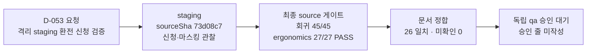

# QA Tracker — haenael-ge

| 표지 | 값 |
|---|---|
| 현재 보고 버전 | v2.1.16 (2026-11-10, 최종 source `73d08c7` 증거 정합) |
| 현재 상태 | **W-12 builder 증거 완료, 독립 qa 승인 대기.** 격리 staging source 일치, 전체 회귀 `45/45`, cashout 3경로×9폭 `27/27` ergonomics PASS. 디자인 분모 `26 일치 / 0 불일치 / 0 미확인` |
| 작성자·모델 | 기존 판정: qa-verifier / Claude Opus 5.5. F-3 정합: code-builder / GPT-5 Codex |
| 라인·단계 | `v2`, `current_stage: qa`, 독립 qa 승인 줄 미작성 |
| 제품 source | `73d08c740f67ccfa730d15c8687931963886b84e` |
| staging | `https://haenael-ge-v2-staging-100-b.vercel.app`. health `version=2.1.2`, `sourceSha=73d08c740f67ccfa730d15c8687931963886b84e`(`.goal/runs/w12-regression-73d08c7/health.json`) |
| 승인 시안 핀 | `docs/design/prototypes/social-viral-loop-v3-opus5.html` v3.0.0, SHA-256 `afca1c03…`(`pipeline-state.v2.md:52`). 작업트리 파일과 SHA 다름(이번 2화면 판정과 별도 추적), [O-1](#t-open) |
| 디자인 상세 | [design-conformance-matrix.md](design-conformance-matrix.md) v2.1.17 |

## 목차 

**현재 보고 (최종 source `73d08c7` builder 증거 · 독립 qa 승인 대기)**
1. [요약](#t-summary)
2. [목적·범위·참고 기준](#t-scope)
3. [수용 조건과 결과](#t-results)
4. [추적성](#t-trace)
5. [증거와 경로 해석](#t-paths)
6. [한계와 오픈 이슈](#t-open)
7. [개정 이력](#t-revisions)

**과거 이력**
8. [회차별 이력 이관 기록](#t-history) → 원문 [archive/v2-qa-tracker-history-v1.0.0-claude-opus-20261109-2008.md](archive/v2-qa-tracker-history-v1.0.0-claude-opus-20261109-2008.md)

## 1. 요약 

- **최종 source 및 staging**: `73d08c7`. 격리 staging health가 `version=2.1.2`, `sourceSha=73d08c7`로 일치한다. 근거 `.goal/runs/w12-regression-73d08c7/health.json`.
- **전체 회귀**: `45 expected / 0 unexpected / 0 flaky / 0 skipped`, EXIT 0. 근거 `.goal/runs/w12-regression-73d08c7/{report.json,run.exit}`.
- **cashout 모바일 ergonomics**: `/cashout`·`/cashout/status`·`/cashout/history` 3경로×9폭, 총 `27/27`; `font_below_13=0`, `tap_below_44=0`, `horizontal_overflow=0`, 위반 0, 콘솔 오류 0, `ERGONOMICS_VERDICT: PASS`. 근거 `.goal/runs/w12-ergonomics-73d08c7/{observations.json,ergo.log}`.
- **현재 디자인 분모**: `26 일치 / 0 불일치 / 0 미확인`. `cashout`은 **일치(구조·순서. 추가 5요소는 2026-08-30 core 판정 승계, 시안 승격은 디자인 갱신 과제로 이관)**. 내역 날짜 KST 표시는 `58316d8`에서 수정되고 경계 시각 단위 시험이 추가됐다.
- **qa 단계**: builder 증거를 정합했으며 독립 qa 승인 줄은 작성하지 않았다.

## 2. 목적·범위·참고 기준 

- **목적**: W-12 환전 신청(D-053)의 최종 source `73d08c7` builder 증거를 기능 해피·엣지, 전체 회귀, 디자인 QA, 모바일 ergonomics 기준으로 집약한다.
- **범위 안(현재)**: 격리 staging 신청 POST·`REQUESTED`·마스킹·상태·내역, cashout 시안 대조, 최종 source 전체 회귀, cashout 3경로×9폭 ergonomics. 현재 builder 증거는 모두 확보됐다.
- **범위 안(과거 근거, 16e483d)**: 회귀 45건, 결제 성공·성장 2화면 3폭 직접 대조, 나머지 23화면 증거 재사용 판정. 당시 D-052 로 cashout 제외.
- **범위 밖**: 실제 Toss 승인 호출, 운영, 비 Chromium, 성능·부하·보안(회장 미지정).
- **참고한 보고서 구성(2026-11-09 조회)**: [GitLab 단위 시험 보고서](https://docs.gitlab.com/ci/testing/unit_test_reports/) 의 "요약 건수 먼저, 실패 건은 상세·첨부로 연결, 기준 대비 새 실패·해소 구분" 을 차용해 §1 건수 우선과 §8 이력의 614c949(44/45) 대비 해소 기록을 둔다. [Playwright 보고자](https://playwright.dev/docs/test-reporters) 의 "실행 하나 = JSON 객체 하나, 첨부는 별도 디렉터리" 구조를 차용해 §5 경로 root 표를 둔다. JUnit 첨부 태그·HTML 보고서는 채택하지 않았다(이 대장은 경로 표로 충분).

## 3. 수용 조건과 결과 

| ID | 출고 항목 | 수용 조건 | 결과 | 증거(저장소 루트 기준) |
|---|---|---|---|---|
| AC-1 | 누적 회귀 | 최종 source 45건 retries 0, unexpected·flaky·skipped 0, EXIT 0 | 충족 45/45, 450.4초 | `.goal/runs/w12-regression-73d08c7/{report.json,run.exit,health.json}` |
| AC-2 | 기능 해피·엣지 + 디자인(결제 2화면) | 실제 `DONE` 3건, 3폭 HTTP 200·overflow 0·console error 0·오류 문구 0, 성공·성장 분리 | 충족 6쌍 일치 | `.goal/runs/g7-independent-192x/{paysuccess,dopamine}-{staging16e,pair16e}-{390,1024,1440}.png`, `observations.json` |
| AC-3 | 디자인(나머지 23화면) | diff 가 해당 UI 를 바꾸지 않을 때 직전 직접 PNG 재사용 | 충족(재사용) | `.goal/verify-20261109-192x.md:33`, 매트릭스 §9 |
| AC-4 | 분모 | 승인된 기준으로 26화면 판정 | `26 일치 / 0 불일치 / 0 미확인`. cashout은 구조·순서 일치, 추가 5요소는 2026-08-30 core 판정 승계 | D-052·D-053, 매트릭스 §6, `.goal/verify-20261110-0358.md` §3 |
| AC-5 | 정리 | 결제 플래그 복구 HTTP 503, fixture 잔존 0 | 충족 | `summary.json` `fixture_cleanup` |
| W-12 | 환전 신청 격리 검증(D-053, 최종 source `73d08c7`) | 격리 staging 신청·마스킹·상태·내역 + 디자인 판정 + 전체 회귀 + 3경로×9폭 ergonomics | **builder 증거 충족, 독립 qa 승인 대기.** staging source 일치, 회귀 45/45, ergonomics 27/27 PASS, 날짜 KST 결함 수정 | `.goal/runs/w12-staging-20261110/`, `.goal/runs/w12-regression-73d08c7/`, `.goal/runs/w12-ergonomics-73d08c7/`, `58316d8`, 매트릭스 §6 |

## 4. 추적성 

추적은 3층이다. **1층 요청**([결정.md](../../wiki/거버넌스/결정.md) D-050~D-053) → **2층 검증 요약**(§1·§3) → **3층 시험별 원본**(staging 관찰, 최종 회귀 `report.json`, ergonomics `observations.json`). 기존 독립 판정의 당시 FAIL은 [검증 원본](../../.goal/verify-20261110-0358.md)에 보존하고, 같은 파일의 후속 해소 근거에서 F-1·F-2·F-4를 최종 source 기준으로 연결한다.

| 요청 번호 | 요청 요지(원문 축약) | 2층: 수치·AC | 3층: 회귀 시험(summary.json 순번 · ID, 전부 `expected`) | 3층: 직접 관찰 원본 | 판정 |
|---|---|---|---|---|---|
| D-050a | 서로 로그인해 응원한 사이는 친구, 친구 상세에서 과거 응원 이력 확인 | AC-1 | #44 `G4-FRIEND-HISTORY-01` · #42 `QA-TC-FD-03` · #9 `QA-REVERIFY-FLOW-01A` | 614c949 회차 재사용: `.goal/runs/g7-final-qa-20261109/friend-preservation/{friends,friend-detail-history}-390.png`, `observations.json` `detail.sent=1·received=1`, `friendList.legacyGuestSections=0` | 충족 |
| D-050b | 비회원(손님) 응원은 마이페이지에서만 본다 | AC-1 | #44 `G4-FRIEND-HISTORY-01` · #4 `MY-01` | 같은 폴더 `my-received-390.png`, `observations.json` `myGuestNames=3·myGuestWords=2` | 충족 |
| D-050c | 워드맵·받은 응원 수 등 홈 집계는 그대로 보인다 | AC-1 | #44 `G4-FRIEND-HISTORY-01`(시험명 "손님 응원은 마이·홈에만 표시") | 같은 `observations.json` `homeCount12=true·wordmapGuestWords=10`, 직접 SQL [이력 01:58 절](archive/v2-qa-tracker-history-v1.0.0-claude-opus-20261109-2008.md) | 충족 |
| D-051a | 결제 성공 화면을 승인 시안대로 | AC-2 | #7 `SMOKE-01` · #43 `ORDER-ATTR-01` · #21 `QA-TC-SP-03` | `.goal/runs/g7-independent-192x/paysuccess-{staging16e,pair16e}-{390,1024,1440}.png`, `observations.json` `widths[]` | 충족(O-6 후보 별도) |
| D-051b | 성장 피드백(워드맵 적립) 화면을 시안대로, 단어 적립 기능 유지 | AC-2 | #7 `SMOKE-01` · #43 `ORDER-ATTR-01` | 같은 폴더 `dopamine-{staging16e,pair16e}-{390,1024,1440}.png`, `observations.json` `widths[]`(워드맵 11, 영역 밖 0) | 충족(O-6 후보 별도) |
| D-052a | 16e483d staging 전체 회귀를 스크립트로 1회, 이어서 다른 모델 독립 VERDICT | AC-1·AC-5 | #1~#45 전부, `stats` expected 45 · unexpected 0 · flaky 0 · skipped 0, `exit` 0 | `.goal/runs/g7-regression-20261109-192x/{summary.json,summary.md,run.exit,captures/}`, 독립 판정 2건(위 링크) | 충족 |
| D-052b | W-12 정책은 결정 대기로 두고 범위에서 뺀다(D-053 으로 대체됨) | AC-4 | 해당 시험 없음(16e483d 회차 범위 제외) | [매트릭스 §6](design-conformance-matrix.md#screens) `cashout` 행 | 과거 범위 제외. PASS 아님 |
| D-053 | 격리 staging 환전 신청 검증만 허용(2026-11-09 21:12) | W-12 · AC-1 · AC-4 | 최종 source 회귀 45건 expected, unexpected·flaky·skipped 0 | `.goal/runs/w12-staging-20261110/`, `.goal/runs/w12-regression-73d08c7/{report.json,health.json,run.exit}`, `.goal/runs/w12-ergonomics-73d08c7/{observations.json,ergo.log}` | **builder 증거 충족, 독립 qa 승인 대기** |

요청 번호 a·b·c 는 이 대장이 각 결정 원문을 문장 단위로 나눠 붙인 하위 번호다. 결정 원장에는 D-050~053 이 있다. 디자인 화면별 판정과 시안 줄 번호는 [매트릭스 §7](design-conformance-matrix.md#trace) 이 정본이다.

증거 재사용 이유: 16e483d diff 7파일이 결제 성공 범위와 `/g/[slug]` `id="cheer"` 1개로 한정됐다. 사용자 승인된 영향 범위 판단이며 이번 대상의 누락이 아니다. 상세는 [매트릭스 §7](design-conformance-matrix.md#trace).

## 5. 증거와 경로 해석 

이 대장의 모든 `.goal/…` 경로는 저장소 루트 기준이다. 최종 source 증거 root는 `.goal/runs/w12-regression-73d08c7/`과 `.goal/runs/w12-ergonomics-73d08c7/`이며, 기능 쓰기 관찰 root는 `.goal/runs/w12-staging-20261110/`이다. 판정표 접두어 `direct-captures/`·`comparison-captures/`의 root는 [매트릭스 §9](design-conformance-matrix.md#paths)에서 해석한다. 기존 독립 판정과 시험 원본은 수정하지 않았다.

## 6. 한계와 오픈 이슈 

| ID | 내용 | 소유 |
|---|---|---|
| O-1 | 시안 핀 SHA `afca1c03…`(커밋 `7ecfb55`)와 작업트리 파일 SHA `5956191b…`(커밋 `3142e9a` 에서 변경) 불일치. 컨트롤러가 `paysuccess`·`dopamine` 두 화면 markup 이 `7ecfb55` 와 완전히 같고 CSS 차이는 `business-info` 뿐임을 확인했다(근거 확인, 이 문서 작성자는 재실행하지 않음). 따라서 이번 2화면 판정에는 영향이 없고, 핀 갱신 여부는 별도 추적 문제로 남긴다. 핀은 바꾸지 않았다 | 컨트롤러 |
| O-2 | 매트릭스 재사용 6행 개별 PNG 경로 미기재 | 다음 QA 회차 |
| O-3 | W-12 builder 증거는 최종 source `73d08c7`에서 정합됐다. 독립 qa 승인 줄은 이 문서 작업 범위 밖이며 작성하지 않았다 | 컨트롤러: 독립 qa 검증·게이트 판정 |
| O-4 | v2.1.14 에서 요청 번호 열과 요청→요약→시험 원본 3층 추적표를 [§4](#t-trace) 에 두었다. 단 qa-verifier 규격의 `docs/qa/testcases.md` TC 정본 파일은 아직 없다(시험 ID 는 회귀 `summary.json` 이 원본) | 다음 회차 이관 |
| O-5 | 이력 19:33 절 등 띄어쓰기 결손은 원문 보존 원칙으로 고치지 않고 [보관본](archive/v2-qa-tracker-history-v1.0.0-claude-opus-20261109-2008.md) 으로 옮겼다. 같은 사실은 §1·§3·§4 에 다시 적었다 | 기록만 |
| O-6 | 표현 편차 **후보**(판정 아님): 1024 pair 에서 `paysuccess` 세로 정렬(시안 상단, staging 중앙)과 `dopamine` CTA 아래 안내 박스 미표시. 첫 독립 판정 VERDICT PASS 는 그대로이며 이 후보로 PASS 를 뒤집거나 일치로 바꿔 세지 않는다. 새 화면 수정 없음. 상세 [매트릭스 O-6](design-conformance-matrix.md#open) | 컨트롤러 재판정 |

## 7. 개정 이력 

| 버전 | 시각(KST) | 변경 |
|---|---|---|
| v2.1.16 | 2026-11-10 | 최종 source `73d08c7` 기준으로 표지·§1~§6·mermaid를 정합. staging source 일치, 회귀 45/45, cashout ergonomics 27/27 PASS, 디자인 `26/0/0`, F-4 `58316d8` 근거를 연결. 독립 qa 승인 줄 미작성 |
| v2.1.15 | 2026-11-09 21:5x | W-12 판정 반영 문서 보정: 표지 현재 상태·매트릭스 참조 v2.1.16, §1 현재(NOT_MET/FAIL)와 과거 16e483d 근거 분리, 범위·AC-4·O-3 을 D-053 기준으로, §4 D-053 행과 추적 mermaid 추가. 제품 판정·시험 원본 변경 없음 |
| v2.1.14 | 2026-11-09 20:1x | §4 요청 번호 3층 추적표, §8 이력 59절 원문 보관본 이관(SHA 일치), O-1·O-4·O-5·O-6 갱신. 판정 변경 없음 |
| v2.1.13 | 2026-11-09 19:53 | 현재 보고 영역(표지·목차·범위·수용 조건·추적성·경로·오픈 이슈) 신설, 이력과 분리. 판정 변경 없음 |
| v2.1.12 | 2026-11-09 19:5x | 16e483d 독립 판정 반영 절 추가 |
| 이전 | 2026-08-03~11-09 | 회차별 절, 현재는 [보관본](archive/v2-qa-tracker-history-v1.0.0-claude-opus-20261109-2008.md) |

## 8. 회차별 이력 (최신순, 판정 효력 없음) 

- 2026-11-10 03:5x KST · W-12 격리 staging QA(Claude 세션): 쓰기 경로 PASS, cashout 디자인 불일치(기존 요소 5개). 사고: 첫 배포 때 worktree `.vercel/project.json` 부재로 `vercel deploy --yes` 가 새 Vercel 프로젝트 `haenael-ge-v2-hotfix` 를 만들고 시험 키를 넣음. 키 폐기·재발급, 연결을 `haenael-ge` 로 복구 후 재배포. 그 프로젝트 삭제는 CLI 가 사람 승인을 요구해 대기.

> 2026-11-09 v2.1.14 에서 회차별 원문 59개 절(원본 줄 88~1465, 1,378줄)을 [archive/v2-qa-tracker-history-v1.0.0-claude-opus-20261109-2008.md](archive/v2-qa-tracker-history-v1.0.0-claude-opus-20261109-2008.md) 로 옮겼다. 원문은 한 글자도 고치지 않았다. 이 대장에서는 현재 보고만 평가한다.

| 검증 항목 | 값 | 방법 |
|---|---|---|
| 이관 줄 수 | 1,378줄 (원본 88~1465) | `sed -n '88,1465p'` 추출, `wc -l` |
| 회차 절 수 | 59개 (`## 2026…` 헤딩) | 이관 전후 `grep -c '^## '` 동일 |
| 원문 동일성 | SHA-256 `82859841…3d3c305323` 일치 | 이관 전 추출본과 보관본 본문(`ARCHIVE-BODY-BEGIN` 이후)을 각각 `sha256sum` |
| 가장 최근 이력 절 | `2026-11-09 19:5x KST · 16e483d 독립 판정 반영` | 보관본 첫 회차 절 |

## 문서 품질 채점 (standard-doc-review.md §2, v2.1.16 최신)

- 완결성 4: 표지·목적·범위·수용 조건·추적성·오픈 이슈·개정 이력이 최종 source 상태와 맞는다. 용어 절은 매트릭스 링크에 기댄다.
- 정밀성 4: 최종 SHA, health version, 회귀 네 수치, 27개 ergonomics 수치와 증거 root를 명시했다. 과거 이력에는 분 단위가 `x`인 기록이 남는다.
- 벤치마크 반영 3: 공식 GitLab·Playwright 보고서 구성을 재사용했다. 이번 버그 픽스 문서 정합에서는 새 외부 조사를 하지 않았다.
- 추적성 5: D-053에서 staging 관찰, 최종 회귀, ergonomics, 디자인 분모, 독립 검증 후속 근거가 경로로 이어진다.
- 전문성/톤 4: 현재 builder 증거와 독립 qa 승인을 분리했다. 과거 하위 요청 번호(a·b·c)는 보존한다.

RUBRIC_SCORE: 완결성=4 정밀성=4 벤치마크=3 추적성=5 전문성=4 total=20/25 (합격선 충족)
WEAKEST_LINE: "벤치마크 반영 3". 이번 변경은 정해진 규격의 버그 픽스 문서 정합이라 새 동종 보고서 조사는 면제했다.

## 과거 자가채점 (v2.1.14 기준, 최신 평가 아님. 2026-11-09 21:4x 후속 재채점 14/25 로 대체됨)

- 완결성 4: 표지·목차·목적·범위·수용 조건·결과·추적성·경로·오픈 이슈·개정 이력·이력 이관 기록이 있다. 용어 절은 매트릭스 §3 링크에 기댄다(5점 아님).
- 정밀성 4: 건수·종료코드·SHA·시험 순번·관찰 키 값이 수치로 있다. 23화면은 재사용 판정이고 재사용 6행 PNG 경로가 비어 있다(O-2).
- 벤치마크 반영 4: GitLab 단위 시험 보고서·Playwright 보고자 공식 문서 2건의 실조회 근거와 차용·미채택을 §2 에 그대로 둔다. 이번 판에서 새로 조사하지 않았다.
- 추적성 4 (3→4): 결정 7개 하위 요청이 요약 수치·AC·`summary.json` 시험 순번과 ID·관찰 원본 경로·판정까지 한 줄씩 이어진다. 5점이 아닌 이유: TC 정본 `testcases.md` 부재(O-4), D-050 직접 관찰이 614c949 회차 재사용, 시안 핀 SHA 불일치 미정리(O-1).
- 전문성/톤 4 (3→4): 오타가 있는 과거 59절을 원문 그대로 보관본으로 옮겨 현재 보고와 분리했고 이관 동일성을 SHA 로 남겼다. 5점이 아닌 이유: 하위 요청 번호(a·b·c)가 결정 원장에 없는 대장 자체 번호이고, 시각 일부가 `19:5x`·`20:1x` 로 분 단위가 아니다.

과거 점수(v2.1.14 자가신고, 무효): 완결성=4 정밀성=4 벤치마크=4 추적성=4 전문성=4 total=20/25
과거 약점: "D-050a … 614c949 회차 재사용: `.goal/runs/g7-final-qa-20261109/friend-preservation/…`" (§4. 이번 source 16e483d 의 친구·손님 화면 직접 관찰이 아니라 회귀 #44 expected 와 직전 회차 관찰에 기댄다)

SOURCES/MODEL: GPT-5 Codex | `.goal/runs/w12-regression-73d08c7/{health.json,report.json,run.exit}` | `.goal/runs/w12-ergonomics-73d08c7/{observations.json,ergo.log}` | `.goal/verify-20261110-0358.md` | 기존 벤치마크 https://docs.gitlab.com/ci/testing/unit_test_reports/ · https://playwright.dev/docs/test-reporters
