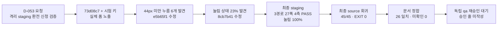

# QA Tracker — haenael-ge

| 표지 | 값 |
|---|---|
| 현재 보고 버전 | v2.1.31 (2026-11-12, F-1·F-2 builder 해소와 exact source 전체 회귀 45/45) |
| 현재 상태 | **✅ builder 증거 충족, 독립 qa 재승인 대기.** source `a980a13`에서 승인 시안 236px를 복원하고, 피드백 상자가 스크롤 뒤 고정 하단 탭에 가리지 않음을 `SMOKE-01`로 검증했다. 390·1024·1440px 같은 폭 대조 6쌍을 직접 확인했고, 환경 오류 1회 뒤 허용된 재실행은 `45 expected / 0 unexpected / 0 flaky / 0 skipped`, EXIT 0이다 |
| 작성자·모델 | 기존 판정: qa-verifier / Claude Opus 5.5. F-1·F-2 수정·증거 정합: code-builder / GPT-5 Codex |
| 라인·단계 | `v2`, `current_stage: qa`, 독립 qa 승인 줄 미작성 |
| 제품 source | `a980a13478274f9c9874c38c4aa3ac6efe80b73d`: 승인 시안 236px 복원, 스크롤 도달성 단언, 결제 2화면 3폭 캡처 계약 |
| staging | `https://haenael-ge-v2-staging-100-b.vercel.app`. deployment `dpl_J9GfEtVwmJHamryPvEV7rVfghhmB`, immutable URL `https://haenael-ekad1st7w-100-b.vercel.app`, 별칭·immutable health `sourceSha=a980a13478274f9c9874c38c4aa3ac6efe80b73d`, `version=2.1.3` |
| 승인 시안 핀 | `docs/design/prototypes/social-viral-loop-v3-opus5.html` v3.0.0, SHA-256 `afca1c03…`(`pipeline-state.v2.md:52`). 작업트리 파일과 SHA 다름(이번 2화면 판정과 별도 추적), [O-1](#t-open) |
| 디자인 상세 | [design-conformance-matrix.md](design-conformance-matrix.md) v2.1.26 |

## 목차 

**현재 보고 (source `a980a13` F-1·F-2 builder 해소 · 전체 회귀 45/45 · 독립 qa 재승인 대기)**
1. [요약](#t-summary)
2. [목적·범위·참고 기준](#t-scope)
3. [수용 조건과 결과](#t-results)
4. [추적성](#t-trace)
5. [증거와 경로 해석](#t-paths)
6. [한계와 오픈 이슈](#t-open)
7. [개정 이력](#t-revisions)

**과거 이력**
8. [회차별 이력 이관 기록](#t-history) → 원문 [archive/v2-qa-tracker-history-v1.0.0-claude-opus-20261109-2008.md](archive/v2-qa-tracker-history-v1.0.0-claude-opus-20261109-2008.md)

## 1. 요약 

- **✅ F-1·F-2 builder 해소**: source `a980a13`에서 승인 프로토타입 `#dopamine .wordmap.cloud`의 236px를 제품과 `SMOKE-01`에 복원했다. 피드백 박스는 스크롤 뒤 고정 하단 탭 위에 완전히 노출됨을 단언한다. 결제 성공·성장 화면은 390·1024·1440px에서 승인 clean frame과 제품을 같은 픽셀 폭으로 합성한 6쌍을 직접 확인했다. 근거 `.goal/runs/w12-regression-a980a13-r2/{captures,comparisons}/`.
- **최종 source 및 staging**: `a980a13`. 격리 staging 별칭과 immutable URL의 health가 `version=2.1.3`, `sourceSha=a980a13478274f9c9874c38c4aa3ac6efe80b73d`로 일치한다. 근거 `.goal/runs/v2-f1-deploy-a980a13/{deploy.json,alias.log,health-alias.json,health-immutable.json}`.
- **전체 회귀·정리**: 첫 실행은 Playwright Chromium revision 불일치로 실행 전에 중단했고 결제 기능을 HTTP 503으로 복구했다. 작업 전용 revision 1228을 설치한 허용 재실행은 `45 expected / 0 unexpected / 0 flaky / 0 skipped`, Playwright·전체 실행 EXIT 0, 497.0초다. DB·Auth·Storage fixture 잔존은 0이다. 근거 `.goal/runs/w12-regression-a980a13{,-r2}/`.
- **F-9 정적·단위 검증**: `web/src` 전수 검색에서 13px 미만 글자 리터럴 0, 디자인 토큰 검사 303파일·기존 40·신규 0, Vitest `92 files / 553 tests` 전부 PASS다. 마이페이지 응원 탭은 `--tap-min-size` 44px에 spacing 토큰 2px를 더해 최소 46px로 고정했다. 근거 `/tmp/haenael-f9-{design-token,vitest}-final5.log`, commits `6bed685`, `a95cd5a`, `dbc8dca`, `b772642`, `ad7dce4`.
- **전체 회귀와 후속 해소**: source `b772642`에서 허용된 전체 회귀를 2회 실행했다. 1차는 `44 expected / 1 unexpected`이며 유일한 실패는 `PW-02`에 수집된 `ERR_NETWORK_CHANGED`였다. 허용된 재실행은 `44 expected / 1 unexpected`이며 `/me` 전화번호 동의 안내의 14px 고아 줄바꿈을 발견했다. source `ad7dce4`에서 균형 줄바꿈으로 보정하고 최종 staging의 `QA-TC-SP-04`를 표적 재실행해 `1 expected / 0 unexpected`, fixture 잔존 0을 확인했다. 두 전체 회귀 모두 종료 후 결제 API HTTP 503과 fixture 잔존 0이었다. 반복 상한에 따라 최종 SHA 전체 45건은 재실행하지 않았다. 근거 `.goal/runs/w12-regression-b772642{,-r2}/`, `.goal/runs/w12-f9-sp04-ad7dce4/`.
- **최종 source 6경로 9폭**: `/onboarding`, `/me`, `/friends`, `/my`, `/g/<slug>`, `/cashout`을 360·390·412·600·700·780·820·900·1000px에서 측정했다. 54/54 모두 13px 미만 글자 0, 44px 미만 누름 0, 눌림 상태 커버 90% 이상, 가로 넘침 0, 콘솔 오류 0이며 시험 회원·목표·잔액·Auth 사용자의 잔존은 0이다. Auth 정리는 `auth.admin.deleteUser`를 사용했다. 근거 `.goal/runs/w12-f9-ergonomics-ad7dce4/{observations.json,run.log,*.png}`.
- **환전 3경로 4축 관찰**: `/cashout`, `/cashout/status`, `/cashout/history`를 각각 360·390·412·600·700·780·820·900·1000px에서 측정했다. 27/27 모두 13px 미만 글자 0, 본문 토큰 16px, 44px 미만 누름 0, 눌림 상태 100%, 가로 넘침 0, 콘솔 오류 0이다. 근거 `.goal/runs/w12-ergonomics-07a0075/{observations.json,measure.log,*.png}`.
- **fixture 정리**: 실측에 만든 폼 회원과 상태 회원, 환전 신청, ledger의 잔존은 각각 0이다. 정리는 `auth.admin.deleteUser` 경로를 사용했다. 근거 `.goal/runs/w12-ergonomics-07a0075/observations.json`의 `cleanup.remaining`.
- **현재 디자인 분모**: 기존 독립 판정 `26 일치 / 0 불일치 / 0 미확인`을 승계한다. `cashout`은 **일치(구조·순서. 추가 5요소는 2026-08-30 core 판정 승계, 시안 승격은 디자인 갱신 과제로 이관)**이며 픽셀 동일 판정이 아니다. 이번 턴에 시안 `cashout.png`와 최종 `allowed-form-390.png`를 직접 대조해 핵심 순서 유지와 추가 요소를 함께 기록했다. 내역 날짜 KST 표시는 `58316d8`에서 수정되고 경계 시각 단위 시험이 추가됐다.
- **qa 단계**: F-1·F-2 builder 수정·실측 증거를 정합했으며 독립 qa 승인 줄은 작성하지 않았다.
- **SEC-EXT-01 카카오 로그인 callback**: **PASS.** 루트 저장소 `.goal/feature-list.json`의 `G4-AUTH-01`에 2026-11-07 13:47 KST source `a738543` staging에서 실제 카카오 동의 뒤 `/my` 도달과 `auth.users` Kakao 행 `last_sign_in_at` 갱신 관찰이 기록돼 있다. `git diff --stat a738543..07a0075 -- web/src/app/auth web/src/lib/auth web/src/proxy.ts supabase/functions/auth-kakao`는 출력 0줄이다. 오늘 `.goal/runs/w12-f8-07a0075/kakao-probe.log` 재실행은 9342 크롬의 카카오 세션 만료로 `interactive_login_required`, `callbackObserved=false`, `productSessionPresent=false`였으므로 환경 미완으로 기록하고 기존 PASS를 뒤집지 않는다.
- **SEC-PAY-01 결제 callback**: `.goal/runs/w12-f8-8cb7b41/toss-success.log`의 `TOSS_CARD_EXTERNAL_AUTH`에서 토스 테스트 키도 카드사 본인인증을 요구함을 관찰했다. 성공 callback은 `accepted_unverified`, 취소·금액 변조는 PASS다. source `07a0075`에서 staging·운영 `cheer-order`가 각각 HTTP 503 `payments_disabled`임을 직접 확인했다. 근거 `.goal/runs/w12-f8-07a0075/{staging-cheer-order.http,staging-cheer-order.json,production-cheer-order.http,production-cheer-order.json}`.

## 2. 목적·범위·참고 기준 

- **목적**: 최종 source `a980a13`에서 독립 검증 7차 F-1·F-2를 승인 수치·3폭 시각 증거·누적 회귀로 해소한다.
- **범위 안(현재)**: 격리 staging, 결제 성공·성장 390·1024·1440px 같은 폭 대조, `SMOKE-01` 최종 236px와 스크롤 도달성 계약, 누적 회귀 45건, 결제 기능 비활성 복구, fixture 정리, O-1·O-2·O-4·O-6·O-7 문서 정합.
- **범위 안(과거 근거, 16e483d)**: 회귀 45건, 결제 성공·성장 2화면 3폭 직접 대조, 나머지 23화면 증거 재사용 판정. 당시 D-052 로 cashout 제외.
- **범위 밖**: 실제 Toss 승인 호출, 운영, 비 Chromium, 성능·부하·보안(회장 미지정).
- **참고한 보고서 구성(2026-11-09 조회)**: [GitLab 단위 시험 보고서](https://docs.gitlab.com/ci/testing/unit_test_reports/) 의 "요약 건수 먼저, 실패 건은 상세·첨부로 연결, 기준 대비 새 실패·해소 구분" 을 차용해 §1 건수 우선과 §8 이력의 614c949(44/45) 대비 해소 기록을 둔다. [Playwright 보고자](https://playwright.dev/docs/test-reporters) 의 "실행 하나 = JSON 객체 하나, 첨부는 별도 디렉터리" 구조를 차용해 §5 경로 root 표를 둔다. JUnit 첨부 태그·HTML 보고서는 채택하지 않았다(이 대장은 경로 표로 충분).

## 3. 수용 조건과 결과 

| ID | 출고 항목 | 수용 조건 | 결과 | 증거(저장소 루트 기준) |
|---|---|---|---|---|
| AC-1 | 최종 source 누적 회귀 | source `a980a13` 45건 retries 0, unexpected·flaky·skipped 0, EXIT 0 | 충족 45/45, 497.0초, health source 일치 | `.goal/runs/w12-regression-a980a13-r2/{summary.json,report.json,playwright.exit,run.exit,health.json}` |
| AC-2 | 기능 해피·엣지 + 디자인(결제 2화면) | 실제 `DONE` 결제, 390·1024·1440px 승인 시안 대조, 성공 상단 정렬, 성장 피드백 박스, 최종 워드맵 236px, 스크롤 뒤 하단 탭 비가림, overflow·console error 0 | 충족. 2화면 × 3폭 = 6쌍 직접 대조, `SMOKE-01` expected | `.goal/runs/w12-regression-a980a13-r2/comparisons/{paysuccess,dopamine}-pair-{390,1024,1440}.png` |
| AC-3 | 디자인(나머지 23화면) | diff 가 해당 UI 를 바꾸지 않을 때 직전 직접 PNG 재사용 | 충족(재사용) | `.goal/verify-20261109-192x.md:33`, 매트릭스 §9 |
| AC-4 | 분모 | 승인된 기준으로 26화면 판정 | `26 일치 / 0 불일치 / 0 미확인`. cashout은 구조·순서 일치, 추가 5요소는 2026-08-30 core 판정 승계 | D-052·D-053, 매트릭스 §6, `.goal/verify-20261110-0358.md` §3 |
| AC-5 | 정리 | 결제 기능 비활성 복구 HTTP 503, 회귀 fixture 잔존 0 | 충족. 결제 기능 비활성 복구 503, DB·Auth·Storage fixture 잔존 0 | `.goal/runs/w12-regression-a980a13-r2/{payment-restore.http,summary.json,execution.log}` |
| W-12 | 환전 신청 격리 검증(D-053, 최종 source `8cb7b41`) | 격리 staging 신청·마스킹·상태·내역 + 디자인 판정 + 전체 회귀 + 3경로 27폭 ergonomics 4축 | **builder 증거 충족, 독립 qa 재승인 대기.** staging source 일치, 회귀 45/45, 신청 폼 9/9와 상태·내역 18/18에서 4축 위반 0, 눌림 상태 100% | `.goal/runs/w12-f7-deploy-8cb7b41/`, `.goal/runs/w12-regression-8cb7b41/`, `.goal/runs/w12-ergonomics-8cb7b41/`, `8cb7b41`, 매트릭스 §6 |
| F-6 | 최종 source 허용 회원 신청·폼 상태 | 시험 키 4종을 넣은 격리 staging에서 허용 회원 신청 성공·중복 차단·허용 밖 거부·신청 폼 9폭 실측 | **builder 해소.** `73d08c7`을 시험 키와 재배포해 실제 폼에서 44px 미만 누름 6개를 발견했고, `e5b65f1`에서 수정 후 최종 staging 재관찰했다. 신청 1건 `REQUESTED`, 마스킹·원문 0·`CASHOUT_HOLD` 1, 중복·허용 밖 거부, 폼 9폭 3축 위반 0, fixture 잔존 0 | `.goal/verify-20261110-1147.md` 후속, `.goal/runs/w12-f6-deploy-{73d08c7,e5b65f1}/`, `.goal/runs/w12-f6-verify-e5b65f1/` |
| F-1 재검증 | 최종 source 전체 회귀·상태 화면 크기 | source `e5b65f1` staging에서 45건 전체 회귀와 `/cashout/status`·`/cashout/history` 9폭을 새로 실행 | **builder 해소, 독립 qa 재승인 대기.** 회귀 `45 expected / 0 unexpected / 0 flaky / 0 skipped`, EXIT 0. `REQUESTED detail`·`REQUESTED history row` 상태 18/18에서 3축 위반 0, 390px 캡처 저장, 결제 플래그 원복과 fixture 정리 확인 | `.goal/runs/w12-regression-e5b65f1/`, `.goal/runs/w12-state-ergonomics-e5b65f1/` |
| F-7 | 신청 폼 눌림 상태 | 측정기와 같은 탭 대상 선택자에서 9폭 `active_ratio >= 90%`, 나머지 3축 위반 0, 폭별 캡처 | **builder 해소.** 폼 9폭과 실제 데이터 상태·내역 18폭 모두 `active_ratio=100%`, 글자·탭 크기·넘침 위반 0, 본문 토큰 16px, 캡처 27장, fixture 잔존 0 | `.goal/verify-20261110-1252.md`, `.goal/runs/w12-ergonomics-8cb7b41/{observations.json,measure.log,*.png}` |
| F-9 | 앱 전역 13px 최소 글자·44px 누름·고아 줄바꿈 | `web/src` 13px 미만 리터럴 0, Vitest·디자인 토큰 검사 PASS, 6경로×9폭 글자·누름·눌림·넘침 위반 0 | **builder 해소, 독립 qa 재승인 대기.** 최종 source `ad7dce4` 54/54 위반 0, `QA-TC-SP-04` 1/1 PASS, fixture 잔존 0. 전체 회귀는 `b772642`에서 2회 44/45였고 최종 고아 줄바꿈 보정 뒤 전체 45건은 반복 상한으로 미실행 | `.goal/verify-20261111-0547.md`, `.goal/runs/w12-f9-ad7dce4/`, `.goal/runs/w12-f9-ergonomics-ad7dce4/`, `.goal/runs/w12-f9-sp04-ad7dce4/`, `.goal/runs/w12-regression-b772642{,-r2}/` |

## 4. 추적성 

추적은 3층이다. **1층 요청**([결정.md](../../wiki/거버넌스/결정.md) D-050~D-053) → **2층 검증 요약**(§1·§3) → **3층 시험별 원본**(staging 관찰, 최종 source 회귀 `report.json`, F-6·상태 화면 `observations.json`). 기존 독립 판정의 당시 FAIL은 [1차 검증 원본](../../.goal/verify-20261110-0358.md)과 [2차 검증 원본](../../.goal/verify-20261110-1147.md)에 보존하고, 후속 해소 근거를 최종 source와 연결한다.

| 요청 번호 | 요청 요지(원문 축약) | 2층: 수치·AC | 3층: 회귀 시험(summary.json 순번 · ID, 전부 `expected`) | 3층: 직접 관찰 원본 | 판정 |
|---|---|---|---|---|---|
| D-050a | 서로 로그인해 응원한 사이는 친구, 친구 상세에서 과거 응원 이력 확인 | AC-1 | #44 `G4-FRIEND-HISTORY-01` · #42 `QA-TC-FD-03` · #9 `QA-REVERIFY-FLOW-01A` | 614c949 회차 재사용: `.goal/runs/g7-final-qa-20261109/friend-preservation/{friends,friend-detail-history}-390.png`, `observations.json` `detail.sent=1·received=1`, `friendList.legacyGuestSections=0` | 충족 |
| D-050b | 비회원(손님) 응원은 마이페이지에서만 본다 | AC-1 | #44 `G4-FRIEND-HISTORY-01` · #4 `MY-01` | 같은 폴더 `my-received-390.png`, `observations.json` `myGuestNames=3·myGuestWords=2` | 충족 |
| D-050c | 워드맵·받은 응원 수 등 홈 집계는 그대로 보인다 | AC-1 | #44 `G4-FRIEND-HISTORY-01`(시험명 "손님 응원은 마이·홈에만 표시") | 같은 `observations.json` `homeCount12=true·wordmapGuestWords=10`, 직접 SQL [이력 01:58 절](archive/v2-qa-tracker-history-v1.0.0-claude-opus-20261109-2008.md) | 충족 |
| D-051a | 결제 성공 화면을 승인 시안대로 | AC-2 | #7 `SMOKE-01` · #43 `ORDER-ATTR-01` · #21 `QA-TC-SP-03`, 최종 source 모두 expected | `.goal/runs/w12-regression-a980a13-r2/comparisons/paysuccess-pair-{390,1024,1440}.png` | 충족, O-6 닫힘 |
| D-051b | 성장 피드백(워드맵 적립) 화면을 시안대로, 단어 적립 기능 유지 | AC-2 | #7 `SMOKE-01` · #43 `ORDER-ATTR-01`, 최종 source 모두 expected | `.goal/runs/w12-regression-a980a13-r2/comparisons/dopamine-pair-{390,1024,1440}.png` | 충족, O-6 닫힘 |
| D-052a | 16e483d staging 전체 회귀를 스크립트로 1회, 이어서 다른 모델 독립 VERDICT | AC-1·AC-5 | #1~#45 전부, `stats` expected 45 · unexpected 0 · flaky 0 · skipped 0, `exit` 0 | `.goal/runs/g7-regression-20261109-192x/{summary.json,summary.md,run.exit,captures/}`, 독립 판정 2건(위 링크) | 충족 |
| D-052b | W-12 정책은 결정 대기로 두고 범위에서 뺀다(D-053 으로 대체됨) | AC-4 | 해당 시험 없음(16e483d 회차 범위 제외) | [매트릭스 §6](design-conformance-matrix.md#screens) `cashout` 행 | 과거 범위 제외. PASS 아님 |
| D-053 | 격리 staging 환전 신청 검증만 허용(2026-11-09 21:12) | W-12 · AC-1 · AC-4 · F-6 · F-7 | 최종 source `8cb7b41` 회귀 45건 expected, unexpected·flaky·skipped 0, 신청 폼·상태·내역 27폭 4축 위반 0 | `.goal/runs/w12-f7-deploy-8cb7b41/`, `.goal/runs/w12-regression-8cb7b41/`, `.goal/runs/w12-ergonomics-8cb7b41/{observations.json,measure.log,*.png}` | **F-7 builder 해소, 독립 qa 재승인 대기** |

요청 번호 a·b·c 는 이 대장이 각 결정 원문을 문장 단위로 나눠 붙인 하위 번호다. 결정 원장에는 D-050~053 이 있다. 디자인 화면별 판정과 시안 줄 번호는 [매트릭스 §7](design-conformance-matrix.md#trace) 이 정본이다.

증거 재사용 이유: 16e483d diff 7파일이 결제 성공 범위와 `/g/[slug]` `id="cheer"` 1개로 한정됐다. 사용자 승인된 영향 범위 판단이며 이번 대상의 누락이 아니다. 상세는 [매트릭스 §7](design-conformance-matrix.md#trace).

## 5. 증거와 경로 해석 

이 대장의 모든 `.goal/…` 경로는 저장소 루트 기준이다. 최종 source 배포 root는 `.goal/runs/v2-f1-deploy-a980a13/`, 전체 회귀 root는 `.goal/runs/w12-regression-a980a13-r2/`, 신청 폼·상태·내역 27폭 4축 root는 `.goal/runs/w12-ergonomics-8cb7b41/`이다. 판정표 접두어 `direct-captures/`·`comparison-captures/`의 root는 [매트릭스 §9](design-conformance-matrix.md#paths)에서 해석한다. 독립 FAIL 원본과 환경 실패 1차 실행은 보존하고 후속 해소 근거만 현재 문서에 연결했다.

## 6. 한계와 오픈 이슈 

| ID | 내용 | 소유 |
|---|---|---|
| O-1 | **닫힘.** 승인본은 `pipeline-state.v2.md approved_artifacts`가 핀한 커밋 `7ecfb55`, SHA-256 `afca1c03…`로 확정한다. 현재 파일 SHA `5956191b…`는 business 정보·coverage 표의 미승인 후속 편집이고 `paysuccess`·`dopamine` markup·CSS는 승인본과 같다. 승인 이력 없는 후속 파일로 핀을 갱신하지 않는다 | 닫힘 |
| O-2 | **닫힘.** 매트릭스 재사용 6행에 승인본·제품 PNG 상대 경로를 직접 기입했다 | 닫힘 |
| O-3 | F-7 builder 증거는 최종 source `8cb7b41`에서 정합됐다. 독립 qa 승인 줄은 이 문서 작업 범위 밖이며 작성하지 않았다 | 컨트롤러: 독립 qa 재검증·게이트 판정 |
| O-4 | **닫힘.** `docs/qa/testcases.md`의 45개 시험 ID·제목·목적은 최종 source에서도 동일하고 `.goal/runs/w12-regression-a980a13-r2/summary.json` 45/45로 재실행됐다 | 닫힘 |
| O-5 | 이력 19:33 절 등 띄어쓰기 결손은 원문 보존 원칙으로 고치지 않고 [보관본](archive/v2-qa-tracker-history-v1.0.0-claude-opus-20261109-2008.md) 으로 옮겼다. 같은 사실은 §1·§3·§4 에 다시 적었다 | 기록만 |
| O-6 | **닫힘.** 승인 clean frame과 source `a980a13` 실화면을 390·1024·1440px 같은 폭으로 합성한 6쌍을 직접 대조했다. `paysuccess`는 상단 정렬, `dopamine`은 CTA 아래 성장 피드백 박스·승인 236px 워드맵·스크롤 뒤 하단 탭 비가림을 표시한다. 최종 `SMOKE-01` expected | 닫힘 |
| O-7 | **닫힘.** staging health source `a980a13478274f9c9874c38c4aa3ac6efe80b73d`의 `.goal/runs/w12-regression-a980a13-r2/`가 `45 expected / 0 unexpected / 0 flaky / 0 skipped`, EXIT 0이다. 결제 기능 비활성 복구 HTTP 503과 fixture 잔존 0도 확인했다 | 닫힘 |

## 7. 개정 이력 

| 버전 | 시각(KST) | 변경 |
|---|---|---|
| v2.1.31 | 2026-11-12 | source `a980a13`에서 승인 236px 복원·스크롤 도달성·3폭 캡처를 검증. Playwright browser revision 환경 실패 1회 뒤 허용 재실행 45/45, 결제 기능 비활성 복구 HTTP 503, fixture 잔존 0. 독립 qa 승인 줄 미작성 |
| v2.1.30 | 2026-11-12 | 독립 검증 7차 F-1·F-2를 즉시 NG 등록하고 재작업 전 PASS 판정을 보류 |
| v2.1.29 | 2026-11-12 | 최종 source `edb4c99` staging 별칭·immutable health 일치, 전체 회귀 45/45, 결제 기능 비활성 복구 HTTP 503, fixture 잔존 0을 연결. 승인 시안과 최종 1024px 결제 성공·성장 화면을 직접 대조해 상단 정렬, CTA 아래 성장 피드백 박스, 최종 200px 워드맵을 확인하고 O-6·O-7을 닫음. `docs/qa/testcases.md`를 최종 source로 갱신해 O-4 유지. 독립 qa 승인 줄 미작성 |
| v2.1.28 | 2026-11-12 | source `165b72a` 전체 회귀 43/45를 NG 등록. `SMOKE-01` 188px는 승인 높이 200px의 진입 모션 시작값 `scale(0.94)`가 적용된 중간 프레임임을 확인해 최종 layout을 재시도하는 assertion으로 보정. 다른 실패는 `QA-TC-LG-02` 30초 timeout. 결제 복구 HTTP 503 확인 |
| v2.1.27 | 2026-11-12 | source `012e0d3` 전체 회귀 44/45의 `SMOKE-01` 실패를 즉시 NG 등록. 승인 규격 200px의 대상은 내부 `.wordmap-cloud`인데 시험이 바깥 래퍼를 측정한 원인을 확인했다. `3cd449a`의 fixture·locator 보정은 표적 실행 0건·EXIT 1이라 아직 PASS로 세지 않고 최종 source 전체 회귀를 대기 |
| v2.1.26 | 2026-11-11 | run `42970386343` 실패 2건 수정. 13px 변경의 전후 높이를 같은 DOM에서 실측해 기존 허용 범위 통과·이탈을 증명하고 확인·제출 중 상태 기준을 갱신. 정당한 `payment-*` 접두어를 계약에 등록. 로컬 계약 PASS, 환전 E2E 13/13, Vitest 553/553, 디자인 토큰 신규 0. main CI 재실행 대기 |
| v2.1.25 | 2026-11-11 | 운영 2.1.3 main CI run `42970386343`의 실패 2건을 즉시 NG 등록. `TC-E2E-V37` 확인 상자 높이 오차와 웹 사용자 정의 클래스 검사 `payment-*` 미등록 접두어를 원본 로그 수치로 기록. 수정·재현 전 PASS 금지 |
| v2.1.24 | 2026-11-11 | F-9 최종 source `ad7dce4` staging health 일치, 13px 미만 리터럴 0, Vitest 553/553, 디자인 토큰 신규 0, 6경로×9폭 54/54 위반 0, 고아 줄바꿈 계약 1/1 PASS를 연결. 전체 회귀 2회 44/45와 최종 SHA 전체 회귀 미실행을 숨기지 않고 O-7에 기록. 독립 qa 승인 줄 미작성 |
| v2.1.23 | 2026-11-11 | source `07a0075` staging health 일치, 회귀 r3 45/45, 환전 3경로 27폭 위반 0, staging·운영 결제 503을 표지·§1에 연결. SEC-EXT-01은 2026-11-07 실제 callback·제품 세션과 이후 인증 경로 diff 0으로 PASS, 오늘 재실행은 카카오 세션 만료 환경 미완으로 분리. 독립 qa 승인 줄 미작성 |
| v2.1.22 | 2026-11-11 | F-8 SEC-PAY-01 성공 callback을 외부 카드 본인인증 제약의 `accepted_unverified`로 기록. 취소·금액 변조 PASS와 staging·운영 결제 비활성 503 출시 조건을 고정. 최종 source 증거는 배포 뒤 갱신 예정 |
| v2.1.21 | 2026-11-10 | F-7 눌림 상태를 최종 source `8cb7b41`에서 해소. 시험 키 포함 staging health SHA 일치, 전체 회귀 45/45, 신청 폼·상태·내역 27폭의 글자·본문 토큰·탭 크기·눌림 상태·넘침을 재측정해 위반 0과 눌림 100%, 폭별 캡처 27장, fixture 잔존 0을 연결. 독립 qa 승인 줄 미작성 |
| v2.1.19 | 2026-11-10 | 최종 source `e5b65f1` exact staging 전체 회귀 45/45, 결제 플래그 HTTP 503 원복, `/cashout/status`·`/cashout/history` `REQUESTED` 화면 18/18 3축 위반 0, 390px 캡처와 fixture 정리 증거를 표지·§1~§6·mermaid에 연결. 독립 qa 승인 줄 미작성 |
| v2.1.18 | 2026-11-10 | cashout 승인 시안과 최종 staging 390px 폼을 직접 대조. 기존 구조·순서 특수 판정은 승계하되 픽셀 동일하지 않음과 추가 요소를 명시 |
| v2.1.17 | 2026-11-10 | F-6 독립 FAIL을 보존하고 실제 폼 재검증으로 정정. `73d08c7` 시험 키 재배포에서 touch target 6개를 발견한 뒤 `e5b65f1`로 수정·재배포했다. 허용 신청·중복·허용 밖 거부, 계좌 입력 폼 9폭 위반 0, fixture 잔존 0을 연결. 독립 qa 승인 줄 미작성 |
| v2.1.16 | 2026-11-10 | 최종 source `73d08c7` 기준으로 표지·§1~§6·mermaid를 정합. staging source 일치, 회귀 45/45, cashout ergonomics 27/27 PASS, 디자인 `26/0/0`, F-4 `58316d8` 근거를 연결. 독립 qa 승인 줄 미작성 |
| v2.1.15 | 2026-11-09 21:5x | W-12 판정 반영 문서 보정: 표지 현재 상태·매트릭스 참조 v2.1.16, §1 현재(NOT_MET/FAIL)와 과거 16e483d 근거 분리, 범위·AC-4·O-3 을 D-053 기준으로, §4 D-053 행과 추적 mermaid 추가. 제품 판정·시험 원본 변경 없음 |
| v2.1.14 | 2026-11-09 20:1x | §4 요청 번호 3층 추적표, §8 이력 59절 원문 보관본 이관(SHA 일치), O-1·O-4·O-5·O-6 갱신. 판정 변경 없음 |
| v2.1.13 | 2026-11-09 19:53 | 현재 보고 영역(표지·목차·범위·수용 조건·추적성·경로·오픈 이슈) 신설, 이력과 분리. 판정 변경 없음 |
| v2.1.12 | 2026-11-09 19:5x | 16e483d 독립 판정 반영 절 추가 |
| 이전 | 2026-08-03~11-09 | 회차별 절, 현재는 [보관본](archive/v2-qa-tracker-history-v1.0.0-claude-opus-20261109-2008.md) |

## 8. 회차별 이력 (최신순, 판정 효력 없음) 

- 2026-11-10 03:5x KST · W-12 격리 staging QA(Claude 세션): 쓰기 경로 PASS, cashout 디자인 불일치(기존 요소 5개). 사고: 첫 배포 때 worktree `.vercel/project.json` 부재로 `vercel deploy --yes` 가 새 Vercel 프로젝트 `haenael-ge-v2-hotfix` 를 만들고 시험 키를 넣음. 키 폐기·재발급, 연결을 `haenael-ge` 로 복구 후 재배포. 그 프로젝트 삭제는 CLI 가 사람 승인을 요구해 대기.

> 2026-11-09 v2.1.14 에서 회차별 원문 59개 절(원본 줄 88~1465, 1,378줄)을 [archive/v2-qa-tracker-history-v1.0.0-claude-opus-20261109-2008.md](archive/v2-qa-tracker-history-v1.0.0-claude-opus-20261109-2008.md) 로 옮겼다. 원문은 한 글자도 고치지 않았다. 이 대장에서는 현재 보고만 평가한다.

| 검증 항목 | 값 | 방법 |
|---|---|---|
| 이관 줄 수 | 1,378줄 (원본 88~1465) | `sed -n '88,1465p'` 추출, `wc -l` |
| 회차 절 수 | 59개 (`## 2026…` 헤딩) | 이관 전후 `grep -c '^## '` 동일 |
| 원문 동일성 | SHA-256 `82859841…3d3c305323` 일치 | 이관 전 추출본과 보관본 본문(`ARCHIVE-BODY-BEGIN` 이후)을 각각 `sha256sum` |
| 가장 최근 이력 절 | `2026-11-09 19:5x KST · 16e483d 독립 판정 반영` | 보관본 첫 회차 절 |

## 문서 품질 채점 (standard-doc-review.md §2, v2.1.31 최신)

- 완결성 5: 표지·목적·범위·수용 조건·추적성·오픈 이슈·개정 이력이 최종 source 상태와 맞고 O-1·O-2·O-4·O-6·O-7을 닫았다.
- 정밀성 4: 최종 SHA, deployment ID, health version, 회귀 45건 통계·종료코드·복구 HTTP, 결제 2화면 3폭 대조 6쌍, 신청·상태·내역 27폭 4축 수치와 증거 root를 명시했다. 과거 이력에는 분 단위가 `x`인 기록이 남는다.
- 벤치마크 반영 3: 공식 GitLab·Playwright 보고서 구성을 재사용했다. 이번 버그 픽스 문서 정합에서는 새 외부 조사를 하지 않았다.
- 추적성 5: D-053에서 2차·3차 독립 FAIL, 73d 폼 노출, e5 누름 크기 수정, 8cb 눌림 상태 수정, 최종 source 회귀·27폭 4축 측정, 디자인 분모가 경로로 이어진다.
- 전문성/톤 4: 현재 builder 증거와 독립 qa 승인을 분리했다. 과거 하위 요청 번호(a·b·c)는 보존한다.

RUBRIC_SCORE: 완결성=5 정밀성=4 벤치마크=3 추적성=5 전문성=4 total=21/25 (합격선 충족)
WEAKEST_LINE: "벤치마크 반영 3". 이번 변경은 정해진 규격의 버그 픽스 문서 정합이라 새 동종 보고서 조사는 면제했다.

## 과거 자가채점 (v2.1.14 기준, 최신 평가 아님. 2026-11-09 21:4x 후속 재채점 14/25 로 대체됨)

- 완결성 4: 표지·목차·목적·범위·수용 조건·결과·추적성·경로·오픈 이슈·개정 이력·이력 이관 기록이 있다. 용어 절은 매트릭스 §3 링크에 기댄다(5점 아님).
- 정밀성 4: 건수·종료코드·SHA·시험 순번·관찰 키 값이 수치로 있다. 23화면은 재사용 판정이고 재사용 6행 PNG 경로가 비어 있다(O-2).
- 벤치마크 반영 4: GitLab 단위 시험 보고서·Playwright 보고자 공식 문서 2건의 실조회 근거와 차용·미채택을 §2 에 그대로 둔다. 이번 판에서 새로 조사하지 않았다.
- 추적성 4 (3→4): 결정 7개 하위 요청이 요약 수치·AC·`summary.json` 시험 순번과 ID·관찰 원본 경로·판정까지 한 줄씩 이어진다. 5점이 아닌 이유: TC 정본 `testcases.md` 부재(O-4), D-050 직접 관찰이 614c949 회차 재사용, 시안 핀 SHA 불일치 미정리(O-1).
- 전문성/톤 4 (3→4): 오타가 있는 과거 59절을 원문 그대로 보관본으로 옮겨 현재 보고와 분리했고 이관 동일성을 SHA 로 남겼다. 5점이 아닌 이유: 하위 요청 번호(a·b·c)가 결정 원장에 없는 대장 자체 번호이고, 시각 일부가 `19:5x`·`20:1x` 로 분 단위가 아니다.

과거 점수(v2.1.14 자가신고, 무효): 완결성=4 정밀성=4 벤치마크=4 추적성=4 전문성=4 total=20/25
과거 약점: "D-050a … 614c949 회차 재사용: `.goal/runs/g7-final-qa-20261109/friend-preservation/…`" (§4. 이번 source 16e483d 의 친구·손님 화면 직접 관찰이 아니라 회귀 #44 expected 와 직전 회차 관찰에 기댄다)

SOURCES/MODEL: GPT-5 Codex | `.goal/verify-20261112-0324.md` | `.goal/runs/v2-f1-deploy-a980a13/{deploy.json,health-alias.json,health-immutable.json}` | `.goal/runs/w12-regression-a980a13-r2/{summary.json,report.json,payment-restore.http,captures,comparisons}` | `.goal/runs/w12-ergonomics-8cb7b41/{observations.json,measure.log,*.png}` | 기존 벤치마크 https://docs.gitlab.com/ci/testing/unit_test_reports/ · https://playwright.dev/docs/test-reporters
