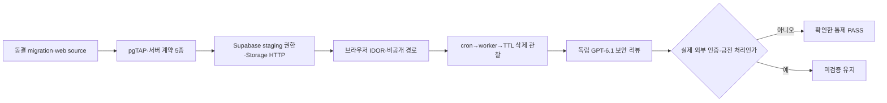

# 해낼게 V2 Security Verification Report

| 항목 | 값 |
|---|---|
| 버전 | v2.0.0 |
| 작성일 | 2026-10-25 |
| 작성자/모델 | qa-verifier / gpt-codex gpt-5.6-sol, reasoning high |
| 상류 산출물(핀) | D-049, V2 server contract migration SHA-256 `131046072ee84a5306f6578826ff74767e0d1b4e7f2d8b4277a9819b95630999` |
| 대상 환경 | Supabase staging `ezzklgotgydwxqebfoys`, Vercel preview |
| 승인 상태 | QA 승인 전. 확인한 보안 통제는 통과, 외부 인증·실제 지급은 미검증 |

## 목차

- [1. 목적·범위·용어](#1-목적범위용어)
- [2. 검증 흐름](#2-검증-흐름)
- [3. 커버리지와 결과](#3-커버리지와-결과)
- [4. 요구↔검증 추적](#4-요구검증-추적)
- [5. 안 한 것](#5-안-한-것)
- [6. 수용기준·판정](#6-수용기준판정)
- [7. 결함·잔여 리스크](#7-결함잔여-리스크)
- [8. 벤치마크·자체 검토](#8-벤치마크자체-검토)
- [9. 개정 이력](#9-개정-이력)

## TL;DR

V2의 DB 권한, Storage 비공개 경로, IDOR, 프로필 사진 업로드·정상 TTL 삭제, 의존성 취약점은 실행 증거로 통과했다. 실제 Kakao OAuth callback과 실제 지급·반려는 계정 로그인과 금전 처리 권한이 필요해 미검증이며, 이 둘을 소스 리뷰나 HTTP 200으로 대체하지 않았다.

## 1. 목적·범위·용어

목적은 V2가 추가한 프로필 사진, 친구·목표 공개범위, 관리자 환전 UI의 권한 경계를 검증하는 것이다. 운영 환경과 실제 지급은 범위 밖이다.

| 용어 | 정의 |
|---|---|
| IDOR | 사용자가 다른 사용자의 리소스 식별자를 바꿔 접근하는 권한 우회 |
| RLS | PostgreSQL Row Level Security |
| Presigned URL | 서명이 붙은 제한 시간 임시 접근 URL |
| TTL | 객체 삭제 전 보존 시간. 프로필 사진은 2시간 5분 |
| Source review | 코드 정적 검토. 실제 런타임 동작의 대체 근거가 아님 |

## 2. 검증 흐름

## 3. 커버리지와 결과

| 통제 | 정량 결과 | 증거 등급 | 판정 |
|---|---|---|---|
| DB·RLS | pgTAP 22 files, 412 tests PASS. 신규 V2 경계 43 tests | 테스트됨 | PASS |
| Supabase 서버 계약 | DB, cleanup schedule, concurrency, runtime, cheer-summary index 5/5 PASS | 테스트됨 | PASS |
| 원격 서버 자산 | migration 추출 catalog assertion 36/36 존재, Edge Functions 16/16 ACTIVE | 관찰됨 | PASS, 존재 확인 한정 |
| 프로필 사진 업로드 | sign 200, Storage PUT 200, finalize 200, hash mismatch 422, 타인 404, 비이미지 415 | 관찰됨 | PASS |
| 프로필 사진 정상 TTL 삭제 | 원 queue due 시각 불변, 10:00 cron run 61, worker HTTP 200, 10:00:02 DONE, metadata 0, Storage object 0, receipt 1 | 관찰됨 | PASS |
| 최소권한 | authenticated role의 avatar ACTIVE 전이·이미지 필드 write·avatar table read 거부 | 관찰됨 | PASS |
| 비공개 Storage 경로 | 친구 응답은 원본 path를 숨기고 Presigned URL만 제공. 관리자 검수만 원본 path 수신 | 관찰됨 | PASS |
| IDOR | friendId와 목표 소유자가 다른 실제 요청 404 | 관찰됨 | PASS |
| production dependency | `npm audit --omit=dev`: info/low/moderate/high/critical 0/0/0/0/0 | 테스트됨 | PASS |
| 결제 차단 | staging `NEXT_PUBLIC_PAYMENTS_ENABLED=false`, 주문 HTTP 503 `payments_disabled` | 관찰됨 | PASS |
| 관리자 환전 소스 | 계좌 전체 번호는 지급 모달에서만 표시, 닫으면 해제. 감사·10분 열람·잠금 RPC 유지. 독립 review NO_FINDINGS | 근거 확인 | PASS, 소스 한정 |
| Kakao OAuth | authorize 화면과 staging callback 형식까지만 도달 | 미검증 | 실제 callback 미검증 |
| 실제 지급·반려 | 버튼·모달 소스 경계만 확인 | 미검증 | 금전 처리 미실행 |

원격 36건 catalog assertion과 16개 Edge Function은 존재 수다. 이를 pgTAP 412건에 더하거나 실제 동작 수로 해석하지 않는다. 소개 저장·목표 종료·회원 탈퇴·프로필 사진 업로드와 삭제는 각 실행 증거를 별도로 사용한다.

## 4. 요구↔검증 추적

| 요청 번호 | 보안 요구 | 검증 | 판정 | 증거 |
|---|---|---|---|---|
| D-049 | 프로토타입 행동을 staging에서 실제 서버 경계와 함께 검증 | DB·Storage·HTTP·브라우저 계층 분리 | PASS | `server-contract-final/`, `staging-v2-migration-assets-inventory-20261025.json` |
| AC-COVER-01~05 | 커버 서명·업로드·검수·오류·권한 경계 | 정상 200, hash 422, 타인 404, format 415, 최소권한 거부 | PASS | staging E2E와 서버 계약 로그 |
| AC-FRIEND-01~02 | 친구 수락 동시성, 다른 사용자 정보 비노출 | 성공 1·used 1·connection 1, IDOR 404 | PASS | staging E2E |
| 개인정보 변경 | 프로필 사진 원본을 비공개로 두고 안전하게 교체·정리 | Presigned URL, private path 비노출, TTL 삭제 | PASS | `staging-profile-avatar-cleanup-observation-20261025-1001.json` |
| 결제·환전 | staging에서 실결제 차단, 관리자 계좌번호 최소 노출 | 503 경계·독립 소스 리뷰 | PASS, 실제 지급 미검증 | dependency·security review 증거 |

## 5. 안 한 것

1. 실제 Kakao 계정 로그인 뒤 `/auth/kakao/callback` 세션 생성.
2. Toss 개발자 계정으로 PG sandbox 결제 승인·취소·webhook 왕복.
3. 실제 관리자 지급 완료·반려와 그 결과 감사로그 생성. 금전 상태를 바꾸므로 실행하지 않았다.
4. 운영 환경 권한·헤더·Storage 검증. 이번 범위는 무료 staging이다.

새 E2E가 만든 TTL 이전 PENDING 객체는 정상 잔여다. 이미 만료된 최초 객체의 정상 삭제는 관찰했으므로 TTL 경로를 다시 미검증으로 낮추지 않는다.

## 6. 수용기준·판정

| 수용기준 | 결과 |
|---|---|
| 타 사용자 리소스 직접 접근은 404 또는 권한 거부 | 충족 |
| private Storage 원본 path는 일반 사용자 응답에 없음 | 충족 |
| 교체된 프로필 사진은 TTL 뒤 cron과 worker로 실제 삭제 | 충족 |
| dependency 취약점 high/critical 0 | 충족 |
| staging 실결제는 503으로 차단 | 충족 |
| 외부 OAuth와 실제 금전 처리는 실행 없이는 PASS 금지 | 미검증 유지 |

**판정:** 확인한 V2 보안 통제 PASS. 전체 릴리스 승인은 Kakao callback과 Toss sandbox 검증 전까지 보류한다.

## 7. 결함·잔여 리스크

| ID | 심각도 | 상태 | 내용 |
|---|---|---|---|
| SEC-EXT-01 | release blocker | open | 실제 Kakao OAuth callback 세션 미검증 |
| SEC-PAY-01 | release blocker | open | PG sandbox 승인·취소·webhook 미검증 |
| SEC-ADMIN-01 | major | open | 실제 지급·반려·감사로그 브라우저 경로 미검증 |

## 8. 벤치마크·자체 검토

ISO/IEC/IEEE 29119의 테스트 증거 분리와 Playwright의 web-first assertion 원칙을 차용했다. 소스 리뷰, 테스트 통과, 실제 HTTP·Storage 관찰을 서로 다른 증거 등급으로 유지한 점이 적용 결과다. Playwright screenshot 문서는 UI 증거에만 사용했고, 보안 동작 증거로 확대하지 않았다.

셀프심문: 이 결론이 틀렸다면 가장 그럴듯한 이유는 무엇인가. staging의 권한이 운영과 다르거나 실제 OAuth·PG에서만 발생하는 설정 결함이다. 그래서 운영 안전성을 선언하지 않고 두 외부 통합을 release blocker로 남겼다.

레드팀: 공격자는 unit test보다 실제 권한 경계를 노린다. 본 보고는 authenticated role 직접 시도, IDOR 404, private path 비노출, 실제 TTL 삭제를 요구해 mock 통과만으로 결론내리지 않았다.

## 9. 개정 이력

| 버전 | 날짜 | 변경 | 작성자 |
|---|---|---|---|
| v2.0.0 | 2026-10-25 | V2 staging 최신 증거로 전면 재작성 | qa-verifier |

---

KNOWLEDGE_QUERY: 해낼게 V2 개인정보·Storage·친구·결제 권한 경계와 QA 보안 계약
HITS_USED: D-049, V2 server contract, Supabase staging 실행 증거, 독립 GPT-6.1 리뷰를 계층별 판정에 사용
HITS_REJECTED: H축 14/14는 기존 cleanup 문서 참조 수라 신규 서버 자산 또는 실제 동작 수로 쓰지 않음. 2026-08 운영 보고는 다른 bundle·환경이라 승계하지 않음
CONFLICTS: 없음. 원격 자산 존재와 실제 동작을 분리하면 증거 간 충돌이 없음
SKILLS_USED: qa, 소스·DB·HTTP·Storage·브라우저 증거 등급을 분리하고 미검증을 보존하는 데 사용
SKILLS_SKIPPED: web-perf, 보안 보고 범위 밖이며 성능 선택 검사는 별도 문서로 분리
SOURCES: ISO/IEC/IEEE 29119 | https://playwright.dev/docs/test-assertions | `docs/qa/evidence/v2-ssot-20261025/`
MODEL: gpt-codex/gpt-5.6-sol, reasoning high
RUBRIC_SCORE: 완결성=5/5 정밀성=5/5 벤치마크=4/5 추적성=5/5 전문성=5/5 total=24/25
WEAKEST_LINE: "실제 지급·반려·감사로그 브라우저 경로는 금전 상태를 바꾸므로 미검증이다."
🏷 STAMP | line: v2 | 생성: 2026-10-25 12:45 KST | model: gpt-5.6-sol high | agent: qa-verifier | skill: qa | 근거: D-049, migration SHA, DB·Storage·HTTP·cron 관찰 | 고민: 자산 존재 수를 실제 동작 수로 부풀리지 않고 외부 인증·금전 처리를 미검증으로 유지
