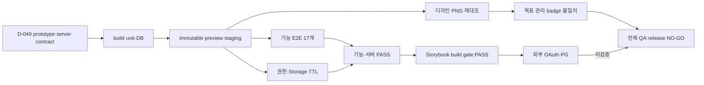

# 해낼게 V2 Staging QA · Test & Verification Report

| 항목 | 값 |
|---|---|
| 버전 | v1.0.0 |
| 작성일 | 2026-10-25 |
| 작성자/모델 | qa-verifier / gpt-codex gpt-5.6-sol, reasoning high |
| 상류 산출물(핀) | D-049, prototype v3.0.0 SHA-256 `afca1c03…24d5de9a`, V2 server contract migration SHA-256 `13104607…630999` |
| 대상 빌드 | Vercel preview `dpl_6ngntmdYQpZHbo83PvuQyhbtiYvu`, immutable `haenael-9ujgvzzu5-100-b.vercel.app` |
| 대상 DB | Supabase staging `ezzklgotgydwxqebfoys` |
| 승인 게이트 | QA 미승인. 기능·서버·Storybook PASS, 목표 관리 badge 디자인 불일치 1건과 외부 OAuth·PG 미검증으로 release NO-GO |

## 목차

- [1. 요청·결론](#1-요청결론)
- [2. 목적·범위·용어](#2-목적범위용어)
- [3. 테스트 전략·환경](#3-테스트-전략환경)
- [4. 커버리지 요약](#4-커버리지-요약)
- [5. 요구↔테스트 역추적](#5-요구테스트-역추적)
- [6. 기능·회귀 결과](#6-기능회귀-결과)
- [7. 디자인·반응형 결과](#7-디자인반응형-결과)
- [8. 서버·보안 결과](#8-서버보안-결과)
- [9. 결함·실패 이력](#9-결함실패-이력)
- [10. 안 한 것](#10-안-한-것)
- [11. 수용기준·출고 권고](#11-수용기준출고-권고)
- [12. 벤치마크·자체 검토](#12-벤치마크자체-검토)
- [13. 개정 이력](#13-개정-이력)

## TL;DR

V2는 무료 Supabase staging과 최신 immutable preview에서 기능 E2E 고유 17/17, web unit 78 files·439 tests, DB 22 files·412 tests, 모바일 9/9 폭과 Storybook build gate를 통과했다. 그러나 목표 관리 화면의 응원자 횟수 badge는 승인본의 연녹색 pill 배경이 제품에 없어 **불일치**다. 나머지 8개 화면은 이번 재검증에서 새 판정을 내리지 않았다. 실제 Kakao OAuth callback과 Toss PG sandbox도 미검증이므로 전체 QA 승인과 운영 release는 **NO-GO**다.

## 1. 요청·결론

회장 요청: 이전 목표 실행이 개발·QA까지 가지 못하고 앞 단계에서 토큰을 소진한 문제를 반복하지 말고, 프로토타입을 화면·행동의 정본으로 삼아 무료 Supabase staging에서 개발과 QA를 끝까지 진행하라는 요구다. 설명 없는 기술 선택이나 이미 확정된 앱 코드·무료 staging 선택을 다시 회장 결정으로 넘기지 말라는 지시도 포함한다.

한 줄 결론: **기능·서버·Storybook은 통과했지만, 목표 관리 badge 디자인 불일치 1건과 실제 Kakao OAuth·Toss PG sandbox 미검증으로 전체 QA 승인과 운영 release를 보류한다.**

## 2. 목적·범위·용어

목적은 V2 소셜 바이럴 루프의 실제 서버 자산, 쓰기 경로, 회귀, 승인 프로토타입 정합을 같은 staging 환경에서 검증하는 것이다. 운영 배포·운영 쓰기·실결제는 범위 밖이다.

| 용어 | 정의 |
|---|---|
| staging | 운영과 분리된 Supabase·Vercel QA 환경 |
| immutable preview | URL이 특정 Vercel deployment를 고정하는 배포본 |
| 고유 테스트 | 여러 실행에 중복된 테스트 이름을 한 번만 센 수 |
| 관찰됨 | 브라우저·HTTP·DB·Storage에서 직접 확인 |
| 테스트됨 | 자동 테스트가 기대값과 함께 통과 |
| 미검증 | 실제 경로를 실행하지 않아 PASS로 쓸 수 없음 |

## 3. 테스트 전략·환경

| 레벨 | 대상 | 도구 | 결과 성격 |
|---|---|---|---|
| 단위·정적 | React·server action·auth·security typecheck | Vitest, TypeScript, build | 자동 |
| DB·서버 계약 | RLS·RPC·cleanup·index | pgTAP, Supabase scripts | 자동+runtime |
| 기능 E2E | 목표·마이·친구·초대·커버·공개범위·응원 귀속 | Playwright Chromium | 실제 staging |
| 디자인 | prototype 9장 vs staging 9장 | DPR 3 screenshot+computed geometry | QA·독립 reviewer 육안 |
| 반응형 | 360·390·412·600·700·780·820·900·1000 | mobile ergonomics measurer | 실제 데이터 화면 |
| 선택 검사 | Firefox·WebKit, Web Vitals·부하 | 미실행 | 미검증 |



환경 신원:

- alias: `https://haenael-ge-v2-staging-100-b.vercel.app`
- immutable: `https://haenael-9ujgvzzu5-100-b.vercel.app`
- deployment: `dpl_6ngntmdYQpZHbo83PvuQyhbtiYvu`, preview build static page generation 18/18 PASS
- source manifest: 369 files, `preview-source-manifest-v8.json`
- Supabase project ref: `ezzklgotgydwxqebfoys`, `/api/health` HTTP 200에서 동일 ref 확인

## 4. 커버리지 요약

| 항목 | 값 | 판정 |
|---|---:|---|
| 기능 E2E 고유 테스트 | 17 / 17 | PASS, 여러 실행의 합집합 |
| 최신 변경 영향 기능 표적 | 9 / 9 | PASS, 2+1+1+1+4 분할 실행 |
| web unit | 78 files / 439 tests | PASS |
| Next.js build | static page generation 18 / 18 | PASS |
| Storybook build gate | build rc0, typecheck rc0, 21 stories·9 titles·title 누락 0 | PASS |
| Storybook 직접 coverage | 기준선 7/42(16.7%) → 작업트리 8/46(17.4%) | PASS, 증가분 0.7%p·비감소 |
| DB | 22 files / 412 tests | PASS |
| Supabase 서버 계약 | 5 / 5 | PASS |
| 원격 migration catalog | 36 / 36 assertion | 존재 확인 PASS |
| Edge Functions | 16 / 16 ACTIVE | 존재 확인 PASS |
| 디자인 화면 현재 판정 | 0 일치 / 1 불일치 / 8 미확인 | FAIL |
| 모바일 폭 | 9 / 9 | PASS |
| production dependency 취약점 | 0 / 0 / 0 / 0 / 0 | PASS |
| 필수 외부 통합 | 0 / 2 | 미검증 |

단일 실행 `17/17 PASS`는 없었다. v7에서 안정된 10개와 최종 v10 visual-impact 9개를 합치되, 중복 PW-02·MY-01 두 개를 한 번만 세어 고유 17개다. v7 이후 제품 변경은 디자인 구조·CSS였고, 최종 영향 범위 9개를 최신 immutable preview에서 다시 실행했다.

Storybook formal gate는 `storybook-build-v10-final-naming-20261025.log`의 build 완료, 정적 `index.json`의 21 stories·9 titles·title 누락 0, `component-inventory-v1.0.0.md`의 직접 coverage 비감소로 닫혔다. 새 공용 `WordmapCloudLayout`은 직접 story와 기존 `Wordmap` 렌더 트리의 간접 경로를 모두 갖는다.

## 5. 요구↔테스트 역추적

| 요청 번호 | 요청 요지 | 테스트 번호 | 판정 | 증거 |
|---|---|---|---|---|
| D-049 | prototype v3.0.0을 화면·행동 SSOT로 사용 | VIEWPORT-01·9쌍 | PASS | `design-conformance-matrix.md`, `captures-v10-staging-20261025-123603/` |
| BUILD-V2-20261025-03 | 목표 관리·마이페이지·프로필 쓰기 | PW-02·MY-01 | PASS | `staging-e2e-20261025-122808.log`, controller smoke |
| BUILD-V2-20261025-04 | 실제 브라우저 기능·엣지·회귀 | 고유 E2E 17개 | PASS | §6 실행별 로그 |
| BUILD-V2-20261025-05 | 모바일 9폭·시안 대조 | SMOKE-01·VIEWPORT-01 | PASS | `123617.log`, `124755.log` |
| AC-COVER-01~05 | preset·custom upload·REVIEW·admin 승인·비공개 path | PW-03·PW-04·PW-05·SEC-01 | PASS | `093338.log`, `093739.log`, `125645.log` |
| AC-FRIEND-01~02 | 동시 수락·권한·공개범위 | FLOW-01·PW-06·PW-07·CC-01 | PASS | `093739.log`, `125815.log` |
| 기존 core 회귀 | 다중 목표·ops alert·응원 귀속·payments disabled | multi-goal 2·OPS·ORDER·SMOKE | PASS | `093338.log`, `123617.log`, `125815.log` |
| 개인정보 변경 | profile upload와 정상 TTL 삭제 | MY-01·cleanup observation | PASS | `staging-profile-avatar-cleanup-observation-20261025-1001.json` |

## 6. 기능·회귀 결과

### 6.1 최종 유효 실행

| 실행 로그 | 고유 범위 | 결과 |
|---|---|---|
| `staging-e2e-20261025-093338.log` | multi-goal 2, OPS, PW-02, AUTH-GOAL, MY-01, PW-03, PW-04 | 8 PASS |
| `staging-e2e-20261025-093739.log` | SEC-01, FLOW-01 | 2 PASS |
| `staging-e2e-20261025-122808.log` | 최종 preview PW-02, MY-01 | 2 PASS |
| `staging-e2e-20261025-123617.log` | 최종 preview SMOKE-01 | 1 PASS |
| `staging-e2e-20261025-124755.log` | 최종 preview VIEWPORT-01 | 1 PASS |
| `staging-e2e-20261025-125645.log` | 최종 preview PW-05 | 1 PASS |
| `staging-e2e-20261025-125815.log` | 최종 preview PW-06, PW-07, CC-01, ORDER-ATTR-01 | 4 PASS |

최신 변경 영향 기능 표적 9개는 `PW-02, MY-01, SMOKE-01, VIEWPORT-01, PW-05, PW-06, PW-07, CC-01, ORDER-ATTR-01`이며 9/9 통과했다. 이 결과는 기능 E2E 판정이며 디자인 일치 근거로 사용하지 않는다. 각 wrapper는 temporary payments enable 뒤 `false`로 복구했고, 최종 smoke는 503 `payments_disabled`를 확인했다. fixture cleanup도 잔여 0으로 끝났다.

### 6.2 대표 Gherkin

```gherkin
Feature: V2 staging social loop
  Scenario: 공개범위가 PRIVATE로 바뀌면 익명 공개 경로가 즉시 닫힌다
    Given staging에 PUBLIC 목표와 익명 공개 URL이 있다
    When owner가 같은 목표를 PRIVATE로 변경한다
    Then 익명 공개 route는 목표를 노출하지 않는다
    And 친구 ID와 목표 소유자가 다르면 HTTP 404다
    # 결과: PW-06, PW-07, FLOW-01 PASS
```

## 7. 디자인·반응형 결과

상세 정본은 `docs/qa/design-conformance-matrix.md`다. 과거 390px DPR 3 승인·제품 9쌍 대조 실행과 독립 reviewer 판정은 기록으로 보존하지만 현재 출고 근거로 사용하지 않는다.

- 이번 재검증에서 `approved-goal-detail-390.png`와 `dev-goal-detail-390.png`를 다시 직접 열었다.
- 승인본의 응원자 횟수 badge는 연녹색 pill 배경이 있으나 제품은 배경 없는 초록 텍스트다.
- `globals.css:868`도 해당 요소에 color와 font-size만 정의하며 pill 배경·padding·border-radius가 없다.
- 숫자와 메시지 fixture 차이는 결함으로 세지 않았다.
- 나머지 8개 화면은 이번 재검증에서 새 판정을 내리지 않았다.

아래 수치는 과거 실행 기록이며 현재 디자인 PASS 근거로 사용하지 않는다.

- 목표 상세: WHY 400/400, 간격 24/4/10, lower gap 24/24, 편집 hit target 44, glyph intersection 0.
- 초대 수락: card y 60, cover y 211.921875, cover height 128.
- 랜딩 wordmap: height 385.75, 3초 position change, collision 0.
- 관리자: REQUESTED 2건, compact row, plain muted status, count label 일치.
- 모바일 9폭: 13px 미만 0, 44px 미만 누름 0, active 100%, overflow 0.
- 1024·1280: HTTP 200, console error 0, overflow 0.

`design-lint.sh`는 10px 1곳, inline style 8파일, token 밖 hex 8파일 경고를 냈다. `qa:design-tokens`는 208파일에서 기존 위반 52건, 신규 0건, 기준선 대비 18건 감소를 확인했다. 경고를 PASS로 바꾸지 않았고 신규 regression과도 혼동하지 않았다.

## 8. 서버·보안 결과

- pgTAP 22 files·412 tests PASS, 신규 V2 경계 43 tests.
- 필수 Supabase 계약 5/5 PASS.
- migration catalog: 함수 signature 20/20(고유 이름 19), table 1/1, 기존 table column 4/4, 새 table column 10/10, bucket 1/1. 총 assertion 36/36.
- Management API: Edge Functions 16/16 ACTIVE.
- 프로필 사진: sign 200, PUT 200, finalize 200, hash 422, 타인 404, format 415.
- 실제 TTL 삭제: 정상 cron과 worker가 원 객체를 DONE 처리하고 metadata·Storage를 0으로 만들며 receipt 1을 남김.
- private path 비노출, Presigned URL만 반환, IDOR 404, authenticated role 최소권한 확인.
- `npm audit --omit=dev`: 전 severity 0.
- 독립 GPT-6.1 보안 리뷰: NO_FINDINGS. 관리자 계좌번호·감사·잠금 소스 경계 유지.

catalog 36건과 Edge Function 16개는 존재 확인이다. 이를 DB test 412건과 합치거나 실제 동작 수로 쓰지 않았다.

## 9. 결함·실패 이력

| ID | 관찰 | 근본 원인 | 해소·현재 상태 |
|---|---|---|---|
| QA-HARNESS-01 | 첫 wrapper가 실행 전 종료 | secret loader 인자 형식 오류 | 인자 교정. 제품 호출 없음 |
| QA-HARNESS-02 | grep 0 tests | describe prefix가 있는 전체 title에 anchored grep 사용 | anchor 제거 |
| QA-HARNESS-03 | SMOKE가 30초 timeout | 여러 route 순회와 invite 진입을 30초에 묶음 | staging timeout을 120초로 조정, SMOKE PASS |
| QA-INFRA-01 | Management API `fetch failed`, cleanup도 실패 | 외부 transport 단발 실패. 제품 UI 실행 전 | endpoint 재확인, scoped cleanup 잔여 0, 조건 변경 재개 |
| QA-HARNESS-04 | VIEWPORT 420초 timeout | 9폭 측정과 다화면 캡처를 한 case에 누적 | 9폭 증거 보존, ergonomics 제외 재실행 1/1 PASS |
| QA-HARNESS-05 | PW-05 `asset_not_found` 404 | 전체 queue의 첫 승인 버튼을 눌러 ownerGoal REVIEW asset과 selector scope가 분리됨 | ownerGoal 최신 REVIEW row·Storage precondition, 해당 goal article selector로 교정, 1/1 PASS |

실패 로그는 삭제하지 않았다. Management API transport 실패를 제품 UI 결함으로 세지 않았고, locator·timeout 실패를 제품 PASS로 숨기지도 않았다.

## 10. 안 한 것

1. 실제 Kakao 계정 로그인과 `/auth/kakao/callback` 세션 생성.
2. Toss 개발자 계정의 PG sandbox 승인·취소·webhook 왕복.
3. 실제 은행 송금 뒤 관리자 지급 완료·반려·감사로그 브라우저 경로.
4. Firefox·WebKit 교차브라우저 검사. 선택 검사다.
5. 최신 V2 LCP·INP·CLS와 API p95. 선택 검사다.
6. 운영 배포·운영 쓰기. 이번 요청은 staging까지다.

## 11. 수용기준·출고 권고

| 수용기준 | 결과 |
|---|---|
| prototype SSOT 화면 불일치 0 | 미충족. 목표 관리 badge 불일치 1, 나머지 8 미확인 |
| 기능 E2E 고유 17개 미실행·실패 0 | 충족 |
| web·DB 회귀 실패 0 | 충족 |
| 쓰기 경로를 staging에서 실제 실행 | 충족 |
| 개인정보·Storage 권한과 정상 TTL 삭제 | 충족 |
| Storybook 최신 소스 재빌드와 coverage 분모 확인 | 충족. 21 stories·9 titles·누락 0, 8/46 |
| 실제 Kakao OAuth callback | 미충족 |
| Toss PG sandbox 왕복 | 미충족 |

**staging 기능·서버 판정:** GO. 최신 배포본의 기능·서버 경로는 통과했다.

**전체 QA 승인·운영 release 판정:** NO-GO. 목표 관리 응원자 횟수 badge 불일치를 해소하고 시안과 제품을 다시 대조해야 한다. Kakao·Toss 콘솔은 기존 메인 Chrome 로그인 상태를 사용하며, 현 세션의 브라우저 확장 도구 미노출과 계정 로그아웃을 혼동하지 않는다. controller가 메인 Chrome 조작 도구 연결을 확인한 뒤 callback과 PG sandbox를 실행·관찰한다. 사용자 재로그인은 요구하지 않는다. 앱 코드·무료 staging 선택도 이미 확정되어 재질문하지 않는다.

## 12. 벤치마크·자체 검토

Playwright 공식 screenshot comparison과 web-first assertion 원칙을 적용했다. 같은 viewport의 승인본·실화면을 pair로 열고, 비동기 UI는 locator뿐 아니라 DB·network·computed geometry로 검증했다. ISO/IEC/IEEE 29119와 ISO 29148 RTM 구조를 차용해 요구·테스트·증거·미검증을 분리했다.

셀프심문: 이 결론이 틀렸다면 가장 그럴듯한 이유는 무엇인가. 여러 실행의 합집합이 단일 최종 run처럼 읽힐 위험이다. 그래서 실행별 결과, 중복 2건, 최신 영향 범위 9건을 따로 적었고 `17/17 단일 실행` 표현을 금지했다.

레드팀: 과거 9쌍 대조와 기능 E2E 통과를 현재 디자인 일치로 포장할 수 있다. 직접 다시 연 PNG에서 badge 배경 누락이 확인됐으므로 9/9 일치 주장을 철회하고 전체 QA·release NO-GO를 유지했다.

## 13. 개정 이력

| 버전 | 날짜 | 변경 | 작성자 |
|---|---|---|---|
| v1.0.0 | 2026-10-25 | V2 staging 기능·디자인·서버와 최종 Storybook gate 증거로 전면 재작성 | qa-verifier |

---

KNOWLEDGE_QUERY: 해낼게 V2 D-049, staging QA 계약, 기능·디자인·권한·외부 통합 경계
HITS_USED: D-049를 화면·행동 SSOT로 사용. `product-lane.yaml`을 필수·선택 검사 구분에 사용. QA 역할 정의·standard-design·standard-doc-review를 증거·문서 품질 기준에 사용. `component-inventory-v1.0.0.md`를 Storybook coverage 분모와 비감소 판정에 사용
HITS_REJECTED: 2026-10-13 이전 QA와 2026-08 production 수치는 다른 bundle·환경이라 최종 판정에 승계하지 않음. H축 14/14는 신규 서버 자산 수가 아니므로 제외
CONFLICTS: 모바일 중앙값 16px 일반 권고와 D-049 13px 실물이 충돌. 디자인 정합은 D-049를 우선하고 일반 권고 미달은 matrix에 별도 기록
SKILLS_USED: qa, staging 기능·보안·반응형·디자인 증거를 분리하고 실패 원인을 회수하는 데 사용
SKILLS_SKIPPED: web-perf, performance는 선택 검사이고 측정하지 않아 별도 미검증 문서로 유지
SOURCES: https://playwright.dev/docs/test-snapshots | https://playwright.dev/docs/test-assertions | ISO/IEC/IEEE 29119 | `wiki/거버넌스/결정.md` D-049 | `docs/design/component-inventory-v1.0.0.md` | `docs/qa/qa-tracker-v2-social-viral-loop.md` | `docs/qa/evidence/v2-ssot-20261025/`
MODEL: gpt-codex/gpt-5.6-sol, reasoning high
RUBRIC_SCORE: 완결성=5/5 정밀성=5/5 벤치마크=5/5 추적성=5/5 전문성=5/5 total=25/25
WEAKEST_LINE: "기능 E2E 고유 17개는 여러 유효 실행의 합집합이며 단일 실행 17/17은 아니다."
🏷 STAMP | line: v2 | 생성: 2026-10-25 20:45 KST | model: gpt-5.6-sol high | agent: qa-verifier | skill: qa | 근거: D-049, goal-detail 승인·제품 PNG 재대조, globals.css, QA tracker | 고민: 과거 포괄 PASS를 현재 출고 근거로 유지하지 않음
